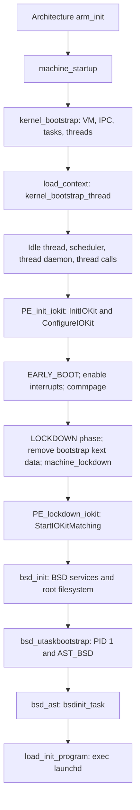

# Boot to PID 1

[Platform overview](README.md) · [CPU execution](execution.md) · [CPU power lifecycle](cpu-power-lifecycle.md)

## Choose the compiled entry path first

`osfmk/conf/files.arm64` selects `arm64/start.s`, `arm/arm_init.c`, and `arm64/arm_vm_init.c` for `config_pmap_ppl`; `config_sptm` selects `arm64/sptm/start_sptm.s` and `arm_init_sptm.c`. Both define architecture startup symbols and converge on `machine_startup()` and then `kernel_bootstrap()`. Read one branch end to end before comparing them. [`files.arm64`](../../../xnu/osfmk/conf/files.arm64#L10), [`machine_startup()`](../../../xnu/osfmk/arm64/machine_routines.c#L515).

`boot_args` provides `virtBase`, `physBase`, memory sizes, `topOfKernelData`, video information, flattened device-tree pointer/length, command line, and flags. These are inputs from the previous boot stage, not objects constructed by normal Mach VM allocation. Bootloader code is outside this checkout. [`arm64/boot.h`](../../../xnu/pexpert/pexpert/arm64/boot.h#L50).

In the PPL-selected assembly, `_start` reaches `start_first_cpu()`. The cold path masks interrupts, reads boot arguments, initializes thread-pointer registers and exception/interrupt stacks, constructs bootstrap translation tables, and reaches `common_start` to establish translation and branch to C. Initial identity and kernel-virtual mappings allow execution to cross the physical-to-virtual transition. The source contains integrity/hardware-specific register paths; these are not one fixed register sequence for every ARM64 target. [`start.s`, entry](../../../xnu/osfmk/arm64/start.s#L231), [`cold initialization`](../../../xnu/osfmk/arm64/start.s#L468), [`common_start`](../../../xnu/osfmk/arm64/start.s#L645).

The SPTM `_start` instead receives a reason sentinel, ordinary boot arguments, and SPTM bootstrap arguments. It distinguishes cold, warm/secondary/hibernate, and monitor-panic entry. Cold entry establishes stacks, rebases/signs the image, initializes static branches, installs XNU exception vectors, and signals `SPTM_FUNCTIONID_FIXUPS_COMPLETE` before entering `arm_init()` (or the KASAN preinitializer). The executable-region transition is a monitor contract described by the XNU caller; its monitor implementation is absent. [`start_sptm.s`](../../../xnu/osfmk/arm64/sptm/start_sptm.s#L35).

## C initialization builds the environment for ordinary kernel code

Both `arm_init()` implementations preserve boot arguments, initialize `BootCpuData`, and call `PE_init_platform(FALSE, args)` to establish early platform/device-tree access. They parse CPU topology, identify the boot CPU, attach a bootstrap thread to its CPU data, establish early timekeeping, run `kernel_startup_bootstrap()`, initialize timer calls and CPU/processor state, and call `arm_vm_init()`. The boot CPU's logical number is discovered; it is not assumed to be zero. [`arm_init.c`](../../../xnu/osfmk/arm/arm_init.c#L349), [`arm_init_sptm.c`](../../../xnu/osfmk/arm64/sptm/arm_init_sptm.c#L752).

SPTM initialization also preserves monitor arguments and uses their `first_avail_phys`, rather than the bootloader's `topOfKernelData`, because preceding components have consumed pages. Its VM initialization adopts the monitor-provided root-table physical address and physical-aperture range. The legacy implementation establishes its own later kernel mappings. After VM setup, both paths initialize console/platform interrupts, timebase/CPU facilities, optional hibernation support, and the stack guard, then call `machine_startup()`. [`SPTM argument adoption`](../../../xnu/osfmk/arm64/sptm/arm_init_sptm.c#L774), [`SPTM arm_vm_init()`](../../../xnu/osfmk/arm64/sptm/arm_init_sptm.c#L1771), [`legacy late initialization`](../../../xnu/osfmk/arm/arm_init.c#L590).

## STARTUP is an ordered registry, interleaved with explicit calls

`STARTUP(subsystem, rank, function)` emits a `startup_entry` containing subsystem, rank, callback, and argument in a linker section. `kernel_startup_bootstrap()` sorts entries by subsystem and rank and runs through `STARTUP_SUB_LOCKS`, covering tunables/timeouts/locks. Later `kernel_startup_initialize_upto()` calls advance a single cursor through successive phases. Equal subsystem/rank entries compare equal: do not infer a dependency order between them from source-file order. [`startup.h`](../../../xnu/osfmk/kern/startup.h#L236), [`startup_entry`](../../../xnu/osfmk/kern/startup.h#L862), [`sorting`](../../../xnu/osfmk/kern/startup.c#L245), [`phase execution`](../../../xnu/osfmk/kern/startup.c#L459).

`kernel_bootstrap()` first calls `vm_mem_bootstrap()`, advances startup through logging and Mach IPC, activates the kernel pmap, initializes machine and clocks, and creates task/thread/runtime facilities. Conditional calls include MAC policy, thread groups, coalitions, sanitizers, and scheduler features. It then creates `kernel_bootstrap_thread`, marks it runnable, and calls `load_context()`. This is the transition from the special early execution environment to a normal kernel thread and stack. [`startup.c`](../../../xnu/osfmk/kern/startup.c#L521), [`load_context()`](../../../xnu/osfmk/kern/startup.c#L1029).

The diagram is the ARM64 path with `IOKIT` and `MACH_BSD` enabled; additional conditional stages are omitted. `kernel_bootstrap_thread()` creates the boot processor's idle thread, starts scheduler services and thread maintenance, runs thread-call initialization, binds to the boot processor during CPU startup, and creates clock/device services. I/O Kit initialization occurs before `spllo()` enables interrupts. General driver matching is deliberately delayed until after `machine_lockdown()` on ARM. [`startup.c`](../../../xnu/osfmk/kern/startup.c#L704), [`PE_init_iokit()`](../../../xnu/pexpert/arm/pe_init.c#L272), [`PE_lockdown_iokit()`](../../../xnu/pexpert/arm/pe_init.c#L410).

`InitIOKit()` initializes I/O Kit/libkern infrastructure, creates the `IOPlatformExpertDevice` root nub from the device tree, and attaches it. `ConfigureIOKit()` applies defaults; `StartIOKitMatching()` starts its matching process. These distinct stages explain why “I/O Kit initialized” does not imply all devices have matched or started. Continue with [drivers](../drivers/README.md) for those asynchronous lifecycles. [`IOStartIOKit.cpp`](../../../xnu/iokit/Kernel/IOStartIOKit.cpp#L134).

## BSD and the first userspace process

`bsd_init()` links `kernel_task` to `kernproc`, establishes process-zero credentials and state, initializes VFS/networking and other configured BSD facilities, performs autoconfiguration, mounts the root filesystem, and establishes its root vnode. It initializes signal state and calls `bsd_utaskbootstrap()`. Root selection and optional image/netboot branches precede process-one creation. [`bsd_init.c`, initial state](../../../xnu/bsd/kern/bsd_init.c#L485), [`root mount`](../../../xnu/bsd/kern/bsd_init.c#L878), [`bootstrap call`](../../../xnu/bsd/kern/bsd_init.c#L1046).

`bsd_utaskbootstrap()` calls `cloneproc(TASK_NULL, NULL, kernproc, CLONEPROC_INITPROC)`, obtains the reference to PID 1, clears transition locks, and sets `AST_BSD` on the new thread. It sets up the map/control-port defaults, enables task IPC, and clears the task's return wait. On that thread's BSD AST, the one-time `bsd_init_done` branch invokes `bsdinit_task()`. That routine names the process `init`, installs exception-to-signal reflection, performs pre-launchd VM initialization, and invokes `load_init_program()`. Creation and executable loading therefore occur at distinct execution points. [`bsd_utaskbootstrap()`](../../../xnu/bsd/kern/bsd_init.c#L1173), [`bsd_ast()` tail](../../../xnu/bsd/kern/kern_sig.c#L3467), [`bsdinit_task()`](../../../xnu/bsd/kern/bsd_init.c#L1083).

`load_init_program()` allocates scratch user memory and tries configured executable candidates. Release selection reaches `/sbin/launchd`; debug/development builds can try internal variants or `launchdsuffix`. A successful `load_init_program_at_path()` returns after loading the program; exhaustion panics. See [process lifecycle](../processes/README.md) and [VFS](../vfs/README.md) for executable loading and path resolution. [`kern_exec.c`](../../../xnu/bsd/kern/kern_exec.c#L8040).

## x86_64 comparison

The x86 bootstrap includes a 32-bit protected-mode entry that establishes page tables and transitions to long mode, then enters `vstart()`. `vstart()` separates boot and secondary CPUs, performs early table/CPU setup, and invokes `i386_init()` or `i386_init_slave()` on the selected stack. `i386_init()` establishes clocks/CPU state, calls `i386_vm_init()`, attaches a bootstrap thread, and enters its architecture `machine_startup()`, which also calls common `kernel_bootstrap()`. Do not apply ARM's monitor arguments, exception stacks, or TTBR setup to this path. [`x86 start.s`](../../../xnu/osfmk/x86_64/start.s#L124), [`vstart()`](../../../xnu/osfmk/i386/i386_init.c#L693), [`i386_init()`](../../../xnu/osfmk/i386/i386_init.c#L840), [`machine_startup()`](../../../xnu/osfmk/i386/AT386/model_dep.c#L302).

The I/O Kit timing differs too: x86 `PE_init_iokit()` starts matching immediately because pre-lockdown work needs CPU enumeration through the ACPI stack. Its later `PE_lockdown_iokit()` waits for the CPU count to be established. The ARM matching-after-lockdown diagram above must not be applied unchanged to x86. [`pexpert/i386/pe_init.c`](../../../xnu/pexpert/i386/pe_init.c#L188).
