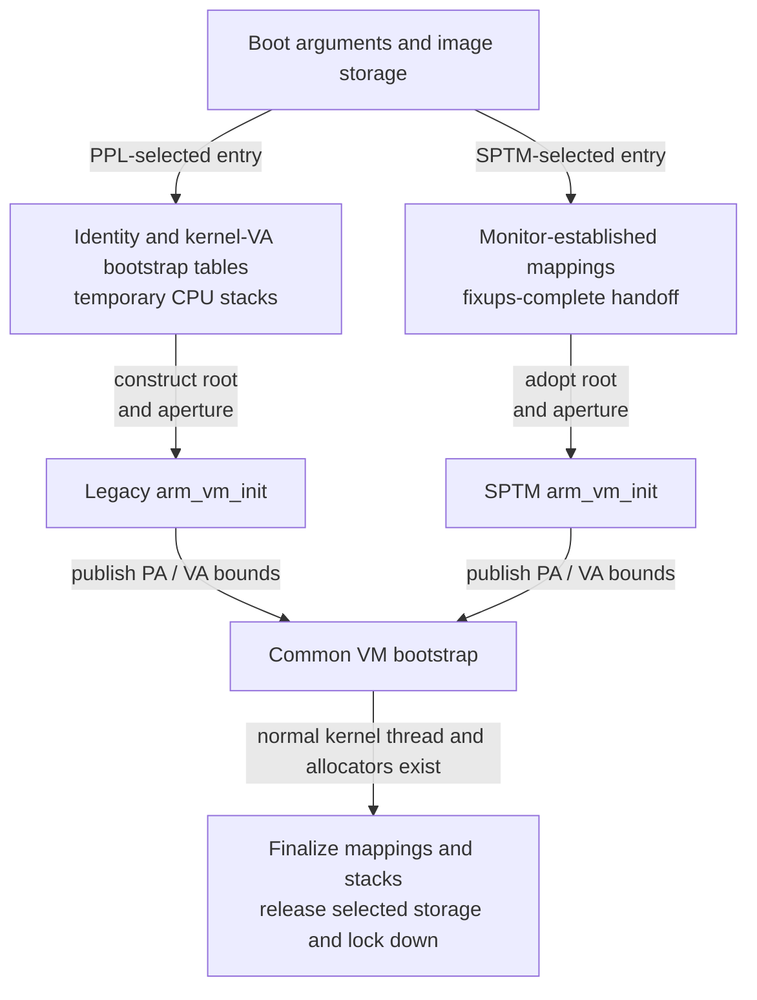
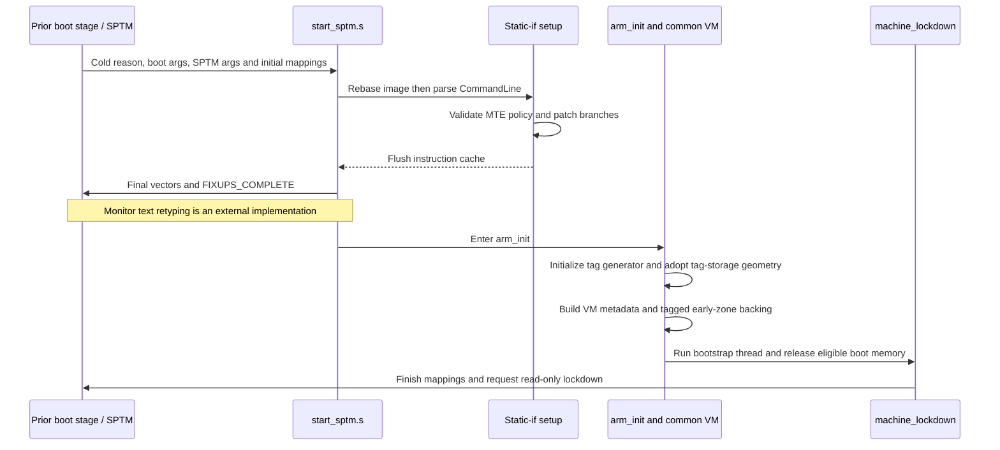
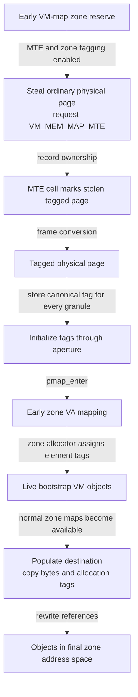
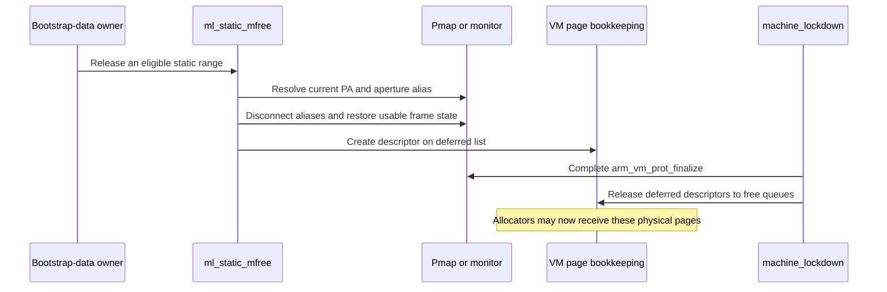

# ARM64 bootstrap memory, ownership and lockdown

[Platform overview](README.md) · [Boot to PID 1](boot.md) · [ARM64 pmap](../vm/pmap-arm64.md) · [Kernel allocation](../vm/kernel-allocation.md) · [MTE storage and page lifetime](../vm/mte-tag-storage-and-page-lifecycle.md) · [SPTM](../security/sptm.md)

Before the kernel can allocate an ordinary object, it needs page tables, physical-page descriptors, maps and zones. Those facilities themselves require memory. ARM64 startup breaks that dependency cycle using image-resident storage, physical allocation cursors and an early mapping allocator. Later, it replaces temporary CPU stacks, releases selected image/boot memory and makes protected state immutable. This chapter follows those ownership changes and the MTE controls established around them. Memory Tagging Extension support adds a second bootstrap requirement: before an allocator can return a checked pointer, its data pages need tag-capable mappings and allocation-tag backing, and each CPU needs the appropriate checking and tag-generator state. The [MTE page-lifetime companion](../vm/mte-tag-storage-and-page-lifecycle.md) follows allocation, retagging, faults and reclamation after these prerequisites exist.

The two local ARM64 boot implementations are selected separately: the `config_pmap_ppl` source set includes `start.s`, `arm_init.c` and `arm_vm_init.c`; the `config_sptm` set includes `start_sptm.s` and `arm_init_sptm.c`. Common VM bootstrap follows both. “Legacy” below means the non-SPTM implementation, with further PPL/integrity guards identified where relevant. It does not mean that every branch in that file is active in one product. [Build selection](../../../xnu/osfmk/conf/files.arm64#L10-L36).

## 1. Boot arguments describe supplied memory; they do not allocate it

The bootloader supplies the ordinary `boot_args`. The record describes the initial address/size inputs; it is not recovered from a running VM map. [boot.h:50–65](../../../xnu/pexpert/pexpert/arm64/boot.h#L50-L65):

<!-- source-excerpt: ../../../xnu/pexpert/pexpert/arm64/boot.h#L50-L65 -->
```c
typedef struct boot_args {
	uint16_t                Revision;                       /* Revision of boot_args structure */
	uint16_t                Version;                        /* Version of boot_args structure */
	uint64_t                virtBase;                       /* Virtual base of memory */
	uint64_t                physBase;                       /* Physical base of memory */
	uint64_t                memSize;                        /* Size of memory */
	uint64_t                topOfKernelData;        /* Highest physical address used in kernel data area */
	Boot_Video              Video;                          /* Video Information */
	uint32_t                machineType;            /* Machine Type */
	void                    *deviceTreeP;           /* Base of flattened device tree */
	uint32_t                deviceTreeLength;       /* Length of flattened tree */
	char                    CommandLine[BOOT_LINE_LENGTH];  /* Passed in command line */
	uint64_t                bootFlags;              /* Additional flags specified by the bootloader */
	uint64_t                memSizeActual;          /* Actual size of memory */
} boot_args;

```

| Quantity | Domain and use |
|---|---|
| `virtBase`, `physBase` | The initial kernel virtual/physical relationship. Early affine conversion is valid only within that bootstrap mapping contract. |
| `memSize` | Managed physical span supplied to the architecture initialization path, subject to page alignment and configured overrides. |
| `memSizeActual` | Total memory reporting input, which may differ from the managed span. |
| `topOfKernelData` | Physical boundary after boot/kernel data in the legacy path. It is not a virtual allocation result. |
| `deviceTreeP`, `deviceTreeLength` | Borrowed boot description, used to discover memory-map entries, kernel-collection ranges and other platform inputs. |
| `SPTMArgs->first_avail_phys` | SPTM's later physical consumption boundary; overrides the temptation to start at the older `topOfKernelData`. |
| `SPTMArgs->physmap_base/end`, root-table address | Monitor-established physical-aperture VA range and translation-root PA adopted by XNU. |

The SPTM `arm_init()` copies both argument records into late-read-only storage. It explicitly uses the monitor's first available physical address because SPTM and other components have consumed pages after the bootloader's boundary. A copied record preserves the values; it does not transfer ownership of every referenced region into the allocator. [Argument adoption](../../../xnu/osfmk/arm64/sptm/arm_init_sptm.c#L767-L781), [physical aperture/root adoption](../../../xnu/osfmk/arm64/sptm/arm_init_sptm.c#L1830-L1860).

Image segments add another set of intervals. `arm_vm_init()` discovers Mach-O ranges for text, constant data, bootstrap data, link information and prelinked images. `arm_vm_prot_init()` expands the low image boundary for kernel-collection headers and selected device-tree/trust-cache data. The TrustCache entry is a physical-address/length record with size and placement checks. SPTM also imports auxiliary-collection boundaries; the legacy path constructs/protects local mappings. These ranges prevent “everything before the free cursor” from being treated as one homogeneous disposable buffer. [Legacy segment/protection setup](../../../xnu/osfmk/arm64/arm_vm_init.c#L1269-L1395), [SPTM segment boundaries](../../../xnu/osfmk/arm64/sptm/arm_init_sptm.c#L1507-L1607).

Bootloader allocation, firmware carveout policy and monitor-internal image validation are not supplied by these consumers. Where XNU checks supplied relationships, the chapter explains those checks; it does not reconstruct how the prior stage selected the addresses.

## 2. First translations and stacks precede ordinary kernel allocation

### Legacy/PPL-selected cold entry

`start_first_cpu()` masks interrupts, keeps the boot-argument PA in `x20`, loads initial virtual/physical bases into `x22/x23`, and uses `x25` for the bootstrap-table storage. It computes virtual stack addresses from the initial base relationship, installs the exception stack in SP_EL1 and the interrupt stack in SP_EL0, and prepares `lr` as the virtual address of `arm_init()`. These are temporary CPU stacks, not ordinary thread stacks allocated by `kmem_alloc()`. [Register and stack preparation](../../../xnu/osfmk/arm64/start.s#L468-L523).

It then creates a V=P identity mapping for the running transition and a kernel-virtual mapping of the image/memory span. The macro allocates additional L2 tables as required while advancing VA/PA cursors and the free table pointer. The earlier “four pages” explanatory comment is not a universal allocation count: the later implementation explicitly reserves two L1 roots and a variable number of L2 pages, bounded by the bootstrap storage configuration. The code also adjusts its bases to avoid mapping memory before the kernel-cache header. [Mapping macro](../../../xnu/osfmk/arm64/start.s#L427-L459), [base adjustment and variable tables](../../../xnu/osfmk/arm64/start.s#L574-L624), [image-resident table buffer](../../../xnu/osfmk/arm64/arm_vm_init.c#L79-L87).

`common_start` programs the translation regime and table bases, cache attributes and vector address, then enables translation/caches through SCTLR and continues at the prepared virtual C entry. Warm/secondary paths have different inputs and can select an already-established `cpu_ttep`; they must not be described as rebuilding the cold VM state. [Translation setup](../../../xnu/osfmk/arm64/start.s#L645-L725), [vectors/SCTLR and C argument](../../../xnu/osfmk/arm64/start.s#L726-L814).

### SPTM cold entry

The SPTM entry receives a reason in `x0`, ordinary boot arguments in `x1` and monitor arguments in `x2`. Cold startup installs the supplied image's temporary stack addresses, preserves the argument pointers in `x26/x27`, rebases/signs absolute addresses and initializes static branches. It sets XNU vectors before issuing `SPTM_FUNCTIONID_FIXUPS_COMPLETE`. The local comments identify the initial executable region and monitor transition; the source does not contain the monitor's page-table construction or protected-register enforcement. [Entry contract](../../../xnu/osfmk/arm64/sptm/start_sptm.s#L35-L70), [cold setup and handoff](../../../xnu/osfmk/arm64/sptm/start_sptm.s#L121-L176).

Do not transplant the legacy TTBR-writing sequence into this route. SPTM `arm_vm_init()` adopts the monitor root via `libsptm_state.root_table_paddr`; it does not construct that root with the legacy `alloc_ptpage(TRUE)` sequence. [Adopted root](../../../xnu/osfmk/arm64/sptm/arm_init_sptm.c#L1852-L1860).




### MTE needs a tagged pointer, tagged storage and a checking execution context

MTE compares a pointer's logical tag with the allocation tag of the addressed 16-byte granule on a checked memory access. The two tags serve different roles: a pointer carries the caller's expectation, while the backing tags describe the current allocation. Retagging storage on allocation or reuse can therefore make a stale pointer fail even when its virtual address still maps valid RAM. It can also detect an access crossing into a differently tagged neighbor. The tag is only four bits, and the implementation describes neighboring-tag exclusion as a best effort; this is not complete bounds checking or proof that every stale pointer fails. [Granule and storage ratio](../../../xnu/osfmk/arm64/mte.h#L66-L68), [tagging both pointer and memory](../../../xnu/osfmk/arm64/mte.c#L98-L151).

Boot must establish several independent pieces. Their presence must not be inferred from a single `HAS_MTE` test:

| Piece | Concrete representation | What it establishes |
|---|---|---|
| Compiled platform support | `HAS_MTE`; H17 also sets `NEEDS_MTE_IRG_RESEED` | MTE instructions, structures and branches exist in this binary. It does not select every allocation for tagging. |
| XNU boot policy | `mte_kern_enabled()`, `mte_kern_data_enabled()`, `mte_user_enabled()`, `mte_user_data_enabled()` | Which kernel/user allocation policies are allowed to request tagging. |
| Translation and storage | Tagged-memory attribute index, page/frame type, physical tag-storage region, VM cell metadata | The access can reach allocation tags belonging to a valid backing lifetime. |
| Per-CPU execution state | SCTLR/TCR controls, `PSTATE.TCO`, `GCR_EL1`, `RGSR_EL1` | Checking permissions/override and the generator/exclusion state used when producing new tags. |
| Per-task/per-map policy | Task opt-in, pmap root configuration, thread controls | Whether a particular user task can use tags; boot-level user support alone does not opt in every process. |

[Platform feature declarations](../../../xnu/pexpert/pexpert/arm64/H17.h#L53-L66), [XNU policy predicates](../../../xnu/osfmk/arm64/mte_xnu.h#L61-L80), [root configuration](../../../xnu/osfmk/arm64/sptm/pmap/pmap.c#L12164-L12174). Follow the [MTE companion](../vm/mte-tag-storage-and-page-lifecycle.md) for the task/map and allocation decisions.

### Build selection, boot policy and feature reporting are different checks

In this snapshot, H17's header defines both `HAS_MTE` and the reseeding requirement. Board configurations including that header supply the compile-time capability; for example T8142 and T6050 do so explicitly. These are source configuration names, not a claim about every shipped device or OS configuration. [H17](../../../xnu/pexpert/pexpert/arm64/H17.h#L53-L66), [T8142](../../../xnu/pexpert/pexpert/arm64/board_config.h#L208-L215), [T6050](../../../xnu/pexpert/pexpert/arm64/board_config.h#L280-L295).

The boot-policy matrix below applies only inside a `HAS_MTE` build. The bit values and defaults come from [mte_xnu.h:40–94](../../../xnu/osfmk/arm64/mte_xnu.h#L40-L94); the consuming body is [mte_config_setup()](../../../xnu/osfmk/arm64/sptm/arm_init_sptm.c#L270-L326).

| Configuration | Local XNU behavior |
|---|---|
| Release, without the debug/development/KASAN branch | All four enablement predicates are inline functions returning `true`. The local debug boot-argument parser is not compiled. This describes XNU's policy source, not an externally supplied monitor setting. |
| Development/debug default | `mte_config` defaults to `0xF`: kernel, kernel pure data, user, user pure data. `mte_debug` defaults to zero. |
| Development/debug explicit mask | `0x1` enables kernel tagging, `0x2` extends it to kernel pure data, `0x4` enables user support, `0x8` extends it to user pure data. The mask replaces the default; it is not a set of extra bits added to `0xF`. |
| Pure-data bit without its parent bit | Kernel-data-without-kernel or user-data-without-user panics during setup. |
| `-disable_mte` recognized by this parser | Both masks become zero, overriding the parsed masks. The header says iBoot and SPTM also honor this argument, but those consumers are not supplied here. |
| KASAN | The same setup body forcibly zeros both masks, even if boot arguments requested MTE. The local comment states that KASAN does not yet support MTE. |
| `mte_debug` | Bits `0x1`, `0x2`, `0x4`, `0x8` request force-all-user, TCO-state debugging, panic on noncanonical API input and panic on software-asynchronous faults respectively. These are distinct from ordinary checking enablement. |

The forcing and validation branches are worth reading together. [osfmk/arm64/sptm/arm_init_sptm.c:292–315](../../../xnu/osfmk/arm64/sptm/arm_init_sptm.c#L292-L315):

<!-- source-excerpt: ../../../xnu/osfmk/arm64/sptm/arm_init_sptm.c#L292-L315 -->
```c
	/* -disable_mte is the legacy big hammer that switches off all of MTE */
	if (static_if_boot_arg_uint64(args, "-disable_mte", 0)) {
		mte_config = MTE_CONFIG_DISABLE_ALL;
		mte_debug_config = MTE_DEBUG_DISABLE_ALL;
	}
#if KASAN
	/* Until KASAN supports MTE, force disable. */
	mte_config = MTE_CONFIG_DISABLE_ALL;
	mte_debug_config = MTE_DEBUG_DISABLE_ALL;
#endif /* KASAN */

	MTE_EVAL_BOOTARG(MTE_ENABLE_KERNEL, mte_config, mte_config_kern_enabled);
	MTE_EVAL_BOOTARG(MTE_ENABLE_KERNEL_PURE_DATA, mte_config, mte_config_kern_data_enabled);
	MTE_EVAL_BOOTARG(MTE_ENABLE_USER, mte_config, mte_config_user_enabled);
	MTE_EVAL_BOOTARG(MTE_ENABLE_USER_PURE_DATA, mte_config, mte_config_user_data_enabled);

	/* Panic on invalid configurations. */
	if (mte_kern_data_enabled() && !mte_kern_enabled()) {
		panic("Kernel DATA tagging requires kernel tagging");
	}

	if (mte_user_data_enabled() && !mte_user_enabled()) {
		panic("User DATA tagging requires user tagging");
	}
```

There is a source-level qualification to the user-only example in the header. It advertises `mte_config=0x4`, but immediately below the predicates the implementation defines `mte_enabled()` as **only** `mte_kern_enabled()`, with a comment saying user-only operation is not expected to be deployed. Common tag-storage initialization uses that alias. Consequently the mask is expressible in the debug parser, but the local source does not justify advertising it as an independently verified boot mode. [Example and limitation](../../../xnu/osfmk/arm64/mte_xnu.h#L47-L51), [alias](../../../xnu/osfmk/arm64/mte_xnu.h#L145-L150), [storage initialization guard](../../../xnu/osfmk/arm64/sptm/pmap/pmap.c#L2421-L2488).

Feature reporting is separate again. `commpage_init_arm_optional_features_pfr1()` decodes the architectural MTE version and related fields into `gARM_FEAT_MTE`, MTE2/3/4 and ASYNC indicators; PFR2 reports store-only support, and a later helper derives canonical/no-address-tag feature indicators from MTE4. These values describe reported CPU features. They do not replace the build guard, boot policy, allocator choice or task admission path. [PFR1/PFR2 reporting](../../../xnu/osfmk/arm/commpage/commpage.c#L662-L692), [derived features](../../../xnu/osfmk/arm/commpage/commpage.c#L825-L835).

### The policy is fixed during the writable-text fixup window

SPTM cold entry calls `arm_static_if_init()` after rebasing the image and before setting final vectors and making `SPTM_FUNCTIONID_FIXUPS_COMPLETE`. The C wrapper passes `boot_args.CommandLine` directly to `static_if_init()`. That initializer links each key to its patch sites, invokes registered callbacks including `mte_config_setup()`, and flushes the instruction cache. On ARM64, a changed static condition becomes a branch or NOP instruction at its patch point. This is how a boot choice becomes a cheap hot-path condition rather than a continually writable global switch. [Entry ordering](../../../xnu/osfmk/arm64/sptm/start_sptm.s#L140-L165), [command-line wrapper](../../../xnu/osfmk/arm64/sptm/arm_init_sptm.c#L383-L388), [initializer](../../../xnu/osfmk/kern/static_if_common.c#L249-L270), [instruction patcher](../../../xnu/osfmk/arm64/static_if.c#L37-L84).

`__static_if_key_delta()` rejects changes once `startup_phase >= STARTUP_SUB_TUNABLES`; its comment also identifies the earlier SPTM text retyping boundary. `FIXUPS_COMPLETE` and the much later `machine_lockdown()` are therefore distinct security milestones. The former closes the local text-fixup window; the latter finishes read-only data/mapping preparation. Neither is a license to modify MTE boot policy at runtime. [Timing guard and patch traversal](../../../xnu/osfmk/kern/static_if_common.c#L273-L311).



The sequence shows dependency order, not every intervening startup call. In particular, the monitor supplies initial translation state before XNU's generator and VM bookkeeping are ready.

### Register controls: what is visible and what belongs to SPTM

The local header defines an MTE-specific control bundle selecting tag access and synchronous checking for both EL1 and EL0. A definition alone does not establish where that bundle is written: [osfmk/arm64/proc_reg.h:601–602](../../../xnu/osfmk/arm64/proc_reg.h#L601-L602):

<!-- source-excerpt: ../../../xnu/osfmk/arm64/proc_reg.h#L601-L602 -->
```c
#define SCTLR_EXTRA               (SCTLR_ATA_ENABLED | SCTLR_ATA0_ENABLED | SCTLR_TCF_SYNC | SCTLR_TCF0_SYNC)
#define SCTLR_MTE_CONFIG          SCTLR_EXTRA
```

| Control | Local encoding or action | Keep separate from |
|---|---|---|
| `SCTLR_EL1.ATA` / `ATA0` | Allocation-tag access enable bits for EL1/EL0. | Whether a specific task/root permits user tag access. |
| `SCTLR_EL1.TCF` / `TCF0` | The MTE-specific bundle selects synchronous checks; asynchronous/asymmetric encodings also exist as definitions. | XNU's software-asynchronous fault handling, which is not proof that hardware TCF was set to asynchronous. |
| `TCR_EL1.MTX0` / `MTX1` | `HAS_MTE` adds both to `TCR_EL1_EXTRA`, incorporated into the base translation-control constants. | Per-granule allocation tags or PTE attribute selection; MTX bits are CPU translation controls. |
| `MAIR_EL1`, index 4 | `CACHE_ATTRINDX_MTE` aliases reserved index `0x4`; its tagged-normal-writeback encoding is **`0xF0`**. | A physical allocation tag. The number 4 is the PTE attribute selector, not the allocation tag or MAIR byte value. |
| `PSTATE.TCO` | `1` overrides checking; `0` permits checking under the rest of the configuration. | Tag access permission and tag storage allocation. |
| `GCR_EL1` | Exclusion mask and `RRND` generator mode. | Current allocation tags in memory. |
| `RGSR_EL1` | Generator seed/state. | A per-object tag, task identity or VM-cell counter. |

[TCF/access definitions](../../../xnu/osfmk/arm64/proc_reg.h#L582-L608), [MTX/base composition](../../../xnu/osfmk/arm64/proc_reg.h#L1028-L1039), [base constants](../../../xnu/osfmk/arm64/proc_reg.h#L1138-L1153), [MAIR value](../../../xnu/osfmk/arm64/proc_reg.h#L1743-L1759), [index alias](../../../xnu/osfmk/arm64/proc_reg.h#L1808-L1810), [GCR/RGSR fields](../../../xnu/osfmk/arm64/proc_reg.h#L3423-L3463).

The legacy `start.s` contains a conditional write of the tagged MAIR byte into slot 4, then writes MAIR and invalidates translations. It also writes `TCR_EL1_BOOT` and `SCTLR_EL1_DEFAULT`. However, the local `SCTLR_EL1_REQUIRED`/`OPTIONAL`/`DEFAULT` composition does **not** include `SCTLR_EXTRA`, and no local use of `SCTLR_MTE_CONFIG` supplies that missing link. Therefore the legacy SCTLR-default write is not evidence that this file enables MTE checking. The MAIR/TCR writes describe **that selected entry implementation**, not an instruction sequence performed by `start_sptm.s`. [Actual SCTLR default composition](../../../xnu/osfmk/arm64/proc_reg.h#L752-L765). In the SPTM route, XNU adopts the root/aperture and says SPTM owns system-register locking; the actual initialization/enforcement of those protected controls is outside this checkout. [Legacy MAIR write](../../../xnu/osfmk/arm64/start.s#L678-L706), [legacy SCTLR write](../../../xnu/osfmk/arm64/start.s#L746-L760), [SPTM responsibility](../../../xnu/osfmk/arm64/machine_routines.c#L562-L568).

Likewise, `proc_reg.h` describes `MTE_TAG_OFFSET_EL2`, a physically contiguous tag array aligned to 1 MiB and a lock bit, but this tree supplies no programming body for that register. The local evidence is a register contract plus XNU's consumption of `first_tag_storage_paddr`/`n_tag_storage_frames`; it is not evidence that XNU writes the EL2 register itself. [Tag-offset definition](../../../xnu/osfmk/arm64/proc_reg.h#L3409-L3421), [SPTM geometry adoption](../../../xnu/osfmk/arm64/sptm/pmap/pmap.c#L2421-L2438).

### Initial tag randomness is per CPU and precedes tagged allocator use

`arm_init()` calls `arm_mte_tag_generator_init(true)` before entering the later VM/bootstrap phases. For a physical platform, `have_apple_mte_tag_generator` is a compile-time true constant. On `APPLEVIRTUALPLATFORM`, the boot CPU inspects `AIDR_EL1.MTEVER` and sets a late-read-only flag only for the recognized version. This probe selects generator behavior; it is not a general runtime discovery mechanism that inserts the MTE implementation into a binary compiled without it. [Boot call](../../../xnu/osfmk/arm64/sptm/arm_init_sptm.c#L969-L975), [generator selection](../../../xnu/osfmk/arm64/machine_routines.c#L3222-L3262).

`arm_mte_random_rgsr_el1_seed()` obtains `early_random()`, masks it to the supported seed field, forces three low seed bits in Apple-generator mode, and retries a zero seed in the other mode. The documented reason is concrete: a zero LFSR seed would produce an endless zero stream. Initialization sets `GCR_EL1.RRND` when using the Apple generator and then writes the seed. The source explicitly relies on RGSR's ordering contract rather than adding a barrier between those writes. [osfmk/arm64/machine_routines.c:3271–3278](../../../xnu/osfmk/arm64/machine_routines.c#L3271-L3278):

<!-- source-excerpt: ../../../xnu/osfmk/arm64/machine_routines.c#L3271-L3278 -->
```c
	if (have_apple_mte_tag_generator) {
		uint64_t gcr_el1 = __builtin_arm_rsr64("GCR_EL1");
		gcr_el1 |= GCR_EL1_RRND;
		__builtin_arm_wsr64("GCR_EL1", gcr_el1);
	}

	uint64_t seed = is_boot_cpu ? arm_mte_random_rgsr_el1_seed() : getCpuDatap()->mte_rgsr_el1_seed;
	__builtin_arm_wsr64("RGSR_EL1", seed);
```

This mitigates predictable tag selection; it does not turn the four-bit tag into a cryptographic identity. The later reseeding path exists precisely because the platform's tag generator is not treated as a sufficient long-lived source of unpredictability.

## 3. Early table allocation is a physical cursor or image reservation

The legacy `alloc_ptpage(map_static)` returns a **virtual address**. Integrity configurations can satisfy static tables from `ropagetable_begin..ropagetable_end`, an image-resident area that will become read-only. Otherwise it converts `avail_start` to a physical-aperture pointer and increments the **physical cursor** by `ARM_PGBYTES`. It neither asks a zone for an object nor removes a `vm_page` from the free queue. Without the relevant integrity configuration, the static request is forced to the dynamic cursor route. [Legacy allocator](../../../xnu/osfmk/arm64/arm_vm_init.c#L449-L486).

The SPTM helper with the same general role returns a **physical address**, accepts a table level, and calls `sptm_retype(..., XNU_PAGE_TABLE, ...)`. The level is part of the frame-conversion request. The similarly named functions are therefore not interchangeable APIs. [SPTM allocator](../../../xnu/osfmk/arm64/sptm/arm_init_sptm.c#L1698-L1744).

The SPTM dynamic branch and frame-type publication are visible in [arm_init_sptm.c:1728–1740](../../../xnu/osfmk/arm64/sptm/arm_init_sptm.c#L1728-L1740):

<!-- source-excerpt: ../../../xnu/osfmk/arm64/sptm/arm_init_sptm.c#L1728-L1740 -->
```c
	} else {
		/* This is a RW allocation. Simply grab a page from [avail_start] */
		paddr = avail_start;
		avail_start += ARM_PGBYTES;
	}

	/* Retype the page to XNU_PAGE_TABLE, with the desired level */
	sptm_retype_params_t retype_params;
	retype_params.level = level;
	sptm_retype(paddr, XNU_DEFAULT, XNU_PAGE_TABLE, retype_params);

	return paddr;
}
```

`ARM_PGBYTES` is the hardware table-page granule in these helpers. Later VM ownership uses `PAGE_SIZE`, the software page size. Both `arm_vm_init()` implementations round the final free physical start **up** to a software-page boundary and the managed end **down** so VM never claims a partial page. An assumed “4 KiB everywhere” calculation would be wrong for the 16 KiB configurations and for test configurations with differing software/hardware sizes. [SPTM managed-end calculation](../../../xnu/osfmk/arm64/sptm/arm_init_sptm.c#L1785-L1800), [SPTM final cursor](../../../xnu/osfmk/arm64/sptm/arm_init_sptm.c#L2166-L2176), [legacy final cursor](../../../xnu/osfmk/arm64/arm_vm_init.c#L2383-L2394).

### The permanent root and physical aperture change address assumptions

Legacy initialization builds `invalid_tte` and the later `cpu_tte`, establishes segment protections and dynamic VA table coverage, constructs the physical aperture, switches TTBR1 to `cpu_ttep`, installs an invalid TTBR0 and flushes translations. Only then does it set `kva_active` and recompute table pointers through `phystokv()`. [Root construction](../../../xnu/osfmk/arm64/arm_vm_init.c#L1936-L1964), [switch and pointer repair](../../../xnu/osfmk/arm64/arm_vm_init.c#L2124-L2180).

The PPL physical-aperture builder records `ptov_table_entry` intervals rather than assuming one affine VA/PA relationship forever. It maps reusable/ownership-changing regions at page granularity, slides bootstrap segments and ordinary memory into their aperture locations, adjusts an unlocked device-tree pointer, and publishes the conversion table. A later `gVirtBase/gPhysBase` subtraction on an arbitrary aperture pointer can therefore describe the wrong physical address. [Interval construction](../../../xnu/osfmk/arm64/arm_vm_init.c#L1516-L1543), [PPL aperture construction](../../../xnu/osfmk/arm64/arm_vm_init.c#L1553-L1629).

SPTM supplies its initial aperture range and root; XNU continues local bookkeeping and allocates additional table pages through monitor interfaces. Some image regions undergo a later `sptm_slide_region()` handoff during finalization. The implementation of that slide is external. Both source files retain a TODO concerning reclamation of bootstrap table memory; leaving the bootstrap root does not establish that every page once used for tables was freed. [SPTM adoption/TODO](../../../xnu/osfmk/arm64/sptm/arm_init_sptm.c#L1830-L1860), [legacy TODO](../../../xnu/osfmk/arm64/arm_vm_init.c#L1936-L1941).

## 4. Pmap stealing breaks the map/zone/page-descriptor dependency cycle

After architecture initialization, `kernel_bootstrap()` calls `vm_mem_bootstrap()`. The sequence matters: resident-page bootstrap runs before zone bootstrap; special VM objects precede map initialization; `kmem_init()` then adopts the remaining VA range and advances KMEM/ZALLOC startup. [Common bootstrap](../../../xnu/osfmk/kern/startup.c#L521-L548), [VM order](../../../xnu/osfmk/vm/vm_init.c#L106-L141).

`vm_page_bootstrap()` initializes locks and page queues, advances the `PMAP_STEAL` startup phase and allocates resident hash/lock bookkeeping through `pmap_steal_memory()`. The `vm_map_steal_memory()` startup callback reserves enough storage for early kernel/submaps and their entries/nodes before those zones can expand dynamically. With MTE it also creates cell metadata before the canonical page array. This is a deliberate bootstrapping reserve, not an ordinary late allocation of every map entry. [Resident bootstrap](../../../xnu/osfmk/vm/vm_resident.c#L2120-L2181), [early phase](../../../xnu/osfmk/vm/vm_resident.c#L2240-L2251), [hash allocations](../../../xnu/osfmk/vm/vm_resident.c#L2294-L2323), [early maps](../../../xnu/osfmk/vm/vm_map.c#L1892-L1955).

`pmap_steal_memory_internal()` maintains a VA cursor independent of `avail_start`/`first_avail`:

1. Obtain the available kernel VA interval from pmap on first use; align the request and advance `virtual_space_start`.
2. For pages of the new VA span that still need backing, obtain physical frames with `pmap_next_page_hi()` and install writable kernel translations with `pmap_enter()`.
3. Account them as stolen/wired and return the VA. The API has fatal early-allocation failure paths rather than a general rollback transaction.

Word-aligned subpage allocations can share already-backed pages. The `map_addr = round_page(addr)` start is significant: this is not one physical page unconditionally allocated per call. `pmap_steal_freeable_memory()` changes the lifetime hint; on the ARM implementations inspected, `pmap_next_page_hi()` delegates to `pmap_next_page()` and ignores that hint. It does not by itself free the returned storage. [Steal allocator](../../../xnu/osfmk/vm/vm_resident.c#L2406-L2553), [wrappers](../../../xnu/osfmk/vm/vm_resident.c#L2557-L2578), [SPTM physical cursor](../../../xnu/osfmk/arm64/sptm/pmap/pmap.c#L2520-L2547).

| Stage | Allocation identity | Later ownership |
|---|---|---|
| Image static storage | Linker-reserved bytes/table or stack symbol | Retained or explicitly jettisoned according to the segment's role. |
| `alloc_ptpage` | Hardware-granule frame from the early PA cursor, or image table reserve | Translation-table state; page-table protection/frame type follows the selected backend. |
| `pmap_steal_memory` | VA range backed by frames removed from the remaining physical cursor | Early bookkeeping/zone storage, accounted as unavailable to ordinary allocation. |
| `pmap_startup` | `vm_page` descriptors for the remaining physical span | Free/replacement queues and normal VM-page APIs become usable. |
| `kmem_init` and later allocators | VM-map ranges, objects and page ownership | Ordinary kernel allocation and teardown contracts. |

These stages overlap in initialization, but they must not be collapsed into a claim that `kalloc` was already available to build all its own prerequisites.


### Early zones explicitly acquire taggable pages instead of borrowing image DATA

The first VM-map zones exist before ordinary zone expansion. `zone_early_mem_init()` ordinarily points at `zone_early_pages_to_cram` in image DATA. With `HAS_MTE`, zone tagging selected and kernel MTE enabled, it instead calls `pmap_steal_zone_memory(size, PAGE_SIZE)`: the static DATA buffer is canonically tagged, whereas zone elements need storage whose tags may be changed independently. [Early-zone choice](../../../xnu/osfmk/kern/zalloc.c#L10252-L10287).

The specialized steal wrapper passes `VM_MEM_MAP_MTE`. For each newly obtained physical page, `pmap_steal_memory_internal()` first records stolen-tagged ownership in MTE metadata, converts the physical page to tagged use, initializes every granule to the canonical tag through the aperture pointer, and only then installs the requested VA mapping. The canonical initialization permits bootstrap code to access the storage through its initial canonical pointer; later element tagging supplies allocation-specific tags. [osfmk/vm/vm_resident.c:2515–2522](../../../xnu/osfmk/vm/vm_resident.c#L2515-L2522):

<!-- source-excerpt: ../../../xnu/osfmk/vm/vm_resident.c#L2515-L2522 -->
```c
#if HAS_MTE
		if (pmap_flags & VM_MEM_MAP_MTE) {
			mteinfo_covered_page_set_stolen_tagged(phys_page);
			pmap_make_tagged_page(phys_page);
			/* Force the canonical tag. */
			mte_store_tag((void *)phystokv(ptoa(phys_page)), PAGE_SIZE);
		}
#endif /* HAS_MTE */
```

The remainder installs the translation and increments wired/stolen counts; failures panic because this early allocator has no general transactional unwind. The default steal wrappers do not pass `VM_MEM_MAP_MTE`, so “stolen during boot” does not mean “tagged.” [Mapping/accounting](../../../xnu/osfmk/vm/vm_resident.c#L2524-L2539), [three wrappers](../../../xnu/osfmk/vm/vm_resident.c#L2556-L2579).

Later `zone_metadata_init()` relocates those early VM structures into normal zone address space. It populates tagged destination backing when configured, copies bytes with checking temporarily disabled, copies the allocation tags separately, and updates early-map pointers. A byte copy alone would preserve object contents while losing the tag contract expected by existing pointers. [Relocation order](../../../xnu/osfmk/kern/zalloc.c#L9929-L9955).



This is a bootstrap example of MTE joining the allocator lifecycle. It does not imply that all image globals, translation tables or stolen descriptors get per-allocation tags; each caller and mapping request still determines coverage.

## 5. Canonical page descriptors make the remaining frames allocatable

`pmap_startup()` estimates descriptor count from the remaining physical span and `PAGE_SIZE + sizeof(struct vm_page)`, then steals storage for the `vm_pages` array itself. On ARM with a linear array, the span matters even when retired-page holes exist. The implementation notes that this estimate does not fully include page-table memory needed to map the array. It initializes descriptors while `pmap_next_page()` supplies frames, records `vm_pages_first_pnum`, and publishes free pages through startup release rules. [Array sizing](../../../xnu/osfmk/vm/vm_resident.c#L2602-L2672), [descriptor initialization/release](../../../xnu/osfmk/vm/vm_resident.c#L2735-L2796).

For SPTM, first use of the physical cursor initializes RAM ranges and optional MTE bookkeeping boundaries; subsequent calls advance `first_avail` by software pages and decrement available capacity until `avail_end`. It does not walk a running process map. [Physical allocator](../../../xnu/osfmk/arm64/sptm/pmap/pmap.c#L2530-L2547), [MTE range adjustment](../../../xnu/osfmk/arm64/sptm/pmap/pmap.c#L2410-L2496).

The initial wire count includes memory withheld from general VM even if no ordinary object performed `vm_page_wire()` on it. It is computed from total memory and free pools with feature-specific deductions, including MTE tag storage. Later releases must repair this accounting. The code also realigns and returns the unconsumed kernel VA range to `vm_mem_bootstrap()` for `kmem_init()`. [Initial wire accounting](../../../xnu/osfmk/vm/vm_resident.c#L2356-L2382), [remaining VA publication](../../../xnu/osfmk/vm/vm_resident.c#L2818-L2830).

MTE storage is not indiscriminately put on the ordinary free queue. Startup separates active tag backing, inactive claimable storage and recursive/unmanaged storage; some special-object insertion waits until KMEM initialization. See [MTE tag storage](../vm/mte-tag-storage-and-page-lifecycle.md#3-boot-creates-metadata-before-publishing-usable-backing).

## 6. Replacing CPU boot stacks must precede releasing their segment

By `machine_lockdown()`, execution is on a normal kernel thread bound to the boot CPU, so the temporary CPU exception/interrupt stacks can be replaced while they are not active. `cpu_stack_alloc()` allocates new permanent, zeroed, guarded stacks through `kmem_alloc()` and publishes their tops/pointers into `BootCpuData`. Each allocation has a guard page on either side; it is not merely a new pointer into BOOTDATA. [Allocation and published fields](../../../xnu/osfmk/arm64/cpu.c#L767-L787), [bootstrap-thread execution](../../../xnu/osfmk/kern/startup.c#L704-L764).

`arm64_replace_bootstack()` requires that kernel-thread context. It loads the new exception-stack top, masks asynchronous exceptions, selects SP_EL1, writes the new stack pointer, returns to SP_EL0 and restores DAIF. It does **not** copy an active boot call stack. Updating SP_EL1 must also precede lockdown of sensitive instructions on the relevant integrity configurations. [Contract and assembly](../../../xnu/osfmk/arm64/machine_routines_asm.s#L1736-L1766).

The critical assembly sequence is [machine_routines_asm.s:1747–1766](../../../xnu/osfmk/arm64/machine_routines_asm.s#L1747-L1766):

<!-- source-excerpt: ../../../xnu/osfmk/arm64/machine_routines_asm.s#L1747-L1766 -->
```asm
LEXT(arm64_replace_bootstack)
	ARM64_STACK_PROLOG
	PUSH_FRAME
	// Set the exception stack pointer
	ldr		x0, [x0, CPU_EXCEPSTACK_TOP]
	mrs		x4, DAIF					// Load current DAIF; use x4 as pinst may trash x1-x3
	msr		DAIFSet, #(DAIFSC_STANDARD_DISABLE)		// Disable all asynchronous exceptions
	// Set SP_EL1 to exception stack
#if defined(KERNEL_INTEGRITY_KTRR) || defined(KERNEL_INTEGRITY_CTRR) || defined(KERNEL_INTEGRITY_PV_CTRR)
	mov		x1, lr
	bl		EXT(pinst_spsel_1)
	mov		lr, x1
#else
	msr		SPSel, #1
#endif
	mov		sp, x0
	msr		SPSel, #0
	msr		DAIF, x4					// Restore interrupt state
	POP_FRAME
	ARM64_STACK_EPILOG EXT(arm64_replace_bootstack)
```

Legacy finalization replaces the stacks before freeing the BOOTDATA backing through its aperture address and clearing obsolete image aliases. SPTM finalization replaces them before asking the monitor to slide BOOTDATA, which would remove the old stack mapping. Freeing the physical pages is a later step in both explanations. [Legacy order](../../../xnu/osfmk/arm64/arm_vm_init.c#L1683-L1713), [SPTM order](../../../xnu/osfmk/arm64/sptm/arm_init_sptm.c#L1637-L1650).


### Stack guards are separate from MTE allocation tagging

Neither `cpu_stack_alloc()`'s permanent exception/interrupt stack flags nor `stack_alloc_internal()`'s ordinary thread-stack flags include `KMA_TAG` in the inspected bodies. `KMA_KSTACK` selects the pmap `VM_MEM_STACK` path; the MTE mapping flag is selected by a separate `KMA_TAG` branch. Thus the guarded boot-stack replacement above must not be presented as automatic per-frame or per-object MTE stack protection. The code does protect the stack boundaries with guards, but compiler stack tagging and universal stack coverage are not established by these calls. [CPU stack flags](../../../xnu/osfmk/arm64/cpu.c#L767-L786), [thread-stack flags](../../../xnu/osfmk/kern/stack.c#L188-L194), [independent mapping flags](../../../xnu/osfmk/vm/vm_kern.c#L1616-L1629).

### Secondary CPUs and sleep restore generator state without rebuilding VM

Each `cpu_data_t` carries `mte_rgsr_el1_seed` and, under `NEEDS_MTE_IRG_RESEED`, `cpu_irg_reseed_counter`. The latter is initialized to zero with CPU data; these are separate from each other and from any page's allocation tag. During processor registration, the boot CPU generates a seed on behalf of each secondary: the source says secondary startup is too early to safely use the corecrypto-backed PRNG. [Fields](../../../xnu/osfmk/arm/cpu_data_internal.h#L221-L223), [saved seed](../../../xnu/osfmk/arm/cpu_data_internal.h#L294-L296), [counter initialization](../../../xnu/osfmk/arm64/cpu.c#L854-L860), [registration seed](../../../xnu/osfmk/arm64/machine_routines.c#L1740-L1750).

SPTM warm entry finds `cpu_data_t` by physical CPU ID, installs its exception/interrupt stack tops and dispatches only the expected reset handlers. `arm_init_cpu()` publishes the active thread and calls `arm_mte_tag_generator_init(false)`, which consumes the saved per-CPU seed instead of requesting new random bytes. Cold VM geometry, static policy patching and boot-zone allocation are not replayed on every secondary startup. [Warm stack/reset selection](../../../xnu/osfmk/arm64/sptm/start_sptm.s#L190-L279), [active thread and generator](../../../xnu/osfmk/arm64/sptm/arm_init_sptm.c#L1185-L1193).

The idle/WFI path saves the current `RGSR_EL1` into that same per-CPU field before entering low power. The `arm_init_cpu()` warm/resume path then restores generator state. This preserves the current generator sequence across sleep-to-RAM and hibernation; it is different from both cold seeding and boundary reseeding. [Idle capture](../../../xnu/osfmk/arm64/cpu.c#L588-L610), [generator restore selection](../../../xnu/osfmk/arm64/machine_routines.c#L3271-L3278).

The separate `arm_init_idle_cpu()` handler for non-retention WFI publishes the active thread and calls `cpu_idle_exit(TRUE)` without calling the tag-generator initializer in its local body. Do not infer that every idle exit repeats the full `arm_init_cpu()` sequence or that this source exposes all monitor-side register restoration. [Idle reset body](../../../xnu/osfmk/arm64/sptm/arm_init_sptm.c#L1345-L1381).

Hibernation reveals why mapping state matters even for a nominally free page. The early restore code may borrow a free physical page for the hibernation header. Such a page can belong to an MTE free queue and retain tagged-memory attributes, while the aperture pointer used to copy it is canonical. `arm_init_cpu()` brackets that header copy with `vm_memtag_disable_checking()` and `vm_memtag_enable_checking()`. The source comment calls this `MAIR=0x4`; read it as **attribute index 4**, whose MAIR encoding is `0xF0`. This scoped exception avoids assuming that all free pages have ordinary untagged mappings. It does not disable MTE for the rest of resume. [Reason and copy bracket](../../../xnu/osfmk/arm64/sptm/arm_init_sptm.c#L1200-L1232), [attribute index](../../../xnu/osfmk/arm64/proc_reg.h#L1753-L1759).

## 7. Static release disconnects aliases and may delay free-list publication

`ml_static_mfree(vaddr, size)` takes a virtual range and visits complete software pages. It converts each address through `kvtophys()` and then `phystokv()` to find the current physical-aperture alias. For a present translation it disconnects the page's other pmap mappings, restores an allocator-compatible physical-aperture/frame state, and creates canonical VM bookkeeping. It adjusts initial/current wired and kernel-cache counts afterward. [Release body](../../../xnu/osfmk/arm64/machine_routines.c#L2154-L2229).

`ml_static_protect()` is backend-specific. The SPTM branch retypes nondefault frames to `XNU_DEFAULT`. The legacy branch updates local permissions, rejects W+X or post-lockdown executable injection, and cannot arbitrarily change part of a block or contiguous-hint group whose permissions differ. A caller must not summarize the SPTM branch as directly editing the same PTEs as legacy. [Protection/retype split](../../../xnu/osfmk/arm64/machine_routines.c#L1953-L2052).

There is a further lifetime boundary: **a descriptor can exist before the frame is on a free queue**. Until aperture sliding has completed, `ml_static_mfree()` creates the descriptor and puts it on `ml_static_mfree_pre_slide_list`. Reusing that page too soon could leave pmap users with pointers to an aperture alias that subsequently moves. After `arm_vm_prot_finalize()` returns, `machine_lockdown()` calls `ml_release_deferred_pages()` to release that entire list; future static frees can publish immediately. [Deferred-list rationale and release](../../../xnu/osfmk/arm64/machine_routines.c#L2110-L2148), [caller order](../../../xnu/osfmk/arm64/machine_routines.c#L559-L573).

The publication choice appears in [machine_routines.c:2199–2206](../../../xnu/osfmk/arm64/machine_routines.c#L2199-L2206):

<!-- source-excerpt: ../../../xnu/osfmk/arm64/machine_routines.c#L2199-L2206 -->
```c
			if (__probable(!ml_static_mfree_queue_up)) {
				vm_page_create_canonical(ppn);
			} else {
				vm_page_t m = vm_page_create(ppn, true, Z_WAITOK);

				vm_page_list_push(&ml_static_mfree_pre_slide_list, m);
			}

```



The diagram describes a pre-finalization release. After deferred mode is disabled, the same API publishes through `vm_page_create_canonical()` directly. It is not a promise that every supplied byte is released: below-aperture requests can return early, only complete pages are visited, absent translations are skipped, and protection failure is fatal rather than silently returning unsafe memory to VM. [Checks and failure policy](../../../xnu/osfmk/arm64/machine_routines.c#L2165-L2195).

## 8. Finalization and lockdown are related but separate operations

The bootstrap thread first loads the static trust-cache interfaces, runs `STARTUP_SUB_LOCKDOWN` callbacks, and jettisons kext bootstrap data with `OSKextRemoveKextBootstrap()`. That must precede `machine_lockdown()` because it can release or relocate static mappings. General IOKit matching is unlocked afterward through `PE_lockdown_iokit()`, and BSD startup follows. The startup phase named LOCKDOWN is therefore not itself the final hardware/monitor lock call. [Common ordering](../../../xnu/osfmk/kern/startup.c#L863-L923), [module teardown companion](../drivers/kext-loading-and-unloading.md).

| Operation | Legacy/PPL-selected path | SPTM-selected path |
|---|---|---|
| Selected early storage | Release pre-image/eligible prelink gaps, replace stacks and release BOOTDATA. | Slide selected KLDDATA, BOOTDATA, linkedit and prelink-info regions; release physical-slide storage, eligible gap and BOOTDATA. |
| Obsolete aliases | Under `XNU_MONITOR`, clear old image aliases for jettisoned bootstrap/link regions. | Request `sptm_slide_region()`; its internal mapping manipulation is not supplied. |
| Permissions | Tighten selected segments; make static page-table-containing DATA_CONST read-only last; barrier and TLB flush. | Prepare protected state locally, then use the monitor lockdown interface. |
| Final integrity | Configuration-selected region locking and optional PPL lockdown. | Prepare commpages and call `sptm_lockdown_xnu()` with preemption explicitly disabled. |

[Legacy finalization](../../../xnu/osfmk/arm64/arm_vm_init.c#L1654-L1755), [SPTM finalization](../../../xnu/osfmk/arm64/sptm/arm_init_sptm.c#L1626-L1695), [machine integrity dispatch](../../../xnu/osfmk/arm64/machine_routines.c#L575-L623).

Linkedit is not unconditionally discarded/slid: `keepsyms`, configured DTrace symbol retention and the KASAN dynamic denylist alter the decision. Likewise, integrity macros determine which static tables/instructions can become immutable. The final non-SPTM permission update deliberately leaves DATA_CONST until other changes are complete because that region can contain the very tables needed to make those changes. [SPTM symbol retention](../../../xnu/osfmk/arm64/sptm/arm_init_sptm.c#L1651-L1673), [legacy last protection](../../../xnu/osfmk/arm64/arm_vm_init.c#L1727-L1755).

`machine_lockdown()` performs finalization, releases deferred pages, dispatches the configured integrity operations, invokes the applicable platform HMAC invalidation callback and finally sets `lockdown_done`. The local SPTM call documents a potentially long retyping operation and disables preemption around it. Its comment about monitor-controlled register locks is an interface explanation; absent monitor code cannot establish the exact protected-register sequence. [Machine completion](../../../xnu/osfmk/arm64/machine_routines.c#L559-L650).


### Lockdown does not freeze operational MTE state

The immutable and mutable state have different owners. Boot policy has already been patched into protected text, and tag-storage bounds such as `mte_tag_storage_start/end/count` are late-read-only globals. `machine_lockdown()` then finalizes mappings and calls `sptm_lockdown_xnu()` for read-only enforcement. In contrast, individual allocation tags, active/borrowed tag-storage pages, per-CPU generator state and a thread's temporary TCO state must continue changing during normal operation. Protecting policy/configuration is compatible with retagging allocations and changing backing-page ownership through the checked interfaces. [Protected geometry declarations](../../../xnu/osfmk/arm64/sptm/pmap/pmap.c#L2076-L2080), [lockdown request](../../../xnu/osfmk/arm64/machine_routines.c#L589-L607), [tag write interface](../../../xnu/osfmk/arm64/mte.c#L243-L258).

### Entry, return and scheduling preserve the checking boundary

A tagged allocator cannot provide a useful mitigation if exception entry leaves tag checks disabled throughout the kernel. The local vector macro states that exception entry sets `PSTATE.TCO`; `BRANCH_TO_KVA_VECTOR` explicitly clears it before servicing the exception. [osfmk/arm64/locore.s:234–241](../../../xnu/osfmk/arm64/locore.s#L234-L241):

<!-- source-excerpt: ../../../xnu/osfmk/arm64/locore.s#L234-L241 -->
```asm
#if HAS_MTE
	/*
	 * PSTATE.TCO (Tag Check Override) is automatically set by the architecture
	 * whenever an exception is taken. TCO disables tag checking, so we want to
	 * restore it ahead of servicing the exception.
	 */
	msr		TCO, #0
#endif /* HAS_MTE */
```

When `fleh_dispatch64` identifies an exception from EL0, it also reseeds the generator on platforms requiring it and writes a kernel exclusion mask into `GCR_EL1`: exclude tag `F`, the kernel canonical tag. On return, the restore path reseeds again under that guard, then checks the target mode in SPSR and selects the EL0 mask only for a user return: exclude tag `0`, the user canonical tag. The kernel entry comment deliberately avoids adding a context-synchronization event solely for the mask write, because kernel generation additionally excludes `F` in its explicit mask. [EL0-origin gate](../../../xnu/osfmk/arm64/locore.s#L1071-L1108), [return target test](../../../xnu/osfmk/arm64/locore.s#L2020-L2037), [explicit exclusion](../../../xnu/osfmk/arm64/mte.c#L104-L125).

`PACGA_IRG_RESEED` obtains the current CPU data via the thread pointer, increments the per-CPU counter without an atomic operation because interrupts must be disabled, and uses two `pacga` results with different discriminators and the counter to construct fresh generator state. Apple mode also forces the designated low seed bits before writing RGSR. This limits observation of one tag-generator sequence across privilege boundaries. It is not a complete inventory of every context-switch call site, nor a claim that the hardware IRG sequence is cryptographically unpredictable on its own. [Reseeding macro and preconditions](../../../xnu/osfmk/arm64/pac_asm.h#L207-L245).

Temporary checking bypasses are deliberately narrow. `mte_disable_tag_checking()` sets TCO and `mte_enable_tag_checking()` clears it; they do not save an arbitrary nesting state. Development/debug TCO validation can panic if a disable is entered while checking is already overridden. The byte/tag relocation and hibernation-header copies above are concrete trusted uses. [Helpers](../../../xnu/osfmk/arm64/mte.h#L280-L317), [debug validation](../../../xnu/osfmk/arm64/mte.c#L58-L82).

That API rule does not mean a scheduler switch loses TCO state. `cswitch.s` saves TCO in `SS64_KERNEL_TCO` and restores it with the kernel register context, so a suspended trusted path resumes with its state. This is a different mechanism from nested disable/enable calls. The context-switch synchronization logic also checks whether the new thread is in an unprivileged-access region and flushes a pending synchronization when it cannot defer to exception return. [TCO save](../../../xnu/osfmk/arm64/cswitch.s#L72-L76), [restore](../../../xnu/osfmk/arm64/cswitch.s#L139-L143), [pending synchronization](../../../xnu/osfmk/arm64/cswitch.s#L278-L299). Continue with [user-memory copies](arm64-user-memory-copy.md) and the [MTE companion](../vm/mte-tag-storage-and-page-lifecycle.md) for fault classification and task consequences.

## 9. Reading a later physical page back through boot

Consider a page formerly backing a jettisoned bootstrap-data segment. This is an illustrative ownership trace, with addresses omitted because they depend on the selected image/platform:

1. The supplied image/boot intervals keep it outside the ordinary physical cursor. Its initial inability to move is reflected in initial wired accounting, even without an ordinary VM-object wire call.
2. A bootstrap consumer finishes using the data and calls the static-release path. The page can retain a usable physical-aperture translation after original aliases are disconnected.
3. The release path prepares permissions/frame type and creates a descriptor. If aperture finalization is incomplete, the descriptor waits on the deferred list.
4. Finalization finishes, deferred release puts it into an appropriate VM free queue, and an ordinary allocation can obtain it.
5. The new allocation can insert the page into a different VM object/map while the physical-aperture alias continues to exist for kernel access.

This is why “still mapped,” “has a canonical descriptor,” “counts as wired” and “available to allocation” answer different questions. The same distinction explains active MTE backing: its physical pages are represented by VM but deliberately owned/wired for tags. [Static release](../../../xnu/osfmk/arm64/machine_routines.c#L2154-L2229), [MTE companion](../vm/mte-tag-storage-and-page-lifecycle.md).

## 10. Configuration, evidence and limits

| Branch or evidence | What was established |
|---|---|
| `config_pmap_ppl` / `config_sptm` | Separate source selection and materially different early root/aperture ownership. [Selection](../../../xnu/osfmk/conf/files.arm64#L10-L36). |
| `ARM_PGBYTES` versus `PAGE_SIZE` | Early table allocation and VM ownership alignment use different named units; no universal granule is assumed. [Alignment](../../../xnu/osfmk/arm64/sptm/arm_init_sptm.c#L1785-L1800). |
| `XNU_MONITOR`, KTRR/CTRR variants, `CONFIG_KERNEL_INTEGRITY` | Control static table allocation, obsolete-alias removal and final protection/locking. Their branches are described separately. [Finalization](../../../xnu/osfmk/arm64/arm_vm_init.c#L1695-L1755), [integrity dispatch](../../../xnu/osfmk/arm64/machine_routines.c#L575-L623). |
| `HAS_MTE`, runtime MTE and memory overrides | Boot-mask/static-if selection, release/KASAN differences, generator seeding/reseeding and scoped TCO state are traced above. Tag storage must remain represented; capacity capping uses a special RAM-range policy. [Range logic](../../../xnu/osfmk/arm64/sptm/pmap/pmap.c#L2410-L2494). |
| `KASAN`, symbol-retention options | Change memory reservations, early entry and release/slide choices; no single allocator geometry covers all sanitizer builds. [Retention](../../../xnu/osfmk/arm64/sptm/arm_init_sptm.c#L1651-L1673), [memory geometry](../../../xnu/osfmk/arm64/sptm/arm_init_sptm.c#L1783-L1838). |
| Assertions and panic branches | Source checks establish alignment, available static-table bounds and protection requirements. They were inspected, not triggered by booting a kernel. [Table bounds](../../../xnu/osfmk/arm64/arm_vm_init.c#L460-L484), [release failure](../../../xnu/osfmk/arm64/machine_routines.c#L2184-L2195). |
| `CONFIG_XNUPOST` | The generic post-test dispatcher runs after machine lockdown; its presence is not a dedicated proof of these ownership transitions. [Dispatch](../../../xnu/osfmk/kern/startup.c#L894-L903). |

This chapter follows selected local cold-boot paths, MTE boot policy and CPU controls, tagged early-zone storage, secondary/resume state, common VM bootstrap, static-page release and final integrity handoffs in `xnu-12377.121.6`. It does not claim a new hardware boot test, exhaustive SoC register coverage, complete page-table reclamation, firmware allocation knowledge or monitor-internal verification. The inspected source establishes the XNU side of these interfaces. SPTM/firmware register programming, hardware tag-array implementation and external policy enforcement remain unavailable; header constants and comments are not substitutes for those bodies. Normal exception/context switching and hibernation restoration retain their full execution/lifetime explanations in the existing companions.

<!-- BEGIN PLATYDOC DOCUMENTATION LICENSE -->
Original Platydoc text and diagrams are licensed under [CC BY 4.0](https://creativecommons.org/licenses/by/4.0/). Quoted source code and third-party material retain their respective licenses.
<!-- END PLATYDOC DOCUMENTATION LICENSE -->
