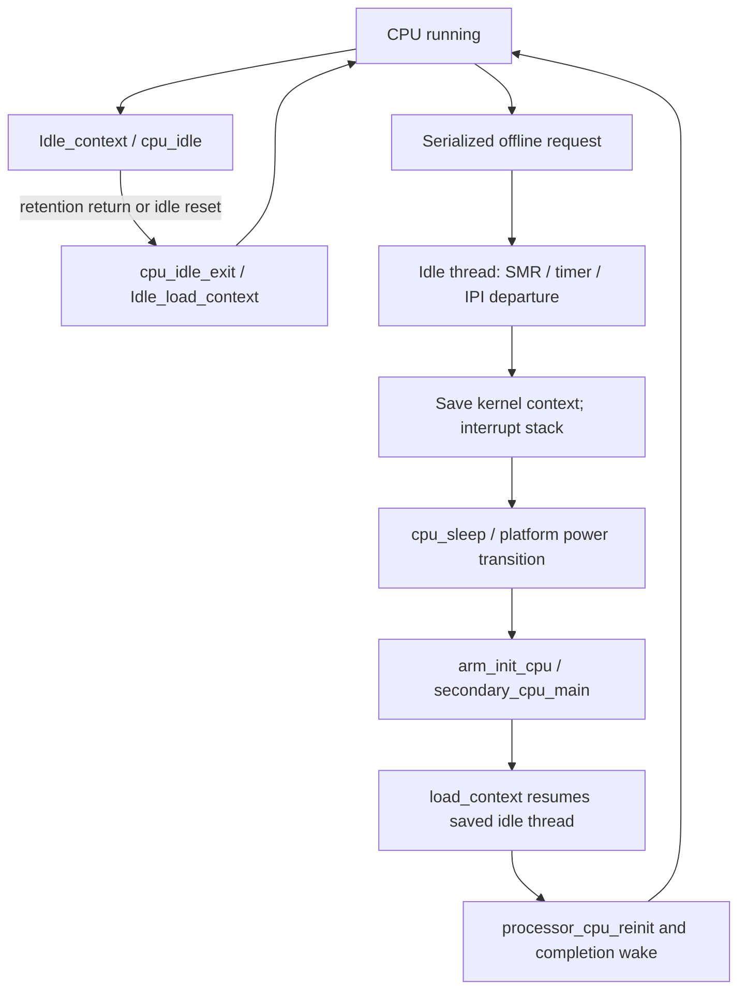

# ARM64 CPU startup, offline, idle, and system sleep

[Platform](README.md) · [Boot to PID 1](boot.md) · [Platform services](platform-services.md) · [Scheduling](../runtime/README.md)

CPU startup has several completion points: platform registration, a hardware start request, executing the warm entry, scheduler publication, interrupt readiness, and the caller observing completion. Likewise, ordinary idle, temporary CPU offline, and system suspend use different paths. This chapter follows those protocols in the ARM64 source without assuming that a particular SoC implements every conditional branch.

The [exception-entry](arm64-exception-entry.md), [exception-return](arm64-exception-return.md), and [protected-execution](../security/protected-execution.md) guides cover register spilling and monitor transitions. Here the question is when a CPU can execute kernel work, who owns the transition, and what must finish before another layer treats it as complete.

## 1. Initial startup establishes prerequisites in explicit phases

The `STARTUP` registry is ordered by subsystem then rank. `kernel_startup_bootstrap()` validates the linker-section size, sorts it, and runs through `STARTUP_SUB_LOCKS`. The comparator returns zero for equal subsystem/rank entries; source-file order is not a dependency contract. [Registry construction and ordering](../../../xnu/osfmk/kern/startup.c#L245), [phase identifiers](../../../xnu/osfmk/kern/startup.h#L59).

`kernel_startup_initialize_upto()` advances a single cursor and asserts that the target phase is later than the completed phase. During a callback it records the preceding phase, then advances the cursor only after the callback returns:

[Per-entry execution](../../../xnu/osfmk/kern/startup.c#L478):
<!-- source-excerpt: ../../../xnu/osfmk/kern/startup.c#L478-L481 -->
```c
		startup_phase = cur->subsystem - 1;
		kernel_startup_log(cur->subsystem);
		cur->func(cur->arg);
		startup_entry_cur = ++cur;
```

This is an initialization sequence, not a dependency resolver or a failure rollback system. Callbacks return `void`. Their own implementation must establish prerequisites and handle failures. Named phases are interleaved with ordinary calls: for example, the bootstrap thread initializes I/O Kit, advances through `EARLY_BOOT`, enables interrupts, initializes additional facilities, advances through `LOCKDOWN`, removes bootstrap metadata, and performs machine lockdown. See [the full cold-boot route](boot.md) for the later BSD/PID 1 path.

A CPU resuming from offline does not rerun this global registry. It restores per-CPU state and resumes its idle-thread context. Confusing global boot with per-CPU reinitialization hides the fact that locks, VM objects, tasks, and most service state already exist.

## 2. Platform registration supplies CPU-specific callbacks

`ml_processor_register()` connects a platform-provided description to `cpu_data_t` and its common `processor`. It checks the logical ID and configured CPU count, records the platform CPU identifier, cluster/cache information, idle callback and latency, error handler, register mappings, and power-gating entry information. It initializes per-CPU SMR and randomness for secondary CPUs and returns signal/tickle entry points to the caller. [Registration](../../../xnu/osfmk/arm64/machine_routines.c#L1649).

The platform `cpu_id` is distinct from the logical CPU number. In the I/O Kit wrapper it identifies an `IOCPU` object. `PE_cpu_start_internal()` invokes that object's `startCPU()` method; this tree supplies the call boundary, not every hardware driver's power/register sequence. Nearby obsolete exported interfaces deliberately fail or panic and must not be substituted for the internal path. [I/O Kit wrapper](../../../xnu/iokit/Kernel/IOCPU.cpp#L101).

Registration and boot are also configuration-dependent. The `!USE_APPLEARMSMP` registration branch calls `processor_boot()` directly. The AppleARMSMP path coordinates startup elsewhere; `processor_start_thread()` documents that its CPU boot thread installs AIC/FastIPI handlers before starting the secondary CPU. The non-AppleARMSMP path cannot assume that installation has already happened. [Registration tail](../../../xnu/osfmk/arm64/machine_routines.c#L1768), [first-thread distinction](../../../xnu/osfmk/kern/startup.c#L996).

## 3. Starting a CPU is serialized, but completion is asynchronous

The main state holders are:

| State | Meaning in the selected path |
| --- | --- |
| `processor_booted` | First-boot setup has been requested/completed by the boot routine; it is not alone a readiness acknowledgment |
| `processor_instartup` / `processor_inshutdown` | Transition coordination under `processor_start_state_lock` |
| `processor_offline_state` | Detailed transition milestones, separate from scheduler state |
| `processor.state` | Scheduler state such as `OFF_LINE`, `START`, or `RUNNING` |
| `processor_online` | Scheduler online publication |
| `cpu_active_thread` / `cpu_reset_handler` | Context and entry target used by the machine startup path |
| `ml_cpu_up_processors` / `SIGPdisabled` | Machine-side availability and CPU-signal readiness |

`processor_boot()` takes `cluster_powerdown_lock` then `processor_updown_lock`, rejects a repeated first boot, creates the reserved idle thread and processor IPC object when needed, and starts the processor. The master CPU is already executing and takes a special initialization path. Secondary first boots call `processor_dostartup(..., true)` without waiting, allowing the actual CPU starts to overlap. [First boot](../../../xnu/osfmk/kern/processor.c#L1302).

`processor_dostartup()` requires both transition mutexes. It sets the startup flag under the start-state lock, checks the expected previous offline state under scheduler/processor-set locking, changes it to `STARTING`, and changes scheduler state to `PROCESSOR_START`. It then requests power enable, opens the machine state-transition bracket, broadcasts `CPU_BOOT_REQUESTED`, and calls `cpu_start()`. [Startup request](../../../xnu/osfmk/kern/processor.c#L1099).

[Startup flag publication](../../../xnu/osfmk/kern/processor.c#L1118):
<!-- source-excerpt: ../../../xnu/osfmk/kern/processor.c#L1118-L1123 -->
```c
	simple_lock(&processor_start_state_lock, LCK_GRP_NULL);
	assert(processor->processor_inshutdown || first_boot);
	processor->processor_inshutdown = false;
	assert(processor->processor_instartup == false);
	processor->processor_instartup = true;
	simple_unlock(&processor_start_state_lock);
```

The target can run before the caller gets back. The post-call state check accepts either `STARTING`, which becomes `STARTED_NOT_RUNNING`, or `STARTED_NOT_WAITED` if the CPU has already progressed. The source explicitly notes that the subsequent `CPU_ACTIVE` event can race with the target's `CPU_BOOTED` event. Event names alone do not establish a total order or replace the completion wait.

`processor_wait_for_start()` waits uninterruptibly on `processor_instartup` with a configurable timeout and panics if startup does not finish. After the flag clears, it rejects a remaining shutdown flag, verifies online publication, and changes `STARTED_NOT_WAITED` to `RUNNING`. [Completion wait](../../../xnu/osfmk/kern/processor.c#L1044). The timeout is a kernel bringup failure, not an ordinary recoverable error returned to a userspace requester.

## 4. Warm entry restores an idle-thread context

For a remote CPU, `cpu_start()` chooses the configured reset entry: `arm_init_cpu` for SPTM or the legacy physical startup address. It selects the startup thread when present, otherwise the idle thread, attaches CPU/per-CPU information, initializes debug state, cleans the shared CPU-data cache lines, handles applicable CTRR cluster ordering, and calls the platform start wrapper. Starting the current CPU instead runs local machine initialization. [Machine start request](../../../xnu/osfmk/arm64/cpu.c#L898).

Both ARM initialization variants clear `SleepState`, restore the current thread association, initialize per-CPU architectural/timer facilities, initialize the timebase before serial drivers use it, configure interrupts/deadlines, and enter `secondary_cpu_main()`. SPTM hibernation adds handoff copying before normal page use; the legacy path has its own translation/integrity steps. [SPTM warm initialization](../../../xnu/osfmk/arm64/sptm/arm_init_sptm.c#L1155), [legacy warm initialization](../../../xnu/osfmk/arm/arm_init.c#L700).

`secondary_cpu_main()` stores the machine parameter on the idle thread and calls `load_context()`. That routine activates the kernel pmap, ensures the reserved stack exists, updates scheduler thread/processor associations, calls `processor_up()`, and loads machine context. `processor_up()` publishes scheduler online state before all CPU signal initialization has finished. [Context adoption](../../../xnu/osfmk/kern/startup.c#L966), [scheduler publication](../../../xnu/osfmk/kern/machine.c#L151).

First boot reaches `processor_start_thread()`. Offline resume instead restores the earlier context saved in `machine_processor_shutdown()` and returns inside `processor_offline()`. Both reach `processor_cpu_reinit()`, which initializes machine/clock state and handles a subtle interrupt dependency: a self-IPI clears `SIGPdisabled`. It temporarily enables interrupts so that IPI can arrive, optionally waits for readiness, disables interrupts, and rechecks debugger/stackshot coordination before `ml_cpu_up()`. [Reinitialization](../../../xnu/osfmk/kern/machine.c#L515).

The optional wait is deliberate on first boot: non-AppleARMSMP interrupt-driver threads may still need scheduling, so waiting synchronously for their self-IPI could prevent their progress. Offline resume uses the stronger wait. The function finally clears `processor_instartup` and wakes completion waiters:

[Startup completion publication](../../../xnu/osfmk/kern/machine.c#L576):
<!-- source-excerpt: ../../../xnu/osfmk/kern/machine.c#L576-L583 -->
```c
	simple_lock(&processor_start_state_lock, LCK_GRP_NULL);
	assert(processor->processor_instartup == true || is_final_system_sleep);
	processor->processor_instartup = false;
	simple_unlock(&processor_start_state_lock);

	splx(s);

	thread_wakeup((event_t)&processor->processor_instartup);
```

## 5. Offlining transfers execution to the reserved idle thread

`processor_exit_reason()` holds the up/down mutex and delegates to `processor_doshutdown()` with the cluster transition lock already required. The final system-sleep case is specifically the master processor when only one processor remains available; ordinary offline must not remove the last online CPU. [Exit wrapper](../../../xnu/osfmk/kern/processor.c#L1174), [shutdown](../../../xnu/osfmk/kern/machine.c#L235).

The routine publishes `processor_inshutdown` and `BEGIN_SHUTDOWN`. For a remote/ordinary shutdown it binds the requesting thread to the target, blocks so the scheduler runs it there, then removes the temporary binding. At this point interrupts remain disabled and blocking is prohibited. It gives the reserved idle thread a `processor_offline` continuation and switches to it with `thread_run()`. The reserved stack makes this handoff possible without allocating a new stack in the constrained phase.

On the idle thread, `processor_offline()` optionally disables preemption to enforce platform quiesce safety, takes the CPU out of SMR worker participation, calls `ml_cpu_down()` to drain machine work, and tells the scheduler the CPU is offline. It then saves the idle thread's kernel context and switches to the interrupt stack. [Idle-thread shutdown](../../../xnu/osfmk/kern/machine.c#L393).

[Assembly context preservation and stack switch](../../../xnu/osfmk/arm64/cswitch.s#L395):
<!-- source-excerpt: ../../../xnu/osfmk/arm64/cswitch.s#L395-L403 -->
```asm
LEXT(Shutdown_context)
	ARM64_PROLOG
	mrs		x10, TPIDR_EL1							// Get thread pointer
	LOAD_KERN_STACK_TOP	dst=x11, src=x10, tmp=x12	// Get the top of the kernel stack
	save_general_registers	x11, 12
	msr		DAIFSet, #(DAIFSC_STANDARD_DISABLE)	// Disable interrupts
	LOAD_INT_STACK_THREAD dst=x12, src=x10, tmp=x11
	mov		sp, x12
	b		EXT(cpu_doshutdown)
```

`processor_offline_intstack()` snapshots accounting, leaves SMR reader participation, deactivates the kernel pmap, and calls `cpu_sleep()`. The machine save is why wake can return to the suspended C call even though hardware sleep itself does not normally return through that call stack.

The original requesting thread resumes elsewhere after the idle-thread handoff. For ordinary offline it waits through `cpu_exit_wait()`, publishes `PROCESSOR_OFF_LINE`/`CPU_OFFLINE`, broadcasts the exit event, requests power disable, records `FULLY_OFFLINE`, and ends the machine transition bracket. Those are later milestones than scheduler removal. Final system sleep has a separate return path on the awakened master CPU. [Caller-side completion](../../../xnu/osfmk/kern/machine.c#L340).

## 6. Timer migration and IPI draining precede power loss

`ml_cpu_down()` clears the CPU's running state and removes its bit from `ml_cpu_up_processors` with release ordering. For an ordinary departing CPU, it chooses another up CPU, migrates the real-time timer queue there, and sends a fire-and-forget `SIGPTimerLocal` signal so the destination can reconsider deadlines. The source relies on `processor_updown_lock` to prevent simultaneous CPU-down migrations. [Machine shutdown](../../../xnu/osfmk/arm64/machine_routines.c#L818).

A synchronous CPU cross-call would deadlock against the stackshot IPI while interrupts are disabled, so this is specifically an asynchronous signal. Failure to send panics. The final quiescing boot CPU has nobody to receive its timers and instead requires that the remaining-up bitmap is already empty. Configured CPU-counter work is offlined before the final signal drain, preventing a canceled cyclic operation from being stranded. Finally `cpu_signal_handler_internal(TRUE)` drains pending signals and leaves exactly `SIGPdisabled`.

These steps explain why merely marking scheduler state offline is insufficient. Timers, debug rendezvous, asynchronous maintenance signals, and SMR still need their own departure protocols before physical power can disappear.

## 7. Ordinary idle saves context but keeps a different availability contract

`Idle_context` saves the current thread's kernel registers and switches to the interrupt stack before `cpu_idle()`. `Idle_load_context` restores them. This is the CPU's idle execution loop, not process sleep and not the full offline protocol. [Assembly idle pair](../../../xnu/osfmk/arm64/cswitch.s#L413).

`cpu_idle()` immediately returns to saved context if idle is disabled or CPU signaling is disabled. Otherwise it may use a bounded WFE interval based on cluster recommendations or a short anticipated idle period. Pending interrupts or a near deadline can avoid the deeper idle path. `SetIdlePop()` and timer checks prevent a chosen idle state from ignoring the next required wakeup. [Idle decision tree](../../../xnu/osfmk/arm64/cpu.c#L481).

For deeper idle it records the active thread, calls the registered idle notification callback, updates the idle-timer deadline, transitions configured counter state, and performs hardware/configuration-specific WFI preparation. Retention WFI can return directly; non-retention reset reaches `arm_init_idle_cpu()`, which restores selected architectural/debug state and calls `cpu_idle_exit(TRUE)`. Ordinary return calls `cpu_idle_exit(FALSE)`. The exit path notifies the platform, refreshes deadlines and configured instrumentation, then restores the saved context. [Idle exit](../../../xnu/osfmk/arm64/cpu.c#L652), [non-retention reset](../../../xnu/osfmk/arm64/sptm/arm_init_sptm.c#L1349).

Do not derive a universal retention/power state from the use of `wfi` alone. The local source has platform callbacks, feature conditionals, and different reset routes; detailed hardware power sequencing belongs to their providers.



## 8. System suspend coordinates all CPUs and preserves time semantics

`cpu_sleep()` records the active thread and reset handler, marks `SleepState`, stops configured profiling/counter facilities, and cleans caches. Under AppleARMSMP, system quiescing invokes platform quiesce; ordinary CPU-down instead calls `PE_cpu_down()`, publishes its sleep token, clears the reset handler against spurious wake, and enters configured sleep preparation. Other configurations use the quiesce callback. [Machine sleep](../../../xnu/osfmk/arm64/cpu.c#L315).

The platform system-sleep path reaches `ml_arm_sleep()`. The boot CPU waits until every other registered CPU reports `ARM_CPU_ON_SLEEP_PATH`, captures `wake_abstime`, resets the reset-time marker, then publishes its own token. Classic suspend writes a firmware-visible signature and requires its buffer; newer configured paths use a different reset route. Where a global sleep bit exists, the boot CPU releases the other CPUs into deep sleep only after this coordination. [Final system-sleep stage](../../../xnu/osfmk/arm64/cpu.c#L1024).

On warm initialization, the quiescing boot CPU recomputes the absolute-time offset so that `mach_absolute_time()` excludes the system-sleep interval even if the hardware counter continued or reset:

[Absolute-time offset on resume](../../../xnu/osfmk/arm64/cpu.c#L1000):
<!-- source-excerpt: ../../../xnu/osfmk/arm64/cpu.c#L1000-L1000 -->
```c
		rtclock_base_abstime = wake_abstime - ml_get_hwclock();
```

This is not a claim that every clock excludes sleep. Hibernation supplies an additional continuous-time offset through its header. The SPTM warm path updates commpage and Exclaves timebase interfaces after adopting the values. Timebase initialization precedes serial rate-control use and later timer-deadline resynchronization.

## 9. Hibernation adds VM and image-provider boundaries

The final shutdown path calls `hibernate_vm_lock()` while blocking is still permitted, before entering the constrained single-CPU phase. ARM's helper actually takes VM queue locks only when `gIOHibernateState` is hibernating. After interrupts are disabled, `hibernate_vm_unlock()` releases those locks but keeps the explicit “VM locks safe” interval until wake calls `hibernate_vm_lock_end()`. The safety now comes from single-threaded execution, not pretending those mutexes remain held. [Shutdown ordering](../../../xnu/osfmk/kern/machine.c#L253), [ARM hibernation lock contract](../../../xnu/osfmk/arm64/hibernate_arm64.c#L303).

The queue helper includes compressor-object, page-queue, free-page, purgeable-queue, and per-CPU local-queue locks. `hibernate_page_list_setall()` builds wired/pageable save lists by subtracting pages known not to need saving. This chapter reads that boundary and its locking, not every page-class selection branch. [Queue synchronization and bitmap contract](../../../xnu/osfmk/vm/vm_resident.c#L9458).

Under `HIBERNATION`, `ml_arm_sleep()` calls `hibernate_write_image()`. Its initial guard returns the normal sleep result if image state, polled I/O support, or hibernation mode is absent. Otherwise it enters the image-writing machinery. A halt result leads to platform poweroff; returning from that halt request panics. The [image-creation chapter](hibernation-image-creation.md) follows compression, encryption boundaries, file extents, and polled transfers; [restore](hibernation-restore.md) follows physical collisions, VM rebuild, and the later image read. [Image entry](../../../xnu/iokit/Kernel/IOHibernateIO.cpp#L1691), [sleep/halt decision](../../../xnu/osfmk/arm64/cpu.c#L1089).

SPTM hibernation resume copies the handoff region before other activity because those pages are not tracked as in-use by XNU. It adopts the hibernation header, restores absolute/continuous-time offsets, and validates/fixes the saved idle-thread preemption count before continuing normal per-CPU initialization. Firmware-computed header values and the protected restore mechanism are external boundaries; their presence does not expose the full restore implementation. [SPTM resume handling](../../../xnu/osfmk/arm64/sptm/arm_init_sptm.c#L1155).

## Inspection scope

Read bodies include startup sorting/cursor execution; processor registration/boot/start/wait/exit; common shutdown, context loading and reinitialization; ARM64 timer/IPI departure; startup, idle, sleep and timebase code; legacy/SPTM warm initialization; context-switch assembly; I/O Kit CPU-start wrapper; and ARM hibernation queue-lock/image-entry boundaries. All SoC register sequences, platform CPU driver implementations, CPU availability policy, and hardware execution remain outside this trace. Dedicated companion chapters now cover [x86 power paths](x86-sleep-and-resume.md), [image creation](hibernation-image-creation.md), and [restore](hibernation-restore.md), with their own configuration and external-implementation limits. No kernel was booted or power transition tested.
