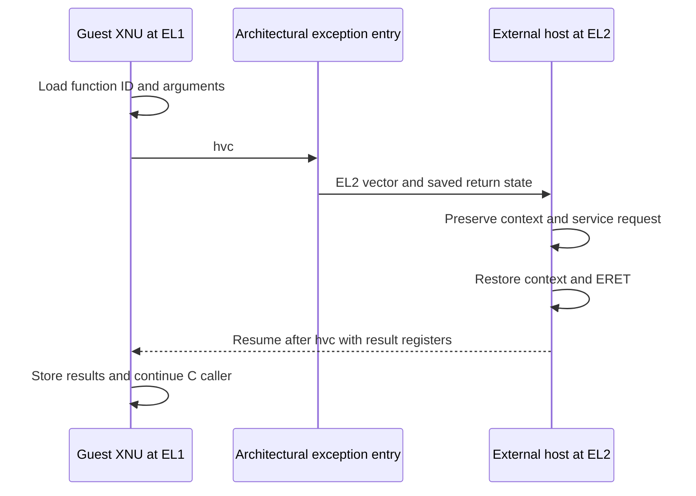

# EL1, EL2, and Apple protected execution

[Platform overview](README.md) · [EL0 to EL1](arm64-exception-entry.md) · [Exception return](arm64-exception-return.md) · [Hardware mappings](hardware-mappings.md)

This checkout shows several privileged transitions with different implementations. Ordinary applications enter XNU through ARM64 exception vectors. A virtualized XNU kernel can issue `hvc` requests to its host. An SPTM-configured kernel calls a protected monitor through a separate interface. Legacy PPL code supplies another protected-call path. A diagram that labels all three simply “EL1 calls EL2” hides the distinctions needed to follow the source.

## Which path is actually present?

| Path | Visible entry in this tree | Visible return | What is external or incomplete |
| --- | --- | --- | --- |
| Application ↔ XNU | `ExceptionVectorsBase`, lower-EL vectors, `fleh_*`, `sleh_*` | Saved-state restore and `ERET` in `locore.s` | Platform-specific register and protection configuration |
| Guest XNU ↔ hypervisor | `hvc_5` / `hvc32_4` under `APPLEVIRTUALPLATFORM`; PAC and power hypercalls | Instructions after `hvc` collect result registers | Host vector table, host saved context, dispatcher, and its exception-return instruction |
| XNU ↔ SPTM | `SPTM_DOMAIN_ENTER` at boot; `sptm_*` library calls; XNU pre-entry/post-exit hooks | C/assembly continuation after the external call | Macro expansion, transport/library bodies, monitor vectors, monitor validation and return |
| XNU ↔ legacy PPL | Generated `*_ppl` wrapper, PPL dispatch/state/stack fragments | PPL cleanup, AST handling, function epilogue | Protected crossing machinery is incomplete in the public assembly |

The build selects SPTM versus legacy ARM sources in [`files.arm64`](../../../platydoc-data/xnu/osfmk/conf/files.arm64#L10-L25). `APPLEVIRTUALPLATFORM`, `HAS_PARAVIRTUALIZED_PAC`, `XNU_MONITOR`, and `CONFIG_SPTM` guard different code. The presence of all these files does not imply that one kernel executes all their branches.

## Architectural EL1 → EL2 → EL1 contract

For an enabled AArch64 `HVC` taken from EL1 to EL2, hardware saves return PC in `ELR_EL2`, processor state in `SPSR_EL2`, and syndrome in `ESR_EL2`, then selects the lower-AArch64 synchronous vector at `VBAR_EL2 + 0x400`. Software must preserve the general registers it needs. EL2 restores its saved context and executes `ERET`; that instruction restores PC/state from `ELR_EL2`/`SPSR_EL2`. For a normally returning hypercall, the saved PC follows `HVC`. Configuration can disable or alter trapping, and host execution may defer a guest's resumption. This describes the architectural contract, not a host implementation found in XNU. [Arm, AArch64 Exception Model, §§4.1.3 and 5](https://documentation-service.arm.com/static/63a065c41d698c4dc521cb1c).



The middle of this diagram is deliberately an architectural/external boundary. There is no checked-in host exception frame to label `arm_saved_state64`: that structure belongs to the XNU exception paths documented in [entry](arm64-exception-entry.md). Likewise, XNU's `ret` from a C wrapper is executed **after** the host has already returned to guest execution; it is not the instruction that lowered EL2 to EL1.

## A concrete guest hypercall

[`hvg_hcall_get_mabs_offset()`](../../../platydoc-data/xnu/osfmk/arm64/arm64_hypercall.c#L254-L266) supplies `VMAPPLE_GET_MABS_OFFSET` and the local absolute-time offset. `hvc_2()` forwards two values through the five-register helper. The call's function ID is in a general register; the instruction immediate remains zero.

[Source: arm64_hypercall.c, lines 254–266](../../../platydoc-data/xnu/osfmk/arm64/arm64_hypercall.c#L254-L266)

<!-- source-excerpt: ../../../platydoc-data/xnu/osfmk/arm64/arm64_hypercall.c#L254-L266 -->
```c
hvg_hcall_return_t
hvg_hcall_get_mabs_offset(uint64_t *mabs_offset)
{
	uint64_t fn = VMAPPLE_GET_MABS_OFFSET;
	uint64_t x1 = ml_get_abstime_offset();

	if (!hvc_2(&fn, &x1)) {
		return HVG_HCALL_UNSUPPORTED;
	}
	*mabs_offset = x1;

	return HVG_HCALL_SUCCESS;
}
```

The implementation copies inputs into `x0`–`x4`, executes the transition instruction, and copies the returned registers back to C storage:

[Source: arm64_hypercall.c, lines 53–67](../../../platydoc-data/xnu/osfmk/arm64/arm64_hypercall.c#L53-L67)

<!-- source-excerpt: ../../../platydoc-data/xnu/osfmk/arm64/arm64_hypercall.c#L53-L67 -->
```c
static inline bool
hvc_5(uint64_t *x0, uint64_t *x1, uint64_t *x2, uint64_t *x3, uint64_t *x4)
{
	asm volatile (
                "mov   x0, %[i0]"    "\n"
                "mov   x1, %[i1]"    "\n"
                "mov   x2, %[i2]"    "\n"
                "mov   x3, %[i3]"    "\n"
                "mov   x4, %[i4]"    "\n"
                "hvc   #0"           "\n"
                "str   x0, %[o0]"    "\n"
                "str   x1, %[o1]"    "\n"
                "str   x2, %[o2]"    "\n"
                "str   x3, %[o3]"    "\n"
                "str   x4, %[o4]"    "\n"
```

This is an excerpt of the inline-assembly statement; its remaining [constraints/clobbers and success test](../../../platydoc-data/xnu/osfmk/arm64/arm64_hypercall.c#L68-L81) are part of the function. The helper treats a negative returned `x0` as failure for its normal status-return convention. UID queries have an explicit different sentinel rule, and `hvc32_4()` handles 32-bit register results. Do not extend that one success convention to every hypercall. [`hvg_get_uid()`](../../../platydoc-data/xnu/osfmk/arm64/arm64_hypercall.c#L132-L149).

[`hv_hvc.h`](../../../platydoc-data/xnu/osfmk/arm64/hv_hvc.h#L31-L78) composes IDs from a fast-call bit, width bit, service namespace, and function number. CPU services include paravirtualized pointer-authentication operations; OEM services include time offset, boot-session UUID, virtual-CPU wait and kick. [`hvg_is_hcall_available()`](../../../platydoc-data/xnu/osfmk/arm64/arm64_hypercall.c#L176-L234) queries host identity/version/features before selected use. The nonvirtual-platform implementations return unsupported rather than executing this helper.

For another concrete call, `hvg_hc_kick_cpu()` translates a logical CPU index to the topology's physical ID and calls `VMAPPLE_VCPU_KICK`. `hvg_hc_wait_for_kick()` passes its interrupt-enable argument to `VMAPPLE_VCPU_WFK`. These functions communicate with the external host; they are not ordinary Mach messages delivered to an `ipc_port`. [`virtual CPU calls`](../../../platydoc-data/xnu/osfmk/arm64/arm64_hypercall.c#L269-L291).

Not every `hvc` has a normal returning contract. The virtual-platform branch of `arm64_prepare_for_sleep()` invokes PSCI CPU-off or system-suspend functions and places an infinite branch immediately afterward. That caller is not expecting the ordinary C-return sequence. [`power hypercalls`](../../../platydoc-data/xnu/osfmk/arm64/machine_routines_asm.s#L1551-L1574). PAC assembly also issues hypercalls and checks their result before continuing: [`pac_asm.h`](../../../platydoc-data/xnu/osfmk/arm64/pac_asm.h#L94-L165).

## SPTM has a distinct, partly external transition interface

For the expanded security and ownership model, see [SPTM](../security/sptm.md), [TXM](../security/txm.md), and [Exclaves execution](../security/exclaves-execution.md). The [entry/exit map](../security/protected-execution.md) distinguishes their ordinary calls, upcalls and interrupted-domain returns.

The SPTM boot source includes `<sptm/sptm_xnu.h>`. The local [`sptm.h`](../../../platydoc-data/xnu/osfmk/arm64/sptm/sptm.h#L30-L46) includes the same external interface, and the [build](../../../platydoc-data/xnu/makedefs/MakeInc.def#L1182-L1186) links `sptm_xnu` and `TrustedExecutionMonitor_Kernel` archives. Their implementations are not supplied here. Test mocks elsewhere in the tree are not the production monitor.

At cold boot XNU writes its exception-vector address, then invokes the external entry macro:

[Source: start_sptm.s, lines 146–161](../../../platydoc-data/xnu/osfmk/arm64/sptm/start_sptm.s#L146-L161)

<!-- source-excerpt: ../../../platydoc-data/xnu/osfmk/arm64/sptm/start_sptm.s#L146-L161 -->
```asm
	/**
	 * Now setup final XNU exception vectors. This is the closest we can do this
	 * in XNU because after sending SPTM SPTM_FUNCTIONID_FIXUPS_COMPLETE, VBAR
	 * will be validated and locked.
	 */
	adrp	x9, EXT(ExceptionVectorsBase)@page
	add		x9, x9, EXT(ExceptionVectorsBase)@pageoff
	msr		VBAR_EL1, x9
	isb

	/**
	 * Call into the SPTM for the first time. This function traps to GL2 to
	 * signal the SPTM that the fixups phase has been completed.
	 */
	SPTM_LOAD_DISPATCH_ID SPTM_DOMAIN, SPTM_DISPATCH_TABLE_XNU_BOOTSTRAP, SPTM_FUNCTIONID_FIXUPS_COMPLETE
	SPTM_DOMAIN_ENTER	x16
```

The comment says **GL2**, Apple's guarded execution terminology. Preserve that qualification: this source does not show the macro becoming the guest's `hvc #0`, nor does it supply the monitor's complete register-bank semantics. `CurrentG` checks and `KERNEL_MODE_*` / `GUARDED_MODE_*` aliases are additional evidence that protected execution is more than an ordinary software call between two C functions. [`register aliases`](../../../platydoc-data/xnu/osfmk/arm64/exception_asm.h#L34-L56), [`pre-entry guard check`](../../../platydoc-data/xnu/osfmk/arm64/locore.s#L2725-L2730).

The boot contract is concrete even without the external macro body: XNU finishes image fixups, supplies the final `VBAR_EL1`, reports fixup completion, and afterward expects the executable region to have its final monitor type. The source says the monitor validates and locks VBAR after that report. This is not an instruction-by-instruction account of the monitor.

### XNU's entry and exit hooks protect its own execution state

`_sptm_pre_entry_hook` saves a frame, callee-saved temporaries, the dispatch ID in `x16`, and arguments `x0`–`x7`. When a current thread exists, it increments `ACT_PREEMPT_CNT`:

[Source: locore.s, lines 2688–2700](../../../platydoc-data/xnu/osfmk/arm64/locore.s#L2688-L2700)

<!-- source-excerpt: ../../../platydoc-data/xnu/osfmk/arm64/locore.s#L2688-L2700 -->
```asm
	/* Save arguments to SPTM function and SPTM function id. */
	mov		x20, x16
	stp		x0, x1, [sp, #-0x40]!
	stp		x2, x3, [sp, #0x10]
	stp		x4, x5, [sp, #0x20]
	stp		x6, x7, [sp, #0x30]

	/* Increase the preemption count. */
	mrs		x9, TPIDR_EL1
	cbz		x9, Lskip_preemption_check_sptmhook
	ldr		w10, [x9, ACT_PREEMPT_CNT]
	add		w10, w10, #1
	str		w10, [x9, ACT_PREEMPT_CNT]
```

It performs optional scheduler-hygiene measurement, checks that the caller is not already in guarded mode, restores arguments, and returns to the library's entry sequence. This hook is not itself the missing protected transition instruction. Early boot can have no `TPIDR_EL1` thread, which explains the explicit zero test. [`full pre-entry hook`](../../../platydoc-data/xnu/osfmk/arm64/locore.s#L2678-L2744).

`_sptm_post_exit_hook` preserves returned `x0`–`x7`, decrements the current thread's preemption count with underflow detection, and checks whether urgent AST handling is now permitted. When it does call `ast_taken_kernel`, it masks exceptions for the call and restores DAIF afterward:

[Source: locore.s, lines 2806–2815](../../../platydoc-data/xnu/osfmk/arm64/locore.s#L2806-L2815)

<!-- source-excerpt: ../../../platydoc-data/xnu/osfmk/arm64/locore.s#L2806-L2815 -->
```asm
	/* IF there is no urgent AST, skip the AST. */
	ldr		x12, [x0, ACT_CPUDATAP]
	ldr		x14, [x12, CPU_PENDING_AST]
	tst		x14, AST_URGENT
	b.eq	Lsptm_skip_ast_taken_sptmhook

	/* Handle the AST. This call requires interrupts to be disabled. */
	msr		DAIFSet, #(DAIFSC_ALL)
	bl		EXT(ast_taken_kernel)
	msr		DAIF, x20
```

The post-hook finally restores the monitor results and its stack frame. It can therefore perform XNU scheduler work **after the protected call has returned**, before the original caller continues. Its function epilogue is distinct from whatever return mechanism the monitor used. [`post-exit hook`](../../../platydoc-data/xnu/osfmk/arm64/locore.s#L2746-L2830).

### A mapping request shows the data crossing this interface

[`pmap_enter_pte()`](../../../platydoc-data/xnu/osfmk/arm64/sptm/pmap/pmap.c#L6328-L6379) constructs/checks a mapping under the relevant reverse-map and epoch protections. It supplies the root-table physical address, virtual address, proposed PTE, and flags to `sptm_map_page()`. The ordinary status result and the per-CPU result area are different outputs. On success it reads the prior PTE and installed PTE pointer:

[Source: pmap.c, lines 6471–6477](../../../platydoc-data/xnu/osfmk/arm64/sptm/pmap/pmap.c#L6471-L6477)

<!-- source-excerpt: ../../../platydoc-data/xnu/osfmk/arm64/sptm/pmap/pmap.c#L6471-L6477 -->
```c
	assert(!preemption_enabled());
	const sptm_map_page_output_t *map_page_out = (const sptm_map_page_output_t *)
	    PERCPU_GET(pmap_sptm_percpu)->sptm_prev_ptes;

	pt_entry_t *pte_p;
	*old_pte = prev_pte = map_page_out->prev_pte;
	*out_pte_p = pte_p = (pt_entry_t*)(map_page_out->ptep);
```

| Structure/value | Local role at the boundary |
| --- | --- |
| `pmap_t`, especially `ttep` | Identifies XNU's address-space/root-table association |
| `locked_pvh_t` | Carries protection for reverse mappings of the target physical page |
| `pmap_epoch_t` | Keeps concurrent table removal/unnesting from invalidating the operation's assumptions |
| `pmap_sptm_percpu_data_t.sptm_prev_ptes` | Per-CPU monitor output storage, populated from bootstrap-provided memory |
| `sptm_map_page_output_t` | External interface type interpreted as previous PTE plus PTE pointer |
| `thread.machine.preemption_count` / assembly `ACT_PREEMPT_CNT` | Prevents migration while the caller relies on that per-CPU storage; see [`machine_thread`](../../../platydoc-data/xnu/osfmk/arm/thread.h#L166) |

The local per-CPU layout is in [`pmap_data.h`](../../../platydoc-data/xnu/osfmk/arm64/sptm/pmap/pmap_data.h#L1173-L1228); [`initialization`](../../../platydoc-data/xnu/osfmk/arm64/sptm/pmap/pmap_data.c#L2050-L2081) computes each CPU's result-area pointer from `SPTMArgs`. The call and failure cleanup are in [`pmap.c`](../../../platydoc-data/xnu/osfmk/arm64/sptm/pmap/pmap.c#L6438-L6469). These are source-visible ownership and concurrency contracts. They do not reveal how the monitor validates page types internally or programs its own privileged registers.

### Resume a protected domain after XNU handles its interrupt

An interrupt can occur while a thread is executing in SPTM, TXM, or the secure kernel (SK). XNU handles the interrupt, then must resume the correct domain. During `arm_init`, XNU registers the stripped address of `xnu_return_to_gl2` with `sptm_register_xnu_exc_return`. This is a return-dispatch address supplied to the monitor, distinct from the ordinary application's saved PC. [`registration`](../../../platydoc-data/xnu/osfmk/arm64/sptm/arm_init_sptm.c#L761-L763).

The saved state visible to XNU does not necessarily contain the protected domain's real interrupted PC in its `pc` field. `ml_get_backtrace_pc` explicitly documents a fixed re-entry handler there and the actual interrupted PC in `x14`; it uses that value when `ml_addr_in_non_xnu_stack` recognizes the saved frame pointer. In the SPTM branch, that helper checks the bootstrap-supplied SPTM per-CPU and TXM thread-stack ranges; otherwise the accessor returns the ordinary saved `pc`. This lets a backtrace recover the interrupted location without confusing the resume handler with the interrupted instruction. [`stack-range checks`](../../../platydoc-data/xnu/osfmk/arm64/machine_routines.c#L3145-L3172), [`backtrace interpretation`](../../../platydoc-data/xnu/osfmk/arm64/machine_routines.c#L3176-L3194).

`xnu_return_to_gl2` reads the current `thread` through `TPIDR_EL1` and chooses the resume interface:

| Thread state | Resume destination |
| --- | --- |
| `thread.txm_thread_stack` is nonzero | Pass the associated stack in `x0` to `txm_resume` |
| Otherwise, `CONFIG_EXCLAVES` and `th_exclaves_intstate & TH_EXCLAVES_EXECUTION` | Branch to `sk_resume` |
| Neither condition holds | Branch to `sptm_resume_from_exception` |

The first branch is short enough to read directly:

[Source: locore.s, lines 1711–1717](../../../platydoc-data/xnu/osfmk/arm64/locore.s#L1711-L1717)

<!-- source-excerpt: ../../../platydoc-data/xnu/osfmk/arm64/locore.s#L1711-L1717 -->
```asm
	mrs		x8, TPIDR_EL1
	ldr		x8, [x8, TH_TXM_THREAD_STACK]
	cbz		x8, 1f
	mov		x0, x8
	b		EXT(txm_resume)
	/* Unreachable */
	b .
```

The [remaining selector](../../../platydoc-data/xnu/osfmk/arm64/locore.s#L1719-L1743) contains the SK and SPTM branches. All three use `b`, without setting a new link register, and mark the following infinite branch unreachable. The selector expects the external interface to resume protected execution rather than return to this dispatch site as an ordinary function. The actual implementations of these resume interfaces are external to this checkout.

The relevant fields and their synchronization contract are in [`thread.h`](../../../platydoc-data/xnu/osfmk/kern/thread.h#L1106-L1122). The interrupt-safe Exclaves flags may be modified only by the current thread with interrupts disabled; `TH_EXCLAVES_EXECUTION` includes execution interrupted or preempted while in the secure kernel or Exclaves userspace. [`flag definition`](../../../platydoc-data/xnu/osfmk/kern/thread.h#L291-L297). Consequently, interpreting only `CurrentEL` or only the saved `pc` misses state that this local return path explicitly consults.

## Legacy PPL: read the state machine, recognize the missing crossing

The legacy `PMAP_SUPPORT_PROTOTYPES_WITH_ASM_INTERNAL` macro constructs a wrapper that loads a call index into `x15` and branches to `_aprr_ppl_enter`. The checked-in code does not provide that entry body. [`wrapper generation`](../../../platydoc-data/xnu/osfmk/arm/pmap/pmap_internal.h#L98-L107). Likewise, `ppl_return_to_kernel_mode` is referenced without its implementation, and [`gxf_exceptions.s`](../../../platydoc-data/xnu/osfmk/arm64/gxf_exceptions.s) consists of includes rather than the complete protected-vector machinery.

The remaining assembly still exposes useful contracts. [`pmap_cpu_data`](../../../platydoc-data/xnu/osfmk/arm/pmap/pmap.h#L172-L221) stores `ppl_kern_saved_sp`, `ppl_stack`, an `arm_context_t *save_area`, `ppl_state`, and in-flight pmap state. The dispatch fragment checks the request against `PMAP_COUNT`, validates KERNEL/DISPATCH/EXCEPTION state transitions, selects the per-CPU PPL stack, and loads `ppl_handler_table[index]`. The handler runs through an indirect authenticated branch when pointer authentication is enabled. [`dispatch setup`](../../../platydoc-data/xnu/osfmk/arm64/locore.s#L2280-L2337), [`handler invocation`](../../../platydoc-data/xnu/osfmk/arm64/locore.s#L2513-L2549).

On an ordinary completion it restores the original stack, clears the in-flight pmap pointer and saved stack, changes DISPATCH back to KERNEL, then branches to the missing crossing routine. The later `ppl_exit` fragment distinguishes ordinary completion, bad call, panic, and an exception; it decreases preemption protection and can process an urgent kernel AST before its C-level return. [`completion`](../../../platydoc-data/xnu/osfmk/arm64/locore.s#L2354-L2383), [`exit handling`](../../../platydoc-data/xnu/osfmk/arm64/locore.s#L2388-L2511).

This path is not fully reconstructable from these fragments: `locore.s` contains explicit `#error "XPRR configuration error"` sites where protected entry/return support would be needed. The nearby panic code also explicitly distinguishes PPL running at GL2 from GL1 on a guest or pre-H13 platform; it checks `CurrentEL` before choosing legal TLB invalidation operations. The unconditional statement “PPL always runs at EL2” would contradict this source. [`configuration gap`](../../../platydoc-data/xnu/osfmk/arm64/locore.s#L2264-L2273), [`GL1/GL2 distinction`](../../../platydoc-data/xnu/osfmk/arm64/locore.s#L2632-L2656).

## SMC and Mach exceptions are separate routes

The `MONITOR`-guarded `monitor_call` is explicitly described as an EL3 call and executes `smc 0x11` before returning to its caller. It is not the source's EL2 guest hypercall helper. [`monitor_call`](../../../platydoc-data/xnu/osfmk/arm64/machine_routines_asm.s#L1768-L1785).

A **Mach exception message** is a higher-level IPC operation constructed after XNU classifies a fault. It can go to a userspace debugger/server or the kernel's Unix exception handler. It does not itself mean entering EL2. Conversely, an `hvc` or protected mapping call need not create a Mach message at all. Follow [Mach exception delivery](../ipc/exception-delivery.md) for that object/port path, and [EL0 entry](arm64-exception-entry.md) and [return](arm64-exception-return.md) for the fully visible XNU saved-state path.

## What this page establishes

The guest's call sites, input/output registers, feature gates, SPTM hooks, mapping result storage, and available PPL state/stack transitions were read directly. The architectural EL2 paragraph is separately sourced from Arm. No host/monitor implementation, generated external entry macro, instruction-level protected return, or complete Apple guarded-register specification was available to inspect. Filling those boxes with invented assembly would obscure the strongest evidence this checkout actually provides.

<!-- BEGIN PLATYDOC DOCUMENTATION LICENSE -->
Original Platydoc text and diagrams are licensed under [CC BY 4.0](https://creativecommons.org/licenses/by/4.0/). Quoted source code and third-party material retain their respective licenses.
<!-- END PLATYDOC DOCUMENTATION LICENSE -->
