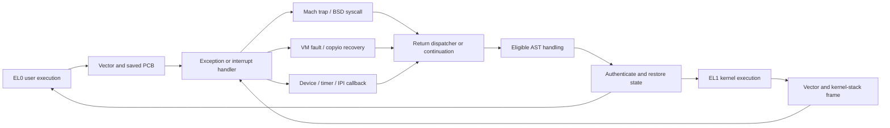

# Exceptions, interrupts, and CPU execution

[Platform overview](README.md) · [ARM64 entry](arm64-exception-entry.md) · [ARM64 return](arm64-exception-return.md) · [Exception levels and monitors](exception-levels-and-monitors.md)

Machine execution connects the thread chosen by the scheduler to instructions running on a CPU. An exception vector preserves that execution, selects a safe stack, and dispatches a kernel operation. The operation may complete, block, deliver a Mach exception, or change the state to resume. The return path handles pending ASTs and restores the selected state. An interrupt may enter the same return machinery without initiating a syscall. [`ARM64 vectors and dispatcher`](../../../xnu/osfmk/arm64/locore.s#L535), [`return dispatcher`](../../../xnu/osfmk/arm64/locore.s#L1690), [`AST handling`](../../../xnu/osfmk/kern/ast.c#L165).

## Follow one complete transition

The dedicated ARM64 guides trace instruction-level mechanisms and include exact source excerpts:

| Guide | Questions answered | Main source route |
|---|---|---|
| [Exception entry](arm64-exception-entry.md) | Which vector is selected? Where are registers saved? Which stack runs C? How do SVC, abort, IRQ, and FIQ differ? | `ExceptionVectorsBase` → long vector → `SPILL_REGISTERS` → `fleh_*` → `sleh_*`. |
| [Exception return](arm64-exception-return.md) | How can a blocked syscall resume without its old stack frames? When can ASTs run? Which fields are authenticated before `eret`? | `exception_return_dispatch` or `thread_exception_return` → AST handling → `AUTH_THREAD_STATE_IN_X0` → restore → `eret`. |
| [Exception levels and monitors](exception-levels-and-monitors.md) | Which crossings are ordinary EL0/EL1, architectural EL2, or Apple guarded-domain transitions? Which implementation is external? | Available bootstrap, monitor, hypervisor, and protected-domain entry/return call sites. |

Assembly and C share structure layouts through generated offsets. `arm_context` combines integer/exception state and NEON state; `arm_saved_state64` includes GPRs, SP/PC/CPSR, FAR/ESR, and an optional control-flow signature. `thread.machine.upcb` names persistent user state, while `kstackptr` names a kernel stack and `machine.CpuDatap` locates per-CPU interrupt/exception stacks and pending ASTs. These objects have different lifetimes even when one exception touches all of them. [`thread_status.h`](../../../xnu/osfmk/mach/arm/thread_status.h#L416), [`arm_context`](../../../xnu/osfmk/mach/arm/thread_status.h#L1220), [`machine_thread`](../../../xnu/osfmk/arm/thread.h#L118), [`cpu_data`](../../../xnu/osfmk/arm/cpu_data_internal.h#L140), [`genassym.c`](../../../xnu/osfmk/arm64/genassym.c#L162).

A useful first walkthrough is user `SVC_64`: `sleh_synchronous` validates the user context, `handle_svc` obtains the call number from saved x16, and negative numbers select Mach traps while nonnegative numbers select BSD syscalls, after special cases. One Mach trap is `mach_msg2_trap`; message IDs and MIG server routines are a later dispatch inside [Mach IPC](../ipc/README.md). A hardware fault instead goes through the abort inspectors and VM/recovery policy; only unresolved user faults that reach `exception_triage` enter [Mach exception delivery](../ipc/kernel-rpc-and-exceptions.md). [`SVC dispatch`](../../../xnu/osfmk/arm64/sleh.c#L2743), [`Mach trap selection`](../../../xnu/osfmk/arm64/bsd_arm64.c#L194), [`abort dispatch`](../../../xnu/osfmk/arm64/sleh.c#L1563).

The reverse walkthrough starts at `thread_syscall_return`: saved x0 receives the result, `thread_exception_return` reloads the persistent PCB, AST handlers may block again, and the final restore authenticates PC/CPSR/LR/x16/x17 on configured PAC systems. An EL1 return has narrower urgent-preemption eligibility and does not become a userspace transition merely because it shares restore code. [`syscall continuation return`](../../../xnu/osfmk/arm64/sleh.c#L3176), [`kernel return`](../../../xnu/osfmk/arm64/locore.s#L1748), [`authenticated restore`](../../../xnu/osfmk/arm64/locore.s#L1951).

## Interrupts connect device callbacks and timer queues

`sleh_irq()` runs an interrupt prologue, then either `PE_handle_ext_interrupt()` for `USE_APPLEARMSMP` or the registered per-CPU `IOInterruptHandler` with target/refCon/nub/source. The C epilogue finishes tracing and interrupt accounting; assembly handles the architectural return. This is the boundary to [driver interrupt handling](../drivers/README.md). [`sleh.c`](../../../xnu/osfmk/arm64/sleh.c#L3003), [`interrupt epilogue`](../../../xnu/osfmk/arm64/sleh.c#L3230).

`sleh_fiq()` classifies configured fast IPIs, timer events, and performance-monitor interrupts. Its fast-IPI path acknowledges the hardware indication before `cpu_signal_handler()` to avoid losing an intervening signal. The timer route reaches `rtclock_intr()` and `timer_intr()`: expired per-CPU timer-call queues and running timers are processed, then the next deadline is recomputed. The source also contains a fallback assumption for unclassified FIQ sources; do not equate every FIQ with a timer. [`sleh_fiq()`](../../../xnu/osfmk/arm64/sleh.c#L3035), [`rtclock_intr()`](../../../xnu/osfmk/arm/rtclock.c#L323), [`timer_intr()`](../../../xnu/osfmk/arm/arm_timer.c#L67), [runtime timers](../runtime/time-and-accounting.md).

## CPU bringup and a context switch

`ml_bootstrap_processors()`, registered at the SCHED startup phase, allocates/initializes secondary CPU data and associates processors with processor sets. AMP builds use the topology's per-CPU set; other ARM builds use the boot set. `ml_processor_register()` connects later platform registration to those preexisting structures. [`machine_routines.c`](../../../xnu/osfmk/arm64/machine_routines.c#L1607).

For another CPU, `cpu_start()` chooses its initial thread, fills its CPU/thread associations and reset handler, makes setup data visible, then calls `PE_cpu_start_internal()`. The platform callback starts hardware; XNU's resumed `arm_init_cpu()` restores machine/timebase facilities and reaches `secondary_cpu_main()`, which loads that processor's idle-thread context. SPTM and PPL choose different reset entry representations. [`cpu.c`](../../../xnu/osfmk/arm64/cpu.c#L898), [`legacy arm_init_cpu()`](../../../xnu/osfmk/arm/arm_init.c#L700), [`SPTM arm_init_cpu()`](../../../xnu/osfmk/arm64/sptm/arm_init_sptm.c#L1155), [`secondary_cpu_main()`](../../../xnu/osfmk/kern/startup.c#L966).

Once the scheduler chooses another thread, `machine_switch_context()` switches pmap/extended state before assembly `Switch_context`. The assembly saves the old kernel context unless a continuation makes that unnecessary, installs the new thread registers/stack, restores its context, and synchronizes process-dependent keys. Even a switch between threads sharing a pmap performs needed maintenance synchronization: ARM cache/TLB completion cannot be left pending on the old CPU after migration. Scheduling choice remains in [runtime](../runtime/scheduling.md). [`pcb.c`](../../../xnu/osfmk/arm64/pcb.c#L437), [`machine_switch_context()`](../../../xnu/osfmk/arm64/pcb.c#L499), [`cswitch.s`](../../../xnu/osfmk/arm64/cswitch.s#L367).

x86_64 uses `idt64.s` and `x86_saved_state` instead. Its `hndl_syscall` dispatches by syscall-class bits to Unix, Mach, machine-dependent, or diagnostic handlers; the return path also calls common `ast_taken_user()`. Shared semantics do not imply shared register conventions. [`idt64.s`, dispatch](../../../xnu/osfmk/x86_64/idt64.s#L1858), [`AST return`](../../../xnu/osfmk/x86_64/idt64.s#L1547).

<!-- BEGIN PLATYDOC DOCUMENTATION LICENSE -->
Original Platydoc text and diagrams are licensed under [CC BY 4.0](https://creativecommons.org/licenses/by/4.0/). Quoted source code and third-party material retain their respective licenses.
<!-- END PLATYDOC DOCUMENTATION LICENSE -->
