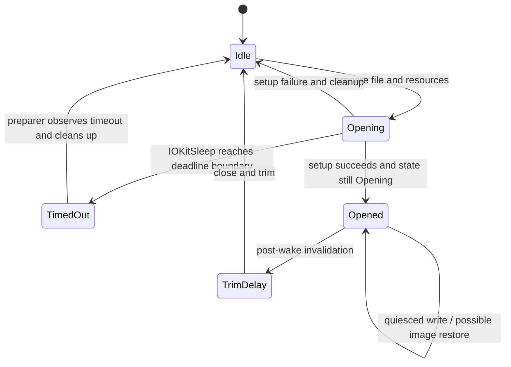

# Hibernation image creation and polled I/O

[Platform](README.md) · [CPU power lifecycle](cpu-power-lifecycle.md) · [Image restore](hibernation-restore.md) · [System sleep policy](../drivers/system-sleep-and-wake.md)

Hibernation saves selected physical memory so that the existing kernel can resume later. It is neither a dump of all RAM nor a replay of cold startup. XNU first obtains a stable file-to-device mapping while ordinary filesystem I/O is possible, prepares VM and buffers, then writes the image in a quiesced context through storage drivers' polling interfaces. The restored kernel later finishes reading its own image before returning to ordinary execution. [`IOHibernateSystemSleep`](../../../xnu/iokit/Kernel/IOHibernateIO.cpp#L502), [`hibernate_write_image`](../../../xnu/iokit/Kernel/IOHibernateIO.cpp#L1691).

This chapter follows the common writer and its visible machine branches. Root-domain decisions about whether to sleep, notification acknowledgments, and CPU orchestration are covered in [system sleep and wake](../drivers/system-sleep-and-wake.md). The distinction matters: successful image preparation does not mean an image has been written, and a writer return code does not by itself prove that firmware entered a particular power state.

## 1. Three different kinds of state

The main state holders answer different questions:

| Holder | Fields or values | Role |
| --- | --- | --- |
| File coordination | `gFSState`, `gFSLock`; idle, opening, opened, timed out, trim delay | Serializes file preparation, late timeout, and eventual disposal |
| Hibernation state | `gIOHibernateState`: inactive, hibernating, waking from hibernate | Distinguishes the saved image's state from an ordinary memory-preserving wake |
| Machine state | per-CPU `cpu_hibernate`, machine VM-lock safety flag | Selects image hooks and records the interval in which VM queues are single-threaded |
| Image resources | `IOHibernateVars` | Owns three page lists, source/scratch and handoff buffers, file variables, preview/video state, and key material |
| Disk description | `IOHibernateImageHeader`, `IOPolledFileIOVars` | Describes image sizes, physical-page runs, file extents, encryption intervals, and buffered device transfers |

These are coordinated rather than interchangeable. `IOHibernateSystemSleep()` initially sets the global hibernation state inactive; only successful resource preparation publishes `Hibernating`. The actual writer subsequently clears the *running kernel's* state back to inactive after writing. The saved copy still contains the earlier state, allowing ordinary wake and image restore to take different branches. [Resource layout](../../../xnu/iokit/Kernel/IOHibernateInternal.h#L45), [setup publication](../../../xnu/iokit/Kernel/IOHibernateIO.cpp#L888), [writer completion](../../../xnu/iokit/Kernel/IOHibernateIO.cpp#L2360).



This diagram describes file coordination, not the whole power state machine. The image can be written while the file state remains `Opened`, and resource teardown and file closure occur at separate wake stages.

## 2. Prepare resources while blocking remains possible

`IOHibernateSystemSleep()` obtains the mode and image pathname, allocates a temporary `IOHibernateVars`, and takes `gFSLock`. It finishes an earlier delayed trim, rejects a busy file state, publishes `Opening`, then drops the lock for potentially blocking allocation and filesystem work. Source and handoff buffers are allocated before the constrained writer phase. Three architecture-sized page lists are allocated together; partial allocation failure frees earlier lists. [Preparation](../../../xnu/iokit/Kernel/IOHibernateIO.cpp#L502), [list allocation](../../../xnu/osfmk/kern/hibernate.c#L50).

An optional preflight page count estimates the minimum file size from memory demand, the previous compression ratio, bitmap and preview allowances, and margin. It is an estimate, not a reservation of an immutable set of pages. The later final scan occurs after CPU and VM quiescence. ARM64 and x86 also choose different maximum-size policies here; reading a single numeric mode as a product-wide guarantee would lose those branches. [Sizing](../../../xnu/iokit/Kernel/IOHibernateIO.cpp#L612).

`hibernate_pin_swap(TRUE)` brackets setup. Later the setup result records whether swap files are pinned and whether the image device is an SSD, which influences standby settings. The matching `hibernate_pin_swap(FALSE)` runs on the common completion path. This temporary setup operation should not be confused with the separately queried fact that swap files satisfy the hibernation pinning requirement. [Pin and preparation](../../../xnu/iokit/Kernel/IOHibernateIO.cpp#L604), [pin release](../../../xnu/iokit/Kernel/IOHibernateIO.cpp#L887).

`IOPolledFileOpen()` calls `kern_open_file_for_direct_io()`. That interface creates or sizes the image file and obtains device extents through a callback. The returned `IOPolledFileIOVars` retains the file reference, extent data, media/poller association, maximum transfer size, and block size. The writer later translates a logical image offset using these extents rather than issuing vnode writes during CPU shutdown. This does not mean every filesystem or device supports the interface. Failure to obtain a usable file or polling stack aborts preparation. [File open and extents](../../../xnu/iokit/Kernel/IOPolledInterface.cpp#L600), [filesystem-side direct I/O](../../../xnu/bsd/kern/kern_symfile.c).

`IOWriteExtentsToFile()` writes an initially open-signature header through the normal direct-file interface. The header carries two inline extents; any remainder is written separately. This early header is not the final committed image header. The final writer returns to offset zero after the payload is complete and writes the final sizes and statistics. [Initial extent record](../../../xnu/iokit/Kernel/IOHibernateIO.cpp#L981), [final header](../../../xnu/iokit/Kernel/IOHibernateIO.cpp#L2264).

The pollers are probed/opened in preflight state and `hibernate_setup()` prepares VM. On success, setup rechecks `gFSState` under the lock before moving resource ownership into global storage. A concurrent `IOHibernateIOKitSleep()` can change `Opening` to `TimedOut`; late completion must then dispose of its resources. Success copies the temporary variable structure into `gIOHibernateVars`, moves the file variables into static `gFileVars`, and frees only the temporary shells. Failure invokes teardown and closes the file instead. [Timeout](../../../xnu/iokit/Kernel/IOHibernateIO.cpp#L1139), [ownership publication](../../../xnu/iokit/Kernel/IOHibernateIO.cpp#L888).

## 3. Flushing reduces the image; it is not the final snapshot

`hibernate_setup()` builds a compact mapping from `vm_pages[]` indices to physical-page runs and resets statistics. When requested and a compressor is present, it synchronizes internal memory objects, takes the decompressor lock, records that teardown must release it, and calls `hibernate_flush_memory()`. That lock remains associated with the hibernation preparation lifetime. The flush result is not propagated as a setup error by this caller. [Setup/teardown](../../../xnu/osfmk/kern/hibernate.c#L94).

The flushing pass visits speculative, inactive, anonymous, cleaned, and active queues, then drains pageout work. `hibernate_flush_queue()` holds the page-queue lock and only *tries* object locks. It drops the queue lock to pause on contention and eventually skips a repeatedly unavailable object. Busy, cleaning, laundry, absent, and error pages are skipped. Hardware ref/mod information can turn a nominally clean page dirty. Eligible dirty pages are removed from ordinary queues and sent through `vm_pageout_cluster()`; internal pages are disconnected with compressor options first. [Queue flushing](../../../xnu/osfmk/vm/vm_resident.c#L8888), [pass ordering](../../../xnu/osfmk/vm/vm_resident.c#L9113).

This is a progress-oriented scan, not a demand that all pageable memory disappear. Throttling waits are bounded. Persistent external-pageout throttling can set `hibernate_skip_external`; an external drain timeout is tolerated, whereas the corresponding internal timeout fails the flush pass. `hibernate_flush_memory()` proceeds to compressor flushing and buffer-cache/zone collection only after the dirty-page pass succeeds, then records statistics. The final image scanner still has to preserve whatever remains necessary. [Drain rules](../../../xnu/osfmk/vm/vm_resident.c#L8853), [flush completion](../../../xnu/osfmk/vm/vm_resident.c#L9198).

## 4. A bitmap bit means exclusion, not inclusion

`hibernate_page_list_t` holds a variable-sized array of banks. Each `hibernate_bitmap_t` identifies a physical first/last page and an array of bitmap words. A set bit means that page is excluded from the corresponding save list. The writer iterates runs of *clear* bits. `page_list_wired` selects the first restore stage; `page_list` ultimately selects the remaining pages. Their meaning changes during construction, so an intermediate bit pattern cannot be read as the final image layout. [Structures](../../../xnu/iokit/IOKit/IOHibernatePrivate.h#L412), [state setter and iterator](../../../xnu/iokit/Kernel/IOHibernateIO.cpp#L414).

The ARM allocator describes kernel-managed memory using one DRAM bank. The x86 allocator derives banks from EFI memory descriptors, merges suitable adjacent ranges, and excludes runtime services and non-DRAM classes according to its switch. These are architecture-specific descriptions of eligible physical memory, not arbitrary VM address ranges. [ARM banks](../../../xnu/osfmk/arm64/hibernate_arm64.c#L89), [x86 banks](../../../xnu/osfmk/i386/hibernate_i386.c#L60).

`hibernate_page_list_setall()` has two modes. Preflight takes normal queue/object/free locks and computes counts without materializing the final lists. The final scan relies on a previously established single-threaded VM interval; assertion builds additionally take selected locks to detect violations. Machine hooks first acquire the relevant queues to synchronize with existing users, then release them after interrupts and execution have been quiesced. The safety flag survives that release until the machine wake hook ends the interval. This is not permission to run these routines concurrently without locks. [Scanner](../../../xnu/osfmk/vm/vm_resident.c#L9509), [queue lock order](../../../xnu/osfmk/vm/vm_resident.c#L9454), [ARM interval](../../../xnu/osfmk/arm64/hibernate_arm64.c#L303), [x86 interval](../../../xnu/osfmk/i386/hibernate_i386.c#L265).

Free pages are excluded from both lists. Ordinary pageable queues are excluded from the wired list. The discard decision additionally requires that a page be usable and not wired, precious, busy, cleaning, or laundry; it consults hardware ref/mod and permits clean pages or pages in volatile/empty purgeable objects. A configured budget can preserve recently referenced executable external pages. Under SPTM that budget is zero, while selected JIT/debug/internal executable frame types are forced into the wired list by a separate rule. Compressor-object pages remain saved in the later list. [Discard predicate](../../../xnu/osfmk/vm/vm_resident.c#L9282), [SPTM classification](../../../xnu/osfmk/vm/vm_resident.c#L9488), [budget](../../../xnu/osfmk/vm/vm_resident.c#L8824).

Finally, all pages selected as wired are excluded from the other list:

[Separating wired from later pages](../../../xnu/osfmk/vm/vm_resident.c#L9916):
<!-- source-excerpt: ../../../xnu/osfmk/vm/vm_resident.c#L9916-L9926 -->
```c
	if (!preflight) {
		// pull wired from hibernate_bitmap
		bitmap = &page_list->bank_bitmap[0];
		bitmap_wired = &page_list_wired->bank_bitmap[0];
		for (bank = 0; bank < page_list->bank_count; bank++) {
			for (uint32_t i = 0; i < bitmap->bitmapwords; i++) {
				bitmap->bitmap[i] = bitmap->bitmap[i] | ~bitmap_wired->bitmap[i];
			}
			bitmap = (hibernate_bitmap_t *)&bitmap->bitmap[bitmap->bitmapwords];
			bitmap_wired = (hibernate_bitmap_t *) &bitmap_wired->bitmap[bitmap_wired->bitmapwords];
		}
```

Consequently, “wired image” is a restore-stage classification. On SPTM it can include normally pageable memory whose frame type requires early restoration. It should not be equated mechanically with `vm_page.wire_count`.

## 5. Discard, metadata compaction, and scratch eligibility

When the writer requests `discard_all`, eligible pages are actually removed before saving. `hibernate_discard_page()` disconnects mappings, updates volatile purgeable objects and their accounting, and frees the page. In the sleep-and-image case, excluded clean pages can instead remain present during ordinary RAM wake; on image restore, `hibernate_page_list_discard()` removes the corresponding resident metadata before later-page restoration. [Discard implementation](../../../xnu/osfmk/vm/vm_resident.c#L9385), [restore discard](../../../xnu/iokit/Kernel/IOHibernateIO.cpp#L2488).

The aggressive discard path also calls `hibernate_teardown_vm_structs()`. It preserves a mapping back to original page-descriptor locations, compacts retained `vm_page` structures, records non-array hash members separately, and omits now-unneeded hash/descriptor pages from the image. This is why restore must explicitly rebuild VM bookkeeping; restoring memory bytes alone does not recreate the intentionally omitted structures. [Compaction](../../../xnu/osfmk/vm/vm_resident.c#L10370), [rebuild](hibernation-restore.md#6-rebuilding-vm-metadata-before-ordinary-allocation).

An especially important ordering separates “do not save” from “safe to overwrite while restoring.” The writer excludes its I/O and source buffers, serializes the wired bitmap, and only then applies volatile exclusions:

[Bitmap serialization boundary](../../../xnu/iokit/Kernel/IOHibernateIO.cpp#L1995):
<!-- source-excerpt: ../../../xnu/iokit/Kernel/IOHibernateIO.cpp#L1995-L2007 -->
```cpp
		// copy out bitmap of pages available for trashing during restore

		bitmap_size = vars->page_list_wired->list_size;
		src = (uint8_t *) vars->page_list_wired;
		err = IOHibernatePolledFileWrite(vars, src, bitmap_size, cryptvars);
		if (kIOReturnSuccess != err) {
			break;
		}

		// mark more areas for no save, but these are not available
		// for trashing during restore

		hibernate_page_list_set_volatile(vars->page_list, vars->page_list_wired, &pageCount);
```

Early restore uses the serialized bitmap as a scratch allocator. A page excluded only afterward is therefore omitted from saved payloads but remains unavailable as early scratch. ARM uses this for the restore stack and prohibited-write I/O ranges. SPTM also excludes ranges that iBoot loads separately from disk. The distinction prevents a restore scratch allocation from overwriting the stack it is executing on or a range the platform says must not be touched. [Machine exclusions](../../../xnu/osfmk/arm64/hibernate_arm64.c#L175), [volatile exclusions](../../../xnu/osfmk/arm64/hibernate_arm64.c#L241).

## 6. Image layout and page encoding

`IOHibernateImageHeader` is a shared bootloader/kernel ABI. Non-ARM64 restore asserts a 512-byte header; ARM64 adds substantial protected-metadata and authentication fields and has no such fixed-size assertion. The fields describe both transport and restoration: total `imageSize`, first-stage `image1Size`, restore-code physical/virtual locations and entry/stack offsets, page/bitmap counts, checksums, extent map, encryption boundaries, handoff pages, time state, and platform-specific data. [Header](../../../xnu/iokit/IOKit/IOHibernatePrivate.h#L215), [size assertion](../../../xnu/iokit/Kernel/IOHibernateRestoreKernel.c#L612).


The drawing shows the common writer's logical order. Block padding, extent overflow, encryption boundaries, and platform-provided segment data add details; it is not a universal byte-offset specification for every ARM secure-image producer.

The writer records the restore code's location and validates that entrypoint/stack offsets fit its saved region. It copies the code region with the restore stack replaced by zeros. Preview data has its own physical-page index so early restore can put it back independently. The page streams then use `(first physical page number, count)` pairs, followed by one tagged payload per page. A zero count ends the stream. [Restore-code capture](../../../xnu/iokit/Kernel/IOHibernateIO.cpp#L1877), [preview](../../../xnu/iokit/Kernel/IOHibernateIO.cpp#L1949), [page runs](../../../xnu/iokit/Kernel/IOHibernateIO.cpp#L2093).

Each page is copied into the preallocated source buffer and checksummed. `WKdm_compress_new()` has three relevant outcomes: failure to compress within the limit saves a full page, zero indicates a repeated-word page saved as four bytes, and another positive length saves compressed data. The tag combines the length and fixed signature; payload storage is rounded to four bytes. Restore recognizes the four-byte form by filling the page with that word. Compression workspace is allocated before quiescence, rather than allocating a compressor object for each page. [Compression and tag construction](../../../xnu/iokit/Kernel/IOHibernateIO.cpp#L2142).

The source also defines an SK-encrypted tag and an `encrypted` payload pointer, but this visible writer initializes that pointer to `NULL` without a local assignment to a secure payload. The tag's existence is not evidence that the complete secure-side encryption producer is present here.

## 7. Encryption has several distinct boundaries

The common software path prepares separate wired and later-page AES contexts. It derives a wired working key using the wired key and volume-key bytes, initializes CBC state, and clears the stored source keys after key schedule preparation. At the later-image boundary it transfers the chaining IV into the wake context. `IOPolledFileWrite()` encrypts only the overlap with `encryptStart`/`encryptEnd`, then advances the IV from the last ciphertext block. Restore obtains required IV handoff data and decrypts read buffers. [Context preparation](../../../xnu/iokit/Kernel/IOHibernateIO.cpp#L1767), [CBC writer](../../../xnu/iokit/Kernel/IOPolledInterface.cpp#L943), [later-image transition](../../../xnu/iokit/Kernel/IOHibernateIO.cpp#L2083).

Hardware encryption is a separate poller contract: setup obtains a volume/hibernation key, and the constrained phase calls `setEncryptionKey()` on the poller stack. Successful hardware setup sets `hwEncrypt`; later restore must obtain the matching volume-key handoff and reinstall the key. x86 obtains a volume key through `IOGetVolumeCryptKey()`, while ARM calls `IOGetHibernationCryptKey()` and also receives a software seed used in the boot image path. This tree exposes those calls, not the storage controller's cryptographic implementation. [Key acquisition](../../../xnu/iokit/Kernel/IOPolledInterface.cpp#L695), [hardware selection](../../../xnu/iokit/Kernel/IOHibernateIO.cpp#L1837).

ARM header fields additionally describe image and region HMACs, protected metadata, and Exclaves data. Their ABI comments and secure-HMAC declarations establish interfaces, not a complete locally implemented authentication chain. `hibernate_secure_hmac.c` in this checkout contains includes but no implementation of the declared secure-HMAC routines, and the ARM writer's segment branch refers to `segInfo` without a definition visible in this translation unit. Those source limitations prevent claiming that this checkout alone reconstructs or builds every secure-image configuration. [ARM header contract](../../../xnu/iokit/IOKit/IOHibernatePrivate.h#L303), [secure interface](../../../xnu/osfmk/arm64/hibernate_secure_hmac.h#L45), [visible unit](../../../xnu/osfmk/arm64/hibernate_secure_hmac.c), [segment branch](../../../xnu/iokit/Kernel/IOHibernateIO.cpp#L2018).

## 8. Polling replaces the ordinary completion environment

`IOPolledInterface` exposes `probe`, `open`, `close`, `startIO`, `checkForWork`, and optional encryption-key setup. The helper walks media providers to collect participating pollers. Probe/open proceed through the array in reverse order; close traverses forward. Preflight allocates a shared I/O buffer and publishes the active property. Before-sleep and after-sleep opens switch existing drivers into the constrained transfer phase; postflight closes the preparation lifetime and releases the buffer when the open count reaches zero. [Interface](../../../xnu/iokit/IOKit/IOPolledInterface.h#L69), [stack/open/close](../../../xnu/iokit/Kernel/IOPolledInterface.cpp#L97).

`IOPolledFileWrite()` uses two buffer halves. It fills one while the preceding transfer uses the other, waits for the previous operation before submitting another, calculates the device offset from the current extent, then advances to the next half/extent. A null, zero-length write pads to a block boundary and flushes buffered bytes. `IOPolledFileRead()` similarly starts read-ahead into one half while the caller consumes the other; decryption is applied to the completed half. Extent exhaustion returns overrun. [Buffered write](../../../xnu/iokit/Kernel/IOPolledInterface.cpp#L894), [read-ahead](../../../xnu/iokit/Kernel/IOPolledInterface.cpp#L1053).

`IOStartPolledIO()` submits to the first poller and installs a completion callback that writes `ioStatus`. `IOPolledFilePollersIODone()` repeatedly calls every poller's `checkForWork()` until that callback changes the sentinel status. A reported error is remembered, but does not itself stop waiting for completion. Although the code computes a two-second deadline, its forced-timeout branch is disabled:

[Actual timeout condition](../../../xnu/iokit/Kernel/IOPolledInterface.cpp#L407):
<!-- source-excerpt: ../../../xnu/iokit/Kernel/IOPolledInterface.cpp#L407-L410 -->
```cpp
		if ((false) && (kIOReturnSuccess == err) && (mach_absolute_time() > AbsoluteTime_to_scalar(&deadline))) {
			HIBLOG("IOPolledInterface::forced timeout\n");
			vars->ioStatus = kIOReturnTimeout;
		}
```

Therefore this helper does not provide an enforced two-second escape from a non-completing driver. Progress depends on the pollers and underlying hardware. Abortability is also explicit: the requested wait mode is intersected with the stack's `abortable` setting; a non-abortable phase ignores `kIOReturnAborted` from `checkForWork()`. The outer hibernation write wrapper separately checks `hibernate_should_abort()`. [Completion loop](../../../xnu/iokit/Kernel/IOPolledInterface.cpp#L379), [writer abort wrapper](../../../xnu/iokit/Kernel/IOHibernateIO.cpp#L1672).

## 9. Completion, errors, and what remains alive

After writing runs, the writer records total and first-stage lengths, checksum/compression statistics, extents, device information, and time fields; it rewrites the header and drains buffered I/O. It closes the before-sleep poller phase, using the aborted close state on failure. An overrun adjusts the remembered compression estimate, but does not locally retry the complete image. Resources remain available for either restore or ordinary wake, and the final file invalidation/trim occurs later. [Writer finish](../../../xnu/iokit/Kernel/IOHibernateIO.cpp#L2252), [wake disposal](hibernation-restore.md#8-normal-context-cleanup-and-delayed-file-disposal).

Once ARM64 reaches this committed writer path, failure is fatal:

[ARM64 post-write outcome](../../../xnu/iokit/Kernel/IOHibernateIO.cpp#L2382):
<!-- source-excerpt: ../../../xnu/iokit/Kernel/IOHibernateIO.cpp#L2382-L2391 -->
```cpp
#if defined(__arm64__)
	if (kIOReturnSuccess == err) {
		return kIOHibernatePostWriteHalt;
	} else {
		// on ARM, once ApplePMGR decides we're hibernating, we can't turn back
		// see: <rdar://problem/63848862> Tonga ApplePMGR diff quiesce path support
		vm_panic_hibernate_write_image_failed(err, vars->fileVars->fileSizeMin,
		    vars->fileVars->fileSizeMax, vars->fileVars->fileSize);
		return err; //not coming here post panic
	}
```

The x86 branch returns Sleep, Restart, or Halt on success according to mode; aborted writes return the named `PostWriteWake` value, and other errors return Sleep. That is only the writer contract. The visible `acpi_hibernate()` caller explicitly distinguishes Halt and Restart, then uses its ordinary callback path for other values; it does not implement a separate `PostWriteWake` branch. See [x86 sleep/resume](x86-sleep-and-resume.md) for that exact call path rather than inferring behavior from the enum name.

## Sources inspected and limits

Deep reads cover `IOHibernateSystemSleep`, setup/publication/timeout, page-list allocation and final scan, dirty-queue flushing and discard, VM metadata compaction, the common image writer, poller collection/open/close/completion, and buffered reads/writes. Headers and architecture hooks were read to distinguish shared ABI from configuration-specific implementation. No kernel build, firmware boot, disk fault injection, or cryptographic validation was performed. Storage-driver polling implementations, bootloader validation, SEP/SPTM internals, and the omitted secure-HMAC producer remain external. The next chapter follows the actual early and late restore bodies and the resources they must reestablish.
