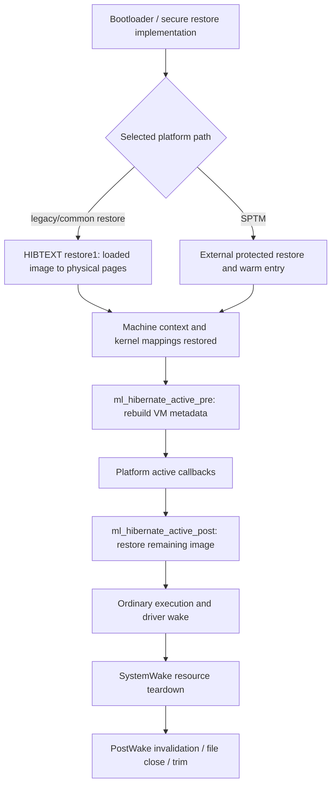

# Hibernation restore: physical memory, VM state, and wake resources

[Platform](README.md) · [Image creation](hibernation-image-creation.md) · [x86 sleep/resume](x86-sleep-and-resume.md) · [ARM64 CPU lifecycle](cpu-power-lifecycle.md)

The saved kernel cannot initially run its ordinary VM allocator or filesystem stack: much of the memory supporting those services has not been restored. The source separates an early, restricted restoration of the first image from a later polled read performed by the resumed kernel. ARM64 SPTM moves much of the early work outside XNU; its visible reentry consumes monitor-provided arguments rather than proving that the legacy restore loop ran. [Common early entry](../../../xnu/iokit/Kernel/IOHibernateRestoreKernel.c#L574), [late restore](../../../xnu/iokit/Kernel/IOHibernateIO.cpp#L2414), [SPTM distinction](../../../xnu/osfmk/arm64/hibernate_restore.c#L29).

The bootloader that locates, authenticates, decrypts, and loads the first-stage image is outside this checkout. The header describes that contract, but this chapter starts where local code receives the loaded image or SPTM warm-entry arguments. The additive page sums used by common restore are bookkeeping/checksums; they must not be substituted for the external authentication protocol.

## 1. Restoration has several completion points



`IOCPURunPlatformActiveActions()` explicitly brackets platform active callbacks with the machine pre/post hooks. This ordering allows VM metadata to be reconstructed before the callbacks, and the storage polling machinery to be brought back before the later image read. It does not mean every driver has completed its normal power-state transition at that point. [Callback bracket](../../../xnu/iokit/Kernel/IOPlatformActions.cpp#L144), [system-wide wake](../drivers/system-sleep-and-wake.md).

The first-stage image normally covers wired pages and any extra machine-selected early pages. “Later image” means the remaining saved pages, not a lazy on-demand paging scheme: the visible `hibernate_machine_init()` reads that stream synchronously before returning. Its routine is entered only for image restore; the ordinary RAM-preserving wake returns without reading image2. [State gate](../../../xnu/iokit/Kernel/IOHibernateIO.cpp#L2432).

## 2. Early restore starts with an image in physical memory

`hibernate_kernel_entrypoint()` receives the image-header physical page number in `p1`, converts it to a physical address, and copies the header into the restore environment's header storage using `pal_hib_map(IMAGE_AREA, ...)`. It computes the serialized bitmap location from the header's extent-map size, restore-code page count, and preview size. The sum `headerPhys + image1Size` is checked for overflow and the maximum representable page address before the image end is converted to a page number. [Entry and address arithmetic](../../../xnu/iokit/Kernel/IOHibernateRestoreKernel.c#L574).

The loaded image and handoff pages must not be borrowed as scratch while they still contain unread inputs. `hibernate_reserve_restore_pages()` clears their bits in the available-page bitmap. On x86 the common entry calls it; on legacy ARM64 the trampoline has already done so while constructing its mappings. Recall the inverted bitmap convention: a set bit excludes a page from the first-stage image and permits early restore to borrow it, subject to these additional reservations. [Reservations](../../../xnu/iokit/Kernel/IOHibernateRestoreKernel.c#L556), [writer's bitmap boundary](hibernation-image-creation.md#5-discard-metadata-compaction-and-scratch-eligibility).

`hibernate_page_list_grab()` uses a monotonically advancing physical-page cursor. It returns the current candidate and scans for the next set bit, crossing physical banks through `hibernate_page_bitmap_pin()`. The initial call seeds the cursor; subsequent calls obtain actual scratch pages. Exhaustion is a restore assertion failure, not a request to the ordinary VM allocator. The allocator does not need to traverse task maps, objects, or zone metadata. [Scratch-page selection](../../../xnu/iokit/Kernel/IOHibernateRestoreKernel.c#L426).

Before copying pages, early restore allocates WKdm scratch and calls machine hooks for restore initialization. The common stage machine processes handoff data, preview data if present, then physical-page runs. Handoff destination pages come from the saved `gIOHibernateHandoffPages[]` array. Preview destinations come from a separate page index. Ordinary image pages carry the tag/length encoding described in [image creation](hibernation-image-creation.md#6-image-layout-and-page-encoding). A zero count advances or ends the stage. [Stage loop](../../../xnu/iokit/Kernel/IOHibernateRestoreKernel.c#L681).

`store_one_page()` maps the destination and either decompresses, fills it with a repeated 32-bit word, or copies a full raw page. It computes the checksum after producing the restored bytes. Handoff pages are restored but excluded from the accumulated image checksum. ARM decompression may copy a misaligned compressed source into aligned scratch before executing the hardware WKdm instruction; x86 calls `WKdm_decompress_new()`. These implementations have different alignment and execution constraints. [Page store](../../../xnu/iokit/Kernel/IOHibernateRestoreKernel.c#L525), [ARM decompression](../../../xnu/osfmk/arm64/hibernate_restore.c#L114), [x86 decompression](../../../xnu/osfmk/i386/hibernate_restore.c#L128).

## 3. Physical collisions are deferred without losing input

The bootloader can place the image in RAM that overlaps the original destinations. Immediately copying every page would overwrite compressed data that has not yet been read. The common loop checks each destination against the serialized bitmap, unread image range, and still-live handoff/preview index ranges:

[Collision tests](../../../xnu/iokit/Kernel/IOHibernateRestoreKernel.c#L771):
<!-- source-excerpt: ../../../xnu/iokit/Kernel/IOHibernateRestoreKernel.c#L771-L781 -->
```c
			conflicts = (ppnum >= atop_64_ppnum(mapPhys)) && (ppnum <= lastMapPage);

			conflicts |= ((ppnum >= atop_64_ppnum(imageReadPhys)) && (ppnum <= lastImagePage));

			if (stage >= pal_hib_restore_stage_handoff_data) {
				conflicts |= ((ppnum >= atop_64_ppnum(srcPhys)) && (ppnum <= (handoffPages + handoffPageCount - 1)));
			}

			if (stage >= pal_hib_restore_stage_preview_pages) {
				conflicts |= ((ppnum >= atop_64_ppnum(pageIndexPhys)) && (ppnum <= lastPageIndexPage));
			}
```

A safe destination is restored immediately. A conflicting destination instead produces a record in `hibernate_scratch_t`: destination page, compressed length, stage identifier, then exactly the compressed payload. The linked scratch store reserves the end of each scratch page for the next physical-page number. Thus arbitrarily many records can span pages without allocating an array proportional to the collision count. These are borrowed pages from the restore bitmap, not `kalloc` objects. [Deferred record](../../../xnu/iokit/Kernel/IOHibernateRestoreKernel.c#L793), [scratch store](../../../xnu/iokit/Kernel/IOHibernateRestoreKernel.c#L453).

For example, suppose a saved destination page currently holds a later compressed run. The first pass copies its payload into scratch and advances over the source. Once all runs have been consumed, the original image storage is no longer needed. The second pass reads each scratch record through an additional copy page and restores its destination. Storing compressed bytes preserves scratch capacity; the copy page prevents reusing the mapped scratch window as an unstable decompressor source. [Replay](../../../xnu/iokit/Kernel/IOHibernateRestoreKernel.c#L813).

This mechanism is more specific than “restore handles overlap.” It protects the inputs that remain live at each stage and delays the writes that would destroy them. The scratch list itself is safe because its pages were chosen from the available set after reserving the loaded image/handoff inputs. The final `pal_hib_patchup()` is architecture-specific; in the visible ARM legacy implementation it resets cluster CTRR bookkeeping, while the x86 hook is empty.

After replay, the routine records actual first-image checksum, number of restored pages, conflict count, and scratch cursor. It publishes `WakingFromHibernate`. The x86 branch flushes caches and calls the saved wake entrypoint. The ARM branch returns to the machine entrypoint. That is the completion of this stage, not completion of the entire image read. [Completion](../../../xnu/iokit/Kernel/IOHibernateRestoreKernel.c#L831).

## 4. Restore mappings differ from normal pmap operations

The x86 `pal_hib_map()` accepts a fixed set of restore mapping windows. Low physical addresses use the existing identity mapping. Higher addresses are mapped by rewriting two adjacent large-page entries in `BootPTD`, preserving the offset into the large page and invalidating both translations with `invlpg`. Mapping two entries allows a source region to cross a large-page boundary. These are temporary boot tables; no task `vm_map`, object lookup, or PV-entry lifecycle is involved. [x86 restore mapping](../../../xnu/osfmk/i386/hibernate_restore.c#L73), [normal x86 pmap](../vm/pmap-x86.md).

Legacy ARM64 `pal_hib_resume_tramp()` constructs temporary tables because it cannot initially use the saved kernel's page tables. It locates the memory bank containing restore code, reserves loaded-image inputs, and borrows pages for table construction. Its local mapper uses a 16 KiB granule and levels 1–3, creates block entries when size/alignment allow, and otherwise descends into allocated lower-level tables. It asserts against unsupported replacement of an existing block. These are properties of this restore implementation, not a claim that every XNU pmap configuration uses the same geometry. [Temporary mapper](../../../xnu/osfmk/arm64/hibernate_restore.c#L145), [trampoline](../../../xnu/osfmk/arm64/hibernate_restore.c#L305).

The trampoline builds TTBR1 mappings for original executable/read-only/writable image segments and a separate slid mapping for other memory. It derives a small randomization input from bytes of the header HMAC; this is the source's local mapping choice, not an independently demonstrated entropy source. TTBR0 supplies identity mappings for restore text, the loaded image, handoff pages, and required device registers. It sets `gHibTramp.memSlide` only after building the tables, and subsequent table modification is forbidden by the mapper's assertion. [Mapping construction](../../../xnu/osfmk/arm64/hibernate_restore.c#L343).

`pal_hib_map()` then maps destination/copy/scratch pages using that slide and treats image/bitmap addresses as identity mapped. The original kernel tables are themselves saved memory and become usable again only after the corresponding pages are restored. The exact assembly/firmware activation and authentication sequence is not fully present here. Do not splice this legacy trampoline into the SPTM warm-entry path as though both execute on every ARM64 system.

## 5. SPTM reentry consumes restored state and borrowed handoff pages

The ARM restore source explicitly says that most of its HIBTEXT/page restoration responsibilities move to SPTM on SPTM-based systems. The visible SPTM assembly routes hibernation through the warm path, relying on SPTM's prior vector-register initialization. It saves the hibernation argument pointer from `x3`, identifies the CPU data record, installs exception/interrupt stacks, and supplies CPU data plus that pointer to the validated reset handler. [SPTM warm selection](../../../xnu/osfmk/arm64/sptm/start_sptm.s#L111), [argument and stack setup](../../../xnu/osfmk/arm64/sptm/start_sptm.s#L178).

`arm_init_cpu()` must preserve the handoff before ordinary initialization can reuse its borrowed pages:

[Early handoff copy](../../../xnu/osfmk/arm64/sptm/arm_init_sptm.c#L1162):
<!-- source-excerpt: ../../../xnu/osfmk/arm64/sptm/arm_init_sptm.c#L1162-L1168 -->
```c
	if ((hibargs != 0) && (hibargs->hib_header_phys != 0) && (hibargs->handoff_page_count > 0)) {
		/*
		 * We must copy the handoff region before anything else because the physical pages
		 * holding the handoff region are not tracked by xnu as in-use.
		 */
		HibernationCopyHandoffRegionFromPageArray(&hibargs->handoff_pages[0], hibargs->handoff_page_count);
	}
```

`HibernationCopyHandoffRegionFromPageArray()` returns when no destination handoff buffer exists; otherwise it copies each supplied physical page through the physical aperture into that preallocated buffer. This helper does not itself compare the argument count with the buffer capacity, so its caller/provider contract matters. The later common handoff parser separately checks the header's handoff-page count and record bounds. `HAS_MTE` builds temporarily disable tag checking around this copy because a borrowed page may come from a tagged free-page queue while being accessed through an untagged aperture pointer. The same issue is handled while copying the image header. This is a narrowly scoped early-resume access rule, not a general exemption for arbitrary mappings. [Handoff helper](../../../xnu/iokit/Kernel/IOHibernateIO.cpp#L282), [header copy](../../../xnu/osfmk/arm64/sptm/arm_init_sptm.c#L1195).

With valid hibernation arguments, C initialization publishes `WakingFromHibernate`, restores header data, and enables the hibernation UART mode. For the boot CPU while quiescing, it restores the saved absolute-time point and the bootloader-provided continuous-clock offset. It checks the expected idle-thread preemption count and decrements it before proceeding through CPU/timebase initialization and normal context resumption. The adjacent comment mentions PPL context, but the code is in the SPTM initialization unit; the safe conclusion is the explicitly checked count repair, not an invented intermediate PPL call. [Time/preemption repair](../../../xnu/osfmk/arm64/sptm/arm_init_sptm.c#L1234).

SPTM-controlled frame restoration, HMAC validation, monitor-owned stack setup, and secure-world encryption algorithms are not implemented by these XNU callers. The shared image metadata and the warm-entry ABI expose their inputs/outputs. [Protected execution](../security/sptm.md) supplies the larger authority boundary; [image creation limits](hibernation-image-creation.md#7-encryption-has-several-distinct-boundaries) explains the incomplete local secure-image producer.

## 6. Rebuilding VM metadata before ordinary allocation

The pre-active hook invokes `hibernate_rebuild_vm_structs()` when required. The routine is a no-op unless teardown set `hibernate_rebuild_needed`. It first invokes the pmap rebuild hook, clears page-hash buckets, and marks uninitialized page descriptors transient so buddy-page searches cannot interpret random contents as valid state. [Rebuild entry](../../../xnu/osfmk/vm/vm_resident.c#L10276).

It then walks the compacted retained descriptors backward. Each descriptor's temporary `vmp_next_m` field records its original location. The descriptor is moved back if needed, its temporary link is cleared, and hashed pages are reinserted into the object/offset hash. The gaps are reconstructed as free `vm_page` descriptors using the physical-run map created during setup. Free-page insertion is batched; `HAS_MTE` restores the descriptor's tagged-page classification from pmap. [Reverse relocation](../../../xnu/osfmk/vm/vm_resident.c#L10301), [free descriptor reconstruction](../../../xnu/osfmk/vm/vm_resident.c#L10252).

Finally, separately recorded hash members outside the main `vm_pages[]` array are reinserted, free-count accounting is checked, and the rebuild-needed flag is cleared. This restores metadata the writer deliberately did not preserve. It is not a general-purpose repair routine for an arbitrary corrupt image, and it assumes the saved compacted descriptors and physical-run map are sound.

The wake hooks deliberately differ. x86's pre-hook calls rebuild unconditionally and lets the internal flag decide. ARM's pre-hook gates it on image-restore state and, under SPTM, publishes `SECURE_HMAC_HIB_RESTORE` to pmap. The active callback queue runs between pre and post. ARM's post hook finishes the image read and ends the single-threaded VM interval:

[ARM post-active completion](../../../xnu/osfmk/arm64/machine_routines.c#L3053):
<!-- source-excerpt: ../../../xnu/osfmk/arm64/machine_routines.c#L3053-L3057 -->
```c
	if (kIOHibernateStateWakingFromHibernate == gIOHibernateState) {
		hibernate_machine_init();
		hibernate_vm_lock_end();
		current_cpu_datap()->cpu_hibernate = 0;
	}
```

The x86 post hook instead tests the CPU hibernate flag, reads the later image, and clears that flag; the x86 VM-lock interval is ended by its machine/platform protocol. These distinctions should be retained when tracing a particular configuration. [x86 hooks](../../../xnu/osfmk/i386/acpi.c#L395).

## 7. Late restore reads all remaining page runs

`hibernate_machine_init()` requires retained file variables and pollers, then checks `WakingFromHibernate`. When the saved mode combined RAM sleep with clean-page exclusion, it first discards the excluded resident pages through `hibernate_page_list_discard()`. Their old contents were not restored and cannot remain valid VM residents. [Late entry](../../../xnu/iokit/Kernel/IOHibernateIO.cpp#L2414).

The routine walks typed `IOHibernateHandoff` records in the preallocated handoff buffer. Every record is bounded against that buffer. Recognized records include graphics information, CBC wake IV, volume key, and x86 EFI runtime memory map. IV data is copied only at the expected size and then zeroed in the handoff. Missing cryptographic handoff required by the selected encryption mode panics. Hardware-encryption restore needs the volume key; software restore needs crypt-vars data. [Handoff parser](../../../xnu/iokit/Kernel/IOHibernateIO.cpp#L2501).

On x86, `hibernate_newruntime_map()` replaces EFI runtime mappings using the new memory-map handoff, updates the system-table location, gives runtime code execute/read permissions and data write/read permissions, and reinitializes the 64-bit EFI service tables. EFI runtime regions are handled separately from ordinary saved DRAM. This is not a rerun of all boot-time EFI discovery. [EFI remapping](../../../xnu/osfmk/i386/AT386/model_dep.c#L494).

After optional progress-buffer mapping, restore opens pollers in after-sleep state with abortability disabled. If hardware encryption is selected, it reinstalls the volume key and panics on failure. It seeks to `image1Size`, initializes the two-half read-ahead state with `readEnd = imageSize`, and starts reading. The stream decoder reads a physical-page run, validates each tag signature, reads the rounded payload, and either fills, decompresses, or directly copies it into the destination physical page through the source descriptor. Every transfer error on this data path panics; a partially restored kernel cannot unwind into a normal running state. [Read setup](../../../xnu/iokit/Kernel/IOHibernateIO.cpp#L2620), [decode/copy loop](../../../xnu/iokit/Kernel/IOHibernateIO.cpp#L2663).

The loop stops at the zero-count terminator. The final check rejects a restore that made no progress beyond the first-image count; it is not an equality comparison against the header's entire expected page count. The routine stores `actualImage2Sum`, updates compression/read statistics, and closes the after-sleep poller phase. The visible body records checksums but does not itself compare every expected checksum to its actual counterpart. Those precise limits matter when identifying where integrity validation really occurs. [Late completion](../../../xnu/iokit/Kernel/IOHibernateIO.cpp#L2750).

The open/close/seek calls here also do not all have identical error handling: the initial after-sleep open status is logged, while read failures and key installation failures have explicit panic checks. Avoid summarizing this as a transactional restore with one uniform rollback path. Its safety depends on earlier image validation, restored machine state, and the specific assertions/error checks in each stage.

## 8. Normal-context cleanup and delayed file disposal

`IOHibernateSystemWake()` closes postflight polling and calls `IOHibernateDone()` when file preparation reached `Opened`. Teardown frees the three page lists and releases the decompressor lock retained by setup; it removes progress mappings, frees reserved VA, and releases preview/source/handoff descriptors. It publishes restored options/graphics state only for a hibernation wake. x86 additionally cleans RTC/SMC/BootNext metadata and handles returned keystore material. ARM's device-tree merge is restricted to selected chosen-node paths rather than merging the whole handoff tree. [Wake and teardown](../../../xnu/iokit/Kernel/IOHibernateIO.cpp#L1286), [VM teardown](../../../xnu/osfmk/kern/hibernate.c#L133).

A hardware key is cleared from pollers during cleanup, and `IOHibernateVars` is zeroed. The global hibernation state is deliberately left available for later wake observers. Freeing these resources does not immediately close `gFileVars`: the static file structure has a separate disposal lifetime. [Cleanup tail](../../../xnu/iokit/Kernel/IOHibernateIO.cpp#L1464).

`IOHibernateSystemPostWake()` marks the header invalid, removes the boot-image NVRAM reference, and under `gFSLock` either closes immediately or schedules delayed trim. `IOHibernateSystemPostWakeTrim()` writes the invalid header and closes/discards the image range through the direct-file interface, then returns the file state to idle. A new preparation can finish outstanding trim before opening another image. This separation keeps slow filesystem cleanup out of early machine restore while preventing a stale image from remaining a normal resume candidate. [Post-wake invalidation](../../../xnu/iokit/Kernel/IOHibernateIO.cpp#L1504), [close/trim](../../../xnu/iokit/Kernel/IOHibernateIO.cpp#L1481), [file close](../../../xnu/iokit/Kernel/IOPolledInterface.cpp#L779).

## Sources inspected and limits

Deep reads cover the common early stage, bitmap scratch allocator, linked collision records, page decoder, x86 temporary mapping windows, legacy ARM temporary table construction, SPTM warm-entry argument use, VM descriptor/hash rebuild, late handoff/decode/read loop, EFI remapping, and wake disposal. Architecture hooks were compared rather than assumed identical. Firmware image selection, authentication/decryption before entry, SPTM restoration bodies, some ARM machine-entry glue, device poller implementations, and real hardware error recovery remain outside this tree or this trace. No restored image was executed or tested.
