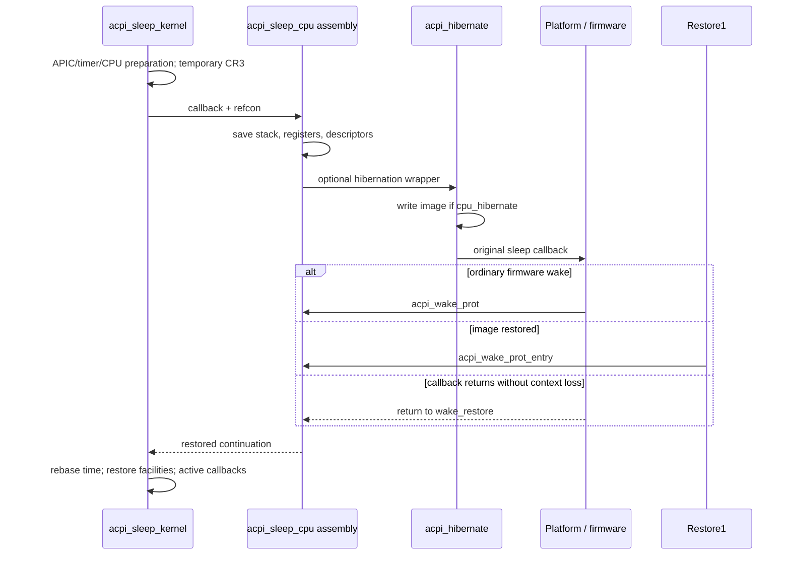

# x86 sleep, resume, CPU context, and time

[Platform](README.md) · [System sleep orchestration](../drivers/system-sleep-and-wake.md) · [ARM64 CPU lifecycle](cpu-power-lifecycle.md) · [Hibernation restore](hibernation-restore.md)

The x86 machine sleep path saves a kernel continuation, gives platform code control of the hardware transition, then restores enough architectural state to return through that same continuation. Ordinary firmware wake and hibernation's first-stage restore converge on the wake assembly. The higher-level power policy and device notification graph are separate from this mechanism. [`acpi_sleep_kernel`](../../../xnu/osfmk/i386/acpi.c#L182), [`acpi_sleep_cpu`](../../../xnu/osfmk/x86_64/start.s#L350).

This chapter follows `CONFIG_SLEEP` and conditional `HIBERNATION`, VMX, hypervisor, performance-counter, and MTRR branches as source paths. It does not establish which sleep states a specific Mac supports. The ACPI platform driver's callback, firmware resume vector installation, and CPU power-management provider are external implementations; XNU supplies the call sites and a substantial part of the saved-context protocol.

## 1. The caller supplies the hardware transition

`acpi_sleep_kernel(acpi_sleep_callback func, void *refcon)` is the C boundary between platform sleep and machine state handling. It first requests that every other CPU move from halted to off by calling `pmCPUExitHaltToOff()`. A non-success status panics. However, that helper itself returns success when no matching registered power-management callback exists; the return alone is not a hardware measurement that a core powered down. [Other-CPU preparation](../../../xnu/osfmk/i386/acpi.c#L202), [dispatch wrapper](../../../xnu/osfmk/i386/pmCPU.c#L463).

The current CPU then shuts down its local APIC, transitions configured counter/profiling facilities offline, saves the power-management timer state, and notifies the hypervisor when present. It clears the task-switched FPU flag so hibernation code can use SIMD acceleration. Tracing is saved/disabled and the pre-sleep absolute time is captured. The caller is already in a constrained machine transition; these operations are not ordinary asynchronous driver requests. [Preparation](../../../xnu/osfmk/i386/acpi.c#L215).

Two call paths follow. With `HIBERNATION`, assembly calls `acpi_hibernate`, which may write an image before invoking the original platform callback. Without it, assembly directly calls `func(refcon)` after optional VMX suspension. Both paths use `x86_64_pre_sleep()` before saving the final CPU continuation and return through `x86_64_post_sleep()` afterward. [Call selection](../../../xnu/osfmk/i386/acpi.c#L247).



The callback-return branch is an explicit implementation path. A normal successful platform sleep callback is not expected to return directly. The return from `acpi_sleep_cpu()` after a successful wake is produced by restoring the saved stack/register continuation.

## 2. Temporary mappings bridge the wake entry

The machine wrapper adds a low-address alias of the kernel's PML4 entry, switches CR3 to the idle kernel table, and remembers the previous CR3. After return it removes the low alias and restores the old root:

[Pre/post sleep mappings](../../../xnu/osfmk/i386/i386_init.c#L211):
<!-- source-excerpt: ../../../xnu/osfmk/i386/i386_init.c#L211-L225 -->
```c
uint64_t
x86_64_pre_sleep(void)
{
	IdlePML4[0] = IdlePML4[KERNEL_PML4_INDEX];
	uint64_t oldcr3 = get_cr3_raw();
	set_cr3_raw((uint32_t) (uintptr_t)ID_MAP_VTOP(IdlePML4));
	return oldcr3;
}

void
x86_64_post_sleep(uint64_t new_cr3)
{
	IdlePML4[0] = 0;
	set_cr3_raw((uint32_t) new_cr3);
}
```

This is narrowly scoped bootstrap mapping manipulation. It is not an invocation of normal `pmap_enter()` or a rebuild of every process address space. The CR3 saved by the subsequent assembly is the temporary sleep root; the outer C variable preserves the root that was active before this bridge. Distinguishing those two saved values explains why assembly restoration and `x86_64_post_sleep(old_cr3)` are both needed. [Normal x86 mapping machinery](../vm/pmap-x86.md).

The low bootstrap area is shared by sleep wake and secondary-CPU startup. `install_real_mode_bootstrap()` copies the real-mode transition code into a reserved physical page, writes the chosen protected-mode entrypoint, and flushes caches. At the end of the sleep C path, XNU reinstalls this bootstrap with `slave_pstart` because the bootstrap page is not saved as ordinary image state and must again serve secondary startup. [Bootstrap installation](../../../xnu/osfmk/i386/acpi.c#L528), [post-wake reinstall](../../../xnu/osfmk/i386/acpi.c#L386).

## 3. Exactly what the sleep assembly saves

`acpi_sleep_cpu()` establishes a frame, pushes flags and general-purpose registers, and stores the resulting stack pointer in `saved_rsp`. It reloads CR3 to flush translations, then saves CR0, CR2, CR3, and CR4. Segment selectors, descriptor-table registers, task register, and both user/kernel GS bases are saved as well. The GS handling uses `swapgs` to obtain the two bases while preserving the kernel's current state. [Register save](../../../xnu/osfmk/x86_64/start.s#L350).

| Saved state | Why the wake path needs it |
| --- | --- |
| `saved_rsp`, stacked GPRs and flags | Returns to the interrupted kernel call chain |
| CR0/CR3/CR4 and CR2 | Restores control/paging state and saved fault address |
| GDT, LDT, IDT, TR | Reestablishes descriptor and interrupt/task-segment access |
| Segment selectors and GS bases | Restores the per-CPU kernel and userspace segment-base context |
| C-level clock and subsystem state | Rebuilds timer conversion and CPU facilities not covered by the assembly push sequence |

This is a system-sleep continuation, not the userspace trap frame described in the exception guides. The assembly does not promise to capture every MSR or all extended processor state in one structure. Several facilities are deliberately reinitialized by the C wake path instead.

Before invoking the callback, assembly swaps the argument registers so `refcon` becomes the callback's first argument. If the callback returns, it skips the hardware context-reconstruction sequence and goes directly to restoring the saved stack:

[Callback and direct-return branch](../../../xnu/osfmk/x86_64/start.s#L414):
<!-- source-excerpt: ../../../xnu/osfmk/x86_64/start.s#L414-L423 -->
```asm
	/*
	 * Call ACPI function provided by the caller to sleep the platform.
	 * This call will not return on success.
	 */

	xchgq %rdi, %rsi
	call	*%rsi

	/* sleep failed, no cpu context lost */
	jmp	wake_restore
```

This branch assumes CPU context was not lost. It should not be interpreted as the platform restoring memory by returning an error code: `acpi_sleep_cpu()` has no such structured return protocol.

## 4. Ordinary wake and image restore converge

The ordinary wake entry `acpi_wake_prot` lies in `__HIB` and begins in 32-bit protected mode with paging disabled. It uses the low interrupt stack and the `SWITCH_TO_64BIT_MODE` macro, then jumps to `Lwake_64`. Hibernation's common early restore instead calls `acpi_wake_prot_entry`, which reaches the same 64-bit restoration sequence. [Wake entries](../../../xnu/osfmk/x86_64/start.s#L425), [restore entry selection](../../../xnu/osfmk/i386/pal_hibernate.h#L48).

The sequence restores CR4, explicitly enables NXE in EFER, restores CR2 and CR0, and reinstalls the saved CR3. It clears selected segment selectors before loading the saved descriptor tables, then restores segment registers and the user/kernel GS-base relationship. Before `ltr`, it clears the busy flag in the saved TSS descriptor; blindly reloading a busy TSS descriptor would violate the architectural contract. Finally, both successful wake and direct callback return converge on `wake_restore`, restore `saved_rsp`, pop registers/flags, and return to C. [Architectural restoration](../../../xnu/osfmk/x86_64/start.s#L447).

For an image restore, these saved globals and stack bytes were themselves restored memory. The early hibernation routine finishes first-image reconstruction before it jumps here. The rest of the saved pages are read later, during platform active actions, as described in [restore stages](hibernation-restore.md). This explains why the machine continuation can run while the entire image is not yet loaded: the first-stage page classification must already cover the execution substrate it needs.

## 5. Image-writer outcomes are not identical to platform outcomes

`acpi_hibernate()` tests the current CPU's hibernation flag and calls `hibernate_write_image()`. Halt and Restart results invoke platform halt/restart actions and the corresponding `PE_halt_restart` callback if present. Other results clear CPU 0's hibernation flag in the *running* state, allowing an ordinary RAM wake to avoid later-image restoration. The saved image contains the earlier flag. [Hibernation wrapper](../../../xnu/osfmk/i386/acpi.c#L132).

The wrapper then suspends VMX when configured, disables tracing, runs platform quiesce actions, recaptures the absolute-time point, and invokes the original callback. Its source comment says control should not return after that callback. The actual assembly still supports a direct return as described above.

There is a subtle limit in the visible branch structure: although the image writer can return the enum named `kIOHibernatePostWriteWake` for an aborted write, `acpi_hibernate()` does not separately test it. It falls into the branch used for values other than Halt/Restart and then invokes the original platform callback. Therefore “an aborted writer returns Wake” is accurate as a writer API statement; “this wrapper immediately returns without attempting sleep” is not supported by the body. [Writer return rules](../../../xnu/iokit/Kernel/IOHibernateIO.cpp#L2392).

Likewise, a platform halt/restart request is a call boundary. The source assumes it effects the transition, but this C wrapper has no distinct error-return protocol from that provider. ARM64's final writer path is stricter: after its commitment, failure panics and success selects Halt. Configuration differences cannot be collapsed into a single universal sleep fallback rule.

## 6. Absolute time is rebased before normal timer use

Immediately after assembly returns, the code samples the raw post-wake absolute-time conversion for diagnostics, then rebases it using the pre-sleep timestamp:

[Wake-time rebase and root restoration](../../../xnu/osfmk/i386/acpi.c#L263):
<!-- source-excerpt: ../../../xnu/osfmk/i386/acpi.c#L263-L271 -->
```c
	acpi_wake_abstime = mach_absolute_time();
	/* Rebase TSC->absolute time conversion, using timestamp
	 * recorded before sleep.
	 */
	rtc_nanotime_init(acpi_sleep_abstime);
	acpi_wake_postrebase_abstime = start = mach_absolute_time();
	assert(start >= acpi_sleep_abstime);

	x86_64_post_sleep(old_cr3);
```

`rtc_nanotime_init(base)` captures the current TSC and stores it as the new `tsc_base`, with the supplied pre-sleep value as `ns_base`, retaining scale/shift. It records diagnostic before/after values and republishes the conversion to the commpage. Thus this uptime representation resumes from the pre-sleep point rather than treating a stopped, reset, or independently advancing TSC as a valid unchanged conversion. The assertion checks that the rebased current value is not earlier than the captured base. [Conversion update](../../../xnu/osfmk/i386/rtclock.c#L146).

This is distinct from calendar time and continuous time across sleep. The surrounding system wake code handles additional clock semantics; a TSC rebase does not alone compute elapsed wall-clock sleep duration. ARM64 uses `rtclock_base_abstime = wake_abstime - ml_get_hwclock()` and, for hibernation, bootloader-supplied continuous-time offset data. Both preserve the selected clock's contract while using different hardware and handoff mechanisms. [ARM time path](cpu-power-lifecycle.md#8-system-suspend-coordinates-all-cpus-and-preserves-time-semantics).

## 7. CPU facilities are restored in a deliberate order

After the time/root rebase, `acpi_sleep_kernel()` initializes serial output as configured, captures whether this was hibernation from `cpu_hibernate`, and restores fast-syscall MSRs. Conditional branches restore machine-check handling, MTRRs/PAT, microcode/workarounds, and VMX operation. VMX receives `did_hibernate`, allowing the provider to distinguish that case. [CPU facilities](../../../xnu/osfmk/i386/acpi.c#L275).

`pmMarkAllCPUsOff()` tells the registered power provider that CPUs need a full restart, but its wrapper is a no-op without that callback. The bootstrap CPU reconfigures its APIC before restarting timers, repairs sanitizer stack state when applicable, configures the decrementer, restores tracing, and initializes FPU/SIMD state. It then notifies the hypervisor of resume and invokes platform active actions. [Wake ordering](../../../xnu/osfmk/i386/acpi.c#L324).

The active-action bracket is where hibernation metadata rebuild and the later image read occur. The x86 pre-hook rebuilds VM structures if teardown marked them necessary; the post-hook reads image2 only if `cpu_hibernate` is still set, then clears it. Only afterward does this path mark the current CPU running in power-management state, restore the power timer state, start timer interrupts, and publish configured counter/profiling online transitions. [Active hooks](../../../xnu/osfmk/i386/acpi.c#L395), [active callback bracket](../../../xnu/iokit/Kernel/IOPlatformActions.cpp#L144).

The order exposes several kinds of readiness. Having restored registers does not mean timers are running; an active platform callback does not mean the post-hook image read has finished; marking a CPU running in the power provider is not itself scheduler publication. The [scheduler guides](../runtime/README.md) cover the common processor states and contexts above these machine operations.

## 8. Secondary CPUs have fast and full restart paths

`cpu_start()` tries `intel_startCPU_fast()` first. That helper asks `pmCPUExitHalt()` to wake a halted core and polls `cpu_running`; it returns failure if the provider cannot perform a fast restart or the target fails to become running. The caller then tries full startup. This distinguishes returning from a retained halt state from restarting a core that lost state. [CPU start](../../../xnu/osfmk/i386/cpu.c#L118), [fast restart](../../../xnu/osfmk/i386/mp.c#L281).

Full `intel_startCPU()` initializes descriptor tables, serializes shared bootstrap resources with `mp_cpu_boot_lock`, disables interrupts, and uses an interrupt-free multiprocessor rendezvous for the hardware start sequence. The rendezvous matters because MTRR/PAT initialization can temporarily disable caching. `start_cpu()` invokes `i386_start_cpu()`, waits for `cpu_running`, and optionally compares the starter/target TSCs using entry/exit barriers. The diagnostic response to excessive skew differs between DEBUG and other builds. [Full startup](../../../xnu/osfmk/i386/mp.c#L428), [start and TSC comparison](../../../xnu/osfmk/i386/mp.c#L350).

A target entering `i386_init_slave()` takes the full initialization branch in `do_init_slave(false)`: caching, syscall state, pmap CPU state, APIC, FPU, and configured machine facilities are reestablished. A retained core returning through `pmCPUHalt()` uses `i386_init_slave_fast()` and skips that full hardware initialization. Both initialize CPU/thread bookkeeping and enter `secondary_cpu_main()` with different initialization parameters. [Target initialization](../../../xnu/osfmk/i386/i386_init.c#L1027), [retained halt return](../../../xnu/osfmk/i386/pmCPU.c#L237).

Failure handling is not merely a timeout error propagated to a user process. The fast path can fall back, but full-start failure in the inspected body prints a failure and halts the machine; the outer `cpu_start()` also panics on a non-success return. These are kernel machine-readiness failures, separate from power policy refusing a sleep request.

## 9. Deep idle is a different path

`acpi_idle_kernel()` implements the boot-CPU side of S0 deep idle with secondaries already offlined. It asserts the boot CPU, cancels the timer deadline, and temporarily enables interrupts only as needed to dismiss pending timer/counter interrupts, then disables them again. The callback contract requires interrupts to remain disabled during the final idle entry, exit, and return. [Deep-idle contract](../../../xnu/osfmk/i386/acpi.c#L415).

It may call the hibernation writer to place storage into its intended state, clears the running CPU hibernation flag, runs platform quiesce actions, and calls the supplied callback. It then records the idle timestamp and enters `pmCPUHalt(PM_HALT_SLEEP)`. On the boot CPU, a provider-supported halt can return directly on wake; non-boot CPUs use the fast initialization path. The no-provider fallback invalidates caches and halts without a supported return. [Idle body](../../../xnu/osfmk/i386/acpi.c#L428), [halt dispatcher](../../../xnu/osfmk/i386/pmCPU.c#L237).

By default, wake rebases nanotime through `rtc_sleep_wakeup(acpi_idle_abstime)` even when the TSC progressed during deep idle. The `deep_idle_rebase` switch allows the diagnostic tracing behavior to differ. The path then runs active actions and restarts timers. It does not use the `acpi_sleep_cpu()` save/firmware-reset sequence and should not be described as merely a smaller instance of that assembly path.

## Sources inspected and limits

Deep reads cover `acpi_sleep_kernel`, `acpi_hibernate`, `acpi_idle_kernel`, sleep/wake assembly, temporary CR3 mappings, nanotime/commpage rebasing, hibernation active hooks, power-management dispatch wrappers, fast/full CPU startup, and target reinitialization. ARM comparison relies on the separately traced [CPU lifecycle](cpu-power-lifecycle.md) and [restore](hibernation-restore.md) chapters. ACPI firmware methods, concrete CPU power-driver state machines, VMX/hypervisor internals, all hardware MSRs, and every platform's resume-vector installation remain outside this trace. No sleep transition was executed on hardware.

<!-- BEGIN PLATYDOC DOCUMENTATION LICENSE -->
Original Platydoc text and diagrams are licensed under [CC BY 4.0](https://creativecommons.org/licenses/by/4.0/). Quoted source code and third-party material retain their respective licenses.
<!-- END PLATYDOC DOCUMENTATION LICENSE -->
