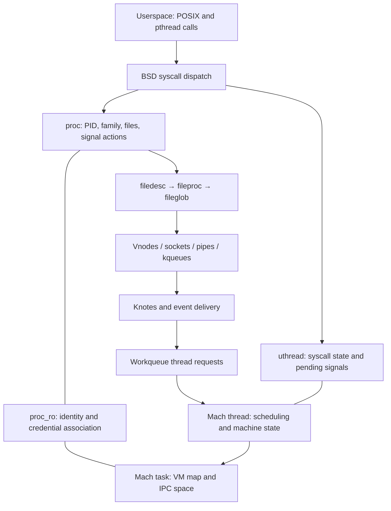

# BSD processes and the POSIX interface

[Guide index](../../README.md) · [Architecture](../../architecture.md)

This part of XNU turns Mach tasks and threads into processes with PIDs, parent/child relationships, credentials, file descriptors, signals, and system calls. It also provides event delivery and the kernel side of pthread workqueues. BSD runs in the kernel address space and calls Mach directly; it is not a separate user process serving POSIX requests.

These pages describe the supplied `xnu-12377.121.6` source snapshot. Configuration guards matter: a declaration in `syscalls.master` does not establish that a feature is enabled in a particular shipped kernel. No running-kernel experiments or kernel build were performed for this chapter.

## Read in this order

1. [Process objects and lifetime](lifecycle.md): the initial map of `proc`, `task`, `thread`, and `uthread`; continue with [Fork, spawn, exec, exit, and wait](process-transitions.md) for publication gates, failure paths, reference drains, and reaping.
2. [System calls, signals, and exceptions](syscalls-signals.md): syscall entry and the exception bridge; continue with [Signal posting, handler entry, and sigreturn](signal-delivery-and-return.md) for target selection, AST processing, ARM64 frames, and validation.
3. [File descriptors: allocation, replacement and close](descriptors-ipc.md): reserved slots, table growth, `fileproc`/`fileglob` ownership, constructor publication, `dup2` replacement, I/O drains, guarded operations and fileport transfer.
4. [Events, pthreads, and workqueues](events-threads.md): the initial event/thread map; continue with [Kqueue, knote, and workloop lifetimes](kqueue-and-workloops.md) for registration, posting, delivery, drop, owner, and servicer protocols.
5. [Pthread boundaries, workqueue service, and cancellation](pthread-workqueue-lifecycle.md): request admission, creator selection, binding, worker reuse/parking, cancellation, join wake, and teardown.
6. [Asynchronous file I/O](async-io.md): request ownership, both worker paths, cancellation races, result consumption, and close/exec/exit drains.
7. [Complete BSD syscall catalog](../../interfaces/bsd-syscalls/README.md): dispatch/argument/result state, every master-table slot and conditional alternative, and each active call's purpose and local mechanism. Compare the separate [Mach namespaces](../../interfaces/README.md) and [AST flavor catalog](../runtime/ast-flavors.md).

For local communication and terminals, continue with:

| Chapter | Mechanism |
| --- | --- |
| [Pipes and UNIX socket rights](pipes-and-unix-socket-rights.md) | Buffer ownership, atomic writes, peer closure, descriptor transfer and collection of unreachable rights cycles |
| [User-address wait and wake](user-lock-wait-and-wake.md) | Private/shared keys, protected comparison, unfair-lock inheritance, wake selection and final-waiter cleanup |
| [POSIX named IPC](posix-named-ipc.md) | Named semaphore creation/wait/unlink and shared-memory name, descriptor, memory-entry and mapping lifetime |
| [System V IPC](system-v-ipc.md) | Message storage and copy failure, semaphore vectors and undo, segment IDs, attachments and removal |
| [TTY and PTY lifecycle](tty-and-pty-lifecycle.md) | Terminal input/output queues, canonical/raw completion, PTY dispatch, job control and hangup/reclamation |

## The objects that connect the layers

The stable distinction is **process policy versus execution mechanism**. `proc` stores the Unix process model; `task` owns the Mach execution environment; `thread` is scheduled; `uthread` supplies BSD state for that thread. The implementation deliberately ties their lifetimes together without making their roles interchangeable. Current credential pointers are in `thread_ro`, so older descriptions placing a `uu_ucred` field in `uthread` do not match this snapshot.

| Boundary | Concrete connection | Continue reading |
| --- | --- | --- |
| Mach execution | `fork_create_child()` calls `task_create_internal()` and creates the main thread; final Mach thread termination calls `proc_exit()` | [Runtime](../runtime/README.md) |
| Virtual memory | Fork requests memory inheritance; exec loads a new Mach-O map | [VM](../vm/README.md) |
| Mach IPC | Task/thread ports become accessible after initialization; exception messages become signals; workloops receive Mach-port events | [IPC](../ipc/README.md) |
| Filesystems | Exec resolves a vnode; descriptors dispatch through `fileops`; `filedesc` holds current/root directories | [VFS](../vfs/README.md) |
| Networking | Socket descriptors share the descriptor machinery; local sockets transport descriptor references | [Networking](../networking/README.md) |
| Security | Credentials, MAC checks, executable policy, and audit hooks appear throughout process transitions | [Security](../security/README.md) |
| Architecture | Trap entry and signal frames use saved machine state | [Platform](../platform/README.md) |

## Sources inspected and limits

“Deep” below means structures and selected complete control/lifetime paths were read. It does not mean every line of these large files was audited.

| Source area | Inspection | Remaining limits |
| --- | --- | --- |
| [`proc_internal.h`](../../../xnu/bsd/sys/proc_internal.h), [`proc_ro.h`](../../../xnu/bsd/sys/proc_ro.h), [`user.h`](../../../xnu/bsd/sys/user.h), [`kern_proc.c`](../../../xnu/bsd/kern/kern_proc.c) | Deep: fields, references, PID lookup, exec drains, proc/task relationship | Process groups, personas, accounting, and all reference-debug cases were not exhaustively traced |
| [`kern_fork.c`](../../../xnu/bsd/kern/kern_fork.c), [`kern_exec.c`](../../../xnu/bsd/kern/kern_exec.c), [`kern_exit.c`](../../../xnu/bsd/kern/kern_exit.c) | Deep: creation/rollback, spawn action and credential ordering, shadow-proc exec publication/gates/failure, exit ownership, ordered teardown, wait/reap | Mach-O parser and every spawn attribute/failure branch are outside this chapter |
| [`systemcalls.c`](../../../xnu/bsd/dev/arm/systemcalls.c), [`syscalls.master`](../../../xnu/bsd/kern/syscalls.master), [`kern_sig.c`](../../../xnu/bsd/kern/kern_sig.c), [`ux_exception.c`](../../../xnu/bsd/uxkern/ux_exception.c) | Deep: ARM dispatcher, restart/error return, posting/AST handling, ARM64 frame construction and sigreturn validation, exception translation | x86/ARM32 signal frames and libsyscall generation were surveyed; full ptrace/job-control behavior remains broader |
| [`kern_descrip.c`](../../../xnu/bsd/kern/kern_descrip.c), [`sys_generic.c`](../../../xnu/bsd/kern/sys_generic.c), descriptor headers | Deep: reservation/table-growth retry, construction/publication/rollback, lookup/drop, fork copying, `dup2` replacement, I/O drain and final close, selected guard predicates and fileport lifetime | Every `fcntl` command, guard-change combination and endpoint-specific drain remains broader; AIO and local IPC have separate focused guides |
| [`kern_aio.c`](../../../xnu/bsd/kern/kern_aio.c) | Deep selected paths: request/ref ownership, validation/enqueue, both workers, completion/consumption, cancellation queue-removal race, close/exec/exit/pool drains | Every batch, fsync dependency, AIO filter, and worker-admission transition is not audited |
| [`kern_event.c`](../../../xnu/bsd/kern/kern_event.c), event headers, [`pthread_workqueue.c`](../../../xnu/bsd/pthread/pthread_workqueue.c), [`pthread_shims.c`](../../../xnu/bsd/pthread/pthread_shims.c) | Deep selected paths: knote register/post/process/drop, fd close, dynamic workloop owner/servicer/retain/turnstile, requests/admission, worker creation/park/exit, pthread boundary | Every filter, work-interval/cooperative scheduling policy, and priority/parking race remains broader; external pthread implementation is absent |
| [`sys_pipe.c`](../../../xnu/bsd/kern/sys_pipe.c), [`uipc_usrreq.c`](../../../xnu/bsd/kern/uipc_usrreq.c), [`sys_ulock.c`](../../../xnu/bsd/kern/sys_ulock.c) | Pipe buffering/wait/close, UNIX rights conversion and cycle collection, ulock key/compare/inheritance/wake/cleanup | Selected implementation paths, not a formal concurrency proof; userspace lock algorithms remain external |
| POSIX/SysV IPC files, [`tty.c`](../../../xnu/bsd/kern/tty.c), [`tty_dev.c`](../../../xnu/bsd/kern/tty_dev.c), [`tty_ptmx.c`](../../../xnu/bsd/kern/tty_ptmx.c) | Named IPC namespace and backing lifetime, SysV queues/vectors/undo/attachments, TTY queues/job control and PTY teardown | Configuration-dependent IPC families; physical terminal drivers and userspace terminal emulation remain external |

The principal code-reading trap is treating historical comments as the current object layout. Confirm descriptions against declarations and executable branches: exec now replaces a proc/task pair, `filedesc` is embedded in `proc`, and some pthread operations cross a function-table boundary into separately supplied code.

<!-- BEGIN PLATYDOC DOCUMENTATION LICENSE -->
Original Platydoc text and diagrams are licensed under [CC BY 4.0](https://creativecommons.org/licenses/by/4.0/). Quoted source code and third-party material retain their respective licenses.
<!-- END PLATYDOC DOCUMENTATION LICENSE -->
