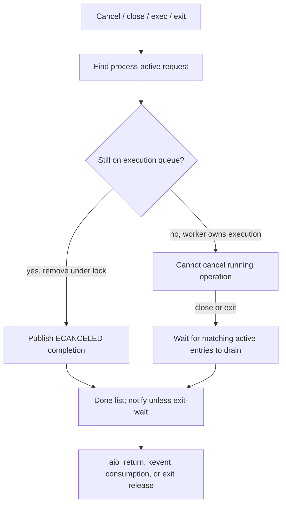

# Asynchronous file I/O and teardown

[Process overview](README.md) · [Descriptors](descriptors-ipc.md) · [VFS](../vfs/README.md) · [Events](events-threads.md)

POSIX AIO queues a file operation and reports its result later. It connects process lifetime, descriptor lookup, worker threads, user address-space access, VFS operations, and signal/kevent completion. The central implementation is [kern_aio.c](../../../xnu/bsd/kern/kern_aio.c).

## Request state and ownership

[`aio_workq_entry`](../../../xnu/bsd/kern/kern_aio.c#L144) contains workqueue and process-list links, result/error values, a reference count, operation flags, optional batch-leader state, the submitting process, the user's control-block address, a copied control block, a retained VFS context, and an optional retained VM map. The user's control-block address identifies the request; the worker uses the copied parameters rather than repeatedly trusting the user structure.

The structure's ownership comment describes separate references for process bookkeeping, submitted work, a list-I/O batch leader, and a waiting `LIO_WAIT` caller. The operation can complete before its result record is consumed. In the ordinary path, `aio_return()` removes a completed record and releases the process's ownership; process exit also drains these records. Kevent completion has its own consumption path, so not every completed request is retrieved through `aio_return()`.

Do not infer execution state from membership in `p_aio_activeq` alone. [`aio_try_enqueue_work_locked()`](../../../xnu/bsd/kern/kern_aio.c#L1463) inserts the entry into process active bookkeeping before putting it on the selected workqueue. Queue membership, executing work, completed state, and reference lifetime are separate observations.

## Submission validates the request, then publishes work

`aio_read()` and `aio_write()` reach [`aio_queue_async_request()`](../../../xnu/bsd/kern/kern_aio.c#L1989). It creates the entry, registers an AIO kevent when requested, enqueues under the AIO process lock, and wakes a worker. Allocation/registration/enqueue failures unwind the entry and associated resources.

[`aio_create_queue_entry()`](../../../xnu/bsd/kern/kern_aio.c#L1926) copies and converts the caller's 32/64-bit control-block layout, then calls `aio_validate()`. Validation checks operation type, buffer/count/offset constraints, notification shape, descriptor access/guards, and vnode-backed file type. It marks `FP_AIOISSUED` on the fileproc. The entry retains the submitting thread and credential from its VFS context.

Execution still looks up the descriptor again. [`do_aio_read()`](../../../xnu/bsd/kern/kern_aio.c#L2250) obtains a fileproc I/O reference, checks read access, calls `dofileread()` with the stored context and explicit offset, then drops the reference. `do_aio_write()` follows the analogous route, using append semantics when the shared file status has `O_APPEND`. These calls converge on normal file-operation dispatch and the filesystem's implementation.

## Two worker implementations are present

The `aio_new_workq` tunable defaults to **1** in this source. Its selected path uses a per-process AIO workqueue; the older global-worker path remains available in the implementation. Read the selection before assuming every worker temporarily switches into a foreign address map. [`tunable`](../../../xnu/bsd/kern/kern_aio.c#L118), [`entry setup`](../../../xnu/bsd/kern/kern_aio.c#L1964).

In the default new path, [`workq_aio_unpark_select_req_or_park_and_unlock()`](../../../xnu/bsd/kern/kern_aio.c#L3216) removes work from the per-process queue, releases the AIO lock, adjusts worker priority from the submitting thread when necessary, and calls `workq_aio_process_entry()`. That function asserts that the worker belongs to the request's process and differs from the submitting thread. It dispatches read/write/fsync work, then completes it. Fsync can be requeued until its entry reaches the head of the process's active list; [`aio_delay_fsync_request()`](../../../xnu/bsd/kern/kern_aio.c#L1908) uses this process-wide ordering test, with an exception during teardown. The pool can create, park, wake, and retire its own worker threads; its source describes it as a reduced workqueue implementation, not the same queue as arbitrary libdispatch work.

In the older path, entry creation retains the target map. [`aio_work_thread()`](../../../xnu/bsd/kern/kern_aio.c#L1765) sets `uthread.uu_aio_task`, switches to that map, performs I/O, restores the original map, and releases the entry's map reference. Its comment relies on exec/exit waiting for active AIO before the process/task relationship can disappear. That is a lifetime protocol, not a general permission to dereference any process without a reference.


## Completion and cancellation coordinate with process exit

[`do_aio_completion_and_unlock()`](../../../xnu/bsd/kern/kern_aio.c#L2131) moves the entry to the done list, records completion/cancellation flags, decrements batch-leader work, and wakes cleanup waiters as appropriate. It drops the AIO process lock before signal or kevent notification, wakes `aio_suspend()` waiters, then releases work/batch references. Notifications are therefore downstream of a published result.

[`aio_return()`](../../../xnu/bsd/kern/kern_aio.c#L842) searches completed work by the original control-block address, excludes kevent-managed consumption, returns the operation result, and removes its record. If the request is still active, it reports `EINPROGRESS`.

[`_aio_exit()`](../../../xnu/bsd/kern/kern_aio.c#L931) marks the AIO pool exiting, cancels queued requests where possible, and waits for already-active operations that cannot be canceled. It then removes completed entries and tears down the pool. `_aio_exec()` uses this cleanup; `_aio_close()` coordinates work associated with a descriptor. This explains why closing or replacing process state cannot simply free the request lists while a worker still uses their context and buffers.

## Cancellation is a queue-removal race

The process active list includes both waiting and executing work. `do_aio_cancel_locked()` therefore cannot cancel merely because it finds a matching `p_aio_activeq` entry. It must remove that entry from its execution workqueue before a worker claims it. `aio_entry_try_workq_remove()` checks the workqueue linkage, uses the per-process implementation for the new path, and rechecks under the global workqueue's spinlock for the older path. The AIO process lock is `p_mlock`; the execution queue has its own synchronization where required. [Removal test](../../../xnu/bsd/kern/kern_aio.c#L511), [process lock](../../../xnu/bsd/kern/kern_aio.c#L491).

Once removal succeeds, cancellation publishes an ordinary completed result with `ECANCELED` and return value `-1`:

[Successful queued cancellation](../../../xnu/bsd/kern/kern_aio.c#L1063):
<!-- source-excerpt: ../../../xnu/bsd/kern/kern_aio.c#L1063-L1074 -->
```c
		/* Can only be cancelled if it's still on a work queue */
		if (aio_entry_try_workq_remove(p, entryp)) {
			entryp->errorval = ECANCELED;
			entryp->returnval = -1;

			/* Now it's officially cancelled.  Do the completion */
			KERNEL_DEBUG(BSDDBG_CODE(DBG_BSD_AIO, AIO_cancel_async_workq) | DBG_FUNC_NONE,
			    VM_KERNEL_ADDRPERM(p), VM_KERNEL_ADDRPERM(entryp->uaiocbp),
			    fd, 0, 0);
			do_aio_completion_and_unlock(p, entryp, AIO_CANCELLED);

			aio_proc_lock(p);
```

The completion helper drops the process lock. A multi-request cancellation must therefore restart its traversal after reacquiring it: the old iterator and list state may no longer be valid. An entry that has already left the execution queue is not canceled by this helper. It remains in process active bookkeeping until completion, and the cancellation result reports `AIO_NOTCANCELED`. Do not interpret the nearby historical comment about leaving the “active queue” as removal from `p_aio_activeq`. [Cancellation loop](../../../xnu/bsd/kern/kern_aio.c#L1036).

Matching uses the original control-block address as an identifier; the internal cancellation helper does not dereference that user pointer. A non-null control block passed through the syscall is separately copied to check its fd against the explicit fd argument. The syscall also has a raw-disk special case and translates “no matching request” differently from “already done.” It returns a cancellation status in the syscall result slot separately from an errno. [`aio_cancel()`](../../../xnu/bsd/kern/kern_aio.c#L562).

## Close, exec, and exit wait for different completion conditions

`_aio_close()` marks matching requests `AIO_CLOSE_WAIT`, cancels queued work, and waits while any matching fd request remains active. Completion wakes all cleanup waiters when that fd has no active requests; multiple closes may wait on the shared channel. Close does not suppress ordinary signal/kevent completion notification merely because it is waiting. [Close drain](../../../xnu/bsd/kern/kern_aio.c#L666), [close wakeup](../../../xnu/bsd/kern/kern_aio.c#L2194).

`_aio_exit()` first closes the AIO pool to further creation. It marks requests `AIO_EXIT_WAIT`, cancels queued work, and waits until the entire process active list is empty. Completion for these requests suppresses signal and kevent notifications and wakes the exit waiter when the last active entry completes. This lets exec/exit drain old-image operations without delivering their ordinary asynchronous notifications into a dying execution context. The close-wait and exit-wait flags are explicitly mutually exclusive. [Exit drain](../../../xnu/bsd/kern/kern_aio.c#L931), [completion notification choice](../../../xnu/bsd/kern/kern_aio.c#L2163).

After active operations have drained, exit detaches the done-list entries under the process lock, shuts down the AIO worker pool, and releases the detached request references outside the lock:

[Detached-result cleanup](../../../xnu/bsd/kern/kern_aio.c#L977):
<!-- source-excerpt: ../../../xnu/bsd/kern/kern_aio.c#L977-L993 -->
```c
	/* release all aio resources used by this process */
	TAILQ_FOREACH_SAFE(entryp, &p->p_aio_doneq, aio_proc_link, tmp) {
		ASSERT_AIO_FROM_PROC(entryp, p);

		aio_proc_remove_done_locked(p, entryp);
		TAILQ_INSERT_TAIL(&tofree, entryp, aio_proc_link);
	}

	aio_proc_unlock(p);

	workq_aio_exit(p);

	/* free all the entries outside of the aio_proc_lock() */
	TAILQ_FOREACH_SAFE(entryp, &tofree, aio_proc_link, tmp) {
		entryp->aio_proc_link.tqe_prev = NULL;
		aio_entry_unref(entryp);
	}
```

The final reference release invokes `aio_free_request()`, which asserts that neither list linkage is still live and releases the optional VM map, retained submitting thread, and credential before freeing storage. Completion separately consumes work ownership and any batch-leader reference; result-list ownership can therefore outlive completion notification. [Final release](../../../xnu/bsd/kern/kern_aio.c#L2036), [completion tail](../../../xnu/bsd/kern/kern_aio.c#L2210).

The new pool's `workq_aio_exit()` atomically removes `p_aio_wqptr`, cancels and waits for its death call, and checks that work/run queues are empty. Remaining idle workers are marked dying and woken; the caller waits on `wa_nthreads` until they have retired before freeing the pool. This is separate from the pthread workqueue's teardown even though some flag and uthread field names are shared. [AIO pool shutdown](../../../xnu/bsd/kern/kern_aio.c#L2873), [pthread workqueue](pthread-workqueue-lifecycle.md).



## Inspection limits

This page inspected request definitions, copy/validation/enqueue, both worker execution entries, read/write dispatch, result consumption, completion, queue-removal cancellation, close/exec/exit draining, and AIO-pool retirement. Every list-I/O batch failure, fsync dependency, AIO kevent filter transition, and worker-admission decision was not audited. The implementation paths were not executed.

<!-- BEGIN PLATYDOC DOCUMENTATION LICENSE -->
Original Platydoc text and diagrams are licensed under [CC BY 4.0](https://creativecommons.org/licenses/by/4.0/). Quoted source code and third-party material retain their respective licenses.
<!-- END PLATYDOC DOCUMENTATION LICENSE -->
