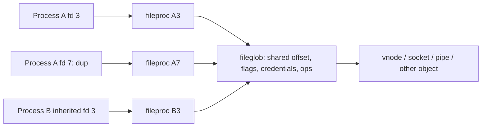

# Descriptors and local communication

[Back to processes](README.md)

## Three levels of identity

An fd number is an index in one process's table. A `fileproc` is the descriptor instance. A `fileglob` is the shared open-file object behind one or more descriptor instances. This distinction explains why closing one fd does not necessarily close the underlying object, and why duplicates can share an offset while having distinct close-on-exec behavior.

[`struct filedesc`](../../../xnu/bsd/sys/filedesc.h#L123) is embedded as `proc.p_fd`. It contains `fd_ofiles[]`, reservation flags in `fd_ofileflags[]`, allocation bounds, the descriptor lock, directory references, knote lists, the workqueue kqueue pointer, and a dynamic-workloop hash. Its historical header comment about a shareable filedesc is less useful than the actual embedded field and `fdt_fork()` implementation in this snapshot.

[`struct fileproc`](../../../xnu/bsd/sys/file_internal.h#L120) has `fp_iocount`, volatile drain flags, per-descriptor flags such as `FP_CLOEXEC`/`FP_CLOFORK`, guard attributes, and `fp_glob`. [`struct fileglob`](../../../xnu/bsd/sys/file_internal.h#L178) has `fg_count`, message-queue references, file status flags, `fg_cred`, `fg_ops`, `fg_offset`, `fg_data`, and `fg_lock`. The data identifies a vnode, socket, pipe, or other supported resource. `struct fileops` supplies read/write, ioctl, select, close, kqueue-filter, and drain methods.

## Reference and close protocol

[`fp_lookup()`](../../../xnu/bsd/kern/kern_descrip.c#L1516) validates the fd while holding the descriptor-table lock, rejects reserved entries, and increments `fp_iocount`. That I/O reference keeps the descriptor instance available while the lock is released and an operation runs. [`fp_drop()`](../../../xnu/bsd/kern/kern_descrip.c#L1599) drops it and wakes a closing/draining thread when appropriate. The table reference, I/O references, and `fileglob` ownership are different counts; none should be treated as interchangeable.

[`fp_close_and_unlock()`](../../../xnu/bsd/kern/kern_descrip.c#L1727) marks the slot `UF_RESERVED | UF_CLOSING`, preventing new ordinary lookups. It performs applicable AIO/security notifications, removes descriptor knotes through `knote_fdclose()`, drains in-flight references, releases the slot, frees the fileproc, and drops the fileglob reference. [`fg_drop()`](../../../xnu/bsd/kern/kern_descrip.c#L244) performs applicable process file-lock cleanup and calls `fo_close()` only on the final fileglob reference before freeing it. The object can therefore outlive a particular descriptor, including through a local-socket message.

[`fdt_fork()`](../../../xnu/bsd/kern/kern_descrip.c#L885) allocates new fileprocs and retains the existing fileglobs. It skips reserved/confined entries, applies `FP_CLOFORK` on fork and `FP_CLOEXEC` for the exec-copy case, and preserves only the appropriate descriptor flags. This function participates in the [shadow-proc exec design](lifecycle.md), so descriptor inheritance cannot be understood only by searching for an old `fdexec()` name.

## Following a read

[`read()` → `read_nocancel()` → `read_internal()`](../../../xnu/bsd/kern/sys_generic.c#L349) constructs a `uio`, which describes the userspace buffers, residual byte count, transfer direction, and offset. `readv_internal()` calls `preparefileread()` to acquire the fileproc and check read permission, derives a VFS context using `fg_cred`, then calls `fp_readv()` and eventually `fo_read()`. It drops the I/O reference afterward.

The concrete `fileops` chooses the next subsystem: vnode operations reach [VFS](../vfs/README.md), socket operations reach [networking](../networking/README.md), and pipe operations stay in `sys_pipe.c`. `fp_readv()` computes transferred bytes from the reduction in `uio_resid()`; interrupted/would-block returns can become a successful short read if bytes were already transferred. The write path follows the same dispatch pattern. Explicit-offset operations add validation; a non-vnode endpoint normally fails random-access requests with `ESPIPE`.

Readiness also uses methods on the underlying object. `select()` walks descriptor methods and associated wait state, while [`poll_nocancel()`](../../../xnu/bsd/kern/sys_generic.c#L1692) allocates a temporary kqueue and converts poll interests into kevent registrations. [Events and workqueues](events-threads.md) explains that common event machinery.

## Pipes and transferred file references

[`pipe()`](../../../xnu/bsd/kern/sys_pipe.c#L392) allocates a paired set of `struct pipe` endpoints, creates one read and one write fileproc, installs `pipeops`, links `pipe_peer`, and publishes the two descriptors after initialization. In this path the interface is half duplex. Continue with [pipe buffering, atomic writes and closure](pipes-and-unix-socket-rights.md) for the `pipe_read()`, `pipe_write()` and `pipeclose()` mechanisms.

UNIX-domain `SCM_RIGHTS` transfers preserve open-file identity rather than copying an integer fd into another process. [`unp_internalize()`](../../../xnu/bsd/kern/uipc_usrreq.c#L2494) validates control metadata, looks up each sending fd under the process descriptor lock, checks whether its fileglob is sendable and whether guards permit transfer, and replaces the fd array with retained/queued fileglob references. [`unp_externalize()`](../../../xnu/bsd/kern/uipc_usrreq.c#L2385) reserves all destination fd slots before committing, creates fileprocs referring to those fileglobs, removes message-queue bookkeeping, and publishes the new fd numbers. The sender's and receiver's numbers can differ.

The fileglob tracks message references separately (`fg_msgcount`, `f_msglist`). [`unp_gc()`](../../../xnu/bsd/kern/uipc_usrreq.c#L2556) exists because sockets containing descriptor references can form cycles that simple reference counting cannot reclaim. The [rights-collection companion](pipes-and-unix-socket-rights.md#why-reference-counting-needs-a-collector) follows root marking, lock-conflict restarts, temporary references, queue flushing and final release.

Mach fileports provide another transfer interface. [`sys_fileport_makeport()`](../../../xnu/bsd/kern/kern_descrip.c#L6066) checks sendability/guards, retains the fileglob, creates a fileport, and copies a send right into the task's IPC namespace. `fileport_releasefg()` drops that ownership when the port is destroyed. Conversely, `sys_fileport_makefd()` accepts a typed `IKOT_FILEPORT` send right and calls `fileport_makefd()` to allocate a descriptor sharing the fileglob; the syscall sets `FP_CLOEXEC`. This is a direct connection between the descriptor and [Mach IPC](../ipc/README.md) object models.

## Other local communication entry points

| Facility | Source and useful starting symbols | Cross-subsystem relation |
| --- | --- | --- |
| System V shared memory | [`sysv_shm.c`](../../../xnu/bsd/kern/sysv_shm.c): `shmget()`, `shmat()`, `shmexit()` | Process attachment tracking in `p->vm_shm`; VM mappings |
| System V semaphores | [`sysv_sem.c`](../../../xnu/bsd/kern/sysv_sem.c): `semop()`, `semexit()` | Blocking and exit-time undo/cleanup |
| System V message queues | [`sysv_msg.c`](../../../xnu/bsd/kern/sysv_msg.c): `msgsnd_nocancel()`, `msgrcv_nocancel()` | Permission checks, queue storage, wait/wakeup |
| Common SysV permission handling | [`sysv_ipc.c`](../../../xnu/bsd/kern/sysv_ipc.c) | Credentials and IPC permission records |
| POSIX shared memory/semaphores | [`posix_shm.c`](../../../xnu/bsd/kern/posix_shm.c), [`posix_sem.c`](../../../xnu/bsd/kern/posix_sem.c) | Distinct APIs with their own objects; some descriptor types in `file_internal.h` |

Continue with [POSIX named IPC](posix-named-ipc.md), [System V IPC](system-v-ipc.md) and [user-address wait/wake](user-lock-wait-and-wake.md) for object ownership, blocking and cleanup. Build-time `SYSV_*` guards and syscall-table configuration must be checked before assuming any particular facility is enabled.

<!-- BEGIN PLATYDOC DOCUMENTATION LICENSE -->
Original Platydoc text and diagrams are licensed under [CC BY 4.0](https://creativecommons.org/licenses/by/4.0/). Quoted source code and third-party material retain their respective licenses.
<!-- END PLATYDOC DOCUMENTATION LICENSE -->
