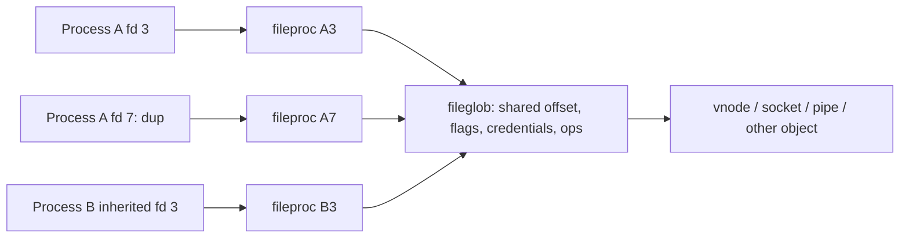
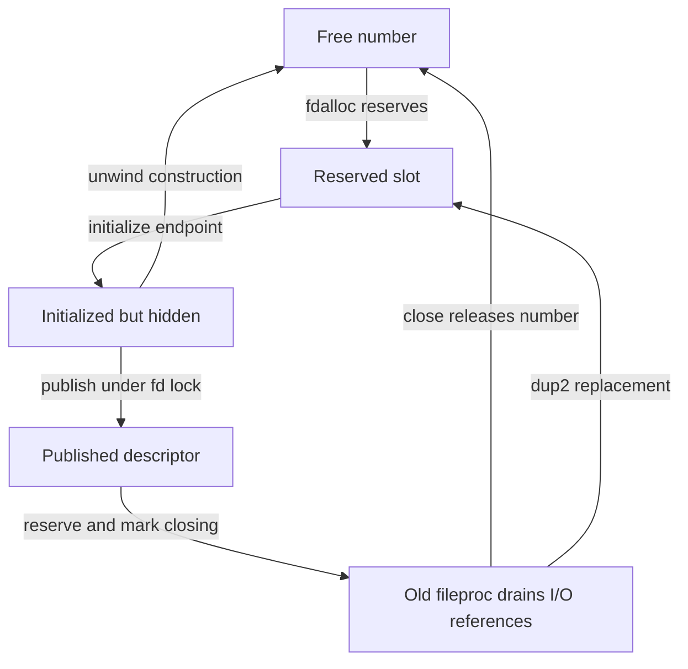

# File descriptors: allocation, replacement and close

[Back to processes](README.md) · [Pipes and UNIX rights](pipes-and-unix-socket-rights.md) · [Advisory locks](../vfs/advisory-locks-and-leases.md)

A descriptor operation first stabilizes a process-local table slot, then uses a `fileproc` and its shared `fileglob`. This chapter follows allocation, publication, replacement and draining before crossing into the owning file, socket or IPC subsystem. The same slot number can later identify a different object; a saved integer is not an object reference.

## Three levels of identity



An fd number is an index in one process's table. A `fileproc` is the descriptor instance. A `fileglob` is the shared open-file object behind one or more descriptor instances. This distinction explains why closing one fd does not necessarily close the underlying object, and why duplicates can share an offset while having distinct close-on-exec behavior.

[`struct filedesc`](../../../xnu/bsd/sys/filedesc.h#L123) is embedded as `proc.p_fd`. It contains `fd_ofiles[]`, reservation flags in `fd_ofileflags[]`, allocation bounds, the descriptor lock, directory references, knote lists, the workqueue kqueue pointer, and a dynamic-workloop hash. Its historical header comment about a shareable filedesc is less useful than the actual embedded field and `fdt_fork()` implementation in this snapshot.

[`struct fileproc`](../../../xnu/bsd/sys/file_internal.h#L120) has `fp_iocount`, volatile drain flags, per-descriptor flags such as `FP_CLOEXEC`/`FP_CLOFORK`, guard attributes, and `fp_glob`. [`struct fileglob`](../../../xnu/bsd/sys/file_internal.h#L178) has `fg_count`, message-queue references, file status flags, `fg_cred`, `fg_ops`, `fg_offset`, `fg_data`, and `fg_lock`. The data identifies a vnode, socket, pipe, or other supported resource. `struct fileops` supplies read/write, ioctl, select, close, kqueue-filter, and drain methods.

## A slot can be occupied without being available

The descriptor lock protects the pointer and its slot flags together. `UF_RESERVED` means a transition owns the number; it can accompany either a null pointer or an initialized `fileproc`. Ordinary `fp_lookup` rejects both. A published descriptor has a nonnull pointer without `UF_RESERVED`. Closing adds both `UF_RESERVED` and `UF_CLOSING`, preserving the old pointer until I/O references drain. [`slot flags`](../../../xnu/bsd/sys/filedesc.h#L178-L183), [`lookup predicate`](../../../xnu/bsd/kern/kern_descrip.c#L1516-L1544).

| Slot state | `fd_ofiles[fd]` | Relevant flags | What another operation can do |
| --- | --- | --- | --- |
| Available | Null | No reservation | `fdalloc` may reserve it |
| Allocation/replacement reserved | Null, or initialized but unpublished object | `UF_RESERVED` | Ordinary lookup fails; `dup2` can wait |
| Published | `fileproc` | No reservation | Lookup can acquire an I/O reference |
| Closing/draining | Old `fileproc` | `UF_RESERVED | UF_CLOSING` | New ordinary lookup fails; existing operations can drop their references |
| Target retained for `dup2` | Null | `UF_RESERVED`, no closing bit | Replacement owns the number until publication or rollback |

`UF_RESVWAIT` records a waiter on reservation completion. Despite the header's short “close in progress” comment, its actual producer is `procfdtbl_waitfd`; releasing or clearing a reservation wakes the wait channel. [`reserve/release/wait/clear`](../../../xnu/bsd/kern/kern_descrip.c#L428-L485).

Publication is an explicit step, performed while holding the descriptor lock. A null `fp` argument means the initialized pointer is already in the slot. [`procfdtbl_releasefd`, lines 453–464](../../../xnu/bsd/kern/kern_descrip.c#L453-L464):

<!-- source-excerpt: ../../../xnu/bsd/kern/kern_descrip.c#L453-L464 -->
```c
void
procfdtbl_releasefd(struct proc * p, int fd, struct fileproc * fp)
{
	if (fp != NULL) {
		p->p_fd.fd_ofiles[fd] = fp;
	}
	p->p_fd.fd_ofileflags[fd] &= ~UF_RESERVED;
	if ((p->p_fd.fd_ofileflags[fd] & UF_RESVWAIT) == UF_RESVWAIT) {
		p->p_fd.fd_ofileflags[fd] &= ~UF_RESVWAIT;
		wakeup(&p->p_fd);
	}
}
```



## Allocation and table growth recheck after sleeping

`fdalloc` searches from the higher of the requested minimum and `fd_freefile`. It requires both a null pointer and no reservation, then updates `fd_afterlast` and the free-search hint. The process nofile limit bounds the search. With `CONFIG_PROC_RESOURCE_LIMITS`, reservation also increments the open-slot accounting and may trigger resource-limit notification; this is distinct from the ordinary `RLIMIT_NOFILE` allocation bound. [`search and limits`](../../../xnu/bsd/kern/kern_descrip.c#L1179-L1271).

If the arrays are too small, the allocator chooses `NDEXTENT` or doubles their size, capped by the process limit. It drops the lock to allocate the pointer and flag arrays, then reacquires it. Another thread may already have grown the table, so the candidate can be freed and the search repeated. Importantly, the current arrays are copied **after** reacquiring the lock; the allocation interval is not a snapshot whose old contents may be blindly published. [`growth and installation`](../../../xnu/bsd/kern/kern_descrip.c#L1272-L1302).

The allocation/recheck branch is explicit. [`lines 1272–1285`](../../../xnu/bsd/kern/kern_descrip.c#L1272-L1285):

<!-- source-excerpt: ../../../xnu/bsd/kern/kern_descrip.c#L1272-L1285 -->
```c
		proc_fdunlock(p);
		newofiles = kalloc_type(struct fileproc *, numfiles, Z_WAITOK | Z_ZERO);
		newofileflags = kalloc_data(numfiles, Z_WAITOK | Z_ZERO);
		proc_fdlock(p);
		if (newofileflags == NULL || newofiles == NULL) {
			kfree_type(struct fileproc *, numfiles, newofiles);
			kfree_data(newofileflags, numfiles);
			return ENOMEM;
		}
		if (fdp->fd_nfiles >= numfiles) {
			kfree_type(struct fileproc *, numfiles, newofiles);
			kfree_data(newofileflags, numfiles);
			continue;
		}
```

`falloc_withinit` adds construction of a fresh open-file object. It checks the system-wide file limit, obtains a reserved number, performs the configured MAC create check, allocates the `fileproc` and `fileglob`, takes an additional constructor I/O reference and stores the pointer while leaving the reservation set. The caller still owns endpoint initialization. The `fileproc` allocator uses `Z_WAITOK | Z_ZERO | Z_NOFAIL`; do not infer an ordinary null-return branch from the older allocation-failure description above the caller. [`construction`](../../../xnu/bsd/kern/kern_descrip.c#L1360-L1424), [`fileproc allocation`](../../../xnu/bsd/kern/kern_descrip.c#L1145-L1153).

A concrete consumer is VFS `open1`: it calls `falloc_withinit`, initializes flags and opens the vnode, then clears the reservation and drops the constructor reference only after the endpoint is ready. Early failures after successful construction use `fp_free`; the later failure path closes the opened vnode before freeing descriptor construction. [`acquire and early unwind`](../../../xnu/bsd/vfs/vfs_syscalls.c#L4936-L4980), [`publish and late unwind`](../../../xnu/bsd/vfs/vfs_syscalls.c#L5179-L5207).

`fp_free` is construction rollback: release the reserved slot, free the new `fileglob`, release the constructor hold and free the `fileproc`. It is not ordinary close and does not run `fg_drop`'s process-lock cleanup. [`rollback`](../../../xnu/bsd/kern/kern_descrip.c#L1442-L1453).

One source-visible qualification prevents claiming universal rollback: the MAC-denial branch **inside** `falloc_withinit`, after `fdalloc` succeeds, unlocks and returns directly without calling `fdrelse` in that branch. The VFS caller returns immediately on this error. The successful-construction cleanup contract should not be generalized to that earlier branch. This observation describes the checked-in bodies, not a runtime test of a particular policy provider. [`MAC-denial branch`](../../../xnu/bsd/kern/kern_descrip.c#L1381-L1394), [`caller return`](../../../xnu/bsd/vfs/vfs_syscalls.c#L4936-L4938).

## Duplication preserves the open file and replaces descriptor state

`finishdup` is shared by duplication interfaces. Under the descriptor lock it rechecks that the source is still published, applies the MAC duplication check, and retains the source `fileglob`. It drops the lock to allocate a new `fileproc`, associates the shared `fileglob`, then reacquires the lock and publishes into the reserved destination. The new descriptor starts with fresh descriptor state plus the requested flags; it is not a byte-for-byte copy of the source `fileproc`. The caller keeps the source I/O reference through this operation. [`finishdup`](../../../xnu/bsd/kern/kern_descrip.c#L555-L618), [`dup caller`](../../../xnu/bsd/kern/kern_descrip.c#L2465-L2503).

`dup2(old, new)` has additional steps because it must use a particular number:

1. Look up and reference `old`, check `GUARD_DUP`, validate `new`, and handle `old == new`.
2. Grow/reserve if necessary. If another transition already reserves `new`, drop the source I/O reference, sleep using `procfdtbl_waitfd`, and restart source lookup after waking.
3. If `new` is published, check its `GUARD_CLOSE`, then call `fp_close_and_unlock` with `FD_DUP2RESV`. That closes the old target while retaining its number as reserved.
4. Call `finishdup`, drop the source I/O reference and unlock. A source recheck or MAC rejection can release the destination reservation and return an error after the previous target was already closed.

[`dup2`, including restart and completion](../../../xnu/bsd/kern/kern_descrip.c#L2529-L2615).

Illustrative interleaving: thread A calls `dup2(3, 8)` while thread B is opening into reserved slot 8. A releases its lookup reference on 3 and waits; B publishes 8 and wakes A. A starts again, so it acts on the source currently associated with 3, not a presumed identity cached before sleeping. If another close marks 3 reserved during a later unlocked phase, `finishdup` can fail its source recheck. Once A closes target 8 with `FD_DUP2RESV`, another allocator cannot claim 8 between that close and replacement.

This is why `dup2` is not implemented as unrelated `close(new)` and `dup(old)` syscalls. It is also not a transaction restoring the previous target on every later error. The target close status is deliberately discarded by the `dup2` caller. [`reserved-target wait`](../../../xnu/bsd/kern/kern_descrip.c#L2570-L2579), [`close and reserve`](../../../xnu/bsd/kern/kern_descrip.c#L2581-L2590), [`source/MAC failure`](../../../xnu/bsd/kern/kern_descrip.c#L573-L585).

## Reference and close protocol

[`fp_lookup()`](../../../xnu/bsd/kern/kern_descrip.c#L1516) validates the fd while holding the descriptor-table lock, rejects reserved entries, and increments `fp_iocount`. That I/O reference keeps the descriptor instance available while the lock is released and an operation runs. [`fp_drop()`](../../../xnu/bsd/kern/kern_descrip.c#L1599) drops it and wakes a closing/draining thread when appropriate. The table reference, I/O references, and `fileglob` ownership are different counts; none should be treated as interchangeable.

`fp_close_and_unlock` first hides the slot with `UF_RESERVED | UF_CLOSING`. It can then drop the descriptor lock for MAC/kauth close notifications and AIO cancellation without permitting a new ordinary lookup. It reacquires the lock, removes descriptor knotes and invokes `fileproc_drain`. The historical caller names in its comment are not the authoritative names for current exec cleanup; follow `fdt_exec` and `fdt_fork` below. [`close ordering`](../../../xnu/bsd/kern/kern_descrip.c#L1727-L1812).

The drain sets `FPV_DRAIN` and loops while `fp_iocount > 1`: the remaining one is the descriptor's base hold. It calls the endpoint's `fo_drain`, wakes select/conflict waiters when applicable, sets `fd_fpdrainwait`, and sleeps while releasing the descriptor lock. `fp_drop` wakes the drain when a reference decrement leaves one. Waking is a reason to recheck the count, not proof that every descriptor in the table has drained. [`drain`](../../../xnu/bsd/kern/kern_descrip.c#L1659-L1723), [`drop and wake`](../../../xnu/bsd/kern/kern_descrip.c#L1599-L1635).

A closing pointer remains reachable through narrowly defined helpers for callers that already own an I/O count; this permits `select` and other operations to release that count even when they retained the fd instead of the pointer. `fp_get_noref_locked_with_iocount` asserts the ownership/state combination. This exception to ordinary lookup does not let a fresh operation bypass close. [`special lookup`](../../../xnu/bsd/kern/kern_descrip.c#L1472-L1488).

After draining, ordinary close releases the number; `dup2` retains its reservation. [`lines 1812–1821`](../../../xnu/bsd/kern/kern_descrip.c#L1812-L1821):

<!-- source-excerpt: ../../../xnu/bsd/kern/kern_descrip.c#L1812-L1821 -->
```c
	fileproc_drain(p, fp);

	if (flags & FD_DUP2RESV) {
		fdp->fd_ofiles[fd] = NULL;
		fdp->fd_ofileflags[fd] &= ~UF_CLOSING;
	} else {
		fdrelse(p, fd);
	}

	proc_fdunlock(p);
```

Only after dropping the descriptor lock does close free the `fileproc` and call `fg_drop`. For a vnode and a real process owner, `fg_drop` performs applicable POSIX record-lock cleanup even if other fileglob references survive. It invokes the endpoint's `fo_close` only when the fileglob count reaches zero. Fileports and UNIX-socket message references can therefore retain the open object after the descriptor disappears. [`final descriptor release`](../../../xnu/bsd/kern/kern_descrip.c#L1821-L1832), [`fileglob close`](../../../xnu/bsd/kern/kern_descrip.c#L244-L295).

A close error from the final endpoint callback arrives after descriptor removal. It does not reinstall the slot or promise that retrying the same integer targets the same object. Distinguish [process-owned advisory locks](../vfs/advisory-locks-and-leases.md) from open-file-owned locks and from transferred references.

[`fdt_fork()`](../../../xnu/bsd/kern/kern_descrip.c#L885) allocates new fileprocs and retains the existing fileglobs. It skips reserved/confined entries, applies `FP_CLOFORK` on fork and `FP_CLOEXEC` for the exec-copy case, and preserves only the appropriate descriptor flags. This function participates in the [shadow-proc exec design](lifecycle.md), so descriptor inheritance cannot be understood only by searching for an old `fdexec()` name.

## Guards constrain operations on the descriptor instance

Ordinary close checks `GUARD_CLOSE`; source duplication checks `GUARD_DUP`; `dup2` separately checks whether its target may be closed. Fileport conversion checks `GUARD_FILEPORT`, and UNIX descriptor transfer has its own send guard. These are checks at concrete operations, not a universal lock on all uses of the open file. [`ordinary close`](../../../xnu/bsd/kern/kern_descrip.c#L5607-L5626), [`dup2 checks`](../../../xnu/bsd/kern/kern_descrip.c#L2537-L2588), [`fileport check`](../../../xnu/bsd/kern/kern_descrip.c#L6082-L6092).

`guarded_close_np` copies in a guard ID, acquires the descriptor lock, and looks up the guarded descriptor with an I/O reference. An unguarded object returns `EINVAL`; a mismatching guard ID returns `EPERM` in this helper, explicitly without producing a mismatch exception. On success it drops its extra I/O reference while retaining the lock and enters the ordinary close machinery. Keeping the lookup reference while entering the drain would make the close wait for its own hold. [`guarded lookup`](../../../xnu/bsd/kern/kern_guarded.c#L141-L164), [`guarded close`](../../../xnu/bsd/kern/kern_guarded.c#L423-L446).

## Following a read

[`read()` → `read_nocancel()` → `read_internal()`](../../../xnu/bsd/kern/sys_generic.c#L349) constructs a `uio`, which describes the userspace buffers, residual byte count, transfer direction, and offset. `readv_internal()` calls `preparefileread()` to acquire the fileproc and check read permission, derives a VFS context using `fg_cred`, then calls `fp_readv()` and eventually `fo_read()`. It drops the I/O reference afterward.

The concrete `fileops` chooses the next subsystem: vnode operations reach [VFS](../vfs/README.md), socket operations reach [networking](../networking/README.md), and pipe operations stay in `sys_pipe.c`. `fp_readv()` computes transferred bytes from the reduction in `uio_resid()`; interrupted/would-block returns can become a successful short read if bytes were already transferred. The write path follows the same dispatch pattern. Explicit-offset operations add validation; a non-vnode endpoint normally fails random-access requests with `ESPIPE`.

Readiness also uses methods on the underlying object. `select()` walks descriptor methods and associated wait state, while [`poll_nocancel()`](../../../xnu/bsd/kern/sys_generic.c#L1692) allocates a temporary kqueue and converts poll interests into kevent registrations. [Events and workqueues](events-threads.md) explains that common event machinery.

## Pipes and transferred file references

[`pipe()`](../../../xnu/bsd/kern/sys_pipe.c#L392) allocates a paired set of `struct pipe` endpoints, creates one read and one write fileproc, installs `pipeops`, links `pipe_peer`, and publishes the two descriptors after initialization. In this path the interface is half duplex. Continue with [pipe buffering, atomic writes and closure](pipes-and-unix-socket-rights.md) for the `pipe_read()`, `pipe_write()` and `pipeclose()` mechanisms.

UNIX-domain `SCM_RIGHTS` transfers preserve open-file identity rather than copying an integer fd into another process. [`unp_internalize()`](../../../xnu/bsd/kern/uipc_usrreq.c#L2494) validates control metadata, looks up each sending fd under the process descriptor lock, checks whether its fileglob is sendable and whether guards permit transfer, and replaces the fd array with retained/queued fileglob references. [`unp_externalize()`](../../../xnu/bsd/kern/uipc_usrreq.c#L2385) reserves all destination fd slots before committing, creates fileprocs referring to those fileglobs, removes message-queue bookkeeping, and publishes the new fd numbers. The sender's and receiver's numbers can differ.

The fileglob tracks message references separately (`fg_msgcount`, `f_msglist`). [`unp_gc()`](../../../xnu/bsd/kern/uipc_usrreq.c#L2556) exists because sockets containing descriptor references can form cycles that simple reference counting cannot reclaim. The [rights-collection companion](pipes-and-unix-socket-rights.md#why-reference-counting-needs-a-collector) follows root marking, lock-conflict restarts, temporary references, queue flushing and final release.

Mach fileports provide another transfer interface. [`sys_fileport_makeport()`](../../../xnu/bsd/kern/kern_descrip.c#L6066) checks sendability/guards, retains the fileglob, creates a fileport, and copies a send right into the task's IPC namespace. `fileport_releasefg()` drops that ownership when the port is destroyed. Conversely, `sys_fileport_makefd()` accepts a typed `IKOT_FILEPORT` send right and calls `fileport_makefd()` to allocate a descriptor sharing the fileglob; the syscall sets `FP_CLOEXEC`. This is a direct connection between the descriptor and [Mach IPC](../ipc/README.md) object models.

The fileport no-senders callback uses `ipc_kobject_dealloc_port` with the notification's make-send count, then releases the associated `fileglob` through `fileport_releasefg`. That release uses `FG_NOPROC`, keeping final transferred-reference disposal separate from closing a process descriptor and its POSIX locks. [`typed port and no-senders`](../../../xnu/osfmk/kern/ipc_misc.c#L53-L107), [`release`](../../../xnu/bsd/kern/kern_descrip.c#L6143-L6147).

`sys_fileport_makeport` also demonstrates partial publication: after `ipc_port_copyout_send` installs a name, copying that integer to the user's buffer can fail. Cleanup deallocates the installed name if still present and drops the fileproc lookup reference; it explicitly tolerates another thread racing to deallocate the name. `sys_fileport_makefd` instead accepts the typed right, creates a fresh descriptor and marks it close-on-exec. [`port-name publication and unwind`](../../../xnu/bsd/kern/kern_descrip.c#L6094-L6140), [`descriptor construction`](../../../xnu/bsd/kern/kern_descrip.c#L6163-L6240).

## Other local communication entry points

| Facility | Source and useful starting symbols | Cross-subsystem relation |
| --- | --- | --- |
| System V shared memory | [`sysv_shm.c`](../../../xnu/bsd/kern/sysv_shm.c): `shmget()`, `shmat()`, `shmexit()` | Process attachment tracking in `p->vm_shm`; VM mappings |
| System V semaphores | [`sysv_sem.c`](../../../xnu/bsd/kern/sysv_sem.c): `semop()`, `semexit()` | Blocking and exit-time undo/cleanup |
| System V message queues | [`sysv_msg.c`](../../../xnu/bsd/kern/sysv_msg.c): `msgsnd_nocancel()`, `msgrcv_nocancel()` | Permission checks, queue storage, wait/wakeup |
| Common SysV permission handling | [`sysv_ipc.c`](../../../xnu/bsd/kern/sysv_ipc.c) | Credentials and IPC permission records |
| POSIX shared memory/semaphores | [`posix_shm.c`](../../../xnu/bsd/kern/posix_shm.c), [`posix_sem.c`](../../../xnu/bsd/kern/posix_sem.c) | Distinct APIs with their own objects; some descriptor types in `file_internal.h` |

Continue with [POSIX named IPC](posix-named-ipc.md), [System V IPC](system-v-ipc.md) and [user-address wait/wake](user-lock-wait-and-wake.md) for object ownership, blocking and cleanup. Build-time `SYSV_*` guards and syscall-table configuration must be checked before assuming any particular facility is enabled.

## Configuration, source tests and inspection boundary

| Evidence | Invariant or boundary to read |
| --- | --- |
| [`fd_guarded.c`](../../../xnu/tests/fd_guarded.c#L14-L29) | Adds guards after registering read monitoring. It exercises that coexistence, not every guard exception or close race. |
| [`failed receive preserves locks`](../../../xnu/tests/fd_recvmsg_fail_file_lock_168227949.c#L160-L203) | Exhausts receive-side descriptor capacity after acquiring a POSIX lock, then checks failed `SCM_RIGHTS` reception did not remove the existing lock. Rollback is not ordinary process close. |
| [`fd_table_limits.c`](../../../xnu/tests/fd_table_limits.c#L34-L113) | Uses spawned clients to distinguish configured soft/hard resource-limit outcomes. These extensions are separate from the basic nofile limit. |
| `CONFIG_MACF`, `CONFIG_PROC_RESOURCE_LIMITS`, `DIAGNOSTIC` | Select create/dup policy hooks, additional resource notifications and assertions. The endpoint's fileops still determine read, drain and final-close behavior. [`create path`](../../../xnu/bsd/kern/kern_descrip.c#L1381-L1397), [`limit notification`](../../../xnu/bsd/kern/kern_descrip.c#L1179-L1211). |

These tests were inspected as source contracts, not executed. The selected review covers slot allocation/growth/publication, duplication, drain/release, guard checks, fork/exec linkage and fileport conversion. Individual filesystem/device `fo_drain`/`fo_close` implementations and every `fcntl` command have their own mechanisms; see their owning chapters and the [descriptor syscall catalog](../../interfaces/bsd-syscalls/README.md).

<!-- BEGIN PLATYDOC DOCUMENTATION LICENSE -->
Original Platydoc text and diagrams are licensed under [CC BY 4.0](https://creativecommons.org/licenses/by/4.0/). Quoted source code and third-party material retain their respective licenses.
<!-- END PLATYDOC DOCUMENTATION LICENSE -->
