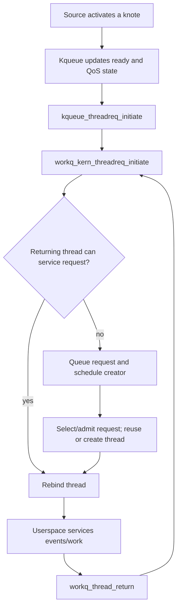

# Events, pthreads, and workqueues

Continue with [Kqueue, knote, and workloop lifetimes](kqueue-and-workloops.md) for event ownership and [Pthread/workqueue lifecycle](pthread-workqueue-lifecycle.md) for admission, binding, parking, cancellation, and exit.

[Back to processes](README.md)

## Kevent registers interests; knotes remember them

A userspace `kevent` describes an interest or a delivered event. A kernel [`struct knote`](../../../xnu/bsd/sys/event_private.h#L428) persists that registration: identity/filter/flags, user data, saved filter data, status bits, QoS indices, its owning queue, and a reference to the watched resource. The resource union includes a fileproc, proc, Mach port/port set, timer call, or thread. A kqueue holds ready registrations; it is not a general-purpose buffer containing every occurrence of an event.

[`struct filterops`](../../../xnu/bsd/sys/event_private.h#L727) separates five responsibilities: `f_attach` establishes the source relationship; `f_detach` removes it; `f_event` evaluates a source notification; `f_touch` changes an existing registration; `f_process` produces a delivery-time result. Filter-specific rules control coalescing, clearing, disabling, and deletion. For example, `EV_CLEAR` changes whether another source activation is needed after processing. These rules should be read per filter rather than inferred from the existence of a ready-list entry.

[`kevent_internal()`](../../../xnu/bsd/kern/kern_event.c#L8082) copies in change requests, calls `kevent_register()`, returns requested receipts/errors, and proceeds to scanning when events are requested. [`kevent_register()`](../../../xnu/bsd/kern/kern_event.c#L4002) validates the filter/flags, finds a matching knote, and creates or updates the registration. For descriptor filters it takes a fileproc reference with `fp_lookup()` before attaching. The object-specific file method can then specialize the filter.

On notification, [`knote_post()`](../../../xnu/bsd/kern/kern_event.c#L808) marks posting state, calls the filter's `f_event`, and activates the knote when the result includes `FILTER_ACTIVE`. [`kqueue_process()`](../../../xnu/bsd/kern/kern_event.c#L7808) and the scan/continuation machinery handle delivery and waiting. `knote_process()` invokes the processing hook and applies the registration protocol. Delivery may represent accumulated state or current readiness; a successful post is not a promise of a unique eventual output record.

## Three queue implementations

The common [`struct kqueue`](../../../xnu/bsd/sys/eventvar.h#L156) contains a spin lock, state bits, count, owning process, and knote-lock tracking. Concrete objects extend it:

| Queue | Additional state | Service model |
| --- | --- | --- |
| `kqfile` | Ready/suppressed lists and `selinfo` | Created by `kqueue()` as a descriptor; a caller waits for events |
| `kqworkq` | Per-QoS ready/suppressed lists and `kqwq_request[]` | Requests servicing threads from the process workqueue, one request per QoS bucket |
| `kqworkloop` | One request, dynamic ID, owner, retain count, state lock, turnstile, QoS state | Coordinates a workloop's servicing thread and synchronous ownership/priority relationships |

The process `filedesc` stores the workqueue queue and the dynamic-workloop hash. [`kqworkloop_get_or_create()`](../../../xnu/bsd/kern/kern_event.c#L3550) resolves IDs and lifetime; retain/release operations distinguish these objects from descriptor-backed kqueues. `kevent_id()` and `kevent_qos()` select modern interfaces and queue behavior. Their flags are part of the ABI, not just formatting differences from legacy `kevent()`.

A workloop here is a BSD event-service object. It is different from an IOKit `IOWorkLoop`, despite the similar name. BSD workloops integrate Mach-port event sources with thread requests, ownership, and turnstile priority propagation; see [IPC](../ipc/README.md) and [runtime](../runtime/README.md).

## Source locks and queue locks

The locking contract at the top of [`eventvar.h`](../../../xnu/bsd/sys/eventvar.h#L80) is essential. Operations initiated from the descriptor side generally follow `proc fd lock → kq lock`, then queue/waitq or workqueue state and thread locks. A source posting an event starts with its own lock and then enters kqueue. To avoid a cycle, kqueue drops its locks when calling into a source and uses knote locking/lifetime protocols to keep the registration valid.

`knote_post()` shows this concretely: it sets `KN_POSTING` under the queue lock, releases the lock for `f_event`, reacquires it, and checks whether another operation marked the knote dropping/vanished. Close/delete paths wait for outstanding posting where required. Copying this function's lock sequence without understanding source serialization is unsafe: it explicitly rejects concurrent posting on the same knote.

## Pthread implementation boundary

[`pthread_shims.c`](../../../xnu/bsd/pthread/pthread_shims.c#L634) exposes `pthread_kext_register()`. A separately supplied implementation registers `pthread_functions`, and XNU returns its kernel callback table. `bsdthread_create()`, `bsdthread_register()`, and `psynch_*` operations delegate through this interface. XNU's initialization panics if the required table is absent.

[`bsdthread_terminate()`](../../../xnu/bsd/pthread/pthread_shims.c#L366) does meaningful local preparation: it handles a workqueue thread leaving the pool and arranges delayed joiner wake/port cleanup when the argument denotes a ulock address. It then calls `pthread_functions->bsdthread_terminate`. A file named “shims” is therefore neither the whole pthread implementation nor necessarily just trivial forwarding. User pthread object layout and the external implementation cannot be reconstructed fully from this tree alone.

An additional in-tree wait/wake mechanism is [`sys_ulock.c`](../../../xnu/bsd/kern/sys_ulock.c#L505). `sys_ulock_wait()` normalizes arguments into `sys_ulock_wait2()`, and the wait/wake paths distinguish unfair-lock ownership from compare-and-wait operations, including shared variants. The [user-lock companion](user-lock-wait-and-wake.md) follows keying, protected comparison, turnstile inheritance, wake selection, timeout and final-waiter cleanup. It should not be conflated with the delegated `psynch_*` family.

## How work reaches a servicing thread

[`struct workqueue`](../../../xnu/bsd/pthread/workqueue_internal.h#L237), referenced by `proc.p_wqptr`, owns run/new/idle uthread lists, thread-creation and retirement callouts, thread counts, QoS activity accounting, a ticket lock, a turnstile, and separate constrained/overcommit/special/cooperative request queues. [`workq_open()`](../../../xnu/bsd/pthread/pthread_workqueue.c#L2081) requires prior pthread registration and initializes per-process pool state. The pool supplies threads; the Mach scheduler still determines when those threads run.

[`workq_threadreq_s`](../../../xnu/bsd/pthread/workqueue_internal.h#L194) records request state, count, flags, QoS, and kqueue override indices. [`workq_kern_threadreq_initiate()`](../../../xnu/bsd/pthread/pthread_workqueue.c#L3051) initializes a request, rejects an exiting pool, may rebind the returning thread immediately, or enqueues the request and schedules the creator. It can connect a workloop turnstile to the pool turnstile while no servicing thread has yet been selected. Permanently bound workloops take a distinct path and must not use this generic initiation routine.

[`workq_constrained_allowance()`](../../../xnu/bsd/pthread/pthread_workqueue.c#L4020) demonstrates admission control. It checks the constrained scheduled-thread limit, aggregates active threads at the requested QoS and higher, includes recently blocked threads still considered busy, and compares against available parallelism. It can schedule delayed reevaluation. “Blocked” therefore does not always mean the pool immediately creates a replacement. Cooperative requests have separate queues/counters; overcommit is another request class, not a synonym for ordinary constrained work.

[`workq_kernreturn()`](../../../xnu/bsd/pthread/pthread_workqueue.c#L3750) dispatches userspace requests for threads and worker returns. Return paths may service events, rebind, park, or retire a worker. On process exit, `workq_mark_exiting()` runs before descriptor/event teardown and `workq_exit()` afterward, so event sources cannot outlive the pool through an uncontrolled request. The full request selector and every park/unpark transition were not audited for this chapter; the cited routines are a concrete route into that deeper study.

<!-- BEGIN PLATYDOC DOCUMENTATION LICENSE -->
Original Platydoc text and diagrams are licensed under [CC BY 4.0](https://creativecommons.org/licenses/by/4.0/). Quoted source code and third-party material retain their respective licenses.
<!-- END PLATYDOC DOCUMENTATION LICENSE -->
