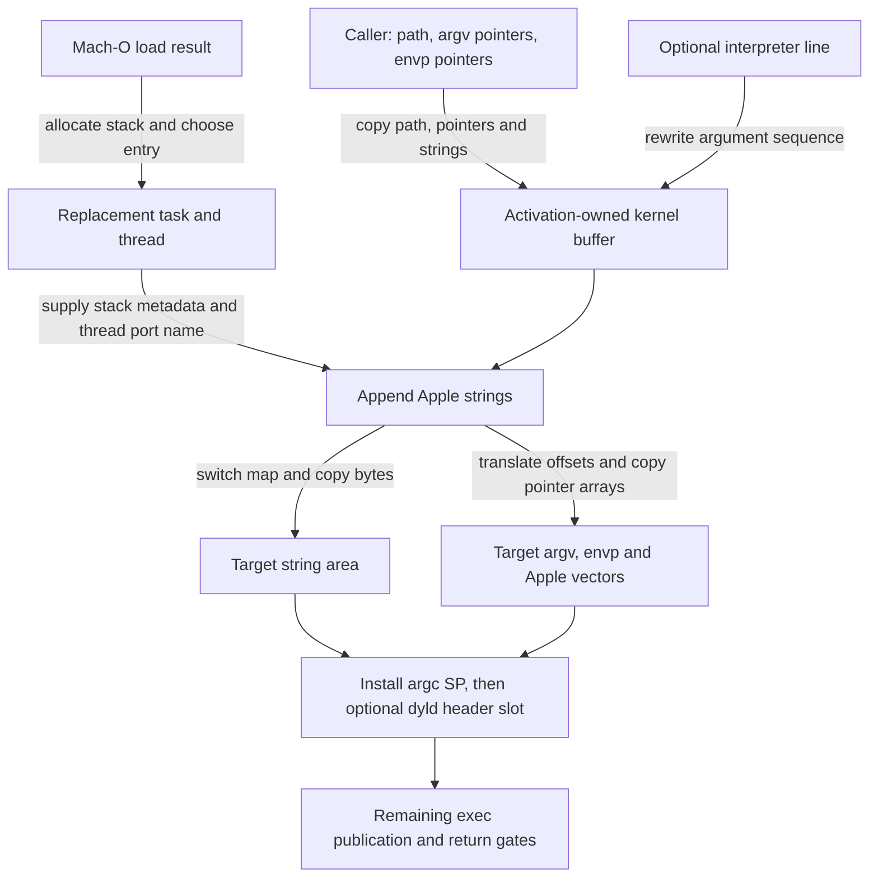
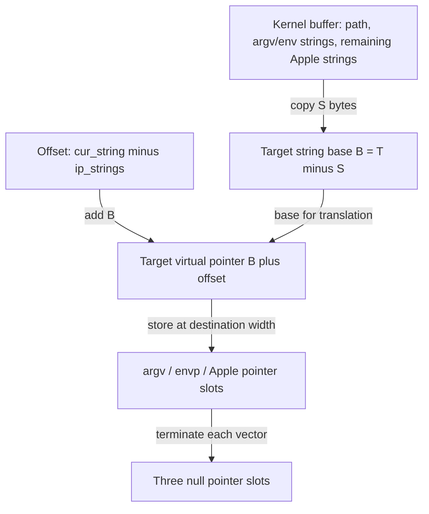
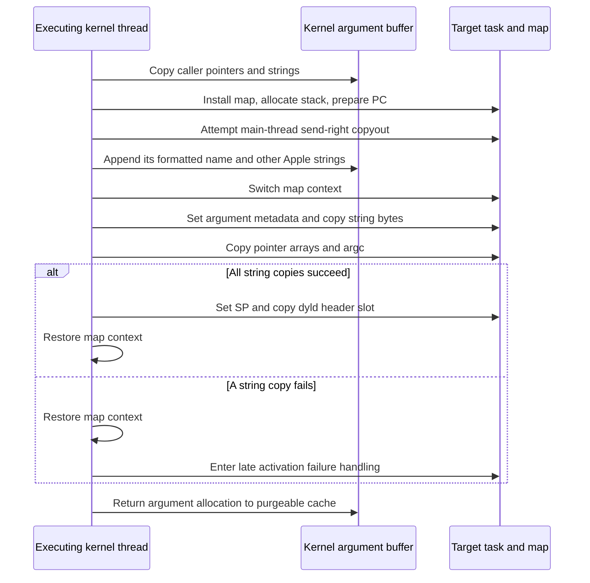

# Exec arguments and the initial user stack

Exec must turn pointers into the calling process into a self-contained startup image in a different address space. This chapter follows that transformation in `xnu-12377.121.6`: argument extraction, interpreter rewriting, kernel string storage, stack allocation, Apple-vector construction, and installation of ARM64 SP and PC. A worked example distinguishes kernel-buffer offsets from addresses in the new process.

Start with the [process guide](README.md) and [process transitions](process-transitions.md). [Executable loading](../../cross-cutting/executable-loading.md) explains how Mach-O supplies the new map and entry point; [exec identity](exec-identity-and-inherited-state.md) explains credentials, inherited resources and publication gates. Those operations surround the stack construction here.

## 1. Extract from the caller before writing into the target

The ordinary exec entry stores the supplied filename, `argp` and `envp` addresses in `image_params`. It records the caller's address width in `IMGPF_WAS_64BIT_ADDR`, creates the replacement proc/task/thread, and gives image activation a VFS context associated with that replacement. The syscall still runs on the old executing thread. `posix_spawn` initializes equivalent argument fields but has different process-construction and error-return surroundings. [Exec setup](../../../platydoc-data/xnu/bsd/kern/kern_exec.c#L6059-L6124), [spawn argument setup](../../../platydoc-data/xnu/bsd/kern/kern_exec.c#L4389-L4405).

After choosing a compatible Mach-O image, `exec_mach_imgact()` sets the destination address/data-width flags. It calls `exec_extract_strings()` before changing its local `thread` and `task` variables to the replacement and before loading/installing the new map. This order preserves access to the old argument pointers while collecting their contents. [Destination width](../../../platydoc-data/xnu/bsd/kern/kern_exec.c#L1980-L1986), [extraction and target selection](../../../platydoc-data/xnu/bsd/kern/kern_exec.c#L2047-L2061).

Three different address representations participate:

| Representation | Example holder | Meaning |
| --- | --- | --- |
| Caller virtual address | `ip_user_argv`, an element read from that array | An address to read with the caller's pointer width and copyin machinery |
| Kernel-buffer pointer or offset | `ip_strings`, `ip_startargv`, `cur_string - ip_strings` | Storage owned by this activation; it is not a user-visible pointer |
| Target virtual address | `string_area`, reconstructed `argv[i]`, saved SP | An address in the replacement task's map |

The later copyout stage explicitly switches the executing thread's map context with `vm_map_switch_to(get_task_map(task))`, then restores it after copying or before leaving a copyout failure path. Assigning the replacement task to a local variable did not perform that address-space switch. [Switch and string copy](../../../platydoc-data/xnu/bsd/kern/kern_exec.c#L2512-L2538), [normal restoration](../../../platydoc-data/xnu/bsd/kern/kern_exec.c#L2705-L2711).



This is the successful construction route. Every copy and allocation still has an error path; no arrow means that the replacement is already allowed to execute.

## 2. One cached allocation carries strings, scratch space and image bytes

`image_params` holds counts (`ip_argc`, `ip_envc`, `ip_applec`), positions within a kernel string buffer, and two remaining-space counters. These fields describe a packed representation, not arrays of kernel pointers corresponding to the final user vectors. [Field definitions](../../../platydoc-data/xnu/bsd/sys/imgact.h#L75-L106).

`exec_activate_image()` obtains the argument buffer before resolving the saved pathname. `execargs_alloc()` admits a limited number of simultaneous users under `execargs_cache_lock`. When no slot is available, it sleeps interruptibly and rechecks the count after waking. It removes a cached mapping under the lock, then drops that lock before allocating a new purgeable mapping or marking a reused one nonvolatile. An interrupted admission returns `EINTR`; a failed VM operation reaches the explicit `ENOMEM` branch, with assertions also present in this source. [Activation entry](../../../platydoc-data/xnu/bsd/kern/kern_exec.c#L2972-L2988), [cache admission and acquisition](../../../platydoc-data/xnu/bsd/kern/kern_exec.c#L8287-L8338), [VM operations](../../../platydoc-data/xnu/bsd/kern/kern_exec.c#L8244-L8277).

The allocation size is `NCARGS + PAGE_SIZE + PAGE_SIZE`: the extra capacity covers Apple strings and an executable-header page. The last page starts at `ip_vdata = ip_strings + NCARGS + PAGE_SIZE`. `exec_copyout_strings()` also uses the space after the assembled strings to construct the outgoing pointer arrays. Do not depict the whole allocation as already containing user-stack bytes. [Allocation-size definition](../../../platydoc-data/xnu/bsd/sys/proc_internal.h#L795-L795), [initial fields](../../../platydoc-data/xnu/bsd/kern/kern_exec.c#L8332-L8336), [pointer scratch placement](../../../platydoc-data/xnu/bsd/kern/kern_exec.c#L6606-L6610).

| Counter | Charged by | Deliberately excluded |
| --- | --- | --- |
| `ip_argspace`, initially `NCARGS` | Argument/environment string bytes including NULs; each destination-width argument/environment pointer; their two terminating null pointers; padding after the combined string region | Executable-path prefix/string, Apple strings and their pointer vector |
| `ip_strspace`, initially `NCARGS + PAGE_SIZE` | Bytes appended to the packed string area, including its alignment padding | Pointer slots reserved through `ip_argspace`; these are constructed later |

`NCARGS` aliases `ARG_MAX`. The kernel-private definition in this checkout tests whether `XNU_TARGET_OS_OSX` is **defined**, selecting 1 MiB when it is and 256 KiB otherwise. A build's preprocessor definitions determine the branch; these numbers are not inferred from an ARM64 filename or a userspace header alone. [Alias](../../../platydoc-data/xnu/bsd/sys/param.h#L99-L99), [conditional definitions](../../../platydoc-data/xnu/bsd/sys/syslimits.h#L72-L85).

`exec_add_user_string()` selects the relevant remaining budget, uses `copyinstr()` for user strings or `copystr()` for kernel strings, and advances the buffer/counters by the reported copied length. If the copy reports `ENAMETOOLONG`, the helper loops; a depleted selected budget returns `E2BIG`. Error handling must therefore treat the partially built buffer as consumed scratch state, rather than assume a failed append changed nothing. [Complete append body](../../../platydoc-data/xnu/bsd/kern/kern_exec.c#L435-L469).

## 3. A script changes both the lookup path and the argument sequence

The initial saved string is `executable_path=` followed by a copy of the invocation pathname. The prefix and pathname consume total string space but do not consume the argument budget. Before saving, `exec_save_path()` clears the prefix/path region because the allocation may have been reused. [Path construction](../../../platydoc-data/xnu/bsd/kern/kern_exec.c#L512-L550).

For a `#!` image, `exec_shell_imgact()` accepts one interpreter redirection: it declines an image already marked `IMGPF_INTERPRET`, and also declines a script inside a previously selected fat slice. The parser works within `IMG_SHSIZE` (512 bytes), recognizes space/tab as whitespace and `#`/newline as line termination, and returns `ENOEXEC` for an absent interpreter or missing bounded line end. It is not a shell quoting or variable-expansion parser. [Character rules](../../../platydoc-data/xnu/bsd/kern/kern_exec.c#L343-L344), [bound](../../../platydoc-data/xnu/bsd/sys/imgact.h#L69-L69), [admission and parsing](../../../platydoc-data/xnu/bsd/kern/kern_exec.c#L609-L677).

It resets the string-buffer counters, saves the interpreter pathname as the new `executable_path`, and saves the whole interpreter-plus-arguments text separately in `ip_interp_buffer`. Returning the internal value `-3` makes the activation loop release the old vnode lookup state and resolve the interpreter. That internal result is not a userspace errno. [Reset and interpreter storage](../../../platydoc-data/xnu/bsd/kern/kern_exec.c#L570-L577), [path replacement](../../../platydoc-data/xnu/bsd/kern/kern_exec.c#L686-L702), [lookup restart](../../../platydoc-data/xnu/bsd/kern/kern_exec.c#L3050-L3100).

During later string extraction, the stored interpreter line is split on spaces/tabs. Its tokens become the first arguments. A non-null old `argv[0]` is skipped; the script pathname is inserted, followed by the remaining supplied arguments. If the selected set-ID script route created `ip_interp_sugid_fd`, the inserted string is `/dev/fd/<number>` instead. Descriptor construction is guarded by `CONFIG_SETUID` and the retained mode bits; the [identity companion](exec-identity-and-inherited-state.md) explains their policy. [Tokenization and old-argument skip](../../../platydoc-data/xnu/bsd/kern/kern_exec.c#L6751-L6811), [script argument insertion](../../../platydoc-data/xnu/bsd/kern/kern_exec.c#L6813-L6829), [optional descriptor construction](../../../platydoc-data/xnu/bsd/kern/kern_exec.c#L704-L734).

For an illustrative invocation with pathname `/tmp/job`, first line `#! /bin/tool -x\n`, and supplied `argv = {"custom-name", "input", NULL}`, the new argument strings are:

```text
Illustrative rewritten argv:
[0] /bin/tool
[1] -x
[2] /tmp/job
[3] input
[4] NULL

First Apple string: executable_path=/bin/tool
```

The arbitrary old string `custom-name` does not become the script pathname. The pathname inserted during extraction is copied from `ip_user_fname` again on the ordinary script path; the earlier saved lookup pathname is not a single immutable snapshot of every later input. Similarly, pointer arrays and strings are read in separate copy operations. The implementation does not freeze all caller memory while collecting them.

## 4. Source pointer width and destination pointer width have separate jobs

The distinction appears at the start of extraction. [Source: `kern_exec.c`, lines 6729–6735](../../../platydoc-data/xnu/bsd/kern/kern_exec.c#L6729-L6735).

<!-- source-excerpt: ../../../platydoc-data/xnu/bsd/kern/kern_exec.c#L6729-L6735 -->
```c
exec_extract_strings(struct image_params *imgp)
{
	int error = 0;
	int     ptr_size = (imgp->ip_flags & IMGPF_WAS_64BIT_ADDR) ? 8 : 4;
	int new_ptr_size = (imgp->ip_flags & IMGPF_IS_64BIT_ADDR) ? 8 : 4;
	user_addr_t     argv = imgp->ip_user_argv;
	user_addr_t     envv = imgp->ip_user_envv;
```

`ptr_size` controls `copyinptr()` and stepping over the caller's arrays. `new_ptr_size` controls pointer-budget reservations and alignment for the image being built. For the ARM64 example below both are eight, but the two flags must remain distinct when reading shared implementation code; their presence does not guarantee every source/destination architecture combination is accepted by image grading.

After aligning the saved path to the destination pointer width, extraction marks `ip_startargv` and walks argument pointers until a null element. A null array address skips that walk. Each copied string increments `ip_argc` only after its bytes and destination pointer slot have passed their budget checks. It reserves the terminating argv pointer, records `ip_endargv`, then performs the analogous environment loop. The environment receives no shell parsing in this helper. [Argument walk](../../../platydoc-data/xnu/bsd/kern/kern_exec.c#L6832-L6866), [environment walk](../../../platydoc-data/xnu/bsd/kern/kern_exec.c#L6868-L6905).

Finally the combined argument/environment string region is padded with zero bytes to the destination pointer width. This padding consumes both counters; the resulting `ip_endenvv` will be the start of appended Apple strings. The path's earlier padding consumed only `ip_strspace`. Individual strings inside a region are separated only by their terminating NUL and need not start at aligned addresses. [Initial path padding](../../../platydoc-data/xnu/bsd/kern/kern_exec.c#L6737-L6747), [combined-region padding](../../../platydoc-data/xnu/bsd/kern/kern_exec.c#L6907-L6924).

For `argv = {"demo", "-v", NULL}` and `envp = {"MODE=1", NULL}` in an eight-byte destination, the argument/environment strings take `5 + 3 + 7 = 15` bytes. Five pointer slots take 40 bytes: two arguments, one environment entry and two terminators. One padding byte brings the total `NCARGS` charge to **56 bytes**. The pathname and Apple strings have separate accounting.

## 5. Stack allocation supplies a top, an extent and a no-access region

For the selected `LC_MAIN` route, the loader obtains the architecture's default stack location, applies its slide and page truncation, and records allocation requirements. An explicit nonzero `stacksize` becomes the usable size; its allocation includes an extra `PAGE_SIZE`, with overflow checks. With no explicit size, allocation uses `MAXSSIZ` and the later stack helper applies the process limit. `LC_MAIN` also requests dyld; the kernel does not use its `entryoff` as the initial PC. [Loader decisions](../../../platydoc-data/xnu/bsd/kern/mach_loader.c#L3010-L3057), [ARM64 default selection](../../../platydoc-data/xnu/osfmk/arm64/status.c#L2414-L2424).

`create_unix_stack()` first records the requested top in `p->user_stack`, then allocates if `user_stack_alloc_size > 0`. It tries a fixed mapping below that top; if allocation fails, it tries anywhere and replaces the recorded top with `addr + size`. A `custom_stack` flag does not universally mean that this helper allocates nothing: an explicit `LC_MAIN.stacksize` sets that flag and still supplies a nonzero allocation size. [Stack setup and fallback](../../../platydoc-data/xnu/bsd/kern/kern_exec.c#L7847-L7891).

The helper sets the low-address portion of the allocation to `VM_PROT_NONE`. For an explicit usable size, that protected amount is `PAGE_SIZE`; for a default stack it derives the protected amount from allocation size minus `RLIMIT_STACK`, using the target map's page mask. If protection fails, it deallocates the new allocation before returning. Kernel `PAGE_SIZE`, map page size, requested usable size and rounded allocation size are separate quantities on mixed-page-size paths. [Guard and limit enforcement](../../../platydoc-data/xnu/bsd/kern/kern_exec.c#L7893-L7916).

The worked example selects matching **16 KiB kernel and target-map pages**, a 128 KiB explicit usable stack (`0x20000`) and a 16 KiB low guard. Its allocation size is `0x24000`. All numerical addresses below are **EL0 CPU virtual addresses in the target map**, not physical addresses or kernel-buffer addresses. Fixed allocation succeeds at the hypothetical location; no claim is made about a device's actual ASLR choice.

## 6. The Apple vector contains metadata and a published port name

`exec_add_apple_strings()` sets `ip_applec = 1` because the first Apple string, the saved executable path, is already at the buffer's beginning. It appends the remaining strings after `ip_endenvv` and finally pads that tail to the destination pointer width. `exec_copyout_strings()` will join those two physically separated parts into one logical pointer vector. [Initial count and PFZ entry](../../../platydoc-data/xnu/bsd/kern/kern_exec.c#L7055-L7084), [tail padding](../../../platydoc-data/xnu/bsd/kern/kern_exec.c#L7373-L7380).

| Entry or group | Local construction rule |
| --- | --- |
| `executable_path`, `pfz` | Saved path plus the commpage-text location selected by destination pointer width |
| `stack_guard`, `malloc_entropy`, `ptr_munge` | Fresh random values formatted as hexadecimal strings; the stack-guard helper clears one byte of the numeric value before formatting |
| `main_stack` | For `unixproc`, four values: top, usable size, allocation base and allocation size |
| `executable_file`, `dyld_file` | File identity from present vnode attributes and nonzero dyld identity fields respectively |
| `executable_cdhash`, `executable_boothash` | Added together when `ubc_cs_getcdhash()` succeeds; the latter derives from boot salt, boot UUID and the executable cdhash |
| `th_port` | The name returned by attempting main-thread send-right copyout into the new task's IPC space when `ip_new_thread` exists |
| `security_config` | Added even when the task's security configuration value is zero |
| Conditional additions | Spawn nano-allocator selection, development dyld flags, subsystem root, pointer-authentication compatibility, macOS mixed-page-size selection, malloc experiment factors, SEC/MTE and hardened-browser metadata |

[Entropy formatting](../../../platydoc-data/xnu/bsd/kern/kern_exec.c#L7007-L7034), [entropy/stack entries](../../../platydoc-data/xnu/bsd/kern/kern_exec.c#L7101-L7153), [file/digest entries](../../../platydoc-data/xnu/bsd/kern/kern_exec.c#L7155-L7216), [optional entries](../../../platydoc-data/xnu/bsd/kern/kern_exec.c#L7217-L7254), [remaining conditional/configuration entries](../../../platydoc-data/xnu/bsd/kern/kern_exec.c#L7277-L7371).

The `stack_guard` string itself is normal NUL-terminated text. The helper's `embedNUL` operation clears bits 8–15 of the random **number**, then formats the number using `%llx`; it does not insert a NUL into the middle of the hexadecimal text. Keep this distinction when interpreting the nearby comment about an embedded NUL. [Numeric mask and formatting](../../../platydoc-data/xnu/bsd/kern/kern_exec.c#L7020-L7026).

The thread-port entry can publish a right before any stack copyout. [Source: `kern_exec.c`, lines 7262–7274](../../../platydoc-data/xnu/bsd/kern/kern_exec.c#L7262-L7274).

<!-- source-excerpt: ../../../platydoc-data/xnu/bsd/kern/kern_exec.c#L7262-L7274 -->
```c
	if ((new_thread = imgp->ip_new_thread) != THREAD_NULL) {
		thread_reference(new_thread);
		sright = convert_thread_to_port_immovable(new_thread);
		task_t new_task = get_threadtask(new_thread);
		mach_port_name_t name = ipc_port_copyout_send_pinned(sright, get_task_ipcspace(new_task));
		char port_name_hex_str[strlen(MAIN_TH_PORT_KEY) + HEX_STR_LEN32 + 1];
		snprintf(port_name_hex_str, sizeof(port_name_hex_str), MAIN_TH_PORT_KEY "0x%x", name);

		error = exec_add_user_string(imgp, CAST_USER_ADDR_T(port_name_hex_str), UIO_SYSSPACE, FALSE);
		if (error) {
			goto bad;
		}
		imgp->ip_applec++;
```

The formatted value is a task-local Mach port name, not a `thread_t` pointer. The code references the new thread, converts that reference to an immovable send right, and attempts to copy the right into the new task's IPC space with the pinned-send helper. On success, a subsequent string-append failure does not undo that publication in this block; broader activation/task cleanup is responsible for abandoning the failed image. The source comment describes an intended libpthread consumer, but this chapter does not reconstruct that external library. [Ownership comment](../../../platydoc-data/xnu/bsd/kern/kern_exec.c#L7256-L7261), [conversion body](../../../platydoc-data/xnu/osfmk/kern/ipc_tt.c#L3085-L3101).

The copyout helper returns `MACH_PORT_DEAD` for `KERN_INVALID_CAPABILITY`, or `MACH_PORT_NULL` for other copyout failures. Exec formats the returned name without checking these sentinel values. A `th_port` string alone therefore does not prove that a usable send right was installed. The numerical example selects successful copyout. [Copyout result conversion and pinned wrapper](../../../platydoc-data/xnu/osfmk/ipc/ipc_port.c#L2949-L2995).

## 7. Copyout rebuilds pointers from offsets

Let `T` be `p->user_stack` on entry, `S` the fully padded string-byte count, and `w` the destination pointer width. With `a = ip_argc`, `e = ip_envc`, and `k = ip_applec`, the helper lays out:

```text
Illustrative formulas matching exec_copyout_strings:
string_area = T - S
pointer_bytes = (a + e + k + 3) * w
ptr_area = string_area - pointer_bytes
argc_area = ptr_area - w
```

The three extra pointer slots terminate argv, envp and the Apple vector. The argc occupies one pointer-sized slot even though its logical count is an integer. [Size and placement](../../../platydoc-data/xnu/bsd/kern/kern_exec.c#L6582-L6616).

The copy sequence is: publish `p_argc`/`p_argslen` and the helper's returned stack address, copy all string bytes, construct/copy the pointer arrays, then copy argc. `p_argslen` is `S`, the string-area size, not the size of every slot below it. The process fields are protected by `proc_lock`; this is not a lock held across the user-memory copies. [Metadata and first copy](../../../platydoc-data/xnu/bsd/kern/kern_exec.c#L6618-L6637), [pointer/argc copies](../../../platydoc-data/xnu/bsd/kern/kern_exec.c#L6680-L6696).

Each output pointer is derived from a kernel-buffer **offset**, added to the target string base. [Source: `kern_exec.c`, lines 6655–6666](../../../platydoc-data/xnu/bsd/kern/kern_exec.c#L6655-L6666).

<!-- source-excerpt: ../../../platydoc-data/xnu/bsd/kern/kern_exec.c#L6655-L6666 -->
```c
		for (j = 0; j < descriptors[i].count; j++) {
			user_addr_t cur_address = string_area + (cur_string - imgp->ip_strings);

			/* Copy out the pointer to the current string. Alignment has been verified  */
			if (ptr_size == 8) {
				*(uint64_t *)ptr_buffer = (uint64_t)cur_address;
			} else {
				*(uint32_t *)ptr_buffer = (uint32_t)cur_address;
			}

			ptr_buffer = (void *)((uintptr_t)ptr_buffer + ptr_size);
			cur_string += strlen(cur_string) + 1; /* Only a NUL between strings in the same area */
```

The descriptor list emits argv, envp, the single path string, and then the other `ip_applec - 1` strings. The path descriptor has no null terminator; the final descriptor supplies the one Apple-vector terminator. This reconnects `ip_strings` and `ip_endenvv` without copying their text into a second Apple-only string block. [Descriptor list](../../../platydoc-data/xnu/bsd/kern/kern_exec.c#L6540-L6580).



There is no requirement that each pointed-to string be pointer-aligned. The pointer slots themselves are aligned to `w`; packed string starts can be at arbitrary byte offsets.

## 8. Worked ARM64 stack layout

Select an ordinary dynamically linked 64-bit-address image, eight-byte source/destination pointers, and the stack allocation from section 5. Let its successful allocation be `[0x167fdc000, 0x168000000)`: the low `[0x167fdc000, 0x167fe0000)` is the guard, and the remaining `0x20000` bytes are usable. Set `T = 0x168000000` and the main image's Mach header address to the hypothetical `H = 0x100000000`.

The invocation is `/tmp/demo`, `argv = {"demo", "-v", NULL}`, `envp = {"MODE=1", NULL}`. Select exactly twelve Apple entries: path, PFZ, three entropy entries, stack description, two file identities, two digest entries, main-thread port and security configuration. The optional additions listed above are absent in this example. The file IDs, port name, entropy and digest characters below are hypothetical values for layout arithmetic; the two 40-character digest strings are placeholders, not a calculated hash pair or recorded launch.

The table specifies every string. Each byte count includes its final NUL. The two digest rows use `00 × 20` and `11 × 20` to mean exactly forty hexadecimal characters following the key; that notation is not literal buffer content.

| Logical element | Buffer offset | Bytes | Illustrative string |
| --- | ---: | ---: | --- |
| `apple[0]` | `0x000` | 26 | `executable_path=/tmp/demo` |
| Path padding | `0x01a` | 6 | Zero bytes |
| `argv[0]` | `0x020` | 5 | `demo` |
| `argv[1]` | `0x025` | 3 | `-v` |
| `envp[0]` | `0x028` | 7 | `MODE=1` |
| Argument/environment padding | `0x02f` | 1 | Zero byte |
| `apple[1]` | `0x030` | 16 | `pfz=0x1ffff0000` |
| `apple[2]` | `0x040` | 23 | `stack_guard=0x12340078` |
| `apple[3]` | `0x057` | 23 | `malloc_entropy=0x1,0x2` |
| `apple[4]` | `0x06e` | 14 | `ptr_munge=0x3` |
| `apple[5]` | `0x07c` | 51 | `main_stack=0x168000000,0x20000,0x167fdc000,0x24000` |
| `apple[6]` | `0x0af` | 24 | `executable_file=0x1,0x2` |
| `apple[7]` | `0x0c7` | 18 | `dyld_file=0x1,0x3` |
| `apple[8]` | `0x0d9` | 59 | `executable_cdhash=` + `00 × 20` |
| `apple[9]` | `0x114` | 61 | `executable_boothash=` + `11 × 20` |
| `apple[10]` | `0x151` | 14 | `th_port=0x103` |
| `apple[11]` | `0x15f` | 20 | `security_config=0x0` |
| Apple-tail padding | `0x173` | 5 | Zero bytes |

Thus `S = 0x178 = 376` bytes, `pointer_bytes = (2 + 1 + 12 + 3) × 8 = 0x90`, and the target string base is `B = 0x167fffe88`. The resulting slots, in increasing address order, are:

| Target virtual address | Contents |
| --- | --- |
| `0x167fffde8` | `H = 0x100000000`, the extra dyld header slot installed after the string helper |
| `0x167fffdf0` | `argc = 2`, in an eight-byte slot |
| `0x167fffdf8` | `argv[0] = B + 0x20 = 0x167fffea8` |
| `0x167fffe00` | `argv[1] = B + 0x25 = 0x167fffead` |
| `0x167fffe08` | Null argv terminator |
| `0x167fffe10` | `envp[0] = B + 0x28 = 0x167fffeb0` |
| `0x167fffe18` | Null environment terminator |
| `0x167fffe20` | `apple[0] = B` |
| `0x167fffe28` through `0x167fffe78` | Eleven Apple pointers, using the offsets for `apple[1]` through `apple[11]` above |
| `0x167fffe80` | Null Apple-vector terminator |
| `0x167fffe88` through `0x167ffffff` | The 376 string/padding bytes; the exclusive end is `T` |

`p->p_argc` becomes 2 and `p->p_argslen` becomes 376. `p->user_stack` remains the high address `T`; the saved machine SP will point below the strings and vectors. These two addresses have different roles. Changing any optional Apple entry can change both `S` and the pointer count, so a fixed offset to `argv` must be derived from the selected layout rather than copied from another launch.

## 9. Saved SP and PC are installed separately

After `exec_copyout_strings()` succeeds, the activator calls `thread_setuserstack(thread, ap)` with `ap = argc_area`. On ARM64 that helper writes the supplied value directly through `set_saved_state_sp()`. For a loaded dynamic linker, the activator then moves SP down by one destination-width slot and copies `load_result.mach_header` there. [SP setter](../../../platydoc-data/xnu/osfmk/arm64/status.c#L2431-L2441), [dyld prefix operation](../../../platydoc-data/xnu/bsd/kern/kern_exec.c#L2541-L2547).

The actual adjustment performs no additional rounding. [Source: `status.c`, lines 2455–2461](../../../platydoc-data/xnu/osfmk/arm64/status.c#L2455-L2461).

<!-- source-excerpt: ../../../platydoc-data/xnu/osfmk/arm64/status.c#L2455-L2461 -->
```c
	sv = get_user_regs(thread);

	sp = get_saved_state_sp(sv);
	sp += adjust;
	set_saved_state_sp(sv, sp);

	return sp;
```

For the example, the string helper returns `0x167fffdf0`; the dynamic-image SP becomes `0x167fffde8`. That value is eight-byte aligned but not sixteen-byte aligned. The inspected construction aligns the string subregions and pointer slots to the destination pointer width; it does not perform an extra sixteen-byte SP adjustment here. This is a kernel-to-startup-code layout, not evidence for a general C-function calling convention or for how dyld later aligns its own calls.

PC was installed earlier by `activate_exec_state()`: initialize thread state, apply the loader's saved thread-state flavors, then call `thread_setentrypoint(thread, result->entry_point)`. The ARM64 setter writes user saved-state PC, using the PAC-safe interrupt wrapper when selected. For the dynamic-image route, `load_dylinker()` supplies the dynamic linker's entry/state; the extra stack word remains the **main image's header address**, not that entry PC. [Exec state activation](../../../platydoc-data/xnu/bsd/kern/kern_exec.c#L877-L916), [ARM64 PC setter](../../../platydoc-data/xnu/osfmk/arm64/status.c#L2470-L2487), [dynamic-linker result transfer](../../../platydoc-data/xnu/bsd/kern/mach_loader.c#L3493-L3505).

The chapter stops at prepared saved state and memory. Actual userspace return still depends on the [exec publication and return gates](process-transitions.md#4-exec-replace-the-proctask-pair-while-preserving-identity) and the [ARM64 entry/return machinery](../platform/execution.md). External dyld and libSystem startup code decide how to consume the vectors and reach the application.

## 10. Failure preserves the stage's actual progress



The diagram selects a replacement thread and dynamic Unix image; the success branch's dyld-header copy can itself fail and take late failure handling. It is not a transaction diagram with rollback of every earlier change.

| Stage and error | State that can already exist |
| --- | --- |
| Argument pointer/string copy fault or budget failure | Kernel-buffer bytes/counters from earlier arguments; caller arrays are not rewritten |
| Stack allocation or guard failure | Recorded stack metadata; the helper deallocates a newly allocated stack if its protection operation fails |
| Apple append failure | Prior metadata and the main-thread send right if its copyout already occurred |
| String-area copyout failure | Updated `p_argc`, `p_argslen` and local returned `ap`; a copy fault does not establish that no destination bytes were written |
| Pointer-vector or argc copyout failure | The successful string-area copy, and possibly earlier pointer/count bytes; saved SP is not installed by the caller until the whole helper succeeds |
| Dyld-header copyout failure | A complete argument image and already adjusted saved SP |

String and dyld-prefix copy errors restore the caller's map context before branching to `badtoolate`. In non-spawn handling that path sends a fatal reason, terminates the exec-copy task when applicable, and sets the internal error to zero because the old image cannot simply resume. Ordinary spawn keeps its error for child cleanup. A zero return from that internal path therefore does not establish a runnable new program. [String-copy failure](../../../platydoc-data/xnu/bsd/kern/kern_exec.c#L2523-L2538), [dyld-prefix failure](../../../platydoc-data/xnu/bsd/kern/kern_exec.c#L2545-L2560), [late-failure body](../../../platydoc-data/xnu/bsd/kern/kern_exec.c#L2867-L2889).

`exec_activate_image()` returns its temporary buffer through `execargs_free()` on its common exit. The free helper marks the mapping volatile, restores it to the cache and clears `imgp->ip_strings` under the cache lock, then wakes admission waiters after unlocking. This ends the activation's ownership; it is not an immediate VM deallocation or a claim that every byte was zeroed. Subsequent outer exec/spawn cleanup checks the pointer before attempting another free. [Activation exit](../../../platydoc-data/xnu/bsd/kern/kern_exec.c#L3124-L3136), [cache return](../../../platydoc-data/xnu/bsd/kern/kern_exec.c#L8355-L8387), [outer exec cleanup](../../../platydoc-data/xnu/bsd/kern/kern_exec.c#L6208-L6219), [outer spawn cleanup](../../../platydoc-data/xnu/bsd/kern/kern_exec.c#L5567-L5580).

The obsolete map has a separate owner: `swap_task_map()` transfers the new map to the target and places the old map in `ip_free_map`. The outer entry releases that map after dropping vnode iocounts. Buffer reuse, user-stack lifetime and task/map destruction therefore end at different points. [Map transfer](../../../platydoc-data/xnu/bsd/kern/kern_exec.c#L2371-L2393), [ordered release](../../../platydoc-data/xnu/bsd/kern/kern_exec.c#L6208-L6219).

## 11. Evidence and limits

The local `sysctl_procargsx_cow` test constructs a large argument vector, asserts successful spawn, then asserts successful size-query/data retrieval and a reported area larger than 64 KiB. It gives evidence for the test's large-argument scenario and adjacent retrieval path. It does not inspect startup SP, every pointer slot, script rewriting, or the optional Apple entries shown here. [Argument construction](../../../platydoc-data/xnu/tests/sysctl_procargsx_cow.c#L46-L97), [assertions](../../../platydoc-data/xnu/tests/sysctl_procargsx_cow.c#L100-L125). No kernel or userspace test was executed for this chapter.

This review follows common exec/spawn argument collection and cleanup, the interpreter helper, selected `LC_MAIN` stack requirements, Apple construction, generic copyout and ARM64 saved-state setters. The numerical example selects equal 16 KiB page sizes and a dynamic 64-bit-address Unix image; it does not validate mixed-page-size configurations, Rosetta paths, every custom-stack image, or all platform admission rules. The format and local creation of Apple strings are visible; the external consumers' behavior and private policy decisions are not reconstructed. For Mach-O parsing, identity transitions and return assembly, use the companion chapters rather than infer those mechanisms from a finished stack image.

<!-- BEGIN PLATYDOC DOCUMENTATION LICENSE -->
Original Platydoc text and diagrams are licensed under [CC BY 4.0](https://creativecommons.org/licenses/by/4.0/). Quoted source code and third-party material retain their respective licenses.
<!-- END PLATYDOC DOCUMENTATION LICENSE -->
