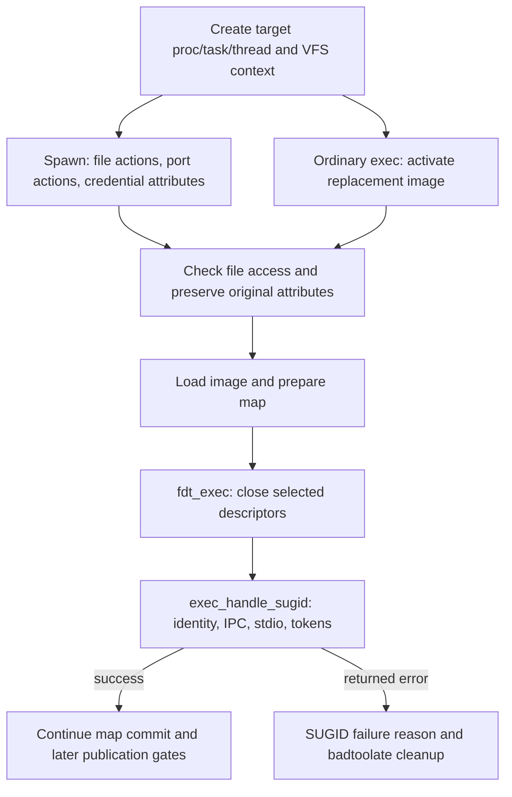
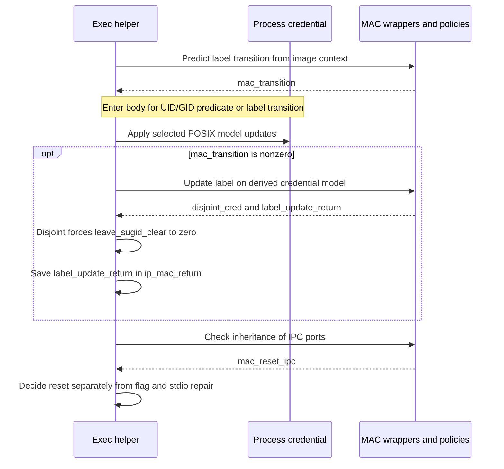
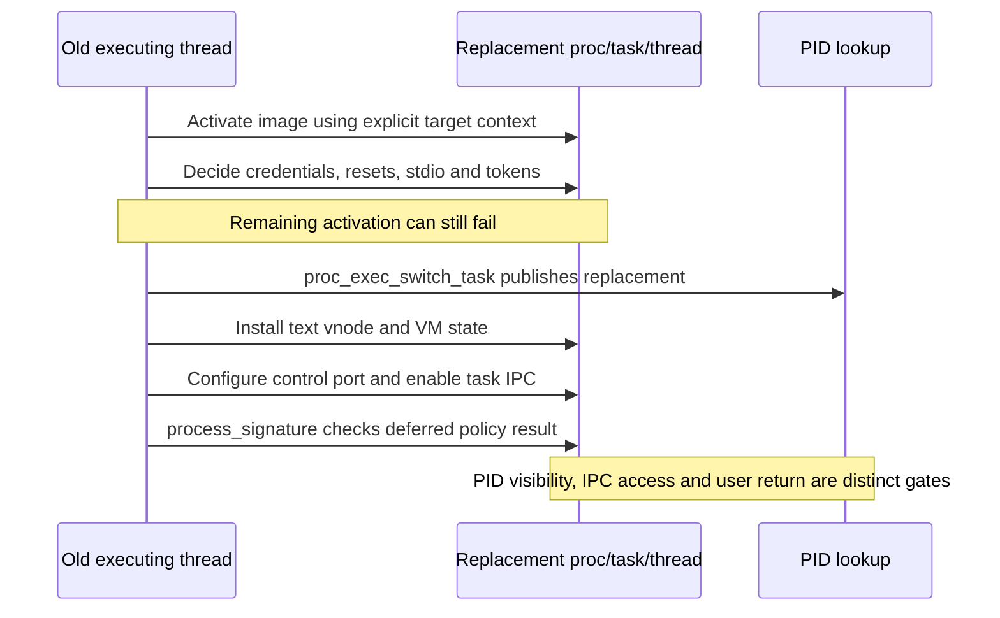

# Exec identity and inherited state

[Processes](README.md) · [Process transitions](process-transitions.md) · [Credentials and policy](../security/credentials-and-policy.md) · [Task and thread capabilities](../security/task-and-thread-capabilities.md)

Executing a file can change effective identity, saved identity, MAC labels, task/thread access, and the meaning of inherited descriptors. These changes are coordinated by `exec_handle_sugid()` during Mach-O activation. A set-ID mode bit alone does not determine every outcome: the previous identity, group membership, policy results, and the target process under construction all matter. This chapter follows that operation in `xnu-12377.121.6`.

Read [process transitions](process-transitions.md) for construction, reference drains, PID publication, and termination of the old task; read [executable loading](../../cross-cutting/executable-loading.md) for Mach-O mappings and [exec arguments and the initial user stack](exec-arguments-and-user-stack.md) for argument transformation and startup state. Here the question is what identity and inherited authority the new image receives, and when those decisions become visible.

## 1. The process being changed is explicit

For ordinary exec, `__mac_execve()` constructs a shadow proc/task/thread and runs activation from the old thread. Its VFS context names the replacement thread and holds a reference to the replacement process's credential. `exec_handle_sugid()` obtains both its process and its initial credential through that context. Using the currently executing thread as the target would confuse the worker performing activation with the new image being prepared. [Exec context setup](../../../platydoc-data/xnu/bsd/kern/kern_exec.c#L6090-L6134), [helper inputs](../../../platydoc-data/xnu/bsd/kern/kern_exec.c#L7525-L7536).

[Source: bsd/kern/kern_exec.c, lines 6117–6120](../../../platydoc-data/xnu/bsd/kern/kern_exec.c#L6117-L6120)

<!-- source-excerpt: ../../../platydoc-data/xnu/bsd/kern/kern_exec.c#L6117-L6120 -->
```c
	p = (proc_t)get_bsdthreadtask_info(imgp->ip_new_thread);

	context.vc_thread = imgp->ip_new_thread;
	context.vc_ucred = kauth_cred_proc_ref(p);      /* XXX must NOT be kauth_cred_get() */
```

The context credential is a distinct input from the credential subsequently published on the process. `vfs_context_ucred()` returns `ctx->vc_ucred`; a process credential replacement does not rewrite that field. The helper uses the context credential for its initial UID/group decision, while `kauth_cred_proc_update()` derives each replacement from the process's then-current published credential. [Context accessor](../../../platydoc-data/xnu/bsd/vfs/kpi_vfs.c#L1716-L1720), [credential update](../../../platydoc-data/xnu/bsd/kern/kern_credential.c#L3925-L3980).

| State | Role during this operation |
| --- | --- |
| `image_params.ip_vfs_context` | Target process/thread context and credential used for VFS operations and initial identity comparisons |
| `ip_origvattr` | Original executable's checked ownership/mode attributes, retained across interpreter lookup |
| `ip_vp`, `ip_arch_offset`, script vnode/labels | Current image and script inputs passed to MAC policy |
| `proc_ro.p_ucred` | Published process credential, replaced through the credential update API |
| `p_flag & P_SUGID` | Process state set by the transition decision; distinct from executable `VSUID`/`VSGID` bits |
| `ip_mac_return`, `ip_csflags` | Deferred label-policy result and image signing state consumed later |
| Target task/thread IPC fields | Control/read/inspect ports and selected exception/debug state reset when required |

[Image parameter fields](../../../platydoc-data/xnu/bsd/sys/imgact.h), [credential storage](../../../platydoc-data/xnu/bsd/sys/proc_ro.h), [transition helper](../../../platydoc-data/xnu/bsd/kern/kern_exec.c#L7525-L7818).

## 2. File actions and permission checks precede the transition

Normal spawn first constructs the child and descriptor table. It establishes the child's VFS context, executes file actions, executes port actions, and then applies credential attributes such as `POSIX_SPAWN_RESETIDS`. The reset uses the credential model's real UID/GID before image activation; executable set-ID handling can change effective IDs afterward. Specialized POSIX credential adoption and persona handling have separate admission and configuration branches. [Action and credential ordering](../../../platydoc-data/xnu/bsd/kern/kern_exec.c#L4872-L4982), [descriptor inheritance](descriptors-ipc.md).

The VFS context is assigned before those actions and attributes. Therefore “file actions use the identity of the eventual executable” is not the implemented rule. In particular, obtaining a descriptor before the set-ID transition and using it afterward are separate stages with separate objects. Descriptor flags and `fdt_exec()` decide which descriptors survive activation. [Context assignment](../../../platydoc-data/xnu/bsd/kern/kern_exec.c#L4872-L4878), [file actions](../../../platydoc-data/xnu/bsd/kern/kern_exec.c#L3539-L3769), [close-on-exec pass](../../../platydoc-data/xnu/bsd/kern/kern_exec.c#L2345-L2354).

`exec_check_permissions()` obtains vnode owner, group, mode and size, requires an executable regular nonempty file, and performs MAC/VFS access checks. Before saving the original attributes, it clears `VSUID|VSGID` for a `MNT_NOSUID` mount or a traced target. Remaining set-ID bits also clear the image's allow-data-execution and disable-ASLR requests. These are modifications to the activation attributes and flags, not a chmod of the file. [Permission and mode handling](../../../platydoc-data/xnu/bsd/kern/kern_exec.c#L7400-L7479).

The first successful permission pass copies `ip_vattr` into `ip_origvattr`; interpreter lookup does not overwrite that saved copy. The script activator additionally clears its saved set-ID bits when `sugid_scripts == 0`, the variable's initial value. This explains why the later identity decision reads original attributes while MAC hooks can also receive the current executable and a script vnode. It does not establish every script-policy outcome on a product kernel. [Original attribute capture](../../../platydoc-data/xnu/bsd/kern/kern_exec.c#L3020-L3029), [script control](../../../platydoc-data/xnu/bsd/kern/kern_exec.c#L400-L401), [script masking](../../../platydoc-data/xnu/bsd/kern/kern_exec.c#L623-L634).



The diagram selects Mach-O activation and successful early preparation. Earlier steps can fail independently. The concrete call to `exec_handle_sugid()` follows `vm_map_exec()` and `fdt_exec()` and precedes the following new-map commit block. A nonzero return creates `EXEC_EXIT_REASON_SUGID_FAILURE` and enters `badtoolate`. [Caller](../../../platydoc-data/xnu/bsd/kern/kern_exec.c#L2324-L2377).

## 3. The ordered UID/group predicate controls the exception

The helper initializes `leave_sugid_clear` to zero, obtains any MAC transition prediction, and clears the target's existing `P_SUGID`. It then evaluates this ordered predicate. [Initialization and prediction](../../../platydoc-data/xnu/bsd/kern/kern_exec.c#L7525-L7558).

[Source: bsd/kern/kern_exec.c, lines 7573–7577](../../../platydoc-data/xnu/bsd/kern/kern_exec.c#L7573-L7577)

<!-- source-excerpt: ../../../platydoc-data/xnu/bsd/kern/kern_exec.c#L7573-L7577 -->
```c
	if (((imgp->ip_origvattr->va_mode & VSUID) != 0 &&
	    kauth_cred_getuid(cred) != imgp->ip_origvattr->va_uid) ||
	    ((imgp->ip_origvattr->va_mode & VSGID) != 0 &&
	    ((kauth_cred_ismember_gid(cred, imgp->ip_origvattr->va_gid, &leave_sugid_clear) || !leave_sugid_clear) ||
	    (kauth_cred_getgid(cred) != imgp->ip_origvattr->va_gid)))) {
```

If the `VSUID` comparison is true, C short-circuit evaluation skips the group expression and leaves `leave_sugid_clear` zero. For a group-only transition, membership is checked first and writes that variable. Successful membership plus a different effective GID enters the body with the variable set to one: XNU treats selecting an already available group differently from acquiring a new identity. [Predicate commentary and body](../../../platydoc-data/xnu/bsd/kern/kern_exec.c#L7560-L7626).

`kauth_cred_ismember_gid()` first checks the credential's groups. When external membership resolution applies, it can consult cached membership or submit a resolver request. An error returns through the predicate's true arm; it is not converted into proof of membership. On the inspected error paths the output remains at its caller-initialized zero. [Membership implementation](../../../platydoc-data/xnu/bsd/kern/kern_credential.c#L2993-L3093).

The following cases assume the checked mode bits remain enabled. The first four rows exclude a requested MAC label transition; MAC effects are added in the next section.

| Initial condition | Enter transition body? | `leave_sugid_clear` inside body | Consequence before MAC adjustments |
| --- | --- | --- | --- |
| No effective UID change and no qualifying GID change | No | Not used for reset/repair | Existing `P_SUGID` stays cleared; final saved IDs/tokens still update |
| `VSUID`, owner UID differs from context effective UID | Yes | `0` | Reset selected IPC state, set `P_SUGID`, attempt stdio repair |
| GID-only change, membership succeeds and new group is already available | Yes, if effective GID differs | `1` | Change effective/saved GID without those additional actions |
| GID-only change, membership fails or reports nonmembership | Yes | `0` | Take the reset/flag/repair path |
| No UID/GID predicate match, but MAC predicts a label transition | Yes, through `handle_mac_transition` | Initially `1` | Label results and IPC-inheritance policy decide further actions |

For an illustrative successful group case, let the context's effective group be 20, its group list contain 20 and 80, and the original file have `VSGID` and group 80. Membership writes one, the effective-GID comparison is true, and the body sets effective/saved GID to 80. With no disjoint MAC label and no IPC-inheritance rejection, `P_SUGID` stays clear and the helper skips port reset and stdio repair. A set-UID change in the same predicate would instead short-circuit before that membership exception. These values illustrate the inspected branch; they are not a product test result.

`P_SUGID` thus records the helper's transition decision, rather than copying a file mode bit. One consumer is the POSIX portion of `task_for_pid()`, which considers this flag alongside caller/target identity, self/root cases and other conditions. Passing or failing that consumer remains a separate operation. [Task acquisition checks](../../../platydoc-data/xnu/bsd/kern/kern_proc.c#L5772-L5856).

## 4. Credential updates preserve real IDs and publish replacements

Within the transition body, `CONFIG_SETUID` controls the POSIX set-ID updates. Each selected mode bit invokes `kauth_cred_proc_update()` with `PROC_SETTOKEN_NONE`; the token is deliberately refreshed at the common tail. The UID and GID updates are separate publications, not one combined mutation of a shared `ucred`. [Update calls](../../../platydoc-data/xnu/bsd/kern/kern_exec.c#L7583-L7626).

| Update | Model arguments and resulting state |
| --- | --- |
| `VSUID` | `setresuid(NONE, file_uid, file_uid, NONE)`: retain real UID, set effective/saved UID, and select no external group-membership UID |
| `VSGID` | `setresgid(NONE, file_gid, file_gid)`: retain real GID and set effective/saved GID |
| Common tail, including ordinary exec | Copy the final effective UID/GID into saved UID/GID and refresh task tokens |

`KAUTH_UID_NONE` has different meanings in the UID helper: for real/effective/saved UID it means leave unchanged, while the `gmuid` argument can explicitly become that value. The helper sets `CRF_NOMEMBERD` when changing `gmuid` to `KAUTH_UID_NONE`. The GID helper uses `kauth_cred_change_egid()` and can also disable resolver participation when that operation requires it. [UID model](../../../platydoc-data/xnu/bsd/kern/kern_credential.c#L4003-L4046), [GID model](../../../platydoc-data/xnu/bsd/kern/kern_credential.c#L4064-L4095).

Credential publication references the old value, derives a model, takes the process credential lock, and checks that the published pointer is still the one used for derivation. A competing update causes a retry. A successful update exchanges the read-only `proc_ro` credential pointer and releases the old holdings. The transition helper relies on this API instead of editing an identity shared with other owners. The complete ownership protocol is in [credential and policy lifetimes](../security/credential-and-policy-lifetimes.md). [Publication and retry](../../../platydoc-data/xnu/bsd/kern/kern_credential.c#L3932-L3980).

## 5. MAC transition, disjointness, and IPC inheritance are separate results

With `CONFIG_MACF`, `mac_cred_check_label_update_execve()` predicts whether policy will change the credential label. If the UID/GID predicate did not enter the body, a nonzero prediction sets `leave_sugid_clear = 1` and jumps into it. This path permits label-only transitions without presuming that every label change must set `P_SUGID`. [Prediction](../../../platydoc-data/xnu/bsd/kern/kern_exec.c#L7536-L7556), [label-only entry](../../../platydoc-data/xnu/bsd/kern/kern_exec.c#L7771-L7786).

`kauth_proc_label_update_execve()` derives a credential model, initializes/associates its MAC label, and invokes the update wrapper. The wrapper supplies both the context credential and the new model, plus the target process, executable/script information, signing flags and policy-specific spawn data. Installed policy hooks can report disjointness and an error. Their private policy logic is outside this wrapper. [Model derivation](../../../platydoc-data/xnu/bsd/kern/kern_credential.c#L4365-L4379), [policy dispatch](../../../platydoc-data/xnu/security/mac_vfs.c#L790-L863).



The update may make policy upcalls: the helper enables send-importance donation on the executing thread around that call, then disables it. A disjoint result forces `leave_sugid_clear` to zero. A label-update error is saved in `ip_mac_return`; it is not returned immediately as this helper's `error`. Later `process_signature()` recognizes it as a security-policy failure. [Update consequences](../../../platydoc-data/xnu/bsd/kern/kern_exec.c#L7628-L7671), [deferred failure](../../../platydoc-data/xnu/bsd/kern/kern_exec.c#L8596-L8608).

After any entered transition body, the IPC-inheritance wrapper receives the target process, previous text vnode/offset, current image vnode/offset and script vnode. Its nonzero result becomes `mac_reset_ipc`. Here that value requests reset; it does not itself become the helper's returned errno. This hook is not called by the ordinary fast path that enters neither the UID/GID body nor the label-transition path. [Call site](../../../platydoc-data/xnu/bsd/kern/kern_exec.c#L7673-L7684), [wrapper](../../../platydoc-data/xnu/security/mac_process.c#L454-L467).

The independent decisions are visible together:

[Source: bsd/kern/kern_exec.c, lines 7684–7701](../../../platydoc-data/xnu/bsd/kern/kern_exec.c#L7684-L7701)

<!-- source-excerpt: ../../../platydoc-data/xnu/bsd/kern/kern_exec.c#L7684-L7701 -->
```c
		if (mac_reset_ipc || !leave_sugid_clear) {
			/*
			 * Have mach reset the task and thread ports.
			 * We don't want anyone who had the ports before
			 * a setuid exec to be able to access/control the
			 * task/thread after.
			 */
			ipc_task_reset((imgp->ip_new_thread != NULL) ?
			    get_threadtask(imgp->ip_new_thread) : proc_task(p));
			ipc_thread_reset((imgp->ip_new_thread != NULL) ?
			    imgp->ip_new_thread : current_thread());
		}

		if (!leave_sugid_clear) {
			/*
			 * Flag the process as setuid.
			 */
			OSBitOrAtomic(P_SUGID, &p->p_flag);
```

An IPC-only rejection can therefore reset ports while leaving `P_SUGID` clear and skipping stdio repair. A disjoint label instead takes all three actions. These outcomes depend on policy results; the framework's call sites do not reveal the complete AMFI or sandbox policy implementation.

## 6. Reset revokes selected access to the target objects

The selected exec path passes `ip_new_thread` and its task to the reset helpers. The fallback expressions name `proc_task(p)` and `current_thread()`, but ordinary shadow-process exec has already constructed its replacement thread. Resetting its kernel-object ports is separate from the later old-task termination and PID-hash exchange. [Reset target selection](../../../platydoc-data/xnu/bsd/kern/kern_exec.c#L7691-L7694), [exec construction](../../../platydoc-data/xnu/bsd/kern/kern_exec.c#L6090-L6120).

| Reset helper/state | Implemented change |
| --- | --- |
| Task control port | Allocate replacement, exchange under `itk_lock`, disable old control association, and deallocate old ports after unlocking |
| Task read/inspect ports | Clear fields for lazy recreation; deallocate the previous read/inspect objects |
| Task exceptions/debug | Clear unprivileged exception actions, with the corpse-notify exception shown in code; clear selected hardened-exception, debug-control and dyld-notification state |
| Thread ports | Exchange control and clear other self-port fields under `thread_mtx_lock`; disable old control/read/inspect associations and deallocate them after unlocking |
| Thread exceptions/reply state | Preserve privileged exception actions, clear the others, and unbind an existing special reply port |
| `CONFIG_CSR` settable self ports | Replace the corresponding send rights; the task helper separately handles corpse state |

[Task reset](../../../platydoc-data/xnu/osfmk/kern/ipc_tt.c#L643-L782), [thread reset and cleanup](../../../platydoc-data/xnu/osfmk/kern/ipc_tt.c#L1033-L1171).

These helpers do not iterate the entire task IPC namespace or clear every special port. In particular, the task reset body does not replace the task-name port or erase a bootstrap port. Avoid interpreting “reset IPC” as a general operation that destroys every inherited right. The surrounding exec construction/old-task teardown determines the namespace relationship; this helper resets specific object access and exception/debug state. [Task IPC construction](../../../platydoc-data/xnu/osfmk/kern/ipc_tt.c#L166-L312), [capability reset details](../security/task-and-thread-capabilities.md).

Allocation occurs before the task/thread field locks. If the inspected reset target has already terminated, the helper frees the newly allocated port and returns. Normal cleanup releases detached send rights and deallocates old kernel-object ports after the field exchange and unlock. Holding a task reference and possessing a still-enabled control port are different conditions. [Task early exit and exchange](../../../platydoc-data/xnu/osfmk/kern/ipc_tt.c#L661-L708), [thread early exit and exchange](../../../platydoc-data/xnu/osfmk/kern/ipc_tt.c#L1068-L1103).

## 7. Standard-descriptor repair is an attempted, fallible operation

Only the `!leave_sugid_clear` branch sets `P_SUGID` and walks descriptors 0 through 2. Existing descriptors are retained. For a missing slot, the loop selects `FREAD` for iteration zero and `FWRITE` for iterations one/two, allocates a descriptor/fileproc, and opens `/dev/null`. This runs after `fdt_exec()` has closed selected inherited descriptors. [Repair loop](../../../platydoc-data/xnu/bsd/kern/kern_exec.c#L7697-L7768).

`falloc_exec()` explicitly passes the activation context's credential and VFS context to `falloc_withinit()`. Thus the fileglob construction and `/dev/null` pathname operation use that context, even though the process credential may already have been replaced. `falloc_withinit()` allocates the lowest available descriptor with `fdalloc(p, 0, ...)`, creates the fileproc/fileglob, and returns its reserved descriptor index. The loop uses that returned `indx`; it does not force allocation at the current loop variable. [Exec allocation macro](../../../platydoc-data/xnu/bsd/sys/filedesc.h#L448-L451), [allocation and reservation](../../../platydoc-data/xnu/bsd/kern/kern_descrip.c#L1360-L1432).

On success the helper sets file flags and vnode operations/data, drops the vnode iocount, then takes the process fd lock to release the descriptor reservation and drop the setup fileproc reference. On `vn_open()` failure it frees the reserved fileproc/slot and nameidata before breaking. Allocation failure continues to the next loop iteration. The descriptor lifecycle is explained in [descriptor reservation and publication](descriptors-ipc.md). [Repair publication and failure](../../../platydoc-data/xnu/bsd/kern/kern_exec.c#L7736-L7768).

The shared `error` variable is assigned by each attempted allocation/open. A later attempt can overwrite an earlier allocation error; the function does not preserve a first-error ledger or prove that all three slots are filled. It reaches the common identity/token tail and returns its resulting `error`. The caller then applies the late-failure rules. The old header comment claiming a void function with no failure indication disagrees with the `static int` body and its checked return. [Header and signature](../../../platydoc-data/xnu/bsd/kern/kern_exec.c#L7498-L7525), [actual return](../../../platydoc-data/xnu/bsd/kern/kern_exec.c#L7817-L7818), [caller failure](../../../platydoc-data/xnu/bsd/kern/kern_exec.c#L2354-L2368).

## 8. Every completed helper tail advances identity and refreshes tokens

The final steps run even when the special transition body was skipped. First the process identity version advances to a value different from its previous version, and the task receives a fresh task unique ID. The equality retry matters because incrementing the global counter once is not by itself proof that the result differs from this process's current version. [Task unique-ID implementation](../../../platydoc-data/xnu/osfmk/kern/task.c#L2570-L2578).

[Source: bsd/kern/kern_exec.c, lines 7791–7797](../../../platydoc-data/xnu/bsd/kern/kern_exec.c#L7791-L7797)

<!-- source-excerpt: ../../../platydoc-data/xnu/bsd/kern/kern_exec.c#L7791-L7797 -->
```c
	int previous_pid_version = proc_get_ro(p)->p_idversion;
	int new_pid_version;
	do {
		new_pid_version = OSIncrementAtomic(&nextpidversion);
	} while (new_pid_version == previous_pid_version);
	proc_setpidversion(p, new_pid_version);
	task_set_uniqueid(proc_task(p));
```

The process then adopts its final effective IDs as saved IDs. This is ordinary exec semantics as well as a set-ID transition consequence:

[Source: bsd/kern/kern_exec.c, lines 7803–7815](../../../platydoc-data/xnu/bsd/kern/kern_exec.c#L7803-L7815)

<!-- source-excerpt: ../../../platydoc-data/xnu/bsd/kern/kern_exec.c#L7803-L7815 -->
```c
	kauth_cred_proc_update(p, PROC_SETTOKEN_ALWAYS,
	    ^bool (kauth_cred_t parent __unused, kauth_cred_t model) {
		posix_cred_t pcred = posix_cred_get(model);

		if (pcred->cr_svuid == pcred->cr_uid &&
		pcred->cr_svgid == pcred->cr_gid) {
		        return false;
		}

		pcred->cr_svuid = pcred->cr_uid;
		pcred->cr_svgid = pcred->cr_gid;
		return true;
	});
```

`PROC_SETTOKEN_ALWAYS` is important when the derivation returns false because saved and effective IDs already match. The credential helper still calls `set_security_token()` on that path. Tokens therefore pick up the new process identity version even when the immutable credential pointer need not change. [Unchanged-credential token path](../../../platydoc-data/xnu/bsd/kern/kern_credential.c#L3932-L3943).

The security token contains effective UID/GID. The audit token also carries audit-session identity, real IDs, PID and process identity version. Its concrete layout here is:

[Source: bsd/kern/kern_prot.c, lines 1661–1668](../../../platydoc-data/xnu/bsd/kern/kern_prot.c#L1661-L1668)

<!-- source-excerpt: ../../../platydoc-data/xnu/bsd/kern/kern_prot.c#L1661-L1668 -->
```c
	audit_token->val[0] = my_cred->cr_audit.as_aia_p->ai_auid;
	audit_token->val[1] = my_pcred->cr_uid;
	audit_token->val[2] = my_pcred->cr_gid;
	audit_token->val[3] = my_pcred->cr_ruid;
	audit_token->val[4] = my_pcred->cr_rgid;
	audit_token->val[5] = proc_getpid(p);
	audit_token->val[6] = my_cred->cr_audit.as_aia_p->ai_asid;
	audit_token->val[7] = proc_pidversion(p);
```

The surrounding source directs consumers toward BSM conversion helpers instead of depending on this literal layout. `set_security_token()` chooses privileged host access for effective UID zero, subject to the MAC host-privilege check. `task_set_security_tokens()` updates task tokens under the task lock and then updates the host special port. The token, task port and process credential are related state with different publication mechanisms. [Token construction and host selection](../../../platydoc-data/xnu/bsd/kern/kern_prot.c#L1648-L1701), [task update](../../../platydoc-data/xnu/osfmk/kern/task.c#L5204-L5232).

## 9. Identity preparation precedes final publication and launch approval

For the ordinary exec route shown below, activation completes before `proc_exec_switch_task()` exchanges the PID-visible proc. The caller then drops its explicit context-credential reference, installs text-vnode and VM state, configures the task control-port policy, enables task IPC, and processes the signature. The replacement's userspace return gates are separate again. [Exec caller and publication ordering](../../../platydoc-data/xnu/bsd/kern/kern_exec.c#L6127-L6197), [process-transition gates](process-transitions.md#4-exec-replace-the-proctask-pair-while-preserving-identity).



The code explicitly permits PID lookup to find the replacement during a window when task IPC remains disabled. Conversely, `process_signature()` runs after the shown IPC enable call, so this sequence should not be redrawn as if all signature policy completed before any task-port publication. A saved `ip_mac_return` can still cause the later failure path. [Publication-window explanation and calls](../../../platydoc-data/xnu/bsd/kern/kern_exec.c#L6175-L6193), [signing-policy companion](../security/executable-signature-policy.md).

If `exec_handle_sugid()` returns a stdio-related error, activation records a SUGID failure and enters `badtoolate`. For the non-spawn branch, that path signals the current process with a fatal reason, terminates the exec-copy task when applicable, and sets the internal return to zero because the old image cannot simply resume. The spawn branch retains its error for surrounding child cleanup. Successful return from one internal stage is therefore not a promise that the new program reaches userspace. [Late failure body](../../../platydoc-data/xnu/bsd/kern/kern_exec.c#L2865-L2894), [spawn/exec failure ownership](process-transitions.md).

## 10. Configuration and evidence boundaries

| Boundary | What this chapter establishes |
| --- | --- |
| `CONFIG_SETUID` | The guarded POSIX credential derivations; it does not imply that every target configuration enables them |
| `CONFIG_MACF` and enforcement controls | Local prediction/update/inheritance wrappers and how their results affect exec; provider-private label and authorization rules remain external |
| `CONFIG_EXT_RESOLVER` | Group membership can extend beyond the in-credential list; membership error is a distinct predicate outcome |
| `CONFIG_CSR` | Additional settable self-port handling in reset helpers |
| Ordinary exec / normal spawn / `POSIX_SPAWN_SETEXEC` | Shared activation helper with different construction, publication and failure surroundings |
| Script and architecture paths | Original/script attribute handling is cited; this chapter does not enumerate every interpreter, Mach-O architecture or platform launch-policy combination |

The source includes focused tests for adjacent observable contracts. [`ensure_pidversion_changes_on_exec`](../../../platydoc-data/xnu/tests/exec-race-128791723.c#L19-L84) records a pre-exec version and asserts the post-exec version differs, using a kernel test hook to arrange the counter case; the [hook](../../../platydoc-data/xnu/bsd/kern/kern_exec.c#L9055-L9064) explains its setup. [`posix_spawn_posix_cred`](../../../platydoc-data/xnu/tests/posix_spawn_posix_cred.c#L22-L91) supplies UID/GID/group/login attributes and checks the resulting process and child behavior. It does not test every set-ID/MAC combination above.

[`spawn_exec_failure.c`](../../../platydoc-data/xnu/tests/spawn_exec_failure.c#L96-L142) checks fatal exit reasons for selected `POSIX_SPAWN_SETEXEC` failures. Its invalid-signature test is explicitly disabled in this snapshot, and its expected signature reason differs between ARM64 and the other branch. These are source evidence for test intent and boundaries; no kernel build or runtime tests were executed for this chapter. The UID/group decision table, IPC reset selection and descriptor error behavior were established by reading their implementations.

<!-- BEGIN PLATYDOC DOCUMENTATION LICENSE -->
Original Platydoc text and diagrams are licensed under [CC BY 4.0](https://creativecommons.org/licenses/by/4.0/). Quoted source code and third-party material retain their respective licenses.
<!-- END PLATYDOC DOCUMENTATION LICENSE -->
