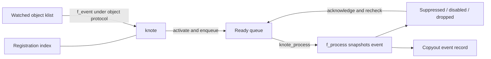

# Kqueue, knote, and workloop lifetimes

[Processes](README.md) · [Event overview](events-threads.md) · [Workqueue servicing](pthread-workqueue-lifecycle.md)

A kqueue registration is a persistent kernel object, a `knote`. A producer updates that object through a filter; the queue later asks the filter to snapshot a deliverable event. The event array returned by `kevent` is a transient representation. Keeping those three objects separate makes registration races, event coalescing, one-shot delivery, and descriptor close understandable.

## 1. A knote belongs to three structures

[`struct knote`](../../../platydoc-data/xnu/bsd/sys/event_private.h#L428) contains three independent linkages:

| Linkage or field | Role |
| --- | --- |
| `kn_link` | Registration lookup through the process's fd-indexed lists or non-fd hash |
| `kn_selnext` | The watched object's `klist`, protected by that object's locking protocol |
| `kn_tqe` | A queue of ready or suppressed knotes belonging to a kqueue |
| `kn_kq_packed` | Packed pointer to the owning kqueue |
| `kn_fp` / `kn_proc` / `kn_ipc_port` / other union members | Filter-specific watched resource |
| `kn_hook` / `kn_hook32` | Private filter state |
| `kn_kevent` and saved fields | Registration identity, flags, user data, saved filter flags/data |
| `kn_status`, QoS index and override | Queue/lifetime state and service-priority bookkeeping |

A knote can remain registered while disabled, unqueued, or temporarily suppressed. `KN_ACTIVE` says an event has been triggered; `KN_QUEUED` says it is currently on a delivery queue. `KN_LOCKED` serializes registration/touch/process/drop operations through an explicit lock context. `KN_POSTING` separately tracks an in-flight producer `f_event` call. The former `KN_STAYACTIVE` bit is commented out in this checkout; descriptions using it as a current state would be stale. [Status bits](../../../platydoc-data/xnu/bsd/sys/event_private.h#L394).

The queue itself has three concrete forms:

- `kqfile` is a descriptor-backed queue with one ready queue, a suppression queue, and select/kqueue readiness support.
- `kqworkq` is the process workqueue event source, with per-QoS ready/suppression queues and a thread request per QoS bucket.
- `kqworkloop` has per-QoS queues but one service request, a separate synchronous owner, a state lock, retain count, dynamic ID, and optional turnstile/scheduling parameters.

[Queue declarations](../../../platydoc-data/xnu/bsd/sys/eventvar.h#L156), [workloop fields](../../../platydoc-data/xnu/bsd/sys/eventvar.h#L345). “One workloop” does not mean “one permanently dedicated thread”: ordinary workloops bind a pool thread for service; permanently bound workloops are a distinct configured mode.

## 2. Registration publishes identity before attaching the filter

`kevent_internal()` copies and processes changes one at a time. Registration errors are written into a returned `EV_ERROR` event when output space and flags permit, or become the syscall error. `EV_RECEIPT` converts a successful registration into an `EV_ERROR` record whose data is zero. The whole changelist is not a transaction: earlier changes can remain installed if a later copyin, attach, or copyout fails. [Change processing](../../../platydoc-data/xnu/bsd/kern/kern_event.c#L8082).

`kevent_register()` validates the filter index and flag combinations. Delete overrides add; disable overrides enable. It finds a matching knote using kqueue, filter, and ident, with optional `EV_UDATA_SPECIFIC` matching on user data. Fd-based registrations use `fd_knlist` under the descriptor lock; others use `fd_knhash` under its hash lock. Lookup acquires the queue lock before dropping the lookup lock. [Registration](../../../platydoc-data/xnu/bsd/kern/kern_event.c#L4002), [matching](../../../platydoc-data/xnu/bsd/kern/kern_event.c#L6771), [lookup locking](../../../platydoc-data/xnu/bsd/kern/kern_event.c#L6998).

For a new fd filter, `fp_lookup()` obtains a fileproc reference. The code allocates a zeroed knote, records its resource and queue, copies registration fields, and saves input filter flags/data separately from the output state. `kq_add_knote()` rechecks for a competing registration while holding the lookup lock. If another thread won, it returns `ERESTART`; the new allocation and file reference are released and registration starts again. [New knote construction](../../../platydoc-data/xnu/bsd/kern/kern_event.c#L4080), [insertion race](../../../platydoc-data/xnu/bsd/kern/kern_event.c#L6841).

Successful insertion establishes knote serialization and retains a dynamic queue. The fileproc reference now belongs to the knote. The source filter's `f_attach` runs without the queue lock; it may specialize the knote's filter ID, so subsequent operations reload `knote_fops()`. An attach error causes a drop through the detached-filter path. A successful attach may already report `FILTER_ACTIVE`, causing immediate activation rather than waiting for a later producer event.

For an existing registration, `knote_lock()` can sleep and discover that another operation deleted the knote. In that case registration repeats lookup rather than using an obsolete pointer. Update invokes `f_touch` without the queue lock, applies accepted changes, and handles activation/disable/QoS state afterward. Delete can be filtered by `f_allow_drop`. A disabled `EV_DISPATCH2` registration may enter `KN_DEFERDELETE` and report `EINPROGRESS` until reenabled. [Update and deferred delete](../../../platydoc-data/xnu/bsd/kern/kern_event.c#L4165).

## 3. Posting runs under the source object's contract

A vnode, socket, process, or other producer calls `knote()` on its watched-object list while holding the source object's lock. That lock protects `kn_selnext` and prevents concurrent producer iteration/attachment changes. Each note then passes through `knote_post()`. [Producer list traversal](../../../platydoc-data/xnu/bsd/kern/kern_event.c#L6574).

The posting helper briefly locks the kqueue, rejects dropping/vanished notes, marks `KN_POSTING`, and invokes `f_event` with the queue lock dropped. The source object's locking protocol still governs the filter. On return, it reacquires the queue lock and checks whether the note died while the callback ran:

[Posting and concurrent drop](../../../platydoc-data/xnu/bsd/kern/kern_event.c#L823):
<!-- source-excerpt: ../../../platydoc-data/xnu/bsd/kern/kern_event.c#L823-L840 -->
```c
	kn->kn_status |= KN_POSTING;

	kqunlock(kq);
	result = filter_call(knote_fops(kn), f_event(kn, hint));
	kqlock(kq);

	/* Someone dropped the knote/the monitored object vanished while we
	 * were in f_event, swallow the side effects of the post.
	 */
	dropping = (kn->kn_status & (KN_DROPPING | KN_VANISHED));

	if (!dropping && (result & FILTER_ADJUST_EVENT_IOTIER_BIT)) {
		kqueue_update_iotier_override(kq);
	}

	if (!dropping && (result & FILTER_ACTIVE)) {
		knote_activate(kq, kn, result);
	}
```

A drop waits for `KN_POSTING` to clear before destroying filter-private state. Conversely, posting discards activation and QoS side effects if deletion or vanishing began meanwhile. A concurrent `f_event` on the same knote is considered a violated producer-lock contract and panics. Concurrent producer posting versus a different `f_*` operation is supported; `KN_MERGE_QOS` prevents racing overrides from accidentally lowering service priority. [Posting completion](../../../platydoc-data/xnu/bsd/kern/kern_event.c#L842), [QoS merge rule](../../../platydoc-data/xnu/bsd/kern/kern_event.c#L6523).

`knote_enqueue()` only queues active notes that are not disabled, suppressed, dropping, or already queued. It increments `kq_count` and wakes the appropriate queue type when a previously empty QoS queue gains an event. A file queue wakes waiters/readiness observers; workqueue and workloop queues initiate or adjust thread service. [Enqueue](../../../platydoc-data/xnu/bsd/kern/kern_event.c#L7051).



## 4. Delivery revalidates and changes future behavior

`kqueue_process()` selects the appropriate queue(s), with workloops scanning higher QoS buckets first. Begin/end-processing operations serialize servicing and coordinate bound-thread state. `knote_process()` takes knote serialization, rechecks queue membership after any lock wait, and suppresses the note so the same event is not repeatedly returned in one processing pass. [Queue processing](../../../platydoc-data/xnu/bsd/kern/kern_event.c#L7808), [knote processing](../../../platydoc-data/xnu/bsd/kern/kern_event.c#L4306).

The filter's `f_process` executes with the queue lock dropped and snapshots state using the filter's own locking rules. A producer hint is therefore not a frozen event payload: readiness can disappear before delivery. If `f_process` reports no active event, no output record is produced. A vanished or deferred-delete note instead gets a synthetic terminal event.

The delivery flags determine what remains registered:

[Post-delivery disposition](../../../platydoc-data/xnu/bsd/kern/kern_event.c#L4429):
<!-- source-excerpt: ../../../platydoc-data/xnu/bsd/kern/kern_event.c#L4429-L4443 -->
```c
	if (kev.flags & EV_ONESHOT) {
		if ((kn->kn_flags & EV_DISPATCH2) == EV_DISPATCH2 &&
		    (kn->kn_status & KN_DEFERDELETE) == 0) {
			/* defer dropping non-delete oneshot dispatch2 events */
			kn->kn_status |= KN_DEFERDELETE | KN_DISABLED;
		} else {
			drop = true;
		}
	} else if (kn->kn_flags & EV_DISPATCH) {
		/* disable all dispatch knotes */
		kn->kn_status |= KN_DISABLED;
	} else if ((kn->kn_flags & EV_CLEAR) == 0) {
		/* re-activate in case there are more events */
		knote_activate(kq, kn, FILTER_ACTIVE);
	}
```

Ordinary one-shot delivery drops the note; dispatch disables it; clear-style filters consume their trigger state; ordinary persistent notes are reactivated so readiness can be checked again. Dispatch2 combines one-shot/deferred-delete semantics to permit a final explicit acknowledgment cycle.

The event callback runs after this state update and, for a dropped note, after detachment. The callback can then fail while copying to userspace. There is no generic rollback restoring a deleted one-shot or the filter's consumed state. Applications cannot infer from an output-buffer fault that no event processing occurred. [Callback order](../../../platydoc-data/xnu/bsd/kern/kern_event.c#L4445).

`EVFILT_USER` is a compact concrete example. Attach records `NOTE_TRIGGER` in `kn_hook32`. Touch applies the requested filter-flag bit operation, saves data, and can set the trigger. Process fills the output from saved state and clears the hook for `EV_CLEAR`. No external file or source klist is necessary for this filter. [User filter](../../../platydoc-data/xnu/bsd/kern/kern_event.c#L1932).

When no event is ready, `kqueue_scan()` can wait with an absolute deadline. Its continuation maps timeout to a successful empty result, interruption to `EINTR`, and queue restart/closure to `EBADF`, then performs cleanup and syscall return using the uthread's saved kevent context. [Scan and continuation](../../../platydoc-data/xnu/bsd/kern/kern_event.c#L7941). Workqueue-driven calls use immediate scans; a pool thread's idle parking is handled by the workqueue machinery instead.

## 5. Close and drop must detach before releasing storage

`knote_drop()` sets `KN_DROPPING`, removes ready/suppressed membership, waits for an in-flight post, and calls `f_detach`. Even an automatically detached source still receives `f_detach` because private filter resources may need cleanup. It then removes the registration lookup entry, cancels lock waiters, releases a dynamic queue reference, drops the fd reference where appropriate, and frees the knote. [Drop](../../../platydoc-data/xnu/bsd/kern/kern_event.c#L7252).

The ownership boundary is visible in the tail:

[Drop releases the queue and file references](../../../platydoc-data/xnu/bsd/kern/kern_event.c#L7271):
<!-- source-excerpt: ../../../platydoc-data/xnu/bsd/kern/kern_event.c#L7271-L7282 -->
```c
	/* Even if we are autodetached, the filter may need to do cleanups of any
	 * stuff stashed on the knote so always make the call and let each filter
	 * handle the possibility of autodetached-ness */
	knote_fops(kn)->f_detach(kn);

	/* kq may be freed when kq_remove_knote() returns */
	kq_remove_knote(kq, kn, p, knlc);
	if (kn->kn_is_fd && ((kn->kn_status & KN_VANISHED) == 0)) {
		fp_drop(p, (int)kn->kn_id, kn->kn_fp, 0);
	}

	knote_free(kn);
```

The queue may disappear during `kq_remove_knote()`. Code after that point may use independently saved process/resource state, but must not assume the former kqueue remains alive.

`knote_fdclose()` walks the descriptor's registrations and serializes each against other knote operations. Most are dropped. A registration that requested vanished delivery instead sets `KN_VANISHED`, drains posting, detaches the filter, and releases the fileproc reference immediately; its remaining note can deliver `EV_VANISHED` without keeping the file open. The filter ID becomes detached so later cleanup does not detach the source twice. The descriptor-table walk restarts after dropping/reacquiring locks. [Fd close](../../../platydoc-data/xnu/bsd/kern/kern_event.c#L6701).

This differs from merely setting `EV_EOF`: the source lifetime and the terminal event acknowledgment can now be separated.

## 6. Dynamic workloop IDs are names, not permanent ownership

`kevent_id()` finds workloops in the process's `fd_kqhash`. IDs zero and all-ones are rejected. `kqworkloop_get_or_create()` resolves races under the hash lock and uses a try-retain on an existing entry, because a zero-reference object can still be waiting to leave the hash. `MUST_EXIST` and `MUST_NOT_EXIST` have explicit errors. Allocation that must block happens after dropping the hash lock, followed by a fresh lookup. [Lookup and creation](../../../platydoc-data/xnu/bsd/kern/kern_event.c#L3550).

A newly initialized queue has one reference returned to its caller; the hash is a discovery structure, not an unconditional immortal reference. Knote registrations and in-flight servicing requests provide additional ownership. Configured workloops can have an implicit control-interface retain. A permanent-thread configuration takes an extra reference before releasing the hash lock and creating the thread, so the published object cannot disappear during that interval. Failure to bind releases both construction references. [Permanent-binding ownership](../../../platydoc-data/xnu/bsd/kern/kern_event.c#L3618).

The final release destroys owner overrides/thread references, completes the turnstile, removes the hash entry, releases configured thread-group/work-interval resources, and destroys locks/storage. Exit's `kqworkloops_dealloc()` handles surviving configured objects after the ordinary users have drained and asserts the expected final retain count. [Deallocation](../../../platydoc-data/xnu/bsd/kern/kern_event.c#L3393), [process cleanup](../../../platydoc-data/xnu/bsd/kern/kern_event.c#L3819).

A thread may register changes against a workloop without being its servicer, but ordinary `kevent_id` event retrieval must target the calling thread's currently bound workloop. A mismatched retrieval returns `EXDEV`. The kernel workqueue interface uses `uu_kqr_bound` and writes the workloop ID alongside stack-delivered events. [`kevent_id()`](../../../platydoc-data/xnu/bsd/kern/kern_event.c#L8274), [workqueue entry](../../../platydoc-data/xnu/bsd/kern/kern_event.c#L8323).

## 7. Owner, servicer, request, and turnstile are different roles

`kqwl_owner` records a synchronous owner discovered through the workloop protocol. `kqwl_request.tr_thread` identifies the pool thread bound to asynchronous service. The state machine keeps these roles distinct: if the same thread becomes the servicer, binding clears the redundant owner role. [Binding](../../../platydoc-data/xnu/bsd/kern/kern_event.c#L5603).

`filt_wlupdate()` has three phases. Under the workloop state lock, it can atomically read a user word and compare masked observed/expected values. A mismatch returns `ESTALE`; owner discovery translates a thread-port name in the current task and returns `EOWNERDEAD` if translation fails. A faulting copyin drops locks and retries before making a decision. The code then takes the queue lock to commit owner/QoS changes and update turnstile inheritance, and finally releases obsolete thread/turnstile references outside the locks. [Owner protocol](../../../platydoc-data/xnu/bsd/kern/kern_event.c#L2060).

Owner changes transfer an actual thread reference, apply the new override before dropping the old one, and can change where synchronous waiters donate priority. While a workqueue request is pending, the workqueue lock may be the turnstile interlock; after binding, the workloop's protocol takes over. This lock handoff is why the source repeatedly rechecks whether the request finished binding during an update.

The workloop filter permits one `NOTE_WL_THREAD_REQUEST` registration, identified by the workloop ID and a valid QoS. Its successful attach fires an event and adds `EV_CLEAR`. Synchronous wait/wake registrations use other identifiers and must be disabled for ordinary event delivery. `filt_wlpost_register_wait()` prepares a workloop turnstile, establishes the inheritor, asserts an abort-safe wait, and blocks through a continuation. The modern kevent interface permits this post-registration wait only in a constrained final-change/error-events form. [Filter attach](../../../platydoc-data/xnu/bsd/kern/kern_event.c#L2417), [wait](../../../platydoc-data/xnu/bsd/kern/kern_event.c#L2548), [call restrictions](../../../platydoc-data/xnu/bsd/kern/kern_event.c#L8145).

`kqworkloop_update_threads_qos()` computes wakeup/override demand and applies it to an owner, an already bound servicer, or a pending request. It creates a new asynchronous request only when appropriate, including no synchronous owner and outstanding events. If events vanish while a request is already in flight, ordinary QoS update does not simply cancel it: the eventual servicer discovers that no work remains. [QoS/service update](../../../platydoc-data/xnu/bsd/kern/kern_event.c#L5833).

Binding itself can be split to avoid a lock inversion:

[Preposting a bind](../../../platydoc-data/xnu/bsd/kern/kern_event.c#L5402):
<!-- source-excerpt: ../../../platydoc-data/xnu/bsd/kern/kern_event.c#L5402-L5408 -->
```c
kqueue_threadreq_bind_prepost(struct proc *p __unused, workq_threadreq_t kqr,
    struct uthread *ut)
{
	ut->uu_kqr_bound = kqr;
	kqr->tr_thread = get_machthread(ut);
	kqr->tr_state = WORKQ_TR_STATE_BINDING;
}
```

The workqueue later calls `kqueue_threadreq_bind_commit()` under the queue lock before the thread returns to userspace or can be aborted. Unbinding clears or soft-preserves the association according to mode, updates turnstiles and overrides, acknowledges suppressed events, and may request another service pass. Permanently bound threads use `KQ_SLEEP` and a soft bind/unbind protocol so parking does not destroy the permanent association. [Bind commit](../../../platydoc-data/xnu/bsd/kern/kern_event.c#L5417), [unbind](../../../platydoc-data/xnu/bsd/kern/kern_event.c#L6260), [bound-thread wakeup](../../../platydoc-data/xnu/bsd/kern/kern_event.c#L6031).

## Inspection scope

This trace reads common registration, posting, knote lock/drop, lookup/index, queue processing, fd-close, dynamic-workloop retain/create/deallocate, owner update, synchronous wait, QoS request, bind/unbind, and workqueue interfaces. `EVFILT_USER` supplies a complete small filter example. Socket/vnode/Mach-port producers retain their own lock and readiness rules; see [networking](../networking/socket-lifecycle-and-io.md), [VFS](../vfs/README.md), and [IPC](../ipc/README.md). Timer scheduling, every filter, nested descriptor-kqueue readiness, all work-interval policies, and every parking/priority race are not exhaustively reconstructed.

<!-- BEGIN PLATYDOC DOCUMENTATION LICENSE -->
Original Platydoc text and diagrams are licensed under [CC BY 4.0](https://creativecommons.org/licenses/by/4.0/). Quoted source code and third-party material retain their respective licenses.
<!-- END PLATYDOC DOCUMENTATION LICENSE -->
