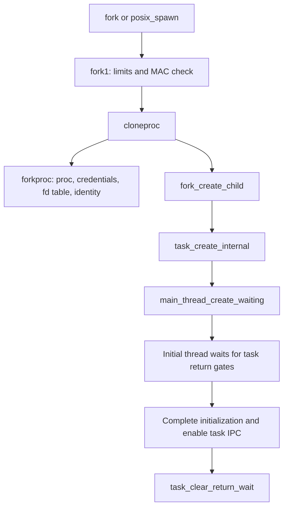

# Process objects and lifetime

For the detailed creation, publication, failure, and teardown protocols, continue with [Fork, spawn, exec, exit, and wait](process-transitions.md).

For the storage and access model, read [the process and its protected data](../../structures/proc-and-proc-ro.md) and [the task and its shared RO record](../../structures/task-and-shared-ro.md). They explain the combined allocation, `proc_ro` field groups, validation, checked writes and final allocation holds, including bootstrap and corpse exceptions.

[Back to processes](README.md)

## Four objects, distinct responsibilities

| Object | Fields or accessors to recognize | Responsibility |
| --- | --- | --- |
| [`struct proc`](../../../xnu/bsd/sys/proc_internal.h#L275) | `p_pid`, `p_pptr`, `p_children`, `p_uthlist`, `p_fd`, `p_sigacts`, `p_lflag`, `p_refcount` | Unix identity, relationships, resources, and transitions |
| [`struct proc_ro`](../../../xnu/bsd/sys/proc_ro.h#L70) | `pr_proc`, `pr_task`, `p_uniqueid`, `p_idversion`, `p_ucred`, `p_csflags` | Protected association and identity/security data |
| Mach `task` / `thread` | `proc_task()`, `get_bsdtask_info()`, `get_threadtask()` | VM/IPC ownership and scheduled execution; see [runtime](../runtime/README.md) |
| [`struct uthread`](../../../xnu/bsd/sys/user.h#L123) | `uu_arg`, `uu_rval`, `uu_siglist`, `uu_sigmask`, `uu_save`, workqueue state | Per-thread BSD execution state |

`proc` and `task` share an allocation in this checkout. [`task_zone_init()`](../../../xnu/osfmk/kern/task.c#L1243) computes aligned sizes and creates `proc_task_zone`; [`proc_get_task_raw()`](../../../xnu/bsd/kern/kern_proc.c#L2026) reaches the task by adding `proc_struct_size`. `proc_task()` additionally checks `P_LHASTASK`. Do not infer that a raw address guarantees the task is still attached, or that the two halves have identical reference lifetimes. `P_REF_PROC_HOLD` and `P_REF_TASK_HOLD` track holds on the combined allocation.

`uthread_init()` initializes BSD state when a Mach thread is created. It fills a `thread_ro` template with `tro_proc`, `tro_proc_ro`, `tro_cred`, and `tro_realcred`, then links the uthread into `p_uthlist` under `proc_lock()`. Ordinary threads inherit a signal mask; workqueue threads use a special mask. [`uthread_cleanup()` and `uthread_destroy()`](../../../xnu/bsd/kern/kern_fork.c#L1453) participate in thread teardown. The `uthread` is not a second independently scheduled thread.

## Credentials and references

The process credential association is `p_proc_ro->p_ucred`, an SMR pointer. A running thread caches the process credential in `tro_realcred` and can have an effective per-thread credential in `tro_cred`. [`current_cached_proc_cred_update()`](../../../xnu/bsd/kern/kern_credential.c#L3527) checks whether the process credential has changed and refreshes the thread through the slow path. [`kauth_cred_get()`](../../../xnu/bsd/kern/kern_credential.c#L3444) returns the effective current-thread credential; callers needing ownership use a referenced form. Fork initialization explicitly uses the creating thread's credential, so thread impersonation is relevant to child identity. Authorization and credential contents are covered in [security](../security/README.md).

[`proc_find(pid)`](../../../xnu/bsd/kern/kern_proc.c#L2520) searches the PID hash under SMR, attempts a reference, and handles an exec transition before returning. The caller must pair a successful result with `proc_rele()`. A PID is a reusable namespace value; `p_uniqueid` and `p_idversion` provide additional identity information. A `proc *` reference preserves an object but is not a substitute for the lock required to read mutable fields.

Relevant synchronization is split across `proc_list_lock()` for process lists/relationships, `proc_lock()` for per-process state, `proc_fdlock()` for descriptors, and credential locks/accessors. Field annotations in `proc_internal.h` identify intended protection. `proc_transstart()/proc_transend()` serialize lifecycle transitions; signal serialization is separate. `proc_refdrain_will_exec()` stalls most new references while existing users drain, and `proc_refdrain()` is used during exit. Avoid holding references indefinitely across operations that need such a drain.

## Fork and spawn

The creation path is visible in [`kern_fork.c`](../../../xnu/bsd/kern/kern_fork.c#L229):

`fork1()` enforces global and per-user process limits, then chooses `CLONEPROC_FORK` or `CLONEPROC_SPAWN`. [`forkproc()`](../../../xnu/bsd/kern/kern_fork.c#L922) allocates from the combined zone, initializes references/locks, allocates identity, copies the explicit `p_forkcopy` group, retains shared objects, and calls `fdt_fork()`. Descriptor table entries are copied while their `fileglob` objects remain shared; [descriptor lifetime](descriptors-ipc.md) explains the consequences.

[`fork_create_child()`](../../../xnu/bsd/kern/kern_fork.c#L442) sets `inherit_memory` only for `CLONEPROC_FORK`, creates the Mach task, associates it with the proc, and creates its main thread in a waiting state. For fork, `fork1()` duplicates the calling thread's machine state and installs child return values. It does not clone every parent thread. The task's VM inheritance behavior is implemented below this boundary in [VM](../vm/README.md).

[`fork()`](../../../xnu/bsd/kern/kern_fork.c#L572) sets the parent return value, sets up the child's map and task control port, enables task IPC, releases transition/signal protections, emits `NOTE_FORK`, and opens the return gates. A child may be present in kernel tables before it can execute user code; initialization visibility and runnability are different milestones.

[`posix_spawn()`](../../../xnu/bsd/kern/kern_exec.c#L4333) uses the creation machinery without copying the parent's address space, applies file actions/attributes, and activates an executable. Its set-exec mode takes the exec replacement path. The `vfork` syscall slot is guarded by `CONFIG_VFORK` in [`syscalls.master`](../../../xnu/bsd/kern/syscalls.master#L120); this inspection did not find an in-tree C definition and does not infer active vfork semantics from residual comments or userspace stubs.

## Exec replaces the proc/task pair

[`execve()` → `__mac_execve()`](../../../xnu/bsd/kern/kern_exec.c#L5984) builds `image_params` and creates a new proc/task/main-thread pair using `CLONEPROC_EXEC`. The new proc has the same PID, unique ID, and identity version but is marked `P_REF_SHADOW`; it is not exposed as a second ordinary process. This is a material distinction from a description of exec as merely overwriting the old task's map.

[`exec_activate_image()`](../../../xnu/bsd/kern/kern_exec.c#L2953) copies the path, resolves it with `namei()`, obtains transition protection on the old proc, checks permissions, reads the initial executable data, and walks the `execsw` activators. Fat binaries can select another slice; scripts redirect lookup to an interpreter, with an iteration limit. [`exec_mach_imgact()`](../../../xnu/bsd/kern/kern_exec.c#L1923) validates Mach-O identity/architecture, calls `load_machfile()`, prepares the new map and initial execution state, and runs credential/security setup. The [executable-loading guide](../../cross-cutting/executable-loading.md) follows the Mach-O parser, segment mappings, dynamic linker, and initial machine state.

[`proc_exec_switch_task()`](../../../xnu/bsd/kern/kern_exec.c#L5795) drains references to both procs, checks that old/new tasks and the calling thread still permit the switch, and transfers signal state, resource accounting, task fields, tracing state, process knotes, timers, and children. Under the process-list lock it calls `phash_replace_locked()` and moves `P_REF_SHADOW` from the new proc to the old one. `proc_find()` explicitly retries around this replacement. The outgoing task is then terminated through the surrounding exec cleanup path, while the new task's initialization gates govern entry to userspace.

Exec failure is phase-dependent. Early failure can return an error to the old image; after the documented point of no return, activation failure can arrange termination and report apparent success internally to complete teardown. Read the `bad` paths and `exec_done` conditions before assuming rollback is always possible.

## Exit, zombie, and reap

[`exit_with_reason()`](../../../xnu/bsd/kern/kern_exit.c#L1641) chooses/coordinates the exiting thread, commits `p_xstat` and `P_LEXIT`, prepares process exit, and calls `task_terminate_internal()`. The final active Mach thread to terminate calls [`proc_exit()`](../../../xnu/osfmk/kern/thread.c#L561). Thus task termination initiated outside the ordinary exit syscall can still complete BSD process teardown.

`proc_exit()` drains signal activity and process references, marks workqueues exiting, cancels/drains AIO, invalidates descriptors, and only then destroys the workqueue after its knotes/kqueues/workloops are gone. It also handles SysV cleanup, controlling-terminal/session work, children, accounting, and parent notification. The common retained-child case becomes `SZOMB` and signals the parent with `SIGCHLD`; special cases can be reaped internally.

[`wait4_nocancel()`](../../../xnu/bsd/kern/kern_exit.c#L3043) searches matching children, skips shadow procs, serializes waiters through `P_LIST_WAITING`, copies status/resource usage out, and calls `reap_child_locked()`. `waitid_nocancel()` has a parallel status interface and supports its own options. [`reap_child_locked()`](../../../xnu/bsd/kern/kern_exit.c#L2849) handles tracing/reparenting cases, removes family/group/hash membership, destroys remaining descriptor/lock state, and drops the wait reference. A zombie is a process record retained for observation; it is not an executing thread.

For the first process, [`bsd_utaskbootstrap()`](../../../xnu/bsd/kern/bsd_init.c#L1173) clones from `kernproc` with no parent task/memory inheritance and obtains PID 1. Its BSD AST reaches `bsdinit_task()`, which installs the exception bridge and calls `load_init_program()`.

<!-- BEGIN PLATYDOC DOCUMENTATION LICENSE -->
Original Platydoc text and diagrams are licensed under [CC BY 4.0](https://creativecommons.org/licenses/by/4.0/). Quoted source code and third-party material retain their respective licenses.
<!-- END PLATYDOC DOCUMENTATION LICENSE -->
