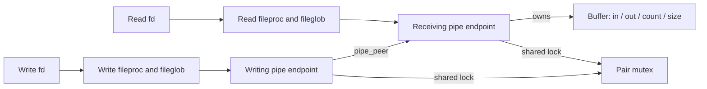
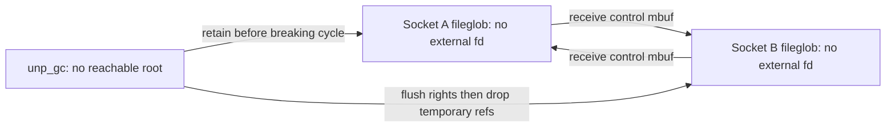

# Pipes, UNIX sockets and queued file rights

[Processes](README.md) · [Descriptor identities](descriptors-ipc.md) · [Socket I/O](../networking/socket-lifecycle-and-io.md) · [Named FIFOs](../vfs/device-nodes-and-fifos.md)

A pipe transfers bytes through a kernel buffer. A UNIX-domain socket additionally carries records and references to open files. Both can keep storage alive while their original descriptor disappears; the precise ownership is different. This chapter follows the local `xnu-12377.121.6` implementation from creation to blocked I/O and final collection.

## Pipe endpoints and publication

`pipe()` allocates a `pipepair`, reserves two file descriptors and installs `pipeops`: one `fileproc` has `FREAD`, the other `FWRITE`. The two `struct pipe` endpoints share a mutex and a MAC label, and refer to one another through `pipe_peer`. The buffer holds byte count, capacity and read/write cursors. The API created here is half duplex. A write resolves the peer endpoint and deposits bytes in the receiving endpoint's buffer; local variable names in `pipe_write()` are easy to misread. [Creation and rollback](../../../platydoc-data/xnu/bsd/kern/sys_pipe.c#L392-L453), [endpoint representation](../../../platydoc-data/xnu/bsd/sys/pipe.h#L102-L177).



Descriptor publication happens only after both ends and their relationship are initialized. A second `falloc` failure frees the reserved first descriptor and closes both endpoints. `procfdtbl_releasefd` makes the initialized descriptors available; reserved slots must not be confused with ordinary live descriptors.

## Byte storage, atomic writes and fault boundaries

Buffer allocation/growth is delayed until needed. `choose_pipespace` selects capacity under global pipe-memory pressure, and `pipespace` or `expand_pipespace` runs while the pipe I/O lock prevents another operation moving the same buffer. The pair mutex protects state; the I/O lock continues protecting the buffer when the mutex is dropped around `uiomove`. `pipe_busy` prevents close from destroying an endpoint used by an operation. [Write allocation](../../../platydoc-data/xnu/bsd/kern/sys_pipe.c#L911-L1005), [read copy](../../../platydoc-data/xnu/bsd/kern/sys_pipe.c#L749-L814).

For a request at most `PIPE_BUF`, insufficient space is treated as no space: a writer must wait for the whole request to fit. Large writes may transfer a portion. A wait to acquire the I/O lock can invalidate the earlier free-space calculation, so the writer checks again. [Atomicity and revalidation](../../../platydoc-data/xnu/bsd/kern/sys_pipe.c#L1006-L1040).

[bsd/kern/sys_pipe.c, lines 998–1003](../../../platydoc-data/xnu/bsd/kern/sys_pipe.c#L998-L1003):
<!-- source-excerpt: ../../../platydoc-data/xnu/bsd/kern/sys_pipe.c#L998-L1003 -->
```c
		space = wpipe->pipe_buffer.size - wpipe->pipe_buffer.cnt;

		/* Writes of size <= PIPE_BUF must be atomic. */
		if ((space < uio_resid(uio)) && (orig_resid <= PIPE_BUF)) {
			space = 0;
		}
```

Illustrative operation: with a 4,096-byte buffer containing 4,000 bytes, a 200-byte request that is within `PIPE_BUF` cannot use the remaining 96 bytes if allocation policy cannot grow the buffer. A nonblocking request returns `EAGAIN`; a blocking writer sleeps until a reader makes enough room. This concerns interleaving between writers. It does not guarantee rollback of a faulting userspace copy. The writer publishes the new count only after the selected transfer, including wraparound, completes without error. The generic syscall layer interprets residual byte progress separately. [Copy and publication](../../../platydoc-data/xnu/bsd/kern/sys_pipe.c#L1052-L1119).

`pipe_read` consumes at most the contiguous tail, unread count and `uio_resid`, then wraps its cursor. Emptying the buffer resets both cursors. An empty live pipe either returns `EAGAIN` or releases the I/O lock and sleeps; an empty pipe with EOF/drain returns zero. A call that already read bytes can return a short result rather than waiting again. Readers wake space waiters, and writes wake data waiters; `selinfo` and knotes expose the same state to readiness consumers. [Read loop and wakeup](../../../platydoc-data/xnu/bsd/kern/sys_pipe.c#L749-L904), [filter thresholds](../../../platydoc-data/xnu/bsd/kern/sys_pipe.c#L1389-L1420).

## Close is a draining operation

`pipeclose` marks EOF and wakes observers before waiting for `pipe_busy` to reach zero. It marks the peer EOF, notifies it and clears the peer's pointer to the closing endpoint, then releases the mutex before destroying this half of the pair. This separates logical closure from storage release. The shared label cannot be destroyed while the other endpoint still needs it. A writer discovering a missing/EOF peer returns `EPIPE`; signal handling above the file operation decides the user-visible SIGPIPE behavior. [Close](../../../platydoc-data/xnu/bsd/kern/sys_pipe.c#L1337-L1385), [write admission](../../../platydoc-data/xnu/bsd/kern/sys_pipe.c#L924-L939).

## UNIX socket data and backpressure

UNIX sockets use `struct unpcb` relationships and ordinary socket buffers rather than the anonymous pipe buffer. `uipc_rcvd` is called after consumption. For streams it calculates how much receiver data and mbuf storage disappeared and returns that allowance to the connected sender's `sb_hiwat` and `sb_mbmax`, then wakes eligible writers. Lock ordering for the connected pair is handled explicitly by `unp_get_locks_in_order`; a disconnect can leave no peer to update. [Receiver accounting](../../../platydoc-data/xnu/bsd/kern/uipc_usrreq.c#L427-L481).

A descriptor payload crosses three representations: sender fd integers → retained `fileglob *` entries in a control mbuf → receiver fd integers. `unp_internalize` validates the SCM_RIGHTS layout, resolves every sender fd under the descriptor lock and checks transfer policy. Queue bookkeeping distinguishes total `fg_count` from message-owned `fg_msgcount`. `unp_externalize` reserves all receiver slots before creating fileprocs and publishing them. Failure releases reserved slots and discards message references with `UNP_FG_NOPROC`, deliberately avoiding process-close record-lock side effects. [Internalize](../../../platydoc-data/xnu/bsd/kern/uipc_usrreq.c#L2494), [externalize](../../../platydoc-data/xnu/bsd/kern/uipc_usrreq.c#L2385-L2480).

## Why reference counting needs a collector

Suppose socket A's receive queue holds a right to socket B and B's queue holds a right to A. After every external fd is closed, each fileglob still has a positive count. A collector must distinguish reachability from count alone.



`unp_gc` holds `uipc_lock` while examining the message list, and each fileglob lock while inspecting its state. A root has references beyond `fg_msgcount`; `FMARK` records reachability and `FDEFER` schedules further graph traversal. Only local-domain sockets whose protocol supports rights are traversed. The collector drops the fileglob lock before locking the socket, so a file passed to itself does not force recursive locking. If socket/buffer acquisition conflicts with rights conversion, it releases the outer lock and restarts marking. [Marking and restart](../../../platydoc-data/xnu/bsd/kern/uipc_usrreq.c#L2556-L2677).

After marking, it retains each unreachable message-only fileglob into a temporary array, releases `uipc_lock`, flushes the selected receive queues, and finally drops the temporary references. The extra references prevent recursive right disposal from freeing objects still in the work list. `unp_scan` walks control mbufs and `unp_dispose` applies discard to their embedded file references. [Collection and disposal](../../../platydoc-data/xnu/bsd/kern/uipc_usrreq.c#L2678-L2800).

[bsd/kern/uipc_usrreq.c, lines 2724–2729](../../../platydoc-data/xnu/bsd/kern/uipc_usrreq.c#L2724-L2729):
<!-- source-excerpt: ../../../platydoc-data/xnu/bsd/kern/uipc_usrreq.c#L2724-L2729 -->
```c
		if (os_ref_get_count_raw(&fg->fg_count) == fg->fg_msgcount) {
			os_ref_retain_raw(&fg->fg_count, &f_refgrp);
			*fpp++ = fg;
			nunref++;
		}
		lck_mtx_unlock(&fg->fg_lock);
```

This is kernel-owned byte/reference transfer. It needs no userspace service to implement the collector. The [pipe drain](../../../platydoc-data/xnu/tests/pipe_drain.c) and [rights peek](../../../platydoc-data/xnu/tests/unp_scm_rights_peek.c) regressions are useful examples; they are not a complete proof of the collector's concurrent behavior.

<!-- BEGIN PLATYDOC DOCUMENTATION LICENSE -->
Original Platydoc text and diagrams are licensed under [CC BY 4.0](https://creativecommons.org/licenses/by/4.0/). Quoted source code and third-party material retain their respective licenses.
<!-- END PLATYDOC DOCUMENTATION LICENSE -->
