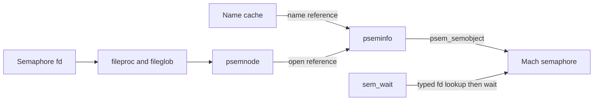
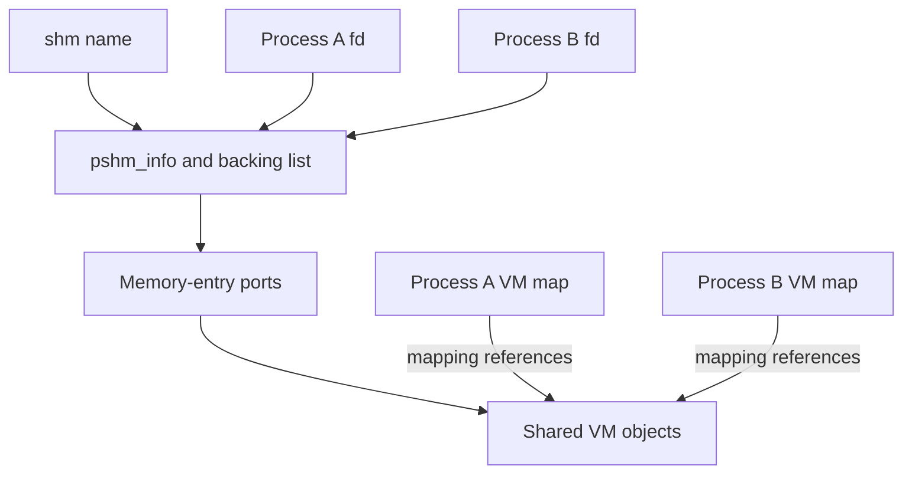

# POSIX named semaphores and shared memory

[Processes](README.md) · [Descriptors](descriptors-ipc.md) · [VM memory entries](../vm/wiring-and-memory-entries.md) · [System V IPC](system-v-ipc.md)

These APIs connect a kernel name namespace to a descriptor-backed object. The name, descriptor, backing memory or semaphore, and an established VM mapping have different lifetimes. Removing a name prevents future lookup; it need not stop an existing holder.

## Named semaphore objects and creation

`psemcache` indexes names; `pseminfo` contains mode/uid/gid, flags, use count and `psem_semobject`; `psemnode` attaches that state to a `DTYPE_PSXSEM` fileglob through `psemops`. This version has global and local cache tables and incorporates the calling process's team identity into name handling. Treat the cache selection rules as kernel namespace behavior, not filesystem pathname lookup. [Structures and tables](../../../xnu/bsd/kern/posix_sem.c#L94-L186), [hash and matching](../../../xnu/bsd/kern/posix_sem.c#L237-L383).

`sem_open` copies and bounds the name, reserves a fileproc, preallocates candidate cache/object/node storage and, for `O_CREAT`, provisionally creates a Mach semaphore before taking the subsystem mutex. Under that mutex it checks the cache, exclusive-create and permissions/MAC policy, and commits either the new object or a reference to the existing one. A competing creator can make the preallocated object unnecessary; the unused Mach semaphore and candidate storage are destroyed. Publication of the fd happens after initialization. [Full creation and rollback](../../../xnu/bsd/kern/posix_sem.c#L535-L804).



Failure before publication frees the reserved descriptor and candidate allocations. `O_CREAT|O_EXCL` on a found name produces `EEXIST`; ordinary `O_CREAT` on an existing object uses that object rather than resetting its count. The initial value is relevant to a newly created backing semaphore.

## Wait/post and the reference held across sleep

`sem_wait_nocancel` acquires a typed fd I/O reference, inspects the node under `PSEM_SUBSYS_LOCK`, applies MAC policy, drops the subsystem lock and calls `semaphore_wait`. The fd I/O reference survives the blocking call and is dropped afterward. Mach interruption/timeouts are translated into BSD errors. `sem_trywait` uses the corresponding zero-time wait, and `sem_post` invokes signal after the same typed-reference validation. [Wait](../../../xnu/bsd/kern/posix_sem.c#L981-L1036), [try/post](../../../xnu/bsd/kern/posix_sem.c#L1039-L1157).

`sem_unlink` removes the namespace reference. If opens remain, the object is marked removed and continues serving those opens. The final `psem_close` destroys the backing semaphore only when removed and no use count remains. It releases the subsystem lock before that destruction in the final-close path. `sem_close` uses descriptor close machinery; it is not name deletion. [Unlink](../../../xnu/bsd/kern/posix_sem.c#L825-L857), [close and destroy](../../../xnu/bsd/kern/posix_sem.c#L1161-L1230).

## Shared-memory names and backing entries

`pshm_info_t` contains a public metadata header, red-black-tree links and a list of `pshm_mobj_t` entries. Each entry stores a memory-entry port and size. A `pshmnode_t` belongs to one open file object and records one reported mapping address, not a complete list of its mappings. The namespace contributes one use-count reference and each open another; internal operations add temporary references while dropping the subsystem lock. [Structures and lifetime contract](../../../xnu/bsd/kern/posix_shm.c#L100-L160), [open](../../../xnu/bsd/kern/posix_shm.c#L383).

`pshm_truncate` is allocation, not general-purpose repeated file resizing: this implementation permits only one successful allocation for the object's lifetime. It rejects both `PSHM_ALLOCATING` and `PSHM_ALLOCATED`, marks allocating under the mutex and retains the object. It rounds size using the current map page size, then creates chunks of at most `ANON_MAX_SIZE` through `mach_make_memory_entry_64(MAP_MEM_NAMED_CREATE)`, dropping the mutex for allocation. [Allocation](../../../xnu/bsd/kern/posix_shm.c#L597-L706).

[bsd/kern/posix_shm.c, lines 642–646](../../../xnu/bsd/kern/posix_shm.c#L642-L646):
<!-- source-excerpt: ../../../xnu/bsd/kern/posix_shm.c#L642-L646 -->
```c
	/* We only allow one ftruncate() per lifetime of the shm object. */
	if (pinfo->pshm_flags & (PSHM_ALLOCATING | PSHM_ALLOCATED)) {
		PSHM_SUBSYS_UNLOCK();
		return EINVAL;
	}
```

After all chunks exist, it publishes length/allocated state and releases the temporary reference. Failure walks the partially built list, releasing each memory-entry port outside the subsystem mutex, clears allocating state and translates the Mach error. No partially allocated object is reported as fully ready. [Rollback](../../../xnu/bsd/kern/posix_shm.c#L708-L730).

## Mapping one object into two processes

`pshm_mmap` requires `MAP_SHARED`, allocated backing, a range within the recorded length and suitable descriptor write access. Its maximum mapping protection excludes write when the open did not allow it. A temporary object reference protects the backing list while VM work occurs without the subsystem mutex. [Admission](../../../xnu/bsd/kern/posix_shm.c#L795-L891).



The mapper reserves the whole requested address range as no-access, then overwrites it with actual memory-entry mappings. Each chunk translates the requested file position into an offset within that entry, uses `VM_INHERIT_SHARE`, and avoids copy-on-write. An explicitly fixed mapping uses VM overwrite semantics rather than a separate destructive unmap. Only after successful insertion does it record the mapping address/flags. [Reservation and chunks](../../../xnu/bsd/kern/posix_shm.c#L893-L974).

For a hypothetical two-chunk object, a request crossing the first chunk's end becomes two fixed VM mappings into one reserved virtual interval. Both processes can choose different base addresses while mapping the same backing entries. The code's error cleanup deallocates the successfully mapped prefix (`mapped_size`); it should not be described as restoring overwritten mappings or providing a transaction over the previous address space. [Failure cleanup](../../../xnu/bsd/kern/posix_shm.c#L975-L1000).

## Unlink, close and mappings that remain

`pshm_unlink_internal` removes the name-tree entry, sets removed and releases the name reference. Final `pshm_deref` destroys the security label, unlocks, releases every backing memory-entry port and frees the object, then re-locks. Existing VM mappings have their own VM references and are not represented by `pshm_usecount`. Closing an fd or releasing its memory-entry send right does not by itself unmap those mappings. [Unlink](../../../xnu/bsd/kern/posix_shm.c#L1005-L1073), [final dereference](../../../xnu/bsd/kern/posix_shm.c#L1093-L1124).

[bsd/kern/posix_shm.c, lines 1107–1121](../../../xnu/bsd/kern/posix_shm.c#L1107-L1121):
<!-- source-excerpt: ../../../xnu/bsd/kern/posix_shm.c#L1107-L1121 -->
```c
		PSHM_SUBSYS_UNLOCK();

		/*
		 * Release references to any backing objects.
		 */
		while ((pshmobj = SLIST_FIRST(&pinfo->pshm_mobjs)) != NULL) {
			SLIST_REMOVE_HEAD(&pinfo->pshm_mobjs, pshmo_next);
			mach_memory_entry_port_release(pshmobj->pshmo_memobject);
			kfree_type(pshm_mobj_t, pshmobj);
		}

		/* free the pinfo itself */
		kfree_type(pshm_info_t, pinfo);

		PSHM_SUBSYS_LOCK();
```

Example: A creates, sizes and maps `/cache`; B opens/maps it; A unlinks the name. A new open without create fails, but A/B can continue accessing their mappings. Recreating the same name denotes a new named object, not the old mappings. Kernel mechanisms for these operations are local; library wrapper representations and application synchronization protocols remain separate.

<!-- BEGIN PLATYDOC DOCUMENTATION LICENSE -->
Original Platydoc text and diagrams are licensed under [CC BY 4.0](https://creativecommons.org/licenses/by/4.0/). Quoted source code and third-party material retain their respective licenses.
<!-- END PLATYDOC DOCUMENTATION LICENSE -->
