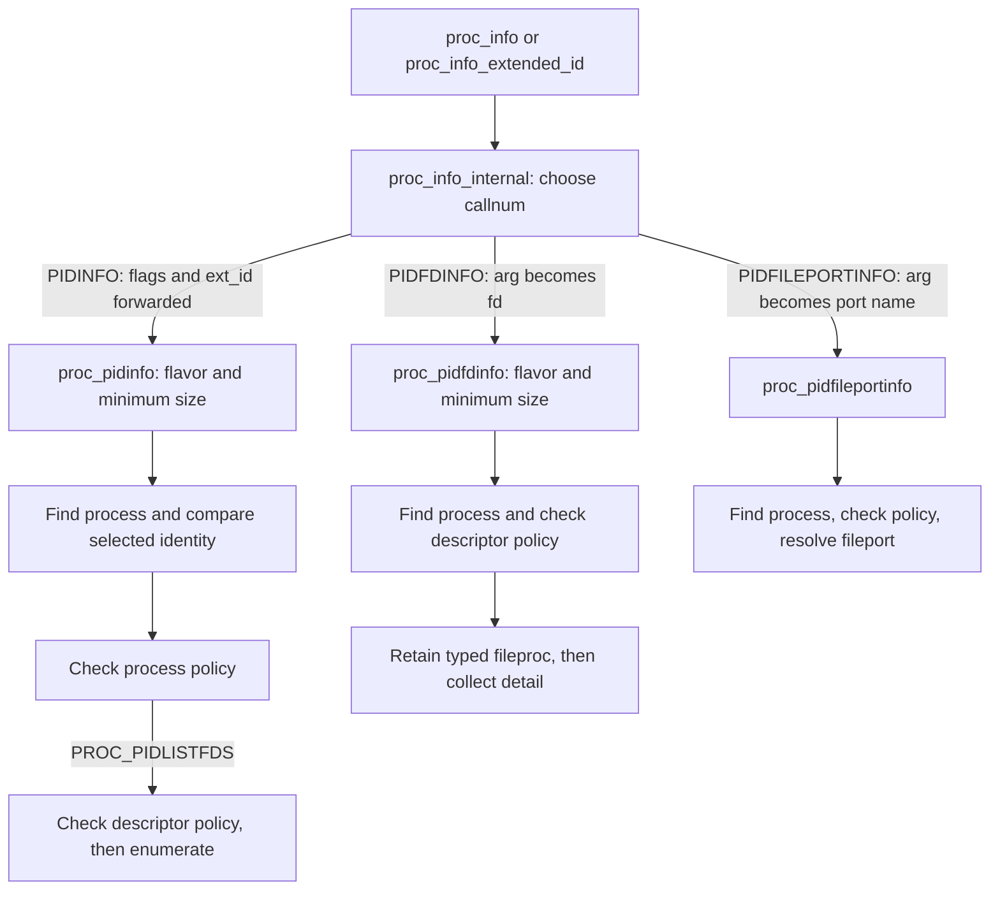
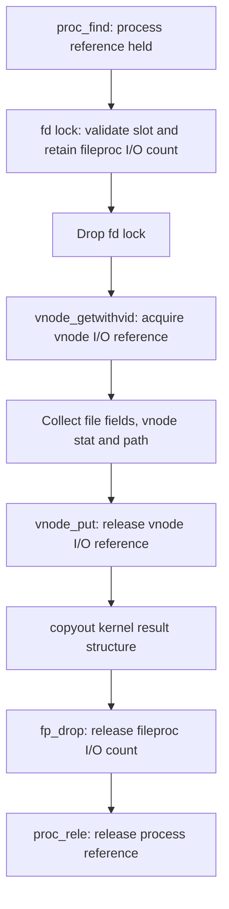
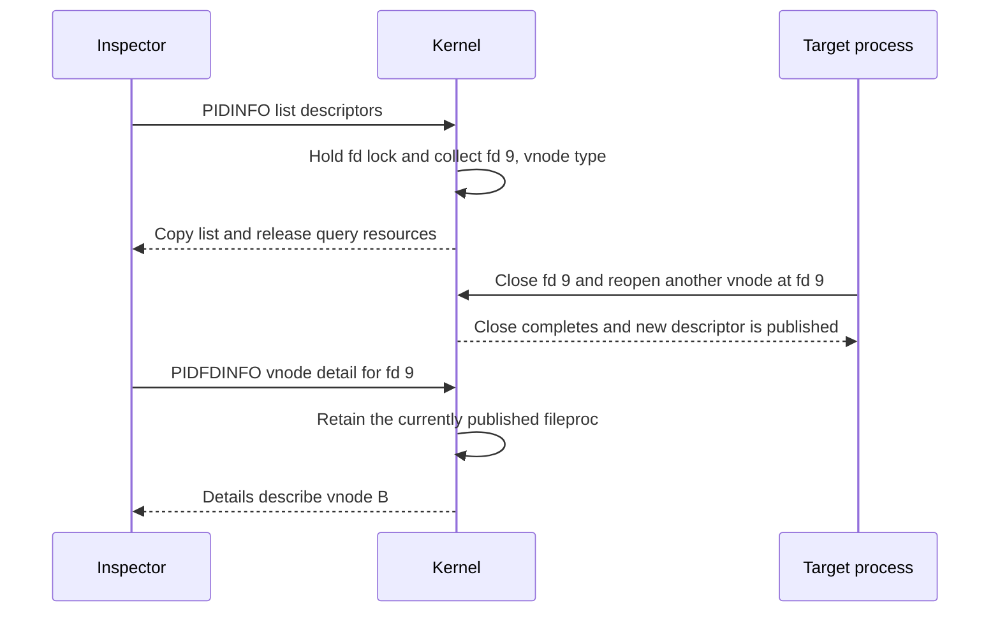

# Process inspection, identities and descriptor snapshots

Inspecting a process involves several different snapshots: finding a process by PID, comparing its identity, enumerating descriptor numbers, and retaining the object behind one descriptor while reading its details. This chapter follows those operations through `proc_info` in `xnu-12377.121.6`. The important distinction is between the lifetime protected during one kernel operation and the identity of a resource across separate calls.

Start with the [process guide](README.md), [process objects and lifetime](lifecycle.md), and [descriptor allocation and close](descriptors-ipc.md). [Command dispatch and validation](../../interfaces/command-dispatch-and-validation.md) explains other nested command interfaces; [exec identity](exec-identity-and-inherited-state.md) explains the process transition that can change an identity version without creating a new process identity.

## 1. A syscall selector chooses another interface

The syscall master declares `proc_info` at slot 336 and `proc_info_extended_id` at slot 545. Both enter the same `proc_info_internal()` dispatcher; the ordinary entry supplies zero comparison flags and a zero extended identity. The extended entry rejects simultaneous `PIF_COMPARE_IDVERSION` and `PIF_COMPARE_UNIQUEID`. [Syscall declarations](../../../platydoc-data/xnu/bsd/kern/syscalls.master#L513-L513), [extended declaration](../../../platydoc-data/xnu/bsd/kern/syscalls.master#L857-L857), [entry bodies](../../../platydoc-data/xnu/bsd/kern/proc_info.c#L287-L302).

There are three selector levels to keep separate:

| Input | Meaning on the selected routes |
| --- | --- |
| `callnum` | Operation family, such as `PROC_INFO_CALL_PIDINFO` or `PROC_INFO_CALL_PIDFDINFO` |
| `flavor` | Family-specific result or operation, such as `PROC_PIDLISTFDS` or `PROC_PIDFDVNODEPATHINFO` |
| `arg` | Flavor-specific auxiliary value; narrowed to an `int` descriptor for PIDFDINFO, or a `mach_port_name_t` for PIDFILEPORTINFO |

`pid` is also overloaded: LISTPIDS interprets it as the listing type and interprets `flavor` as that type's filter value. For the three per-process families below, it is a target PID. Unknown top-level selectors return `EINVAL`; some other selectors change controls or terminate processes, so the entire syscall family cannot be described as read-only inspection. [Selector definitions](../../../platydoc-data/xnu/bsd/sys/proc_info_private.h#L278-L302), [complete top-level dispatch](../../../platydoc-data/xnu/bsd/kern/proc_info.c#L305-L357).

The dispatch explicitly forwards the identity comparison arguments to PIDINFO, but not to PIDFDINFO or PIDFILEPORTINFO. Passing comparison flags to the extended syscall does not add a comparison to every selected operation. [Selected dispatch branches](../../../platydoc-data/xnu/bsd/kern/proc_info.c#L311-L320):

<!-- source-excerpt: ../../../platydoc-data/xnu/bsd/kern/proc_info.c#L311-L320 -->
```c
	case PROC_INFO_CALL_PIDINFO:
		return proc_pidinfo(pid, flags, ext_id, flavor, arg, buffer, buffersize, retval);
	case PROC_INFO_CALL_PIDFDINFO:
		return proc_pidfdinfo(pid, flavor, (int)arg, buffer, buffersize, retval);
	case PROC_INFO_CALL_KERNMSGBUF:
		return proc_kernmsgbuf(buffer, buffersize, retval);
	case PROC_INFO_CALL_SETCONTROL:
		return proc_setcontrol(pid, flavor, arg, buffer, buffersize, retval);
	case PROC_INFO_CALL_PIDFILEPORTINFO:
		return proc_pidfileportinfo(pid, flavor, (mach_port_name_t)arg, buffer, buffersize, retval);
```



This diagram omits unrelated selectors and the error exits. Each helper returns a kernel error separately from `*retval`. On the successful list and fixed-structure detail routes studied here, `*retval` is a byte count. A helper returning zero as its error does not itself mean that zero bytes were produced. Userspace `libproc` wrappers, their declarations and their error conversions are a separate interface boundary; the trace here starts at the kernel syscall arguments.

## 2. Resolve a process, then ask which identity was found

PIDINFO first selects the flavor's minimum buffer size. For a non-null descriptor-list buffer it requires at least one `struct proc_fdinfo`; a null buffer selects the size-query route. A too-small buffer returns `ENOMEM` before process lookup. Other flavors have other constraints: `PROC_PIDPATHINFO`, for example, also rejects sizes above its maximum with `EOVERFLOW`. [Flavor sizing](../../../platydoc-data/xnu/bsd/kern/proc_info.c#L2063-L2188), [size checks](../../../platydoc-data/xnu/bsd/kern/proc_info.c#L2190-L2196).

`proc_find(pid)` obtains an ordinary process reference through the SMR-protected PID hash. Its reference attempt rejects new or dead processes; lookup retries around shadow-proc and exec transitions rather than handing the caller an unreferenced hash-table pointer. The successful reference protects the process object used by this operation. It does not suspend the target's threads or lock all its fields. [Reference acquisition](../../../platydoc-data/xnu/bsd/kern/kern_proc.c#L886-L898), [PID lookup and retries](../../../platydoc-data/xnu/bsd/kern/kern_proc.c#L2520-L2574). The [lifetime guide](lifecycle.md) explains the ordinary exec reference drain and final release machinery.

The extended PIDINFO comparison occurs after lookup and before policy or result collection. Both mismatch cases report `ESRCH`, the same error used when lookup fails. [Comparison branches](../../../platydoc-data/xnu/bsd/kern/proc_info.c#L2219-L2226):

<!-- source-excerpt: ../../../platydoc-data/xnu/bsd/kern/proc_info.c#L2219-L2226 -->
```c
	if ((flags & PIF_COMPARE_IDVERSION) && (ext_id != proc_pidversion(p))) {
		error = ESRCH;
		goto out;
	}
	if ((flags & PIF_COMPARE_UNIQUEID) && (ext_id != proc_uniqueid(p))) {
		error = ESRCH;
		goto out;
	}
```

The two comparison values are not interchangeable:

| Identity | Stored and returned as | Meaning established by the local source |
| --- | --- | --- |
| PID | `p_pid` | Reusable process-lookup number |
| Process unique ID | `p_uniqueid` in `proc_uniqidentifierinfo` | Assigned on ordinary creation; copied into the exec replacement process |
| PID identity version | `p_idversion` in `proc_uniqidentifierinfo` | Assigned on creation and changed by the selected exec identity transition |
| Executable UUID | `p_uuid` in `proc_uniqidentifierinfo` | Executable-image identity, not a substitute for either process comparison value |

`proc_piduniqidentifierinfo()` fills the UUID, unique ID, parent unique ID, identity version and original-parent version. The ABI structure is 56 bytes. Ordinary process creation assigns new unique/version values; the exec shadow copies them. Later, `exec_mach_imgact()` calls `exec_handle_sugid()`, whose identity update selects a version different from the previous version. Thus a successful exec can preserve the process unique ID while invalidating an old version comparison. The subsequent `task_set_uniqueid()` is a separate task-side update, not evidence that the process's `p_uniqueid` changed. [Output structure](../../../platydoc-data/xnu/bsd/sys/proc_info_private.h#L45-L55), [field collection](../../../platydoc-data/xnu/bsd/kern/proc_info.c#L1539-L1548), [creation and exec copy](../../../platydoc-data/xnu/bsd/kern/kern_fork.c#L978-L1001), [activator caller](../../../platydoc-data/xnu/bsd/kern/kern_exec.c#L2354-L2358), [exec identity update](../../../platydoc-data/xnu/bsd/kern/kern_exec.c#L7786-L7797).

### Live lookup and zombie lookup are separate paths

Descriptor-list PIDINFO does not request zombie fallback, and PIDFDINFO uses only `proc_find()`. Selected other PIDINFO flavors do allow a zombie: note-exit, exit-reason and platform flavors set `findzomb` during flavor selection; the BSD-info and unique-identifier flavors enable it when their `arg` is nonzero. Consequently, a dying process may be enumerable or available to a permitted zombie-information flavor while its descriptor query returns `ESRCH`. [Flavor selection](../../../platydoc-data/xnu/bsd/kern/proc_info.c#L2063-L2188), [conditional zombie lookup](../../../platydoc-data/xnu/bsd/kern/proc_info.c#L2198-L2217), [PIDFDINFO lookup](../../../platydoc-data/xnu/bsd/kern/proc_info.c#L2889-L2902).

The zombie helper acquires `proc_list_lock`, checks that the hash entry has exited, waits if another waiter owns `P_LIST_WAITING`, and sets that bit to claim it. PIDINFO records whether it owns an ordinary reference or a zombie claim and releases the matching kind on exit: `proc_rele()` versus `proc_drop_zombref()`. The latter clears the wait bit and wakes waiters under the process-list lock. This is not an ordinary process reference with a different name. [Zombie acquisition and release](../../../platydoc-data/xnu/bsd/kern/kern_proc.c#L1109-L1154), [PIDINFO cleanup](../../../platydoc-data/xnu/bsd/kern/proc_info.c#L2589-L2595).

## 3. Identity checks and access checks answer different questions

`proc_security_policy()` first invokes `mac_proc_check_proc_info()` when `CONFIG_MACF` is selected. It then applies the requested same-user rule: compare the current effective credential's UID with the target credential's UID under an SMR read section. A mismatch requires `PRIV_GLOBAL_PROC_INFO`; failure returns `EPERM`. `priv_check_cred()` itself includes MAC restriction/grant checks and the default superuser path, so describing root as an unconditional bypass would omit a policy stage. [Shared process policy](../../../platydoc-data/xnu/bsd/kern/proc_info.c#L3193-L3235), [privilege implementation](../../../platydoc-data/xnu/bsd/kern/kern_priv.c#L78-L128).

Several PIDINFO flavors disable the explicit same-user comparison, including short BSD info, unique identifiers, pathname, coalition information and platform information. They still call the MAC policy helper. The hook also has enforcement gates before dispatching to registered policies; those policy providers determine their own results. A locally visible hook invocation does not establish every shipped system's admission decision. [Flavor exceptions and policy call](../../../platydoc-data/xnu/bsd/kern/proc_info.c#L2228-L2245), [MAC enforcement and dispatch](../../../platydoc-data/xnu/security/mac_process.c#L709-L727).

`PROC_PIDLISTFDS` performs two policy calls: first with call number PIDINFO, then with call number PIDFDINFO and the same list flavor. Its null-buffer size query reaches those checks too. Typed PIDFDINFO detail uses CHECK_SAME_USER and its own detail flavor. A successful identity query, size query or descriptor list therefore does not imply that a later detail request will pass its own policy or filesystem checks. [List policy and dispatch](../../../platydoc-data/xnu/bsd/kern/proc_info.c#L2243-L2253), [detail policy](../../../platydoc-data/xnu/bsd/kern/proc_info.c#L2899-L2902).

## 4. Descriptor listing returns numbers and types

`struct proc_fdinfo` is an eight-byte record: an `int32_t proc_fd` and a `uint32_t proc_fdtype`. It does not contain a `fileproc` pointer, a persistent file-object identity or a per-descriptor generation. `PROX_FDTYPE_VNODE`, `PROX_FDTYPE_SOCKET` and the other type constants tell the caller which detail flavor may be appropriate. [Record and type definitions](../../../platydoc-data/xnu/bsd/sys/proc_info.h#L665-L681).

For the syscall helper, three quantities have different meanings:

| Quantity | How `proc_pidfdlist()` derives it | What it establishes |
| --- | --- | --- |
| Null-buffer estimate | Positive `fd_nfiles`, plus 20, multiplied by record size | Suggested allocation based on descriptor-table capacity, not the number of currently open descriptors |
| Fetch allocation capacity | Minimum of sampled `fd_nfiles` and `buffersize / sizeof(struct proc_fdinfo)` | Maximum records this call will collect; fractional-record tail bytes are unused |
| Successful output length | Collected `count * sizeof(struct proc_fdinfo)` | Number of record bytes actually copied, not the original estimate or full allocation size |

The initial `fd_nfiles` sample precedes the locked enumeration. The extra 20 entries belong to the estimate only; they do not reserve future slots or promise that a later fetch sees the same table. [Sizing and allocation](../../../platydoc-data/xnu/bsd/kern/proc_info.c#L522-L541):

<!-- source-excerpt: ../../../platydoc-data/xnu/bsd/kern/proc_info.c#L522-L537 -->
```c
	if (p->p_fd.fd_nfiles > 0) {
		numfds = (uint32_t)p->p_fd.fd_nfiles;
	}

	if (buffer == (user_addr_t) 0) {
		numfds += 20;
		*retval = (numfds * sizeof(struct proc_fdinfo));
		return 0;
	}

	/* buffersize is big enough atleast for one struct */
	needfds = buffersize / sizeof(struct proc_fdinfo);

	if (numfds > needfds) {
		numfds = needfds;
	}
```

After allocating a zeroed kernel buffer, `proc_fdlist_internal()` holds `proc_fdlock` for its entire enumeration. `fdt_foreach` uses `fdt_next(..., true)`, which skips absent entries and entries with `UF_RESERVED`. Thus the list includes settled descriptors, not in-progress reservations or closing slots. The iterator's executable predicate is the authority for the meaning of `only_settled`. [Iteration macro](../../../platydoc-data/xnu/bsd/sys/filedesc.h#L284-L287), [iterator body](../../../platydoc-data/xnu/bsd/kern/kern_descrip.c#L718-L741), [locked collection](../../../platydoc-data/xnu/bsd/kern/proc_info.c#L496-L509):

<!-- source-excerpt: ../../../platydoc-data/xnu/bsd/kern/proc_info.c#L496-L509 -->
```c
	proc_fdlock(p);

	fdt_foreach(fp, p) {
		if (count >= numfds) {
			break;
		}
		file_type_t fdtype = FILEGLOB_DTYPE(fp->fp_glob);
		pfd[count].proc_fd = fdt_foreach_fd();
		pfd[count].proc_fdtype = (fdtype != DTYPE_ATALK) ?
		    fdtype : PROX_FDTYPE_ATALK;
		count++;
	}

	proc_fdunlock(p);
```

The loop copies descriptor numbers and types, including the special AppleTalk type translation, without retaining each `fileproc` for the caller. It stops at the capacity limit, unlocks, and only then copies the collected records to userspace. The kernel buffer preserves that collected list even if the target changes its table during copyout. After copyout it frees the buffer; it sets `*retval` only if the copy succeeded. [Fetch, copyout and free](../../../platydoc-data/xnu/bsd/kern/proc_info.c#L539-L552).

A full buffer has no dedicated truncation flag or automatic required-length result. It may mean exactly that many settled descriptors existed, or that enumeration stopped early. A later retry is another enumeration. Also, the kernel KPI named `proc_fdlist()` has different sizing semantics: its null-buffer path returns `fd_afterlast` in elements under the descriptor lock. Do not apply the syscall helper's byte estimate and 20-record allowance to that KPI. [KPI body](../../../platydoc-data/xnu/bsd/kern/proc_info.c#L563-L577).

LISTPIDS has a similar distinction at another namespace: its null-buffer result is `(nprocs + 20) * sizeof(int)`, not the exact count matching a filter. Its fetch holds `proc_list_lock` while walking the live and, if capacity remains, zombie lists, then releases that lock before copyout. A PID list carries numbers, not retained process objects for later calls. [Process-list estimate and allocation](../../../platydoc-data/xnu/bsd/kern/proc_info.c#L361-L401), [enumeration and copyout](../../../platydoc-data/xnu/bsd/kern/proc_info.c#L403-L485).

## 5. Typed detail retains the object it actually finds

For `PROC_PIDFDVNODEPATHINFO`, PIDFDINFO checks the result structure's minimum size, finds a live process, applies policy, then calls `fp_get_ftype(p, fd, DTYPE_VNODE, EBADF, &fp)`. The earlier descriptor list is not an input to this lookup. [Validation and vnode branches](../../../platydoc-data/xnu/bsd/kern/proc_info.c#L2844-L2924).

`fp_get_ftype()` holds the descriptor spin mutex while checking bounds, presence, reservation and type. It increments the selected `fileproc`'s I/O count before unlocking. An invalid or reserved descriptor returns `EBADF`; a type mismatch returns the error supplied by the detail caller. Vnode detail supplies `EBADF`, while socket detail supplies `ENOTSOCK`. [Typed lookup](../../../platydoc-data/xnu/bsd/kern/kern_descrip.c#L1553-L1571):

<!-- source-excerpt: ../../../platydoc-data/xnu/bsd/kern/kern_descrip.c#L1553-L1571 -->
```c
	proc_fdlock_spin(p);
	if (fd < 0 || fd >= fdp->fd_nfiles ||
	    (fp = fdp->fd_ofiles[fd]) == NULL ||
	    (fdp->fd_ofileflags[fd] & UF_RESERVED)) {
		proc_fdunlock(p);
		return EBADF;
	}

	if (fp->f_type != ftype) {
		proc_fdunlock(p);
		return err;
	}

	zone_id_require(ZONE_ID_FILEPROC, sizeof(*fp), fp);
	os_ref_retain_locked(&fp->fp_iocount);
	proc_fdunlock(p);

	*fpp = fp;
	return 0;
```

The vnode helper separately captures `vnode_vid(vp)` and acquires the vnode with `vnode_getwithvid()`. It zeroes a kernel result structure, fills file metadata, asks VFS for vnode metadata, and attempts pathname reconstruction. It releases its vnode I/O reference before copying the completed structure to userspace; the outer helper still owns the `fileproc` I/O count and process reference. [Vnode-path helper](../../../platydoc-data/xnu/bsd/kern/proc_info.c#L2623-L2647).



This is the successful vnode-path route. Acquisition or collection errors skip the later work and release only resources already acquired. In particular, failure after `fp_get_ftype()` still reaches the outer `fp_drop()`, and successful vnode acquisition is paired with `vnode_put()` on both collection outcomes. [Outer cleanup](../../../platydoc-data/xnu/bsd/kern/proc_info.c#L3004-L3010).

### A retained object is not a frozen metadata record

`fill_fileinfo()` samples the fileglob's open flags, offset, type and reference count, then descriptor close-on-exec/close-on-fork and guard state. The helper does not acquire one lock spanning those reads. `PROC_FP_SHARED` is derived from the fileglob reference count exceeding one; it is not a count of matching descriptor numbers in the list. [File metadata collection](../../../platydoc-data/xnu/bsd/kern/proc_info.c#L2651-L2684).

`fill_vnodeinfo()` creates a VFS context from the current context, optionally checks `mac_vnode_check_fsgetpath()`, and calls `vn_stat()`. That path also performs the vnode stat MAC check when enabled and authorizes read-attributes/read-security before obtaining the actual stat. Process inspection policy is therefore only one admission stage. The filesystem supplies its own metadata through the VFS path; this chapter does not reconstruct absent filesystem implementations. [Vnode metadata helper](../../../platydoc-data/xnu/bsd/kern/proc_info.c#L2689-L2720), [context creation](../../../platydoc-data/xnu/bsd/vfs/kpi_vfs.c#L1622-L1636), [stat checks](../../../platydoc-data/xnu/bsd/vfs/vfs_vnops.c#L1716-L1734).

The pathname is obtained after the other metadata. The helper ignores `vn_getpath()`'s return value, forces the final path byte to NUL, and can still report a successful structure copy. Consequently, a successful detail result does not guarantee that pathname reconstruction succeeded, that it is a unique name for the vnode, or that it still names the same object after return. The collected file offset, stat fields and pathname also have no single shared observation instant. [Path collection and output](../../../platydoc-data/xnu/bsd/kern/proc_info.c#L2633-L2643):

<!-- source-excerpt: ../../../platydoc-data/xnu/bsd/kern/proc_info.c#L2633-L2643 -->
```c
	fill_fileinfo(fp, proc, &vfip.pfi);
	error = fill_vnodeinfo(vp, &vfip.pvip.vip_vi, TRUE);
	if (error == 0) {
		count = MAXPATHLEN;
		vn_getpath(vp, &vfip.pvip.vip_path[0], &count);
		vfip.pvip.vip_path[MAXPATHLEN - 1] = 0;
		vnode_put(vp);
		error = copyout((caddr_t)&vfip, buffer, sizeof(struct vnode_fdinfowithpath));
		if (error == 0) {
			*retval = sizeof(struct vnode_fdinfowithpath);
		}
```

If close begins after the typed lookup acquired its I/O count, close marks the slot reserved/closing and drains outstanding I/O counts before releasing the slot and freeing the `fileproc`. `fp_drop()` uses the retained pointer, drops the count under the descriptor lock, and wakes a drain waiter when needed. This protects the selected object's lifetime during detail collection; it does not preserve that descriptor for the caller after return. [Close reservation](../../../platydoc-data/xnu/bsd/kern/kern_descrip.c#L1756-L1762), [I/O drain](../../../platydoc-data/xnu/bsd/kern/kern_descrip.c#L1682-L1710), [slot release after drain](../../../platydoc-data/xnu/bsd/kern/kern_descrip.c#L1808-L1830), [I/O count release](../../../platydoc-data/xnu/bsd/kern/kern_descrip.c#L1599-L1635).

## 6. Worked list-then-detail operation with concurrent changes

The following values are hypothetical and use the eight-byte descriptor-list ABI above. Let PID 420 have process unique ID 1001, identity version 7007, a descriptor-table capacity `fd_nfiles = 32`, and five settled descriptors: 0, 1, 2, 5 and 9. Descriptor 9 refers to vnode A; descriptor 5 is a socket.

An optional null-buffer preflight produces `(32 + 20) * 8 = 416` bytes. It has not counted the five occupied slots. For the two data operations below, suppose the caller instead supplies a 43-byte list buffer, sufficient for five records:

| Stage | Arithmetic or selected state | Result |
| --- | --- | --- |
| List-call capacity | `floor(43 / 8) = 5`; `min(32, 5) = 5` | A 40-byte kernel allocation for five records |
| Locked enumeration | Five settled descriptors collected | Entries for 0, 1, 2, 5 and 9; fd 9's type is vnode |
| Successful list copyout | `5 * 8 = 40` | Return length 40; the final three supplied bytes are not list output |
| Later detail call | PIDFDINFO, `arg = 9`, vnode-path flavor | Fresh process lookup and fresh typed descriptor lookup |

If a sixth settled descriptor had existed during enumeration, this capacity would still produce five records and 40 bytes. Neither a full list buffer nor the earlier 416-byte estimate certifies completeness at the time of a later detail call.



This schedule is a valid list followed by a valid detail query. Both type checks can succeed even though they concern different vnode objects. If fd 9 is still absent or reserved, detail returns `EBADF`; if it has become a socket, this vnode flavor also returns `EBADF`. Conversely, if detail obtains the I/O count before close starts, the close drain protects that selected `fileproc` until detail drops it. The ordering of acquisition decides which object is inspected; the list record itself owns none of these references. [Fresh descriptor lookup and error selection](../../../platydoc-data/xnu/bsd/kern/proc_info.c#L2913-L2925), [typed lookup](../../../platydoc-data/xnu/bsd/kern/kern_descrip.c#L1548-L1572), [close drain and release](../../../platydoc-data/xnu/bsd/kern/kern_descrip.c#L1808-L1830).

Process identity adds another independent boundary. If PID 420 is later reused for unique ID 1002, a new extended PIDINFO call comparing against unique ID 1001 returns `ESRCH`. If the original process instead execs while keeping unique ID 1001 and changes its version to 7008, a unique-ID comparison can still match while a comparison against version 7007 fails. These comparisons concern the process found for that PIDINFO call. PIDFDINFO receives neither comparison argument, so an earlier identity check or an extended-entry flag does not bind its later descriptor lookup to the previously observed process. No combination of these separate calls creates an atomic process-and-descriptor snapshot. [Identity checks](../../../platydoc-data/xnu/bsd/kern/proc_info.c#L2219-L2226), [dispatch boundary](../../../platydoc-data/xnu/bsd/kern/proc_info.c#L311-L320).

## 7. Fileport detail uses a different namespace and lifetime

PIDFILEPORTINFO accepts a Mach port name in the target task's IPC space. After minimum-size, process-lookup and same-user policy checks, it calls `fileport_invoke(proc_task(p), name, ...)`. The helper converts a send right of type `IKOT_FILEPORT`, invokes the callback with its fileglob, and releases the typed send reference after the callback. It does not interpret the name as a descriptor number in `p_fd`. A failed conversion/invocation transport result is translated to `EINVAL`; a successful invocation returns the callback's detail error. [Fileport dispatch](../../../platydoc-data/xnu/bsd/kern/proc_info.c#L3137-L3189), [typed conversion and callback lifetime](../../../platydoc-data/xnu/osfmk/kern/ipc_misc.c#L120-L142).

The callback constructs a zeroed temporary `fileproc`, installs the fileglob pointer, checks its type and reuses selected detail helpers. For vnode paths it passes `PROC_NULL`, so `fill_fileinfo()` omits descriptor-specific close-on-exec/close-on-fork state. This temporary structure is an adapter, not a retained descriptor-table slot. Fileport name lookup also occurs anew per operation; the top-level dispatch does not forward the extended PID identity comparison here. [Vnode callback](../../../platydoc-data/xnu/bsd/kern/proc_info.c#L3068-L3089), [file information conditional](../../../platydoc-data/xnu/bsd/kern/proc_info.c#L2651-L2667). Continue with [descriptor and fileport lifetime](descriptors-ipc.md) for creation, transfer and last-right cleanup.

## 8. Failure, output and release boundaries

For the selected operations, errors can occur before lookup, after retaining the process, after retaining a descriptor, or during final copyout. These stages have different cleanup obligations:

| Stage | Representative result | Resources and output |
| --- | --- | --- |
| Invalid family/flavor or simultaneous comparison modes | `EINVAL` | No result collection has begun |
| Below selected minimum structure size | `ENOMEM` | Rejected before the target lookup |
| Missing live target or failed identity comparison | `ESRCH` | Any acquired process reference or zombie claim is released |
| Process/MAC/privilege check | Provider error or `EPERM` | Release process ownership; no descriptor-list buffer has been populated |
| Descriptor-list kernel allocation | `ENOMEM` | Outer PIDINFO still releases process ownership |
| Typed lookup absent/reserved/wrong type | `EBADF`, or flavor-selected type error | No fileproc I/O count was acquired on lookup failure |
| Vnode acquisition, stat or policy failure | Underlying helper error | Drop acquired vnode and fileproc ownership as applicable |
| Copyout failure | Copy routine's error | Free list storage or unwind detail references; successful output-byte count is not published |

The list and vnode detail helpers only set their byte count after successful copyout. They do not implement rollback of bytes that a failed user-memory copy may already have written. Treat output as valid according to the returned error and successful length, not merely because part of the destination buffer changed. The same helpers release kernel resources even when copyout fails. [List copyout and cleanup](../../../platydoc-data/xnu/bsd/kern/proc_info.c#L545-L552), [vnode detail copyout](../../../platydoc-data/xnu/bsd/kern/proc_info.c#L2633-L2647), [outer descriptor/process release](../../../platydoc-data/xnu/bsd/kern/proc_info.c#L3004-L3010).

Other flavors require their own interpretation. For example, PIDFDINFO's workqueue-kqueue special case uses `fd == -1`, can return success when no on-demand workqueue kqueue exists, and does not follow the ordinary typed descriptor lookup. A generic claim that every PIDFDINFO success returns one fixed descriptor structure would therefore be wrong. [Kqueue special cases](../../../platydoc-data/xnu/bsd/kern/proc_info.c#L2953-L2988).

## 9. Evidence and limits

The local descriptor-list test exercises null-buffer estimation, a five-record fetch buffer, an opened temporary vnode descriptor, and returned counts. Its loop checks the vnode type when it encounters the temporary descriptor; it does not explicitly assert that this descriptor was found, and it does not force the concurrent close/reuse schedule above. The identity test compares parent/child unique IDs, executable UUIDs and recorded parent identities. These are useful bounded assertions, not evidence of an atomic cross-call snapshot. [Descriptor-list test](../../../platydoc-data/xnu/tests/proc_info.c#L1676-L1722), [identity test](../../../platydoc-data/xnu/tests/proc_info.c#L930-L953). No kernel or userspace test was executed for this chapter.

The common `proc_info.c` implementation is selected as a standard BSD source file, not enclosed in a blanket macOS-only implementation guard. Individual detail providers and checks still depend on configuration; for example, the socket-detail helper returns `ENOTSUP` without `SOCKETS`, and MAC checks depend on `CONFIG_MACF` and provider enforcement. The source describes local kernel behavior, not a promise that every flavor is available to every application or platform. [Source selection](../../../platydoc-data/xnu/bsd/conf/files#L497-L497), [socket detail configuration](../../../platydoc-data/xnu/bsd/kern/proc_info.c#L2724-L2742).

This review follows the shared dispatch, identity comparisons, selected live/zombie lookup, process policy, descriptor list, vnode detail, fileport adapter and their cleanup. It does not enumerate every information flavor, prove metadata coherence inside every filesystem or endpoint provider, or reconstruct external `libproc` wrappers and private MAC policies. The worked concurrent cases are deductions from the shown lookup/reference/lock boundaries, not runtime observations or vulnerability research.

<!-- BEGIN PLATYDOC DOCUMENTATION LICENSE -->
Original Platydoc text and diagrams are licensed under [CC BY 4.0](https://creativecommons.org/licenses/by/4.0/). Quoted source code and third-party material retain their respective licenses.
<!-- END PLATYDOC DOCUMENTATION LICENSE -->
