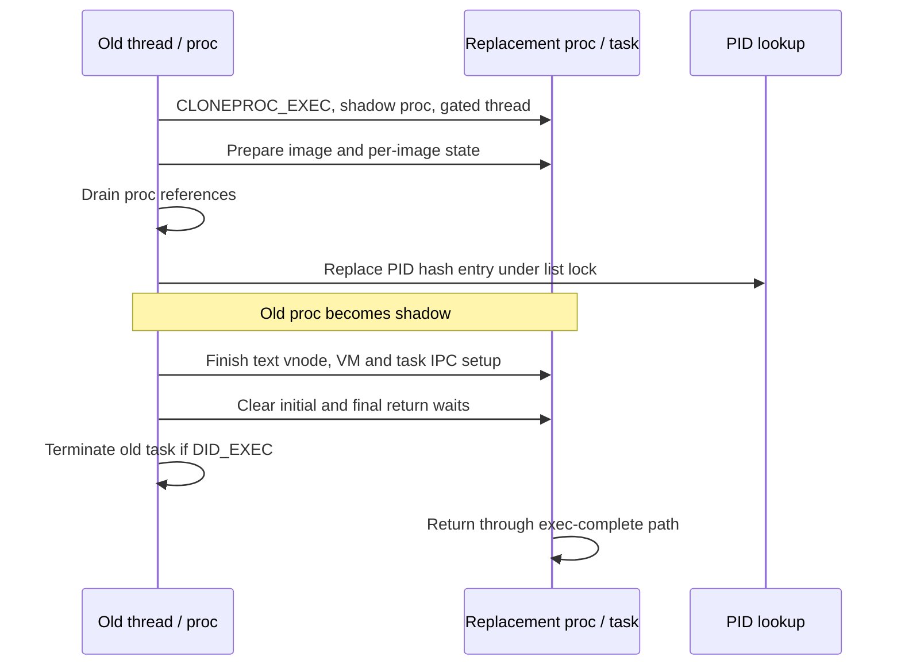

# Fork, spawn, exec, exit, and wait

[Processes](README.md) · [Object overview](lifecycle.md)

A process transition changes several independently protected objects: the PID-visible `proc`, the Mach task and its IPC access, its threads, its descriptor table, and references held by other kernel code. No single “process lock” makes the entire operation atomic. This chapter follows the coordination mechanisms in this checkout. The actual executable parser, segment mappings, initial stack, and dyld selection are in [Executable loading](../../cross-cutting/executable-loading.md).

## 1. Four forms of exclusion

The following mechanisms answer different questions.

| Mechanism | What it protects or delays | Source |
| --- | --- | --- |
| `proc_list_lock()` | PID hash, parent/child and process-list changes | [exec replacement](../../../xnu/bsd/kern/kern_exec.c#L5903), [wait traversal](../../../xnu/bsd/kern/kern_exit.c#L3069) |
| `proc_lock()` / `p_mlock` | Mutable process and signal state, together with flags and sleep protocols | [signal serialization](../../../xnu/bsd/kern/kern_sig.c#L3569) |
| `P_LINTRANSIT`, `P_LTRANSCOMMIT`, `p_transholder` | Ownership of a process transition, including sleeps while other transitions finish | [transition operations](../../../xnu/bsd/kern/kern_proc.c#L4676) |
| Process reference drain and task return-wait flags | Existing kernel users must leave; a newly created thread must not return to userspace too soon | [exec reference drain](../../../xnu/bsd/kern/kern_proc.c#L1173), [child creation](../../../xnu/bsd/kern/kern_fork.c#L442) |

`proc_transstart()` does not keep `p_mlock` held throughout exec. It sets a transition flag under that mutex; a competing transition either sleeps or returns `EDEADLK` when the operation has committed or a nonblocking acquisition was requested. `proc_transcommit()` establishes the committed state and wakes waiters; `proc_transend()` clears the transition state and wakes them again. Code must still use the appropriate lock for individual data changes.

Reference draining solves a different problem. `proc_refdrain_will_exec()` marks the process as approaching exec, waits for ordinary references to drain, then marks it `P_REF_IN_EXEC` and returns an owned reference. `proc_refwake_did_exec()` clears that state and wakes blocked lookup/reference users. `initproc` is explicitly exempted from the ordinary wait-for-drain loop. Neither operation is equivalent to stopping all task threads.

## 2. Fork: build first, release the child last

The syscall reaches `fork1()`, which checks the global process limit and per-user accounting, applies `RLIMIT_NPROC`, and performs the MAC fork check before calling `cloneproc()`. A failed creation unwinds the user process count. [`fork1()`](../../../xnu/bsd/kern/kern_fork.c#L229) and [`cloneproc()`](../../../xnu/bsd/kern/kern_fork.c#L675) separate BSD object construction from Mach task/thread creation.

`forkproc()` constructs the BSD side. It allocates process statistics, copies signal actions, initializes references and locks, allocates a PID for a normal child, joins process-group bookkeeping, and creates `proc_ro`. Credentials initially come from the creating thread's current credential, which can differ from the parent's ordinary process credential. `fdt_fork()` copies descriptor-table state and uses a thread-specific working directory when one exists; inherited file descriptions remain shared through their references. The child also inherits limits and selected execution attributes. [Construction and inheritance](../../../xnu/bsd/kern/kern_fork.c#L922), [credential and descriptor setup](../../../xnu/bsd/kern/kern_fork.c#L1054).

`fork_create_child()` requests memory inheritance only for `CLONEPROC_FORK`. Exec and spawn use the same creation framework with different flags; “all child creation copies the parent's address space” would therefore be wrong. The initial task flags encode the userspace return barrier:

[Return-wait setup in `fork_create_child()`](../../../xnu/bsd/kern/kern_fork.c#L453):
<!-- source-excerpt: ../../../xnu/bsd/kern/kern_fork.c#L453-L459 -->
```c
	bool inherit_memory = !!(clone_flags & CLONEPROC_FORK);
	bool in_exec = !!(clone_flags & CLONEPROC_EXEC);
	/*
	 * Exec complete hook should be called for spawn and exec, but not for fork.
	 */
	uint8_t returnwaitflags = (!inherit_memory ? TRW_LEXEC_COMPLETE : 0) |
	    (TRW_LRETURNWAIT | TRW_LRETURNWAITER);
```

The function passes these flags to `task_create_internal()` and creates the main thread waiting in `task_wait_to_return`. The caller receives extra task/thread references. The thread may exist and the proc may be marked `SRUN` while this return barrier still prevents execution of the intended userspace continuation. [Task and thread creation](../../../xnu/bsd/kern/kern_fork.c#L468).

For ordinary fork, `thread_dup()` copies the current thread state, and `thread_set_child()` arranges the child return convention. The parent receives the child's PID. The syscall finishes VM guard setup, initializes the task control-port policy, and enables task IPC before releasing the child's signal and process-transition exclusion. It posts `NOTE_FORK` to process knotes. Finally it clears the task return-wait state and drops the construction references. [Fork syscall completion](../../../xnu/bsd/kern/kern_fork.c#L572).

The late parent-death check is part of the correctness path, not merely accounting:

[Late cancellation and reference release](../../../xnu/bsd/kern/kern_fork.c#L612):
<!-- source-excerpt: ../../../xnu/bsd/kern/kern_fork.c#L612-L628 -->
```c
		/*
		 * If current process died during the fork, the child would contain
		 * non consistent vmmap, kill the child and reap it internally.
		 */
		if (parent_proc->p_lflag & P_LEXIT || !thread_is_active(current_thread())) {
			task_terminate_internal(child_task);
			proc_list_lock();
			child_proc->p_listflag |= P_LIST_DEADPARENT;
			proc_list_unlock();
		}

		/* "Return" to the child */
		task_clear_return_wait(get_threadtask(child_thread), TCRW_CLEAR_ALL_WAIT);

		/* drop the extra references we got during the creation */
		task_deallocate(child_task);
		thread_deallocate(child_thread);
```

Thus a child created while the parent's task is dying is terminated and marked for internal reaping rather than being allowed to use an inconsistent inherited map.

Creation failure before a live child exists takes `forkproc_free()`. This is a construction rollback: release signal/transition ownership, limits, descriptor contents, vnode and audit/persona resources; leave process-group/list accounting; remove a non-shadow PID entry; then release the process's wait reference. The function explicitly avoids treating the partially constructed address space as a normal exiting process. [Rollback](../../../xnu/bsd/kern/kern_fork.c#L806).

## 3. Spawn: mutate the child before activating its image

`posix_spawn` uses the child-construction and image-activation machinery rather than a userspace fork followed by an independent exec syscall. Its kernel interface copies a descriptor describing spawn attributes and variable-sized action arrays; there are separate user-width conversions and size/count checks. `POSIX_SPAWN_SETEXEC` selects an exec-like replacement rather than an ordinary new child. [Spawn argument handling](../../../xnu/bsd/kern/kern_exec.c#L4333).

File actions execute in order against the target child's descriptor table using a VFS context associated with the new thread. This matters when the spawning thread and the child have different credential or directory state. The action interpreter implements open, dup2, fileport-to-fd duplication, close, and other action kinds. An open action can first obtain a different descriptor, duplicate it to the requested number, then close the temporary descriptor. Fileport duplication translates a typed port from the calling task's IPC space and releases that port reference after creating the descriptor. [`exec_handle_file_actions()`](../../../xnu/bsd/kern/kern_exec.c#L3539).

The ordering around credentials is deliberate. File actions run after descriptor-table creation and before executable set-user/group-ID handling. `POSIX_SPAWN_RESETIDS` updates the child credential before image activation, so executable credential changes can take precedence later. Port actions also run before activation. Errors go to the common failure path rather than allowing a partly configured child to return to userspace. [File actions, port actions, and credential changes](../../../xnu/bsd/kern/kern_exec.c#L4840).

For a normal spawn failure after creating a child, the cleanup code marks it `P_LIST_DEADPARENT`; when appropriate it assigns an exit owner, records `p_posix_spawn_failed`, and calls `exit1()`. It still clears return gates and releases the construction references. A failed spawn is therefore not handled by simply freeing a `proc` structure that may already have tasks, descriptors, and observers attached. [Spawn completion and failure](../../../xnu/bsd/kern/kern_exec.c#L5684).

This chapter does not reconstruct every spawn attribute. Scheduling policy, CPU preferences, personas, exception-port actions, and each specialized file action have their own validation branches in this large function.

## 4. Exec: replace the proc/task pair while preserving identity

In this checkout exec constructs a `CLONEPROC_EXEC` process/task pair. The replacement proc initially carries `P_REF_SHADOW`, uses the same PID and identity values, and is not inserted as a second PID-hash entry. This lets image preparation occur without making the incomplete replacement the ordinary PID lookup result. [Exec clone allocation](../../../xnu/bsd/kern/kern_fork.c#L989).

`__mac_execve()` allocates `image_params` and associated attributes, records the operation in the current uthread, and constructs a VFS context using the replacement thread and an explicitly retained credential. The old thread executes the kernel activation path; the new thread is the eventual userspace execution context. This distinction explains why relying blindly on `current_proc()` or `kauth_cred_get()` at every point would be incorrect. [Exec setup](../../../xnu/bsd/kern/kern_exec.c#L6030).

During Mach-O activation, `execsigs()` resets caught handlers and alternate-stack state for the new execution context; `_aio_exec()` drains the old process's asynchronous I/O and can block. SysV cleanup and other per-image transitions happen in the same activation path. [Activation cleanup](../../../xnu/bsd/kern/kern_exec.c#L2685), [signals](signal-delivery-and-return.md), [AIO](async-io.md).

`proc_exec_switch_task()` is the main identity handoff:

1. Drain references to the old and replacement procs and prevent incompatible lookup activity.
2. Verify the replacement task and current thread are still active and the old proc is not already exiting.
3. Transfer pending signals, masks, exit-reason ownership, tracing/accounting state, and selected task fields.
4. Mark the old task as having executed and remove the replacement task's exec-copy status.
5. Transfer process knotes and interval timers.
6. Under the process-list lock, move children, replace the PID-hash entry, and transfer shadow status to the old proc.
7. Wake reference waiters, release the old reference, and return the replacement proc with a reference held for the caller.

[Full switch function](../../../xnu/bsd/kern/kern_exec.c#L5795). The PID-visible part is compact:

[PID and shadow-status exchange](../../../xnu/bsd/kern/kern_exec.c#L5903):
<!-- source-excerpt: ../../../xnu/bsd/kern/kern_exec.c#L5903-L5913 -->
```c
		proc_list_lock();

		/* Insert the new proc in child list of parent proc */
		p_reparentallchildren(old_proc, new_proc);

		/* Switch proc in pid hash */
		phash_replace_locked(old_proc, new_proc);

		/* Transfer the shadow flag to old proc */
		os_atomic_andnot(&new_proc->p_refcount, P_REF_SHADOW, relaxed);
		os_atomic_or(&old_proc->p_refcount, P_REF_SHADOW, relaxed);
```

The old shadow proc remains a real object with teardown obligations. It is no longer the ordinary process identified by that PID.

There are additional publication gates after this switch. The exec caller installs executable-vnode state and performs VM setup, initializes the task control port, enables task IPC, and processes the signature. The source explicitly describes a window in which `proc_find()` can find the replacement while task-port lookup cannot yet use the new task's disabled IPC state. This is a staged publication, not an atomic swap of every kernel-facing property. [Post-switch initialization](../../../xnu/bsd/kern/kern_exec.c#L6137).



## 5. Exec failure has a point of no return

Before the irreversible activation point, an error can terminate the replacement and return an errno to the original caller. Later activation failure is handled differently: `exec_mach_imgact()` has a `badtoolate` path that sends a fatal signal for non-spawn exec, terminates the new exec task where necessary, and reports zero to the surrounding exec path because resuming the old image as an ordinary failed syscall is no longer valid. Normal spawn preserves its failure result instead. [Late image failure](../../../xnu/bsd/kern/kern_exec.c#L2865).

The final cleanup also checks actual task state rather than relying only on `error`:

[Old-task termination condition](../../../xnu/bsd/kern/kern_exec.c#L6340):
<!-- source-excerpt: ../../../xnu/bsd/kern/kern_exec.c#L6340-L6348 -->
```c
		/*
		 * Do not terminate the current task, if proc_exec_switch_task did not
		 * switch the tasks, terminating the current task without the switch would
		 * result in loosing the SIGKILL status.
		 */
		if (task_did_exec(old_task)) {
			/* Terminate the current task, since exec will start in new task */
			task_terminate_internal(old_task);
		}
```

An unswitched replacement still marked as an exec copy is terminated. Initial return-wait state is cleared, watchport inheritance is transferred on the success path, and the final gate is released. If failure occurred before completion, the exec-complete flag is also cleared. Thread, task, proc, credential, vnode, argument-buffer, label, reason, and importance-inheritance references are released by the corresponding cleanup paths. [Exec unwind](../../../xnu/bsd/kern/kern_exec.c#L6204), [final gates](../../../xnu/bsd/kern/kern_exec.c#L6322).

Even the order of ordinary releases is constrained: the executable vnode iocount is dropped before `ip_free_map` is deallocated, with an explicit deadlock comment. This is a useful reminder that “free everything on error” is insufficient without knowing which releases can block or reenter filesystem/VM code.

## 6. Exit ownership precedes resource teardown

`exit_with_reason()` obtains transition ownership, then coordinates with signal handling to choose the thread responsible for exit. `sig_lock_to_exit()` records `exit_thread` and calls `task_hold_and_wait()` with the process lock dropped. The process is marked `P_LEXIT` and its exit status/reason installed before `proc_prepareexit()` and task termination. A second exit attempt can discover that another thread already owns the operation; behavior differs for a caller inside the dying task and an external caller. [Exit initiation](../../../xnu/bsd/kern/kern_exit.c#L1641), [signal/exit handoff](../../../xnu/bsd/kern/kern_sig.c#L3611).

The Mach thread termination path invokes `proc_exit()` when the task loses its last active thread. `proc_exit()` also handles the case in which task termination arrived without an earlier ordinary BSD exit. It sets `P_LPEXIT`, drains active signal delivery and signal waiters, and drains process references before dismantling resources. [`proc_exit()`](../../../xnu/bsd/kern/kern_exit.c#L2299), [Mach termination](../../../xnu/osfmk/kern/thread.c#L561).

The crucial teardown sequence is:

- `workq_mark_exiting()` prevents new workqueue thread requests.
- `_aio_exit()` cancels work that is still cancellable and waits for executing I/O.
- `fdt_invalidate()` closes descriptors and destroys descriptor-owned knotes, kqueues, and workloops.
- `workq_exit()` releases the remaining workqueue state after those event objects are gone.

[Ordered teardown](../../../xnu/bsd/kern/kern_exit.c#L2371). Both AIO draining and descriptor invalidation can block. Their position before final workqueue destruction allows object-specific detach and request cancellation to use the workqueue machinery they depend on.

Later cleanup handles IPC-related BSD state, terminal/session behavior, children, the text vnode, limits, and statistics. It detaches the Mach task/proc association, emits `NOTE_EXIT`, and marks the exiting uthread `UT_PROCEXIT`. A normal child becomes `SZOMB`, signals `SIGCHLD`, and wakes the parent. Shadow procs and eligible dead-parent/no-child-wait cases are instead marked for internal reaping. [Final detach and notification](../../../xnu/bsd/kern/kern_exit.c#L2690).

## 7. Wait consumes status, then reaping releases the identity

`wait4_nocancel()` scans children under `proc_list_lock()` and skips shadow procs. `P_LIST_WAITING` serializes competing waiters for one child. A zombie's status and resource usage are copied to userspace before `reap_child_locked()` is called. A failed status/rusage copyout releases the waiter claim and returns the error; it does not silently reap the child and lose its status. [Wait selection and copyout](../../../xnu/bsd/kern/kern_exit.c#L3043).

Stopped and continued children have separate report paths. `WNOHANG` returns zero when matching children exist without reportable state; no matching children produces `ECHILD`. A blocking wait saves arguments in the uthread and sleeps interruptibly with `wait1continue` as its continuation. This is why kernel wait cannot be understood solely as a polling loop around `p_stat`. [Wait sleep and restart](../../../xnu/bsd/kern/kern_exit.c#L3200).

`reap_child_locked()` posts `NOTE_REAP`, drains process knotes, rolls up or discards accounting as required, frees saved usage and exit reasons, updates user process counts, removes process-group/child/list/PID membership, destroys the descriptor table's residual storage and locks, and drops the process wait reference. Traced children may first be handed back to their original parent instead of being freed. [Reaping](../../../xnu/bsd/kern/kern_exit.c#L2849).

The lifetime is consequently `running → exit owned → task/thread teardown → zombie/status available → reaped`, with construction rollback and internal shadow-proc reaping as distinct branches. A PID disappearing, a task becoming inactive, and the final process allocation being released are different events.

## Inspection scope

Complete selected bodies were read for `fork1`, child/task creation, `forkproc` and rollback, process transition/reference helpers, exec replacement and its final unwind, spawn file-action/credential/failure handling, exit ownership, `proc_exit` resource ordering, and wait/reap. Mach-O parsing is covered separately. Every spawn policy, ptrace race, terminal/session branch, persona implementation, crash-report path, and architecture's register duplication is not reconstructed here.

<!-- BEGIN PLATYDOC DOCUMENTATION LICENSE -->
Original Platydoc text and diagrams are licensed under [CC BY 4.0](https://creativecommons.org/licenses/by/4.0/). Quoted source code and third-party material retain their respective licenses.
<!-- END PLATYDOC DOCUMENTATION LICENSE -->
