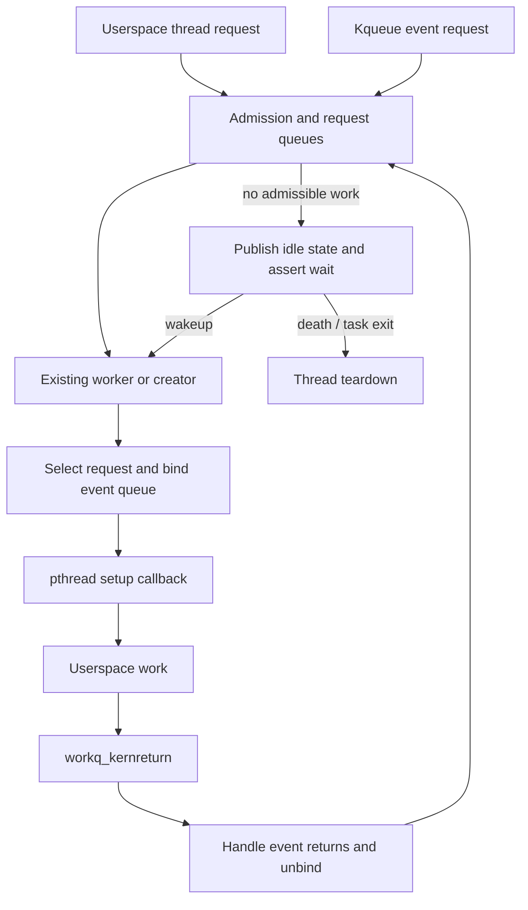

# Pthread boundaries, workqueue service, and cancellation

[Processes](README.md) · [Event overview](events-threads.md) · [Kqueue/workloops](kqueue-and-workloops.md) · [AIO cleanup](async-io.md)

XNU contains the workqueue admission, scheduling, binding, and parking machinery, but several pthread operations cross `pthread_functions` into a separately supplied implementation. This chapter follows the code visible in this checkout and names that boundary explicitly. A userspace dispatch queue is not itself a kernel queue of function pointers: the kernel receives thread-service requests and event registrations; userspace chooses and runs its work.

## 1. The pthread function table is an implementation boundary

`pthread_init()` requires a registered function table and panics if none exists. `bsdthread_create()` forwards the function, argument, stack, pthread address, and flags to that implementation. `bsdthread_register()` first converts the user thread-entry function pointers, then calls the version-appropriate registration callback. The `psynch_*` syscall shims similarly forward mutex/condition/rwlock operations. [Initialization and syscall shims](../../../xnu/bsd/pthread/pthread_shims.c#L316).

This repository exposes the signatures and the services XNU supplies back to pthread. It does not contain the complete implementation of pthread creation, thread-local storage layout, user stack construction, user cancellation cleanup handlers, or the libc/libpthread return trampolines. The visible workqueue calls to `workq_create_threadstack`, `workq_setup_thread`, and `workq_handle_stack_events` must be read as concrete external calls with source-visible contracts, not replaced by imagined inline code.

The boundary is bidirectional. XNU's pthread shims provide thread/VM/turnstile helpers; the external implementation calls back into event delivery when preparing or recycling a worker. [Shim callback table](../../../xnu/bsd/pthread/pthread_shims.c#L530). [Runtime scheduling](../runtime/README.md) describes the Mach mechanisms underneath these operations.

## 2. A process workqueue tracks demand and workers separately

`workq_open()` requires `P_LREGISTER`. It serializes initial publication through the process workqueue pointer, allocates `struct workqueue`, initializes its reference, ticket lock, turnstile, worker lists and request queues, and creates immediate, delayed, and idle-death thread calls. Hardware/QoS information initializes admission limits; compile-time defaults are not a guarantee that a running system will use exactly those limits. [Open](../../../xnu/bsd/pthread/pthread_workqueue.c#L2081).

[`struct workqueue`](../../../xnu/bsd/pthread/workqueue_internal.h#L237) includes:

| Fields | Purpose |
| --- | --- |
| `wq_thrunlist`, `wq_thnewlist`, `wq_thidlelist` | Worker lifecycle lists |
| `wq_nthreads`, `wq_thidlecount`, scheduled counters | Pool capacity and assignments |
| `wq_thactive`, `wq_lastblocked_ts` | Atomic scheduler-visible activity and recent blocking |
| Overcommit/constrained/special priority queues | Different request-admission classes |
| Per-QoS cooperative queues | Cooperative request ordering and service counts |
| `wq_creator` | A worker nominated to advance queued demand |
| `wq_turnstile`, `wq_inheritor` | Propagation of service urgency |
| `WQ_EXITING` | Closure to further service creation |

A `workq_threadreq_s` is a demand record. It has a count, flags, lifecycle state, QoS, and kqueue override/index fields. Its union can hold priority-queue linkage, cooperative linkage, or a bound thread/work interval; those alternatives cannot be used simultaneously. Ordinary user requests can request several workers through one counted allocation. Kqueue requests are embedded in their owning event queue and ordinarily have count one. [Request representation](../../../xnu/bsd/pthread/workqueue_internal.h#L194).

The request states are `IDLE`, `NEW`, `QUEUED`, `CANCELED`, `BINDING`, and `BOUND`. The last two specifically represent a kevent request's association with a worker. Finishing a userspace work item is not synonymous with freeing every request: a bound event request must be unbound through kqueue's protocol, while an anonymous counted request is released after its requested service count is consumed. [State contracts](../../../xnu/bsd/pthread/workqueue_internal.h#L133).

## 3. There are two main sources of service demand

`workq_kernreturn()` multiplexes userspace requests. `WQOPS_QUEUE_REQTHREADS` requests ordinary workers; `WQOPS_QUEUE_REQTHREADS2` requests cooperative service. Other operations return workers to the kernel, update event-manager priority, query narrowing, or register dispatch offsets. The syscall rejects unregistered processes. [Multiplexer](../../../xnu/bsd/pthread/pthread_workqueue.c#L3750).

`workq_reqthreads()` validates count and QoS, allocates a request, and derives overcommit/cooperative flags. This version rejects cooperative counts greater than one and the combination of cooperative plus overcommit. For a multi-worker ordinary request it can wake part of the requested parallelism directly, subject to applicable admission checks; the remaining demand goes through the normal request/creator path. Worker creation can drop and reacquire the lock, so the function rechecks exit and available capacity. [Userspace request](../../../xnu/bsd/pthread/pthread_workqueue.c#L2914).

Kqueue initiates service through `workq_kern_threadreq_initiate()` using an embedded request. Permanently bound requests are forbidden here because their union storage is already used for other data. The function initializes the request, locks the workqueue, and refuses admission after exit has begun:

[Request initialization and exit gate](../../../xnu/bsd/pthread/pthread_workqueue.c#L3079):
<!-- source-excerpt: ../../../xnu/bsd/pthread/pthread_workqueue.c#L3079-L3083 -->
```c
	assert(req->tr_state == WORKQ_TR_STATE_IDLE);
	priority_queue_entry_init(&req->tr_entry);
	req->tr_count = 1;
	req->tr_state = WORKQ_TR_STATE_NEW;
	req->tr_qos   = qos;
```

[Exit rejection](../../../xnu/bsd/pthread/pthread_workqueue.c#L3098):
<!-- source-excerpt: ../../../xnu/bsd/pthread/pthread_workqueue.c#L3098-L3103 -->
```c
	workq_lock_spin(wq);
	if (_wq_exiting(wq)) {
		req->tr_state = WORKQ_TR_STATE_IDLE;
		workq_unlock(wq);
		return false;
	}
```

A request made while a returning worker is unbinding may use `WORKQ_THREADREQ_ATTEMPT_REBIND`. If that thread is admissible, it immediately binds again; otherwise the request is enqueued and a creator is scheduled. For a workloop with synchronous waiters, the turnstile can temporarily donate through the workqueue turnstile until a concrete thread becomes responsible. [Initiation/rebind](../../../xnu/bsd/pthread/pthread_workqueue.c#L3051).

## 4. Admission is more than counting idle threads

Constrained admission first checks the scheduled constrained-thread cap. It then evaluates active workers at the requested QoS and higher priorities, plus recently blocked workers that may resume soon, against the configured parallelism for that bucket. When considering reuse it excludes the current worker where appropriate. Delayed creation can be scheduled to reevaluate after a recent-blocking interval expires. [`workq_constrained_allowance()`](../../../xnu/bsd/pthread/pthread_workqueue.c#L4020).

Cooperative admission uses its own scheduled counts and pool-size policy. An unsaturated pool can admit another worker; the algorithm also considers an unserviced QoS bucket and the aggregate scheduled count down to the requested QoS. Overcommit requests bypass these ordinary constrained/cooperative allowance checks, but still do not remove total pool limits, allocation failures, process exit, or scheduling constraints. [Cooperative allowance](../../../xnu/bsd/pthread/pthread_workqueue.c#L1562), [admissibility selection](../../../xnu/bsd/pthread/pthread_workqueue.c#L4105).

`workq_threadreq_select()` compares special/turnstile-promoted demand, the event-manager request, and the best eligible overcommit/cooperative/constrained requests. This is not a FIFO shared by all request kinds. The selection can prefer a request with inherited priority over a nominally higher-QoS candidate. [Selection](../../../xnu/bsd/pthread/pthread_workqueue.c#L4357).

For ordinary workers, `workq_sched_callback()` updates activity when a thread blocks or unblocks. A blocked worker remains scheduled but no longer active; its recent-block timestamp prevents instantly replacing every brief sleep with a new worker. The unblock callback explicitly cannot acquire the workqueue lock because it may execute in interrupt context with a thread lock held. Atomic activity accounting is needed for that path. Cooperative workers do not install this ordinary callback in `workq_setup_and_run()`; their quantum/admission mechanisms differ. [Scheduler callback](../../../xnu/bsd/pthread/pthread_workqueue.c#L1940).

## 5. A creator carries demand into the scheduler

`workq_schedule_creator()` nominates an idle worker, adjusts an existing creator's priority, or arranges thread creation. The creator is anonymous: it has not irrevocably removed a particular request from the queue. A worker already returning from userspace can take that request first. When the creator finally runs, it may find no remaining useful work and park again. This avoids binding every pending request to a newly created thread prematurely. [Creator policy and implementation](../../../xnu/bsd/pthread/pthread_workqueue.c#L4468).

If there are no idle workers, the caller's context determines whether it may create immediately, schedule an immediate thread call, or request AST redrive. Allocation failure can schedule delayed creation. The turnstile inheritor tracks who currently carries this responsibility, rather than continuing to donate to an unrelated thread.

`workq_add_new_idle_thread()` increments the reserved worker count under the workqueue lock, drops the lock, asks pthread to allocate the user stack, and calls `thread_create_workq_waiting()`. If thread creation fails, it destroys the stack through pthread; failure paths reacquire the lock and decrement the reserved count. On success, the thread-creation initialization callback returns with the workqueue lock held, records its stack and tags, and inserts a normal new worker into `wq_thnewlist`. [Creation/rollback](../../../xnu/bsd/pthread/pthread_workqueue.c#L1040).

## 6. Selecting, binding, and entering userspace

`workq_select_threadreq_or_park_and_unlock()` checks exit and pending demand, chooses an admissible request, moves priority inheritance to the prospective worker, updates scheduled/active counts and worker policy, then unfreezes base priority. If that exposes a required preemption, it can return to parking before dequeuing the request. The accounting changes have corresponding parking adjustments. [Selection-to-run path](../../../xnu/bsd/pthread/pthread_workqueue.c#L4609).

For an event request, binding is split: `kqueue_threadreq_bind_prepost()` installs `uu_kqr_bound`, `tr_thread`, and `BINDING` while the workqueue lock protects the transition. After dropping that lock, `kqueue_threadreq_bind_commit()` takes the queue lock and completes `BOUND` state. This avoids taking the locks in the wrong order. The commit must happen before userspace execution or thread abort can observe the association. [Event binding](kqueue-and-workloops.md#7-owner-servicer-request-and-turnstile-are-different-roles).

`workq_setup_and_run()` resets the voucher when required, distinguishes first use from reuse, supplies QoS/upcall flags, and creates a pinned immovable thread-port name when the worker does not yet have one. Conversion consumes a newly acquired thread reference. It arms or disarms the workqueue quantum according to thread support, installs the ordinary scheduler callback only for non-cooperative workers, then crosses the pthread boundary:

[Final setup call](../../../xnu/bsd/pthread/pthread_workqueue.c#L5011):
<!-- source-excerpt: ../../../xnu/bsd/pthread/pthread_workqueue.c#L5011-L5020 -->
```c
	if (workq_thread_is_cooperative(uth)) {
		thread_sched_call(th, NULL);
	} else {
		thread_sched_call(th, workq_sched_callback);
	}

	pthread_functions->workq_setup_thread(p, th, vmap, uth->uu_workq_stackaddr,
	    uth->uu_workq_thport, 0, setup_flags, upcall_flags);

	__builtin_unreachable();
```

The callback is responsible for user stack/event setup and the actual user register state. Its call is marked nonreturning. The XNU side exposes `kevent_workq_internal()` for immediate delivery into the prepared stack area, including the workloop ID where needed. It does not select and invoke arbitrary libdispatch application blocks inside the kernel.



## 7. Return and parking are race-sensitive handshakes

`workq_thread_return()` rejects callers that are not live workqueue threads and rejects event returns without an event binding. It restores the default blocked-signal policy while preserving the process's explicitly allowed signal-mask changes. For event service it asks pthread to handle stack events with parking semantics. That callback must either continue service without returning, fail, or return with the queue unbound. [Worker return](../../../xnu/bsd/pthread/pthread_workqueue.c#L3641).

The ordinary successful path removes the scheduler callback, calls `thread_will_park_or_terminate()` (an empty hook in this checkout), and selects another request or parks. It is common to reuse the same Mach thread for a different request with a different QoS and event association.

`workq_park_and_unlock()` publishes idle-list membership before stack/voucher cleanup that may drop the lock and allow preemption. A concurrent requester can select the worker during that interval. Its wakeup might occur before the worker actually asserted its wait, so the returning worker rechecks its running flag:

[Repairing a wakeup-before-wait interval](../../../xnu/bsd/pthread/pthread_workqueue.c#L3979):
<!-- source-excerpt: ../../../xnu/bsd/pthread/pthread_workqueue.c#L3979-L3988 -->
```c
	if (uth->uu_workq_flags & UT_WORKQ_RUNNING) {
		/*
		 * While we'd dropped the lock to unset our voucher, someone came
		 * around and made us runnable.  But because we weren't waiting on the
		 * event their thread_wakeup() was ineffectual.  To correct for that,
		 * we just run the continuation ourselves.
		 */
		workq_unpark_select_threadreq_or_park_and_unlock(p, wq, uth, setup_flags);
		__builtin_unreachable();
	}
```

If selected, it runs the continuation directly. Otherwise it handles a pending death decision, disarms its quantum, asserts an interruptible wait while still holding the workqueue lock, releases the lock, and blocks with `workq_unpark_continue`. [Final park](../../../xnu/bsd/pthread/pthread_workqueue.c#L3990). Parking therefore changes availability and wait state in a carefully ordered sequence; it is not just “sleep until more work.”

Permanently bound workloops use a separate create/bind and soft park/wakeup path. They retain their request/thread association while sleeping and do not enter ordinary request priority queues. Their termination path releases work-interval membership and voucher state and can call pthread with `WQ_SETUP_EXIT_THREAD`, even requesting first-use setup if the thread never reached userspace before being retired. [Permanent bind](../../../xnu/bsd/pthread/pthread_workqueue.c#L3350), [bound termination](../../../xnu/bsd/pthread/pthread_workqueue.c#L3485).

## 8. Cancellation requests interruption; pthread performs user cleanup

`__pthread_markcancel()` translates the supplied thread port only within the current task. It acquires a thread reference, returns `ESRCH` if translation fails, sets cancellation state if not already canceled, and safely aborts an enabled cancellation-point wait. The temporary thread reference is released before return. [Mark cancellation](../../../xnu/bsd/kern/kern_sig.c#L937).

`__pthread_testcancel()` clears `UT_NOTCANCELPT`. If cancellation is pending, enabled, and not already consumed, its pre-syscall form returns `EINTR` through `unix_syscall_return()` rather than entering the operation. Its other form safely aborts the current thread. Cancellation-point syscall wrappers invoke this helper before their noncanceling implementations; AIO's suspend wrapper is one example. [Test cancellation](../../../xnu/bsd/kern/kern_sig.c#L914), [AIO suspend wrapper](../../../xnu/bsd/kern/kern_aio.c#L1144).

`__pthread_canceled()` enables/disables handling or changes pending `UT_CANCEL` into `UT_CANCELED` when the cancellation condition holds. These flags coordinate kernel waits and userspace handling. They do not constitute a generic “destroy this thread now” syscall, unwind user stack frames, or run pthread cleanup handlers. Those user behavior details require the external pthread implementation.

Pthread cancellation, workqueue-request cancellation, and AIO cancellation have different ownership rules. A workqueue request canceled during process exit releases queue ownership; an executing AIO cannot in general be canceled and must complete before its process resources disappear. See [AIO cancellation and draining](async-io.md#cancellation-is-a-queue-removal-race).

## 9. Thread termination and process exit release different owners

`bsdthread_terminate()` first performs workqueue-specific bookkeeping for a workqueue thread and rejects the AIO-worker case. It distinguishes the legacy semaphore join interface from the ulock-address form. The ulock form stores the join address and thread-port name in uthread termination state, sets `THREAD_TAG_USER_JOIN`, and delays destruction of that port so a joining thread can still resolve its owner. It then calls the external terminate callback. [Terminate shim](../../../xnu/bsd/pthread/pthread_shims.c#L366).

Later, after the Mach thread no longer counts against the task's thread count, the termination path changes the user join word, invokes `uthread_joiner_wake()`, and releases the delayed port name. The wake helper clears the saved termination state before issuing the ulock wake. [Mach join completion](../../../xnu/osfmk/kern/thread.c#L1065), [BSD wake helper](../../../xnu/bsd/kern/kern_fork.c#L1411). This is more precise than saying the initial terminate syscall immediately satisfies every join.

`uthread_cleanup()` releases per-thread VFS/select/reason state and unbinds any remaining kqueue request. When the proc/task association is still appropriate, it removes the uthread from `p_uthlist` and transfers eligible pending signals back to process state. Exec-copy threads have special membership rules. [Uthread cleanup](../../../xnu/bsd/kern/kern_fork.c#L1453).

Process exit is broader. `workq_mark_exiting()` sets `WQ_EXITING` under the workqueue lock, cancels likely pending thread calls opportunistically, clears creator/request scheduling state, removes turnstile inheritance, and destroys queued requests after admission has stopped. Embedded event requests go through a queue-specific cancellation release; anonymous requests are freed:

[Request destruction distinguishes owners](../../../xnu/bsd/pthread/pthread_workqueue.c#L1756):
<!-- source-excerpt: ../../../xnu/bsd/pthread/pthread_workqueue.c#L1756-L1764 -->
```c
workq_threadreq_destroy(proc_t p, workq_threadreq_t req)
{
	req->tr_state = WORKQ_TR_STATE_CANCELED;
	if (req->tr_flags & (WORKQ_TR_FLAG_WORKLOOP | WORKQ_TR_FLAG_KEVENT)) {
		kqueue_threadreq_cancel(p, req);
	} else {
		zfree(workq_zone_threadreq, req);
	}
}
```

Only after AIO and descriptor/event cleanup does `proc_exit()` call `workq_exit()`. That function atomically removes `p_wqptr`, disables the current worker's scheduler callback before waits, synchronously cancels/frees thread calls, drops retained thread references from remaining run-list entries, asserts new/idle lists have drained, and releases the queue. [Exit closure](../../../xnu/bsd/pthread/pthread_workqueue.c#L2187), [final teardown](../../../xnu/bsd/pthread/pthread_workqueue.c#L2261), [process ordering](process-transitions.md#6-exit-ownership-precedes-resource-teardown).

## Inspection scope

Selected complete paths were read for the pthread shims, workqueue open, request creation, constrained/cooperative admission, scheduler activity callbacks, creator selection, worker creation/rollback, request selection/binding, user setup/return, ordinary park races, permanent-binding entry/termination, cancellation, join wake, uthread cleanup, and workqueue exit. Every QoS policy, timer backoff, cooperative quantum-expiry branch, work-interval configuration, and idle-death heuristic is not reconstructed. External pthread and libdispatch implementations are interface boundaries, not source audited by this chapter.

