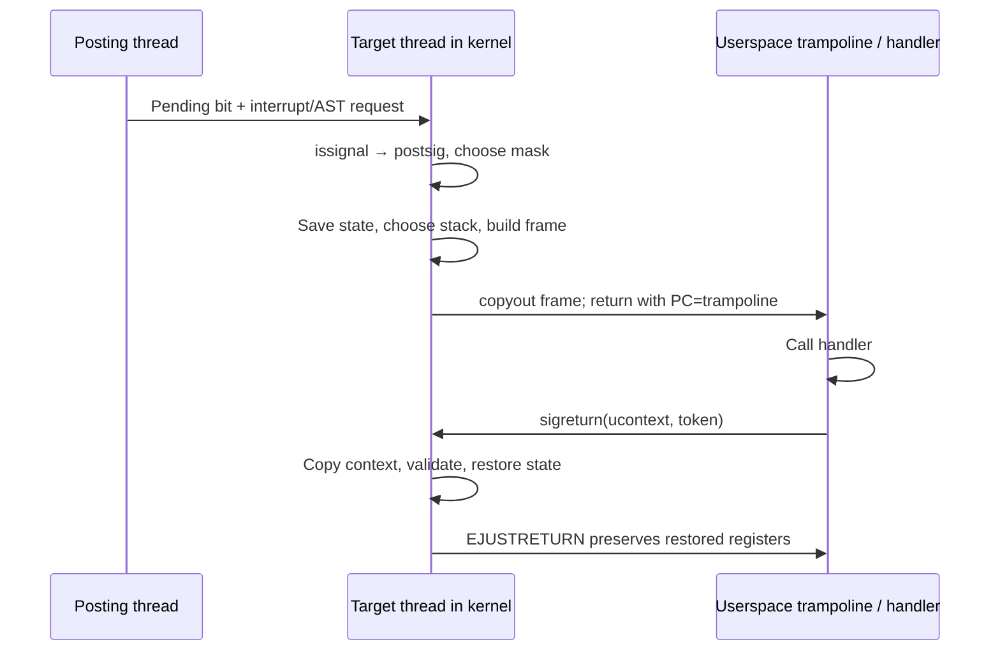

# Signal posting, handler entry, and sigreturn

[Processes](README.md) · [Syscall and exception overview](syscalls-signals.md)

Signals connect process policy to a particular thread's eventual return to userspace. Posting a signal, choosing an eligible thread, interrupting a kernel wait, building a user signal frame, and restoring that frame are separate operations. This chapter traces the common BSD machinery and the ARM64 frame path in this checkout. Mach exception routing and the exception-to-signal bridge are described in [Exception delivery](../ipc/exception-delivery.md).

## 1. State is split between the proc and uthread

| State | Meaning |
| --- | --- |
| `p_sigacts` | Handler and trampoline addresses, per-signal catch masks, restart/on-stack/reset/nodefer behavior, and sigreturn validation policy |
| `p_sigignore` / `p_sigcatch` | Fast process-wide disposition sets |
| `p_siglist` | Process-level pending state used by relevant transition paths |
| `uu_siglist` / `uu_sigmask` | Pending signals assigned to this thread and its blocked-signal set |
| `uu_sigwait` / `uu_oldmask` | Synchronous waiting selection and the mask saved by temporary-mask operations |
| `uu_sigstk` | Alternate stack description and current on-stack state |
| `uu_pending_sigreturn` / `uu_sigreturn_token` / `uu_sigreturn_diversifier` | Nested handler accounting and ARM signal-state validation inputs |
| `p_signalholder` / `P_LINSIGNAL` / `p_sigwaitcnt` | Serialization of signal operations and waiters |
| `exit_thread` | Thread selected to coordinate process exit |

See [process fields](../../../platydoc-data/xnu/bsd/sys/proc_internal.h), [uthread fields](../../../platydoc-data/xnu/bsd/sys/user.h), and [signal action fields](../../../platydoc-data/xnu/bsd/sys/signalvar.h).

`setsigvec()` installs a handler and trampoline, excludes unmaskable signals from its catch mask, and updates the fast disposition sets. Ignoring a signal can clear already pending process state. `SIGCONT` is deliberately excluded from the ordinary ignored-signal set because its continuation effect still matters. `SIGCHLD` disposition also changes child-reaping behavior through `P_NOCLDWAIT`. [Disposition installation](../../../platydoc-data/xnu/bsd/kern/kern_sig.c#L633).

The handler address and trampoline are different. The kernel prepares a return to the trampoline; userspace code invokes the handler and later performs `sigreturn`. The C calling sequence of an application's handler is therefore not the direct kernel register setup shown below.

## 2. Posting chooses an action and a thread

`psignal_internal()` serves several entry variants: process-directed delivery, a specified thread, vfork handling, and a “try this thread first” path. It consumes the supplied exit-reason reference on every path, either by transferring it or freeing it. No caller may keep using that reference merely because the signal was ignored. [Posting entry and contract](../../../platydoc-data/xnu/bsd/kern/kern_sig.c#L2038).

Before changing mutable state, ordinary paths enter the signal serialization protocol and lock the proc. The lock also protects the selected uthread's lifetime while it is accessed through the process's thread list. The function rejects processes already exiting or lacking a usable task and handles ignored dispositions early.

For process-directed signals, `get_signalthread()` scans `p_uthlist` for a thread that can accept the signal or is synchronously waiting for it. Its first pass skips pthread workqueue threads because they can remain parked in the kernel; its second pass allows them. AIO workqueue threads remain excluded in both passes. It can finally ask the Mach layer for an eligible signal thread. This selection is not a promise to interrupt a particular arbitrary application thread. [Thread selection](../../../platydoc-data/xnu/bsd/kern/kern_sig.c#L1941).

The selected action combines disposition, tracing, mask, and sigwait state:

| Action | Representative result |
| --- | --- |
| Ignore | Drop the ordinary signal without creating a handler frame |
| Hold | Leave the pending bit for a later unmask; `SIGCONT` still has special resume behavior |
| Synchronous wait | Consume the pending bit and wake the thread waiting on `uu_sigwait` |
| Catch | Make the signal pending and arrange interruption/AST processing |
| Default stop | Stop the task/process and notify its parent according to tracing/job-control rules |
| Default fatal | Arrange termination, potentially aborting a wait more strongly and attaching a reason |

[Action selection and pending-bit update](../../../platydoc-data/xnu/bsd/kern/kern_sig.c#L2180). Pending ordinary signals are bit sets: repeated postings of the same number can coalesce. This path is not a general FIFO of arbitrary signal payloads.

Stop and continue signals remove incompatible pending bits. `SIGCONT` can resume a stopped task even when held or ignored; a caught continuation signal additionally needs eventual handler delivery. The code temporarily drops signal serialization in selected parent-notification operations and reacquires it afterward. Those transitions explain why callers cannot assume a `proc_lock` acquired at entry stays continuously held until posting returns. [Continue/stop paths](../../../platydoc-data/xnu/bsd/kern/kern_sig.c#L2293).

A caught ordinary signal uses `thread_abort_safely()` to interrupt an interruptible kernel wait. A fatal signal can take the stronger abort path and install terminating task policy. These are scheduling/wait actions. They do not call the user's signal handler on the posting CPU. [Posting wakeup and cleanup](../../../platydoc-data/xnu/bsd/kern/kern_sig.c#L2500).

## 3. AST processing decides what can be delivered now

The BSD AST runs on the target thread on its kernel return path. It processes other BSD return work as well, then checks signals under the proc lock:

[Signal loop in `bsd_ast()`](../../../platydoc-data/xnu/bsd/kern/kern_sig.c#L3459):
<!-- source-excerpt: ../../../platydoc-data/xnu/bsd/kern/kern_sig.c#L3459-L3465 -->
```c
	proc_lock(p);
	if (CHECK_SIGNALS(p, current_thread(), ut)) {
		while ((signum = issignal_locked(p))) {
			postsig_locked(signum);
		}
	}
	proc_unlock(p);
```

`issignal_locked()` and its internal signal-selection code take pending signals minus the thread mask, discard now-ignored signals, and handle stop/tracing rules before returning a signal for `postsig_locked()`. The ordinary selection uses the first set signal bit rather than posting order. Tracing can stop the task or route a software-signal Mach exception before normal disposition handling resumes. [Selection](../../../platydoc-data/xnu/bsd/kern/kern_sig.c#L2670).

For a caught signal, `postsig_locked()` removes the pending bit and chooses the mask that must be restored after the handler. Normally this is `uu_sigmask`. If `UT_SAS_OLDMASK` records a temporary-mask operation, it instead uses `uu_oldmask` and clears that flag. During handler execution it adds the installed handler's catch mask and, unless `SA_NODEFER` is set, the current signal itself. `SA_RESETHAND` resets the disposition for applicable signals before entering userspace. [Handler-mask setup](../../../platydoc-data/xnu/bsd/kern/kern_sig.c#L3208).

For a default fatal disposition, the function retains an existing thread exit reason as needed, handles optional core-dump work outside the process lock, and calls `exit_with_reason()`. The exit routine owns the supplied reason. This path joins the [process exit protocol](process-transitions.md#6-exit-ownership-precedes-resource-teardown); it does not return through a signal trampoline.

Signal serialization uses `P_LINSIGNAL` and `p_signalholder` with sleeps on the process state. The protocol survives short intervals in which `p_mlock` is dropped. Exit waits for signal delivery and its waiters to drain before destroying the corresponding state. A source annotation saying “called with proc locked” must therefore be read together with the helper's explicit unlock/relock behavior. [`proc_signalstart()` and `proc_signalend()`](../../../platydoc-data/xnu/bsd/kern/kern_sig.c#L3569), [exit drain](../../../platydoc-data/xnu/bsd/kern/kern_exit.c#L2339).

## 4. ARM64 sendsig builds a user-owned frame

`sendsig()` starts with zeroed local frame/state storage. It selects traditional versus siginfo-style delivery, obtains the installed trampoline, and records whether the thread was already on the alternate stack. On the first outstanding handler it generates a random sigreturn token and a nonzero masked diversifier, then increments `uu_pending_sigreturn`. Nested handlers share those validation inputs until the outstanding count returns to zero. [Frame setup](../../../platydoc-data/xnu/bsd/dev/arm/unix_signal.c#L279).

`sendsig_get_state64()` obtains `ARM_THREAD_STATE64`, the exception state, and NEON state. It copies general registers into the frame's machine context and converts the exported thread state to the user representation. The conversion requests sigreturn-token stashing and, for the relevant protection policy, the thread-specific user diversifier. This is not a raw memcpy of the kernel's privileged saved-state object into user memory. [State extraction](../../../platydoc-data/xnu/bsd/dev/arm/unix_signal.c#L117).

If an alternate signal stack is enabled, the thread is not already on it, and the signal's action requests it, the frame starts at that stack's top and `SA_ONSTACK` is set. Otherwise it uses the current user SP. ARM64 subtracts the signal-frame size and the 128-byte red zone, then aligns the result to 16 bytes. The local frame contains the user siginfo, ucontext, and machine context. The ucontext points to the machine-context location within the eventual user frame and records its expected size. [Stack placement](../../../platydoc-data/xnu/bsd/dev/arm/unix_signal.c#L368), [ucontext construction](../../../platydoc-data/xnu/bsd/dev/arm/unix_signal.c#L158).

The proc mutex is dropped before filling/copying user-visible state and invoking `copyout()`. Holding a sleeping mutex across potentially faulting user memory accesses would not be a valid description of this path. Selected process siginfo fields are separately accessed under the lock. Once frame copyout succeeds, the thread's register state is replaced:

[ARM64 trampoline registers](../../../platydoc-data/xnu/bsd/dev/arm/unix_signal.c#L180):
<!-- source-excerpt: ../../../platydoc-data/xnu/bsd/dev/arm/unix_signal.c#L180-L190 -->
```c
	regs->x[0] = catcher;
	regs->x[1] = infostyle;
	regs->x[2] = sig;
	regs->x[3] = p_sinfo;
	regs->x[4] = p_uctx;
	regs->x[5] = token;
	regs->pc = trampact;
	regs->cpsr = PSR64_USER64_DEFAULT;
	regs->sp = sp;

	return thread_setstatus(th_act, ARM_THREAD_STATE64, (void *)regs, ARM_THREAD_STATE64_COUNT);
```

The six arguments are the handler, delivery style, signal number, siginfo pointer, ucontext pointer, and validation token. PC becomes the trampoline, SP points at the constructed frame, and the saved processor mode is the default user mode. See [frame copyout and register installation](../../../platydoc-data/xnu/bsd/dev/arm/unix_signal.c#L558).



A frame-construction failure is not an ordinary `EFAULT` returned by a signal syscall, because the thread was being redirected asynchronously. The bad path decrements pending-sigreturn accounting, forces `SIGILL` to its default disposition, clears its ignore/catch/mask state, creates a reason, and posts it through the locked thread-preferred path. [Delivery failure](../../../platydoc-data/xnu/bsd/dev/arm/unix_signal.c#L643).

## 5. sigreturn validates and restores a requested continuation

The ARM `sigreturn()` syscall first handles two special alternate-stack state operations. The normal context-return path copies a user ucontext and then the machine context designated by that ucontext. For ARM64 the machine-context size must equal the expected combined thread/exception/NEON flavor size; arbitrary-sized contexts are rejected. [Context copyin](../../../platydoc-data/xnu/bsd/dev/arm/unix_signal.c#L747), [syscall](../../../platydoc-data/xnu/bsd/dev/arm/unix_signal.c#L800).

The function restores alternate-stack state and the signal mask, always removing `sigcantmask`. Pending newly unblocked signals cause another AST request. This happens before token and machine-state validation. Consequently the syscall is not one atomic transaction that either restores everything or restores nothing; an error can occur after these signal fields have changed.

The outer token binds the supplied ucontext address, converted to the user representation, to the uthread's random token. A mismatch returns `EINVAL` when validation is enabled. The machine-state restoration gets separate flags controlling thread-state checks:

[Machine-state validation policy selection](../../../platydoc-data/xnu/bsd/dev/arm/unix_signal.c#L900):
<!-- source-excerpt: ../../../platydoc-data/xnu/bsd/dev/arm/unix_signal.c#L900-L907 -->
```c
		if (sigreturn_validation != PS_SIGRETURN_VALIDATION_DISABLED) {
			tssf_flags |= TSSF_CHECK_SIGRETURN_TOKEN;

			if (pac_sigreturn_token || task_needs_user_signed_thread_state(current_task())) {
				tssf_flags |= TSSF_ALLOW_ONLY_MATCHING_TOKEN | TSSF_THREAD_USER_DIV;
			}
		}
		error = sigreturn_set_state64(th_act, &mctx.mc64, tssf_flags);
```

`sigreturn_set_state64()` forces the processor mode back to user mode before passing the general-register state to `thread_setstatus_from_user()`. It then restores NEON state. Each operation can reject input; the two calls are ordered, so this helper also should not be described as an all-fields atomic update. [Register restoration](../../../platydoc-data/xnu/bsd/dev/arm/unix_signal.c#L776).

On pointer-authentication builds, the exported state can carry kernel-signed PC/LR markers and embedded sigreturn tokens. `machine_thread_state_convert_to_user()` generates those tokens for the marked register values. `machine_thread_state_check_sigreturn_token()` checks them against the thread's token and pointer-authentication context. `machine_thread_state_convert_from_user()` decides whether a mismatch is rejecting under the supplied flags, selects a diversifier, and authenticates the appropriate pointers. [Export](../../../platydoc-data/xnu/osfmk/arm64/status.c#L797), [token checks](../../../platydoc-data/xnu/osfmk/arm64/status.c#L858), [import policy](../../../platydoc-data/xnu/osfmk/arm64/status.c#L1042).

These are distinct layers: the ucontext-address token is checked in BSD, while machine-state validation handles the exported register representation. Configuration and per-task policy affect which machine checks are enforced. The source does not justify describing every ARM64 build as using an identical signing mode.

After successful restoration, pending-sigreturn accounting decreases and the syscall returns a special internal result:

[Successful sigreturn completion](../../../platydoc-data/xnu/bsd/dev/arm/unix_signal.c#L940):
<!-- source-excerpt: ../../../platydoc-data/xnu/bsd/dev/arm/unix_signal.c#L940-L945 -->
```c
	/* Decrement the pending sigreturn count */
	if (ut->uu_pending_sigreturn > 0) {
		ut->uu_pending_sigreturn--;
	}

	return EJUSTRETURN;
```

The ARM syscall return path recognizes `EJUSTRETURN` and leaves the restored registers intact. Ordinary errno/return-value installation would overwrite part of the context that `sigreturn` just restored. The same dispatcher handles `ERESTART` by adjusting the saved PC for syscall reexecution, but whether an interrupted operation produces that result depends on its sleep/error path and signal restart policy. [ARM syscall result handling](../../../platydoc-data/xnu/bsd/dev/arm/systemcalls.c#L497).

## 6. Exec and cancellation alter the signal environment

`execsigs()` moves relevant pending process signals to the replacement thread, resets caught dispositions, applies default-ignore consequences, resets sigreturn validation policy, and disables/clears the alternate stack. The caller's signal mask is not simply reset to an empty mask. The exec switch separately transfers pending thread state and masks from the old execution context. [Exec signal reset](../../../platydoc-data/xnu/bsd/kern/kern_sig.c#L732), [exec identity handoff](../../../platydoc-data/xnu/bsd/kern/kern_exec.c#L5820).

Pthread cancellation uses some of the same thread-abort machinery but has its own flags. `__pthread_markcancel()` sets `UT_CANCEL` and `UT_NO_SIGMASK` and can safely abort an enabled cancellation-point wait. `get_signalthread()` skips `UT_NO_SIGMASK` threads in its normal scan. These operations do not themselves run userspace cancellation handlers or implement pthread unwinding. See [Pthread/workqueue lifecycle](pthread-workqueue-lifecycle.md).

## Inspection scope

The common posting/selection, disposition installation, AST/handler delivery, serialization/exit handoff, cancellation flags, ARM sendsig/sigreturn, and relevant ARM64 machine-state conversion bodies were read. The detailed frame trace is ARM64; ARM32 compatibility and x86 frame layouts are not reconstructed here. Full ptrace/job-control behavior, core-dump generation, signal syscalls' every compatibility branch, and userspace trampoline implementation remain outside this chapter.

<!-- BEGIN PLATYDOC DOCUMENTATION LICENSE -->
Original Platydoc text and diagrams are licensed under [CC BY 4.0](https://creativecommons.org/licenses/by/4.0/). Quoted source code and third-party material retain their respective licenses.
<!-- END PLATYDOC DOCUMENTATION LICENSE -->
