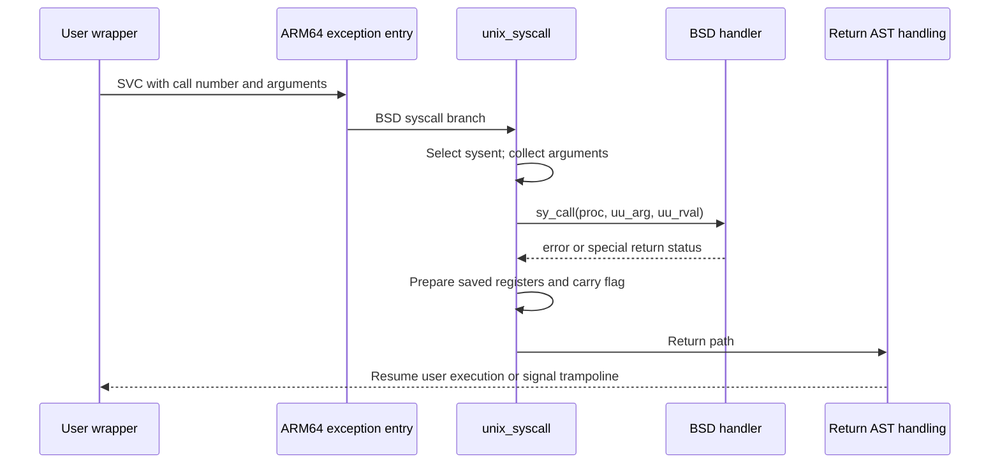

# System calls, signals, and exceptions

For the full common signal path and ARM64 user-frame return protocol, continue with [Signal posting, handler entry, and sigreturn](signal-delivery-and-return.md).

[Back to processes](README.md)

## The syscall table is generated

[`bsd/kern/syscalls.master`](../../../xnu/bsd/kern/syscalls.master) is the authoritative input for BSD syscall numbers, argument types, handler names, audit events, and generation flags. Its header identifies the products of [`makesyscalls.sh`](../../../xnu/bsd/kern/makesyscalls.sh): dispatch table, syscall-name table, number/prototype headers, and audit mappings. The file also makes configuration-dependent omissions explicit; a reserved slot can call `nosys()` instead of a feature handler.

[`struct sysent`](../../../xnu/bsd/sys/sysent.h#L45) holds `sy_call`, return type, argument count, argument-byte count, and, where configured, a 32-bit argument munger. Handlers have the broad form `handler(proc, argument_block, return_values)`. Their C return is usually an errno-style status; the syscall's successful value is placed in the separate return storage. Confusing those two returns makes syscall handlers difficult to follow.

The userspace side is partly in [`libsyscall`](../../../xnu/libsyscall). [`create-syscalls.pl`](../../../xnu/libsyscall/xcodescripts/create-syscalls.pl) reads the master file plus platform mappings/custom implementations and emits stubs. [`custom/SYS.h`](../../../xnu/libsyscall/custom/SYS.h) supplies architecture-specific trap/error macros; specialized wrappers live alongside it and under `wrappers/`. `NO_SYSCALL_STUB` marks calls whose normal public entry is not supplied by the generic stub treatment. This tree contains a syscall interface layer, not all of libc, libpthread, dyld, or libdispatch.

## A concrete ARM64 call path

The SVC handling in [`osfmk/arm64/sleh.c`](../../../xnu/osfmk/arm64/sleh.c#L2750) distinguishes Mach traps from Unix syscalls. [`unix_syscall()`](../../../xnu/bsd/dev/arm/systemcalls.c#L90) obtains the current uthread, selects a bounded table entry, fills `uu_arg`, initializes `uu_rval`, records the syscall number, and applies configured filtering and audit hooks around `sy_call`. Arguments are copied from saved registers or the relevant user stack representation, with ABI-specific conversion where needed. These checks are part of the entry boundary; subsystem handlers must still validate the content of pointers and arguments they receive.

[`arm_prepare_u64_syscall_return()`](../../../xnu/bsd/dev/arm/systemcalls.c#L497) implements three cases that recur throughout BSD:

| Handler result | Machine return action | Meaning for the caller |
| --- | --- | --- |
| Ordinary success/error | Pack return values, or place errno in `x0` and set carry | The wrapper returns the value or takes its `cerror` path |
| `ERESTART` | Move the saved PC back by the SVC instruction width | Re-enter the syscall after returning from the kernel |
| `EJUSTRETURN` | Leave the specially prepared saved state alone | A handler has already arranged how execution resumes |

[`bsd/dev/i386/systemcalls.c`](../../../xnu/bsd/dev/i386/systemcalls.c) provides the analogous x86 paths, including `unix_syscall64()`. Register details belong in the [platform chapter](../platform/README.md), while `sysent` and subsystem handlers remain the shared logic.

Cancellation and interruption are also separate. For example, [`read()`](../../../xnu/bsd/kern/sys_generic.c#L390) calls `__pthread_testcancel()` before `read_nocancel()`. A blocking operation can return `EINTR` or `ERESTART`; the I/O helper may still report successfully transferred bytes if progress already occurred. An interrupted syscall is not automatically a canceled pthread.

## Where signal state lives

Signal disposition is process-wide: `p_sigacts.ps_sigact[]` stores handlers, `ps_trampact[]` stores trampolines, and the associated masks encode reset, alternate-stack, interruption, and masking behavior. `p_sigignore` and `p_sigcatch` summarize disposition. Pending and blocked signals are chiefly per-thread: `uu_siglist`, `uu_sigmask`, `uu_sigwait`, and `uu_oldmask`. `p_siglist` can hold signals captured back from threads. See the declarations in [`proc_internal.h`](../../../xnu/bsd/sys/proc_internal.h#L229) and [`user.h`](../../../xnu/bsd/sys/user.h#L215).

[`psignal_internal()`](../../../xnu/bsd/kern/kern_sig.c#L2051) supports process-directed and thread-directed variants. It rejects inappropriate targets, handles ignored/exiting processes, coordinates signal serialization, selects an appropriate thread, updates pending state, and requests attention through an AST or thread interruption. The process lock protects the targeted thread/uthread during parts of posting; the source explicitly warns that their existence is no longer guaranteed just because a raw pointer remains after that protection is dropped.

Posting does not execute a user handler on the posting CPU's call stack. [`bsd_ast()`](../../../xnu/bsd/kern/kern_sig.c#L3362), reached through asynchronous system-trap handling on the target's return path, checks timers and pending signals. Under process locking it loops through `issignal_locked()` and `postsig_locked()`. Selection deals with blocked, ignored, stop/continue, and traced-process cases; delivery consumes a pending signal and chooses termination or a user catcher.

[`postsig_locked()`](../../../xnu/bsd/kern/kern_sig.c#L3066) routes fatal default actions through the exit machinery and, where configured, core-dump handling. For a catcher it prepares masks and calls the machine-dependent `sendsig()`. [`bsd/dev/arm/unix_signal.c`](../../../xnu/bsd/dev/arm/unix_signal.c#L279) and the [x86 counterpart](../../../xnu/bsd/dev/i386/unix_signal.c#L165) build user contexts/signal frames and alter saved thread state to enter a trampoline. `sigreturn()` validates and restores state. The architecture files were surveyed here; their complete frame-validation rules require a dedicated security/ABI review.

## Mach exceptions become signals through a real IPC boundary

[`exception_triage_thread()`](../../../xnu/osfmk/kern/exception.c#L743) attempts thread, task, then host exception handlers. A debugger or other registered handler can therefore handle an exception before BSD signal conversion. [`ux_handler_setup()`](../../../xnu/osfmk/kern/ux_handler.c) registers the Unix exception handler at the host level for its selected exception mask. Its `catch_mach_exception_raise()` converts the supplied thread port into a referenced thread and calls [`handle_ux_exception()`](../../../xnu/bsd/uxkern/ux_exception.c#L114).

The BSD bridge first asks `machine_exception()` for an architecture-specific translation, then applies generic mappings: invalid-address `EXC_BAD_ACCESS` becomes `SIGSEGV`, other bad-access cases generally become `SIGBUS`, bad instructions become `SIGILL`, and breakpoints become `SIGTRAP`. There is additional stack-overflow handling to select `SIGSEGV` and account for alternate-stack readiness. The bridge stores exception metadata in the uthread and calls [`threadsignal()`](../../../xnu/bsd/kern/kern_sig.c#L1785), which sets pending state and requests a BSD AST.

This path connects hardware faults, [Mach exception IPC](../ipc/README.md), debugger interception, and POSIX signals. It does not mean every Mach exception is synonymous with a signal, or that a successful exception handler must terminate the process.

<!-- BEGIN PLATYDOC DOCUMENTATION LICENSE -->
Original Platydoc text and diagrams are licensed under [CC BY 4.0](https://creativecommons.org/licenses/by/4.0/). Quoted source code and third-party material retain their respective licenses.
<!-- END PLATYDOC DOCUMENTATION LICENSE -->
