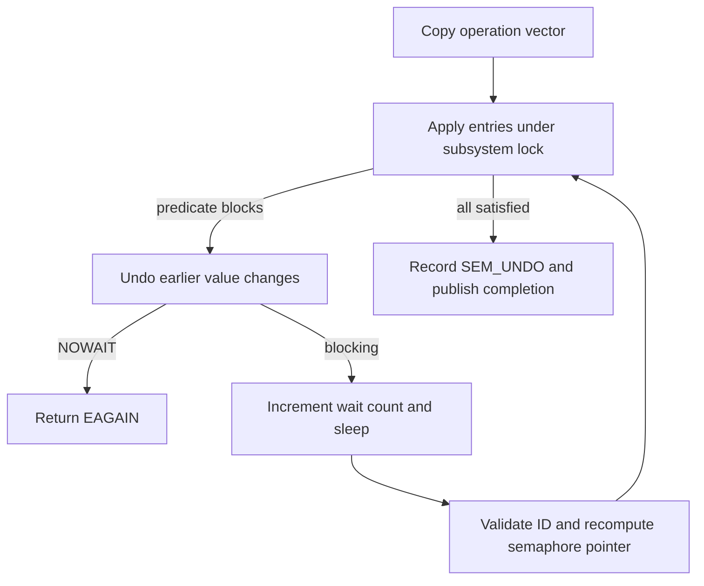

# System V IPC: queues, semaphore vectors and shared segments

[Processes](README.md) · [POSIX named IPC](posix-named-ipc.md) · [VM mappings](../vm/virtual-address-maps.md)

System V IPC uses integer object IDs and permission records rather than file descriptors. This chapter follows the separately configured `SYSV_MSG`, `SYSV_SEM` and `SYSV_SHM` implementations. Their presence in the tree does not establish that every product enables them. The common permission gate is [`ipcperm`](../../../xnu/bsd/kern/sysv_ipc.c), and the implementations maintain independent subsystem locks and storage.

## IDs contain both a slot and a generation

Lookup splits an ID into array index and sequence. It rejects out-of-range, free or wrong-sequence records, so a reused table slot is not the previous object. A creation key finds an object; `IPC_PRIVATE` requests a new one. Key, returned ID and mapping address are three different values. [Message lookup](../../../xnu/bsd/kern/sysv_msg.c#L730-L774), [shared-segment lookup](../../../xnu/bsd/kern/sysv_shm.c#L234-L263).

| Facility | Stored objects | Waiting/storage resource |
| --- | --- | --- |
| Messages | `msqid_kernel`, linked `msg` headers, segment-index chains in `msgmap` | Queue byte allowance, global headers and message segments |
| Semaphores | `semid_kernel`, `sem` array, per-process `sem_undo` entries | Value/count predicates across an operation vector |
| Shared memory | `shmid_kernel`, linked `shm_handle`, per-process `shmmap_state` | Named memory-entry backing and VM mappings |

[Message pools](../../../xnu/bsd/kern/sysv_msg.c#L94-L135), [semaphore lookup/undo](../../../xnu/bsd/kern/sysv_sem.c#L240-L450), [shared-memory representations](../../../xnu/bsd/kern/sysv_shm.c#L138-L163).

## Message send reserves before publishing

`msgsnd_nocancel` validates ID, write permission/MAC policy and message size. A message needs a header plus `ceil(size/msgssz)` storage segments. It can block because its queue is locked/full or because the global header/segment pool is depleted. `IPC_NOWAIT` changes those shortages to `EAGAIN`. A blocking request releases the subsystem mutex via `msleep`, reacquires it and rechecks the relevant state; deletion and interruption can terminate the operation. [Admission/resource loop](../../../xnu/bsd/kern/sysv_msg.c#L706-L902).

The sender marks `MSG_LOCKED`, removes a header and segments from free lists, and drops the mutex around user copies. The message's type and body are private allocations until ready to append. A copy fault frees the header/segments, clears the locked bit and wakes waiters. A valid type must be positive. On successful copy it updates queue counts/time/last-sender and wakes receivers; removal during a copy has its own cleanup branch. [Copy and append](../../../xnu/bsd/kern/sysv_msg.c#L904-L1122).

## Receive can consume a message even if copyout fails

`msgrcv_nocancel` checks read permission and scans for a suitable message. Zero type selects the first queued message. Positive type selects an exact match. For negative type this source scans in queue order for the first entry satisfying `msg_type <= -msgtyp`; do not silently replace that code with a different operating system's selection algorithm. A too-small buffer without `MSG_NOERROR` returns `E2BIG` before removing the selected entry; with the flag, the copied payload is truncated. An empty match either sleeps or returns the no-message error. After sleep, allocation/sequence are rechecked. [Selection](../../../xnu/bsd/kern/sysv_msg.c#L1199-L1363).

Once selected, the message is unlinked and queue counters are reduced **before** user copyout. A fault while returning its type or body frees the removed message rather than putting it back. Thus an `EFAULT` does not mean the queue is unchanged. [Bookkeeping and copyout](../../../xnu/bsd/kern/sysv_msg.c#L1366-L1476).

[bsd/kern/sysv_msg.c, lines 1374–1377](../../../xnu/bsd/kern/sysv_msg.c#L1374-L1377):
<!-- source-excerpt: ../../../xnu/bsd/kern/sysv_msg.c#L1374-L1377 -->
```c
	msqptr->u.msg_cbytes -= msghdr->msg_ts;
	msqptr->u.msg_qnum--;
	msqptr->u.msg_lrpid = proc_getpid(p);
	msqptr->u.msg_rtime = sysv_msgtime();
```

`msgctl(IPC_RMID)` authorizes removal, disposes queued messages, invalidates the queue and wakes blocked operations. Its treatment of a sender holding `MSG_LOCKED` is part of the removal protocol, not proof that every user copy runs under the global mutex. [Control/removal](../../../xnu/bsd/kern/sysv_msg.c#L373-L573).

## A semaphore request is a vector

`semop` copies a bounded array of `sembuf` operations. Negative values require enough semaphore value to subtract; zero waits for zero; positive values add. It applies entries while holding the subsystem mutex. If an entry cannot proceed, it rolls back earlier changes before returning `EAGAIN` or sleeping, then retries the vector. The failing predicate determines whether `semncnt` or `semzcnt` tracks the waiter. [Vector processing](../../../xnu/bsd/kern/sysv_sem.c#L973-L1206).



Illustrative vector: decrement semaphore 0 by one, then wait for semaphore 1 to become zero. If the second predicate blocks, the first decrement is undone before sleeping. Another process therefore does not observe an indefinitely half-completed vector. `SEM_UNDO` adds a second transaction: recording undo adjustments can fail, requiring undo/value rollback. [Undo registration and rollback](../../../xnu/bsd/kern/sysv_sem.c#L1212-L1315).

The invalid-index branch differs from that blocking rollback. This implementation checks each `sem_num` inside the apply loop; an out-of-range entry jumps directly to `semopout` with `EFBIG`. That exit only unlocks and returns. Earlier valid entries in such a malformed vector can therefore already have changed values. The comment's atomicity explanation describes the wait/retry path, not this error exit. [Index validation](../../../xnu/bsd/kern/sysv_sem.c#L1066-L1099), [direct exit](../../../xnu/bsd/kern/sysv_sem.c#L1309-L1313).

`semexit` finds the exiting process's undo entries, applies adjustments to surviving semaphore sets, clamps selected negative adjustment outcomes at zero, wakes waiters and removes the process's undo bookkeeping. `semctl` value/reset/remove operations also reconcile undo entries, so stale adjustments must not be applied to a reused semaphore ID. [Exit undo](../../../xnu/bsd/kern/sysv_sem.c#L1321-L1438), [undo clearing](../../../xnu/bsd/kern/sysv_sem.c#L537).

## Shared segments and attachments

`shmget` either checks an existing key/size/permission combination or allocates a segment backed by a chain of Mach memory-entry handles. `shmat` checks the ID, permission and readonly flag, reserves a per-process attachment slot, rounds/alignment-checks the address using the current map page size, reserves a no-access interval and overlays shared entry mappings. Only after success does it publish the attachment ID, increment `shm_nattch` and return the virtual address. [Creation](../../../xnu/bsd/kern/sysv_shm.c#L710-L947), [attachment](../../../xnu/bsd/kern/sysv_shm.c#L378-L579).

The failure branch removes its successfully mapped prefix and translates the Mach error; it is not a generic promise to restore prior address-space state. `shmdt` finds the recorded base address, removes the VM range and decrements attachment count. `IPC_RMID` changes the key to private and marks removed; final storage release waits for the last attachment. Lookup refuses removed segments, while existing mappings remain usable until detached. [Remove](../../../xnu/bsd/kern/sysv_shm.c#L680-L696), [detach and backing release](../../../xnu/bsd/kern/sysv_shm.c#L267-L318).

`shmfork` copies attachment bookkeeping and increments segment attachment counts. `shmexit` removes mappings and records; `shmexec` uses a variant that performs bookkeeping without redundantly deleting mappings from the old address space. [Fork/exit/exec](../../../xnu/bsd/kern/sysv_shm.c#L964-L1045). These kernel bodies are available here; no userspace IPC daemon supplies them.

<!-- BEGIN PLATYDOC DOCUMENTATION LICENSE -->
Original Platydoc text and diagrams are licensed under [CC BY 4.0](https://creativecommons.org/licenses/by/4.0/). Quoted source code and third-party material retain their respective licenses.
<!-- END PLATYDOC DOCUMENTATION LICENSE -->
