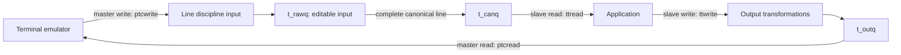

# TTY queues, PTY endpoints and job control

[Processes](README.md) · [Signals](signal-delivery-and-return.md) · [Device nodes](../vfs/device-nodes-and-fifos.md) · [Knotes](kqueue-and-workloops.md)

The terminal layer transforms a byte stream into input editing, terminal signals and flow-controlled output. A pseudo-terminal pairs that machinery with a userspace terminal emulator instead of a physical serial device. The line discipline, foreground process group and descriptor lifetime are separate parts of the path.

## State and dispatch

`struct tty` owns a mutex, raw/canonical/output `clist` queues, `termios`, window size, state flags, foreground group/session references, input/output readiness records, output high/low watermarks, generation and reference count. `t_line` selects `linesw`; callbacks such as `t_oproc` connect queued output to a device implementation. [Representation](../../../platydoc-data/xnu/bsd/sys/tty.h#L115-L154).

The PTMX initializer registers master and slave character-device operations, a clonable `/dev/ptmx` node and dynamic slave names (`ttys%03d` in this implementation). `ptmx_get_ioctl` owns per-instance allocation; `ptmx_clone` supplies a candidate minor, which is not by itself a guarantee of exclusive successful open. `ptcopen` rejects an existing master or still-open/draining slave and installs the output callback. [Registration](../../../platydoc-data/xnu/bsd/kern/tty_ptmx.c#L120-L247), [instance allocation](../../../platydoc-data/xnu/bsd/kern/tty_ptmx.c#L270), [master open](../../../platydoc-data/xnu/bsd/kern/tty_dev.c#L489-L531).



Slave `ptsread`/`ptswrite` dispatch through `linesw[t_line]` while holding the tty lock. Master `ptcwrite` injects input into the discipline; `ptcread` consumes `t_outq` and handles packet/user-control prefixes when enabled. Consequently writing a newline on the slave and writing a newline on the master enter different transformations. [Slave operations](../../../platydoc-data/xnu/bsd/kern/tty_dev.c#L377-L426), [master read](../../../platydoc-data/xnu/bsd/kern/tty_dev.c#L622), [master write](../../../platydoc-data/xnu/bsd/kern/tty_dev.c#L882).

## Input processing and canonical records

`ttyinput` first processes pending input and applies flow-control thresholds. It handles break/parity/framing conditions, strip/quote behavior, literal-next and discard, signal characters, start/stop characters, and CR/NL translation before canonical editing. `VINTR`, `VQUIT` and `VSUSP` can signal the foreground process group; `NOFLSH` controls whether associated queues are flushed. These bytes do not necessarily reach a reader as ordinary bytes. [Input decisions](../../../platydoc-data/xnu/bsd/kern/tty.c#L486-L706).

Canonical erase/kill/word-erase modify the pending raw line, including UTF-8-aware erase handling. A completed line moves to the canonical queue and wakes readers. `ttread` chooses `t_canq` in canonical mode and `t_rawq` otherwise. A canonical read is therefore driven by line completion, not simply by whether any character has arrived. [Editing and queue publication](../../../platydoc-data/xnu/bsd/kern/tty.c#L707-L881), [read queue choice](../../../platydoc-data/xnu/bsd/kern/tty.c#L2173-L2199).

Example: master writes `a`, `b`, erase, newline under canonical input with echo. Editing removes `b` from pending input; the application reads the completed `a` line, while echo/output rules determine what the emulator displays. This is an illustrative terminal configuration, not a claim that every PTY has those flags enabled.

## Noncanonical completion and output pressure

| `VMIN` / `VTIME` | Read rule in the noncanonical path |
| --- | --- |
| Both zero | Poll available input, including a zero-byte result |
| Positive minimum, zero timer | Wait for the configured minimum |
| Zero minimum, positive timer | Return input when present or zero on timeout |
| Both positive | Wait for initial input, then use the timed partial-input path while collecting the minimum |

`VTIME` is converted from tenths of a second to a sleep interval. `IO_NDELAY` is handled before the blocking rules. Wakeup returns to a loop that reloads terminal flags/state; changes to termios can wake a reader and change its predicate. [Noncanonical decisions](../../../platydoc-data/xnu/bsd/kern/tty.c#L2180-L2330), [termios update](../../../platydoc-data/xnu/bsd/kern/tty.c#L1357-L1405).

`ttwrite` copies bounded chunks, applies output processing, fills `t_outq` and calls the start callback. High-water pressure can block writers; draining output wakes them around low-water state. `IXON` input start/stop controls `TS_TTSTOP`; output discard can consume a write without storing it. Master reads subsequently drain the queue and restart the line discipline. [Output loop](../../../platydoc-data/xnu/bsd/kern/tty.c#L2463-L2680), [master drain](../../../platydoc-data/xnu/bsd/kern/tty_dev.c#L684-L710).

## Session and foreground group decisions

The controlling terminal belongs to a session; its foreground group can differ from the caller's group. `TIOCSCTTY` checks session leadership and existing associations. Foreground-group ioctls validate group/session relationships rather than treating the supplied integer as an arbitrary signal target. `TIOCSETD` closes/opens disciplines; a failed new open attempts to reopen the old one, and the source explicitly warns that rollback is racy. [Control operations](../../../platydoc-data/xnu/bsd/kern/tty.c#L1407-L1626).

A background `ttread` returns `EIO` if SIGTTIN is ignored/blocked, vfork constraints apply, or the group cannot participate in job control; otherwise it drops the tty lock around `pgsignal(SIGTTIN)`, then returns `EINTR` to let signal handling proceed. Background writes signal SIGTTOU only under the relevant `TOSTOP` and signal-mask conditions. A revoked terminal is treated as background for the read decision. [Read job control](../../../platydoc-data/xnu/bsd/kern/tty.c#L2130-L2170), [write job control](../../../platydoc-data/xnu/bsd/kern/tty.c#L2497-L2535).

## Sleep, hangup and final release

`ttysleep` saves the tty generation before dropping the mutex in `msleep0`. A revoked tty returns `ERESTART`; a generation change after wake also returns `ERESTART`, preventing an old operation from continuing against recycled logical state.

[bsd/kern/tty.c, lines 3232–3250](../../../platydoc-data/xnu/bsd/kern/tty.c#L3232-L3250):
<!-- source-excerpt: ../../../platydoc-data/xnu/bsd/kern/tty.c#L3232-L3250 -->
```c
ttysleep(struct tty *tp, void *chan, int pri, const char *wmesg, int timo)
{
	int error;
	int gen;

	TTY_LOCK_OWNED(tp);

	if (tp->t_state & TS_REVOKE) {
		return ERESTART;
	}

	gen = tp->t_gen;
	/* Use of msleep0() avoids conversion timo/timespec/timo */
	error = msleep0(chan, &tp->t_lock, pri, wmesg, timo, (int (*)(int))0);
	if (error) {
		return error;
	}
	return tp->t_gen == gen ? 0 : ERESTART;
}
```

Master close drops carrier through the line discipline, marks a still-open slave zombie, flushes queues, clears `t_oproc` and posts revoke/readiness notifications. `ttyclose` flushes, increments generation, restores the default discipline and detaches session/group relationships. These operations wake blocked users before the object is finally deallocated. [Master close](../../../platydoc-data/xnu/bsd/kern/tty_dev.c#L534-L615), [tty close](../../../platydoc-data/xnu/bsd/kern/tty.c#L376-L472).

Knotes retain their tty relationship until detached; revoke can occur while notes exist, so the PTY code has explicit autodetach/closed-state handling. `tty_lock`/unlock are tied to object references, and `ttyfree` performs final release outside the lock. Final deallocation requires no attached knotes and frees all three queues and the mutex. [Knote detach](../../../platydoc-data/xnu/bsd/kern/tty_ptmx.c#L541-L572), [release](../../../platydoc-data/xnu/bsd/kern/tty.c#L3297-L3343).

The common terminal/PTY mechanism is local source. Hardware-specific serial/USB behavior and userspace terminal-emulator policy are outside these generic callbacks. [TTY ioctl](../../../platydoc-data/xnu/tests/tty_ioctl.c) and [PTY kevent](../../../platydoc-data/xnu/tests/kevent_pty.c) tests provide focused reading examples.

<!-- BEGIN PLATYDOC DOCUMENTATION LICENSE -->
Original Platydoc text and diagrams are licensed under [CC BY 4.0](https://creativecommons.org/licenses/by/4.0/). Quoted source code and third-party material retain their respective licenses.
<!-- END PLATYDOC DOCUMENTATION LICENSE -->
