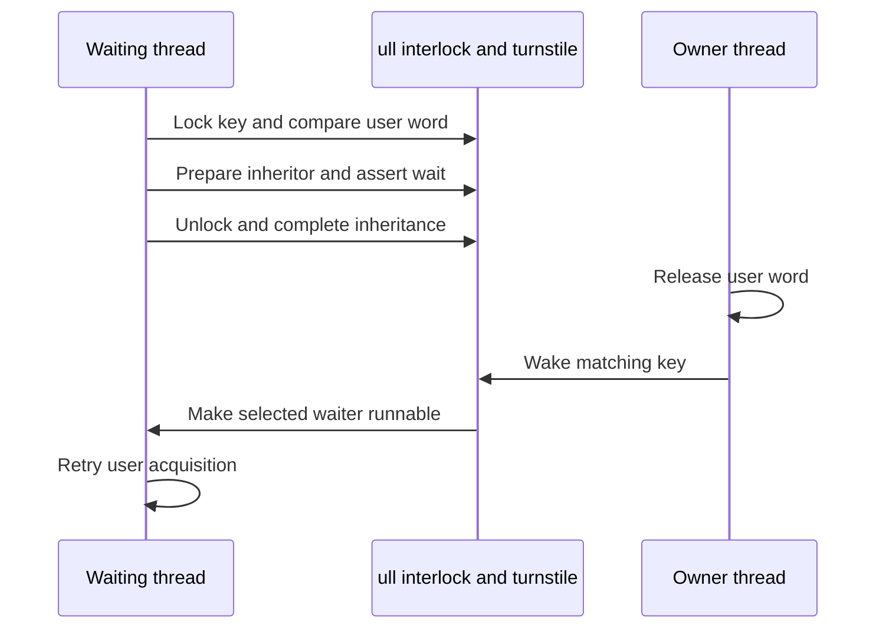

# User-address waits, unfair locks and turnstiles

[Processes](README.md) · [Turnstile protocol](../runtime/wait-and-turnstile-protocols.md) · [Pthread lifecycle](pthread-workqueue-lifecycle.md)

A ulock syscall lets a thread sleep only while a user memory word still has an expected value. For unfair locks, the kernel also resolves the presumed owner and lends it priority. It does not execute the application's critical section or make a waking thread the owner of the user word. The fast acquisition and retry algorithm remain in userspace.

## The address is a lookup key, not a kernel lock pointer

`ulk_t` distinguishes private `(task, user address)` keys from shared `(VM object identity, offset)` keys. Including the task prevents a same-address wake across exec from selecting a previous task's wait state. Shared operations use `uaddr_findobj` so two different virtual addresses mapping the same backing can match. The hash bucket contains `ull_t` objects with a separate interlock, waiter count, reference count, established opcode, optional owner reference and turnstile pointer. [Definitions](../../../platydoc-data/xnu/bsd/kern/sys_ulock.c#L124-L193), [wait key construction](../../../platydoc-data/xnu/bsd/kern/sys_ulock.c#L519-L594).

| Operation selected in this implementation | Word size | Key and owner |
| --- | --- | --- |
| `UL_UNFAIR_LOCK` | 32 bits | Task/address; owner thread can receive inheritance |
| `UL_COMPARE_AND_WAIT` | 32 bits | Task/address; no owner |
| `UL_COMPARE_AND_WAIT64` | 64 bits | Task/address; no owner |
| Shared compare-and-wait forms | 32 or 64 bits | Object/offset; no owner |

Do not infer support merely from a constant in a header: the switch in `sys_ulock_wait2` determines accepted operations. Null/misaligned addresses and invalid flag combinations return `EINVAL`. Conflicting operation types on an existing live key return `EDOM`. [Operation switch](../../../platydoc-data/xnu/bsd/kern/sys_ulock.c#L548-L576), [opcode check](../../../platydoc-data/xnu/bsd/kern/sys_ulock.c#L634-L644).

## Compare and queue without losing the wake

`sys_ulock_wait` normalizes its older argument format into `sys_ulock_wait2`. The latter may perform a bounded adaptive spin for an unfair lock whose owner is on a CPU. That optimization is followed by the protected compare-and-enqueue path if necessary. [Entry and spinning](../../../platydoc-data/xnu/bsd/kern/sys_ulock.c#L505-L633).

The decisive read runs under the `ull` interlock. An atomic copy that would fault cannot block there; it returns a fault for userspace to resolve and retry. If the value has changed, the syscall does not sleep. If it still matches, the unfair-lock path resolves the owner port, manages its thread reference, prepares the turnstile and registers the wait before dropping the interlock. An unlocking thread entering the wake syscall must serialize with this transition. [Compare/owner preparation](../../../platydoc-data/xnu/bsd/kern/sys_ulock.c#L645-L729).



The deadline is either an absolute value with `ULF_DEADLINE`, a nanosecond relative timeout, or forever for zero. `THREAD_ABORTSAFE` allows interruption; the contention flag can suppress workqueue wait reporting. If the thread will block, `uthread.uu_save.uus_ulock_wait_data` saves the `ull`, flags, return storage and owner references for the continuation. Inheritor updates are completed outside the interlock before `thread_handoff_parameter` or `thread_block_parameter`. [Wait and continuation state](../../../platydoc-data/xnu/bsd/kern/sys_ulock.c#L731-L790).

## Wake selection and owner handoff

`ulock_wake` reconstructs the same key but requests an existing object; no waiter object yields `ENOENT`. Target-thread wake validates a thread port and is incompatible with wake-all or unfair-owner operation. A late unfair-lock wake by a thread different from the currently recorded owner returns without disturbing the newer owner, unless the explicit allow-non-owner flag applies. [Wake validation](../../../platydoc-data/xnu/bsd/kern/sys_ulock.c#L914-L1032).

Ordinary compare waits can wake one, all, or a selected thread. The selected-thread path returns `EALREADY` when the target is not waiting there. The unfair-lock one-wake path uses the priority-ordered turnstile queue to identify the highest-priority waiter and update inheritance; it then transfers `ull_owner` reference ownership. This is a kernel scheduling relationship, not an atomic store into the application lock. [Selection and inheritance](../../../platydoc-data/xnu/bsd/kern/sys_ulock.c#L1034-L1089).

## Completion and last-waiter teardown

Both immediate nonblocking outcomes and the resumed continuation converge on cleanup. `turnstile_complete` relinquishes this operation's turnstile contribution. Under the `ull` interlock, the final waiter clears the stored owner and invalidates the lookup key; then `ull_put` drops the operation reference/interlock. Only afterward may `turnstile_cleanup` and thread deallocation run. [Continuation](../../../platydoc-data/xnu/bsd/kern/sys_ulock.c#L862-L887), [cleanup](../../../platydoc-data/xnu/bsd/kern/sys_ulock.c#L820-L857).

[bsd/kern/sys_ulock.c, lines 826–844](../../../platydoc-data/xnu/bsd/kern/sys_ulock.c#L826-L844):
<!-- source-excerpt: ../../../platydoc-data/xnu/bsd/kern/sys_ulock.c#L826-L844 -->
```c
	*retval = --ull->ull_nwaiters;
	if (ull->ull_nwaiters == 0) {
		/*
		 * If the wait was canceled early, we might need to
		 * clear out the lingering owner reference before
		 * freeing the ull.
		 */
		old_lingering_owner = ull->ull_owner;
		ull->ull_owner = THREAD_NULL;

		memset(&ull->ull_key, 0, sizeof ull->ull_key);
		ull->ull_refcount--;
		assert(ull->ull_refcount > 0);
	}
	ull_put(ull);

	/* Need to be called after dropping the interlock */
	turnstile_cleanup();

```

For example, a waiter can time out while it still owns the last recorded donation reference. Removing the queue entry alone would leave that reference behind; the `old_lingering_owner` cleanup handles it. Separately, a waker cleans the old owner reference after updating inheritance. Waiter count, object reference count and thread reference count therefore cannot be treated as one counter.

`wait_result_to_return_code` translates scheduling outcomes; `ULF_NO_ERRNO` returns a negative error in the result word while the syscall itself succeeds, and `ESTALE` is normalized by this entry path. A successful wait may mean the compared word changed without any sleep. Always re-evaluate the user predicate. [Return handling](../../../platydoc-data/xnu/bsd/kern/sys_ulock.c#L789-L811).

The local [ulock regression](../../../platydoc-data/xnu/tests/ulock.c) supplies timeout/wake examples. External pthread and unfair-lock libraries determine how these mechanisms implement higher-level mutex/condition semantics.

<!-- BEGIN PLATYDOC DOCUMENTATION LICENSE -->
Original Platydoc text and diagrams are licensed under [CC BY 4.0](https://creativecommons.org/licenses/by/4.0/). Quoted source code and third-party material retain their respective licenses.
<!-- END PLATYDOC DOCUMENTATION LICENSE -->
