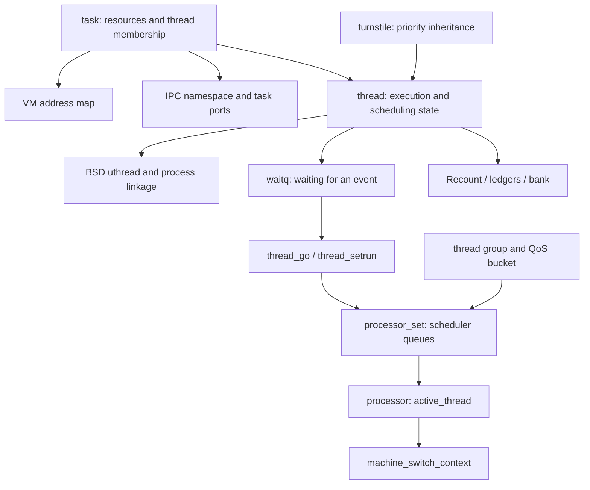

# Mach runtime: execution, scheduling, and synchronization

[Guide index](../../README.md) · [Architecture](../../architecture.md)

The runtime turns a task's resources and a thread's saved execution state into work performed by CPUs. It also provides the waits, locks, timers, and accounting used throughout XNU. The central files are in `osfmk/kern/`, but their clients include BSD, Mach IPC, VM, and I/O Kit. Start with the object relationships below, then follow one blocking operation from its caller through the scheduler. [`task.h`](../../../xnu/osfmk/kern/task.h#L277), [`thread.h`](../../../xnu/osfmk/kern/thread.h#L399), [`sched_prim.c`](../../../xnu/osfmk/kern/sched_prim.c#L3874).

The arrows identify relationships and control transfers; they do not all denote owning references. For ownership and synchronization, inspect the field declarations and the creation/teardown paths linked in [objects and lifecycle](objects-and-lifecycle.md). In particular, a task is not the scheduler's execution unit, and `TH_RUN` does not prove that a thread is currently on a CPU. [`thread.h`, state definitions](../../../xnu/osfmk/kern/thread.h#L530).

## Reading route

1. [Objects and lifecycle](objects-and-lifecycle.md): distinguish task, thread, processor, and processor set; trace creation and staged destruction.
2. [Scheduling](scheduling.md): understand the common scheduler core before studying the Clutch hierarchy and Edge placement policy.
3. [Waits, locks, and priority inheritance](waits-and-locks.md): follow an event wait and a contended mutex; learn which locks protect the transition.
4. [Time, deferred work, and accounting](time-and-accounting.md): distinguish timer callouts from worker-thread callbacks, then follow clocks, Recount/coalitions/work intervals, ledger settlement and bank charging through focused companions.
5. [AST mechanism](ast-mechanism.md) and [all AST flavors](ast-flavors.md): publication in CPU/thread masks, remote checks, interrupt and user-return consumption, preemption, APCs, signals, guards, telemetry and deferred payloads.

## Detailed execution and lifetime paths

The introductory pages above provide the object map. These chapters follow the implementation through decisions, lock handovers, races, and cleanup:

1. [Scheduler execution](scheduler-execution.md): current-thread eligibility, placement/selection retries, kernel-stack allocation, continuations, ARM64 context switching, departure, and termination reaping.
2. [Clutch and Edge](clutch-and-edge.md): the three-level runnable hierarchy, deadline/warp/starvation windows, group interactivity, cluster migration weights, availability checks, and stealing.
3. [Wait and turnstile protocols](wait-and-turnstile-protocols.md): wait registration and `TH_WAKING`, mutex retries, donated turnstile storage, inheritor references, and generation-checked priority-chain traversal.
4. [Suspension, stopping and abort](suspension-stop-and-abort.md): separate persistent suspension counts, safe stopping, wait interruption, abort requests and resumption.
5. [Timer and thread-call lifetime](timer-and-thread-call-lifetime.md): timer-lock collision handling, callback execution context, `ONCE` rearm, worker references, completion waits, cancellation branches, and owner teardown.

For lock implementations, continue with [reader/writer locks](reader-writer-locks.md) and [ticket and pointer locks](ticket-and-pointer-locks.md). The first distinguishes the default legacy RW representation from the newer implementation explicitly used by VM; the second follows ticket reservation, invalidation and pointer publication. Keep each primitive's acquisition, blocking and release rules separate from the mutex/turnstile protocol.

## Clocks and accounting mechanisms

1. [ARM64 clocks and time domains](clocks-and-time-domains.md): counter access, timebase scaling, sleep offsets, calendar/NTP state and commpage read/publication protocols.
2. [Recount and resource attribution](recount-and-resource-attribution.md): per-owner topology, snapshot deltas, sequence reads, terminated/live rollups, coalition reporting and work-interval telemetry/lifetime.
3. [Ledgers, limits and settlement](ledgers-limits-and-settlement.md): encoded entry features, per-CPU deferred pairs, maintenance-IPI settlement, refill, limits and AST handoff.
4. [Bank accounts and charging](../ipc/bank-accounts-and-charging.md): voucher attribute roles, shared accounts, adoption and quantum attribution, live bills and final task totals.

## Detailed execution policy

1. [Priority, QoS, and quanta](priority-qos-and-quanta.md): effective-policy composition, base/scheduled priority, common versus Clutch decay, quantum accounting, nonurgent preemption, and stacked failsafe demotions.
2. [Realtime deadlines and runqueues](realtime-deadlines-and-runqueues.md): policy validation/adjustment, work-interval restrictions, deadline lifetimes, conditional priority/EDF selection, backup/spill notifications, and queue ownership.
3. [CPU eligibility and scheduler variants](cpu-eligibility-and-scheduler-variants.md): compile-time policy choice, dualq/AMP alternatives, processor binding, SMT siblings, recommendation changes, deferred migration, and maintenance-starvation recovery.

Useful questions to keep beside a source file are: Which thread is running this function? Can it block? Which lock makes the condition and wait registration atomic? Who retains the objects after a lock is released? Does this build even select the implementation being read? The answers are often in assertions and nearby comments rather than the public function name. Concrete examples are `thread_create_internal()`'s returned-lock contract, `thread_invoke()`'s preemption assertion, and compile-time `SCHED(f)` selection. [`thread.c`](../../../xnu/osfmk/kern/thread.c#L1260), [`sched_prim.c`](../../../xnu/osfmk/kern/sched_prim.c#L2999), [`sched_prim.h`](../../../xnu/osfmk/kern/sched_prim.h#L870).

## Major boundaries

Continue into the neighboring guides for [processes and BSD](../processes/README.md), [VM](../vm/README.md), [Mach IPC](../ipc/README.md), [drivers](../drivers/README.md), and [platform execution](../platform/README.md).

| Boundary | Runtime side and next source to read |
|---|---|
| BSD process/thread management | `uthread_init()` in `thread_create_internal()`, `thread_ro.tro_proc`, and task/BSD teardown coordination; the process lifecycle remains a BSD concern. [`thread.c`](../../../xnu/osfmk/kern/thread.c#L1325), [`thread.h`](../../../xnu/osfmk/kern/thread.h#L187). |
| Virtual memory | Task creation builds/forks `task->map`; threads cache that map; termination calls `vm_map_terminate()`. [`task.c`](../../../xnu/osfmk/kern/task.c#L1405), [`thread.c`](../../../xnu/osfmk/kern/thread.c#L1464). |
| Mach IPC | Task/thread ports expose controlled operations; IPC waits use wait queues and turnstiles; voucher adoption can change work attribution. [`task.c`](../../../xnu/osfmk/kern/task.c#L3070), [`turnstile.h`](../../../xnu/osfmk/kern/turnstile.h#L65), [`thread.c`](../../../xnu/osfmk/kern/thread.c#L3364). |
| Machine/platform code | `machine_thread_create()`, `machine_switch_context()`, topology discovery, interrupts, and performance-control hooks connect portable policy to hardware. [`thread.c`](../../../xnu/osfmk/kern/thread.c#L1316), [`sched_prim.c`](../../../xnu/osfmk/kern/sched_prim.c#L451). |
| Every blocking subsystem | `assert_wait*()`, `thread_block()`, and wakeup routines converge on runtime state transitions. [`sched_prim.c`](../../../xnu/osfmk/kern/sched_prim.c#L1201), [`waitq.c`](../../../xnu/osfmk/kern/waitq.c#L1319). |

## Sources inspected and limits

“Deep path review” means the named function bodies and adjacent contracts were read. It does not mean every branch in these large files was audited, compiled, or executed.

| Depth | Sources | Coverage and limits |
|---|---|---|
| Deep path review | [`task.c`](../../../xnu/osfmk/kern/task.c), [`thread.c`](../../../xnu/osfmk/kern/thread.c), [`thread_act.c`](../../../xnu/osfmk/kern/thread_act.c), corresponding headers | Creation, membership, termination request/self-termination/reaping/final release. Persistent suspension, transient stop/abort and resumption have a dedicated companion; corpse, security and exception branches here are contextual. |
| Deep path review | [`sched_prim.c`](../../../xnu/osfmk/kern/sched_prim.c), [`sched_clutch.c`](../../../xnu/osfmk/kern/sched_clutch.c), [`processor.h`](../../../xnu/osfmk/kern/processor.h), [`thread_policy.c`](../../../xnu/osfmk/kern/thread_policy.c) | Wake-to-runnable and selection/invocation/departure paths, stack shortage retry, ARM64 switch wrapper/assembly, Clutch root/bucket/thread selection and interactivity, Edge migration weight/availability and representative stealing, QoS mapping. Selected realtime and SMT policy now have focused chapters below. Every shared-resource/performance-island branch and x86 switch assembly remain partial or outside this review. |
| Deep path review | [`priority.c`](../../../xnu/osfmk/kern/priority.c), [`thread_policy.c`](../../../xnu/osfmk/kern/thread_policy.c), [`sched_average.c`](../../../xnu/osfmk/kern/sched_average.c), [`sched_rt.c`](../../../xnu/osfmk/kern/sched_rt.c), [`sched_dualq.c`](../../../xnu/osfmk/kern/sched_dualq.c), [`sched_amp.c`](../../../xnu/osfmk/kern/sched_amp.c), [`processor.c`](../../../xnu/osfmk/kern/processor.c), selected [`work_interval.c`](../../../xnu/osfmk/kern/work_interval.c) | QoS composition/base-priority ordering, usage decay and quanta, stacked demotion, RT validation/adjustment/deadline queues/stealing, selected SMT/alternate queue policy, recommendation publication and pulled-thread migration. Full workload configuration, all policy flavors, machine topology/power hints and CPU-limit responses remain partial. |
| Deep path review | [`waitq.c`](../../../xnu/osfmk/kern/waitq.c), [`lock_mtx.c`](../../../xnu/osfmk/kern/lock_mtx.c), [`turnstile.c`](../../../xnu/osfmk/kern/turnstile.c) | Wait registration, detachment/wakeup and timeout pulling; mutex contention/retry; turnstile donation/recovery, inherited-priority queues and references, cleanup, and generation-checked chain handover. Port-set link management and every client/interleaving remain outside the deep review. |
| Deep selected lock paths | [`lock_rw_old.c`](../../../xnu/osfmk/kern/lock_rw_old.c), [`lock_rw.c`](../../../xnu/osfmk/kern/lock_rw.c), [`lock_rw.h`](../../../xnu/osfmk/kern/lock_rw.h), [`locks.c`](../../../xnu/osfmk/kern/locks.c), [`lock_ticket.c`](../../../xnu/osfmk/kern/lock_ticket.c), [`lock_ptr.c`](../../../xnu/osfmk/kern/lock_ptr.c), ARM64 wrappers and callers | Default/explicit RW selection, admission, spin/sleep, upgrade/downgrade, wake and destruction; ticket reservation/invalidation and pointer publication with caller lifetime contracts. No exhaustive interleaving or memory-order proof, x86 expansion, kernel or formal-model execution. |
| Deep path review | [`timer_call.c`](../../../xnu/osfmk/kern/timer_call.c), [`thread_call.c`](../../../xnu/osfmk/kern/thread_call.c) | Timer enqueue/expiry/async dequeue/cancel and thread wait-timer drain; thread-call submission, ONCE/SIGNAL branches, worker compensation, finish/rearm, cancel/wait/free. Long-term timer migration, full coalescing policy, worker retirement remain partial; hardware/common clock paths now have a separate companion. |
| Deep selected accounting paths | [`work_interval.c`](../../../xnu/osfmk/kern/work_interval.c), [`coalition.c`](../../../xnu/osfmk/kern/coalition.c), [`thread_group.c`](../../../xnu/osfmk/kern/thread_group.c), [`recount.c`](../../../xnu/osfmk/kern/recount.c), [`ledger.c`](../../../xnu/osfmk/kern/ledger.c), [`bank.c`](../../../xnu/osfmk/bank/bank.c), [`ipc_voucher.h`](../../../xnu/osfmk/ipc/ipc_voucher.h) | Recount snapshots/sequence reads/topologies, live/exited thread/task/coalition aggregation, work-interval telemetry/refcounts, ledger direct/scalable updates/remote settlement/refill/AST, and bank derivation/adoption/bill teardown. Full workload-policy combinations, external energy/runtime providers and empirical accuracy remain outside this review. |
| Deep selected clock paths | [`rtclock.c`](../../../xnu/osfmk/arm/rtclock.c), [`machine_routines.c`](../../../xnu/osfmk/arm64/machine_routines.c#L2490-L2546), [`clock.c`](../../../xnu/osfmk/kern/clock.c), [`commpage.c`](../../../xnu/osfmk/arm/commpage/commpage.c), ARM64/local libsyscall wrappers | Timebase scaling, absolute/continuous domains, wake reconciliation, calendar rate/step and commpage publication/read consistency. Platform frequency/RTC providers, hardware accuracy and complete NTP control remain external or partial. |

The existing [Clutch/Edge design](../../../xnu/doc/scheduler/sched_clutch_edge.md), [task-reference debugging](../../../xnu/doc/debugging/task_ref.md), [Recount](../../../xnu/doc/observability/recount.md), and [coalition accounting](../../../xnu/doc/observability/coalitions.md) documents complement the source. Their introductory/design sections were consulted; code in this checkout controls implementation-specific statements here.

<!-- BEGIN PLATYDOC DOCUMENTATION LICENSE -->
Original Platydoc text and diagrams are licensed under [CC BY 4.0](https://creativecommons.org/licenses/by/4.0/). Quoted source code and third-party material retain their respective licenses.
<!-- END PLATYDOC DOCUMENTATION LICENSE -->
