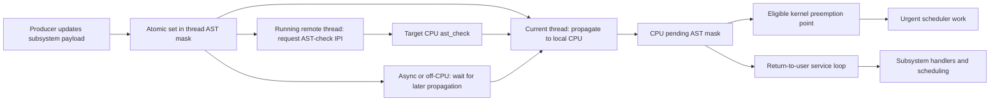
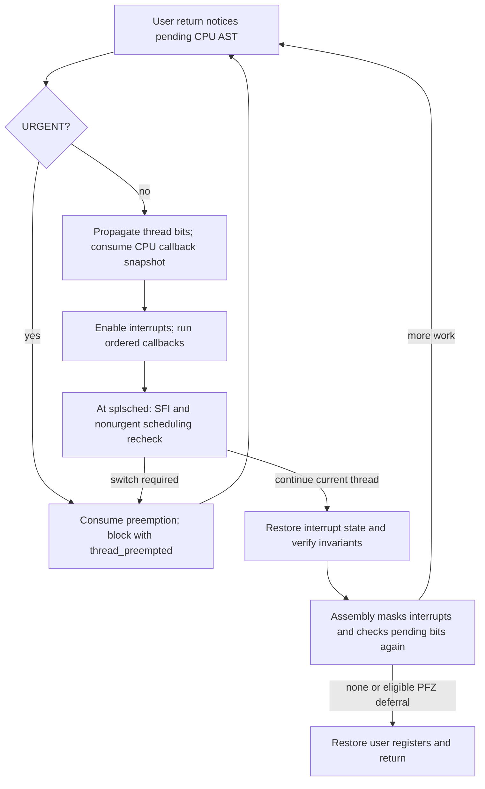
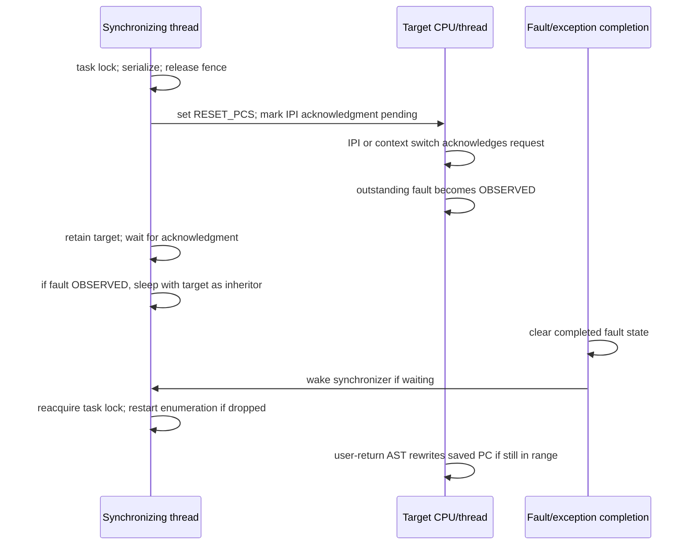

# ASTs: pending work, safe service points, and return-to-user control

An AST is deferred work represented by reason bits, not a new hardware exception vector or an allocated callback object. Producers record state and request that execution visit a suitable service point. Machine return paths and preemption-enable paths inspect pending bits; common code decides whether to schedule, invoke a subsystem handler, suspend, terminate, or resume the return sequence. The namespace also contains scheduler reason codes that are not independently dispatched callbacks. [`ast.h` contract and namespace](../../../platydoc-data/xnu/osfmk/kern/ast.h#L73-L152), [`ast_taken_kernel()`](../../../platydoc-data/xnu/osfmk/kern/ast.c#L119-L158), [`ast_taken_user()`](../../../platydoc-data/xnu/osfmk/kern/ast.c#L167-L304).

Read the [complete flavor reference](ast-flavors.md) for all 22 active bits, composites, retired positions, and subsidiary payload flags. This chapter follows their common transport and execution contract. [ARM64 context switching](../platform/arm64-context-switching.md) explains the stack/continuation machinery, while [ARM64 exception return](../platform/arm64-exception-return.md) follows register restoration after AST work is finished.

## 1. There are two pending masks, plus subsystem payloads

| State | Owner and update discipline | What the value means |
|---|---|---|
| `thread->ast` | A thread; atomic relaxed OR/AND-not/load helpers | Work that can be recorded while the thread is off-CPU. Setting a bit does not itself send an interrupt or run a callback. |
| `cpu_pending_ast` through `ast_pending()` | Current CPU; common helpers require `splsched` | Work the local return/preemption machinery should notice. `ast_on/off/consume` perform ordinary mask operations under that execution discipline. |
| `thread->kevent_ast_bits`, `t_telemetry_ast`, `kperf_ast`, `mach_exc_info`, and other subsystem state | Respective subsystem protocols | Details that one top-level bit cannot encode. Counts, loss/coalescing rules, references, and locking come from those protocols. |
| Processor-set `pending_AST_*_cpu_mask` | Scheduler processor-set state | Which CPUs have scheduling requests in flight; this is not the per-CPU callback mask. |

The thread atomic helpers are in [ast.h:195–198](../../../platydoc-data/xnu/osfmk/kern/ast.h#L195-L198), local mask operations in [ast.c:465–532](../../../platydoc-data/xnu/osfmk/kern/ast.c#L465-L532), ARM's storage accessor in [cpu_common.c:839–842](../../../platydoc-data/xnu/osfmk/arm/cpu_common.c#L839-L842), and scheduler request-mask updates in [sched_prim.c:4590–4631](../../../platydoc-data/xnu/osfmk/kern/sched_prim.c#L4590-L4631). Payload examples are [kevent and telemetry producers](../../../platydoc-data/xnu/osfmk/kern/thread_act.c#L1650-L1669) and [Mach exception recording](../../../platydoc-data/xnu/osfmk/kern/thread.c#L2437-L2473).

`ast_context()` runs when selecting an incoming thread. It removes the outgoing CPU's `AST_PER_THREAD` subset, then ORs the **entire** incoming `thread->ast` value. `ast_propagate()` only ORs the thread value into local CPU state. These operations are intentionally different:

[ast.c, lines 519–535](../../../platydoc-data/xnu/osfmk/kern/ast.c#L519-L535)

<!-- source-excerpt: ../../../platydoc-data/xnu/osfmk/kern/ast.c#L519-L535 -->
```c
void
ast_context(thread_t thread)
{
	ast_t *pending_ast = ast_pending();

	*pending_ast = (*pending_ast & ~AST_PER_THREAD) | thread_ast_get(thread);
}

/*
 * Propagate ASTs set on a thread to the current processor
 * Called at splsched
 */
void
ast_propagate(thread_t thread)
{
	ast_on(thread_ast_get(thread));
}
```

The mask is an implementation classification, not an assurance that every bit stored in a thread belongs to `AST_PER_THREAD`. `AST_KPERF` is set through `act_set_ast(thread, AST_KPERF)` but excluded from that mask. `AST_DTRACE` and `AST_SFI` are also not per-thread members. The user handler explicitly questions the DTrace/Kperf classification; SFI has its own comment that it is currently per-processor. Preserve that nuance instead of inventing a strict partition the code does not implement. [Mask definition](../../../platydoc-data/xnu/osfmk/kern/ast.h#L146-L149), [Kperf setter](../../../platydoc-data/xnu/osfmk/kern/thread_act.c#L1729-L1739), [classification comments](../../../platydoc-data/xnu/osfmk/kern/ast.c#L218-L236).



## 2. Setting work and interrupting a remote CPU are separate actions

`act_set_ast()` raises scheduler interrupt level. For the current thread it atomically sets the bit and propagates immediately. For a different thread it takes the thread scheduling lock, sets the bit, then checks that `last_processor` is running **this thread** before requesting an AST check there. If the target is not running, no remote interrupt is needed merely to preserve the bit: later context selection propagates its thread state. The thread lock protects that running-target decision; a remembered CPU pointer by itself is insufficient. [Setter body](../../../platydoc-data/xnu/osfmk/kern/thread_act.c#L1582-L1607), [incoming context update](../../../platydoc-data/xnu/osfmk/kern/sched_prim.c#L3241-L3257).

`act_set_ast_async()` deliberately omits the remote IPI and thread lock. It still propagates for the current thread; remote targets may notice only at a later switch or quantum expiry. Kevent and telemetry use this path. Quantum expiry explicitly propagates thread bits, and the user-return handler forces another propagation before consuming its callback snapshot. Thus “async” here is a notification-latency choice, not a different callback execution context. [Async setter](../../../platydoc-data/xnu/osfmk/kern/thread_act.c#L1611-L1627), [quantum propagation](../../../platydoc-data/xnu/osfmk/kern/priority.c#L237-L245), [user propagation](../../../platydoc-data/xnu/osfmk/kern/ast.c#L194-L224).

On ARM64, `cause_ast_check()` sends `SIGPast` only to another CPU. The signal handler clears that signal and calls `ast_check(current_processor())`. On x86 the corresponding request is `i386_signal_cpu(..., MP_AST, ASYNC)`. The IPI causes a local **check**; it is not execution of every user-return callback inside the interrupt handler. [ARM request](../../../platydoc-data/xnu/osfmk/arm64/machine_routines.c#L1799-L1809), [ARM receive](../../../platydoc-data/xnu/osfmk/arm/cpu_common.c#L672-L677), [x86 request](../../../platydoc-data/xnu/osfmk/i386/mp.c#L1970-L1982).

`ast_check()` ignores a CPU not in `PROCESSOR_RUNNING`, locks its active thread, acknowledges restartable-range IPI state, propagates thread bits, and runs `csw_check()`. Scheduling reasons returned by that check are ORed into the local mask. It also updates urgency/performance-control information when needed. A maintenance IPI is different: `maintenance_ack_ipi()` handles SMR and ledger-tab acknowledgments, not the AST flavor dispatcher. [AST-check body](../../../platydoc-data/xnu/osfmk/kern/sched_prim.c#L5855-L5920), [maintenance handler](../../../platydoc-data/xnu/osfmk/kern/sched_prim.c#L5843-L5847).

## 3. Kernel service means eligible urgent preemption

`ast_taken_kernel()` enters with interrupts disabled and must return to its caller. Idle threads consume preemption bits and handle scheduling themselves. A stale urgent check is harmless: the function returns if `AST_URGENT` has already disappeared. If the thread is preparing to block (`waitq_wait_possible()` is false), it consumes only URGENT so the caller does not repeatedly invoke it, then returns. Otherwise it consumes `AST_PREEMPTION`, requires PREEMPT to accompany the request, and blocks with a **null continuation**. That preserves the interrupted kernel call chain for eventual resumption. [Kernel handler](../../../platydoc-data/xnu/osfmk/kern/ast.c#L119-L158), [kernel preemption frame](../../../platydoc-data/xnu/osfmk/kern/ast.c#L106-L114).

[ast.c, lines 143–157](../../../platydoc-data/xnu/osfmk/kern/ast.c#L143-L157)

<!-- source-excerpt: ../../../platydoc-data/xnu/osfmk/kern/ast.c#L143-L157 -->
```c
	if (waitq_wait_possible(thread) == FALSE) {
		/* Consume AST_URGENT or the interrupt will call us again */
		ast_consume(AST_URGENT);
		return;
	}

	/* TODO: Should we csw_check again to notice if conditions have changed? */

	ast_t urgent_reason = ast_consume(AST_PREEMPTION);

	assert(urgent_reason & AST_PREEMPT);

	/* We've decided to try context switching */
	thread_preempted_in_kernel(urgent_reason);
}
```

This is why the mere presence of BSD, ledger, or exception-reporting bits does not run those callbacks whenever a kernel lock is released. Their general dispatcher is the user-return path. Urgent scheduling can occur at several machine-controlled points:

- ARM64 kernel exception return checks the interrupted IRQ mask, then the thread preemption count and CPU URGENT bit; it switches to the thread stack before calling `ast_taken_kernel()` ([locore.s:1747–1765](../../../platydoc-data/xnu/osfmk/arm64/locore.s#L1747-L1765)).
- Re-enabling preemption to count zero checks URGENT. The slow path first verifies interrupts are unmasked, masks them, and reloads the CPU bit to handle a possible intervening CPU switch ([preemption_disable.c:65–106](../../../platydoc-data/xnu/osfmk/arm/preemption_disable.c#L65-L106)).
- Re-enabling interrupts with preemption enabled loops over pending URGENT work before unmasking ([machine_routines_common.c:1100–1128](../../../platydoc-data/xnu/osfmk/arm/machine_routines_common.c#L1100-L1128)).
- x86's `T_PREEMPT` trap case calls the same common kernel handler with interrupts off ([trap.c:729–742](../../../platydoc-data/xnu/osfmk/i386/trap.c#L729-L742)).

`csw_check()` is allowed to decide there is no longer a reason to switch. Nonurgent preemption can receive a bounded grace interval while running in kernel space; the timer rechecks with URGENT at expiry. When the nonurgent timer policy is enabled and no timer is already pending, a new nonurgent request that interrupted userspace is upgraded to URGENT instead of arming that timer. The function's disabled-timer, idle-thread, and already-pending branches return earlier. This timing policy is independent of whether a subsystem callback has work pending. [Nonurgent policy](../../../platydoc-data/xnu/osfmk/kern/sched_prim.c#L5696-L5753), [expiry recheck](../../../platydoc-data/xnu/osfmk/kern/sched_prim.c#L5924-L5958), [priority and quantum guide](priority-qos-and-quanta.md).

## 4. User-return dispatch consumes a snapshot, not the thread's entire future

`ast_taken_user()` begins with interrupts disabled, no pending wait, and a non-idle thread. If URGENT is pending, it consumes preemption bits and blocks **before** running ordinary callbacks. Its continuation is `thread_preempted`, which calls `thread_exception_return()`; there is no requirement to preserve the current AST-handler call chain. [Urgent user path](../../../platydoc-data/xnu/osfmk/kern/ast.c#L167-L192), [continuation](../../../platydoc-data/xnu/osfmk/kern/ast.c#L91-L100).

Otherwise the handler propagates thread bits, consumes a local-CPU snapshot of `AST_PER_THREAD | AST_KPERF | AST_DTRACE`, and enables interrupts. It then processes callbacks in a fixed order. The thread-level bit is generally cleared immediately before its handler, not wholesale when the CPU snapshot is consumed. If an earlier callback abandons the call chain through a continuation, unserviced thread bits can therefore be re-propagated on the next switch/return. The source also imposes a contract: a handler must not jump straight to exception return without propagation or a context switch that reinstates the unserviced CPU work. [Snapshot and contract](../../../platydoc-data/xnu/osfmk/kern/ast.c#L201-L226).

The order in this checkout is DTRACE → BSD → MACF → ARCADE → APC → SYNTHESIZE_MACH → LARGE_ENTER_TELEMETRY → MACH_EXCEPTION → LEDGER → KPERF → RESET_PCS → KEVENT → PROC_RESOURCE → TELEMETRY → DEBUG_ASSERT, skipping compiled-out branches. It is the ordering of tests in `handle_user_asts_interrupts_enabled()`, not the numeric order of the bits. A callback can block, report an exception, or terminate, so reaching later entries in the same invocation is not guaranteed. [Dispatcher body](../../../platydoc-data/xnu/osfmk/kern/ast.c#L307-L410).

After those callbacks, the function returns to scheduler interrupt level, consumes SFI work if configured, and then consumes nonurgent preemption reasons. If PREEMPT was present, it re-runs `csw_check()` under the thread lock, preserving the QUANTUM reason for that decision. It can service a newly required SFI wait, block through `thread_preempted`, or retain the current thread and clear its pending nonurgent timer. Finally it restores interrupt state, performs configured SPTM redzone-stack cleanup, and checks return-to-user invariants. [Final scheduling and checks](../../../platydoc-data/xnu/osfmk/kern/ast.c#L228-L304).



## 5. Assembly rechecks, PFZ deferral, and the eventual privilege transition

ARM64 `return_to_user` masks exceptions and loads `CPU_PENDING_AST`. With no work it proceeds toward restoration. When the caller requests a preemption-free-zone check and the saved user PC lies in that commpage range, the code writes `1` to saved user `x15`, leaves the ASTs pending, and proceeds as if there were none for this return. The commpage contract makes that register available as a request to reenter after leaving the protected userspace sequence. This is a controlled deferral of AST work, not consumption or suppression of its producers. [Initial check](../../../platydoc-data/xnu/osfmk/arm64/locore.s#L1796-L1829), [PFZ decision](../../../platydoc-data/xnu/osfmk/arm64/locore.s#L1830-L1848), [PFZ/return guide](../platform/arm64-exception-return.md#the-commpage-preemption-free-zone-exception).

The non-PFZ route calls the C handler and branches back to the check. Saved state must still be restored afterward; calling an AST handler is not itself a user-mode transition:

[locore.s, lines 2128–2132](../../../platydoc-data/xnu/osfmk/arm64/locore.s#L2128-L2132)

<!-- source-excerpt: ../../../platydoc-data/xnu/osfmk/arm64/locore.s#L2128-L2132 -->
```asm
user_take_ast:
	PUSH_FRAME
	bl		EXT(ast_taken_user)							// Handle all ASTs, may return via continuation
	POP_FRAME_WITHOUT_LR
	b		check_user_asts								// Now try again
```

x86 follows the same broad common-code contract with different saved registers and assembly. `return_from_trap` finds the active thread's PCB, tests pending bits, optionally marks saved EBX/RBX for a PFZ return, calls `ast_taken_user()`, disables interrupts, reloads the saved-state location, and loops. This does not imply that x86 and ARM have identical stack or interrupt-mask implementation. [x86 return loop](../../../platydoc-data/xnu/osfmk/x86_64/idt64.s#L1540-L1579).

`AST_LAZY` is defined as DEBUG_ASSERT, but no executable reference to that mask was found in this checkout outside its definition. These assembly loops test pending bits directly. Therefore the header's statement that lazy ASTs “can be skipped” must not be converted into a claim that these shown return paths actually skip them. [Definition](../../../platydoc-data/xnu/osfmk/kern/ast.h#L151-L152), [ARM pending test](../../../platydoc-data/xnu/osfmk/arm64/locore.s#L1820-L1825), [x86 pending test](../../../platydoc-data/xnu/osfmk/x86_64/idt64.s#L1544-L1547).

## 6. Selected asynchronous workers have an explicit service loop

AIO workers can process a limited AST subset while doing work without completing an ordinary return to userspace. `ast_check_async_thread()` requires interrupts enabled, repeatedly raises scheduler level to consume `AST_MACH_EXCEPTION | AST_DTRACE | AST_TELEMETRY | AST_KPERF | AST_DEBUG_ASSERT`, and invokes the shared enabled-interrupt dispatcher. It does not consume every flavor and does not call `ast_propagate()` itself. The AIO loop calls it after processing an entry and before reacquiring the AIO process lock. [Restricted loop](../../../platydoc-data/xnu/osfmk/kern/ast.c#L429-L458), [AIO caller](../../../platydoc-data/xnu/bsd/kern/kern_aio.c#L3232-L3247).

This is an explicit exception to the convenient phrase “all callbacks run on user return.” Kernel-thread self-termination is another targeted exception: `thread_terminate()` directly clears APC and calls `thread_apc_ast()` because kernel threads never pass through the user-return AST loop. Neither case makes arbitrary per-thread AST bits a general kernel-worker callback queue. [Self-termination](../../../platydoc-data/xnu/osfmk/kern/thread_act.c#L338-L358).

## 7. Clearing a request and detaching its payload are different operations

The local `reasons` snapshot exists only in the current handler's execution. Consuming it from `cpu_pending_ast` does not atomically clear `thread->ast` or a subsystem payload. Those operations happen separately at each branch. For KEVENT the implementation first clears the thread bit, then exchanges `kevent_ast_bits` to zero, and calls the subsystem only for a nonzero payload. TELEMETRY uses the same broad pattern through `act_clear_telemetry_ast()`. [Dispatcher](../../../platydoc-data/xnu/osfmk/kern/ast.c#L379-L405), [telemetry clear](../../../platydoc-data/xnu/osfmk/kern/thread_act.c#L1764-L1769).

[ast.c, lines 379–385](../../../platydoc-data/xnu/osfmk/kern/ast.c#L379-L385)

<!-- source-excerpt: ../../../platydoc-data/xnu/osfmk/kern/ast.c#L379-L385 -->
```c
	if (reasons & AST_KEVENT) {
		thread_ast_clear(thread, AST_KEVENT);
		uint16_t bits = atomic_exchange(&thread->kevent_ast_bits, 0);
		if (bits) {
			kevent_ast(thread, bits);
		}
	}
```

Consider an illustrative interleaving with a previously pending kevent request. A second producer may OR its subsidiary reason before the exchange, so the current callback observes both reasons. If it adds a reason after the exchange, that reason remains in the thread payload for a later pass. The producer also posts the top-level bit; a repeated top-level request can therefore lead to a later handler invocation whose payload is already empty. The `if (bits)` check accommodates that case. This explains the reason-set representation without treating it as a count, promising one invocation per producer, or replacing the subsystem's synchronization rules with a claim about all possible races. [Producer order](../../../platydoc-data/xnu/osfmk/kern/thread_act.c#L1650-L1657), [consumer order](../../../platydoc-data/xnu/osfmk/kern/ast.c#L379-L385).

The atomic thread-mask helpers use relaxed ordering. Their job is mask manipulation; they do not acquire a reference to a port, pin a VM map, or publish an arbitrary callback closure. Payload protection must come from the producer/consumer protocol. Examples differ substantially: Mach exception state is current-thread-owned; restartable synchronization holds a thread reference while dropping the task lock; Arcade explicitly owns send rights and VM copies. [Atomic helpers](../../../platydoc-data/xnu/osfmk/kern/ast.h#L195-L198), [exception ownership](../../../platydoc-data/xnu/osfmk/kern/thread.c#L2438-L2472), [restartable reference](../../../platydoc-data/xnu/osfmk/kern/restartable.c#L403-L487), [Arcade ownership](../../../platydoc-data/xnu/osfmk/kern/arcade.c#L281-L331).

Callback state can also be discarded deliberately. Kperf clears its payload after invoking its handlers, including when the sampling handler returns early for an exec transition. Telemetry buffer processing can fail because the buffer has been deallocated or a record is too large. The top-level dispatcher has no generic success code to inspect and no automatic retry queue: it calls `void` handlers and continues. Any retry or persistent pending state must be implemented by the subsystem. [Kperf order](../../../platydoc-data/xnu/osfmk/kern/ast.c#L362-L371), [exec skip](../../../platydoc-data/xnu/osfmk/kperf/action.c#L509-L514), [telemetry failures](../../../platydoc-data/xnu/osfmk/kern/telemetry.c#L1397-L1411).

## 8. Three distinct ways a callback can block

### APC: abandon the old call chain and recheck suspension

APC registration is serialized with the thread mutex and scheduling lock. The consumer enters with no locks held, takes the mutex, clears aborted scheduling flags under the thread lock, and checks whether the thread remains active. Inactivity transfers to `thread_terminate_self()`. Suspension sets `suspend_parked`, asserts an abort-safe wait on `suspend_count`, drops the mutex, and blocks with the non-null `thread_suspended` continuation. The old AST-handler call chain is not the continuation's return address. [Producer locking](../../../platydoc-data/xnu/osfmk/kern/thread_act.c#L1308-L1351), [consumer](../../../platydoc-data/xnu/osfmk/kern/thread_act.c#L1390-L1430).

[thread_act.c, lines 1418–1427](../../../platydoc-data/xnu/osfmk/kern/thread_act.c#L1418-L1427)

<!-- source-excerpt: ../../../platydoc-data/xnu/osfmk/kern/thread_act.c#L1418-L1427 -->
```c
	/* If we're suspended, go to sleep and wait for someone to wake us up. */
	if (thread->suspend_count > 0) {
		thread->suspend_parked = TRUE;
		assert_wait(&thread->suspend_count,
		    THREAD_ABORTSAFE | THREAD_WAIT_NOREPORT_USER);
		thread_mtx_unlock(thread);

		thread_block(thread_suspended);
		/*NOTREACHED*/
	}
```

On wake, `thread_suspended()` reacquires the mutex, accounts for an interrupted wait, and checks `suspend_count` again. If a new or continuing suspension remains, it rearms APC; then it unlocks and calls `thread_exception_return()`. The recheck handles a changing suspension state rather than assuming the original wake grants permanent permission to return to userspace. Unserviced per-thread flavors from the abandoned AST pass remain available for propagation. [Continuation](../../../platydoc-data/xnu/osfmk/kern/thread_act.c#L1358-L1387), [common reinstatement contract](../../../platydoc-data/xnu/osfmk/kern/ast.c#L203-L219).

### Ledger: preserve the call chain and explicitly retry

`ledger_ast()` first reconciles CPU-limit policy, snapshots task parameters under the task lock, and rejects work for a missing ledger or dying task/thread. It checks the thread and task ledgers, temporarily obtains the coalition ledger, checks it, and drops that reference. It can invoke callbacks or identify a need to block. This is accounting policy executed at a safe point, not a passive reporting-only callback. [Policy and lifetime checks](../../../platydoc-data/xnu/osfmk/kern/ledger.c#L1824-L1945).

`ledger_perform_blocking()` asserts a deadline wait on a deficit entry, marks `LF_WAKE_NEEDED`, and blocks with a **null** continuation and reason LEDGER. A normal `THREAD_AWAKENED` return becomes `KERN_FAILURE`, whose meaning here is “restart evaluation”; the caller goes back to its `top` label and resnapshots policy. Other wait results return `KERN_SUCCESS` to continue. This deliberately inverted-sounding local status convention is worth reading in the function body before inferring that failure means resource loss. [Blocking body](../../../platydoc-data/xnu/osfmk/kern/ledger.c#L2035-L2084), [caller retry](../../../platydoc-data/xnu/osfmk/kern/ledger.c#L1946-L1961).

### SFI: a CPU request becomes a class wait

SFI is consumed outside the ordinary callback snapshot. At scheduler interrupt level, `sfi_ast()` takes `sfi_lock`, returns if the facility is disabled, and reclassifies the thread while also holding its scheduling lock. If the resulting class is in an off phase, it asserts an interruptible wait on that class's wait queue, records the class continuation, drops locks, and blocks with reason SFI. An interrupted wait is expected for a thread already exiting; other unexpected assertion outcomes are checked. Reclassification under the lock prevents an old CPU AST from blindly applying an obsolete class decision. [SFI body and race explanation](../../../platydoc-data/xnu/osfmk/kern/sfi.c#L939-L1005), [common service locations](../../../platydoc-data/xnu/osfmk/kern/ast.c#L227-L263).

These paths show why “AST handler can block” is incomplete documentation. APC uses a continuation and rearms as needed; ledger retains its stack and retries; SFI uses a class-specific continuation. The common dispatcher supports these protocols but does not supply their wake event, priority inheritance, object references, or condition recheck. [Continuation machinery](scheduler-execution.md), [wait and turnstile protocols](wait-and-turnstile-protocols.md).

## 9. Restartable ranges: request delivery is not completion

`AST_RESET_PCS` makes the distinction especially visible. A caller of `task_restartable_ranges_synchronize()` wants other threads to stop depending on a registered userspace instruction range before memory can be reclaimed. The routine accepts only the current task, succeeds immediately without registered ranges, starts a temporary priority floor, and serializes requests with `task_rr_in_flight` under the task lock. Concurrent synchronization returns `KERN_ALREADY_WAITING`. It then executes a release fence and posts requests to the other threads. [Synchronization setup](../../../platydoc-data/xnu/osfmk/kern/restartable.c#L582-L654).

The posting decision is not just “set a bit on all threads.” For an inactive target, no new request is installed. A running remote target gets `trr_ipi_ack_pending`, the bit, and an IPI. An off-CPU target gets a bit only if its saved PC lies in a restartable range; if it is faulting, that fault becomes `TRR_FAULT_OBSERVED` and requires waiting. Current-thread signaling takes a simpler local set/propagate route. [Precise branches](../../../platydoc-data/xnu/osfmk/kern/thread_act.c#L1672-L1726).

At IPI or context-switch time, `thread_reset_pcs_ack_IPI()` runs under the thread lock, clears the acknowledgment flag, and changes an in-flight fault from PENDING to OBSERVED. That is distinct from the eventual AST handler changing the saved PC. A synchronizer may therefore have received acknowledgment while still needing to wait for an already-started memory fault to complete. [Acknowledgment](../../../platydoc-data/xnu/osfmk/kern/restartable.c#L382-L400), [scheduler call site](../../../platydoc-data/xnu/osfmk/kern/sched_prim.c#L5865-L5878), [fault safety requirement](../../../platydoc-data/xnu/osfmk/kern/restartable.c#L458-L477).



`thread_rr_wait_if_needed()` references the target before it drops the task lock. It waits for the IPI flag to change, then can atomically install `trr_sync_waiting` and sleep with the target as turnstile inheritor for an observed fault. It ultimately releases that reference. When a wait drops the task lock, the outer loop restarts task-thread enumeration rather than continuing through stale list state. Fault completion or termination clears fault state and wakes the waiter. These references and acknowledgments, not the mere AST bit, establish the reclamation boundary. [Wait/reference protocol](../../../platydoc-data/xnu/osfmk/kern/restartable.c#L403-L487), [outer restart](../../../platydoc-data/xnu/osfmk/kern/restartable.c#L656-L685), [fault completion](../../../platydoc-data/xnu/osfmk/kern/restartable.c#L358-L379).

The AST callback itself is much smaller: look up the saved PC, reset it if the thread is active and the registered range contains it, and assert that fault/wait state is resolved. Range data can be read without a lock because registration is restricted to the task's single-threaded state. The callback does not perform the synchronization loop above. [Consumer](../../../platydoc-data/xnu/osfmk/kern/restartable.c#L496-L522), [registration assumptions](../../../platydoc-data/xnu/osfmk/kern/restartable.c#L594-L604).

## 10. Exception records and reporting failures have their own ownership rules

`AST_MACH_EXCEPTION` uses a single thread record. `thread_ast_mach_exception()` asserts the current thread, skips `kernel_task`, and refuses to overwrite an existing sticky exception or replace a non-sticky pending exception with another non-sticky one. It stores the reason/type/code/subcode before posting. The consumer snapshots these fields, zeros the record, and then routes guard reasons or fatal handling. A lingering CPU bit with no valid reason does nothing. This is neither a general FIFO of exceptions nor proof that every synchronous exception first becomes an AST. [Producer](../../../platydoc-data/xnu/osfmk/kern/thread.c#L2425-L2473), [consumer](../../../platydoc-data/xnu/osfmk/kern/thread.c#L2547-L2578), [Mach exception delivery](../ipc/exception-delivery.md).

`AST_SYNTHESIZE_MACH` instead handles a map-level fault potentially reported asynchronously while kernel work borrows an address space. A task-wide request can wake several threads, but `vm_map_synthesize_guard_exception()` uses compare/exchange to replace the map record with ALREADY_REPORTED. Threads observing no record, the sentinel, or a lost compare/exchange return. One winning thread performs reporting, with the configured MTE soft-mode alternative. The task fan-out checks task activity and locks each remote thread while deciding whether to send an IPI. [Fan-out](../../../platydoc-data/xnu/osfmk/kern/task.c#L10844-L10883), [map claim](../../../platydoc-data/xnu/osfmk/vm/vm_map.c#L7760-L7800).

[vm_map.c, lines 7774–7783](../../../platydoc-data/xnu/osfmk/vm/vm_map.c#L7774-L7783)

<!-- source-excerpt: ../../../platydoc-data/xnu/osfmk/vm/vm_map.c#L7774-L7783 -->
```c
	async_fault = *(volatile vm_map_async_fault_t *)&map->async_fault;

	if (async_fault.code == 0 ||
	    async_fault.code == VM_ASYNC_TAG_FAULT_ALREADY_REPORTED ||
	    !os_atomic_cmpxchg(&map->async_fault, async_fault, clear_fault, relaxed)) {
		/*
		 * Someone handled that fault already, just return
		 */
		return;
	}
```

`AST_PROC_RESOURCE` similarly consumes the need to **evaluate** current limits, not an immutable report for the allocation that first set the bit. Descriptor/workloop evaluation uses sentinels so racing threads do not repeat the same limit action; descriptors are checked first. Port-space reporting can exempt PID 0/1, report a full system-sized space as fatal, or allocate a fatal-task send right for a configured hard limit. The reporting routine releases that right after sending, logs notification errors, and uses SIGKILL if the required token cannot be allocated. These are explicit failure branches; generic AST dispatch does not rescue a failed report. [FD/workloop arbitration](../../../platydoc-data/xnu/bsd/kern/kern_proc.c#L5546-L5578), [port reporting and cleanup](../../../platydoc-data/xnu/osfmk/kern/task.c#L8650-L8707).

Arcade demonstrates a callback that owns transport resources and retries. It copies a send right under `arcade_upcall_mutex`, refreshes the service port if invalid, builds a `vm_map_copy_t` containing the executable path, sends the validation upcall, and releases the send right. `MACH_SEND_INVALID_DEST` discards the unsent VM copy before retry; `MIG_SERVER_DIED` also retries. A successful rejection or other failure terminates the task. The ten-second deadline calculated by the handler is passed to the port-refresh wait; it must not be advertised as a proven end-to-end bound on every external upcall or the refresh-in-progress wait, which has no deadline argument. [Callback](../../../platydoc-data/xnu/osfmk/kern/arcade.c#L270-L353), [refresh and waits](../../../platydoc-data/xnu/osfmk/kern/arcade.c#L183-L257).

## Sources inspected and limits

| Source area | Inspection depth for these chapters | Boundary |
|---|---|---|
| [`ast.h`](../../../platydoc-data/xnu/osfmk/kern/ast.h#L73-L232), [`ast.c`](../../../platydoc-data/xnu/osfmk/kern/ast.c#L73-L541) | Entire namespace, kernel/user/asynchronous service, masks, dispatch order, clearing, final assertions | Exhaustive for the defined top-level flavors in this checkout; no live configuration-matrix execution. |
| [`thread_act.c`](../../../platydoc-data/xnu/osfmk/kern/thread_act.c#L1308-L1813) | APC, assertion handler, generic/current/remote/async setters, restartable and telemetry producers | Broader task/thread suspend/terminate ownership remains in the lifecycle and execution guides. |
| [`sched_prim.c`](../../../platydoc-data/xnu/osfmk/kern/sched_prim.c#L5696-L5958), [`priority.c`](../../../platydoc-data/xnu/osfmk/kern/priority.c#L228-L245) | AST-check IPI, nonurgent timer, quantum propagation; selected reason/dispatch sites | Scheduler selection policies are crosslinked, not re-audited exhaustively here. |
| [`locore.s`](../../../platydoc-data/xnu/osfmk/arm64/locore.s#L1747-L1848), [`idt64.s`](../../../platydoc-data/xnu/osfmk/x86_64/idt64.s#L1540-L1579), [`preemption_disable.c`](../../../platydoc-data/xnu/osfmk/arm/preemption_disable.c#L65-L106) | ARM64 kernel/user gates and loop, ARM preemption/interrupt-enable hooks, x86 user PFZ/recheck and trap hook | Register restore, PAC, monitor return, and all x86 entry variants belong to platform guides. |
| [`restartable.c`](../../../platydoc-data/xnu/osfmk/kern/restartable.c#L350-L685) | Fault/IPI acknowledgment state machine, references, lock drops/restart, saved-PC callback | Registration formats and every machine fault-entry hook are not comprehensively traced. |
| [`ledger.c`](../../../platydoc-data/xnu/osfmk/kern/ledger.c#L1824-L2084), [`sfi.c`](../../../platydoc-data/xnu/osfmk/kern/sfi.c#L939-L1005) | Core callback conditions, waiting/retry, ledger reference boundary, SFI locking/class wait | All ledger entry implementations, every SFI class, and workload behavior not audited. |
| [`thread.c`](../../../platydoc-data/xnu/osfmk/kern/thread.c#L2425-L2578), [`vm_map.c`](../../../platydoc-data/xnu/osfmk/vm/vm_map.c#L7760-L7800), [`task.c`](../../../platydoc-data/xnu/osfmk/kern/task.c#L10844-L10883) | Deferred exception slot, map-level compare/exchange and task fan-out, selected resource/telemetry callbacks | Guard-specific policy and exception IPC recipients remain separate guides. |
| [`kern_event.c`](../../../platydoc-data/xnu/bsd/kern/kern_event.c#L9687-L9764), [`kern_sig.c`](../../../platydoc-data/xnu/bsd/kern/kern_sig.c#L3361-L3471), [`kern_proc.c`](../../../platydoc-data/xnu/bsd/kern/kern_proc.c#L5546-L5578) | All kevent sub-bits, TSD failure behavior, BSD AST body, resource callback selection | Full signal disposition, workqueue and fd-limit implementations are cross-subsystem work. |
| [`telemetry.c`](../../../platydoc-data/xnu/osfmk/kern/telemetry.c#L438-L504), [`action.c`](../../../platydoc-data/xnu/osfmk/kperf/action.c#L501-L605), [`dtrace.c`](../../../platydoc-data/xnu/bsd/dev/dtrace/dtrace.c#L19228-L19252) | All local AST sub-bit dispatches, representative producers and buffer/exec failures | Not a complete profiler, tracing, or telemetry-buffer audit. |
| [`arcade.c`](../../../platydoc-data/xnu/osfmk/kern/arcade.c#L183-L353), [`mac_mach.c`](../../../platydoc-data/xnu/security/mac_mach.c#L349-L352) | Local upcall/ref/retry paths and MAC callback boundary | External validation service and installed MAC policy bodies cannot be inferred from the AST frontend. |

The source search distinguished live constants, historical comments, per-subsystem payloads, and similarly named trace reasons. It does not establish that all producers execute in every supported configuration or that the source contains the external services. The complete numeric/configuration reference is [AST flavors](ast-flavors.md); the common service paths above are the foundation for following any additional producer.

<!-- BEGIN PLATYDOC DOCUMENTATION LICENSE -->
Original Platydoc text and diagrams are licensed under [CC BY 4.0](https://creativecommons.org/licenses/by/4.0/). Quoted source code and third-party material retain their respective licenses.
<!-- END PLATYDOC DOCUMENTATION LICENSE -->
