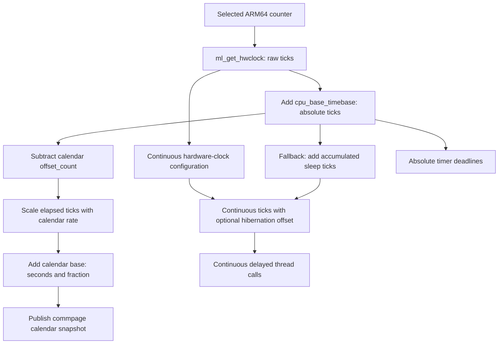
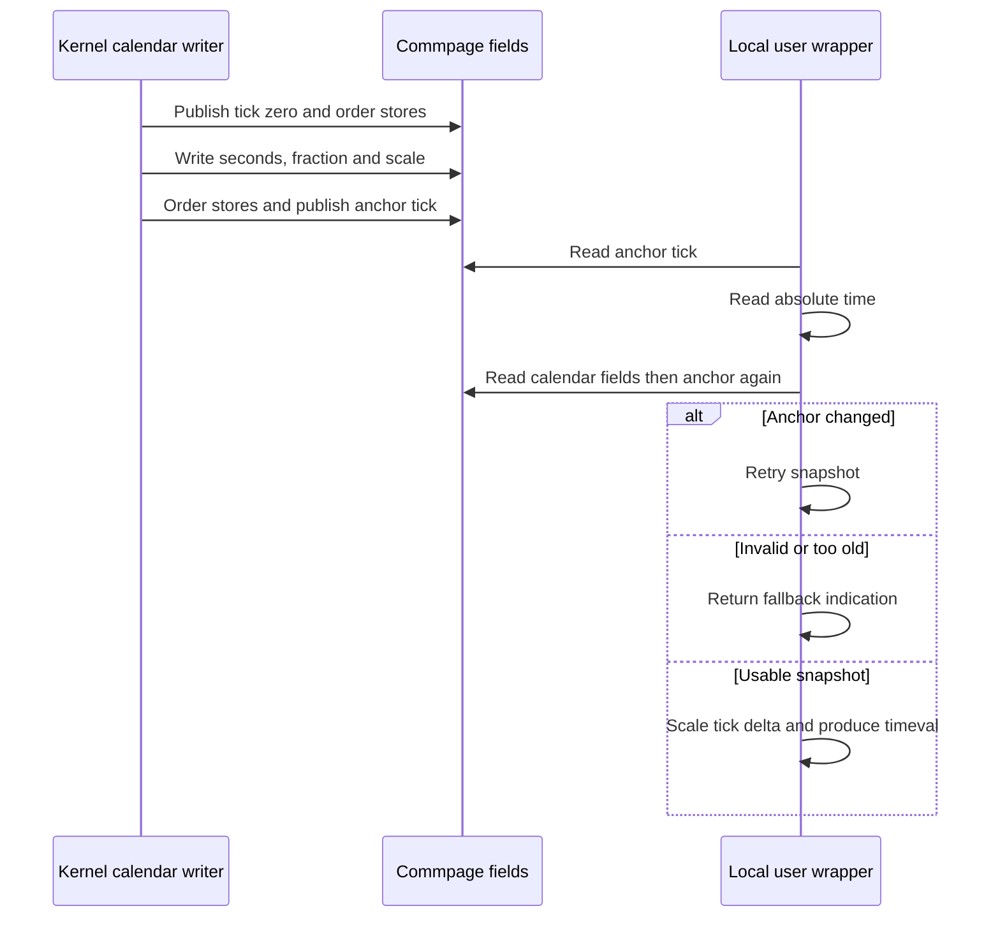

# ARM64 clocks, calendar time, and the commpage

[Runtime](README.md) · [Time and accounting](time-and-accounting.md) · [Timer lifetime](timer-and-thread-call-lifetime.md) · [Recount](recount-and-resource-attribution.md)

XNU has several time domains because a scheduler deadline, time spent asleep, and a civil-time timestamp answer different questions. On ARM64, a hardware counter supplies ticks; the kernel and local libsyscall wrappers apply offsets, scaling and consistency checks. This chapter follows those implementations in `xnu-12377.121.6`. Platform frequency/RTC providers and the hardware counter itself are boundaries, not code reconstructed here.

## 1. Choose the time domain before doing arithmetic

| Value | Representation and operation | Sleep or calendar adjustment |
| --- | --- | --- |
| Hardware clock | `ml_get_hwclock()` reads the selected architectural counter. It has no `cpu_base_timebase` addition. | Continuity depends on the selected hardware and hibernation configuration. |
| Absolute time | `mach_absolute_time()` → `ml_get_timebase()` → counter plus `cpu_base_timebase`. Units are Mach ticks. | Wake initialization adjusts the base to exclude the suspended interval. Setting civil time does not redefine this counter. |
| Continuous time | Hardware-clock path, optionally plus hibernation offset; otherwise absolute time plus accumulated sleep ticks. | Includes sleep. Conversion to an absolute deadline depends on the current accumulated sleep offset. |
| Approximate time | `mach_approximate_time()` selects the configured approximate source or falls back to a direct clock read. | Reduced freshness is deliberate. Do not substitute it for a strict boundary timestamp. |
| Calendar time | `clock_calend` base and scaled elapsed absolute time, represented internally as integer seconds plus a binary fraction. | Can be stepped by setting the calendar; NTP adjustment changes scaling; wake adds sleep to the calendar base. |

The selection bodies are [ARM clocks](../../../xnu/osfmk/arm/rtclock.c#L166-L279), [hardware/base reads](../../../xnu/osfmk/arm64/machine_routines.c#L2490-L2546), [continuous clocks](../../../xnu/osfmk/kern/clock.c#L1727-L1780), and [calendar state](../../../xnu/osfmk/kern/clock.c#L279-L315). These APIs do not all return nanoseconds. `mach_timebase_info()` provides the rational conversion for Mach ticks.



The continuous hardware path and the software-offset path are alternatives selected by configuration. The calendar calculation is separate from the fixed Mach tick-to-nanosecond conversion.

## 2. From the counter to absolute time

`rtclock_early_init()` registers a platform timebase callback. `timebase_callback()` validates the supplied frequency, derives the fraction `(frequency denominator × 10^9) / frequency numerator`, reduces it, and initializes conversion constants. `clock_timebase_info()` returns those constants; the conversion routines split seconds and remainders to perform integer arithmetic. An illustrative 24 MHz input yields a ratio of `125/3` nanoseconds per tick, so three ticks represent 125 ns. This is an example, not a claim about every supported device. [Registration and scaling](../../../xnu/osfmk/arm/rtclock.c#L87-L149), [timebase information](../../../xnu/osfmk/arm/rtclock.c#L314-L317), [conversion routines](../../../xnu/osfmk/arm/rtclock.c#L462-L523).

The counter read has speculative and ordered variants. With the relevant architectural support, the nonspeculative path reads its dedicated register; otherwise it executes `isb` before the ordinary register read. The absolute-time wrapper must also avoid combining an old wake offset with a counter read from a new epoch. It reads the base twice and retries if it changed. Compiler barriers surround the counter read; the counter helper supplies the architectural ordering. [Counter selection and barriers](../../../xnu/osfmk/arm64/machine_routines.c#L2460-L2513).

[osfmk/arm64/machine_routines.c, lines 2530–2544](../../../xnu/osfmk/arm64/machine_routines.c#L2530-L2544):

<!-- source-excerpt: ../../../xnu/osfmk/arm64/machine_routines.c#L2530-L2544 -->
```c
uint64_t
ml_get_timebase()
{
	uint64_t clock, timebase;

	//the retry is for the case where S2R catches us in the middle of this. see rdar://77019633
	do {
		timebase = getCpuDatap()->cpu_base_timebase;
		os_compiler_barrier();
		clock = ml_get_hwclock();
		os_compiler_barrier();
	} while (getCpuDatap()->cpu_base_timebase != timebase);

	return clock + timebase;
}
```

`cpu_timebase_init()` establishes the per-CPU base. On the boot CPU's wake path, it computes `rtclock_base_abstime = wake_abstime - ml_get_hwclock()` and installs the new base, preserving the absolute-time epoch across the sleep gap. Secondary CPUs use the common base. Consequently, reading the hardware register alone is not equivalent to reading `mach_absolute_time()`. [Wake and CPU initialization](../../../xnu/osfmk/arm64/cpu.c#L974-L1014).

The local ARM64 userspace wrapper repeats this representation. `_COMM_PAGE_USER_TIMEBASE` selects direct `CNTVCT_EL0`, the nonspeculative register variants, or a kernel trap when userspace counter access is unavailable. Its macro brackets the counter read with two loads of the commpage base:

[libsyscall/wrappers/mach_absolute_time.s, lines 227–235](../../../xnu/libsyscall/wrappers/mach_absolute_time.s#L227-L235):

<!-- source-excerpt: ../../../xnu/libsyscall/wrappers/mach_absolute_time.s#L227-L235 -->
```asm
.macro CALC_MACH_ABSOLUTE_TIME reg
1:
	ldr	x1, [x3]			// Load the offset
	mrs	x0, \reg			// Read the timebase
	ldr	x2, [x3]			// Load the offset
	cmp	x1, x2				// Compare our offset values...
	b.ne	1b				// If they changed, try again
	add	x0, x0, x1			// Construct mach_absolute_time
.endm
```

The direct path therefore does not require a syscall on every call, but the fallback explicitly loads the Mach ARM absolute-time trap selector and executes `svc`. The kernel publishes its base with `commpage_update_timebase()`. [ARM64 selector and trap fallback](../../../xnu/libsyscall/wrappers/mach_absolute_time.s#L250-L287), [base publication](../../../xnu/osfmk/arm/commpage/commpage.c#L942-L947).

## 3. Continuous time and sleep reconciliation

The kernel `mach_continuous_time()` has three compile-time cases: raw hardware clock plus hibernation offset, raw hardware clock, or an absolute-time read bracketed by two reads of `mach_absolutetime_asleep`. The last case retries when the offset changes during the read. Its memory barrier and retry belong to the software fallback; they are not a description of the hardware branch. [Complete selector](../../../xnu/osfmk/kern/clock.c#L1727-L1745).

The local userspace wrapper first tries `_mach_continuous_hwclock()`, using commpage feature flags and the hardware-timebase offset. If unavailable, `_mach_continuous_time()` reads the sleep offset before and after `mach_absolute_time()` and retries. The approximate wrapper intentionally omits that retry because a slightly old base is acceptable for that API. [User hardware/fallback/approximate paths](../../../xnu/libsyscall/wrappers/mach_continuous_time.c#L62-L140).

On a hardware-clock wake, `clock_wakeup_calendar_hwclock()` takes `splclock` and the clock lock, invalidates the calendar commpage timestamp, and calculates:

- accumulated sleep = continuous ticks − absolute ticks;
- latest sleep = new accumulated sleep − previous accumulated sleep;
- calendar adjustment = scaled latest sleep added to calendar offset/base.

It publishes the new continuous-time offset, publishes the hibernation hardware offset when configured, and adjusts continuous-time delayed thread calls. Only afterward does it release the lock and send the calendar-change notification. [Wake operation](../../../xnu/osfmk/kern/clock.c#L1185-L1222), [sleep scaling](../../../xnu/osfmk/kern/clock.c#L1138-L1182).

The legacy wake path instead derives sleep using the platform monotonic clock when enabled, otherwise UTC readings; it handles invalid/negative inferred intervals and updates the same accounting domains. `clock_wakeup_calendar()` selects between these paths, including the hibernation override. Do not equate all wake accounting with a direct counter subtraction. [Legacy reconciliation](../../../xnu/osfmk/kern/clock.c#L1229-L1440), [selection](../../../xnu/osfmk/kern/clock.c#L1444-L1460).

A worked example, after converting all ticks to a common unit: immediately before sleep, absolute time is 100 seconds and continuous time is 120 seconds. Five seconds asleep should leave absolute time near 100, continuous time near 125, and accumulated sleep near 25. Subsequent execution advances both running clocks. Changing the civil date does not supply that five-second sleep interval.

`continuoustime_to_absolutetime()` subtracts accumulated sleep and clamps to zero if the continuous value is no greater than that offset. The reverse adds the offset. Both require interrupts disabled and explicitly limit the result's validity to the next offset update. A conversion made before sleeping is not a permanent relation between future deadlines. [Conversion contracts](../../../xnu/osfmk/kern/clock.c#L1780-L1804).

## 4. Calendar state, NTP scaling, and deliberate clock steps

`clock_calend` stores the boot/calendar base, accumulated offset, the absolute tick at which that offset was last reconciled, scale factors, and sleep-related state. `get_scaled_time(now)` subtracts `offset_count` and returns only the elapsed ticks converted by `scale_delta()` into a binary time. Its calendar-read callers then add `clock_calend.bintime` before converting the result into seconds and microseconds/nanoseconds. The fractional field represents a fraction of one second with 64 fractional bits; it is not a nanosecond counter. [State](../../../xnu/osfmk/kern/clock.c#L279-L315), [scaling and composition](../../../xnu/osfmk/kern/clock.c#L503-L619).

`clock_update_calendar()` first accounts elapsed time using the old rate, advances the anchor, then obtains the next adjustment from `ntp_update_second()` and recomputes its scale. This order prevents a new rate from being applied retroactively to the whole preceding interval. [Periodic adjustment](../../../xnu/osfmk/kern/clock.c#L884-L938).

`clock_set_calendar_microtime()` is a step operation. A set-time mutex serializes the operation, while the shorter clock-lock section invalidates the commpage snapshot and changes the calendar state. The code releases the clock lock and restores interrupt state before calling `PESetUTCTimeOfDay()`, which can block in platform code. The wider set-time serialization and the clock spin-lock region have different purposes. [Set-time path and cleanup](../../../xnu/osfmk/kern/clock.c#L730-L840).

A kernel calendar read also refreshes the fast path: `clock_gettimeofday_and_absolute_time()` takes the clock lock at `splclock`, reads absolute time, derives calendar seconds/microseconds, publishes the corresponding commpage timestamp, and optionally returns the absolute tick used. [Read and publish](../../../xnu/osfmk/kern/clock.c#L690-L715).

## 5. A commpage snapshot is a publication protocol

The kernel maps commpage storage through a writable alias while userspace reads the corresponding shared data. Calendar publication sets `TimeStamp_tick` to zero, orders the invalidation, writes the seconds/fraction/rate fields, orders those stores, and finally publishes a nonzero tick. [Commpage setup](../../../xnu/osfmk/arm/commpage/commpage.c#L99-L121).

[osfmk/arm/commpage/commpage.c, lines 318–329](../../../xnu/osfmk/arm/commpage/commpage.c#L318-L329):

<!-- source-excerpt: ../../../xnu/osfmk/arm/commpage/commpage.c#L318-L329 -->
```c
	commpage_timeofday_datap->TimeStamp_tick = 0x0ULL;

	__builtin_arm_dmb(DMB_ISH);

	commpage_timeofday_datap->TimeStamp_sec = secs;
	commpage_timeofday_datap->TimeStamp_frac = frac;
	commpage_timeofday_datap->Ticks_scale = scale;
	commpage_timeofday_datap->Ticks_per_sec = tick_per_sec;

	__builtin_arm_dmb(DMB_ISH);

	commpage_timeofday_datap->TimeStamp_tick = tbr;
```



`__commpage_gettimeofday_internal()` brackets the payload with reads of `TimeStamp_tick` and applies its ARM load barrier before checking the second value. A changed tick retries; zero, a delta of at least one second, or an unrepresentable seconds value returns failure to the wrapper's fallback path. A successful read scales the small delta, carries fractional overflow into seconds, and converts the fraction to microseconds. This bounded extrapolation is why stale shared data does not silently supply calendar time indefinitely. [Complete local read](../../../xnu/libsyscall/wrappers/__commpage_gettimeofday.c#L42-L127).

## 6. Deadlines, configuration, and tests

Absolute/continuous timestamps and intervals share a tick representation, but their domains remain distinct. Some clock deadline helpers explicitly saturate addition to `UINT64_MAX` on overflow. That does not prove every conversion/multiplication helper is saturating; inspect the helper selected by the caller. Delayed thread calls maintain distinct queues for the two domains and are covered in [timer and thread-call lifetime](timer-and-thread-call-lifetime.md). [Deadline additions](../../../xnu/osfmk/kern/clock.c#L1642-L1688).

| Selection or test | What to check in this source |
| --- | --- |
| User timebase accessibility/register support | Commpage selector drives direct reads versus trap fallback; the local wrapper has several ordered-register variants. [ARM64 assembly](../../../xnu/libsyscall/wrappers/mach_absolute_time.s#L222-L292). |
| `HAS_CONTINUOUS_HWCLOCK`, `HIBERNATION`, legacy-clock override | Determines continuous source and wake reconciliation. [Clock branches](../../../xnu/osfmk/kern/clock.c#L1444-L1460), [continuous read](../../../xnu/osfmk/kern/clock.c#L1727-L1745). |
| Continuous clock tests | Monotonicity, process pauses, calendar changes, and approximate clocks are separate tests. Actual system-sleep testing has an explicit `MCT_SLEEP_TEST` gate. [Tests](../../../xnu/tests/mach_continuous_time.c#L38-L300). |
| Timebase information | The local test exercises the information interface. It is not a frequency-calibration experiment. [Test source](../../../xnu/tests/mach_timebase_info.c). |

These test bodies were read, not executed here. The reviewed path covers kernel/local-user clock representations, consistency, sleep adjustment and calendar publication. It does not establish hardware accuracy, firmware persistence, every NTP control operation, or a complete hibernation implementation.

<!-- BEGIN PLATYDOC DOCUMENTATION LICENSE -->
Original Platydoc text and diagrams are licensed under [CC BY 4.0](https://creativecommons.org/licenses/by/4.0/). Quoted source code and third-party material retain their respective licenses.
<!-- END PLATYDOC DOCUMENTATION LICENSE -->
