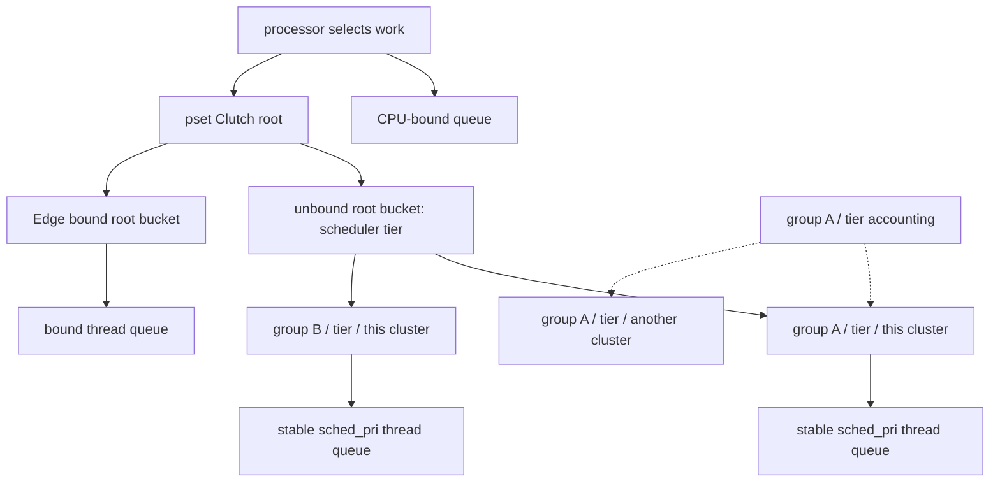

# Clutch hierarchy and Edge cluster placement

[Runtime](README.md) · [Common scheduler execution](scheduler-execution.md) · [Scheduling introduction](scheduling.md)

The companion [priority and quanta chapter](priority-qos-and-quanta.md) explains Clutch bucket-group contention shifts and per-thread decay; [realtime scheduling](realtime-deadlines-and-runqueues.md) follows the separate RT queues/matrix; [CPU eligibility](cpu-eligibility-and-scheduler-variants.md) contrasts dualq/AMP and covers recommendations/SMT.

Clutch selects work within a processor set through a hierarchy: scheduler bucket, thread-group bucket, then thread. Edge extends that machinery with placement and migration across processor sets representing clusters. A thread's priority is therefore an input at multiple levels, not a complete explanation of where or when it runs. The common scheduler passes an eligible currently running thread into policy selection so it can compete with queued work without first being enqueued. [`sched_clutch.c`, hierarchy traversal](../../../xnu/osfmk/kern/sched_clutch.c#L2977-L3046), [`Edge chooser`](../../../xnu/osfmk/kern/sched_clutch.c#L6070-L6097), [`sched_prim.c`](../../../xnu/osfmk/kern/sched_prim.c#L2790-L2859).

The discussion is conditional on the selected scheduler. `CONFIG_SCHED_CLUTCH` is configured for the relevant ARM64 builds, and `CONFIG_SCHED_EDGE` adds the asymmetric-multiprocessing policy. Other dispatch configurations use other implementations. The repository's [Clutch/Edge design document](../../../xnu/doc/scheduler/sched_clutch_edge.md) is a useful orientation; the bodies cited here define this checkout's details. [`sched.h`](../../../xnu/osfmk/kern/sched.h#L185-L217), [`sched_prim.h`](../../../xnu/osfmk/kern/sched_prim.h#L870-L902).

## 1. Four objects that are easy to confuse

| Object | Identity and important fields |
|---|---|
| `sched_clutch_root` | One processor-set hierarchy; tracks `scr_pset`, runnable count/priority/urgency, bound and unbound root buckets, runnable/warp bitmaps, and deadline queues. Edge adds steal silos and incoming-migration eligibility. [`sched_clutch.h`](../../../xnu/osfmk/kern/sched_clutch.h#L130-L211). |
| `sched_clutch_root_bucket` | One scheduler bucket within that root, such as foreground or background, separately bound/unbound under Edge. Contains deadline linkage, `scrb_warp_remaining`, `scrb_warped_deadline`, `scrb_starvation_avoidance`, `scrb_starvation_ts`, and the next-level queue. [`sched_clutch.h`](../../../xnu/osfmk/kern/sched_clutch.h#L95-L128). |
| `sched_clutch_bucket_group` | A thread group's members at one scheduler bucket across clusters. Supplies shared interactivity, CPU-use/blocked accounting, preferred-cluster recommendation, and its per-root buckets. The lookup selects by `thread->th_sched_bucket`. [`sched_clutch.h`](../../../xnu/osfmk/kern/sched_clutch.h#L283-L380), [`sched_clutch.c`](../../../xnu/osfmk/kern/sched_clutch.c#L2748-L2768). |
| `sched_clutch_bucket` | The runnable portion of that group/bucket on one root. Holds `scb_priority`, `scb_thr_count`, parent links, a stable thread-priority queue, a separate priority queue for computing bucket priority, and a timeshare list. [`sched_clutch.h`](../../../xnu/osfmk/kern/sched_clutch.h#L213-L280). |

“Bound” has two meanings here. A thread bound to a particular CPU is ineligible for the ordinary Clutch hierarchy and uses that processor's bound queue. Edge's processor-set-bound threads are instead represented by bound root buckets; shared-resource policy can also put a thread in that bound portion. A bound root bucket therefore does not imply every member has a specific `bound_processor`. [`sched_clutch.h`](../../../xnu/osfmk/kern/sched_clutch.h#L52-L60), [`enqueue and chooser`](../../../xnu/osfmk/kern/sched_clutch.c#L3415-L3450), [`Edge-bound insertion`](../../../xnu/osfmk/kern/sched_clutch.c#L2785-L2797).



The hierarchy is protected primarily by the processor-set lock, but cross-cluster fields cannot all use that single lock. Header annotations distinguish processor-set-protected fields, atomic fields, immutable fields, and atomic fields whose writers also hold the processor-set lock. In particular, bucket-group runnable counts and block timestamps are updated together through wide atomics because runnable-count changes can happen without a processor-set lock. [`sched_clutch.h`, locking legend](../../../xnu/osfmk/kern/sched_clutch.h#L70-L85), [`sched_clutch.c`](../../../xnu/osfmk/kern/sched_clutch.c#L2691-L2745).

## 2. Insertion establishes three different orderings

For an unbound hierarchy member, `sched_clutch_thread_insert()` derives the thread's group/bucket/root combination and inserts three linkages. The stable run queue is ordered using `sched_pri` and an insertion timestamp; a preempted insertion gets a different flag from a tail insertion. The bucket-priority queue uses promoted scheduling priority when applicable, otherwise base priority. The timeshare list supports subsequent priority maintenance. These structures intentionally answer different questions. [`sched_clutch.c`](../../../xnu/osfmk/kern/sched_clutch.c#L2799-L2826).

[`osfmk/kern/sched_clutch.c:2814–2823`](../../../xnu/osfmk/kern/sched_clutch.c#L2814-L2823)

<!-- source-excerpt: ../../../xnu/osfmk/kern/sched_clutch.c#L2814-L2823 -->
```c
	/* Insert thread into the clutch_bucket stable priority runqueue using sched_pri */
	thread->th_clutch_runq_link.stamp = current_timestamp;
	priority_queue_entry_set_sched_pri(&clutch_bucket->scb_thread_runq, &thread->th_clutch_runq_link, thread->sched_pri,
	    (options & SCHED_TAILQ) ? PRIORITY_QUEUE_ENTRY_NONE : PRIORITY_QUEUE_ENTRY_PREEMPTED);
	priority_queue_insert(&clutch_bucket->scb_thread_runq, &thread->th_clutch_runq_link);

	/* Insert thread into clutch_bucket priority queue based on the promoted or base priority */
	priority_queue_entry_set_sched_pri(&clutch_bucket->scb_clutchpri_prioq, &thread->th_clutch_pri_link,
	    sched_thread_sched_pri_promoted(thread) ? thread->sched_pri : thread->base_pri, false);
	priority_queue_insert(&clutch_bucket->scb_clutchpri_prioq, &thread->th_clutch_pri_link);
```

Insertion then updates urgency and counts. An empty bucket becoming runnable is linked into its root bucket; its ancestors become runnable as needed. Inserting into an already populated bucket instead recalculates its priority and position. Removal performs the inverse empty-bucket/empty-root transitions. Edge also updates cumulative per-tier counts, shared-resource load, and steal-silo membership. All of this happens under the hierarchy's processor-set lock. [`sched_clutch.c`](../../../xnu/osfmk/kern/sched_clutch.c#L1645-L1705), [`bucket runnable/update`](../../../xnu/osfmk/kern/sched_clutch.c#L1833-L1903), [`insertion accounting`](../../../xnu/osfmk/kern/sched_clutch.c#L2828-L2849).

This separation matters for a promoted lock owner. Its donated scheduling priority can affect both which thread wins inside its bucket and which thread-group bucket wins at the next level. The turnstile supplies the promotion through thread policy; Clutch consumes the resulting priority state. It does not itself decide who owns the lock or construct the inheritance chain. [`sched_clutch.c`](../../../xnu/osfmk/kern/sched_clutch.c#L2820-L2823), [`thread_policy.c`](../../../xnu/osfmk/kern/thread_policy.c#L3000-L3031), [wait and turnstile protocols](wait-and-turnstile-protocols.md).

## 3. Root selection: deadline, warp, and starvation window

Timeshare root buckets use an earliest-deadline queue whose deadlines incorporate a configured worst-case execution latency, called WCEL in this source. These are scheduler eligibility/fairness parameters, not a guarantee that an arbitrary application operation completes by that time. Fixed-priority work above the timeshare buckets has separate handling and does not use this deadline-update algorithm. [`sched_clutch.c`](../../../xnu/osfmk/kern/sched_clutch.c#L180-L198), [`selection entry`](../../../xnu/osfmk/kern/sched_clutch.c#L835-L899), [`deadline update`](../../../xnu/osfmk/kern/sched_clutch.c#L1062-L1092).

The initial tables in this checkout are:

| Bucket | WCEL | Warp window | Thread quantum: macOS / other targets |
|---|---:|---:|---:|
| FIXPRI | Not used by timeshare EDF | Not used | 10 / 10 ms |
| FG | 0 ms | 8 ms | 10 / 10 ms |
| IN | 37.5 ms | 4 ms | 10 / 8 ms |
| DF | 75 ms | 2 ms | 10 / 6 ms |
| UT | 150 ms | 1 ms | 4 / 4 ms |
| BG | 250 ms | 0 ms | 2 / 2 ms |

These values come from the static WCEL, warp, and conditional quantum arrays; they describe source defaults, not a measurement of the running machine or an unconditional end-user latency promise. [`sched_clutch.c`](../../../xnu/osfmk/kern/sched_clutch.c#L190-L252).

`sched_clutch_root_highest_root_bucket()` compares the earliest bound and unbound timeshare buckets, and also considers the current thread's root bucket if that bucket is not currently enqueued. The current thread therefore remains a candidate even when it was the last runnable member removed from its hierarchy. A root bucket already in a starvation-avoidance window loses that status when its configured thread-quantum interval has elapsed, updates its deadline, and causes selection to be reevaluated. [`sched_clutch.c`](../../../xnu/osfmk/kern/sched_clutch.c#L835-L927).

Warp lets a higher natural-priority bucket run ahead of a lower bucket with an earlier deadline for a bounded window. The eligible warp bitmap comes from the same bound/unbound class as the EDF candidate; the implementation explicitly avoids warping across those two classes. The current thread's root bucket can use remaining warp as well. When a warp window starts, its end time is recorded; when it expires, the remaining warp and bitmap eligibility are cleared and selection repeats. [`sched_clutch.c`](../../../xnu/osfmk/kern/sched_clutch.c#L929-L1040).

When no higher bucket can warp, the EDF bucket wins. If a higher natural-priority bucket remains runnable, the selected lower bucket can open a starvation-avoidance window. The duration is one thread quantum for that bucket measured as a single interval across the cluster—not a new independent quantum granted to every waiting thread:

[`osfmk/kern/sched_clutch.c:953–963`](../../../xnu/osfmk/kern/sched_clutch.c#L953-L963)

<!-- source-excerpt: ../../../xnu/osfmk/kern/sched_clutch.c#L953-L963 -->
```c
				/*
				 * Since a higher bucket is runnable, it indicates that the EDF bucket should be in starvation avoidance.
				 *
				 * The starvation avoidance window is allocated as a single quantum for the starved bucket, enforced
				 * simultaneously across all CPUs in the cluster. The idea is to grant the starved bucket roughly one
				 * quantum per core, each time the bucket reaches the earliest deadline position. Note that this
				 * cadence is driven by the difference between the starved bucket's and highest-runnable bucket's WCELs.
				 */
				edf_bucket->scrb_starvation_avoidance = true;
				edf_bucket->scrb_starvation_ts = timestamp;
				debug_info->trace_data.selection_opened_starvation_avoidance_window = true;
```

When the EDF choice agrees with natural priority, deadline update and warp replenishment follow a different branch. A preemption-check traversal is also not interchangeable with a removal traversal: the function restricts when a queued bucket's starvation state can be updated, while still accounting for a genuinely running previous bucket. Reading only the top-level “EDF” comment misses these stateful decisions. [`sched_clutch.c`](../../../xnu/osfmk/kern/sched_clutch.c#L945-L978).

For a conceptual example, suppose a background bucket has become the earliest-deadline candidate while foreground work remains runnable. Foreground can still win while its applicable warp window permits; after warp is exhausted, background can receive its starvation window. This illustrates the branch ordering only. Actual selection also depends on bound/unbound class, timestamps, current-thread state, and whether the traversal is checking or removing work. [`sched_clutch.c`](../../../xnu/osfmk/kern/sched_clutch.c#L916-L1040).

## 4. Thread-group interactivity and the final thread comparison

Within an unbound root bucket, Clutch chooses a group bucket using its calculated bucket priority. That priority combines a base/promoted-priority input with an interactivity score derived from bucket-group CPU use and blocked time. Let `I` denote `sched_clutch_bucket_group_interactive_pri`, `B` the recorded blocked amount, and `U` the recorded used amount. The source uses the following two branches, retaining the prior score if both inputs are zero:

[`osfmk/kern/sched_clutch.c:1746–1761`](../../../xnu/osfmk/kern/sched_clutch.c#L1746-L1761)

<!-- source-excerpt: ../../../xnu/osfmk/kern/sched_clutch.c#L1746-L1761 -->
```c
	if ((cpu_blocked == 0) && (cpu_used == 0)) {
		return (uint8_t)clutch_bucket_group->scbg_interactivity_data.scct_count;
	}
	/*
	 * For all timeshare buckets, calculate the interactivity score of the bucket
	 * and add it to the base priority
	 */
	if (cpu_blocked > cpu_used) {
		/* Interactive clutch_bucket case */
		interactive_score = sched_clutch_bucket_group_interactive_pri +
		    ((sched_clutch_bucket_group_interactive_pri * (cpu_blocked - cpu_used)) / cpu_blocked);
	} else {
		/* Non-interactive clutch_bucket case */
		interactive_score = ((sched_clutch_bucket_group_interactive_pri * cpu_blocked) / cpu_used);
	}
	return interactive_score;
```

Consequently, a group that is mostly blocked approaches a score of `2I`; one that is continuously runnable with little blocked time approaches zero. This is an interpretation of the formula, not a per-thread sleep bonus. The blocked interval begins when the group's runnable/running count reaches zero and ends when it becomes nonzero; one sleeping member does not count the entire group as blocked if another remains runnable. The accounting caps the added blocked duration, and score calculation also includes aging/adjustment before publishing a new score. [`sched_clutch.c`](../../../xnu/osfmk/kern/sched_clutch.c#L2649-L2688), [`group run count`](../../../xnu/osfmk/kern/sched_clutch.c#L2691-L2745).

[`osfmk/kern/sched_clutch.c:2737–2745`](../../../xnu/osfmk/kern/sched_clutch.c#L2737-L2745)

<!-- source-excerpt: ../../../xnu/osfmk/kern/sched_clutch.c#L2737-L2745 -->
```c
	uint64_t ctime = mach_absolute_time();
	os_atomic_rmw_loop(&clutch_bucket_group->scbg_blocked_data.scct_packed, old_blocked_data.scct_packed, new_blocked_data.scct_packed, relaxed, {
		new_blocked_data.scct_count = old_blocked_data.scct_count - 1;
		new_blocked_data.scct_timestamp = old_blocked_data.scct_timestamp;
		if (new_blocked_data.scct_count == 0) {
		        new_blocked_data.scct_timestamp = ctime;
		}
	});
	return (uint32_t)new_blocked_data.scct_count;
```

On Edge, multiple roots can contribute to shared bucket-group state. Score publication uses a packed atomic timestamp/score update and ignores a calculation older than the value already published. Non-Edge Clutch can instead rely on the boot processor set's hierarchy lock for this part. This is a concrete example of why a processor-set lock alone does not serialize the whole cross-cluster policy. [`sched_clutch.c`](../../../xnu/osfmk/kern/sched_clutch.c#L2667-L2688).

The current thread is compared at both lower levels. If its group bucket differs from the best queued bucket, the comparison uses its scheduling priority plus the group's stored interactivity score. If it is in the selected bucket, its scheduling priority competes with the stable queue's maximum. Tie-breaking incorporates whether the processor is still in its first time slice. The hierarchy walker removes the winner only for the appropriate remove traversal and only when it is not the already running thread. [`sched_clutch.c`](../../../xnu/osfmk/kern/sched_clutch.c#L1801-L1830), [`thread comparison`](../../../xnu/osfmk/kern/sched_clutch.c#L2924-L2956), [`traversal/removal`](../../../xnu/osfmk/kern/sched_clutch.c#L2977-L3033).

Equal bucket priority also does not imply one bucket permanently stays first. Bucket-update/removal paths use explicit same-priority round-robin behavior, while the thread queue separately retains its stable priority/insertion rules. These are local fairness mechanisms at different hierarchy levels. [`sched_clutch.c`](../../../xnu/osfmk/kern/sched_clutch.c#L1859-L1903), [`selection removal option`](../../../xnu/osfmk/kern/sched_clutch.c#L3026-L3033).

## 5. Edge: selecting a cluster before selecting its CPU

The preferred processor set is derived from the thread's group/bucket recommendation, with special treatment for processor-set binding and depressed priority. That preference is not an immutable CPU assignment. `sched_edge_choose_processor()` asks `sched_edge_migrate_candidate()` for an available cluster and then invokes the ordinary within-pset CPU chooser. CPU-bound threads bypass this routine. [`sched_clutch.c`](../../../xnu/osfmk/kern/sched_clutch.c#L1450-L1519), [`Edge chooser`](../../../xnu/osfmk/kern/sched_clutch.c#L6070-L6097).

For ordinary migration, the load metric is an estimate of scheduling latency. The implementation reads a fixed-point processor-set load average and average execution time, rounds the load average, clamps execution time to at least one, multiplies, and saturates the result to 32 bits. An unrecommended processor set reports a maximal load through the wrapper. Shared-resource threads have a separate load path. These are estimates and policy inputs; they are not a count of every pending instruction or a direct thermal measurement. [`sched_clutch.c`](../../../xnu/osfmk/kern/sched_clutch.c#L4355-L4389), [`metric wrapper`](../../../xnu/osfmk/kern/sched_clutch.c#L4554-L4573), [`shared-resource selection`](../../../xnu/osfmk/kern/sched_clutch.c#L5754-L5775).

[`osfmk/kern/sched_clutch.c:4375–4387`](../../../xnu/osfmk/kern/sched_clutch.c#L4375-L4387)

<!-- source-excerpt: ../../../xnu/osfmk/kern/sched_clutch.c#L4375-L4387 -->
```c
sched_edge_get_pset_load_average(processor_set_t pset, sched_bucket_t sched_bucket)
{
	uint64_t load_average = os_atomic_load(&pset->pset_load_average[sched_bucket], relaxed);
	uint64_t avg_execution_time = os_atomic_load(&pset->pset_execution_time[sched_bucket].pset_avg_thread_execution_time, relaxed);
	/*
	 * Since a load average of 0 indicates an idle pset, don't allow an average
	 * execution time less than 1us to cause a pset to appear idle.
	 */
	avg_execution_time = MAX(avg_execution_time, 1ULL);
	uint64_t product = ((load_average + SCHED_PSET_LOAD_EWMA_ROUND_BIT) >> SCHED_PSET_LOAD_EWMA_FRACTION_BITS) * avg_execution_time;
	/* Perform a saturating cast to uint32_t. */
	return (uint32_t)MIN(product, UINT32_MAX);
}
```

An edge is directional and bucket-dependent. Candidate evaluation requires migration to be allowed from the preferred processor set to the destination. It rejects a busier destination; for ordinary threads, the load improvement must reach the edge's migration weight. An idle destination can be accepted immediately, except where performance-island policy still requires the edge threshold. Candidate ties favor homogeneous clusters, and the search visits native candidates before foreign ones. [`sched_clutch.c`](../../../xnu/osfmk/kern/sched_clutch.c#L5754-L5886).

[`osfmk/kern/sched_clutch.c:5788–5799`](../../../xnu/osfmk/kern/sched_clutch.c#L5788-L5799)

<!-- source-excerpt: ../../../xnu/osfmk/kern/sched_clutch.c#L5788-L5799 -->
```c
	uint32_t edge_delta = 0;
	if (dst_load > preferred_pset_load) {
		return false;
	}
	edge_delta = preferred_pset_load - dst_load;
	if (!shared_rsrc_thread && (edge_delta < edge.sce_migration_weight)) {
		/*
		 * For non shared resource threads, use the edge migration weight to decide if
		 * this pset is over-committed at the QoS level of this thread.
		 */
		return false;
	}
```

As a conceptual arithmetic example, a preferred estimated load of 120 and destination load of 80 give an improvement of 40. With an ordinary-thread edge weight of 64, that candidate is rejected; with weight 32, it clears this particular test. Those numbers are illustrative, not sampled policy settings or measurements. Other permission, availability, search-order, and special-resource branches still apply. [`sched_clutch.c`](../../../xnu/osfmk/kern/sched_clutch.c#L5771-L5815).

The migration helper first honors an available processor-set binding; real-time threads normally remain on the preferred set through this ordinary placement logic. A context-switch requeue can consume an already arranged “stir-the-pot” swap hint. Once a candidate is selected, the accurate placement mode drops the old processor-set lock, acquires the candidate's lock, and checks that the destination is still recommended. If unavailable, it removes that candidate from the bitmap and tries an alternative, preferring a homogeneous set. Exhaustion or an incompletely initialized boot candidate can return null to the common scheduler's retry/fallback path. The best-effort mode used by avoidance checks does not promise that same locked commitment. [`sched_clutch.c`](../../../xnu/osfmk/kern/sched_clutch.c#L5888-L6097), [`common placement retry`](../../../xnu/osfmk/kern/sched_prim.c#L5545-L5609).

## 6. Stealing is a different search

An idle processor set can ask for work from another set. Edge indexes runnable buckets into steal silos according to their preferred processor set. This preserves the work's recommendation even if it is currently queued somewhere else. Consequently, the permission edge used while inspecting a silo is from the silo's recommendation to the idle destination, not simply from the current donor cluster to that destination. [`sched_clutch.h`](../../../xnu/osfmk/kern/sched_clutch.h#L172-L185), [`sched_clutch.c`](../../../xnu/osfmk/kern/sched_clutch.c#L4716-L4744).

The helper visits populated silos and scheduler buckets. Stealing must be allowed; its ordered-tier scan assumes that a disallowed higher bucket also disallows lower ones. An “only excess load” request can require cumulative runnable depth to exceed the donor's available CPUs when the applicable edge has nonzero weight. Performance-island configurations can additionally require a load delta sufficient for the edge. It selects the highest-priority thread from eligible bucket candidates, preserving search-order bias on ties. [`sched_clutch.c`](../../../xnu/osfmk/kern/sched_clutch.c#L4716-L4805).

The outer search performs a cheap atomic eligibility peek, takes the donor's processor-set lock, rechecks, removes a candidate, updates donor load, and unlocks. It can stop at the first productive donor in ordered search; it is not a global optimization over every runnable thread on every cluster. The idle policy also distinguishes rescuing foreign runnable work, native stealing, and requests to rebalance foreign running work. [`sched_clutch.c`](../../../xnu/osfmk/kern/sched_clutch.c#L4881-L4980).

## Sources inspected and limits

The deepest reviewed paths are insertion/removal and hierarchy traversal, root deadlines/warp/starvation state, bucket priority and interactivity accounting, preferred-cluster selection, migration permission/weight/availability, and representative steal selection. Lock annotations and the current-thread comparisons were checked against their bodies. The chapter also follows the accurate-placement lock handoff into the common scheduler.

Performance-island topology construction, all shared-resource policies, every recommendation-change migration path, full real-time balancing, and scheduler-tick aging are contextual or partial reviews. Tables are source defaults and examples are conceptual. No scheduling workload was run, no latency guarantee was measured, and no fairness proof is claimed. For a useful next source exercise, follow one `SCHED_TAILQ` insertion through `sched_clutch_thread_insert()`, then compare `SCHED_CLUTCH_TRAVERSE_CHECK_PREEMPT` with `SCHED_CLUTCH_TRAVERSE_REMOVE_CONSIDER_CURRENT` in the hierarchy walker. [`sched_clutch.c`](../../../xnu/osfmk/kern/sched_clutch.c#L2778-L2850), [`hierarchy walker`](../../../xnu/osfmk/kern/sched_clutch.c#L2977-L3046).

<!-- BEGIN PLATYDOC DOCUMENTATION LICENSE -->
Original Platydoc text and diagrams are licensed under [CC BY 4.0](https://creativecommons.org/licenses/by/4.0/). Quoted source code and third-party material retain their respective licenses.
<!-- END PLATYDOC DOCUMENTATION LICENSE -->
