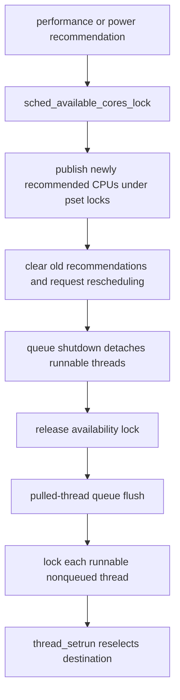

# CPU eligibility, SMT, and scheduler variants

[Runtime](README.md) · [Clutch and Edge](clutch-and-edge.md) · [Realtime queues](realtime-deadlines-and-runqueues.md) · [System sleep and wake](../drivers/system-sleep-and-wake.md)

Choosing a CPU is constrained by more than its current priority. A processor must be in an eligible lifecycle state, normally recommended for scheduling, compatible with the thread's binding/affinity and selected policy, and acceptable under SMT sibling rules. These conditions can change while the scheduler drops one processor-set lock to acquire another. A candidate is therefore a snapshot to validate, not a durable assignment established by a previous load estimate. [`pset_available_cpumap()`](../../../platydoc-data/xnu/osfmk/kern/processor.c#L593-L596), [`SMT chooser recheck`](../../../platydoc-data/xnu/osfmk/kern/sched_prim.c#L5057-L5088), [`common current-thread tests`](../../../platydoc-data/xnu/osfmk/kern/sched_prim.c#L2558-L2602).

This chapter supplies three missing boundaries around the existing execution/Clutch guides: compile-time policy selection, selected dualq/AMP alternatives, and CPU recommendation/SMT transitions. It does not repeat Edge's thread-group bucket hierarchy or claim to cover every platform power-state transition.

## 1. The scheduler implementation is selected at build time

`SCHED(f)` names a member of a particular constant dispatch table selected by preprocessor conditions. AMP builds use Edge when configured and otherwise the AMP table; non-AMP builds use Clutch when configured and otherwise dualq. `sched.h` enables Clutch for eligible ARM64 builds with `CONFIG_CLUTCH` and without the Edge opt-out; AMP additionally enables Edge. The table-shaped API permits shared scheduler code and compiler optimization without making this a runtime plugin framework. [`sched_prim.h`](../../../platydoc-data/xnu/osfmk/kern/sched_prim.h#L870-L901), [`sched.h`](../../../platydoc-data/xnu/osfmk/kern/sched.h#L191-L225).

[sched_prim.h, lines 877–897](../../../platydoc-data/xnu/osfmk/kern/sched_prim.h#L877-L897)

<!-- source-excerpt: ../../../platydoc-data/xnu/osfmk/kern/sched_prim.h#L877-L897 -->
```c
#if __AMP__

#if CONFIG_SCHED_EDGE
extern const struct sched_dispatch_table sched_edge_dispatch;
#define SCHED(f) (sched_edge_dispatch.f)
#else /* CONFIG_SCHED_EDGE */
extern const struct sched_dispatch_table sched_amp_dispatch;
#define SCHED(f) (sched_amp_dispatch.f)
#endif /* CONFIG_SCHED_EDGE */

#else /* __AMP__ */

#if CONFIG_SCHED_CLUTCH
extern const struct sched_dispatch_table sched_clutch_dispatch;
#define SCHED(f) (sched_clutch_dispatch.f)
#else /* CONFIG_SCHED_CLUTCH */
extern const struct sched_dispatch_table sched_dualq_dispatch;
#define SCHED(f) (sched_dualq_dispatch.f)
#endif /* CONFIG_SCHED_CLUTCH */

#endif /* __AMP__ */
```

| Selected variant | Ordinary runnable organization and important differences |
|---|---|
| dualq | Per-pset queue for unbound work and per-processor queue for bound work; common usage decay; SMT-aware chooser when configured; realtime stealing hook null. [`sched_dualq.c`](../../../platydoc-data/xnu/osfmk/kern/sched_dualq.c#L105-L191). |
| AMP | P/E-oriented pset queues plus bound queues; explicit spill/steal and recommendation rules in the alternate implementation. It does not use the Clutch hierarchy. [`sched_amp.c`](../../../platydoc-data/xnu/osfmk/kern/sched_amp.c#L123-L207), [`selection`](../../../platydoc-data/xnu/osfmk/kern/sched_amp.c#L238-L296). |
| Clutch | Pset root → scheduling bucket → thread-group bucket → thread, plus special bound handling; group-scoped timeshare shifts and bucket quanta. [`sched_clutch.c`](../../../platydoc-data/xnu/osfmk/kern/sched_clutch.c#L3214-L3293), [Clutch chapter](clutch-and-edge.md). |
| Edge | Clutch plus cross-pset policy/placement, including separate realtime spill/steal hooks. Performance-island features have further `HAS_MCORE` configuration. [`sched_clutch.c`](../../../platydoc-data/xnu/osfmk/kern/sched_clutch.c#L3852-L3923), [`sched.h`](../../../platydoc-data/xnu/osfmk/kern/sched.h#L208-L225). |

Both dualq and Clutch's inspected initial-mode callbacks start kernel-task threads fixed and other task threads timeshare. That default is subsequently subject to explicit policy, work intervals, and demotion; the presence of a fixed-mode field does not identify a different CPU chooser by itself. Realtime work is routed by the common `sched_pri >= BASEPRI_RTQUEUES` dispatch test into the separate realtime queue. [`sched_dualq.c`](../../../platydoc-data/xnu/osfmk/kern/sched_dualq.c#L194-L202), [`sched_clutch.c`](../../../platydoc-data/xnu/osfmk/kern/sched_clutch.c#L3296-L3304), [`setrun routing`](../../../platydoc-data/xnu/osfmk/kern/sched_prim.c#L5617-L5632).

## 2. Available, online, recommended, idle, and bound are different states

`processor` tracks active thread, current priority and bound/SMT summaries, lifecycle state, and sibling relationships. `processor_set` aggregates state maps, available CPUs, recommendation masks, primary/realtime maps, pending preemption/spill bits, and policy queues. State transitions update both the individual state and per-state maps; availability is updated when state crosses the `PROCESSOR_IDLE` boundary in the enum ordering. The actual helper used by placement returns the intersection of `cpu_available_map` and `recommended_bitmask`. [`processor.h`](../../../platydoc-data/xnu/osfmk/kern/processor.h#L248-L334), [`processor fields`](../../../platydoc-data/xnu/osfmk/kern/processor.h#L418-L490), [`state updates`](../../../platydoc-data/xnu/osfmk/kern/processor.c#L958-L986).

[processor.c, lines 593–596](../../../platydoc-data/xnu/osfmk/kern/processor.c#L593-L596)

<!-- source-excerpt: ../../../platydoc-data/xnu/osfmk/kern/processor.c#L593-L596 -->
```c
pset_available_cpumap(processor_set_t pset)
{
	return pset->cpu_available_map & pset->recommended_bitmask;
}
```

Consequently, an online or registered CPU need not appear in the ordinary placement candidate map. Conversely, a recommended CPU can have work already assigned (`DISPATCHING`) rather than be idle. Pending urgent/preempt bits further exclude or deprioritize candidates to avoid piling up redundant notifications. Published load/recommendation summaries guide searches, but a chooser reacquires the selected pset lock and checks eligibility before returning. [`choose_processor_smt()`](../../../platydoc-data/xnu/osfmk/kern/sched_prim.c#L4687-L4803), [`active candidate mask`](../../../platydoc-data/xnu/osfmk/kern/sched_prim.c#L4878-L4891), [`return recheck`](../../../platydoc-data/xnu/osfmk/kern/sched_prim.c#L5069-L5088).

Binding is a stronger and separate path. `thread_bind()` changes the current thread's binding under its scheduler lock and returns the prior binding; the internal helper requires the thread be off a runqueue and below realtime priority. The helper merely changes `bound_processor`: its comment explains that an explicit block is needed to migrate the current thread immediately, but the body does not itself issue a block or remote AST. Wakeup binding and shutdown unbinding provide specialized locked paths. [`sched_prim.c`](../../../platydoc-data/xnu/osfmk/kern/sched_prim.c#L1847-L1942).

Bound threads bypass normal processor choice in `thread_setrun()`, which takes the bound CPU's pset lock directly. Likewise, `thread_select()` does not idle an unrecommended processor solely on recommendation grounds when bound work still requires service there. Binding is therefore not interchangeable with a performance-controller preference. Affinity is another condition: a running thread whose affinity-set pset differs from the current pset fails the continuation test even when it is otherwise runnable. [`sched_prim.c`](../../../platydoc-data/xnu/osfmk/kern/sched_prim.c#L2490-L2504), [`continuation tests`](../../../platydoc-data/xnu/osfmk/kern/sched_prim.c#L2581-L2602), [`bound setrun`](../../../platydoc-data/xnu/osfmk/kern/sched_prim.c#L5603-L5615).

## 3. dualq makes the queue and preemption rules visible

In dualq, `dualq_runq_for_thread()` selects the pset's shared `pset_runq` for unbound threads and the CPU's own `runq` for bound threads. Both use the common priority-banded `run_queue`. `sched_dualq_choose_thread()` compares the highest priorities in those two queues against the caller's minimum, favors the bound queue on an equal-priority tie, and dequeues its head. A bound choice returns before the unbound SMT filtering discussed below. [`sched_dualq.c`](../../../platydoc-data/xnu/osfmk/kern/sched_dualq.c#L173-L191), [`choose`](../../../platydoc-data/xnu/osfmk/kern/sched_dualq.c#L227-L299).

The context-switch check uses strict `>` while the current CPU is in its first timeslice and `>=` after expiration. Equal-priority queued work therefore competes differently after the current slice has been consumed. Queue urgency determines whether the requested preemption is urgent; avoid-processor policy can force an urgent result first. These rules are a compact contrast to Clutch's root deadline/warp selection, not a simplified description of Clutch itself. [`sched_dualq.c`](../../../platydoc-data/xnu/osfmk/kern/sched_dualq.c#L324-L359), [quantum behavior](priority-qos-and-quanta.md#6-quantum-size-is-policy-input-not-a-fixed-universal-timeslice).

[sched_dualq.c, lines 338–344](../../../platydoc-data/xnu/osfmk/kern/sched_dualq.c#L338-L344)

<!-- source-excerpt: ../../../platydoc-data/xnu/osfmk/kern/sched_dualq.c#L338-L344 -->
```c
	pri = MAX(main_runq->highq, bound_runq->highq);

	if (processor->first_timeslice) {
		has_higher = (pri > processor->current_pri);
	} else {
		has_higher = (pri >= processor->current_pri);
	}
```

Queued priority changes and removals must account for another CPU winning the dequeue race. `sched_dualq_processor_queue_remove()` takes the pset lock and checks whether the thread still records this runqueue association; if it has left, it returns false rather than unlinking stale links. Common `set_sched_pri()` and mode-change code use this result to decide whether reinsertion is needed. Holding the thread lock alone does not guarantee the queue lock was acquired before a remote dequeue. [`sched_dualq.c`](../../../platydoc-data/xnu/osfmk/kern/sched_dualq.c#L419-L446), [`set_sched_pri()`](../../../platydoc-data/xnu/osfmk/kern/sched_prim.c#L5990-L6050).

Dualq stealing traverses other psets one lock at a time. On SMT builds only a primary processor may use that steal path. The donor test counts queued normal/realtime work against eligible idle/dispatching capacity, restricted to primaries for this purpose. A successful steal removes from the donor's shared queue and returns unlocked. Queue shutdown drains the shared queue only when the pset's online-processor count reaches zero; bound queue handling is not silently folded into this helper. [`sched_dualq.c`](../../../platydoc-data/xnu/osfmk/kern/sched_dualq.c#L402-L416), [`steal`](../../../platydoc-data/xnu/osfmk/kern/sched_dualq.c#L451-L479), [`donor predicate`](../../../platydoc-data/xnu/osfmk/kern/sched_prim.c#L2237-L2258).

## 4. SMT constraints are checked at placement and selection

The modeled SMT topology links a primary with one secondary and marks both as SMT siblings. The initialization code explicitly assumes two-way SMT. `thread_no_smt()` is true only when the feature is enabled, the thread is unbound, and its own or task's NO_SMT flag is set. The running-processor predicate also excludes bound work. This is a scheduler execution restriction with explicit exceptions; these fields alone should not be described as a complete hardware security-isolation proof. [`processor.c`](../../../platydoc-data/xnu/osfmk/kern/processor.c#L550-L582), [`NO_SMT predicates`](../../../platydoc-data/xnu/osfmk/kern/sched_prim.c#L9366-L9382).

[sched_prim.c, lines 9369–9374](../../../platydoc-data/xnu/osfmk/kern/sched_prim.c#L9369-L9374)

<!-- source-excerpt: ../../../platydoc-data/xnu/osfmk/kern/sched_prim.c#L9369-L9374 -->
```c
thread_no_smt(thread_t thread)
{
	return sched_allow_NO_SMT_threads &&
	       (thread->bound_processor == PROCESSOR_NULL) &&
	       ((thread->sched_flags & TH_SFLAG_NO_SMT) || (get_threadtask(thread)->t_flags & TF_NO_SMT));
}
```

In dualq's unbound dequeue path, a secondary will not take a NO_SMT candidate or run any ordinary candidate while the primary is running a NO_SMT thread. A primary will not start a NO_SMT candidate when its secondary is executing bound work. These cases set `must_idle` and return no thread; the selection code does not scan deeper for a lower-priority compatible candidate in that branch. Existing execution is checked by the avoid-processor callback as well. That callback exempts a thread bound to this CPU and, on a secondary, restricts ordinary work when the primary is realtime. [`sched_dualq.c`](../../../platydoc-data/xnu/osfmk/kern/sched_dualq.c#L260-L297), [`avoid predicate`](../../../platydoc-data/xnu/osfmk/kern/sched_dualq.c#L551-L594).

`choose_processor_smt()` folds a last-CPU hint to the primary. It lets the machine layer supply an idle-cost hint only while the pset is online, then rejects hints outside the pset, unrecommended CPUs, and invalid lifecycle states. For normal work it searches preferred idle primaries, non-avoided idle primaries, and other idle primaries before examining occupied CPUs and idle secondaries. Rotation/preference masks affect ordering without replacing availability checks. [`sched_prim.c`](../../../platydoc-data/xnu/osfmk/kern/sched_prim.c#L4687-L4803), [`idle ordering`](../../../platydoc-data/xnu/osfmk/kern/sched_prim.c#L4827-L4873).

When primaries are busy, the chooser records low-priority primary/secondary and least-queued candidates. It excludes secondary candidates whose primary runs NO_SMT work and excludes already-pending preemptions as appropriate. It prefers preempting a lower-priority primary before directly waking a secondary; the displaced thread may then use that secondary. After searching eligible psets, it falls back to an idle secondary, a paired running secondary, or a least-loaded queue association, then revalidates availability under the selected pset lock. Under Edge, the non-realtime CPU search stays within the starting pset because Edge already made the cross-cluster placement decision. [`sched_prim.c`](../../../platydoc-data/xnu/osfmk/kern/sched_prim.c#L4875-L5088).

There is also a balancing action on the way to idle. If both siblings of the current physical core are idle, `sched_SMT_balance()` looks for another running secondary whose primary is also running and which is not itself realtime; it arranges an SMT-rebalance IPI and sends it after unlocking. Separately, common `thread_select()` pushes non-realtime secondary execution toward reconsideration unless the thread is yielding, and avoids pulling ordinary work onto an unbound secondary while recommended idle primaries exist. These are opportunities to improve placement, not a claim that every instant is globally optimal. [`sched_prim.c`](../../../platydoc-data/xnu/osfmk/kern/sched_prim.c#L2150-L2199), [`selection`](../../../platydoc-data/xnu/osfmk/kern/sched_prim.c#L2538-L2580).

## 5. Realtime CPU preferences allow explicit backup exceptions

Realtime work uses additional helpers: a preferred CPU excludes unavailable/unrecommended CPUs, CPUs already running realtime, pending urgent requests, and configured CPU-0 avoidance. The source defaults to CPU-0 avoidance on x86. On SMT, secondary execution is controlled by `sched_allow_rt_smt` and a capacity test involving available primaries, queued realtime work, and optionally backup count. A pending realtime spill can make an otherwise nonpreferred CPU eligible. [`sched_prim.c`](../../../platydoc-data/xnu/osfmk/kern/sched_prim.c#L2108-L2131), [`fast-track`](../../../platydoc-data/xnu/osfmk/kern/sched_prim.c#L9469-L9482), [`RT eligibility`](../../../platydoc-data/xnu/osfmk/kern/sched_prim.c#L9485-L9552).

A CPU eligible only as a backup delays before claiming realtime work, dropping both current-thread and pset locks around each 10-microsecond delay, then retrying the complete selection loop. The default maximum count is five, with adjustments for preference policy. This gives the preferred CPU an opportunity to claim the shared queue while retaining a fallback when it stalls. It is neither a hard reservation of the thread to the preferred CPU nor simultaneous execution on both. [`sched_prim.c`](../../../platydoc-data/xnu/osfmk/kern/sched_prim.c#L2437-L2463), [`backup wait/retry`](../../../platydoc-data/xnu/osfmk/kern/sched_prim.c#L2503-L2536), [RT queue/IPI ownership](realtime-deadlines-and-runqueues.md#6-cpu-placement-and-ipi-dispatch-are-separate-from-dequeue-order).

[sched_prim.c, lines 2521–2531](../../../platydoc-data/xnu/osfmk/kern/sched_prim.c#L2521-L2531)

<!-- source-excerpt: ../../../platydoc-data/xnu/osfmk/kern/sched_prim.c#L2521-L2531 -->
```c
					if (sched_ok_to_run_realtime_thread(pset, processor, true)) {
						if (timeout_count-- > 0) {
							pset_unlock(pset);
							thread_unlock(thread);
							delay(10);
							thread_lock(thread);
							pset_lock(pset);
							continue;
						}
						ok_to_run_realtime_thread = true;
					}
```

The current realtime thread receives a chance to finish its first slice even when the CPU is not preferred for new realtime selection. That exception and the bound-work exception explain why the instantaneous active-thread map need not look like the list of CPUs a fresh unbound wakeup would select. [`sched_prim.c`](../../../platydoc-data/xnu/osfmk/kern/sched_prim.c#L2490-L2505), [`current RT continuation`](../../../platydoc-data/xnu/osfmk/kern/sched_prim.c#L2604-L2643).

## 6. The alternate AMP scheduler has a narrower P/E model

The non-Edge AMP implementation uses common priority queues, not the Clutch hierarchy. On an E pset with spill pending, its chooser compares the P queue's highest priority with local shared and bound work. If P work wins, it returns null so common selection invokes the steal path. The preemption check includes that spill priority/urgency in its comparison. This null result can mean “try the indicated donor,” not “there is no runnable work.” [`sched_amp.c`](../../../platydoc-data/xnu/osfmk/kern/sched_amp.c#L238-L281), [`preemption`](../../../platydoc-data/xnu/osfmk/kern/sched_amp.c#L323-L372).

Its representative steal path moves from E toward the P pset. It first checks load, changes pset locks, then rechecks load, queued count versus dispatching CPUs, and absence of recommended idle P CPUs before dequeuing. The locked second check is essential: the earlier load snapshot does not authorize unlinking a donor thread after conditions change. Policy-specific thresholds and a pending-spill input affect whether that opportunity is taken. [`sched_amp.c`](../../../platydoc-data/xnu/osfmk/kern/sched_amp.c#L477-L518).

`pcores_recommended()` determines which pset `sched_amp_choose_processor()` initially selects; after changing locks, it rechecks that the chosen pset remains recommended, returning null unlocked if not. The eligibility callback permits P-recommended threads on either P or E, but E-recommended threads only on E. The avoid-processor callback requests migration when a running thread's recommendation and pset type no longer agree. Queue shutdown drains on the last online CPU or when the pset is no longer recommended. These are selected policies of this alternate implementation, not rules to apply unchanged to Edge's matrix. [`sched_amp.c`](../../../platydoc-data/xnu/osfmk/kern/sched_amp.c#L627-L704), [`shutdown`](../../../platydoc-data/xnu/osfmk/kern/sched_amp.c#L426-L439).

## 7. Recommendation updates move queued ownership before redispatch

`sched_update_recommended_cores_locked()` runs with `sched_available_cores_lock` held. It combines requested performance-control recommendations with powerdown constraints; sleep override or the recommended-core failsafe substitutes the managed-core mask. If the result would leave no still-online recommended CPU, it chooses a last-resort CPU, with a separate boot-CPU-shutdown branch and a panic if no candidate exists. Recommendation updates are therefore constrained by forward progress, not accepted as an arbitrary empty set. [`sched_prim.c`](../../../platydoc-data/xnu/osfmk/kern/sched_prim.c#L8892-L8935).

New recommendations are published before removals. Under each pset lock, newly recommended CPUs update mode/masks, idle ones become dispatching, and the policy is told that an online pset became schedulable. Removal clears recommendation state, arranges rescheduling of running/dispatching CPUs, and calls ordinary and realtime queue-shutdown hooks. The ordinary hook's contract releases the pset lock; the realtime hook acquires its own. Some SMR-down work is deferred because it can wake threads and must not execute under the availability lock. [`sched_prim.c`](../../../platydoc-data/xnu/osfmk/kern/sched_prim.c#L8948-L9084).

Detached runnable threads go into a per-processor `pulled_thread_queue`. Preparation either selects an interrupt-specific instance or disables preemption to pin the normal instance. Flush later removes each detached thread, takes its thread lock at scheduler interrupt level, asserts that it is runnable and has no runqueue membership, and calls `thread_setrun()` to select a new destination. The flush also balances the preemption protection and deferred SMR actions. This two-stage operation avoids reacquiring the placement/availability lock recursively while shutting down the old queue. [`sched_prim.c`](../../../platydoc-data/xnu/osfmk/kern/sched_prim.c#L8164-L8295).

[sched_prim.c, lines 8234–8243](../../../platydoc-data/xnu/osfmk/kern/sched_prim.c#L8234-L8243)

<!-- source-excerpt: ../../../platydoc-data/xnu/osfmk/kern/sched_prim.c#L8234-L8243 -->
```c
		spl_t s = splsched();
		thread_lock(thread);

		thread_assert_runq_null(thread);
		assert(thread->state & (TH_RUN));
		thread_setrun(thread, SCHED_TAILQ);

		thread_unlock(thread);
		splx(s);

```



## 8. The recommended-core failsafe differs from thread demotion

On ARM64, a realtime quantum callback can call `sched_consider_recommended_cores()` when performance control has recommended fewer than the possible CPUs. The scheduler uses its maintenance thread as evidence of starvation: after a quick age test, it locks that thread and requires that it is runnable, still queued, and old enough to benefit from more CPU capacity. A blocked or already executing maintenance thread is not sufficient evidence. [`sched_prim.c`](../../../platydoc-data/xnu/osfmk/kern/sched_prim.c#L8396-L8463), [`quantum hook`](../../../platydoc-data/xnu/osfmk/kern/priority.c#L265-L269).

The routine prepares deferred thread migration, takes the availability lock, checks that another caller did not already enable the override, records diagnostic state, and republishes recommendations with the failsafe flag set. It flushes detached threads after unlocking. This changes scheduler recommendations; the intersected availability map still determines which CPUs can actually be selected. It should not be described as this function synchronously powering on every physical core. [`sched_prim.c`](../../../platydoc-data/xnu/osfmk/kern/sched_prim.c#L8473-L8516), [`override mask`](../../../platydoc-data/xnu/osfmk/kern/sched_prim.c#L8905-L8913), [`availability intersection`](../../../platydoc-data/xnu/osfmk/kern/processor.c#L593-L596).

Once the maintenance thread runs, it waits at least the starvation-threshold hysteresis interval before clearing the override and restoring requested recommendations. This prevents the first successful maintenance execution from immediately removing the extra capacity. Per-thread failsafe instead changes a thread's actual scheduling mode to timeshare; the two mechanisms have different state, triggers, and restoration conditions. [`sched_prim.c`](../../../platydoc-data/xnu/osfmk/kern/sched_prim.c#L8523-L8585), [thread failsafe](priority-qos-and-quanta.md#8-excessive-computation-demotes-mode-and-later-restores-it).

System sleep uses another recommendation override around cluster-powerdown coordination. The scheduler-side override/restore functions manage that state and flush detached work; the driver/platform chain determines when they are invoked and which machine backend applies. Continue in [system sleep and wake](../drivers/system-sleep-and-wake.md) for that sequence rather than inferring sleep behavior from an ordinary CPU recommendation change. [`sched_prim.c`](../../../platydoc-data/xnu/osfmk/kern/sched_prim.c#L8102-L8159).

## Sources inspected and limits

Deep review covered build-time selection, dualq queue choice/removal/preemption/stealing, selected AMP spill and placement retries, available/recommended state, binding, SMT candidate/dequeue/continuation rules, realtime backup delay, recommendation publication and pulled-thread flushing, and the ARM64 maintenance-starvation failsafe. The [Clutch/Edge chapter](clutch-and-edge.md) remains the companion for that implementation's group and cluster algorithms.

Full CPU startup/hot-unplug, every performance-island/shared-resource branch, topology-specific machine hints, all SFI behavior, and external performance-controller policy are outside this selected analysis. No processor-offline, SMT, or sleep experiment was run. Source references identify conditional implementations; they do not establish the configuration of a particular shipped kernel.

<!-- BEGIN PLATYDOC DOCUMENTATION LICENSE -->
Original Platydoc text and diagrams are licensed under [CC BY 4.0](https://creativecommons.org/licenses/by/4.0/). Quoted source code and third-party material retain their respective licenses.
<!-- END PLATYDOC DOCUMENTATION LICENSE -->
