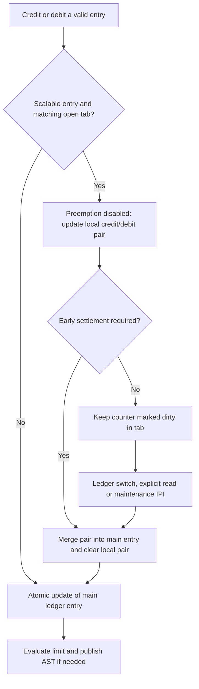
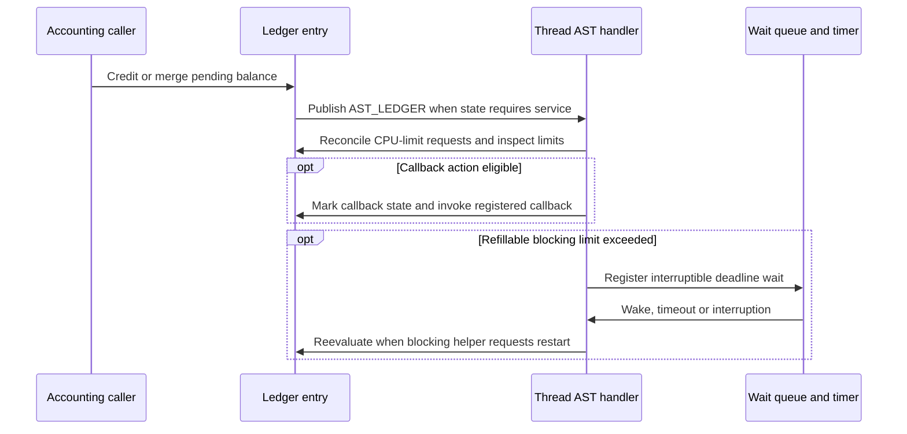

# Ledger balances, per-CPU settlement, and limit enforcement

[Runtime](README.md) · [Time and accounting](time-and-accounting.md) · [Recount](recount-and-resource-attribution.md) · [AST flavors](ast-flavors.md) · [Bank charging](../ipc/bank-accounts-and-charging.md)

A ledger is an owned set of resource entries. Clients credit/debit entries; selected features retain historical debits, peaks, periodic allowances or callback thresholds. Scalable entries can defer updates in a per-CPU tab, so a stored balance is not necessarily the final balance visible after settlement. Limit handling publishes AST work rather than invoking every policy callback inside the original accounting operation. This chapter follows common and ARM64 paths in `xnu-12377.121.6`.

## 1. Templates select representation and behavior

`ledger_template` describes entry names/groups/units, callbacks, allocation size, optional per-CPU tabs, and a lookup from tab counters to encoded entry IDs. `ledger_template_finalize()` assigns offsets/counter indices/features, determines storage size, and sets up the allocation backend. An entry ID is therefore not simply its ordinal in the template. A ledger instance contains an ID, template pointer, atomic reference count and variable entry storage. [Template definition](../../../platydoc-data/xnu/osfmk/kern/ledger.h#L243-L267), [finalization](../../../platydoc-data/xnu/osfmk/kern/ledger.c#L358-L438), [instance layout](../../../platydoc-data/xnu/osfmk/kern/ledger.c#L124-L165).

| Feature/representation | What a credit or debit means | Consequence |
| --- | --- | --- |
| Small entry, no `LFEAT_DEBIT` | The credit field is the balance. Debit subtracts directly from it. | Calling `ledger_debit()` does not require retaining a historical debit counter. |
| `LFEAT_DEBIT` | Credit and debit accumulate separately; balance is their difference. | Historical totals and current balance are different values. |
| `LFEAT_SCALABLE` | Eligible updates can first accumulate in a per-CPU credit/debit pair. | Reading main storage without settlement can omit deferred updates. |
| `LFEAT_MAXIMUM` | Tracks interval/lifetime balance peaks. | Needs large-entry storage and checks that may force early settlement. |
| `LFEAT_REFILL` | A period and last-refill timestamp define renewable allowance. | Implies historical debit and is incompatible with scalable entries and maximum tracking. |
| `LFEAT_CALLBACK` / diagnostic feature | Limit/warning state requests deferred callback work. | Uses action and already-reported flags, not a callback for every credit. |

The header documents feature compatibility; finalization normalizes selected options, removes scalable behavior for non-scalable templates, and adds debit for refill. Do not assume every documented incompatible pair has a separate runtime rejection: inspect the finalization checks when introducing a template. [Feature contracts](../../../platydoc-data/xnu/osfmk/kern/ledger.h#L112-L213), [normalization and allocation](../../../platydoc-data/xnu/osfmk/kern/ledger.c#L358-L438).

The small and large entries share initial fields but have different storage. Large entries add debit, limit, and a union for refill timing or maxima. `ledger_instantiate()` allocates zeroed storage, initializes references and defaults, including initially unlimited limits. Allocation/free may use the protected backend selected by the template/configuration; do not infer a universal ordinary-zone allocation for pmap ledgers. [Layouts](../../../platydoc-data/xnu/osfmk/kern/ledger.c#L133-L165), [instantiate/free](../../../platydoc-data/xnu/osfmk/kern/ledger.c#L489-L575).

## 2. Direct updates versus an open per-CPU tab

`ledger_credit()`/`ledger_debit()` validate the ledger/entry and require a positive amount; an invalid entry or nonpositive amount is a no-op in these void interfaces. Direct credit adds to the main credit field atomically. Direct debit either adds historical debit or subtracts from balance. The updates then evaluate applicable limit/callback state. [Public update path](../../../platydoc-data/xnu/osfmk/kern/ledger.c#L1179-L1213), [direct arithmetic](../../../platydoc-data/xnu/osfmk/kern/ledger.c#L966-L1007).

A template can instead maintain a `ledger_tab` per CPU. Each tab has one `lt_open` ledger pointer, a bitmask identifying dirty counters, a local array of credit/debit pairs, a reentrancy flag and a force-settle acknowledgement flag. The pair layout permits merging either a history-preserving debit or a net balance into the main entry. [Tab and pair representation](../../../platydoc-data/xnu/osfmk/kern/ledger.c#L87-L122).



For an eligible scalable update, preemption is disabled so the tab stays on the same CPU. If that tab is open for another ledger, the operation falls back to direct accounting rather than changing its owner implicitly. `lt_lock` protects against maintenance-IPI reentrancy while a local pair is being changed. If a force-settle request arrives during that region, the updater notices the pending acknowledgement after dropping the local guard and settles. [Local credit/debit paths](../../../platydoc-data/xnu/osfmk/kern/ledger.c#L1068-L1154).

`le_should_settle()` can discard a zero-net pair when no historical debit is needed. For maxima/callback entries it estimates pressure using main balance plus local balance multiplied by the CPU count. That expression is a trigger to flush; it is not a measured sum of all CPUs' pending tabs. Crossing a projected maximum, critical/warning transition or applicable diagnostic threshold can force settlement. [Early-flush decisions](../../../platydoc-data/xnu/osfmk/kern/ledger.c#L840-L879).

## 3. Opening, flushing, and remote acknowledgements

`ledger_tab_open()` requires preemption disabled. When changing to a different ledger it first settles a dirty tab, then publishes the new borrowed pointer. Pmap switches use this mechanism; the SPTM pmap path opens the corresponding pmap ledger. The tab does not itself retain the ledger: the caller must keep the ledger alive while it remains open. [Tab switch](../../../platydoc-data/xnu/osfmk/kern/ledger.c#L1713-L1730), [explicit lifetime contract](../../../platydoc-data/xnu/osfmk/kern/ledger.h#L680-L698), [ARM64 SPTM pmap integration](../../../platydoc-data/xnu/osfmk/arm64/sptm/pmap/pmap.c#L4395-L4410).

Local settlement walks dirty bits, resolves each bit through the template's counter lookup, copies and clears the pair, and merges it into the owning ledger. It intentionally processes even a zero amount because merging must re-evaluate state. Only after the stores are ordered does it clear the dirty mask and acknowledgement/reentrancy state.

[osfmk/kern/ledger.c, lines 1040–1064](../../../platydoc-data/xnu/osfmk/kern/ledger.c#L1040-L1064):

<!-- source-excerpt: ../../../platydoc-data/xnu/osfmk/kern/ledger.c#L1040-L1064 -->
```c
le_tab_settle(ledger_template_t lt, ledger_tab_t tab)
{
	ledger_t ledger = tab->lt_open;

	assert(!tab->lt_lock);
	os_atomic_store(&tab->lt_lock, true, compiler_acquire);

	for (uint64_t mask = tab->lt_mask; mask; mask &= mask - 1) {
		uint32_t      idx   = __builtin_ffsll(mask) - 1;
		uint32_t      entry = lt->lt_counter_lut[idx];
		ledger_pair_t pair  = tab->lt_pairs[idx];

		/*
		 * do -not- skip amount == 0, le_tab_{credit,debit}()
		 * relies on this performing the check again.
		 */

		tab->lt_pairs[idx].lp_pair = 0;
		le_tab_merge(ledger, entry, pair __ppl_only(, false));
	}

	os_atomic_thread_fence(release);
	tab->lt_mask = 0;
	tab->lt_ipi_and_lock = 0;
}
```

`ledger_tab_settle()` is a coordinated flush, not a lock around all future credits. In normal operation it requires interrupts enabled so the caller can itself service other CPUs' settlement requests. It disables preemption while scanning template tabs, flushes its own matching tab, and sends maintenance IPIs to remote matching dirty tabs. It then re-enables preemption before waiting for acknowledgements and finishes with an acquire fence. [Remote settlement](../../../platydoc-data/xnu/osfmk/kern/ledger.c#L1733-L1800).

A receiver settles immediately only when an acknowledgement is pending and its local reentrancy guard is clear. Otherwise the active updater services the request when safe. The public IPI acknowledgement routine here services the task-ledger template. These details matter when tracing a pmap update that cannot perform arbitrary policy work inline. [Acknowledgement handling](../../../platydoc-data/xnu/osfmk/kern/ledger.c#L1809-L1822), [deferred updater flush](../../../platydoc-data/xnu/osfmk/kern/ledger.c#L1068-L1154).

`ledger_get_entries()` normally settles a scalable entry before reading it; `LEO_NO_SETTLE` deliberately skips that step. The read rejects an invalid entry and restricts settling reads from interrupt context. Separate main credit/debit loads are not a Recount-style sequence transaction. New concurrent credits remain possible after the flush, so this operation must not be described as freezing all resource consumers. [Get entries/balance](../../../platydoc-data/xnu/osfmk/kern/ledger.c#L2089-L2148).

## 4. A concrete delayed-balance example

The local unit test constructs a scalable template and disables preemption while manipulating its tab. Its values expose the contract:

| Operation | Main balance read with `LEO_NO_SETTLE` | Why |
| --- | --- | --- |
| Direct credit 42, debit 30 | 12 | No tab is accumulating these updates. |
| Open tab, credit 1 and 100 | 12 | Pending pair holds the additional 101. |
| Settle matching tabs | 113 | Pending credits merged into main storage. |
| Debit 100 through open tab | 113 | Debit remains pending. |
| Open the tab for `NULL` | 13 | Changing owner settles the old ledger first. |
| Debit 1 after closing the tab | 12 | Direct fallback updates the main entry. |

This is the inspected test sequence, not a performance benchmark. The unit test was not run here. [Test body](../../../platydoc-data/xnu/tests/unit/test_ledgers.c#L57-L111).

## 5. Limits, refill, and publication of AST work

Changing a limit does not reset current consumption. `ledger_set_limit()` updates the threshold/warning state, clears callback/warning flags and calls the wake helper, which wakes recorded sleepers only when the balance satisfies the new limit. Changing to unlimited also disables automatic refill and blocking; changing a finite limit while refill is scheduled resets its last-refill anchor to zero. `ledger_set_period()` requires a finite limit, converts its nanosecond input to Mach ticks, resets current balance without decreasing historical totals, and schedules refill. [Limit mutation](../../../platydoc-data/xnu/osfmk/kern/ledger.c#L1447-L1488), [period configuration](../../../platydoc-data/xnu/osfmk/kern/ledger.c#L1621-L1665).

`ledger_refill()` serializes competing refills with `LF_REFILL_INPROGRESS`. It counts completed periods, computes the allowance to restore, caps that restoration to the outstanding balance, and advances the historical debit rather than overwriting the credit history. It updates the time anchor, clears callback state where appropriate, and wakes recorded sleepers when the balance is at or below the limit. Refilling an allowance is therefore an accounting debit, not a backwards movement of the execution counter. [Refill](../../../platydoc-data/xnu/osfmk/kern/ledger.c#L645-L727).

The update/check path requests `AST_LEDGER` when limit/warning state requires service. Normal current-thread publication also propagates to the CPU AST state. Scheduler accounting has a special override: `ledger_credit_sched()` temporarily identifies the thread whose time is being charged, so the AST belongs to that thread even while another execution context performs the update. The protected-monitor path can defer publication through the tab's PPL AST field. These are separate implementation branches, not an implication that all ARM64 ledgers run inside that monitor. [AST producer](../../../platydoc-data/xnu/osfmk/kern/ledger.c#L729-L824), [scheduler override](../../../platydoc-data/xnu/osfmk/kern/ledger.c#L1223-L1236), [tab deferred publication](../../../platydoc-data/xnu/osfmk/kern/ledger.c#L1713-L1730).



`ledger_ast()` snapshots policy inputs under the relevant locks, applies/removes per-thread CPU limits, checks whether the thread remains active, then evaluates thread/task/coalition ledger state. It retains and releases the coalition ledger while using it. The callback scan considers critical, warning and diagnostic state; already-reported flags suppress redundant delivery. The actual blocking helper is applied to thread/task ledgers in this path. Do not infer a coalition wait loop merely because its limits are checked. [AST body](../../../platydoc-data/xnu/osfmk/kern/ledger.c#L1825-L1962), [callback scan](../../../platydoc-data/xnu/osfmk/kern/ledger.c#L1965-L2031).

Blocking is restricted to eligible refill entries with a blocking action and an exceeded limit. It registers an interruptible wait ending at `last_refill + refill_period`, marks `LF_WAKE_NEEDED`, and blocks with reason `AST_LEDGER`. A `THREAD_AWAKENED` result requests a full AST restart because policy, other resources or thread lifetime may have changed. Other results take the helper's continue path; it is inaccurate to claim every wake/timeout restarts identically. [Blocking decisions](../../../platydoc-data/xnu/osfmk/kern/ledger.c#L2035-L2084). The [AST flavor chapter](ast-flavors.md) explains where `AST_LEDGER` is consumed on the return-to-user route.

## 6. Ownership and configuration boundaries

A thread's cached task ledger receives a reference during creation and loses it during destruction; task and bank owners have their own references. That reference lifetime is distinct from template lifetime and from the borrowed pointer in an open tab. The final ledger dereference frees instance storage through its selected backend. [Thread acquisition](../../../platydoc-data/xnu/osfmk/kern/thread.c#L1449-L1455), [thread release](../../../platydoc-data/xnu/osfmk/kern/thread.c#L780-L783), [ledger reference/free](../../../platydoc-data/xnu/osfmk/kern/ledger.c#L539-L575).

| Selected condition | Consequence |
| --- | --- |
| Scalable template/entry | Enables delayed per-CPU accounting; refill entries use a different representation/contract. [Finalize](../../../platydoc-data/xnu/osfmk/kern/ledger.c#L358-L438). |
| Positive-balance assertions | Development/assertion options can detect invalid negative balances; this is not an unconditional production policy for every resource. [Feature definition](../../../platydoc-data/xnu/osfmk/kern/ledger.h#L127-L129), [configuration](../../../platydoc-data/xnu/osfmk/kern/ledger.c#L172-L173). |
| Diagnostic ledger feature | Controls additional threshold fields/callback behavior. [Feature guards](../../../platydoc-data/xnu/osfmk/kern/ledger.h#L163-L170). |
| `CONFIG_SCHED_RT_ALLOW` | Adds reconciliation of requested CPU-limit changes in the AST handler. [AST branch](../../../platydoc-data/xnu/osfmk/kern/ledger.c#L1825-L1877). |
| Bank bills | Use a non-scalable template and their own ownership/settlement lifecycle. [Bank companion](../ipc/bank-accounts-and-charging.md). |

This review follows template setup, direct/scalable updates, settlement, period/limit mutations, selected AST policy and final release. Client callbacks decide the actual resource policy; a generic ledger does not itself define a process memory budget, jetsam policy, every coalition limit, or all scheduler CPU-limit interfaces.

<!-- BEGIN PLATYDOC DOCUMENTATION LICENSE -->
Original Platydoc text and diagrams are licensed under [CC BY 4.0](https://creativecommons.org/licenses/by/4.0/). Quoted source code and third-party material retain their respective licenses.
<!-- END PLATYDOC DOCUMENTATION LICENSE -->
