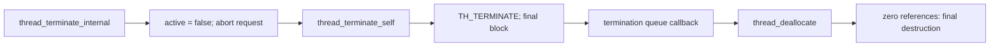

# Objects and lifecycle

[Runtime overview](README.md) · [Next: scheduling](scheduling.md)

The [scheduler execution chapter](scheduler-execution.md#6-departure-quantum-and-final-termination) follows the final timer drain, off-CPU transition, and `TH_TERMINATE2` reaping boundary in detail.

## Four objects to distinguish

| Object | Fields worth locating first | Meaning |
|---|---|---|
| `struct task` | `lock`, `ref_count`, `active`, `map`, `threads`, `thread_count`, `active_thread_count`, `itk_space`, `ledger` | Resource container and membership owner. A task can contain many threads sharing its address space and IPC namespace. [`task.h`](../../../xnu/osfmk/kern/task.h#L277). |
| `struct thread` | `state`, `sched_lock`, `mutex`, `wait_event`, `waitq`, `continuation`, `kernel_stack`, `machine`, `sched_pri`, `base_pri`, `map`, `t_tro` | Execution state plus the scheduler's runnable/waiting metadata. [`thread.h`](../../../xnu/osfmk/kern/thread.h#L399). |
| `struct processor` | `state`, `active_thread`, `idle_thread`, `processor_set`, `current_pri`, `runq` | One scheduler-visible CPU and cached information used to place/preempt work. [`processor.h`](../../../xnu/osfmk/kern/processor.h#L472). |
| `struct processor_set` | `sched_lock`, CPU bitmaps, `pset_runq`, `rt_runq`, `pset_clutch_root`, `pset_type` | Shared scheduling domain, queues, and CPU state. On AMP builds, initialization creates virtual psets from hardware clusters; avoid assuming a universal one-cluster/one-pset mapping. [`processor.h`](../../../xnu/osfmk/kern/processor.h#L234), [`sched_init()`](../../../xnu/osfmk/kern/sched_prim.c#L451). |

The read-only-zone object `thread_ro` stores linkage to `tro_task`, and, with BSD, `tro_proc`, `tro_proc_ro`, and credentials. Its lifetime is one-to-one with the thread; a thread reference permits access to this object. Use `get_threadtask()` and the provided accessors instead of assuming a portable direct `thread->task` field. Some architecture-specific compatibility fields differ. [`thread.h`, `thread_ro`](../../../xnu/osfmk/kern/thread.h#L176).

Processor state is also a protocol, not just a status label. The documented transitions include `OFF_LINE`, `START`, `RUNNING`, `IDLE`, `DISPATCHING`, and `PENDING_OFFLINE`. External placement can request dispatch, but the target CPU acknowledges the transition to running. The pset scheduling lock protects processor state; cached priority and deadline must be meaningful while dispatching/running so another CPU can assess preemption. [`processor.h`, state-machine comment](../../../xnu/osfmk/kern/processor.h#L105).

## Creating a task and its first thread

`task_create_internal()` initializes a supplied `child_task` object. It instantiates a task ledger, then either calls `vm_map_fork()` when inheriting memory or creates a pmap and map. The inheritance condition also distinguishes corpse forks. It initializes the task lock, thread queue, counters, and active state; later code sets up IPC, policy, coalition membership, and resource ownership metadata. This function is the Mach resource initialization layer, not a complete description of BSD `fork` or `exec`. [`task.c`](../../../xnu/osfmk/kern/task.c#L1376).

`thread_create_internal()` is a particularly useful reading exercise because its end state is deliberately not “a running user thread”:

1. Allocate a zone-backed thread, initialize its template state, establish two initial references, and call `machine_thread_create()`.
2. Initialize BSD `uthread` information, locks, thread IPC, and `thread_ro`; store the continuation and parameter.
3. Take `tasks_threads_lock` and the parent task lock. Reject inactive/halting parents, forbidden suspension cases, and thread-count limits.
4. Retain the parent task, create a thread ledger, retain the task ledger, cache the map, and allocate wait/depression timers.
5. Initialize scheduler mode, priorities, policy, and thread group; link the thread into task/global lists; allocate its reusable turnstile.

The function explicitly returns **both the task lock and `tasks_threads_lock` held on success**. Its wrappers complete setup and release them. Reading it as an ordinary unlocked constructor would miss a major publication contract. [`thread.c`, `thread_create_internal()` and callers](../../../xnu/osfmk/kern/thread.c#L1260).

## Suspension and execution control

[Suspension, stopping and aborting threads](suspension-stop-and-abort.md) follows task/thread hold aggregation, the legacy and token interfaces, PID suspension, off-CPU waits and AST_APC parking. It distinguishes a reference keeping an object alive from a hold preventing user execution, and task send-once tokens from the ordinary-send tokens used by `thread_suspend2`.

## Termination is staged

`thread_terminate_internal()` holds the thread mutex, marks it inactive, requests an abort, and clears an interruptible wait or starts a never-started thread so it can terminate. For another thread, it waits for the stop protocol. `thread_terminate()` rejects attempts to terminate an arbitrary kernel thread: kernel threads must cooperate in their own termination. [`thread_act.c`](../../../xnu/osfmk/kern/thread_act.c#L285).

`thread_terminate_self()` runs on the dying thread. It disables its IPC access, resets policy/work-interval state, cancels wait and depression timers, and waits for concurrent timer expirations to finish. It then sets `TH_TERMINATE`, marks an uninterruptible wait, and blocks permanently. Assertions check that lock counts, priority promotions, and work-interval state have been unwound. This is why “inactive” and “memory freed” are separate observations. [`thread.c`](../../../xnu/osfmk/kern/thread.c#L462).

The termination daemon callback `thread_terminate_queue_invoke()` rolls usage into the task, removes task/global membership, and drops a reference. Crash inspection can defer this reaping. `thread_deallocate_complete()` requires zero references and `TH_TERMINATE2`, then destroys IPC/uthread state, ledgers, the returned turnstile, voucher, stacks, machine state, and remaining allocations. `thread_deallocate_safe()` queues final release when freeing directly would be unsuitable. [`thread.c`, reap](../../../xnu/osfmk/kern/thread.c#L999), [`thread.c`, release](../../../xnu/osfmk/kern/thread.c#L719).

Task termination follows the same separation. `task_terminate_internal()` holds the task, sets `active = FALSE`, disables task-port operations, requests termination of every member thread, tears down resources, terminates the VM map, moves the task to the terminated list, and drops its active reference. Its comment requires the VM map and IPC space to exist until this operation returns because port-to-map/space conversions depend on that contract. Final `task_deallocate_internal()` asserts that thread membership is empty, the BSD association is gone, IPC space is inactive, and active-thread count is zero. [`task.c`, termination](../../../xnu/osfmk/kern/task.c#L2982), [`task.c`, final release](../../../xnu/osfmk/kern/task.c#L1997).

## Lifetime and locking rules that matter when reading

Reference counts keep storage alive; locks protect mutable state. The task lock, thread mutex, and thread scheduling lock are different locks with different callers. Global lists use `tasks_threads_lock`. Follow the local acquisition order rather than inferring a global order from one function. For example, task termination orders two task locks by address when the caller belongs to another task. [`task.c`](../../../xnu/osfmk/kern/task.c#L2993).

The thread run-queue field has an unusually explicit rule: when null, the thread lock protects it; when non-null, the corresponding run-queue lock protects it. Transitioning from null to non-null requires both locks, whereas clearing it can happen without the thread lock. The source therefore requires the `thread_get/set/clear_runq*()` helpers. The union containing runnable, wait, and daemon queue links is another warning against casually inspecting a thread without knowing its current state. [`thread.h`](../../../xnu/osfmk/kern/thread.h#L406).

For reference debugging, continue with [`task_ref.c`](../../../xnu/osfmk/kern/task_ref.c) and the original [task-reference guide](../../../xnu/doc/debugging/task_ref.md). For a scheduler trace, continue at [`thread_block_reason()`](../../../xnu/osfmk/kern/sched_prim.c#L3874), where object state becomes a context-switch decision.

<!-- BEGIN PLATYDOC DOCUMENTATION LICENSE -->
Original Platydoc text and diagrams are licensed under [CC BY 4.0](https://creativecommons.org/licenses/by/4.0/). Quoted source code and third-party material retain their respective licenses.
<!-- END PLATYDOC DOCUMENTATION LICENSE -->
