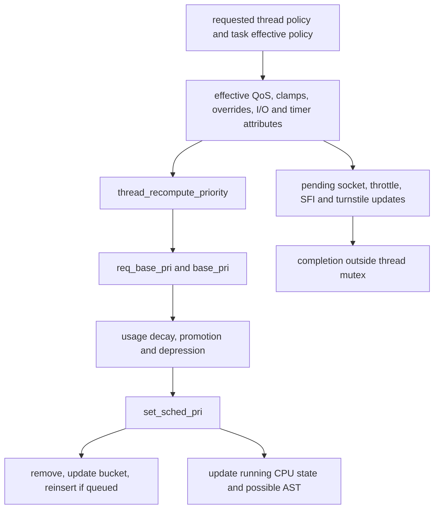

# Priority, QoS, timeshare decay, and quantum expiration

[Runtime](README.md) · [Execution path](scheduler-execution.md) · [Clutch and Edge](clutch-and-edge.md) · [Realtime policy](realtime-deadlines-and-runqueues.md)

A thread's requested QoS is an input to several policies, not the number directly compared at every scheduling decision. XNU computes effective policy, derives a base priority, applies timeshare usage and temporary promotions/depressions, and updates queue placement and processor state. Quantum expiration then accounts for execution, checks excessive fixed/realtime computation, updates priority, and requests preemption when the selection rules require it. Expiration does not unconditionally switch to another thread. [`thread_policy.c`](../../../xnu/osfmk/kern/thread_policy.c#L1623-L1908), [`priority.c`](../../../xnu/osfmk/kern/priority.c#L96-L271), [`set_sched_pri()`](../../../xnu/osfmk/kern/sched_prim.c#L5990-L6110).

This chapter follows that pipeline. The [execution chapter](scheduler-execution.md) owns the mechanics of choosing, switching, and departing; the [Clutch chapter](clutch-and-edge.md) owns the runnable hierarchy. Here the question is why the numbers and time budgets passed into those mechanisms change.

## 1. Keep requested policy, base priority, and scheduled priority distinct

| State | What the inspected implementation uses it for |
|---|---|
| `requested_policy` | Thread requests and override inputs. Effective recomputation takes a snapshot and does not rewrite this snapshot to implement a clamp. [`thread_policy.c`](../../../xnu/osfmk/kern/thread_policy.c#L1623-L1695). |
| `effective_policy` | Combined task/thread state: QoS, relative priority, background restrictions, I/O tier, timer/throughput attributes, work-interval-driven policy, and promotion exceptions. [`thread_policy.c`](../../../xnu/osfmk/kern/thread_policy.c#L1696-L1853). |
| `req_base_pri` | Latest priority supplied to the base-priority setter. It can differ from effective `base_pri` while base priority is frozen. [`priority.c`](../../../xnu/osfmk/kern/priority.c#L284-L326). |
| `base_pri`, `max_priority`, `task_priority` | Effective starting point and task-derived constraints, before scheduler usage decay and kernel promotion rules. [`thread.h`](../../../xnu/osfmk/kern/thread.h#L593-L622), [`thread_recompute_priority()`](../../../xnu/osfmk/kern/thread_policy.c#L1054-L1183). |
| `sched_pri` | Priority used by runnable-thread queues and processor state; derived from base priority plus usage/promotion/depression rules. [`priority.c`](../../../xnu/osfmk/kern/priority.c#L383-L432). |
| `sched_mode`, `saved_mode`, demotion flags | Actual scheduling mode and requested mode retained while one or more temporary demotions are active. [`priority.c`](../../../xnu/osfmk/kern/priority.c#L936-L1111). |
| `sched_usage`, `cpu_usage`, `cpu_delta`, `sched_time_save`, `pri_shift`, `sched_stamp` | Usage collection/aging and the load-dependent conversion from accumulated usage into priority reduction. These are not interchangeable with a lifetime CPU-time ledger. [`priority.c`](../../../xnu/osfmk/kern/priority.c#L458-L745), [`sched_tick_delta`](../../../xnu/osfmk/kern/sched.h#L434-L448). |

The priority ranges themselves are defined in `sched.h`: ordinary runnable queues include priorities through `MAXPRI_PROMOTE`/`MAXPRI_KERNEL` 95; realtime queues start at `BASEPRI_RTQUEUES` 97. `BASEPRI_REALTIME` is the separate boundary constant 96. Use the specific constant checked by a path rather than treating these two names as synonyms. [`sched.h`](../../../xnu/osfmk/kern/sched.h#L142-L181), [`dispatch classification`](../../../xnu/osfmk/kern/sched_prim.c#L5617-L5632).

## 2. Effective QoS is recomputed before CPU priority

`thread_policy_update_internal_spinlocked()` starts with requested QoS. For a specified request it takes the maximum of the applicable override/promotion sources, including kevent, workloop-service, and workqueue inputs. A background task can allow a synchronous waiter's promotion above its clamp for this thread. Task QoS clamp and ceiling are applied separately; a clamp can create an effective QoS even for an unspecified request, and it disables work-interval-driven priority. The outbound-promotion QoS is captured before later ceiling/background effects. [`thread_policy.c`](../../../xnu/osfmk/kern/thread_policy.c#L1623-L1703).

Relative priority is retained only under the body's explicit conditions: requested QoS is specified, requested QoS equals the computed effective QoS, and `thrp_qos_override` is unspecified. The surrounding comment discusses boosting broadly, but the actual predicate tests that particular override field; do not replace it with an invented test that every possible promotion source is absent. Later background handling may still reset effective QoS and relative priority. [`thread_policy.c`](../../../xnu/osfmk/kern/thread_policy.c#L1704-L1760).

I/O, latency, throughput, and socket policy are calculated alongside QoS. The same table that supplies starting CPU priorities supplies I/O and timer-related tiers. A QoS change may therefore require work outside the scheduler, including rethrottling and socket background updates. Termination policy clears selected throttles to avoid slowing exit. After accounting for time under the old QoS, the code publishes the new effective-policy structure and records deferred work in a pending token. [`thread_policy.c`](../../../xnu/osfmk/kern/thread_policy.c#L78-L133), [`policy combination/publication`](../../../xnu/osfmk/kern/thread_policy.c#L1762-L1866).

The thread mutex and scheduler thread lock protect the relevant mutation stages, but effects that cannot run while holding the mutex are completed afterward. `thread_policy_update_complete_unlocked()` calls back into the affected subsystem to obtain current policy; its contract is to run sometime after publication, rather than to carry an immutable full policy snapshot to every subsystem. Priority-chain propagation is also deferred when needed. This separates publishing scheduler-visible policy from completing its non-scheduler effects. [`tasklocked update`](../../../xnu/osfmk/kern/thread_policy.c#L1186-L1233), [`completion contract`](../../../xnu/osfmk/kern/thread_policy.c#L1930-L1978).



## 3. From effective QoS to base priority

`thread_recompute_priority()` first handles realtime mode, then applicable non-realtime work-interval priority, then effective QoS, and finally legacy task-relative importance. The QoS table begins UI at 46, initiated at 37, default/legacy at 31, utility at 20, and background/maintenance at 4. Frontmost interactive urgency adds one to the UI result. The numbers describe this table, not a guaranteed observed `sched_pri` for every thread carrying that class. [`thread_policy.c`](../../../xnu/osfmk/kern/thread_policy.c#L78-L94), [`priority derivation`](../../../xnu/osfmk/kern/thread_policy.c#L1054-L1128).

Relative priority is scaled to the gap between neighboring QoS bases, using integer arithmetic; it is not simply added as an unscaled negative integer. For example, with default base 31, utility base 20, and relative priority -15, the formula subtracts `(11 * 15) >> 4`, producing base 21 before subsequent constraints. This is a conceptual calculation from the current constants, not a measurement of a running thread. [`thread_qos_scaled_relative_priority()`](../../../xnu/osfmk/kern/thread_policy.c#L207-L254).

[thread_policy.c, lines 243–254](../../../xnu/osfmk/kern/thread_policy.c#L243-L254)

<!-- source-excerpt: ../../../xnu/osfmk/kern/thread_policy.c#L243-L254 -->
```c
	int prio_range_max = thread_qos_policy_params.qos_pri[qos];
	int prio_range_min = next_lower_qos ? thread_qos_policy_params.qos_pri[next_lower_qos] : 0;

	/*
	 * We now have the valid range that the scaled relative priority can map to. Note
	 * that the lower bound is exclusive, but the upper bound is inclusive. If the
	 * range is (21,31], 0REL should map to 31 and -15REL should map to 22. We use the
	 * fact that the max relative priority is -15 and use ">>4" to divide by 16 and discard
	 * remainder.
	 */
	int scaled_relprio = -(((prio_range_max - prio_range_min) * (-qos_relprio)) >> 4);

```

Legacy importance is bounded before adding task priority. The result is raised for applicable user promotion, clamped to task maximum/minimum, then selectively allowed above the task maximum for work-interval or promote-above-task policy. A failsafe-demoted realtime thread gets the depression priority in this path; termination can raise priority again to speed exit. Non-macOS builds impose their additional minimum. The ordering matters: these are not independent flags whose effects can be summed in arbitrary order. [`thread_policy.c`](../../../xnu/osfmk/kern/thread_policy.c#L1114-L1183).

`sched_set_thread_base_priority()` records the request even when `TH_SFLAG_BASE_PRI_FROZEN` prevents lowering effective base priority. It updates runnable-priority-change timing and notifies performance control when the running thread's base changes. For non-Clutch policy it updates the scheduling bucket here; for Clutch it defers bucket movement to the scheduled-priority update, where queue removal can be coordinated. [`priority.c`](../../../xnu/osfmk/kern/priority.c#L284-L330).

## 4. Usage decay and promotion produce scheduled priority

`thread_recompute_sched_pri()` starts from base priority, invokes the policy's timeshare calculation only for timeshare mode, then applies depression and promotion ordering. Full `TH_SFLAG_DEPRESS` wins over kernel mutex promotion; poll depression can be overridden by kernel promotion and priority-floor reasons. Non-realtime kernel promotion is capped at `MAXPRI_PROMOTE`; rwlock, waitq, exec, and explicit floor flags supply their respective minimum priorities. These kernel scheduler priorities are distinct from the user-policy promotion that influenced base priority. [`priority.c`](../../../xnu/osfmk/kern/priority.c#L383-L432), [turnstile propagation](wait-and-turnstile-protocols.md).

The common timeshare formula subtracts `sched_usage >> pri_shift` from base priority unless `pri_shift == INT8_MAX`, which means no decay penalty. The macOS/Clutch branch clamps the result to the user minimum and kernel maximum. The non-macOS, non-Clutch branch additionally limits the decay band and has background-floor behavior. Describing all builds as having one fixed decay floor would miss this preprocessor distinction. [`priority.c`](../../../xnu/osfmk/kern/priority.c#L550-L612).

[priority.c, lines 594–611](../../../xnu/osfmk/kern/priority.c#L594-L611)

<!-- source-excerpt: ../../../xnu/osfmk/kern/priority.c#L594-L611 -->
```c
int
sched_compute_timeshare_priority(thread_t thread)
{
	/* start with base priority */
	int priority = thread->base_pri;

	if (thread->pri_shift != INT8_MAX) {
		priority -= (thread->sched_usage >> thread->pri_shift);
	}

	if (priority < MINPRI_USER) {
		priority = MINPRI_USER;
	} else if (priority > MAXPRI_KERNEL) {
		priority = MAXPRI_KERNEL;
	}

	return priority;
}
```

`sched_tick_delta()` consumes the difference in Recount thread execution time since `sched_time_save`, then advances that saved value. The lightweight update is allowed only for the current, nonqueued thread. It accumulates timeshare usage only when the previous `pri_shift` indicates contention, records CPU delta, updates configured Clutch group usage, and recomputes priority lazily. On SMT builds a `NO_SMT` thread can accumulate an additional fraction because occupying a whole core denies its sibling execution. [`sched.h`](../../../xnu/osfmk/kern/sched.h#L434-L448), [`priority.c`](../../../xnu/osfmk/kern/priority.c#L458-L500).

A full `update_priority()` runs when global `sched_tick` differs from `sched_stamp`. It first gathers usage under the *previous* window's contention decision, applies shift-table aging approximating `(5/8)^ticks`, and clears old usage entirely once the age exceeds the table's covered interval. It then installs the current load-dependent shift and recomputes timeshare priority. `cpu_delta` exists so lightweight accounting can later join the aged CPU-usage value without double counting. Failsafe release is checked during this full update. [`priority.c`](../../../xnu/osfmk/kern/priority.c#L504-L745).

The nominal scheduler tick is 125 ms (`SCHED_TICK_SHIFT == 3`), not the thread quantum. The maintenance continuation calculates elapsed pseudo-ticks, bounds unusually large deltas, updates averages, scans normal and realtime queues, reports runnable latency, and sleeps again. Wake checks are made from quantum/switch/idle paths. Queue scans gather referenced candidate threads under runqueue locks; processing later takes each thread lock, updates if still appropriate, and releases the reference. This avoids performing every priority change while holding the queue being scanned. [`sched.h`](../../../xnu/osfmk/kern/sched.h#L358-L368), [`maintenance`](../../../xnu/osfmk/kern/sched_prim.c#L6728-L6869), [`candidate processing`](../../../xnu/osfmk/kern/sched_prim.c#L6937-L7036).

## 5. Clutch and dualq do not measure contention at the same scope

In the non-Clutch timeshare path, `compute_sched_load()` samples runnable counts by bucket and available CPU count. It limits contributions from lower classes to higher ones, normalizes load, and applies an exponentially weighted average. `compute_averages()` converts that load into `sched_pri_shifts`. The reads are atomic snapshots of separate counters; the implementation explicitly truncates inconsistent combinations produced by concurrent updates. This is approximate policy accounting, not a global transaction over every runnable thread. [`sched_average.c`](../../../xnu/osfmk/kern/sched_average.c#L178-L304).

Clutch instead takes the thread's shift from its thread-group × scheduling-bucket group, shared across clusters. Its update subtracts one from that group's runnable/running count, divides by available CPU count, bounds the load index, and derives the shift. This allows a workload with at most CPU-width parallelism to avoid internal decay. Threads ineligible for the Clutch hierarchy return `INT8_MAX`. Root-bucket deadline/warp policy and group interactivity still choose among workloads; the usage decay discussed here orders threads within that policy rather than replacing it. [`sched_clutch.c`](../../../xnu/osfmk/kern/sched_clutch.c#L2097-L2129), [`thread shift lookup`](../../../xnu/osfmk/kern/sched_clutch.c#L3096-L3115), [hierarchy selection](clutch-and-edge.md).

[sched_clutch.c, lines 2118–2128](../../../xnu/osfmk/kern/sched_clutch.c#L2118-L2128)

<!-- source-excerpt: ../../../xnu/osfmk/kern/sched_clutch.c#L2118-L2128 -->
```c
	if (sched_ts < current_sched_ts) {
		os_atomic_store(&clutch_bucket_group->scbg_timeshare_tick, current_sched_ts, relaxed);
		/* NCPU wide workloads should not experience decay */
		uint64_t bucket_group_run_count = os_atomic_load_wide(&clutch_bucket_group->scbg_blocked_data.scct_count, relaxed) - 1;
		uint32_t bucket_group_load = (uint32_t)(bucket_group_run_count / processor_avail_count);
		bucket_group_load = MIN(bucket_group_load, NRQS - 1);
		uint32_t pri_shift = sched_fixed_shift - sched_load_shifts[bucket_group_load];
		/* Ensure that the pri_shift value is reasonable */
		pri_shift = (pri_shift > SCHED_PRI_SHIFT_MAX) ? INT8_MAX : pri_shift;
		os_atomic_store(&clutch_bucket_group->scbg_pri_shift, pri_shift, relaxed);
	}
```

`set_sched_pri()` handles the resulting placement mutation. A queued non-current thread is removed before its priority and, for Clutch, bucket change; it is then reinserted with preemption/tail options. The current thread has no runqueue membership to remove: a nonlazy priority drop checks whether it should leave the CPU, while a lazy update still refreshes processor state. A remote running thread can receive an AST check. Equal-priority updates usually return early, with a specific initial-Clutch-bucket exception. [`sched_prim.c`](../../../xnu/osfmk/kern/sched_prim.c#L5990-L6110).

## 6. Quantum size is policy input, not a fixed universal timeslice

`thread_quantum_init()` uses realtime computation for realtime mode and `SCHED(initial_quantum_size)` otherwise. Realtime and fixed modes are capped by their unsafe-computation thresholds. With CPU-limit integration enabled, a positive remaining ledger allowance can shorten the quantum; if none remains, the ledger system handles blocking rather than this helper installing a zero-length quantum. The helper asserts a positive value fitting `uint32_t`. [`sched_prim.c`](../../../xnu/osfmk/kern/sched_prim.c#L4050-L4086).

For dualq/AMP-style common timeshare policy, default boot tunables give a 10-ms ordinary quantum and 2.5-ms background quantum. Clutch uses an explicit bucket table: on macOS FIXPRI/FG/IN/DF each get 10 ms, utility 4 ms, background 2 ms; other targets use 8 ms initiated and 6 ms default while retaining the other listed values. Those are starting values in this source, affected by the mode/CPU-limit logic and remaining-quantum accounting. [`sched_prim.c`](../../../xnu/osfmk/kern/sched_prim.c#L144-L148), [`timeshare initialization`](../../../xnu/osfmk/kern/sched_prim.c#L560-L581), [`Clutch quantum table`](../../../xnu/osfmk/kern/sched_clutch.c#L232-L252), [`Clutch lookup`](../../../xnu/osfmk/kern/sched_clutch.c#L3286-L3293).

At expiration, `thread_quantum_expire()` first credits task/thread/bank ledgers before taking the thread lock, because ledger activity could try to wake this very thread. It snapshots Recount state, updates processor/thread dispatch times, evaluates failsafe, refreshes priority, clears `first_timeslice`, creates a new quantum, and asks `csw_check()` whether preemption is warranted. It propagates other ASTs, rearms the running timer, and emits platform/performance-control updates. The body explicitly notes that its ledger credit uses the nominal remaining quantum rather than fully correcting timer-firing lateness. [`priority.c`](../../../xnu/osfmk/kern/priority.c#L96-L271).

[priority.c, lines 213–219](../../../xnu/osfmk/kern/priority.c#L213-L219)

<!-- source-excerpt: ../../../xnu/osfmk/kern/priority.c#L213-L219 -->
```c
	processor->first_timeslice = FALSE;

	thread_quantum_init(thread, ctime);

	timer_update(&thread->runnable_timer, ctime);

	processor->quantum_end = ctime + thread->quantum_remaining;
```

The old thread's switch-away path can retain unused quantum while still in its first timeslice; a priority drop since dispatch prevents that retention. A tiny non-realtime remainder is treated as expired but carried into the next budget. Realtime exhaustion assigns a sentinel deadline. These rules explain why a context switch, a quantum interrupt, and exhaustion of an application's useful work are different events. [`sched_prim.c`](../../../xnu/osfmk/kern/sched_prim.c#L3578-L3624), [departure and requeue](scheduler-execution.md#6-departure-quantum-and-final-termination).

## 7. Nonurgent preemption requests get a bounded grace mechanism

`csw_check_locked()` considers unrecommended CPUs, realtime spill/queue state, policy-specific queue competition, avoid-processor policy, SMT rebalance, suspension, and configured SFI. Realtime queued work can request urgent or ordinary preemption depending on priorities, first-timeslice state, and deadlines. Eager-preempt state upgrades selected policy preemptions. A check produces AST bits; it does not directly transfer control to another thread. [`sched_prim.c`](../../../xnu/osfmk/kern/sched_prim.c#L5759-L5842).

For an ordinary nonurgent preemption while interrupted in kernel space, `update_pending_nonurgent_preemption()` can arm a short running timer so the thread gets a grace interval to release locks or return to user space. The default tunable is 50 microseconds. An interruption of user space is upgraded to urgent immediately; an already armed timer is not duplicated. Expiration clears the pending state, locks the current thread, and rechecks with `AST_URGENT`, so it does not force a switch based solely on an obsolete earlier queue observation. Kernel AST handling also refuses to preempt a thread already preparing to block. [`sched_prim.c`](../../../xnu/osfmk/kern/sched_prim.c#L140-L142), [`nonurgent timer`](../../../xnu/osfmk/kern/sched_prim.c#L5683-L5753), [`expiration`](../../../xnu/osfmk/kern/sched_prim.c#L5924-L5958), [`ast_taken_kernel()`](../../../xnu/osfmk/kern/ast.c#L119-L158).

## 8. Excessive computation demotes mode and later restores it

The quantum callback evaluates failsafe only for realtime/fixed mode and excludes system-critical threads, kernel-priority promotion, and promotion-reason flags. It computes recent execution from the computation epoch plus metered segments and subtracts interrupt time outside the thread's control. Exceeding the mode-specific threshold sets `safe_release` and adds `TH_SFLAG_FAILSAFE`. Thresholds are multiples of the policy's null-thread quantum; target XR uses different realtime defaults and safe multipliers. These are source-selected policies, not one universal “realtime threads may run for N milliseconds” rule. [`priority.c`](../../../xnu/osfmk/kern/priority.c#L153-L195), [`tunables`](../../../xnu/osfmk/kern/sched_prim.c#L150-L164), [`threshold construction`](../../../xnu/osfmk/kern/sched_prim.c#L584-L622).

Demotion removes a queued thread, saves its prior mode, changes actual mode to timeshare, recomputes priority, and reinserts if necessary. If another demotion reason already exists, it adds the reason without overwriting the saved mode. Undemotion removes only its own reason; it restores the saved mode only after all reasons are gone. A user mode change during demotion changes `saved_mode`, preserving the distinction between requested and actual execution policy. Full priority updates clear failsafe after `safe_release`, and reporting is deferred outside scheduler locks. [`priority.c`](../../../xnu/osfmk/kern/priority.c#L972-L1111), [`release check`](../../../xnu/osfmk/kern/priority.c#L715-L722), [`deferred reporting`](../../../xnu/osfmk/kern/sched_prim.c#L6950-L7018).

[priority.c, lines 1031–1052](../../../xnu/osfmk/kern/priority.c#L1031-L1052)

<!-- source-excerpt: ../../../xnu/osfmk/kern/priority.c#L1031-L1052 -->
```c
	if (thread->sched_flags & TH_SFLAG_DEMOTED_MASK) {
		/* Another demotion reason is already active */
		thread->sched_flags |= reason;
		return;
	}

	assert(thread->saved_mode == TH_MODE_NONE);

	boolean_t removed = thread_run_queue_remove(thread);

	thread->sched_flags |= reason;

	thread->saved_mode = thread->sched_mode;

	sched_set_thread_mode(thread, TH_MODE_TIMESHARE);

	thread_recompute_priority(thread);

	if (removed) {
		thread_run_queue_reinsert(thread, SCHED_TAILQ);
	}
}
```

This per-thread demotion is separate from the ARM64 recommended-core failsafe, which changes CPU availability recommendations when maintenance is starved. That second mechanism is covered in [CPU eligibility](cpu-eligibility-and-scheduler-variants.md); confusing them would obscure whether a trace shows a thread's mode changing or additional CPUs becoming eligible.

## Sources inspected and limits

Deep review covered policy composition/publication and deferred completion, QoS scaling/base-priority ordering, scheduled-priority promotion/decay, common and Clutch contention shifts, maintenance candidate processing, quantum initialization/expiration/departure, nonurgent preemption, and stacked failsafe demotion/release. Follow one QoS change through `thread_policy_update_internal_spinlocked()` → `thread_recompute_priority()` → `sched_set_thread_base_priority()` → `thread_recompute_sched_pri()` → `set_sched_pri()`, then compare a quantum update of the same thread.

Every policy flavor, all BSD workqueue override producers, every CPU-limit ledger action, and full performance-controller behavior remain outside this selected trace. No timing measurements or scheduler workload tests were run; example numbers are arithmetic from this checkout's constants.

<!-- BEGIN PLATYDOC DOCUMENTATION LICENSE -->
Original Platydoc text and diagrams are licensed under [CC BY 4.0](https://creativecommons.org/licenses/by/4.0/). Quoted source code and third-party material retain their respective licenses.
<!-- END PLATYDOC DOCUMENTATION LICENSE -->
