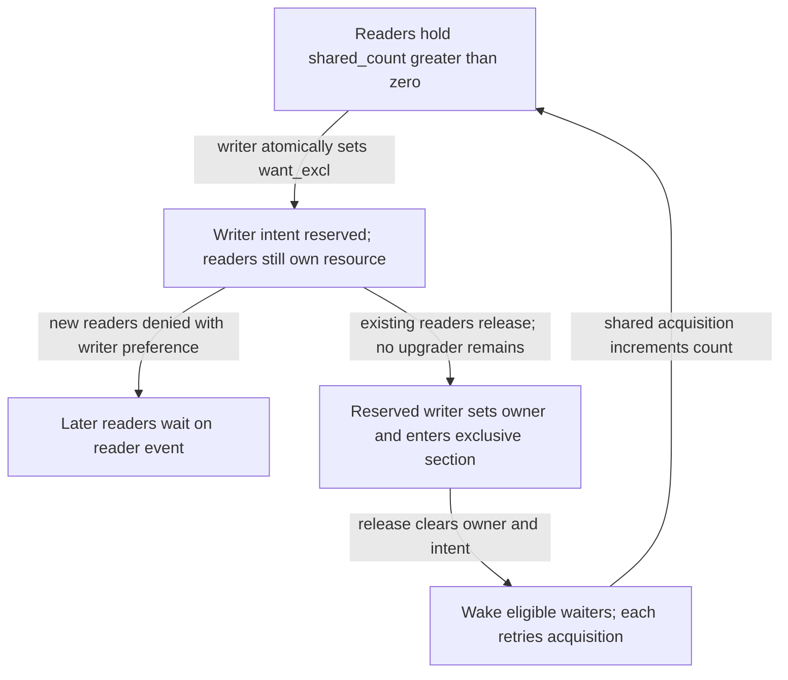
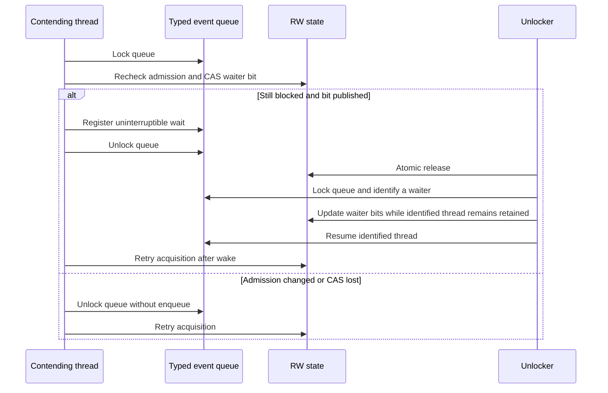
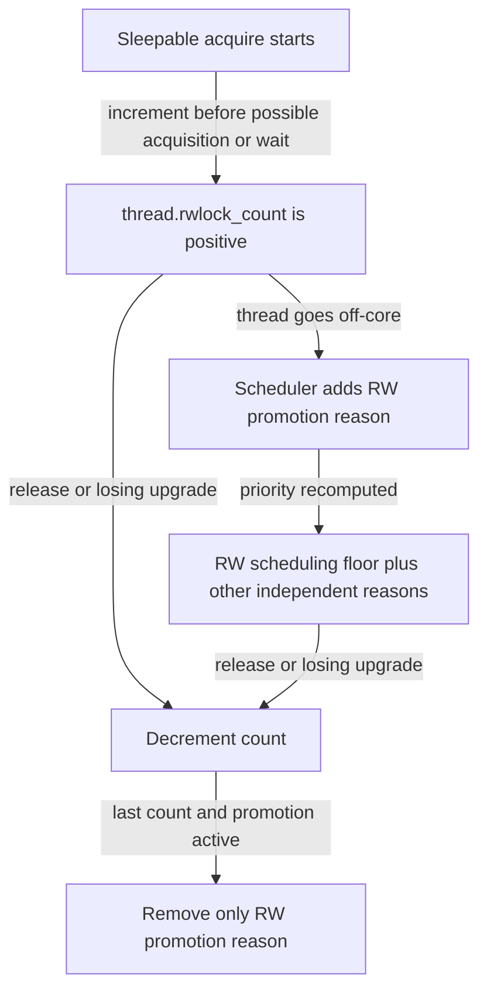

# Reader-writer locks: admission, upgrades and wakeup lifetime

[Runtime overview](README.md) · [Waits and locks](waits-and-locks.md) · [Mutexes and turnstiles](wait-and-turnstile-protocols.md) · [Ticket and pointer locks](ticket-and-pointer-locks.md)

A reader-writer lock protects a resource that permits simultaneous shared readers but only one exclusive writer. In this checkout, understanding an `lck_rw_*()` call requires first identifying the **declared lock type**. XNU builds two implementations with different state words, waiting protocols and fairness rules. This chapter follows both, including what remains held after an upgrade fails, why waking a waiter does not transfer ownership, and how the scheduler treats a thread that cannot make progress while using these locks. [Build selection](../../../platydoc-data/xnu/osfmk/conf/files#L159-L162), [type selection](../../../platydoc-data/xnu/osfmk/kern/lock_rw.h#L204-L227).

## 1. The default type and the explicit new implementation

`XNU_LCK_RW_DEFAULT_TO_NEW` is **0** in `lock_rw.h`. Under `XNU_KERNEL_PRIVATE`, `lck_rw_t` therefore names `lck_rw_old_t`; overloadable declarations route an explicit `lck_rw_new_t *` to the new implementation. Both source files are compiled. Changing the function name is not how callers choose the backend. [Default switch](../../../platydoc-data/xnu/osfmk/kern/lock_rw.h#L40-L47), [aliases](../../../platydoc-data/xnu/osfmk/kern/lock_rw.h#L204-L227), [old implementation's local alias](../../../platydoc-data/xnu/osfmk/kern/lock_rw_old.c#L69-L74), [new implementation's alias](../../../platydoc-data/xnu/osfmk/kern/lock_rw.c#L42-L51).

| Declared object | Implementation and operational consequence |
|---|---|
| `lck_rw_t` / `lck_rw_old_t` in this snapshot | `lock_rw_old.c`: a 32-bit reader/intent/interlock word, two address-derived wait events, writer-intent reservation before readers drain. |
| `lck_rw_new_t` | `lock_rw.c`: a 64-bit split state, MCS queue for contending writers, three typed wait events, atomic-add shared acquisition, separate handling of wait-queue lifetime. |
| `vm_object.Lock` | Explicitly `lck_rw_new_t`; the VM object's ordinary shared/exclusive wrappers select the new overload. |
| `vm_map.ilock` | Explicitly `lck_rw_new_t`; it is unsafe to infer that a VM lock uses the legacy algorithm from the public spelling alone. |

The concrete declarations are in [`vm_object_xnu.h`](../../../platydoc-data/xnu/osfmk/vm/vm_object_xnu.h#L145-L154) and [`vm_map_xnu.h`](../../../platydoc-data/xnu/osfmk/vm/vm_map_xnu.h#L589-L600). [`vm_object_lock()` and its companions](../../../platydoc-data/xnu/osfmk/vm/vm_object.c#L7581-L7683) show the dispatch through `&object->Lock`. The remainder of this chapter labels the variants explicitly.

Neither implementation maintains a production linked list of every shared owner. The exclusive owner is a compact thread ID; debug builds add per-thread lock tracking. A reader count is a count of grants, not a list from which the scheduler can identify and boost each reader. [Layouts](../../../platydoc-data/xnu/osfmk/kern/lock_rw.h#L94-L164), [debug tracking](../../../platydoc-data/xnu/osfmk/kern/lock_rw.c#L541-L854).

## 2. Legacy state: intent and ownership are different

The legacy object contains a type, `lck_rw_owner`, the state word and padding. Its state word has the following fields. Initialization selects writer preference unless `LCK_ATTR_RW_SHARED_PRIORITY` is supplied and enables sleeping unless `LCK_ATTR_RW_NO_SLEEP` is supplied. [Layout](../../../platydoc-data/xnu/osfmk/kern/lock_rw.h#L139-L164), [initialization](../../../platydoc-data/xnu/osfmk/kern/lock_rw_old.c#L204-L221).

| Field | Meaning in the implementation |
|---|---|
| `shared_count` (16 bits) | Number of active shared grants. A successful upgrader sheds its own count while waiting for other readers. |
| `want_excl` | A writer has reserved the exclusive path, or already holds it. Setting this bit alone does not mean readers or an upgrader have finished. |
| `want_upgrade` | One shared holder has reserved conversion to exclusive. It takes precedence over a writer waiting for readers to drain. |
| `interlock` | Short serialization of condition recheck, waiter-bit publication and `assert_wait()`. It is not the protected resource's exclusive ownership. |
| `priv_excl` | New readers are held back by writer/upgrader intent. With shared preference, readers can join an existing nonempty reader cohort despite intent. |
| `r_waiting`, `w_waiting` | At least one thread may need a reader/writer wakeup. These are flags, not waiter counts or ownership promises. |
| `can_sleep` | Whether contended acquisition can register an uninterruptible scheduler wait. |
| `tag_valid` | Marks a tag instead of a normal state; destruction writes the destroyed tag. |

The interlock disables interrupts and uses a bit lock; dropping it restores the prior interrupt state. Atomic fast paths that see `interlock` must wait for it to clear. The ordinary acquire/release loops use acquire/release atomic operations; the interlock-protected field stores use compiler ordering because the interlock supplies the synchronization. [Interlock and state helpers](../../../platydoc-data/xnu/osfmk/kern/lock_rw_old.c#L120-L125), [interrupt handling](../../../platydoc-data/xnu/osfmk/kern/lock_rw_old.c#L262-L283), [interlock spinning](../../../platydoc-data/xnu/osfmk/kern/lock_rw_old.c#L389-L407).



The diagram omits an upgrade waiter; that case is expanded below. It also does not promise FIFO ordering among sleeping writers. Legacy release wakes matching writers with `thread_wakeup()`, and each retries the admission rules. [Writer acquisition](../../../platydoc-data/xnu/osfmk/kern/lock_rw_old.c#L523-L740), [release wake decisions](../../../platydoc-data/xnu/osfmk/kern/lock_rw_old.c#L1713-L1755).

## 3. Legacy shared and exclusive acquisition

Shared acquisition increments `rwlock_count` before a sleepable attempt, then uses an acquire atomic loop. If neither exclusive intent, upgrade intent nor the interlock is set, it adds one to `shared_count`. The owner field must remain zero. If intent is present, `lck_rw_grab()` can still admit a reader when shared preference is configured and the reader cohort is already nonempty. [Shared entry](../../../platydoc-data/xnu/osfmk/kern/lock_rw_old.c#L1000-L1054), [admission predicate](../../../platydoc-data/xnu/osfmk/kern/lock_rw_old.c#L446-L473).

Exclusive acquisition first tries a single test-and-set requiring zero readers, no writer/upgrader intent and no interlock. On failure it separates two waits:

1. Reserve `want_excl`, waiting for a previous writer's reservation if necessary.
2. Keep that reservation while waiting for **both** `shared_count` and `want_upgrade` to clear.

Only after this drain does it write the current compact thread ID to `lck_rw_owner` and return exclusive ownership. A snapshot with `want_excl=1`, nonzero readers and `owner=0` is therefore an ordinary contended state. [Fast acquisition and owner publication](../../../platydoc-data/xnu/osfmk/kern/lock_rw_old.c#L754-L795), [reserve stage](../../../platydoc-data/xnu/osfmk/kern/lock_rw_old.c#L555-L622), [drain stage](../../../platydoc-data/xnu/osfmk/kern/lock_rw_old.c#L630-L700).

The legacy try functions do not enqueue a sleeping waiter. They can nevertheless spin on the internal interlock and retry failed atomic exchanges. `try_lock_shared()` refuses either intent bit even on a reader-biased lock, whereas the blocking shared slow path can join an existing cohort. “Try” therefore means no scheduler blocking on contention, not a single instruction or identical admission to the blocking API. A failed try returns without adding a shared grant or a per-thread RW count. [Try-shared](../../../platydoc-data/xnu/osfmk/kern/lock_rw_old.c#L1486-L1536), [try-exclusive](../../../platydoc-data/xnu/osfmk/kern/lock_rw_old.c#L1574-L1615).

### Spinning becomes a protected wait registration

For a sleepable legacy lock, `lck_rw_deadline_for_spin()` returns an immediate deadline if there are already reader/writer waiters or the reader count exceeds `machine_info.max_cpus`; otherwise it uses `mach_absolute_time() + MutexSpin`. Those checks avoid spending a normal spin interval when the existing population already suggests poor on-core progress. ARM pauses use `WFE` after an exclusive load; this is still spinning in the current kernel execution context, not a scheduler sleep. [Deadline](../../../platydoc-data/xnu/osfmk/kern/lock_rw_old.c#L286-L314), [ARM pause and drain](../../../platydoc-data/xnu/osfmk/kern/lock_rw_old.c#L318-L386).

When spinning expires, the waiter disables interrupts, takes the bit interlock and rereads the state. If the condition became available, it claims the relevant state under that interlock. Otherwise it sets `r_waiting` or `w_waiting`, publishes an uninterruptible `assert_wait()` on `(lock + 2)` or `(lock + 1)`, releases the interlock and calls `thread_block()` only if registration returned `THREAD_WAITING`. It loops after wakeup. The condition check and wait registration are protected together; wakeup before the eventual `thread_block()` is handled by the scheduler's wait protocol. [Event definitions](../../../platydoc-data/xnu/osfmk/kern/lock_rw_old.c#L76-L77), [reader registration](../../../platydoc-data/xnu/osfmk/kern/lock_rw_old.c#L933-L968), [writer registration](../../../platydoc-data/xnu/osfmk/kern/lock_rw_old.c#L591-L617), [generic wait transitions](wait-and-turnstile-protocols.md).

Legacy `NO_SLEEP` is a caller obligation: acquisition requires preemption already disabled and never takes the sleepable interlock path. Its deadline helper uses a very large interval and the outer loops continue; expiry there is not a user-visible timeout. The `_b()` variants let a caller-supplied block stop a non-sleepable attempt. If a writer already reserved `want_excl` before that early return, `lck_rw_drop()` clears it. [Context check and entry](../../../platydoc-data/xnu/osfmk/kern/lock_rw_old.c#L741-L791), [callback contract](../../../platydoc-data/xnu/osfmk/kern/lock_rw_old.c#L828-L858), [drop and cleanup](../../../platydoc-data/xnu/osfmk/kern/lock_rw_old.c#L486-L519), [post-drain early return](../../../platydoc-data/xnu/osfmk/kern/lock_rw_old.c#L725-L731).

## 4. Legacy upgrades, downgrades and the lost-read-lock case

A shared-to-exclusive upgrade is not equivalent to taking a second lock. The legacy implementation requires writer preference, atomically sheds the caller's shared count and tries to reserve `want_upgrade`. If another upgrader already reserved it, the caller still sheds its shared count, may wake the successful upgrader when it was the last reader, removes debug/count ownership and returns **false with no lock held**. Otherwise it waits for remaining readers to drain and becomes exclusive owner. [Upgrade body](../../../platydoc-data/xnu/osfmk/kern/lock_rw_old.c#L1286-L1337), [failure cleanup](../../../platydoc-data/xnu/osfmk/kern/lock_rw_old.c#L1132-L1157), [successful drain](../../../platydoc-data/xnu/osfmk/kern/lock_rw_old.c#L1170-L1268).

The two branches both subtract the old shared grant:

[osfmk/kern/lock_rw_old.c, lines 1306–1326](../../../platydoc-data/xnu/osfmk/kern/lock_rw_old.c#L1306-L1326).

<!-- source-excerpt: ../../../platydoc-data/xnu/osfmk/kern/lock_rw_old.c#L1306-L1326 -->
```c
		if (data & LCK_RW_WANT_UPGRADE) {
			data -= LCK_RW_SHARED_READER;
			if ((data & LCK_RW_SHARED_MASK) == 0) {         /* we were the last reader */
				data &= ~(LCK_RW_W_WAITING);            /* so clear the wait indicator */
			}
			if (atomic_exchange_complete32(&lock->lck_rw_data, prev, data, memory_order_acquire_smp)) {
				return lck_rw_lock_shared_to_exclusive_failure(lock, prev);
			}
		} else {
			data |= LCK_RW_WANT_UPGRADE;            /* ask for WANT_UPGRADE */
			data -= LCK_RW_SHARED_READER;           /* and shed our read count */
			if (atomic_exchange_complete32(&lock->lck_rw_data, prev, data, memory_order_acquire_smp)) {
				break;
			}
		}
		cpu_pause();
	}
	/* we now own the WANT_UPGRADE */
	if (data & LCK_RW_SHARED_MASK) {        /* check to see if all of the readers are drained */
		lck_rw_lock_shared_to_exclusive_success(lock);  /* if not, we need to go wait */
	}
```

A worked interleaving with writer preference illustrates why callers must revalidate after failure:

| Step | State and interpretation |
|---|---|
| Readers A and B enter | `shared_count=2`, neither intent bit set, `owner=0`. |
| Writer W reserves | `want_excl=1`, count still 2. W has not entered its critical section. |
| A requests upgrade | A sets `want_upgrade=1` and removes its reader count: count 1. W also waits for this bit to clear. |
| B requests upgrade | B sees existing upgrade intent, removes the final reader count and returns false. B must stop using data protected only by its old grant. |
| A observes count 0 | A becomes exclusive owner even though W's `want_excl` remains set. |
| A releases | Release clears `want_upgrade` first. W can then finish draining, set its own owner ID and enter. |

These are chosen successful atomic orderings, not a claim that all schedules produce this sequence. The crucial invariant is that only one upgrader waits while the others release their shared grants; retaining all readers while multiple upgraders waited would prevent progress. [Upgrade atomic loop](../../../platydoc-data/xnu/osfmk/kern/lock_rw_old.c#L1301-L1336), [writer drain mask](../../../platydoc-data/xnu/osfmk/kern/lock_rw_old.c#L630-L652), [release clears upgrade before writer intent](../../../platydoc-data/xnu/osfmk/kern/lock_rw_old.c#L1794-L1816).

Downgrade performs one release atomic transition that adds a shared count and removes the caller's upgrade or exclusive intent after clearing the owner field. It never exposes an intermediate fully unlocked critical section. Waiting readers are woken unless writer preference and sleeping writers suppress that wake; writers are not woken merely by downgrade because one reader remains. In contrast, explicit yield helpers release, pause and reacquire: protected state can change during that gap. [Downgrade](../../../platydoc-data/xnu/osfmk/kern/lock_rw_old.c#L1348-L1440), [legacy yield helpers](../../../platydoc-data/xnu/osfmk/kern/lock_rw_old.c#L2045-L2175).

## 5. Legacy release and destruction

`lck_rw_done()` releases the mode inferred from the state. A shared release decrements the reader count; only the last reader reaches waiter processing. An exclusive release clears the owner and removes `want_upgrade` if present, otherwise `want_excl`. It updates waiter flags in the same release atomic exchange and passes the **prior** state to `lck_rw_done_gen()` for wake selection. The checked shared/exclusive wrappers verify mode/owner expectations before and after this common operation. [Release state machine](../../../platydoc-data/xnu/osfmk/kern/lock_rw_old.c#L1770-L1840), [checked wrappers](../../../platydoc-data/xnu/osfmk/kern/lock_rw_old.c#L1854-L1900).

On the last shared release or an exclusive release, the helper wakes writers if the old `w_waiting` was set. It wakes readers only when old `r_waiting` was set and the combination of writer preference plus waiting writers does not suppress them. Each woken thread competes again. Clearing a waiting bit means the unlocker has taken responsibility for the corresponding wake, not that every thread has already run. It then decrements the releasing thread's RW count and removes debug ownership. [Wake and count cleanup](../../../platydoc-data/xnu/osfmk/kern/lock_rw_old.c#L1713-L1755).

Destruction asserts an unheld state, marks the type invalid, installs `LCK_RW_TAG_DESTROYED` and releases the lock-group reference. It does not implement a general waiter cancellation/drain protocol. The containing object's lifetime discipline must exclude new attempts and ensure no outstanding user can touch the lock. [Legacy destroy](../../../platydoc-data/xnu/osfmk/kern/lock_rw_old.c#L234-L249).

## 6. New RW state and why a failed read increment is not rolled back

The new object retains a compact exclusive owner but uses a 64-bit `lck_rw_word_t` split into the fields below. `lock32` covers only `u_wanted`, `x_locked` and `r_count`; the other fields carry configuration and contention. [Complete layout](../../../platydoc-data/xnu/osfmk/kern/lock_rw.h#L50-L137), [constant masks](../../../platydoc-data/xnu/osfmk/kern/lock_rw.c#L201-L210).

| Part | Fields and use |
|---|---|
| Queue tail | `x_tail`: 16-bit per-CPU MCS node identity for writer spinners. It is not an owning thread pointer or a sleeping wait queue. |
| Configuration | `valid`, `x_bias`, `no_sleep`; fixed after initialization. |
| Sleeping/committed waiters | `s_waiters`, `u_waiter`, `x_waiters`, `x_urgent`. The urgent flag changes writer wake breadth. |
| Acquisition word | `u_wanted` reserves the single upgrader; `x_locked` denotes exclusive ownership; 30-bit `r_count` is meaningful **only while `x_locked` is clear**. |

A shared fast attempt first checks `valid`, no upgrade/exclusive state, and—when writer-biased—an empty writer-spinner tail. It deliberately ignores sleeping `x_waiters`: an on-core arrival can acquire ahead of sleepers. The pretest is racy. The subsequent atomic add increments `r_count` and succeeds if the returned state is not exclusively locked. If a writer won between the pretest and add, the increment remains in the word but represents no shared owner. The exclusive unlock resets the entire acquisition word, removing these failed speculative increments. [Admission rules](../../../platydoc-data/xnu/osfmk/kern/lock_rw.c#L234-L269), [shared attempt](../../../platydoc-data/xnu/osfmk/kern/lock_rw.c#L281-L327), [exclusive release](../../../platydoc-data/xnu/osfmk/kern/lock_rw.c#L2064-L2080).

For `__arm64__ && __ARM_ARCH_8_3__`, the body separates a relaxed add from an acquire load; the source explains the acquire-PC optimization for read-only critical sections. Other builds use an acquire add. This is a selected code-generation path, not a claim that every ARM64 target emits one fixed instruction sequence. The new reader does not decrement after a failed attempt:

[osfmk/kern/lock_rw.c, lines 315–325](../../../platydoc-data/xnu/osfmk/kern/lock_rw.c#L315-L325).

<!-- source-excerpt: ../../../platydoc-data/xnu/osfmk/kern/lock_rw.c#L315-L325 -->
```c
		word.lock64 = os_atomic_add(&lck->lck_rw.lock64,
		    LCK_RW_R_COUNT_INC.lock64, relaxed);
		os_atomic_load(&lck->lck_rw.lock64, acquire);
#else
		word.lock64 = os_atomic_add(&lck->lck_rw.lock64,
		    LCK_RW_R_COUNT_INC.lock64, acquire);
#endif
		success = !word.x_locked;
	}

	return success;
```

For example, R passes the pretest, W CASes `lock32` from zero to `x_locked`, and R's add sees `x_locked=1`. R enters contention without owning a read grant; W continues to be the only owner and clears the acquisition word on release. Conversely, if R increments before W's CAS, the nonzero count makes that CAS fail. An exact formal memory-model proof is outside this source trace. [Exclusive CAS](../../../platydoc-data/xnu/osfmk/kern/lock_rw.c#L329-L346), [algorithm rationale](../../../platydoc-data/xnu/osfmk/kern/lock_rw.c#L66-L112).

## 7. New contention: queued writer spinners and three typed waits

Reader contention adaptively spins and retries admission. Writer contention first enters an MCS queue using per-CPU node storage; a thread behind the leader waits on its own node status, while the leader tests the RW word. The writer queue mode is `LCK_MCS_SLEEPABLE | LCK_MCS_ABORTABLE`: an urgent AST can request removal from this queue before the RW acquisition loop eventually blocks or backs off. Leaving the MCS queue does not release an acquired RW lock; these are separate states. [Reader step](../../../platydoc-data/xnu/osfmk/kern/lock_rw.c#L1400-L1456), [writer step and dequeue](../../../platydoc-data/xnu/osfmk/kern/lock_rw.c#L1820-L1921), [MCS abort path](../../../platydoc-data/xnu/osfmk/kern/locks.c#L491-L549), [MCS representation](../../../platydoc-data/xnu/osfmk/kern/locks_internal.h#L278-L347).

Spinning expiry, or an existing upgrader waiter in selected paths, leads to `lck_rw_assert_wait()`. Unlike legacy RW, there is **no RW-word bit interlock**. The helper derives one of three typed events—read, write or upgrade—locks its global event queue, rereads admission, and either declines to sleep or atomically publishes the appropriate waiter bits. It calls `waitq_assert_wait64_locked()` only when those bits are already present or its full-word CAS succeeds. A CAS collision returns to acquisition rather than enqueuing based on stale state. [Event encoding](../../../platydoc-data/xnu/osfmk/kern/lock_rw.c#L1124-L1138), [wait registration](../../../platydoc-data/xnu/osfmk/kern/lock_rw.c#L1312-L1359).

The key publication and registration branch is:

[osfmk/kern/lock_rw.c, lines 1331–1354](../../../platydoc-data/xnu/osfmk/kern/lock_rw.c#L1331-L1354).

<!-- source-excerpt: ../../../platydoc-data/xnu/osfmk/kern/lock_rw.c#L1331-L1354 -->
```c
	if (hint == kThreadWaitKernelRWLockRead &&
	    lck_rw_lock_s_allowed(word, false)) {
		waiting = false;
	} else if (hint == kThreadWaitKernelRWLockWrite &&
	    lck_rw_lock_x_allowed(word, false)) {
		waiting = false;
	} else if (hint == kThreadWaitKernelRWLockUpgrade &&
	    lck_rw_lock_u2x_allowed(word)) {
		waiting = false;
	} else if ((word.lock64 & mask.lock64) == mask.lock64) {
		waiting = true;
	} else {
		waiting = os_atomic_cmpxchg(&lck->lck_rw.lock64, word.lock64,
		    word.lock64 | mask.lock64, relaxed);
	}

	if (waiting) {
		thread_set_pending_block_hint(self, hint);
		waitq_assert_wait64_locked(waitq, event,
		    THREAD_UNINT | THREAD_WAIT_NOREPORT_USER,
		    TIMEOUT_URGENCY_SYS_NORMAL, TIMEOUT_WAIT_FOREVER,
		    TIMEOUT_NO_LEEWAY, self);
	}

```



The diagram compresses spinning and scheduler dispatch. An identified thread is not automatically installed as the owner; all wake paths return to acquisition. Extremely unlucky interference after expiry can select exponential `mutex_pause()` backoff even when wait registration repeatedly loses its race. [Reader backoff](../../../platydoc-data/xnu/osfmk/kern/lock_rw.c#L1434-L1446), [blocking helper](../../../platydoc-data/xnu/osfmk/kern/lock_rw.c#L1361-L1383).

Writer admission also distinguishes sleeping waiter urgency. A non-realtime writer above `MINPRI_FLOOR` without `TH_OPT_VMPRIV` publishes `x_urgent` as well as `x_waiters`. This does not donate that writer's priority to all readers. It requests a broader wake so the scheduler can choose among writers rather than leaving a higher-priority thread behind multiple low-priority sleepers. [Urgent-writer predicate and rationale](../../../platydoc-data/xnu/osfmk/kern/lock_rw.c#L1845-L1873).

## 8. New wakeup and storage lifetime after unlocking

New shared release uses a release subtraction and requests wake processing when the resulting reader count reaches zero with writer/upgrader waiters. Exclusive release clears the owner and atomically clears the entire `lock32` portion with release ordering. The wake functions run **after** this publication, so the current unlocker cannot assume the containing object still exists merely because it once held the lock. [Shared release](../../../platydoc-data/xnu/osfmk/kern/lock_rw.c#L1716-L1745), [exclusive release](../../../platydoc-data/xnu/osfmk/kern/lock_rw.c#L2052-L2080).

The solution uses the typed wait event and a waiting thread's separate right to access the object. Under the event-queue lock, a wake helper first identifies and removes a matching thread. Only if it found one may it modify the lock's waiter bits; that thread is not resumed until the update is finished. If no thread remains, another wake may have won or the old instance may already be gone, so the helper does not dereference the lock to clear stale bits. The event type prevents interpreting a completely different primitive at the same address; it does not prove the RW instance is the identical allocation, and spurious wakes of a replacement RW instance are tolerated. [Lifetime rationale](../../../platydoc-data/xnu/osfmk/kern/lock_rw.c#L135-L178), [identify/resume helpers](../../../platydoc-data/xnu/osfmk/kern/lock_rw.c#L1140-L1158), [wakeup contract](../../../platydoc-data/xnu/osfmk/kern/lock_rw.c#L1256-L1276).

Wake selection is explicit:

| State in the unlocking snapshot | Action |
|---|---|
| `u_wanted` | Wake the upgrader if `u_waiter` is set; suppress other wake categories. |
| Reader bias plus `s_waiters` | Wake shared waiters. |
| `x_waiters`, with no remaining readers | Wake exclusive waiters. Normally identify up to two; when `x_urgent` was set, wake all matching writers. |
| Otherwise `s_waiters` | Wake shared waiters. |

The writer helper uses `WAITQ_CHECK_HAS_MORE` on its second identified thread to keep or clear waiter bits. Readers are woken as a group after one identified reader gives the helper safe access to the RW word; the upgrader is singular. All of these decisions can race with other awakeners and on-core acquisitions. [Selection](../../../platydoc-data/xnu/osfmk/kern/lock_rw.c#L1278-L1310), [writers](../../../platydoc-data/xnu/osfmk/kern/lock_rw.c#L1160-L1209), [readers and upgrader](../../../platydoc-data/xnu/osfmk/kern/lock_rw.c#L1210-L1254).

New destruction is correspondingly strict: after validating type and `valid`, it removes configuration bits from a snapshot and requires the remainder to be zero. Outstanding owner/count, queue tail or waiter bits are an invariant violation. It checks the group, drops its reference and zeroes the object. This is validation of an externally quiesced object, not a destructor that wakes and cancels users. [Destroy](../../../platydoc-data/xnu/osfmk/kern/lock_rw.c#L946-L963).

## 9. New conversion and spin-mode contracts

New upgrade first CASes the sole-reader acquisition word directly to `x_locked`. On failure it atomically sets `u_wanted`. An already-set bit means another upgrader won: the caller invokes shared unlock and returns false. The successful reserving upgrader records its owner ID, subtracts its own reader count, and waits until the acquisition word contains only `u_wanted`; it then converts that word to exclusive. The owner field can therefore identify an upgrading thread before `x_locked` becomes true. [Upgrade entry](../../../platydoc-data/xnu/osfmk/kern/lock_rw.c#L1761-L1790), [prepare and drain](../../../platydoc-data/xnu/osfmk/kern/lock_rw.c#L1584-L1659).

Downgrade clears the owner and performs a release RMW that replaces `lock32` with exactly one shared grant, retaining the queue/configuration half. Eligible readers can then wake. As with legacy upgrade, false means **the read lock is gone**. VM callers must retry or otherwise reconstruct their lookup under a new grant. The fault path is one real consumer of this contract. [Downgrade](../../../platydoc-data/xnu/osfmk/kern/lock_rw.c#L2097-L2118), [VM wrapper](../../../platydoc-data/xnu/osfmk/vm/vm_object.c#L7671-L7683), [fault upgrade callers](../../../platydoc-data/xnu/osfmk/vm/vm_fault.c#L3930-L3950).

The suffix `_spin` on the new RW API specifies the held-mode preemption/accounting contract; it does **not by itself guarantee that acquisition never sleeps**:

| Operation/configuration | Behavior |
|---|---|
| Normal sleepable acquisition | Increment `rwlock_count`; adaptive contention temporarily disables preemption, restores it before blocking, and returns with ordinary preemption state. |
| `_spin` on a sleepable lock | Disable preemption for ownership. If contention blocks, temporarily establish a priority floor, reenable preemption, block/back off, disable preemption again and remove the temporary floor. |
| `_spin` plus `LCK_ATTR_RW_NO_SLEEP` | Select the dedicated non-sleeping contention loop and hardware timeout policy. This is the path that avoids scheduler blocking. |
| `lck_rw_convert_nospin()` | Keep the same lock ownership, add the RW count, then reenable preemption. |
| `lck_rw_convert_spin()` | Keep ownership, disable preemption, then remove the RW count. |

[Held-mode accounting](../../../platydoc-data/xnu/osfmk/kern/lock_rw.c#L350-L371), [spin-to-block transition](../../../platydoc-data/xnu/osfmk/kern/lock_rw.c#L1361-L1383), [shared mode dispatch](../../../platydoc-data/xnu/osfmk/kern/lock_rw.c#L1511-L1543), [exclusive no-sleep loop](../../../platydoc-data/xnu/osfmk/kern/lock_rw.c#L1947-L1975), [mode conversion](../../../platydoc-data/xnu/osfmk/kern/lock_rw.c#L2191-L2209).

Context validation in assertion builds distinguishes interrupt context, expected preemption depth, no-sleep configuration and exceptional early-boot/hibernation/panic circumstances. Those branches are not blanket permission to acquire a sleepable lock from arbitrary interrupt-disabled code. [New context checks](../../../platydoc-data/xnu/osfmk/kern/lock_rw.c#L855-L904).

## 10. RW counts, scheduler promotion and explicit condition sleeps

Both variants use the common per-thread `rwlock_count` helpers for their sleepable held/attempting state. The counter increments before an ordinary acquisition can publish ownership, remains nonzero across its internal wait, and decrements on release or failed upgrade. It is consequently broader than the field comment “number of locks held”: an acquisition in progress can contribute. [Legacy increment before attempt](../../../platydoc-data/xnu/osfmk/kern/lock_rw_old.c#L766-L773), [new mode helper](../../../platydoc-data/xnu/osfmk/kern/lock_rw.c#L350-L371), [counter implementation](../../../platydoc-data/xnu/osfmk/kern/lock_rw.c#L2626-L2658), [thread field](../../../platydoc-data/xnu/osfmk/kern/thread.h#L608).

When a thread goes off-core with a positive count, `thread_dispatch()` marks active sleepable-SMR trackers stalled and later, with the thread locked, calls `lck_rw_set_promotion_locked()`. Unless `LCK_OPTION_DISABLE_RW_PRIO` disables this mechanism, it adds `TH_SFLAG_RW_PROMOTED`; priority computation applies at least `MINPRI_RWLOCK` together with other independent promotion reasons. The final count decrement clears this reason if present. This is a thread-scoped scheduling floor, **not** the mutex turnstile's directed waiter-to-owner priority inheritance. There is no per-RW chain enumerating all reader owners. [Off-core integration](../../../platydoc-data/xnu/osfmk/kern/sched_prim.c#L3554-L3580), [set/clear promotion](../../../platydoc-data/xnu/osfmk/kern/lock_rw.c#L2575-L2624), [priority calculation](../../../platydoc-data/xnu/osfmk/kern/priority.c#L403-L424), [design limits](../../../platydoc-data/xnu/osfmk/kern/lock_rw.c#L2514-L2561).



`lck_rw_sleep()` and `_deadline()` serve a different need from internal lock contention: wait for a caller's condition while releasing an already-held RW lock. They register the event while the lock is still held, release through `lck_rw_done()`, block, and reacquire the old or explicitly requested mode unless `LCK_SLEEP_UNLOCK` says to remain unlocked. If registration did not produce a wait, they normally retain the lock; `LCK_SLEEP_UNLOCK` still releases it. `LCK_SLEEP_PROMOTED_PRI` keeps an explicit priority-floor token across the release/wait/reacquire interval. A wake, abort or deadline result describes the condition wait; it does not validate the caller's protected condition after reacquisition. [Legacy sleep implementation](../../../platydoc-data/xnu/osfmk/kern/lock_rw_old.c#L2188-L2301), [new implementation](../../../platydoc-data/xnu/osfmk/kern/lock_rw.c#L2455-L2510).

## 11. Evidence, tests and remaining limits

This trace covers both representations, shared/exclusive/try admission, legacy interrupt interlocking, adaptive/new MCS contention, wait publication, upgrade failure, downgrade, post-unlock wake lifetime, scheduler count/promotion, condition sleep and destruction. The [ticket and pointer-lock companion](ticket-and-pointer-locks.md) expands the shared MCS infrastructure and non-sleeping primitives. It does not establish fairness bounds under every schedule or prove the ARM memory model.

The tree includes a TLA+ RW model with explicit read/write/upgrade event sets and an exclusion invariant. Its own comments intentionally omit detailed owner/readers tracking to reduce state transitions. That model is additional design evidence, not proof that this checkout's compiled implementation and all configuration branches have been verified. [Model state and invariants](../../../platydoc-data/xnu/tools/tla/rwlock.tla#L35-L99).

The lock benchmark supplies separate new and legacy RW operation tables, including upgrade/downgrade, and a user test exposes the corresponding selections. The VM wrappers provide real new-RW clients. These bodies were inspected; no kernel benchmark, test kernel, TLA+ execution or hardware timing measurement was run for this documentation. [Benchmark adapters](../../../platydoc-data/xnu/osfmk/kern/locks.c#L3963-L4085), [test command options](../../../platydoc-data/xnu/tests/locks_throughput.c#L55-L77), [VM object wrappers](../../../platydoc-data/xnu/osfmk/vm/vm_object.c#L7581-L7683).

<!-- BEGIN PLATYDOC DOCUMENTATION LICENSE -->
Original Platydoc text and diagrams are licensed under [CC BY 4.0](https://creativecommons.org/licenses/by/4.0/). Quoted source code and third-party material retain their respective licenses.
<!-- END PLATYDOC DOCUMENTATION LICENSE -->
