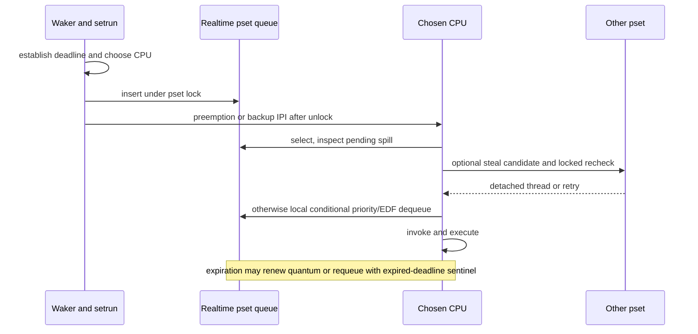

# Realtime policy, deadlines, and processor-set runqueues

[Runtime](README.md) · [Priority and quanta](priority-qos-and-quanta.md) · [CPU eligibility](cpu-eligibility-and-scheduler-variants.md) · [Execution path](scheduler-execution.md)

Realtime threads use a separate queue in each processor set. The queue combines priority bands and deadlines; selecting a CPU, selecting a queued thread, deciding whether the current realtime thread can continue, and notifying backup CPUs are related but distinct decisions. The implementation is split between `sched_rt.c` and `sched_prim.c`, with policy setup in `thread_policy.c`. The header explicitly describes this ongoing separation, so reading only one implementation file misses important behavior. [`sched_rt.h`](../../../xnu/osfmk/kern/sched_rt.h#L108-L119), [`realtime_setrun()`](../../../xnu/osfmk/kern/sched_prim.c#L4256-L4395), [`rt_runq_dequeue()`](../../../xnu/osfmk/kern/sched_rt.c#L1388-L1449).

The selected path below starts with a time-constraint request and ends with queue removal, CPU execution, and requeue/shutdown. It establishes what this checkout validates and schedules; it does not claim a general feasibility proof or measured deadline guarantee.

## 1. Time-constraint parameters and what acceptance means

`thread.realtime` holds `period`, `computation`, `constraint`, `preemptible`, `priority_offset`, and an absolute `deadline`. The API defines period as nominal time between processing arrivals, computation as nominal work per arrival, and constraint as elapsed time allowed from arrival to completion, all in absolute-time units. A zero period means no inherent periodicity. The public header labels `preemptible` **ignored**: retaining and returning that field does not make this a request to disable kernel preemption. [`thread.h`](../../../xnu/osfmk/kern/thread.h#L622-L630), [`thread_policy.h`](../../../xnu/osfmk/mach/thread_policy.h#L120-L156), [`stored/getter values`](../../../xnu/osfmk/kern/thread_policy.c#L432-L435), [`getter`](../../../xnu/osfmk/kern/thread_policy.c#L1355-L1365).

The public `thread_policy_set()` wrapper rejects static-parameter changes unless the testing override is enabled. It restricts user-supplied explicit realtime priority to the base realtime queue level under the normal policy, and rejects a thread joined to a workload-ID interval which does not allow realtime. Applying a legacy scheduling flavor to a QoS thread first removes its requested QoS; if the internal operation fails, the wrapper attempts to restore that original request. These checks precede queue policy and are not deadline calculations. [`thread_policy.c`](../../../xnu/osfmk/kern/thread_policy.c#L265-L331).

The internal setter takes the thread mutex, rejects inactive threads, validates flavor count, then checks `constraint >= computation` and the supported computation interval. Initialization defines that interval as 50 microseconds through 50 milliseconds, converted into the machine's absolute-time units. After validation, it raises a computation smaller than half the constraint to `constraint / 2`, capped at the maximum realtime quantum. Therefore the accepted computation may differ from the input. The body mutates the policy structure passed to this internal routine before storing the result. [`thread_policy.c`](../../../xnu/osfmk/kern/thread_policy.c#L341-L420), [`timebase constants`](../../../xnu/osfmk/kern/sched_rt.c#L83-L110).

[thread_policy.c, lines 408–420](../../../xnu/osfmk/kern/thread_policy.c#L408-L420)

<!-- source-excerpt: ../../../xnu/osfmk/kern/thread_policy.c#L408-L420 -->
```c
		if (info->constraint < info->computation ||
		    info->computation > max_rt_quantum ||
		    info->computation < min_rt_quantum) {
			result = KERN_INVALID_ARGUMENT;
			break;
		}

		if (info->computation < (info->constraint / 2)) {
			info->computation = (info->constraint / 2);
			if (info->computation > max_rt_quantum) {
				info->computation = max_rt_quantum;
			}
		}
```

For example, a nominal 1-ms computation with a 6-ms constraint passes the initial bounds, then becomes 3 ms in the stored policy. This is illustrative arithmetic; the caller uses converted absolute-time values, and hardware execution has not been measured here. A much larger constraint can reach the 50-ms cap rather than retaining an exact half-constraint computation. [`thread_policy.c`](../../../xnu/osfmk/kern/thread_policy.c#L408-L420).

The setter checks explicit priority range when applicable, raises to scheduler interrupt level, takes the thread lock, stores the parameters, sets a priority offset unless a work interval owns it, and requests realtime mode. It reevaluates realtime-allow policy afterward and records SFI work. This body does not sum all realtime utilizations, reserve a CPU share for the request, or install a periodic release timer from `period`. Acceptance means these local parameter/policy transitions succeeded, not that the system proved all accepted threads schedulable. [`thread_policy.c`](../../../xnu/osfmk/kern/thread_policy.c#L422-L458), [`mode setter`](../../../xnu/osfmk/kern/thread_policy.c#L957-L974), [`parameter semantics`](../../../xnu/osfmk/mach/thread_policy.h#L126-L147).

## 2. Requested realtime mode can still be demoted

`thread_recompute_priority()` maps actual realtime mode to `BASEPRI_RTQUEUES + priority_offset` and ensures a previously absent deadline is initialized. If the thread is temporarily demoted, it follows the non-realtime priority path even though `saved_mode` records a realtime request. Demotion reasons are composable: throttling, excessive-computation failsafe, and realtime-disallowed policy can coexist. Restoring one reason does not override another still-active reason. [`thread_policy.c`](../../../xnu/osfmk/kern/thread_policy.c#L1054-L1084), [`priority.c`](../../../xnu/osfmk/kern/priority.c#L1007-L1111), [priority/failsafe chapter](priority-qos-and-quanta.md#8-excessive-computation-demotes-mode-and-later-restores-it).

Under `CONFIG_SCHED_RT_ALLOW`, a tunable enables the work-interval restriction, defaulting on for the XR target and off otherwise. `thread_rt_evaluate()` excludes kernel-task threads, then demotes requested/actual realtime threads lacking the interval's `RT_ALLOWED` flag and restores that demotion when conditions change. For non-platform user tasks it also requests a CPU limit, with defaults of 70 percent over 10 ms; the percentage is bounded to 1–99 and the interval to at least 1 ms. A ledger AST makes the target apply the request. A successful scheduling-policy call may thus leave the thread's requested mode saved while its actual mode is timeshare. [`thread_policy.c`](../../../xnu/osfmk/kern/thread_policy.c#L3353-L3504).

[thread_policy.c, lines 3456–3466](../../../xnu/osfmk/kern/thread_policy.c#L3456-L3466)

<!-- source-excerpt: ../../../xnu/osfmk/kern/thread_policy.c#L3456-L3466 -->
```c
	if (thread_has_rt(thread) && (wi_flags & TH_WORK_INTERVAL_FLAGS_RT_ALLOWED) == 0) {
		if (!sched_thread_mode_has_demotion(thread, TH_SFLAG_RT_DISALLOWED)) {
			KDBG(MACHDBG_CODE(DBG_MACH_SCHED, MACH_RT_DISALLOWED_WORK_INTERVAL),
			    thread_tid(thread));
			sched_thread_mode_demote(thread, TH_SFLAG_RT_DISALLOWED);
		}
	} else {
		if (sched_thread_mode_has_demotion(thread, TH_SFLAG_RT_DISALLOWED)) {
			sched_thread_mode_undemote(thread, TH_SFLAG_RT_DISALLOWED);
		}
	}
```

Work intervals contribute authorization, thread-group identity, and sometimes priority. `work_interval_set_policy()` first requires workload configuration to enable thread-policy effects. A realtime-class interval updates the realtime priority offset but deliberately does not change mode: the thread must explicitly opt in. Explicit join updates the relevant thread flags and reevaluates RT permission; leaving clears interval-driven policy before replacing the interval. The pointer change transfers a reference to the thread and releases the old interval at completion. Auto-join has different locking and a documented remote-running-thread deferral, so it should not be collapsed into the explicit current-thread join path. [`work_interval.c`](../../../xnu/osfmk/kern/work_interval.c#L706-L822), [`join/cleanup`](../../../xnu/osfmk/kern/work_interval.c#L840-L1033), [`WI policy case`](../../../xnu/osfmk/kern/thread_policy.c#L2142-L2173).

## 3. A processing arrival establishes an absolute deadline

`thread_unblock()` computes `now + constraint` for an actual realtime thread, clears old remaining quantum and metered computation, and completes the wait-to-runnable state transition. This is an arrival-associated deadline; it is not simply the stored `period` or a countdown repeatedly decremented by the runqueue. Policy recomputation also initializes a missing deadline when entering realtime mode. [`sched_prim.c`](../../../xnu/osfmk/kern/sched_prim.c#L885-L942), [`initial deadline`](../../../xnu/osfmk/kern/thread_policy.c#L1064-L1079).

[sched_prim.c, lines 930–940](../../../xnu/osfmk/kern/sched_prim.c#L930-L940)

<!-- source-excerpt: ../../../xnu/osfmk/kern/sched_prim.c#L930-L940 -->
```c
	if (thread->sched_mode == TH_MODE_REALTIME) {
		uint64_t ctime = mach_absolute_time();
		thread->realtime.deadline = thread->realtime.constraint + ctime;
		KTRC(MACHDBG_CODE(DBG_MACH_SCHED, MACH_SET_RT_DEADLINE) | DBG_FUNC_NONE,
		    (uintptr_t)thread_tid(thread), thread->realtime.deadline, thread->realtime.computation, 0);
	}

	/*
	 * Clear old quantum, fail-safe computation, etc.
	 */
	thread->quantum_remaining = 0;
```

When the thread receives a quantum, the budget is its adjusted `computation`, capped by realtime failsafe and potentially shortened by a positive remaining CPU-limit allowance. On switch-away, exhausted realtime quantum becomes `RT_DEADLINE_QUANTUM_EXPIRED` rather than pretending it retains its prior live deadline. The sentinel differs from `RT_DEADLINE_NONE`. `rt_deadline_add()` saturates comparison additions to NONE on overflow; the arrival assignment itself is the plain addition shown above. Preserve that distinction instead of claiming every deadline arithmetic operation uses the saturation helper. [`sched_prim.c`](../../../xnu/osfmk/kern/sched_prim.c#L4050-L4086), [`departure`](../../../xnu/osfmk/kern/sched_prim.c#L3590-L3610), [`sentinels`](../../../xnu/osfmk/kern/sched.h#L305-L307), [`saturating comparison helper`](../../../xnu/osfmk/kern/sched_rt.c#L767-L771).

## 4. The queue has both per-priority and global deadline metadata

| Structure/field | Role |
|---|---|
| `processor_set.rt_runq` | One realtime queue per pset, separate from ordinary policy queues. The pset lock protects mutations in the traced paths. [`processor.h`](../../../xnu/osfmk/kern/processor.h#L267-L274), [`insert`](../../../xnu/osfmk/kern/sched_rt.c#L1348-L1356). |
| `rt_queue_pri[i].pri_queue` | Deadline-ordered queue for one realtime priority. `i = sched_pri - BASEPRI_RTQUEUES`. [`sched_rt.c`](../../../xnu/osfmk/kern/sched_rt.c#L1276-L1320). |
| `pri_count`, `pri_earliest_deadline`, `pri_constraint` | Per-priority count and cached properties of its head. [`sched.h`](../../../xnu/osfmk/kern/sched.h#L284-L289). |
| `bitmap`, aggregate `count` | Which priority bands have work and the total number of queued threads. [`sched.h`](../../../xnu/osfmk/kern/sched.h#L291-L303). |
| Aggregate `earliest_deadline`, `constraint`, `ed_index` | Globally earliest queued deadline, its constraint, and its priority-band index; these need not identify the highest-priority band. [`sched_rt.c`](../../../xnu/osfmk/kern/sched_rt.c#L1319-L1329). |
| `stealable_rt_threads_earliest_deadline` | Lockless candidate hint published for Edge stealing when local queued work exceeds available non-RT-running capacity. It must be rechecked after taking the donor lock. [`sched_rt.c`](../../../xnu/osfmk/kern/sched_rt.c#L819-L836), [`steal`](../../../xnu/osfmk/kern/sched_rt.c#L575-L634). |

Insertion scans the chosen priority queue in deadline order. It inserts before the first strictly later deadline or appends when no queued deadline is later; an earlier head updates per-band and potentially global caches. It increments counts and installs the thread's runqueue association. The chosen processor stored with that association identifies the pset queue's locking route; it does not turn the pset-wide realtime queue into an exclusive per-CPU list. [`sched_rt.c`](../../../xnu/osfmk/kern/sched_rt.c#L1276-L1356), [`realtime_setrun()`](../../../xnu/osfmk/kern/sched_prim.c#L4288-L4295).

Removal/dequeue update the band head and scan nonempty bands to rebuild the aggregate earliest-deadline cache. They clear the thread's queue association after unlinking. Debug/test-harness consistency checks verify sorted deadlines, counts, bitmap state, cached head fields, and aggregate metadata. Atomic fields support published summaries; their presence does not remove the pset-lock contract for coordinated mutation. [`sched_rt.c`](../../../xnu/osfmk/kern/sched_rt.c#L1214-L1273), [`dequeue metadata`](../../../xnu/osfmk/kern/sched_rt.c#L1413-L1449), [`remove`](../../../xnu/osfmk/kern/sched_rt.c#L1466-L1509).

## 5. Default dequeue is conditional priority plus earliest deadline

`rt_runq_dequeue()` begins with the highest nonempty priority band. With strict-priority mode enabled, it takes that band's earliest-deadline thread. With the default `sched_rt_runq_strict_priority == false`, it additionally examines the globally earliest-deadline band's head. If that is another band, it chooses it only when the sum of both heads' nominal computations and deadline epsilon is strictly less than the highest-priority head's constraint. This is the implemented local comparison, not a full EDF feasibility calculation over every queued or running thread. [`sched_rt.c`](../../../xnu/osfmk/kern/sched_rt.c#L57-L66), [`dequeue`](../../../xnu/osfmk/kern/sched_rt.c#L1388-L1411).

[sched_rt.c, lines 1402–1409](../../../xnu/osfmk/kern/sched_rt.c#L1402-L1409)

<!-- source-excerpt: ../../../xnu/osfmk/kern/sched_rt.c#L1402-L1409 -->
```c
			thread_t ed_thread = qe_queue_first(&ed_runq->pri_queue, struct thread, runq_links);
			thread_t hi_thread = qe_queue_first(&rt_runq->pri_queue, struct thread, runq_links);

			if (ed_thread->realtime.computation + hi_thread->realtime.computation + rt_deadline_epsilon < hi_thread->realtime.constraint) {
				/* choose the earliest deadline thread */
				rt_runq = ed_runq;
				i = ed_index;
			}
```

For a conceptual queue, let the highest-priority head require 3 ms with a 6-ms constraint, and a lower-priority but earlier-deadline head require 1 ms with a 2-ms constraint. With the default 0.1-ms epsilon, `1 + 3 + 0.1 < 6` allows the earlier-deadline head to go first. If the highest-priority head's constraint were 3 ms, that comparison fails. This example assumes the supplied numbers are already the stored values after policy adjustment and does not predict measured response time. [`comparison`](../../../xnu/osfmk/kern/sched_rt.c#L1405-L1408), [`epsilon initialization`](../../../xnu/osfmk/kern/sched_rt.c#L57-L110).

The current-thread continuation decision is related but not identical. During its first timeslice, an eligible realtime thread can stay on CPU. Pending spill, a higher-priority queued thread under strict policy, the corresponding computation/constraint comparison under relaxed policy, or sufficiently earlier queued deadlines can force selection. Edge also checks other psets' earlier pending realtime work. The current thread may finish its first slice even when that CPU would not be preferred for a newly chosen realtime thread. [`sched_prim.c`](../../../xnu/osfmk/kern/sched_prim.c#L2589-L2676).

## 6. CPU placement and IPI dispatch are separate from dequeue order

The non-SMT `sched_rt_choose_processor()` expects a starting pset locked. It looks for available recommended CPUs not already running realtime and not already handling urgent preemption. If necessary it seeks a lower-priority running CPU, or at equal priority a sufficiently later deadline. An AMP search follows realtime spill search order and can perform a second pass considering CPUs with pending urgent ASTs; this addresses the race where locks are dropped between psets while another CPU resolves its pending scheduling request. It does not compute the globally latest deadline across every pset: the code intentionally accepts the first suitable pset candidate. [`sched_rt.c`](../../../xnu/osfmk/kern/sched_rt.c#L461-L564), [`CPU candidate helpers`](../../../xnu/osfmk/kern/sched_rt.c#L1078-L1196).

If no CPU should be preempted, placement can still select an available CPU as the queue's association. If the starting pset lost all eligible CPUs while locks were dropped, it unlocks and returns null so the caller retries placement. This null return denotes changed eligibility, not destruction of the runnable thread. SMT-specific preferred/backup selection is covered in [CPU eligibility](cpu-eligibility-and-scheduler-variants.md). [`sched_rt.c`](../../../xnu/osfmk/kern/sched_rt.c#L531-L564), [`common setrun retry`](../../../xnu/osfmk/kern/sched_prim.c#L5502-L5629).

`realtime_setrun()` holds both the thread and chosen pset locks on entry and returns with the pset unlocked. It inserts the thread before arranging notifications and asserts that realtime work is not processor-bound. It requests urgent preemption when the arriving thread has higher priority, or equal priority with a sufficiently earlier deadline. A chosen CPU already too busy may receive no IPI; the work stays queued for another CPU to drain. Actual IPIs are performed after the pset lock is released. [`sched_prim.c`](../../../xnu/osfmk/kern/sched_prim.c#L4256-L4395).

Low-constraint work can notify backup processors. The threshold is 4 ms; configured backup counts are reduced by existing urgent notifications relative to queued work. Source defaults are architecture-dependent: x86 has one backup, SMT x86 uses two, and the non-x86 defaults shown are zero. Followup-IPI logic asks whether queued work plus applicable backups exceeds already pending urgent requests. A backup notification is an opportunity for another CPU to claim queue work, not a second execution instance of the same thread. [`sched_rt.c`](../../../xnu/osfmk/kern/sched_rt.c#L102-L110), [`sched.h`](../../../xnu/osfmk/kern/sched.h#L450-L458), [`setrun backup calculation`](../../../xnu/osfmk/kern/sched_prim.c#L4272-L4285), [`followup`](../../../xnu/osfmk/kern/sched_rt.c#L908-L942).

## 7. Edge stealing rechecks published candidates under the donor lock

Realtime migration/stealing uses its own matrix and cached search orders. Initial Edge policy permits homogeneous-cluster spill/steal and disables heterogeneous transitions; the `HAS_MCORE` branch adds explicit exceptions and a reserve pset. These defaults can be updated through the realtime matrix interface, which recomputes derived search metadata. They must not be replaced by the non-realtime Edge matrix merely because both use the same edge structure. [`sched_rt.c`](../../../xnu/osfmk/kern/sched_rt.c#L118-L225), [`configuration interface`](../../../xnu/osfmk/kern/sched_rt.c#L267-L360).

`sched_rt_steal_thread()` starts with the local earliest deadline and searches published donor hints for something earlier by more than epsilon. It changes the held pset lock to the donor and checks the advertised state again. If another CPU won the race, it reacquires the original pset, refreshes the local deadline, and retries. Success dequeues under the donor lock, updates its stealable summary, and returns with the original stealing pset locked. Even an unsuccessful search may have dropped the original lock. [`sched_rt.c`](../../../xnu/osfmk/kern/sched_rt.c#L575-L634).

[sched_rt.c, lines 617–623](../../../xnu/osfmk/kern/sched_rt.c#L617-L623)

<!-- source-excerpt: ../../../xnu/osfmk/kern/sched_rt.c#L617-L623 -->
```c
			} else {
				/* Failed to steal (another pset stole first). Try again. */
				KTRC(MACHDBG_CODE(DBG_MACH_SCHED, MACH_RT_STEAL) | DBG_FUNC_NONE, (uintptr_t)thread_tid(THREAD_NULL), pset->pset_id, pset->cpu_set_low, 1);
				pset = change_locked_pset(pset, stealing_pset);
				/* Update earliest_deadline in case it changed while the stealing_pset lock was not held. */
				earliest_deadline = rt_runq_earliest_deadline(pset);
				continue;
```

`sched_rt_choose_thread()` clears pending spill before trying this hook. Since the hook may drop locks, it repeats when spill became pending again during that interval; only afterward does it dequeue local work. The spill-IPI helper has another explicit return contract: false means the starting lock was never dropped; true means locks were traversed and no pset lock remains held. Callers track that boolean to avoid double-unlocking. These lock contracts are part of the scheduling algorithm, not incidental annotations. [`sched_rt.c`](../../../xnu/osfmk/kern/sched_rt.c#L640-L671), [`spill contract/body`](../../../xnu/osfmk/kern/sched_rt.c#L840-L902).



## 8. Queue shutdown and scope of the guarantees

`sched_rt_queue_shutdown()` takes the pset lock and leaves its queue alone if any available recommended CPU remains. Otherwise it drains queued threads into a pulled-thread queue, updates load/stealable metadata, and unlocks. The later flush locks each detached runnable thread and calls `thread_setrun()` to find a new destination outside the original availability-update lock. This is migration of runnable ownership, not a mass cancellation of realtime work. [`sched_rt.c`](../../../xnu/osfmk/kern/sched_rt.c#L685-L704), [`pulled-thread flush`](../../../xnu/osfmk/kern/sched_prim.c#L8198-L8247).

Deep review covered parameter validation/adjustment, QoS rollback, work-interval RT authorization, deadline creation/expiration, queue insertion/removal and metadata, conditional priority/EDF selection, current-thread continuation, non-SMT placement, backup/followup notifications, Edge stealing/lock handovers, and queue shutdown. The full set of realtime matrix updates, SMT helper subcases, external workload configuration and performance controller, and every CPU-limit response remain selected boundaries. No realtime workload or deadline test was executed. Read the strict comparison and the locks around it before interpreting a deadline trace as either pure EDF or strict priority.
