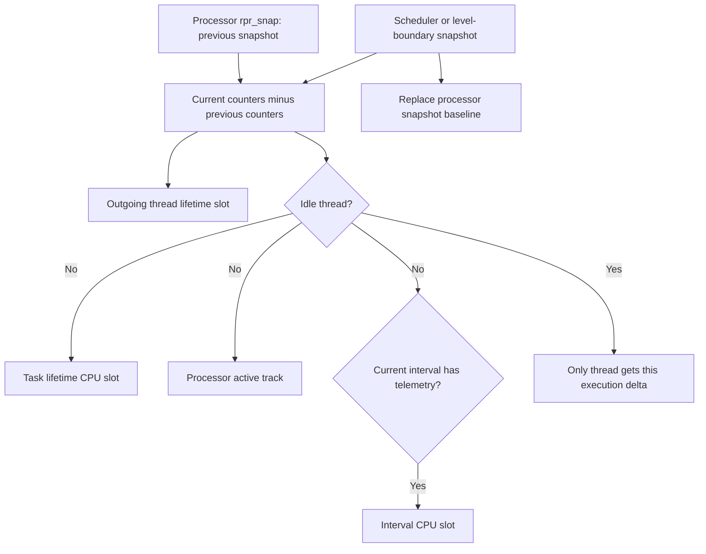
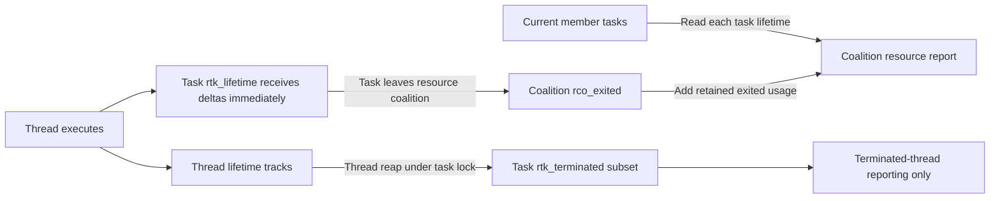

# Recount tracks, execution snapshots, and resource attribution

[Runtime](README.md) · [Time and accounting](time-and-accounting.md) · [Clocks](clocks-and-time-domains.md) · [Ledgers](ledgers-limits-and-settlement.md) · [Bank charging](../ipc/bank-accounts-and-charging.md)

Recount turns differences between execution-counter snapshots into thread, task, processor, work-interval and coalition statistics. Its central operation is addition of a measured delta to several owners. The owners have different topologies and lifetimes; a consistent read of one track does not freeze the whole machine. This chapter traces ARM64/common implementation and selected reporting/teardown paths in `xnu-12377.121.6`.

## 1. Objects and where their counters live

A `recount_track` contains `rt_sync` and `rt_usage`. Each usage holds metrics indexed by execution level: Mach ticks, plus instructions/cycles when configured. Energy is a separate `ru_energy_nj` field because its producer samples out of band. A `recount_plan` describes the array topology; the plan is needed whenever indexing, reading, rolling up or destroying an array. [Definitions](../../../xnu/osfmk/kern/recount.h#L64-L160).

| Owner and field | Plan/topology | Lifetime and meaning |
| --- | --- | --- |
| Thread `th_recount.rth_lifetime` | CPU kind | Accumulates this thread's execution, separated by performance/efficiency-kind slots and execution level. |
| Task `tk_recount.rtk_lifetime` | CPU | Receives non-idle thread deltas directly during execution. Includes execution by threads that later terminate. |
| Task `rtk_terminated` | CPU kind, plain usage array | Separate retained sum of terminated threads for interfaces that need that subset. It is not added to task lifetime totals. |
| Processor `pr_recount.rpr_active` | System topology, one embedded track per processor | Counts active non-idle work. `rpr_snap` stores that CPU's preceding snapshot; separate idle/interrupt fields support other views. |
| Work interval `wi_recount.rwi_current_instance` | CPU | Receives execution while the thread is associated with an interval that has telemetry enabled. |
| Resource coalition `rco_exited` | CPU kind, plain usage array | Retains removed tasks' lifetime totals. Reporting combines it with current members. |

The concrete plans are in [recount.c](../../../xnu/osfmk/kern/recount.c#L191-L196); owner layouts and lock contracts are in [recount.h](../../../xnu/osfmk/kern/recount.h#L266-L364). “System topology” means a single slot in that owner's storage, not one global counter shared by all processors.

Per-CPU updates require preemption disabled so a writer does not change CPU/slot halfway through an update. CPU-kind and single-slot topologies require their owner to exclude simultaneous writers. The sequence counter supports readers; it does not replace the single-writer contract. [Topology contracts](../../../xnu/osfmk/kern/recount.h#L64-L82).

## 2. A context switch attributes a delta to the outgoing thread

The scheduler takes a `recount_snap` around switching, then passes the outgoing thread/task to `recount_switch_thread()`. ARM snapshot helpers read the timebase and optional performance counters, with an ordered snapshot adding the required instruction barrier. `recount_snap_diff()` subtracts the processor's previous snapshot and asserts that the counters did not go backward. [Snapshot helpers](../../../xnu/osfmk/kern/recount.c#L200-L226), [delta calculation](../../../xnu/osfmk/kern/recount.c#L576-L587), [scheduler calls](../../../xnu/osfmk/kern/sched_prim.c#L3015-L3025), [switch accounting](../../../xnu/osfmk/kern/sched_prim.c#L3109-L3119).

[osfmk/kern/recount.c, lines 1083–1103](../../../xnu/osfmk/kern/recount.c#L1083-L1103):

<!-- source-excerpt: ../../../xnu/osfmk/kern/recount.c#L1083-L1103 -->
```c
recount_switch_thread(struct recount_snap *cur, struct thread *off_thread,
    struct task *off_task)
{
	if (__improbable(!_recount_started)) {
		return;
	}

	processor_t processor = current_processor();

	struct recount_snap *last = recount_get_snap(processor);
	struct recount_snap diff = { 0 };
	recount_snap_diff(&diff, cur, last);
	recount_absorb_snap(&diff, off_thread, off_task, processor,
#if RECOUNT_THREAD_BASED_LEVEL
	    off_thread->th_recount.rth_current_level
#else // RECOUNT_THREAD_BASED_LEVEL
	    RCT_LVL_KERNEL
#endif // !RECOUNT_THREAD_BASED_LEVEL
	    );
	memcpy(last, cur, sizeof(*last));
}
```

`recount_switch_thread()` selects the outgoing thread's execution level and passes it to `recount_absorb_snap()`. Absorption updates the thread's track and normally its task, processor and telemetry-enabled work interval too. It starts all selected sequence updates, publishes that phase, adds the delta to each, publishes the data and completes the sequence updates. Back in `recount_switch_thread()`, the final `memcpy` advances the CPU's baseline to the new snapshot. [Absorption and baseline update](../../../xnu/osfmk/kern/recount.c#L1026-L1103).



Idle execution has an intentional exception: the idle thread receives its own usage, but its task, processor-active track and interval do not receive that execution as ordinary active work. Processor idle duration is tracked separately. Treating all processor elapsed time as task execution would erase this distinction. [Idle branch](../../../xnu/osfmk/kern/recount.c#L1026-L1080), [processor idle/usage accounting](../../../xnu/osfmk/kern/recount.c#L1359-L1414).

## 3. User/kernel transitions and metrics with different producers

ARM64 tracks a thread's current execution level. Transition helpers first account the elapsed interval under the old level, record the new level, and replace the processor baseline. Local assembly calls Recount when leaving/entering userspace; secure-level tracking exists under `CONFIG_SPTM`. The exact counter precision also depends on `PRECISE_USER_KERNEL_TIME` and the PMC configuration. [Transition implementation](../../../xnu/osfmk/kern/recount.c#L1183-L1279), [ARM64 user exit](../../../xnu/osfmk/arm64/locore.s#L1148-L1162), [ARM64 user return](../../../xnu/osfmk/arm64/locore.s#L1849-L1862), [level/configuration definitions](../../../xnu/osfmk/kern/recount.h#L37-L120).

Interrupt enter/leave hooks maintain duration counters as well. Interrupt duration is an additional view of execution already occurring in kernel context, not an independent third category to add on top of user and kernel totals. [Interrupt duration](../../../xnu/osfmk/kern/recount.c#L1283-L1309), [ARM64 interrupt hooks](../../../xnu/osfmk/arm64/sleh.c#L3218-L3236).

`recount_add_energy()` takes an energy delta supplied by its caller and adds it to the corresponding owners. Its selector `recount_update_single_start()` does not begin the `rt_sync` sequence transaction used by the time/CPI path. Thus energy is not guaranteed to be the same measurement instant as the time/instruction/cycle tuple simply because they share a structure. Energy support requires both the relevant build option and CPU counter support; the PMGR/CLPC producer's complete measurement implementation is outside this code path. [Energy update](../../../xnu/osfmk/kern/recount.c#L1106-L1150), [single-field selector](../../../xnu/osfmk/kern/recount.c#L299-L306), [configuration](../../../xnu/osfmk/kern/recount.c#L76-L82), [field contract](../../../xnu/osfmk/kern/recount.h#L153-L159).

When precise user/kernel time is disabled, `_fix_time_precision()` moves system time into the reported user field and zeros the kernel field. A zero kernel result from such a build is not evidence that no kernel execution occurred. [Output normalization](../../../xnu/osfmk/kern/recount.c#L589-L601).

## 4. What a consistent read guarantees

A writer increments `rt_sync` to an odd generation, orders the update phase, changes the fields, orders their publication, and increments to an even generation. A reader obtains a generation, waits/retries around an in-progress update, copies the usage, then validates the generation. It can retry without taking a lock that blocks the scheduler writer. [Sequence primitives](../../../xnu/osfmk/kern/recount.c#L237-L334).

[osfmk/kern/recount.c, lines 336–346](../../../xnu/osfmk/kern/recount.c#L336-L346):

<!-- source-excerpt: ../../../xnu/osfmk/kern/recount.c#L336-L346 -->
```c
static void
recount_read_track(struct recount_usage *stats,
    const struct recount_track *track)
{
	uintptr_t on_enter = 0;
	do {
		const struct recount_usage *vol_stats =
		    recount_read_start(track, &on_enter);
		*stats = *vol_stats;
	} while (!recount_try_read_end(track, on_enter));
}
```

`recount_rollup()` repeats this operation across the source topology and maps each source slot into the destination topology. Each read can be consistent while the aggregate spans several moments. No single generation protects the entire thread/task/processor/coalition graph. [Topology rollup](../../../xnu/osfmk/kern/recount.c#L386-L411), [topology conversion](../../../xnu/osfmk/kern/recount.c#L1446-L1498).

Ordinary thread/task usage helpers sum stored tracks. The current-thread helper has a special contract: with interrupts disabled it sums the current thread's stable tracks, takes a fresh counter snapshot, and adds the still-uncommitted delta to the local result as kernel execution. It does not advance the persistent processor baseline; later accounting must still absorb that interval. [Current-thread read](../../../xnu/osfmk/kern/recount.c#L604-L617), [ordinary thread helper](../../../xnu/osfmk/kern/recount.c#L775-L787), [task helper](../../../xnu/osfmk/kern/recount.c#L973-L984).

For example, if a stored thread total is 100 ticks and the CPU baseline is 8 ticks behind now, the current-thread result can be 108 while stored tracks still contain 100. Adding 108 back to those tracks would double count; this helper is a reporting operation.

## 5. Thread exit, task exit, and coalition totals

Thread reaping rolls `rth_lifetime` into the task's `rtk_terminated` before removing the thread from task membership, under the task lock. This preserves the terminated-thread subset for reporting after the thread storage disappears. The task's `rtk_lifetime` already received the same execution as it happened. [Termination queue operation](../../../xnu/osfmk/kern/thread.c#L1000-L1045), [rollup helpers](../../../xnu/osfmk/kern/recount.c#L556-L569).

A resource coalition retains removed tasks in a different manner. Its removal callback holds the coalition lock, updates exit/resource counters, rolls the departing task's lifetime usage into `rco_exited`, and removes it from the live queue. Exec-copy/did-exec cases are explicitly excluded from some accounting to avoid counting the transition copies as independent resource owners. [Resource removal](../../../xnu/osfmk/kern/coalition.c#L600-L682).



The diagram deliberately has no arrow adding `rtk_terminated` to `rtk_lifetime`. For coalition reporting, `coalition_resource_usage_internal()` creates its temporary ledger before taking the coalition lock, copies retained/exited values, and walks live tasks under that lock. Membership cannot disappear during that walk, but running tasks can continue updating their per-CPU counters. The result is a protected membership traversal, not a simultaneous global snapshot. Some values, such as current footprint, intentionally use live tasks rather than retaining exited balances. [Report construction](../../../xnu/osfmk/kern/coalition.c#L733-L944).

Membership has its own lifetime rules. Adoption rejects duplicate, terminated or reaped states under the coalition lock, publishes the task pointer, and acquires activity/storage references. Multi-coalition adoption rolls back earlier successful adoptions if a later one fails. Removal first clears task membership pointers under the task lock, then invokes each coalition removal path; later reference release is separate from logical removal. [Single adoption](../../../xnu/osfmk/kern/coalition.c#L1959-L2009), [rollback/removal](../../../xnu/osfmk/kern/coalition.c#L2047-L2134). This is why coalition active count, member count and object reference count cannot be used interchangeably.

## 6. Work-interval ownership and telemetry

`struct work_interval` contains its ID, creation flags, creator identity, reference count, optional thread group, policy data, and Recount storage. Telemetry-enabled creation initializes its track array; the getter returns no tracks for absent or telemetry-disabled intervals. `recount_absorb_snap()` consults the thread's current interval when attributing a delta. Joining does not copy the thread's entire past lifetime into the interval. [Structure and telemetry selector](../../../xnu/osfmk/kern/work_interval.c#L152-L228), [creation](../../../xnu/osfmk/kern/work_interval.c#L1166-L1248).

`thread_set_work_interval()` consumes one interval reference on success. Explicit operations require the current thread; auto-join operations have a different thread-lock contract. The operation checks policy/RT admission, changes the thread pointer and relevant group/policy state, then releases the old interval. A remotely running auto-joined thread can take the deferred-unjoin branch, which marks the state for a later safe transition rather than immediately detaching it. [Contract and checks](../../../xnu/osfmk/kern/work_interval.c#L825-L920), [pointer transfer and old release](../../../xnu/osfmk/kern/work_interval.c#L947-L1031).

Port-based join converts the port to an interval reference and releases it if changing the thread fails; successful adoption transfers it to the thread. Thread termination leaves its interval. The final release frees telemetry storage before object storage. Under `CONFIG_SCHED_AUTO_JOIN`, a release with `THREAD_WI_THREAD_LOCK_HELD` defers destruction to an MPSC daemon so allocation locks are not acquired in that context. The branch is controlled by the release options, not merely by the interval's name or general description. [Join failure cleanup](../../../xnu/osfmk/kern/work_interval.c#L1516-L1547), [thread termination](../../../xnu/osfmk/kern/work_interval.c#L1036-L1056), [release/deferred free](../../../xnu/osfmk/kern/work_interval.c#L345-L401).

## 7. Allocation, configuration, and validation boundaries

Track and plain-usage arrays are allocated according to plan topology and zero-initialized. Thread/task/coalition/work-interval initialization and destruction use matching plans. A task owns both lifetime and terminated storage, while a coalition owns only its retained exited usage here. Destroying an owner without respecting the relevant membership and writer quiescence would invalidate readers; Recount allocation alone does not supply those object-lifetime references. [Allocation and owner init/deinit](../../../xnu/osfmk/kern/recount.c#L1532-L1620).

| Option or local test | Consequence or inspected contract |
| --- | --- |
| `CONFIG_PERVASIVE_CPI`, precise timing | Determines instruction/cycle storage and transition sampling. [Snapshot/transition code](../../../xnu/osfmk/kern/recount.c#L200-L226), [precision path](../../../xnu/osfmk/kern/recount.c#L1183-L1206). |
| `CONFIG_SPTM` | Adds the secure execution level; it does not make all secure-service implementation visible here. [Configuration](../../../xnu/osfmk/kern/recount.h#L37-L42). |
| `CONFIG_PERVASIVE_ENERGY` and CPU support | Controls the separately supplied energy metric. [Selection](../../../xnu/osfmk/kern/recount.c#L76-L82). |
| Thread-exit regression | `getrusage_thread_terminate_increasing` checks increasing observed usage across thread termination. Its helper checks user time; do not turn its comment into an independent proof of every field. [Test](../../../xnu/tests/recount/recount_tests.c#L630-L670). |
| Coalition reporting tests | Exercise coalition resource counters and CPU-kind-related reporting. [Tests](../../../xnu/tests/recount/coalition_info_tests.c#L60-L118). |
| Work-interval telemetry tests | Cover telemetry enabled/disabled and multithread cases. [Creation flags](../../../xnu/tests/work_interval_data_test.c#L63-L95), [test cases](../../../xnu/tests/work_interval_data_test.c#L358-L390). |

The local tests were read, not run. This chapter covers selected measurement and ownership paths; it does not claim a complete workload-policy audit, the external energy model, globally atomic reports, or empirical accounting accuracy. Continue with [ledgers](ledgers-limits-and-settlement.md) for balances/limits and [bank accounts](../ipc/bank-accounts-and-charging.md) for charging work performed for another task. The [observability guide](../../development/observability.md) maps the reporting facilities built on these primitives.

<!-- BEGIN PLATYDOC DOCUMENTATION LICENSE -->
Original Platydoc text and diagrams are licensed under [CC BY 4.0](https://creativecommons.org/licenses/by/4.0/). Quoted source code and third-party material retain their respective licenses.
<!-- END PLATYDOC DOCUMENTATION LICENSE -->
