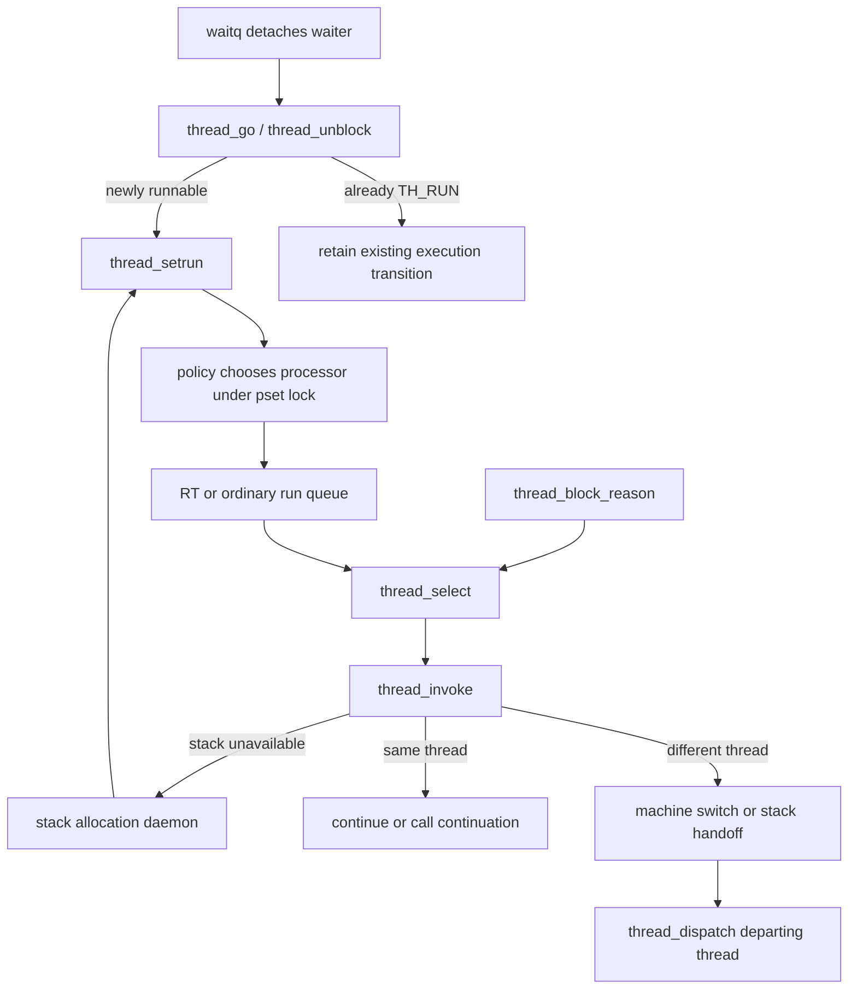

# From runnable thread to executing context

[Runtime](README.md) · [Scheduling introduction](scheduling.md) · [Clutch and Edge](clutch-and-edge.md)

The [AST mechanism](ast-mechanism.md) follows pending masks, remote requests, kernel preemption gates, and callbacks that block; the [flavor reference](ast-flavors.md) maps every defined bit to its producer and consumer.

For the policy decisions surrounding these transitions, read [priority/QoS and quantum expiration](priority-qos-and-quanta.md), [realtime queue selection](realtime-deadlines-and-runqueues.md), and [CPU/SMT eligibility](cpu-eligibility-and-scheduler-variants.md).

For the concrete ARM64 instructions and saved structures behind the machine boundary, read [thread switching, first entry, continuations and exit](../platform/arm64-context-switching.md). It follows the pmap/register/stack switch, first dispatch, stack handoff and termination through their distinct return paths.

A scheduler decision has three separate results: a runnable thread is assigned to a processor, a processor selects an eligible thread, and the machine layer installs that thread's execution context. Selection does not guarantee execution: the selected thread may need a kernel stack, and the scheduler may have to select again. The common implementation separates these stages into `thread_setrun()`, `thread_select()`, and `thread_invoke()`. [`sched_prim.c`](../../../xnu/osfmk/kern/sched_prim.c#L5502-L5643), [`thread_select()`](../../../xnu/osfmk/kern/sched_prim.c#L2437-L2468), [`thread_invoke()`](../../../xnu/osfmk/kern/sched_prim.c#L2999-L3036).

This chapter follows that common path, including what happens to the thread that leaves the CPU. Policy-specific selection is in [Clutch and Edge](clutch-and-edge.md); [exception return](../platform/arm64-exception-return.md) explains how a scheduling AST reaches this machinery from user execution.

## 1. The state that must agree

A `thread` carries several related but distinct descriptions of its execution. `state` contains `TH_RUN`, wait, suspension, and termination bits; `runq` identifies a processor's run queue membership; `chosen_processor` records placement; `kernel_stack`, `reserved_stack`, `continuation`, and `parameter` describe how execution can resume. A running thread can have `TH_RUN` while `runq` is null. A waiting thread can temporarily retain `TH_RUN` until the context-switch departure path removes its runnable accounting. [`thread.h`](../../../xnu/osfmk/kern/thread.h#L405-L460), [`state definitions`](../../../xnu/osfmk/kern/thread.h#L530-L548), [`thread_dispatch()`](../../../xnu/osfmk/kern/sched_prim.c#L3691-L3712).

The `runq` field has an explicit asymmetric locking contract. A null value is protected by the thread lock; a non-null value is protected by the queue lock. Changing null to non-null requires both. Removing a queued thread can clear the field without taking the thread lock, because the queue lock prevents another remover from winning simultaneously. Code inspecting membership must use this protocol, not treat the thread lock alone as authority over every value. [`thread.h`, run-queue locking comment](../../../xnu/osfmk/kern/thread.h#L405-L436).

| State or object | What the execution path uses it for |
|---|---|
| `thread->state`, `sched_pri`, `sched_mode` | Runnable/waiting eligibility and scheduling priority; `thread_select()` also checks termination and suspension. [`sched_prim.c`](../../../xnu/osfmk/kern/sched_prim.c#L2555-L2604). |
| `bound_processor`, `affinity_set` | Hard CPU binding and processor-set affinity checks. [`sched_prim.c`](../../../xnu/osfmk/kern/sched_prim.c#L2583-L2598). |
| `processor->active_thread`, `state`, `deadline` | Current execution identity and the processor's dispatch/real-time bookkeeping. [`sched_prim.c`](../../../xnu/osfmk/kern/sched_prim.c#L3241-L3279), [`selection completion`](../../../xnu/osfmk/kern/sched_prim.c#L2941-L2981). |
| Processor-set lock and pending-AST masks | Serialize placement/selection with another CPU making work runnable or requesting preemption. [`sched_prim.c`](../../../xnu/osfmk/kern/sched_prim.c#L2879-L2935). |
| `continuation`, `parameter`, `kernel_stack` | Either preserve a suspended C call chain or restart at a continuation after obtaining a usable stack. [`sched_prim.c`](../../../xnu/osfmk/kern/sched_prim.c#L3282-L3309). |

`SCHED(f)` is a configuration boundary. Static dispatch can select Edge, AMP, Clutch, or dual-queue implementations; the ARM64 Clutch and heterogeneous Edge definitions are themselves conditional. The portable code below must be read with the actual dispatch table/configuration in mind. An x86 or non-Clutch build does not automatically have the bucket policy described in the companion chapter. [`sched_prim.h`](../../../xnu/osfmk/kern/sched_prim.h#L870-L902), [`sched.h`](../../../xnu/osfmk/kern/sched.h#L185-L217).

## 2. Waking is a state transition before it is placement

A wait queue first detaches a selected waiter and marks `TH_WAKING`. `thread_go()` expects that detachment: the thread must no longer carry a wait event or queue, must still be waiting, and must not be terminating. `thread_unblock()` records the result, handles the wait timer, sets `TH_RUN`, and clears the wait-related bits. It reports whether this actually added a runnable thread. If the thread was already runnable—for example, wakeup raced with the thread's final approach to blocking—there is no second runnable-count increment or duplicate run-queue insertion. [`waitq.c`](../../../xnu/osfmk/kern/waitq.c#L577-L619), [`thread_go()`](../../../xnu/osfmk/kern/sched_prim.c#L1043-L1091), [`thread_unblock()`](../../../xnu/osfmk/kern/sched_prim.c#L856-L923).

The ordinary new-runnable path calls `thread_setrun(thread, SCHED_PREEMPT | SCHED_TAILQ)`. A handoff-enabled wake can instead retain the target and put it in the current thread's `handoff_thread` slot. That is a deliberately separate transfer opportunity; it does not mean every wake immediately switches CPUs or hands ownership of the waited-on primitive to the waiter. [`thread_go()`](../../../xnu/osfmk/kern/sched_prim.c#L1064-L1091), [`mutex acquisition retry`](../../../xnu/osfmk/kern/lock_mtx.c#L784-L825).

`thread_setrun()` enters with the thread locked and not already queued. For an unbound thread it chooses a node/processor set and calls the policy's processor chooser, with bounded retries and fallback handling for unavailable processors. A CPU-bound thread goes directly to its bound processor. The chosen processor set is locked at enqueue time; the real-time versus ordinary enqueue decision uses the `BASEPRI_RTQUEUES` priority threshold. The respective enqueue routine releases that lock, and the unbound path may subsequently request spill work. [`sched_prim.c`](../../../xnu/osfmk/kern/sched_prim.c#L5502-L5643).



The diagram connects the ordinary paths; handoff, idle, real-time, and CPU-offline cases introduce branches. Its decisive retry is visible in `thread_block_reason()`: select a thread under the current thread's lock, unlock, invoke, and repeat if invocation failed. [`sched_prim.c`](../../../xnu/osfmk/kern/sched_prim.c#L3874-L3944).

## 3. Selecting includes deciding to keep the current thread

`thread_select()` runs at scheduler interrupt level with the current thread locked. It updates policy state before taking the processor-set lock, then evaluates whether the current CPU and current thread are still suitable. A processor removed from the recommended set, real-time restrictions, and SMT constraints can force a different path before ordinary queue comparison. These are placement and CPU-availability decisions, not just comparisons between two priority integers. [`sched_prim.c`](../../../xnu/osfmk/kern/sched_prim.c#L2437-L2553).

The exact runnable test excludes waiting, idle, terminating, and suspended states:

[`osfmk/kern/sched_prim.c:2566–2567`](../../../xnu/osfmk/kern/sched_prim.c#L2566-L2567)

<!-- source-excerpt: ../../../xnu/osfmk/kern/sched_prim.c#L2566-L2567 -->
```c
		/* i.e. not waiting, not TH_SUSP'ed */
		bool still_running = ((thread->state & (TH_TERMINATE | TH_IDLE | TH_WAIT | TH_RUN | TH_SUSP)) == TH_RUN);
```

Even after that test, processor affinity, binding, and the policy's `thread_avoid_processor()` can make the current thread ineligible. Yield changes some rebalancing checks; on SMT builds, a non-real-time thread on a secondary processor may be forced toward a primary processor. The code passes the current thread to ordinary policy selection only when it is eligible to remain. [`sched_prim.c`](../../../xnu/osfmk/kern/sched_prim.c#L2577-L2598), [`ordinary chooser`](../../../xnu/osfmk/kern/sched_prim.c#L2790-L2859).

Real-time selection is handled separately. An eligible real-time thread with time remaining in its first time slice may keep running, subject to earlier-deadline/higher-priority candidates and the configured real-time policy. Real-time queue work is considered before ordinary work, including spill work from other processor sets. It is inaccurate to reduce this code either to “highest priority always wins” or “earliest deadline always wins”: those statements omit eligibility, time-slice state, and configuration checks. [`sched_prim.c`](../../../xnu/osfmk/kern/sched_prim.c#L2599-L2791).

The common ordinary-thread shortcut asks whether the policy queue contains sufficient priority to challenge the current thread. Clutch intentionally prevents that shortcut; it must compare the current thread against the full hierarchy rather than a flat queue's highest priority:

[`osfmk/kern/sched_clutch.c:3467–3478`](../../../xnu/osfmk/kern/sched_clutch.c#L3467-L3478)

<!-- source-excerpt: ../../../xnu/osfmk/kern/sched_clutch.c#L3467-L3478 -->
```c
static boolean_t
sched_clutch_processor_queue_has_priority(
	__unused processor_t    processor,
	__unused int            priority,
	__unused boolean_t      gte)
{
	/*
	 * Never short-circuit the Clutch runqueue by returning FALSE here. Instead,
	 * thread_select() should always go through sched_clutch_choose_thread().
	 */
	return TRUE;
}
```

Selection also has a concurrency retry. A steal operation drops the local processor-set lock. During that interval another CPU can enqueue work, observe that this CPU is still running a suitable thread, and decide an IPI is unnecessary. After a failed steal, `thread_select()` reacquires the lock and rechecks bound work, ordinary queues, real-time spill, and new pending AST bits before going idle. A single empty-queue observation made before dropping the lock would be insufficient. [`sched_prim.c`](../../../xnu/osfmk/kern/sched_prim.c#L2872-L2937).

When there is no better work, the current eligible thread can remain. Otherwise the CPU becomes idle and the policy's balance hook runs before returning the processor's idle thread. A returned thread is selected for execution, but stack installation still lies ahead. [`sched_prim.c`](../../../xnu/osfmk/kern/sched_prim.c#L2941-L2981).

## 4. Invocation: same thread, donated stack, or saved context

`thread_invoke()` asserts preemption is enabled on entry: this is not a legitimate place to arrive while retaining a spin lock or other preemption-disabled critical section. It locks and verifies the selected thread, including runnable state, absent run-queue membership, and compatible CPU binding. This boundary is where the scheduler's chosen object becomes an execution context. [`sched_prim.c`](../../../xnu/osfmk/kern/sched_prim.c#L2999-L3076).

There are three useful cases:

1. **The selected thread is current.** Without a continuation, return directly. With a continuation, clear the saved continuation fields and invoke it with the wait result; the old call chain is intentionally abandoned. [`sched_prim.c`](../../../xnu/osfmk/kern/sched_prim.c#L3184-L3240).
2. **The current thread has a continuation and the target has no stack.** Subject to reserved-stack constraints, hand the current stack to the target. This changes thread identity and, when needed, the address space while the immediate stack/register state remains active. Dispatch the departed thread, then call the target's continuation. [`sched_prim.c`](../../../xnu/osfmk/kern/sched_prim.c#L3076-L3183).
3. **A conventional context switch is needed.** Ensure the target has a stack, update processor/accounting state, and call `machine_switch_context()`. The old thread's kernel call chain is preserved only if it is not parking on a continuation. [`sched_prim.c`](../../../xnu/osfmk/kern/sched_prim.c#L3194-L3309).

The stack handoff's deliberately unusual contract is stated beside its call:

[`osfmk/kern/sched_prim.c:3136–3146`](../../../xnu/osfmk/kern/sched_prim.c#L3136-L3146)

<!-- source-excerpt: ../../../xnu/osfmk/kern/sched_prim.c#L3136-L3146 -->
```c
			/*
			 * This is where we actually switch thread identity,
			 * and address space if required.  However, register
			 * state is not switched - this routine leaves the
			 * stack and register state active on the current CPU.
			 */
			TLOG(1, "thread_invoke: calling stack_handoff\n");
			stack_handoff(self, thread);

			/* 'self' is now off core */
			assert(thread == current_thread_volatile());
```

If `stack_alloc_try()` cannot supply a stack, invocation puts the target on `thread_stack_queue` and returns false. The stack daemon can allocate with interrupts enabled, allowing VM work, then locks the thread and makes it runnable again. The original CPU immediately returns to selection rather than blocking inside stack allocation. [`sched_prim.c`](../../../xnu/osfmk/kern/sched_prim.c#L3194-L3221), [`thread.c`](../../../xnu/osfmk/kern/thread.c#L1163-L1204).

[`osfmk/kern/thread.c:1176–1185`](../../../xnu/osfmk/kern/thread.c#L1176-L1185)

<!-- source-excerpt: ../../../xnu/osfmk/kern/thread.c#L1176-L1185 -->
```c
	/* allocate stack with interrupts enabled so that we can call into VM */
	stack_alloc(thread);

	KERNEL_DEBUG_CONSTANT(MACHDBG_CODE(DBG_MACH_SCHED, MACH_STACK_WAIT) | DBG_FUNC_END, thread_tid(thread), 0, 0, 0, 0);

	spl_t s = splsched();
	thread_lock(thread);
	thread_setrun(thread, SCHED_PREEMPT | SCHED_TAILQ);
	thread_unlock(thread);
	splx(s);
```

A conventional switch has a non-local-looking C return. The stack on which `machine_switch_context()` returns belongs to the thread now resuming. Its local `self` is meaningful again, while the returned `thread` is the thread most recently removed from this processor. The function's comment explicitly prohibits relying on other locals as if execution had simply continued through an ordinary call. `thread_dispatch(thread, self)` then completes departure processing for that returned thread. [`sched_prim.c`](../../../xnu/osfmk/kern/sched_prim.c#L3282-L3334).

## 5. What ARM64 installs

The ARM64 wrapper first handles extended context and the pmap, then calls `Switch_context()`. It asserts PAN is enabled where supported. The pmap helper switches when the map or security override changes; even when it does not change, it issues a DSB and requests context synchronization so cache/TLB maintenance and user context effects are not incorrectly carried across migration. “Same address space” does not mean “no machine synchronization.” [`pcb.c`](../../../xnu/osfmk/arm64/pcb.c#L437-L529).

At the assembly boundary, a non-null continuation suppresses saving the departing kernel register state. The implementation changes thread registers, obtains the new kernel stack state, restores registers, installs process-dependent keys/context synchronization, and returns through the switch epilogue:

[`osfmk/arm64/cswitch.s:375–386`](../../../xnu/osfmk/arm64/cswitch.s#L375-L386)

<!-- source-excerpt: ../../../xnu/osfmk/arm64/cswitch.s#L375-L386 -->
```asm
LEXT(Switch_context)
	ARM64_PROLOG
	cbnz	x1, Lswitch_threads					// Skip saving old state if blocking on continuation
	LOAD_KERN_STACK_TOP	dst=x3, src=x0, tmp=x4	// Get the old kernel stack top
	save_general_registers	x3, 4
Lswitch_threads:
	set_thread_registers	x2, x3, x4
	LOAD_KERN_STACK_TOP	dst=x3, src=x2, tmp=x4
	load_general_registers	x3, 4
	set_process_dependent_keys_and_sync_context	x2, x3, x4, x5, w6
	cswitch_epilogue

```

This is a kernel scheduling context switch, not an `eret` to user mode. A thread may resume deep inside the kernel, or start a continuation that later reaches exception return. The continuation entry separately prepares a fresh stack/frame, calls the continuation, and terminates the thread if that continuation returns. See [ARM64 return](../platform/arm64-exception-return.md) for saved user-state restoration. [`cswitch.s`](../../../xnu/osfmk/arm64/cswitch.s#L340-L363), [`Switch_context`](../../../xnu/osfmk/arm64/cswitch.s#L375-L386).

The stack-handoff implementation also has configuration-specific work. Under SPTM it unmaps an old redzone mapping before detaching the stack and starts the receiving thread without that redzone mapping; reserved stacks have an explicit exchange rule. These checks explain why stack transfer cannot be modeled as assigning only `new->kernel_stack = old->kernel_stack`. The x86 machine-switch implementation is a separate backend and is not instruction-by-instruction reviewed here. [`pcb.c`](../../../xnu/osfmk/arm64/pcb.c#L1045-L1107), [`x86 backend entry`](../../../xnu/osfmk/i386/pcb.c#L461).

## 6. Departure, quantum, and final termination

`thread_dispatch()` runs after the switch on the receiving execution context. It can release a departed continuation thread's old stack. It accounts for consumed/remaining quantum and requeues a still-runnable departed thread: quantum expiry goes to the tail; a preemption can preserve head placement; other departures request tail/preemption behavior. A handoff can transfer remaining quantum under the explicit checks in this path. These queue-position choices are inputs to policy fairness, not an unconditional global FIFO promise. [`sched_prim.c`](../../../xnu/osfmk/kern/sched_prim.c#L3446-L3518), [`quantum and requeue`](../../../xnu/osfmk/kern/sched_prim.c#L3519-L3670).

For a waiter, dispatch clears `TH_RUN`, resets placement/runnable timestamps, decrements the policy's runnable count, and reports a scheduler block callback if required. That callback is how thread-call workers tell their group that a worker blocked; it is distinct from merely registering a wait. The new thread receives its execution/quantum timer bookkeeping afterward. [`sched_prim.c`](../../../xnu/osfmk/kern/sched_prim.c#L3687-L3847), [`thread-call scheduler callback`](../../../xnu/osfmk/kern/thread_call.c#L1517-L1553).

Thread termination uses this same departure machinery rather than freeing the active thread in place. `thread_terminate_internal()` marks the thread inactive, requests abort handling, interrupts an eligible wait or starts a not-yet-started thread, and can wait for a remote thread to stop. Kernel threads require cooperation: an external request cannot terminate another kernel thread through `thread_terminate()`, and self-termination drives the APC path explicitly because there is no future user-return AST boundary. [`thread_act.c`](../../../xnu/osfmk/kern/thread_act.c#L285-L360).

Before the final block, `thread_terminate_self()` cancels the wait timer and drains concurrent expirations using `wait_timer_active`, releasing the thread lock and scheduler interrupt level during the delay loop. It frees a reserved stack, marks `TH_TERMINATE`, asserts an uninterruptible wait, and checks that promotion, lock, handoff, work-interval, and configured Exclaves state have been unwound. Canceling the timer alone would not establish this lifetime boundary. [`thread.c`](../../../xnu/osfmk/kern/thread.c#L637-L716).

The first departure after that final block marks the second termination phase:

[`osfmk/kern/sched_prim.c:3695–3707`](../../../xnu/osfmk/kern/sched_prim.c#L3695-L3707)

<!-- source-excerpt: ../../../xnu/osfmk/kern/sched_prim.c#L3695-L3707 -->
```c
				/* Only the first call to thread_dispatch
				 * after explicit termination should add
				 * the thread to the termination queue
				 */
				if ((thread_state & (TH_TERMINATE | TH_TERMINATE2)) == TH_TERMINATE) {
					should_terminate = TRUE;
					thread_state |= TH_TERMINATE2;
				}

				timer_stop(&thread->runnable_timer, processor->last_dispatch);

				thread_state &= ~TH_RUN;
				thread->state = thread_state;
```

After dropping departure locks, dispatch queues the thread for termination processing and stops treating the pointer as safe to use. The reaper removes task/global membership, rolls up accounting, handles user join completion, and deallocates the thread reference; inspection/crash handling can defer this work. Request, self-cleanup, off-CPU transition, and final object reclamation are separate stages. The [object lifecycle guide](objects-and-lifecycle.md) covers the remaining reference and task relationships. [`sched_prim.c`](../../../xnu/osfmk/kern/sched_prim.c#L3744-L3761), [`thread_terminate_queue_invoke()`](../../../xnu/osfmk/kern/thread.c#L999-L1090).

## Inspection limits and a useful source walk

Read `thread_unblock()` → `thread_setrun()` first, then `thread_block_reason()` → `thread_select()` → `thread_invoke()` → `thread_dispatch()`. Follow the stack-allocation failure once before studying policy heuristics; it makes clear why selection and execution are separate contracts. The linked bodies above were reviewed, including ARM64's wrapper and small assembly switch body. Complete real-time admission/deadline policy, every SMT/offline transition, x86 register switching, and task/corpse teardown are outside this chapter's deep review; these pages are source analysis, not runtime or formal verification.

<!-- BEGIN PLATYDOC DOCUMENTATION LICENSE -->
Original Platydoc text and diagrams are licensed under [CC BY 4.0](https://creativecommons.org/licenses/by/4.0/). Quoted source code and third-party material retain their respective licenses.
<!-- END PLATYDOC DOCUMENTATION LICENSE -->
