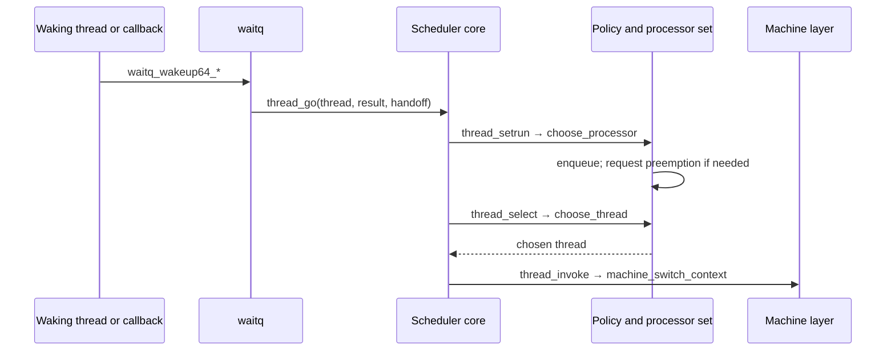
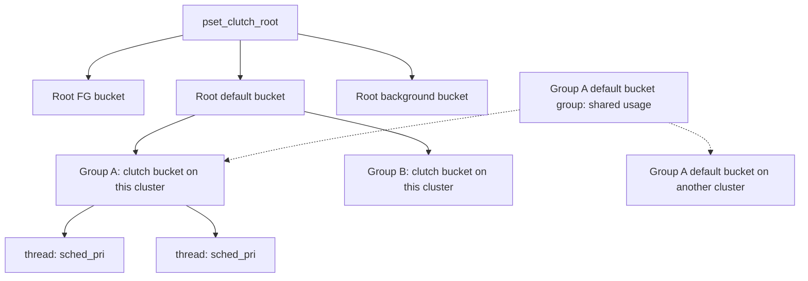

# From runnable thread to CPU execution

[Runtime overview](README.md) · [Waits and locks](waits-and-locks.md)

For the full deferred-service protocol, read [AST transport, service points, and callback lifetime](ast-mechanism.md) and the [complete AST flavor reference](ast-flavors.md). They distinguish scheduler reasons from per-thread callbacks and trace remote IPIs through the return path.

The execution-policy details now continue in [priority, QoS and quanta](priority-qos-and-quanta.md), [realtime deadlines and runqueues](realtime-deadlines-and-runqueues.md), and [CPU eligibility and scheduler variants](cpu-eligibility-and-scheduler-variants.md). These cover the numeric policy and configuration decisions surrounding the common dispatch path.

For the detailed implementation, continue with [scheduler execution and context switching](scheduler-execution.md) and [Clutch/Edge selection and placement](clutch-and-edge.md).

## Common machinery and selected policy

`sched_prim.c` implements the common transitions: a thread becomes runnable, a CPU chooses work, a context switch takes place, and the departing thread is requeued or left waiting. `SCHED(f)` supplies policy operations such as `choose_thread`, `choose_processor`, `processor_enqueue`, and priority updates. Selection is fixed at compile time: AMP uses Edge when enabled and otherwise AMP policy; other builds use Clutch when enabled and otherwise dualq. Thus a function-pointer-shaped table does not imply a runtime scheduler plugin choice. [`sched_prim.h`](../../../platydoc-data/xnu/osfmk/kern/sched_prim.h#L870).

Clutch eligibility is also conditional. `sched.h` enables it for eligible arm64 configurations with `CONFIG_CLUTCH` and without `CONFIG_SCHED_EDGE_OPT_OUT`; AMP additionally enables Edge. The checkout therefore contains multiple valid implementations. The presence of `sched_clutch.c` alone does not identify the scheduler in a particular kernel binary. [`sched.h`](../../../platydoc-data/xnu/osfmk/kern/sched.h#L192).

## A wake-to-run trace

This depicts the ordinary queued path. Wakeup can attempt a handoff, and selection can keep the current thread running; neither wakeup nor entry into the scheduler guarantees a switch. [`thread_go()`](../../../platydoc-data/xnu/osfmk/kern/sched_prim.c#L1043), [`thread_select()`](../../../platydoc-data/xnu/osfmk/kern/sched_prim.c#L2437).

`thread_go()` expects the wait queue to have detached the thread and cleared its event. With the thread locked and interrupts disabled, it invokes `thread_unblock()`; if a new runnable transition is required, it either records a handoff target or calls `thread_setrun()`. The latter updates priority, classifies work, selects a node/starting pset, and invokes the chosen scheduler's placement operation. It handles CPUs becoming unavailable during placement and treats processor-bound threads separately. Finally it dispatches realtime priorities through `realtime_setrun()` and other work through `processor_setrun()`. [`sched_prim.c`, wakeup](../../../platydoc-data/xnu/osfmk/kern/sched_prim.c#L1043), [`sched_prim.c`, placement](../../../platydoc-data/xnu/osfmk/kern/sched_prim.c#L5502).

`thread_block_reason()` raises to scheduler interrupt level, clears handled scheduling ASTs, saves the continuation/parameter, locks the current thread, and calls `thread_select()`. It repeats selection if `thread_invoke()` cannot complete the proposed switch. `thread_select()` updates the current thread's priority, takes the pset lock, and examines CPU eligibility, runnable queues, and preemption conditions. An AST is a deferred-action request checked at appropriate execution boundaries; here the scheduling AST bits explain why selection is needed. [`sched_prim.c`](../../../platydoc-data/xnu/osfmk/kern/sched_prim.c#L3874).

`thread_invoke()` is the boundary to execution mechanics. It checks that preemption is not disabled, snapshots accounting, validates both threads, and handles stack/continuation cases. The normal machine switch calls `machine_switch_context()`; subsequent `thread_dispatch()` accounts for and handles the outgoing thread. A continuation permits resumption at an explicit function with a parameter rather than requiring every blocked operation to preserve its entire kernel call stack. Read the surrounding stack handoff cases before following the architecture assembly. [`sched_prim.c`, invocation](../../../platydoc-data/xnu/osfmk/kern/sched_prim.c#L2999), [`sched_prim.c`, machine switch](../../../platydoc-data/xnu/osfmk/kern/sched_prim.c#L3309).

## Priority and QoS are several layers

`thread` distinguishes `req_base_pri`, effective `base_pri`, current `sched_pri`, maximum/task priorities, scheduling mode, and scheduler bucket. Requested and effective policy are also distinct structures. `thread_policy_update_internal_spinlocked()` combines task policy and thread requests, including overrides and I/O/timer attributes; `thread_recompute_priority()` turns effective policy into a base priority. Scheduler decay and inheritance can then change scheduling behavior. [`thread.h`](../../../platydoc-data/xnu/osfmk/kern/thread.h#L593), [`thread_policy.c`](../../../platydoc-data/xnu/osfmk/kern/thread_policy.c#L1623).

The initial QoS priorities in `thread_qos_policy_params` are user-interactive 46, user-initiated 37, legacy/default 31, utility 20, and background/maintenance 4. They are starting points, not guarantees that every thread of that QoS has that `sched_pri`. Relative priority, frontmost interactive urgency, task limits, work-interval policy, realtime policy, and promotion paths matter. The same table also supplies I/O, latency, and throughput tiers: QoS affects more than CPU selection. [`thread_policy.c`, table](../../../platydoc-data/xnu/osfmk/kern/thread_policy.c#L78), [`thread_recompute_priority()`](../../../platydoc-data/xnu/osfmk/kern/thread_policy.c#L1054).

## Clutch: select a class, workload, then thread

Clutch's runnable hierarchy associates a pset root with root scheduling buckets, then thread-group buckets, then runnable threads. A `sched_clutch_bucket` represents one **thread group × scheduling bucket × cluster** combination. Its `sched_clutch_bucket_group` shares usage/timeshare information across cluster instances. Root bucket structures also distinguish bound from unbound work. [`sched_clutch.h`](../../../platydoc-data/xnu/osfmk/kern/sched_clutch.h#L95).

At the root level, deadline ordering gives lower classes a chance to run while bounded “warp” windows favor responsive higher classes. The configured worst-case-execution-latency inputs are 0 for FG, 37.5 ms for initiated, 75 ms for default, 150 ms for utility, and 250 ms for background; FIXPRI has special treatment. These are scheduler policy inputs, not end-to-end application latency promises. Selection also has starvation-avoidance windows and compares special above-UI work. [`sched_clutch.c`, parameters](../../../platydoc-data/xnu/osfmk/kern/sched_clutch.c#L180), [`sched_clutch_root_highest_root_bucket()`](../../../platydoc-data/xnu/osfmk/kern/sched_clutch.c#L836).

Within a root bucket, `sched_clutch_bucket_pri_calculate()` adds an interactivity score to the bucket's highest relevant base/promoted priority. The score compares CPU-used history and intervals when the bucket group has no runnable/running threads. Within the chosen clutch bucket, the runnable priority queue orders threads by `sched_pri`; separate linkage tracks priority used to rank the bucket itself. Keeping these queues distinct lets a promoted thread affect workload selection while preserving thread-level scheduling order. [`sched_clutch.c`, priority calculation](../../../platydoc-data/xnu/osfmk/kern/sched_clutch.c#L1715), [`thread.h`, Clutch links](../../../platydoc-data/xnu/osfmk/kern/thread.h#L456).

The concrete selection route is `sched_clutch_hierarchy_thread_highest()` → `sched_clutch_root_highest_root_bucket()` → bound/unbound thread lookup → removal when required. It carries the previously running thread through the hierarchy so policy can select continued execution. For insertion, follow `sched_clutch_thread_insert()` and watch how empty-to-runnable transitions update ancestor queues/counts. [`sched_clutch.c`, selection](../../../platydoc-data/xnu/osfmk/kern/sched_clutch.c#L2982), [`sched_clutch.c`, insertion](../../../platydoc-data/xnu/osfmk/kern/sched_clutch.c#L2778).

Thread groups are not simply task IDs. Initial membership comes from the task's coalition, while bank vouchers and work intervals can change the relevant grouping. That connection is why scheduler policy and [work attribution](time-and-accounting.md) should be read together. [`thread_group_init_thread()`](../../../platydoc-data/xnu/osfmk/kern/thread_group.c#L303), [`thread_set_voucher_name()`](../../../platydoc-data/xnu/osfmk/kern/thread.c#L3364).

## Edge and alternate paths

Edge adds placement across psets to Clutch's selection within a pset. `sched_edge_choose_processor()` obtains a preferred pset, asks `sched_edge_migrate_candidate()` whether capacity/policy favor another pset, then calls the common CPU chooser. `processor_set.sched_edges[destination][bucket]` encodes policy per destination and scheduling bucket. Foreign/native pset maps, load estimates, recommendation-specific steal queues, and performance-control updates provide the inputs and rebalancing mechanisms. This is substantially richer than a rule assigning all foreground work to performance cores. [`sched_clutch.c`](../../../platydoc-data/xnu/osfmk/kern/sched_clutch.c#L6062), [`processor.h`](../../../platydoc-data/xnu/osfmk/kern/processor.h#L324).

For deeper Edge study, read `sched_edge_migration_check()`, `sched_edge_migrate_edges_evaluate()`, `sched_edge_steal_thread()`, and `sched_edge_tg_preferred_pset_change()`, then the original [design document](../../../platydoc-data/xnu/doc/scheduler/sched_clutch_edge.md). The [Clutch and Edge chapter](clutch-and-edge.md) traces migration weights, availability retries, and representative stealing; other rebalancing heuristics remain partial. [`sched_clutch.c`](../../../platydoc-data/xnu/osfmk/kern/sched_clutch.c#L5754).

Realtime work has its own pset queue and policy hooks; see `sched_rt_choose_thread()`, `rt_runq_insert()`, and realtime fields in `thread`. `sched_rt.h` explicitly says realtime code is still being moved from the core into `sched_rt.c`, so both files are needed. The dualq dispatch table is a more compact alternative policy to read, using common timeshare machinery with per-processor and pset queues. [`sched_rt.h`](../../../platydoc-data/xnu/osfmk/kern/sched_rt.h#L108), [`sched_rt.c`](../../../platydoc-data/xnu/osfmk/kern/sched_rt.c#L640), [`sched_dualq.c`](../../../platydoc-data/xnu/osfmk/kern/sched_dualq.c#L105).

<!-- BEGIN PLATYDOC DOCUMENTATION LICENSE -->
Original Platydoc text and diagrams are licensed under [CC BY 4.0](https://creativecommons.org/licenses/by/4.0/). Quoted source code and third-party material retain their respective licenses.
<!-- END PLATYDOC DOCUMENTATION LICENSE -->
