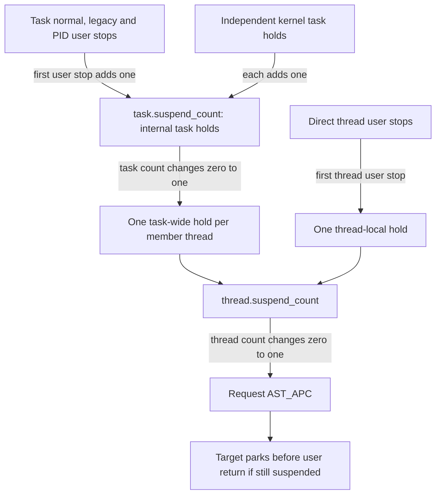
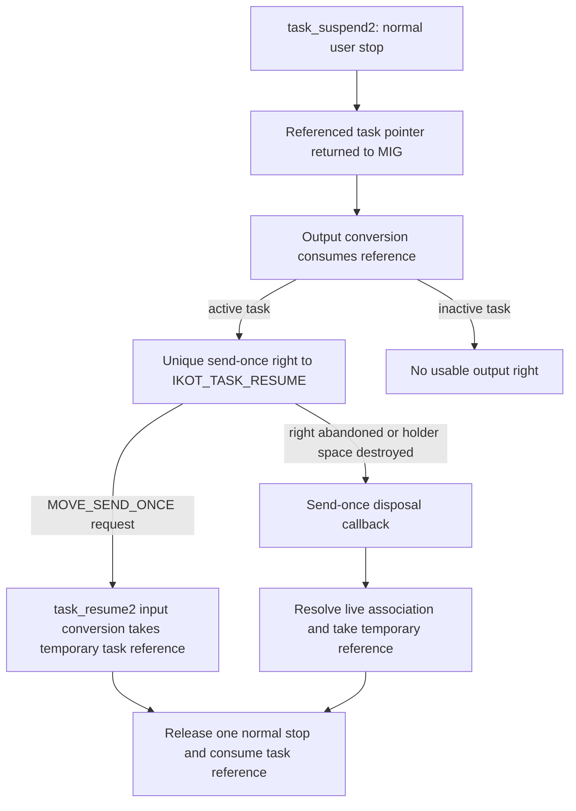

# Suspension, stopping and aborting threads

[Runtime guide](README.md) · [Objects and lifecycle](objects-and-lifecycle.md) · [AST mechanism](ast-mechanism.md) · [Task and thread capabilities](../security/task-and-thread-capabilities.md)

Suspension prevents a task or thread from returning to user execution while a hold remains. The request, the hold counter, the off-CPU wait, and the eventual APC parking are separate operations. An abort instead asks a blocked or executing thread to abandon eligible waits; it does not add a suspension hold. This chapter follows those ownership and scheduling boundaries in the selected XNU snapshot.

## 1. Entry points do not all require the same capability

The MIG declarations use `task_read_t` for both legacy task suspend/resume and `task_suspend2`, and `thread_read_t` for legacy thread suspend/resume and `thread_suspend2`. A control right can satisfy these read conversions, while an inspect right cannot. `thread_abort` and `thread_abort_safely` use `thread_act_t`, the control-thread conversion. Resuming through a token instead uses that token's special port type. Authority is the declaration plus converter and implementation checks, not the apparent destructiveness of a name. [`task declarations`](../../../xnu/osfmk/mach/task.defs#L188-L204), [`task token declarations`](../../../xnu/osfmk/mach/task.defs#L468-L473), [`thread declarations`](../../../xnu/osfmk/mach/thread_act.defs#L170-L215), [`thread token declarations`](../../../xnu/osfmk/mach/thread_act.defs#L426-L437).

| Request | Main state change | External representation of the request |
| --- | --- | --- |
| `task_suspend` / `task_resume` | Legacy subset of the task's user-stop count | Hidden ordinary send right in the caller's IPC space, used for aggregate cleanup |
| `task_suspend2` / `task_resume2` | Normal task user-stop count | One move-send-once token per suspension |
| `pid_suspend` / `pid_resume` | One distinguished PID hold, tracked by `pidsuspended` | PID-based BSD request with its own policy checks; no token returned |
| `thread_suspend` / `thread_resume` | Legacy subset of thread-local user stops | No hidden resume-port right is created by these bodies |
| `thread_suspend2` / `thread_resume2` | Normal thread-local user stops | Ordinary move-send token, with aggregate no-senders cleanup |
| `thread_abort` / `thread_abort_safely` | Abort scheduling flags and eligible wait interruption | No suspension token or hold |

The task and thread `suspend2` protocols **differ** in this release. The task token is `mach_port_move_send_once_t`; the thread declaration uses `mach_port_move_send_t`. A task [identity token](../security/task-and-thread-capabilities.md#9-identity-tokens-resolve-identity-without-becoming-unconditional-authority) is a third, unrelated object, used to resolve identity and request a permitted capability later.

## 2. The counters form two levels of aggregation

| State | Meaning and synchronization |
| --- | --- |
| `task.user_stop_count` | User-level task stops, including normal, legacy and the distinguished PID hold; changed under the task lock |
| `task.legacy_stop_count` | Legacy subset used by task resume-port no-senders cleanup |
| `task.pidsuspended` | Whether the single PID hold exists; ordinary task release preserves its floor |
| `task.suspend_count` | Internal task holds, including one hold for the entire nonzero user-stop group plus independent kernel holds |
| `thread.user_stop_count`, `legacy_user_stop_count` | Direct thread suspension counts, under the thread mutex; distinct from task-wide suspension |
| `thread.suspend_count` | Internal holds on this thread, including task-wide and direct-thread contributions |
| `thread.suspend_parked` | APC suspension parking protocol state; not proof the thread is currently on a wait queue |
| `TH_SUSP`, `wake_active` | Scheduler stop arbitration and wait notification, separate from the suspension counters |

[`task fields`](../../../xnu/osfmk/kern/task.h#L303-L311), [`PID flag`](../../../xnu/osfmk/kern/task.h#L505-L505), [`thread internal count`](../../../xnu/osfmk/kern/thread.h#L600-L601), [`thread user counts`](../../../xnu/osfmk/kern/thread.h#L780-L781), [`scheduler stop`](../../../xnu/osfmk/kern/sched_prim.c#L1490-L1588).

`place_task_hold` first rejects an inactive non-corpse task; corpse tasks return success without incrementing these counters. For a live task it increments the legacy subset when appropriate, then increments `user_stop_count`. Only the zero-to-one transition calls `task_hold_locked`. Thus three task user stops normally contribute **one** internal task hold. [`user-stop aggregation`](../../../xnu/osfmk/kern/task.c#L3990-L4053).

`task_hold_locked` separately increments `task.suspend_count`. Only its zero-to-one transition notifies the BSD workqueue and visits every member thread, taking each thread mutex and calling `thread_hold`. Conversely, only the one-to-zero transition in `task_release_locked` resumes the workqueue and drops those thread holds. Independent kernel holds survive ordinary user resumes. [`task hold`](../../../xnu/osfmk/kern/task.c#L3643-L3674), [`task release`](../../../xnu/osfmk/kern/task.c#L3783-L3809).



The diagram shows contributions, not an arithmetic sum of all user counters into every thread. Illustrative normal sequence: two `task_suspend2` calls make `task.user_stop_count = 2`, but only one internal task hold reaches each thread. A direct `thread_suspend` on one member gives that thread a second internal hold. Returning both task tokens removes the task-wide hold; that member remains suspended until its direct thread hold is released.

Thread creation closes the membership race. The ordinary suspended-thread constructor sets one legacy thread user stop and calls `thread_hold`, then adds another hold if the parent task is suspended. A running-thread constructor has no initial user stop but still adds the parent's task hold. Creation and publication occur with the task/global membership locks held. [`suspended constructor`](../../../xnu/osfmk/kern/thread.c#L1609-L1625), [`running constructor`](../../../xnu/osfmk/kern/thread.c#L1680-L1690), [constructor locking](objects-and-lifecycle.md#creating-a-task-and-its-first-thread).

## 3. A hold requests APC; waiting observes the CPU boundary

Under the thread mutex, `thread_hold` increments the internal counter. The first hold sets `AST_APC` using the thread scheduling lock at scheduler interrupt level. The setter propagates locally or requests an AST check when the target is running remotely. This is deferred execution on the target, not execution of its suspension callback by the requesting thread. [`hold`](../../../xnu/osfmk/kern/thread_act.c#L406-L416), [`APC publication`](../../../xnu/osfmk/kern/thread_act.c#L1308-L1351).

`place_task_hold` calls `task_wait_locked(task, FALSE)` on the first user stop. That walks member threads while holding the task lock and calls `thread_wait` for everyone except the current thread. Direct `thread_suspend` likewise waits for a non-current target after dropping its mutex. A self-suspending caller must complete the kernel-side request and reach its own APC; it cannot synchronously wait for itself to stop. [`task iteration`](../../../xnu/osfmk/kern/task.c#L3745-L3766), [`thread caller`](../../../xnu/osfmk/kern/thread_act.c#L545-L569).

`thread_wait(..., FALSE)` waits until the target is no longer on a CPU; `TRUE` also waits for `TH_RUN` to clear. Its own wait is uninterruptible and uses `wake_active` under the wake and scheduling locks. The `FALSE` result does **not** promise that the target cannot later run kernel code: an existing kernel wait may wake, and APC still prevents user return while the hold survives. This distinction explains the source's “stop executing user code” contract without inventing a permanently frozen kernel stack.

[Source: `osfmk/kern/sched_prim.c`, lines 1649–1668](../../../xnu/osfmk/kern/sched_prim.c#L1649-L1668).

<!-- source-excerpt: ../../../xnu/osfmk/kern/sched_prim.c#L1649-L1668 -->
```c
	/*
	 * Wait until not running on a CPU.  If stronger requirement
	 * desired, wait until not runnable.  Assumption: if thread is
	 * on CPU, then TH_RUN is set, so we're not waiting in any case
	 * where the original, pure "TH_RUN" check would have let us
	 * finish.
	 */
	while ((oncpu = thread_isoncpu(thread)) ||
	    (until_not_runnable && (thread->state & TH_RUN))) {
		if (oncpu) {
			assert(thread->state & TH_RUN);
			processor = thread->chosen_processor;
			cause_ast_check(processor);
		}

		thread->wake_active = TRUE;
		thread_unlock(thread);

		wresult = assert_wait(&thread->wake_active, THREAD_UNINT);
		wake_unlock(thread);
```

The separate `thread_stop`/`thread_unstop` pair arbitrates stop requests with `TH_SUSP`. It can be interrupted while waiting, and calls `thread_unstop` on its interrupted post-acquisition path. Its return is unlocked; its own comment requires an external stop mechanism to keep the thread from becoming runnable again. Neither `TH_SUSP` nor a completed `thread_wait` replaces a counted hold. [`stop and unwind`](../../../xnu/osfmk/kern/sched_prim.c#L1490-L1588), [`unstop`](../../../xnu/osfmk/kern/sched_prim.c#L1591-L1628).

### Parking and resuming

The existing [APC consumer section](ast-mechanism.md#apc-abandon-the-old-call-chain-and-recheck-suspension) follows the complete continuation path. Its decisions are significant here:

1. Clear abort scheduling flags under the scheduling lock.
2. If `thread.active` is false, terminate the thread before considering suspension.
3. If `suspend_count > 0`, set `suspend_parked`, assert an abort-safe wait on the counter, drop the mutex and block with `thread_suspended` as continuation.
4. On wake, the continuation rechecks the counter and rearms APC if another hold remains, then returns through the exception-return path.

[`consumer and continuation`](../../../xnu/osfmk/kern/thread_act.c#L1367-L1430).

`thread_release` must run with the mutex held. Reaching zero either starts a never-started thread or clears `suspend_parked` and wakes that specific thread. Since the wait is abort-safe, an abort can have already removed it from the wait queue; the marker is protocol state, not a queue-membership test.

[Source: `osfmk/kern/thread_act.c`, lines 437–443](../../../xnu/osfmk/kern/thread_act.c#L437-L443).

<!-- source-excerpt: ../../../xnu/osfmk/kern/thread_act.c#L437-L443 -->
```c
	if (--thread->suspend_count == 0) {
		if (!thread->started) {
			thread_start(thread);
		} else if (thread->suspend_parked) {
			thread->suspend_parked = FALSE;
			thread_wakeup_thread(&thread->suspend_count, thread);
		}
```

## 4. Legacy task suspension tracks hidden ordinary send rights

`task_suspend` first places a `TASK_HOLD_LEGACY` user stop. It then takes the task IPC lock, lazily creates or makes a send right to `task.itk_resume` of type `IKOT_TASK_RESUME`, and copies that ordinary right into the **calling** task's IPC space. The returned name is intentionally not exposed by this API. Repeated copyout can merge ordinary send rights into a name with additional user references; it does not create unique one-shot token names. [`legacy suspend`](../../../xnu/osfmk/kern/task.c#L4141-L4196), [`ordinary-right reverse lookup`](../../../xnu/osfmk/ipc/ipc_object.c#L930-L946).

The older introductory comment says all legacy rights account for “a single suspension.” The bodies actually increment `legacy_stop_count` and `user_stop_count` for each call, aggregate those user stops into one internal task hold, and remove **all remaining legacy counts** when the last ordinary sender disappears. Do not use that comment to collapse the two counters. [`increment`](../../../xnu/osfmk/kern/task.c#L4007-L4029), [`aggregate cleanup`](../../../xnu/osfmk/kern/task.c#L4089-L4096).

`task_resume` first calls `release_task_hold(TASK_HOLD_LEGACY)` under the task lock. It then takes the task IPC lock and the caller's IPC-space write lock, reverse-looks up the hidden resume right, and drops one user reference on successful resume. On failed resume it destroys the found right; if no local right exists but the release succeeded, it prints an out-of-band-resume warning. The counter release therefore is not conditioned on proving that this caller owns a matching hidden right. [`legacy resume`](../../../xnu/osfmk/kern/task.c#L4207-L4251).

A further compatibility distinction is visible in the release helper: legacy mode decrements `legacy_stop_count` only if positive, but can still decrement `user_stop_count` when the PID floor permits it. This is weaker matching than the thread legacy-resume helper, which explicitly requires a positive legacy count. Do not promise that mixing the task APIs gives ownership isolation between legacy and token holds.

[Source: `osfmk/kern/task.c`, lines 4097–4107](../../../xnu/osfmk/kern/task.c#L4097-L4107).

<!-- source-excerpt: ../../../xnu/osfmk/kern/task.c#L4097-L4107 -->
```c
		} else {
			if (mode == TASK_HOLD_LEGACY && task->legacy_stop_count > 0) {
				task->legacy_stop_count--;
			}
			if (--task->user_stop_count == 0) {
				release = TRUE;
			}
		}
	} else {
		return KERN_FAILURE;
	}
```

The resume port's no-senders callback converts the association to a temporary task reference, takes the task lock, checks the notification's make-send generation, and releases `TASK_HOLD_LEGACY_ALL`. It drops the temporary task reference afterward. It is **aggregate ordinary-send cleanup**, separate from abandoning a task `suspend2` token. [`registration`](../../../xnu/osfmk/kern/task.c#L253-L255), [`callback`](../../../xnu/osfmk/kern/task.c#L4368-L4389).

### Copyout failure is not a per-call counter rollback

A legacy hold already exists when hidden-right copyout begins. On copyout failure, `task_suspend` logs and returns the error; it does not directly undo its increment. `ipc_object_copyout` destroys the supplied right on failure. That may trigger aggregate no-senders cleanup if it removes the last ordinary sender, but this is not an unconditional rollback of exactly the failed call's count. If other ordinary send rights remain, the last-sender condition has not yet occurred. [`failure reporting`](../../../xnu/osfmk/kern/task.c#L4178-L4196), [`copyout cleanup`](../../../xnu/osfmk/ipc/ipc_object.c#L951-L958), [`ordinary-right destruction`](../../../xnu/osfmk/ipc/ipc_object.c#L681-L702).

## 5. Task suspend2 carries one hold in a send-once right

`task_suspend2_grp` performs a normal user stop and returns a newly referenced task pointer as its **kernel representation** of `task_suspension_token_t`. Failure returns a null token. The MIG output translator converts that referenced pointer into the wire-visible right and consumes the reference. The token is not a separately allocated identity object. [`suspend and reference`](../../../xnu/osfmk/kern/task.c#L4278-L4299), [`reference deallocator`](../../../xnu/osfmk/kern/task.c#L2267-L2284).

[Source: `osfmk/mach/mach_types.defs`, lines 655–660](../../../xnu/osfmk/mach/mach_types.defs#L655-L660).

<!-- source-excerpt: ../../../xnu/osfmk/mach/mach_types.defs#L655-L660 -->
```c
type task_suspension_token_t = mach_port_move_send_once_t
#if	KERNEL_SERVER
		intran: task_suspension_token_t convert_port_to_task_suspension_token_mig(mach_port_t)
		outtran: mach_port_t convert_task_suspension_token_to_port_mig(task_suspension_token_t)
#endif	/* KERNEL_SERVER */
		;
```

`convert_task_suspension_token_to_port_grp` locks the task, tests `active`, then takes its IPC lock and creates `itk_resume` if needed. It makes one send-once right and releases both locks; whether it obtained a right or found an inactive task, it consumes the supplied task reference. The output token therefore keeps the **port/right** alive; it is not a permanent additional task reference after conversion. A task that dies between suspension and output conversion can yield `IP_NULL`. [`output converter`](../../../xnu/osfmk/kern/ipc_tt.c#L3741-L3772).



On explicit `task_resume2`, the request transfers the send-once destination right. The token input converter validates `IKOT_TASK_RESUME` under the port lock and takes a temporary task reference. `task_resume2_grp` releases one normal hold and consumes that reference, including when release fails. The `.defs` token type supplies input/output translators but no generic destructor; the implementation's explicit reference consumption matters. [`input converter`](../../../xnu/osfmk/kern/ipc_tt.c#L2686-L2702), [`resume consumption`](../../../xnu/osfmk/kern/task.c#L4323-L4351).

Abandoning the right follows another path. `ipc_notify_send_once_and_unlock` recognizes a kernel-space destination; `ipc_kobject_notify_send_once_and_unlock` decrements the send-once right count, unlocks while retaining a port reference, directly calls `task_suspension_send_once`, then releases the port. This does not queue an ordinary user notification message to an application server. The callback converts the remaining association, releases one normal hold under the task lock and drops its temporary task reference. [`notification dispatch`](../../../xnu/osfmk/ipc/ipc_notify.c#L180-L200), [`kernel callback dispatch`](../../../xnu/osfmk/kern/ipc_kobject.c#L1308-L1336).

[Source: `osfmk/kern/task.c`, lines 4396–4409](../../../xnu/osfmk/kern/task.c#L4396-L4409).

<!-- source-excerpt: ../../../xnu/osfmk/kern/task.c#L4396-L4409 -->
```c
task_suspension_send_once(ipc_port_t port)
{
	task_t task = convert_port_to_task_suspension_token(port);

	if (task == TASK_NULL || task == kernel_task) {
		return; /* nothing to do */
	}

	/* release the hold held by this specific send-once right */
	task_lock(task);
	release_task_hold(task, TASK_HOLD_NORMAL);
	task_unlock(task);

	task_suspension_token_deallocate(task);         /* drop token reference */
```

For two correctly paired task `suspend2` calls, dropping one send-once token releases one user stop; the other remains. Unlike ordinary send rights, send-once copyout does not reverse-merge into an existing name. Using a token once consumes that right, so reusing the old name is an IPC destination error rather than a second authorization to release the same hold. [`send-once namespace allocation`](../../../xnu/osfmk/ipc/ipc_object.c#L932-L937), [`double-resume test`](../../../xnu/tests/ipc/task_suspension.c#L338-L367).

## 6. PID suspension is a distinguished hold with policy and notifications

`pid_suspend` and `pid_resume` are BSD entry points. They reject PID zero, find the process, accept the POSIX access predicate or the process-resume/suspend entitlement, and apply the selected MAC check. On macOS, a non-root foreign request can also require the task-access-server upcall. Their process-reference lifetime is the one in these handlers; do not copy the separate `task_for_pid` release-before-upcall sequence into their explanation. [`PID suspend admission`](../../../xnu/bsd/kern/kern_proc.c#L6360-L6423), [`PID resume admission`](../../../xnu/bsd/kern/kern_proc.c#L6587-L6647).

Under the task lock, `task_pidsuspend_locked` rejects an already PID-suspended task, sets `pidsuspended`, and places the distinguished hold; failure clears the flag. This is a single boolean-owned contribution, not arbitrary nested PID suspension. Ordinary releases require `user_stop_count > (pidsuspended ? 1 : 0)`, preserving that last PID hold. PID resume first requires and clears the flag, then releases the corresponding count. [`PID placement`](../../../xnu/osfmk/kern/task.c#L4413-L4429), [`release floor`](../../../xnu/osfmk/kern/task.c#L4072-L4079).

After successful suspension and when `message_app_suspended` is set, the kernel notifies IOKit and invokes [deferred VM reclamation](../vm/deferred-reclamation.md). Successful resume notifies IOKit under the same `message_app_suspended` condition. `CONFIG_FREEZE` adds serialization against `changing_freeze_state`: wait uninterruptibly with the task lock released, claim the transition, release the PID hold, clear `frozen` on success, then wake transition waiters. [`suspend notifications`](../../../xnu/osfmk/kern/task.c#L4442-L4462), [`resume/freeze coordination`](../../../xnu/osfmk/kern/task.c#L4473-L4517).

The BSD wrapper adds memorystatus hooks and, on the selected non-macOS socket configuration, socket resume. Those hooks are not one atomic transaction with the hold change: `memorystatus_on_resume` precedes `task_pidresume`. Return translation distinguishes invalid arguments; the wrapper also has a memory-error-to-SIGKILL/EIO branch, without proving that the current `task_pidresume` body can produce that result. [`resume wrapper`](../../../xnu/bsd/kern/kern_proc.c#L6649-L6675).

Signal job-control state is another distinction. Signal paths call internal task suspend/resume helpers while updating `SSTOP`, `SRUN`, and signal bookkeeping. This does not make every `SIGCONT` an unconditional release of all Mach or PID suspension state. The signal action, tracing and process-state branches determine which internal release occurs. [`debugger stop`](../../../xnu/bsd/kern/kern_sig.c#L2748-L2759), [`selected continue branches`](../../../xnu/bsd/kern/kern_sig.c#L2302-L2325), [signal delivery](../processes/signal-delivery-and-return.md).

## 7. Direct thread holds and the different thread token protocol

`thread_suspend_internal` requires the thread mutex, rejects inactive targets with `KERN_TERMINATED`, increments `user_stop_count`, and takes one internal hold only on the first user stop. Legacy mode also increments `legacy_user_stop_count`. `thread_resume_internal` rejects zero user stops; legacy mode additionally rejects zero legacy stops. Only the final user-stop removal releases the internal hold. [`thread count operations`](../../../xnu/osfmk/kern/thread_act.c#L454-L531).

The public legacy wrappers reject null and kernel-task threads. Suspend waits for a non-current thread to leave the CPU; resume only updates the counters. Despite the old comment above `thread_suspend` describing hidden send rights and unique send-once tokens, this body creates **no** resume port or right. Its legacy hold is not automatically coupled to the suspender's IPC-space lifetime by this routine. [`comment and body`](../../../xnu/osfmk/kern/thread_act.c#L535-L587).

`thread_suspend2` does implement a token, but with ordinary send rights:

1. Preallocate an `IKOT_THREAD_RESUME` port before taking the thread mutex.
2. Place a normal thread user stop. On failure, unlock and deallocate the unused candidate port.
3. If IPC remains active, publish the candidate only if `thread_resume_port` is still null, then make a send right **under the mutex**. This serializes make-send generation changes with cleanup.
4. Unlock, destroy any unused preallocation, wait for a non-current target to leave the CPU, and return the right.

[`thread token creation`](../../../xnu/osfmk/kern/thread_act.c#L590-L651). The inactive-IPC branch can leave a null returned right after a successful internal hold; it should not be described as an unconditional token-publication guarantee across termination.

`thread_resume2` resolves the port association under the port lock, takes a thread reference, releases one normal thread stop under its mutex and drops the reference. The MIG parameter is move-send, consuming a user reference to the ordinary send right on the request path. [`resume`](../../../xnu/osfmk/kern/thread_act.c#L655-L683), [`wire contract`](../../../xnu/osfmk/mach/thread_act.defs#L429-L437).

Abandoning **one** ordinary token while other senders remain does not itself release one hold. When all ordinary senders disappear, `thread_suspension_no_senders` references the thread, takes its mutex, validates the make-send generation, and selects `THREAD_SUSPEND_ALL`. That sets `user_stop_count` back to `legacy_user_stop_count`, removing all remaining nonlegacy stops; it sets `TH_SFLAG_AUTO_RESUMED` if no user stops remain. Concurrent token creation increments the generation under that same mutex, so stale cleanup cannot remove its newly published hold. [`callback`](../../../xnu/osfmk/kern/thread.c#L4045-L4080), [`all-token release`](../../../xnu/osfmk/kern/thread_act.c#L510-L528).

This differs from task tokens at both boundaries: multiple thread tokens can be user references to an ordinary send-right name, and automatic cleanup is aggregate. The [thread token tests](../../../xnu/tests/ipc/thread_suspension.c#L359-L457) also check that a legacy `thread_resume` cannot release a stop created only by `thread_suspend2`.

## 8. Aborting a wait does not release a suspension

`thread_abort` takes the thread mutex, rejects inactivity, invokes `act_abort`, and tries `clear_wait(..., THREAD_INTERRUPTED)`. `act_abort` sets `TH_SFLAG_ABORT`, requests APC and cancels priority depression; if an abort was already pending it clears `TH_SFLAG_ABORTSAFELY`, upgrading it to an unrestricted interruptible abort. The caller does not propagate `clear_wait`'s result. Thus successful `thread_abort` means the request was accepted, not that the current wait was necessarily broken. [`abort request`](../../../xnu/osfmk/kern/thread_act.c#L721-L761).

In particular, `clear_wait_internal` refuses a `THREAD_INTERRUPTED` result for `TH_UNINT`. Aborting a thread does not forcibly unwind an uninterruptible kernel operation, release its locks, or undo side effects already performed by its syscall. [`uninterruptible rejection`](../../../xnu/osfmk/kern/sched_prim.c#L1702-L1719).

`thread_abort_safely` first tries to interrupt an existing safe wait. If the target is not at a safe point or the clear attempt fails, it records `TH_SFLAG_ABORT | TH_SFLAG_ABORTSAFELY` and requests APC unless a stronger abort is already pending. It returns success for an active target after queuing that request. The `.defs` comment says an unsafe immediate abort fails; this current body instead defers it.

[Source: `osfmk/kern/thread_act.c`, lines 776–789](../../../xnu/osfmk/kern/thread_act.c#L776-L789).

<!-- source-excerpt: ../../../xnu/osfmk/kern/thread_act.c#L776-L789 -->
```c
	if (thread->active) {
		spl_t           s = splsched();

		thread_lock(thread);
		if (!thread->at_safe_point ||
		    clear_wait_internal(thread, THREAD_INTERRUPTED) != KERN_SUCCESS) {
			if (!(thread->sched_flags & TH_SFLAG_ABORT)) {
				thread->sched_flags |= TH_SFLAG_ABORTED_MASK;
				thread_set_apc_ast_locked(thread);
				thread_depress_abort_locked(thread);
			}
		}
		thread_unlock(thread);
		splx(s);
```

`thread_mark_wait_locked` applies the thread's interruptibility mask before setting `at_safe_point`. An uninterruptible wait, or an ordinary interruptible wait with only a safe-abort request pending, can still be entered. An eligible abort-safe wait instead returns `THREAD_INTERRUPTED` without joining the wait state and consumes the safe-abort flags. “Safe” is this explicit scheduler/wait protocol, not a proof that arbitrary application operations are transactional. [`effective interruptibility and flags`](../../../xnu/osfmk/kern/sched_prim.c#L1114-L1165).

A suspension APC uses an abort-safe wait. Aborting it may wake the thread, but the `thread_suspended` continuation sees the remaining `suspend_count` and rearms APC. Abort is therefore not resume. Conversely, ordinary resume removes a hold but does not cancel unrelated waits on sockets, locks or events.

## 9. Termination disconnects capabilities and wins over parking

`thread_terminate_internal` marks the thread inactive under the mutex, requests abort, interrupts an eligible existing wait or starts a never-started thread, then waits off-CPU for a foreign target. The APC consumer checks inactivity before suspension, so remaining holds do not trap a terminating thread permanently in its suspension park. Kernel threads require cooperative self-termination; that path explicitly invokes APC because there is no user-return loop. [`termination request`](../../../xnu/osfmk/kern/thread_act.c#L285-L359), [staged teardown](objects-and-lifecycle.md#termination-is-staged).

Task IPC disable disconnects `IKOT_TASK_RESUME` from the task. Token callbacks that can no longer resolve the association do nothing to the task. Later termination deallocates the resume port; outstanding rights must not be treated as a way to resurrect the old task. Thread IPC disable similarly disconnects its resume port. Distinguish the deactivated association, outstanding right storage, task/thread references temporarily acquired by conversion, and the counted hold itself. [`task disable`](../../../xnu/osfmk/kern/ipc_tt.c#L464-L481), [`task resume-port disposal`](../../../xnu/osfmk/kern/ipc_tt.c#L622-L628), [`thread disable`](../../../xnu/osfmk/kern/ipc_tt.c#L913-L920).

Corpse handling has its own qualification: task hold/release helpers return success without changing the counters for a corpse, while output token conversion requires an active task. Success from a helper alone cannot establish that a living runnable task was stopped or that a usable user token was produced. [`corpse short circuits`](../../../xnu/osfmk/kern/task.c#L3994-L4001), [`release`](../../../xnu/osfmk/kern/task.c#L4063-L4070), [`output activity check`](../../../xnu/osfmk/kern/ipc_tt.c#L3747-L3770).

## 10. Configuration, tests and reading boundary

| Source or configuration | What to inspect |
| --- | --- |
| [`task_suspension.c`](../../../xnu/tests/ipc/task_suspension.c#L139-L416) | Legacy and token counts, explicit resume, abandoned-task-token cleanup, two outstanding tokens, and consumed-token reuse |
| [`mixed task APIs`](../../../xnu/tests/ipc/task_suspension.c#L550-L630) | Dropping a task send-once token leaves the separately held legacy stop; the test comments loosely call this “no-sender” cleanup, but the implementation dispatch is send-once |
| [`thread_suspension.c`](../../../xnu/tests/ipc/thread_suspension.c#L187-L457) | Legacy/token paths, aggregate automatic resume, legacy refusal to consume a token-only stop, and multiple token user references |
| [`task_info SIGCONT case`](../../../xnu/tests/task_info.c#L843-L959) | A selected signal-action scenario with a Mach suspension; not every possible signal/tracing branch |
| `CONFIG_TASK_SUSPEND_STATS`, `MACH_ASSERT` | Suspension-source/timing records and diagnostic outstanding counters; the latter explicitly is not robust ownership accounting. [`statistics hooks`](../../../xnu/osfmk/kern/task.c#L4003-L4013), [`diagnostic caveat`](../../../xnu/osfmk/kern/task.c#L4080-L4087) |
| `CONFIG_EXCLAVES` | Ordinary task hold/release conclave calls are inside `#if 0` here. `task_hold_and_wait(..., suspend_conclave)` has a separate enabled path, drops/reacquires the task lock and tolerates a termination/resume race. Do not infer symmetric conclave suspend/resume from the function names. [`ordinary disabled path`](../../../xnu/osfmk/kern/task.c#L4031-L4049), [`disabled release`](../../../xnu/osfmk/kern/task.c#L3812-L3819), [`kernel hold path`](../../../xnu/osfmk/kern/task.c#L3707-L3729) |
| `CONFIG_FREEZE`, `CONFIG_MEMORYSTATUS`, `CONFIG_MACF`, target OS | Select freeze serialization, application lifecycle notifications and admission checks; they do not turn the ordinary task/thread token protocols into the same mechanism |

Tests were read, not executed. This chapter covers local state, reference conversion, selected entry bodies, callbacks and scheduler/APC boundaries. Generated MIG stubs and userspace task-access/MAC policy providers are not reconstructed. Complete signal, freezer and Exclave internals belong to their own chapters; follow [wait protocols](wait-and-turnstile-protocols.md), [AST dispatch](ast-mechanism.md), [deferred reclaim](../vm/deferred-reclamation.md) and [capability acquisition](../security/task-and-thread-capabilities.md) at those boundaries.

<!-- BEGIN PLATYDOC DOCUMENTATION LICENSE -->
Original Platydoc text and diagrams are licensed under [CC BY 4.0](https://creativecommons.org/licenses/by/4.0/). Quoted source code and third-party material retain their respective licenses.
<!-- END PLATYDOC DOCUMENTATION LICENSE -->
