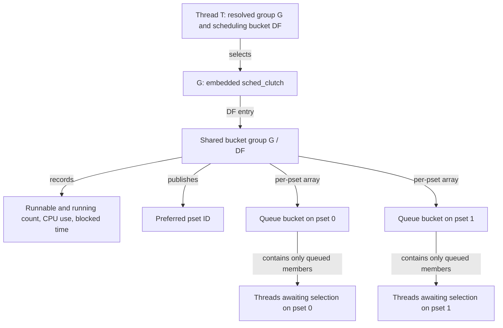
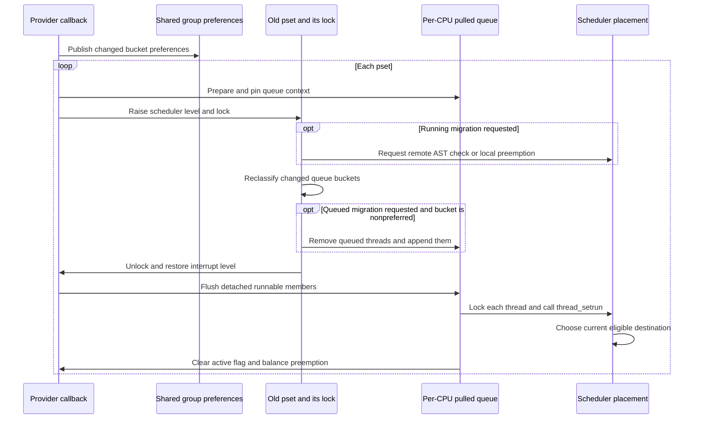

# Thread-group accounting and cluster migration

A thread can change its attribution group while continuing to execute on the same CPU. Separately, the scheduler can change where an existing group's work should run. These operations update different state: the first transfers accounting between groups; the second publishes placement preferences and optionally requests redistribution. This chapter follows both in `xnu-12377.121.6`, through common thread-group code and the ARM64 Clutch/Edge scheduler.

Start with the [runtime guide](README.md), [work-interval policy and group selection](work-interval-policy-and-thread-groups.md), and [Clutch/Edge queue selection](clutch-and-edge.md). [CPU eligibility](cpu-eligibility-and-scheduler-variants.md) explains the separate operation that recommends or removes CPUs globally; changing one group's preferred processor set does not perform that global operation. [Recount](recount-and-resource-attribution.md) explains the execution measurements consumed below.

## Keep membership, runnable accounting, and queue placement separate

The Clutch attached to a `thread_group` contains one bucket group per scheduling bucket. On Edge, each bucket group has a per-processor-set array of queue buckets. Thus group G's default-QoS work can have one shared accounting record and queued members on several clusters. The current preferred processor set is another field in that shared record. [Structures and field annotations](../../../platydoc-data/xnu/osfmk/kern/sched_clutch.h#L250-L352), [group-to-Clutch linkage](../../../platydoc-data/xnu/osfmk/kern/thread_group.c#L162-L185).

| State | Representation | What a change means |
| --- | --- | --- |
| Resolved membership | `thread->thread_group`, obtained from home, voucher, interval or preadoption sources | Which group the thread currently belongs to |
| Runnable/running contribution | `scbg_blocked_data.scct_count`, paired with a blocked timestamp | Whether this group and scheduling bucket have work able to run, including a running member |
| Recorded scheduler CPU use | `scbg_cpu_data.scbcd_cpu_used`, plus per-thread `sched_time_save`, `sched_usage`, `cpu_delta` | Input to interactivity and timesharing policy |
| Queued membership | `thread->runq`, bucket queues, `scb_thr_count`, root counts and Clutch `sc_thr_count` | Work actually linked into a scheduler hierarchy |
| Placement preference | Atomic `scbg_preferred_pset` | A preferred destination used by later placement decisions |
| Steal classification | `scb_preferred_pset_when_enqueued` and the bucket's steal-silo linkage | Which preference the current queue bookkeeping represents |

The two counts must not be substituted for each other. `scbg_blocked_data` tracks runnable **and running** members; `scb_thr_count` matches a particular bucket's queue. The Clutch-wide `sc_thr_count` changes at actual hierarchy insertion/removal, whereas the group-change helper below transfers the runnable contribution without an insertion. [Run-count contract](../../../platydoc-data/xnu/osfmk/kern/sched_clutch.c#L2691-L2700), [queue insertion](../../../platydoc-data/xnu/osfmk/kern/sched_clutch.c#L2828-L2842), [queue removal](../../../platydoc-data/xnu/osfmk/kern/sched_clutch.c#L2880-L2909).



This is a representation diagram, not a promise that both queues are populated or that T is queued. A running thread contributes to the shared run count while being absent from these queues. The group holds the embedded Clutch for its lifetime; generic final group destruction calls `sched_clutch_destroy()` before freeing group storage. That destructor asserts an empty Clutch queue count and destroys its bucket-group storage. [Initialization](../../../platydoc-data/xnu/osfmk/kern/thread_group.c#L270-L277), [destruction](../../../platydoc-data/xnu/osfmk/kern/thread_group.c#L562-L591), [Clutch destructor](../../../platydoc-data/xnu/osfmk/kern/sched_clutch.c#L1444-L1457).

## An explicit group change happens outside a run queue

After an explicit work-interval join has selected its interval and scheduling policy, `thread_set_work_interval_thread_group()` runs on the current thread. It raises to scheduler interrupt level, locks that thread, updates the interval-group source, and invokes the hierarchy resolver. A nonnull interval also clears preadoption. If resolving the sources produces the same group, the resolver performs its completion housekeeping without the group-change callout. [Interval call order](../../../platydoc-data/xnu/osfmk/kern/work_interval.c#L970-L995), [explicit group setter](../../../platydoc-data/xnu/osfmk/kern/thread_group.c#L1147-L1168), [resolve/change decision](../../../platydoc-data/xnu/osfmk/kern/thread_group.c#L811-L850).

`thread_set_resolved_thread_group()` first publishes the new pointer. It asserts `TH_RUN`, excludes `TH_IDLE`, and requires no runqueue membership. Under `CONFIG_SCHED_CLUTCH`, it passes **both** the saved old group and the new group to the accounting helper. That explicit old argument is necessary because looking through `thread->thread_group` now finds the new group. [Publication and callout](../../../platydoc-data/xnu/osfmk/kern/thread_group.c#L774-L809).

The Clutch eligibility test here excludes a thread hard-bound to a particular processor. A processor-set binding is different: it does not exclude the thread from this callout, but changes its CPU-usage treatment below. [Eligibility macros](../../../platydoc-data/xnu/osfmk/kern/sched_clutch.h#L45-L60).

For a change on the current thread, the helper then reports the new identity through `machine_thread_going_on_core()` and `machine_switch_perfcontrol_state_update(THREAD_GROUP_UPDATE, ...)`. These callbacks package the group ID/data for the registered performance controller; their default-callback branches can return without calling a provider. They are notifications, not a local algorithm that chooses a new cluster or synchronously moves the current execution. [Self notification](../../../platydoc-data/xnu/osfmk/kern/thread_group.c#L747-L765), [ARM on-core adapter](../../../platydoc-data/xnu/osfmk/arm/machine_routines_common.c#L534-L573), [state-update adapter](../../../platydoc-data/xnu/osfmk/arm/machine_routines_common.c#L480-L518).

The resolved pointer is supported by the ownership of its selected source. The setter does not manufacture a new reference for each accounting field. In the explicit interval path, the old interval remains retained until after group selection and RT reevaluation; only then does the caller release it. Preadoption has separate safe-release housekeeping. These ordering rules keep the old group usable while its counters are updated. [Old-interval release](../../../platydoc-data/xnu/osfmk/kern/work_interval.c#L1018-L1030), [preadoption completion](../../../platydoc-data/xnu/osfmk/kern/thread_group.c#L725-L743).

Auto-join is a separate path. `thread_set_autojoin_thread_group_locked()` assigns its resolved pointer directly and does not call `thread_set_resolved_thread_group()` or its Clutch accounting helper. Its current-thread performance notification also carries `PERFCONTROL_CALLOUT_WAKE_UNSAFE`. The [auto-join chapter](work-interval-policy-and-thread-groups.md#unwind-remote-demotion-and-final-release) covers its real-time and scheduler-state preconditions. Do not generalize the explicit transfer below to every write to `thread_group`. [Auto-join setter](../../../platydoc-data/xnu/osfmk/kern/thread_group.c#L1096-L1143).

## Transfer the runnable contribution and finish old-group accounting

For an eligible thread, `sched_clutch_thread_clutch_update()` decrements the old bucket group's run count, consumes the thread's accumulated scheduler-time delta, then increments the new bucket group's count. It does not unlink and reinsert the thread: its caller established that there is no runqueue membership to move. [Entire transfer](../../../platydoc-data/xnu/osfmk/kern/sched_clutch.c#L2195-L2227).

[Source: osfmk/kern/sched_clutch.c, lines 2211–2226](../../../platydoc-data/xnu/osfmk/kern/sched_clutch.c#L2211-L2226)

<!-- source-excerpt: ../../../platydoc-data/xnu/osfmk/kern/sched_clutch.c#L2211-L2226 -->
```c
	if (old_clutch) {
		assert((thread->state & (TH_RUN | TH_IDLE)) == TH_RUN);

		sched_clutch_run_bucket_decr(old_clutch, thread->th_sched_bucket);

		/* Attribute CPU usage with the old clutch */
		sched_clutch_bucket_group_t old_clutch_bucket_group = NULL;
		if (!SCHED_CLUTCH_THREAD_PSET_BOUND(thread)) {
			old_clutch_bucket_group = &(old_clutch->sc_clutch_groups[thread->th_sched_bucket]);
		}
		sched_clutch_thread_tick_delta(thread, old_clutch_bucket_group);
	}

	if (new_clutch) {
		sched_clutch_run_bucket_incr(new_clutch, thread->th_sched_bucket);
	}
```

`sched_clutch_thread_tick_delta()` obtains the delta through `sched_tick_delta`: read recorded Recount user-plus-system time, subtract `sched_time_save`, and advance that saved baseline. It adds the result to `cpu_delta` and, when `pri_shift < INT8_MAX`, to `sched_usage`. When supplied the old bucket-group pointer, it charges that group directly rather than rediscovering the new group through the thread. [Delta consumer](../../../platydoc-data/xnu/osfmk/kern/sched_clutch.c#L2170-L2192), [delta macro](../../../platydoc-data/xnu/osfmk/kern/sched.h#L433-L448), [Recount time accessor](../../../platydoc-data/xnu/osfmk/kern/recount.c#L735-L740).

This is the recorded scheduler-time boundary. The accessor used here does not add the current CPU's unsnapshotted elapsed interval; the separate `recount_current_thread_time_mach()` does that. Consequently the phrase “finish old-group accounting” refers to the delta this body actually consumes, not an assertion of a fresh hardware sample at the exact pointer assignment. [Separate current-thread accessor](../../../platydoc-data/xnu/osfmk/kern/recount.c#L742-L755).

Two further limits apply. Above-timeshare/FIXPRI bucket CPU updates return without changing the interactivity CPU-use total. A processor-set-bound thread passes no old bucket-group pointer, and the ordinary CPU-use helper also excludes processor-set-bound threads; its per-thread delta fields can still advance. Ordinary bucket-group additions cap the individual delta at `sched_clutch_bucket_group_adjust_threshold`. [CPU-use exclusions and cap](../../../platydoc-data/xnu/osfmk/kern/sched_clutch.c#L1935-L1964).

The run-count transitions have their own timestamp semantics:

| Transition | Recorded effect |
| --- | --- |
| Old count remains positive after decrement | Keep its existing blocked timestamp; other runnable/running work still exists |
| Old count reaches zero | Store the current absolute time as the start of the group's blocked interval |
| New count was already positive | Increment without inventing another blocked interval |
| New count was zero | Atomically replace its blocked timestamp with the invalid marker; if a real earlier timestamp exists, add a capped elapsed blocked duration |

The count and timestamp are updated together with a packed 128-bit atomic loop. This is needed even without a pset lock: one bucket group spans work on multiple roots. The old and new groups are separate updates, not one atomic transaction over both groups. [Increment and blocked-duration completion](../../../platydoc-data/xnu/osfmk/kern/sched_clutch.c#L2702-L2727), [decrement](../../../platydoc-data/xnu/osfmk/kern/sched_clutch.c#L2729-L2745), [packed representation](../../../platydoc-data/xnu/osfmk/kern/sched_clutch.h#L285-L295).

### A small accounting example

Select an unbound, timeshare thread T whose scheduling bucket stays DF during the illustrated interval change. Let group A/DF have three runnable/running members including T, and B/DF have two. T is executing and has no runqueue membership. Suppose its saved Recount total is 1,000 and the recorded total read by this helper is 1,100 **Mach-time units**, with the delta below the bucket's adjustment cap. These are illustrative values, not nanoseconds or a runtime measurement.

The transfer makes A's count 2, charges its selected CPU-use total by 100, advances T's baseline to 1,100, and makes B's count 3. Neither group begins or ends a blocked interval in this schedule. B does not inherit A's prior interactivity history; T's per-thread usage history is not reset. T also remains on its current CPU. If A had only T, A's decrement would additionally begin a blocked interval; if B had been empty, B's increment could finish one. These outcomes follow the separate delta and run-count bodies above.

This example isolates the group accounting step. A real work-interval join can change effective priority or scheduling bucket before it reaches that step, and has the admission and reference rules described in [work-interval policy](work-interval-policy-and-thread-groups.md#class-scheduling-mode-and-priority-remain-distinct).

## A placement update supplies preferences and two independent actions

Edge exposes `sched_perfcontrol_thread_group_preferred_psets_set()` to the performance-controller interface. The caller passes the group's machine-data pointer, a default pset ID, a per-performance-class override array, and option bits. The wrapper recovers the containing `thread_group`, translates each scheduler bucket to its performance class, and selects that class's override unless it is `SCHED_PERFCONTROL_PREFERRED_PSET_OVERRIDE_NONE`. [Interface contract and options](../../../platydoc-data/xnu/osfmk/arm/machine_routines.h#L1175-L1206), [bucket/class map](../../../platydoc-data/xnu/osfmk/kern/thread_group.c#L1294-L1314), [wrapper](../../../platydoc-data/xnu/osfmk/kern/thread_group.c#L1459-L1482).

The resulting array has one preferred pset for each scheduling bucket, so changing a group's default does not override a class that still has its own explicit preference. The legacy cluster-ID entry translates through `cluster_id_to_pset_id` before invoking the pset interface. Cluster IDs and pset IDs therefore should not be used interchangeably in an example. This is an internal provider interface, not a user syscall that resolves an arbitrary integer group handle. [Cluster wrapper](../../../platydoc-data/xnu/osfmk/kern/thread_group.c#L1484-L1502).

| Option bits | Running members | Queued members |
| --- | --- | --- |
| Neither | No immediate rescheduling request from this callback | Refresh steal classification; leave queue membership in place |
| `MIGRATE_RUNNING` (`0x1`) | Request reconsideration for selected running CPUs | Refresh classification without draining |
| `MIGRATE_RUNNABLE` (`0x2`) | No immediate request from this callback | Drain selected nonpreferred buckets, then redispatch |
| Both | Perform both actions | Perform both actions |

These actions occur only if at least one bucket's preference actually changes. `sched_edge_tg_preferred_pset_change()` builds a changed-bucket bitmap and returns immediately if it is empty. Sending an identical preference array with different option bits is therefore not an unconditional “rebalance now” operation. [Changed-bucket test](../../../platydoc-data/xnu/osfmk/kern/sched_clutch.c#L6261-L6281).

[Source: osfmk/kern/sched_clutch.c, lines 6278–6288](../../../platydoc-data/xnu/osfmk/kern/sched_clutch.c#L6278-L6288)

<!-- source-excerpt: ../../../platydoc-data/xnu/osfmk/kern/sched_clutch.c#L6278-L6288 -->
```c
	if (bitmap_lsb_first(clutch_bucket_modify_bitmap, TH_BUCKET_SCHED_MAX) == -1) {
		/* No changes in any clutch buckets; nothing to do here */
		return;
	}

	/*
	 * The first operation is to update the preferred pset for all QoS buckets within the
	 * thread group so that any future threads becoming runnable would see the new preferred
	 * pset value.
	 */
	sched_edge_update_preferred_pset(clutch, clutch_bucket_modify_bitmap, tg_bucket_preferred_pset);
```

The helper first publishes the changed `scbg_preferred_pset` fields using relaxed atomic stores. It then visits psets in order, prepares a local pulled-thread queue, raises scheduler interrupt level, and locks that pset. Running-member notification precedes queued-member handling. The queued helper returns with the pset unlocked; the caller restores interrupt level and flushes the pulled queue before visiting the next pset. [Atomic publication](../../../platydoc-data/xnu/osfmk/kern/sched_clutch.c#L6114-L6123), [per-pset loop](../../../platydoc-data/xnu/osfmk/kern/sched_clutch.c#L6290-L6313).

There is no single lock or atomic store publishing the entire preference array and all queue changes together. A new placement can observe a newly stored preference while old queue classification is still being visited. The later queue helper rereads the bucket's shared preference when classifying it. That describes the source's incremental update; it does not establish a serialization protocol for every possible concurrent provider update. [Preference reader](../../../platydoc-data/xnu/osfmk/kern/sched_clutch.c#L1473-L1483), [reread during queue handling](../../../platydoc-data/xnu/osfmk/kern/sched_clutch.c#L6159-L6172).

## Running members receive a request, not a direct transfer

With `MIGRATE_RUNNING`, the helper scans the current pset's `PROCESSOR_RUNNING` CPU bitmap while the pset remains locked. For each CPU it compares `current_thread_group` with the target group, reads `cpu_running_buckets`, skips `TH_BUCKET_SCHED_MAX`, and compares that bucket's requested preference with the current pset ID. It uses these processor summaries rather than taking every active thread's lock. [Running scan](../../../platydoc-data/xnu/osfmk/kern/sched_clutch.c#L6192-L6245).

The running helper's changed-bucket bitmap parameter is marked `__unused`. Once the outer operation has found any change, this scan considers all recorded buckets of the group against the supplied preference array. The queued helper, in contrast, iterates only changed buckets. Thus an already nonpreferred running member in an otherwise unchanged bucket can also receive a request. [Unused parameter and predicates](../../../platydoc-data/xnu/osfmk/kern/sched_clutch.c#L6192-L6230).

Processor summary publication records the sentinel for idle or hard-CPU-bound threads. A pset-bound thread is not covered by that hard-CPU-binding exclusion, and this scan does not independently inspect its bound-pset field. The later scheduler still has binding and eligibility rules. Treat the scan's result as a reason to reconsider placement, not proof that every notified thread can move to the group's preference. [Summary update](../../../platydoc-data/xnu/osfmk/kern/processor.c#L666-L692), [later binding checks](../../../platydoc-data/xnu/osfmk/kern/sched_clutch.c#L5476-L5510).

For another CPU, `sched_ipi_action(..., SCHED_IPI_EVENT_REBALANCE)` selects the IPI and publishes the relevant pending AST state. Edge falls through to the common rebalance policy, which selects an immediate IPI for a running destination; `sched_ipi_perform()` calls `cause_ast_check()`. The helper collects those destinations, then performs the IPIs before returning to its caller, which still owns the pset lock at this point. [IPI action and publication](../../../platydoc-data/xnu/osfmk/kern/sched_prim.c#L4420-L4449), [rebalance policy](../../../platydoc-data/xnu/osfmk/kern/sched_prim.c#L4463-L4476), [Edge fallback](../../../platydoc-data/xnu/osfmk/kern/sched_clutch.c#L6490-L6543), [IPI execution](../../../platydoc-data/xnu/osfmk/kern/sched_prim.c#L4502-L4519), [send loop](../../../platydoc-data/xnu/osfmk/kern/sched_clutch.c#L6239-L6246).

For the current CPU, `sched_ipi_action()` returns `SCHED_IPI_NONE`; the caller explicitly records pending preemption and sets a local AST instead. The callback therefore does not send an IPI to itself. [Local-CPU branch](../../../platydoc-data/xnu/osfmk/kern/sched_clutch.c#L6227-L6235).

The ensuing scheduling decision can keep the thread, choose other work, or later requeue it elsewhere. `sched_edge_thread_avoid_processor()` checks binding, graph permission and available alternatives; later ordinary placement also considers load and recommendation state. A notification does not acknowledge arrival on the preferred cluster. [Avoid-processor decisions](../../../platydoc-data/xnu/osfmk/kern/sched_clutch.c#L5476-L5578), [selection and revalidation](../../../platydoc-data/xnu/osfmk/kern/sched_clutch.c#L5992-L6094), [AST mechanism](ast-mechanism.md).

## Queued members pass through a temporary scheduler queue

For each changed bucket on the locked pset, the queued helper finds the target group's per-pset `sched_clutch_bucket`. An absent `scb_root` requires a zero thread count and ends work for that bucket. Otherwise it refreshes steal-silo membership using the current preferred pset. Reclassification removes the old silo linkage and inserts the bucket into the preferred pset's silo, maintaining its populated bitmaps. It does not itself move the bucket to another processor set. [Bucket selection](../../../platydoc-data/xnu/osfmk/kern/sched_clutch.c#L6159-L6170), [steal-silo reclassification](../../../platydoc-data/xnu/osfmk/kern/sched_clutch.c#L1554-L1588).

Only `MIGRATE_RUNNABLE` together with a different preferred pset drains the bucket. The drain walks the bucket's thread list, removes each through ordinary Clutch removal, and appends it to the prepared `pulled_thread_queue`. This targets the group's ordinary per-pset buckets; pset-bound work uses Edge's separate bound-root queues, and hard-CPU-bound work is outside the Clutch hierarchy. [Drain predicate](../../../platydoc-data/xnu/osfmk/kern/sched_clutch.c#L6170-L6182), [drain body](../../../platydoc-data/xnu/osfmk/kern/sched_clutch.c#L6097-L6106), [bound insertion split](../../../platydoc-data/xnu/osfmk/kern/sched_clutch.c#L2778-L2797).

[Source: osfmk/kern/sched_clutch.c, lines 6170–6182](../../../platydoc-data/xnu/osfmk/kern/sched_clutch.c#L6170-L6182)

<!-- source-excerpt: ../../../platydoc-data/xnu/osfmk/kern/sched_clutch.c#L6170-L6182 -->
```c
		sched_edge_steal_silo_clutch_bucket_classify(clutch_bucket, root_clutch, clutch_bucket_preferred_pset);

		if (migrate_immediately && (root_clutch->scr_pset_id != clutch_bucket_preferred_pset)) {
			/*
			 * For transitions where threads need to be migrated immediately, drain the threads into a
			 * local queue unless we are looking at the clutch buckets for the newly recommended
			 * pset.
			 */
			sched_edge_clutch_bucket_threads_drain(clutch_bucket, clutch_bucket->scb_root, threadq);
		}
	}

	pset_unlock(root_clutch->scr_pset);
```

Removal updates the root's cumulative/shared-resource load, removes the thread's queue links, clears `runq`, and reduces hierarchy counts. The source explicitly warns that other cores holding the thread lock can change scheduling fields after `runq` is cleared. The later flush consequently locks the thread before placement. T is still runnable while detached: queue removal does not execute a new blocking transition or remove its group's runnable/running contribution. [Removal and publication boundary](../../../platydoc-data/xnu/osfmk/kern/sched_clutch.c#L2860-L2914), [flush assertions](../../../platydoc-data/xnu/osfmk/kern/sched_prim.c#L8230-L8245).

### Why preparation and flushing must stay paired

`pulled_thread_queue_prepare()` selects the interrupt-specific per-CPU queue when interrupts are already disabled. Otherwise it disables preemption to pin the ordinary per-CPU queue. Each has an active flag that rejects overlapping use of the same instance. An interrupt can therefore use its separate instance while interrupting an ordinary prepared operation. [Storage](../../../platydoc-data/xnu/osfmk/kern/processor.h#L185-L189), [preparation](../../../platydoc-data/xnu/osfmk/kern/sched_prim.c#L8164-L8190).

[Source: osfmk/kern/sched_prim.c, lines 8178–8187](../../../platydoc-data/xnu/osfmk/kern/sched_prim.c#L8178-L8187)

<!-- source-excerpt: ../../../platydoc-data/xnu/osfmk/kern/sched_prim.c#L8178-L8187 -->
```c
	if (ml_get_interrupts_enabled() == false) {
		threadq = &current_processor()->processor_threadq_interrupt;
	} else {
		/* paired with enable inside pulled_thread_queue_flush */
		disable_preemption();
		threadq = &current_processor()->processor_threadq;
	}

	assert(threadq->ptq_queue_active == false);
	threadq->ptq_queue_active = true;
```

The temporary queue links the still-runnable thread through `wait_links`. The enqueue helper takes no additional thread reference; it is a scheduler placement handoff, not a new wait registration or an independent IPC ownership reference. Flush removes each link, raises to scheduler interrupt level, takes the thread lock, verifies `TH_RUN` and null `runq`, and calls `thread_setrun(thread, SCHED_TAILQ)`. It releases that thread lock and restores interrupt level before advancing. [Enqueue](../../../platydoc-data/xnu/osfmk/kern/sched_prim.c#L8301-L8312), [flush loop](../../../platydoc-data/xnu/osfmk/kern/sched_prim.c#L8230-L8248).

The original pset lock is already dropped before this placement loop. `thread_setrun()` may acquire a different pset lock, update priority and choose a destination using the then-current group/preference/binding state. It retries failed placement and has last-resort branches for unavailable CPUs. Its caller supplies `SCHED_TAILQ`, not a command naming the new preferred pset as an obligatory destination. [Placement and retry](../../../platydoc-data/xnu/osfmk/kern/sched_prim.c#L5510-L5601), [bound and queue dispatch](../../../platydoc-data/xnu/osfmk/kern/sched_prim.c#L5603-L5632).

Flush balances the ordinary queue's preemption disable even when no threads were pulled, clears the active flag, and handles the queue's generic deferred SMR-down bookkeeping. This Edge caller does not request SMR-down work itself. A completed flush establishes that the detached threads were handed back to scheduling, not that they have all run or that the preferred pset accepted them. [Empty completion](../../../platydoc-data/xnu/osfmk/kern/sched_prim.c#L8198-L8220), [final completion](../../../platydoc-data/xnu/osfmk/kern/sched_prim.c#L8280-L8298).



The diagram shows ordered calls and asynchronous rescheduling requests. It does not require an IPI recipient to act before the callback reaches its queued-work phase, and it omits unmodified buckets and ordinary placement retry details.

## Worked two-cluster schedule

Assume ARM64 with `CONFIG_SCHED_CLUTCH` and `CONFIG_SCHED_EDGE`, two initialized/recommended psets 0 and 1 representing two clusters, and ordinary unbound DF threads. Do not infer particular P/E hardware from these numeric pset IDs. Let T have completed the explicit A→B group transfer above while running on pset 0. Allow normal scheduler summary publication before the subsequent update. Let B also have queued thread Q on pset 0 and blocked thread W; B/DF currently prefers pset 0. Other bucket preferences remain unchanged.

Now the provider changes B/DF to prefer pset 1 and passes both migration bits. Assume no concurrent provider update, group change, CPU shutdown or priority change while following this illustrative schedule:

| Step | T, already running on pset 0 | Q, queued on pset 0 | W, blocked |
| --- | --- | --- | --- |
| Publish preference 1 | Keeps executing until scheduling acts | Still linked to pset 0 initially | Remains blocked |
| Visit pset 0 | Matching processor summary causes a remote AST request, or a local AST if this callback runs there | B/DF's bucket is reclassified to preference 1, then drained into the pulled queue | No blocked-thread list is scanned |
| Flush outside pset lock | Its AST can be handled independently | Thread lock is acquired; `thread_setrun` makes a fresh placement decision | Still no wakeup caused by this update |
| Ordinary scheduling/wakeup | A later decision may move it if an appropriate alternative is selected | With pset 1 idle/eligible and the stated ordinary conditions, placement can select 1 | On a later unrelated wake, placement reads the updated preference |

This is a path walkthrough, not a measured timing order between T and Q. Pset 1 being the preferred destination is an input; binding, load/edge policy and recommendation revalidation still control placement. The callback loops over every pset, so it later visits pset 1 too; queued work already there can be classified without being drained for this unchanged destination. [Outer loop](../../../platydoc-data/xnu/osfmk/kern/sched_clutch.c#L6290-L6313), [preferred-idle selection and final check](../../../platydoc-data/xnu/osfmk/kern/sched_clutch.c#L6002-L6056).

Change one assumption at a time to understand the operation's limits:

- With neither migration bit, preferences and steal classification change, but this callback neither drains Q nor asks T to reschedule.
- With only the queued bit, Q is redispatched while T receives no immediate request from this callback.
- With only the running bit, T receives a request while Q stays queued under its refreshed steal classification.
- If B/DF already prefers 1 and every other preference also matches, the outer unchanged-array return skips all these actions, even when both bits are passed.
- If pset 1 becomes unavailable before Q's placement commits, the chooser can select an alternative or enter its retry/fallback path. The preference change is not rolled back.

These variants use the actual option predicates and unchanged-array branch; none asserts that a blocked member becomes runnable or that a callback waits for migration completion.

## Configuration, tests, and implementation boundaries

`sched.h` enables Clutch for ARM64 when `CONFIG_CLUTCH` is selected and `CONFIG_SCHED_EDGE_OPT_OUT` is absent; `__AMP__` additionally enables Edge. Single-cluster Clutch retains the group-accounting operation without this Edge cross-cluster update loop. The non-Edge preferred-pset and preferred-cluster wrappers are empty bodies, while its older recommendation interface dispatches through the selected scheduler. These source conditions are not a shipping-device availability matrix. [Selection](../../../platydoc-data/xnu/osfmk/kern/sched.h#L191-L207), [non-Edge wrappers](../../../platydoc-data/xnu/osfmk/kern/thread_group.c#L1520-L1570).

The provider interface can be invoked with preemption enabled or from scheduler, quantum-interrupt and timer-interrupt callouts. The paired queue preparation, interrupt-level changes and pset/thread lock phases above are therefore part of its implementation contract. The inspected wrapper does not acquire a fresh reference from its machine-data argument or return a completion token; its valid pointer/array and lifetime are an internal caller contract. This chapter follows the local consumers, not the external controller's policy, callback serialization, workload-specific choices or hardware power response. [Call-context contract](../../../platydoc-data/xnu/osfmk/kern/thread_group.c#L1459-L1480), [machine-data publication at group creation](../../../platydoc-data/xnu/osfmk/kern/thread_group.c#L279-L291).

The checked-in scheduler tests provide adjacent evidence, with an important distinction:

| Source | Assertion or implementation inspected | Limit |
| --- | --- | --- |
| [`edge_migration.c`](../../../platydoc-data/xnu/tests/sched/edge_migration.c#L12-L59) | A bound-pset placement case and fallback when that pset is derecommended | Harness topology/placement assertions, not production callback completion |
| [`migration_harmonious_chosen_pset`](../../../platydoc-data/xnu/tests/sched/edge_migration.c#L894-L949) | Placement and avoid-processor decisions under selected preferred/load conditions | Does not demonstrate the complete provider→IPI→thread execution schedule |
| [Harness preference setter](../../../platydoc-data/xnu/tests/sched/sched_test_harness/sched_edge_harness.c#L395-L405) | Directly calls `sched_edge_update_preferred_pset()` | Bypasses the production per-pset migration wrapper, which is under `!SCHED_TEST_HARNESS` |
| [`thread_group_set` trace test](../../../platydoc-data/xnu/tests/thread_group_set_32261625.c#L21-L54) | Requires a group-set trace with a nonzero thread ID before the selected worker event | Does not compare Clutch counts, old/new CPU attribution, or cluster arrival |

The production guard begins before the two migration helpers and includes `sched_edge_tg_preferred_pset_change()`. A test that stores a preference through the harness therefore cannot be described as having executed those helpers. [Guard and production path](../../../platydoc-data/xnu/osfmk/kern/sched_clutch.c#L6125-L6154), [guard end](../../../platydoc-data/xnu/osfmk/kern/sched_clutch.c#L6315-L6332).

Source review covered explicit membership transfer, runnable and CPU-use accounting, per-class preference construction, atomic publication, running summaries and AST/IPI requests, steal reclassification, queued removal and redispatch, and the relevant completion/ownership boundaries. General Edge graph search, shared-resource policies, real-time balancing and CPU lifecycle are linked companions rather than rederived here. No scheduler tests, kernel build or workload measurements were run; the worked numbers and schedules are illustrative deductions from the cited bodies.

<!-- BEGIN PLATYDOC DOCUMENTATION LICENSE -->
Original Platydoc text and diagrams are licensed under [CC BY 4.0](https://creativecommons.org/licenses/by/4.0/). Quoted source code and third-party material retain their respective licenses.
<!-- END PLATYDOC DOCUMENTATION LICENSE -->
