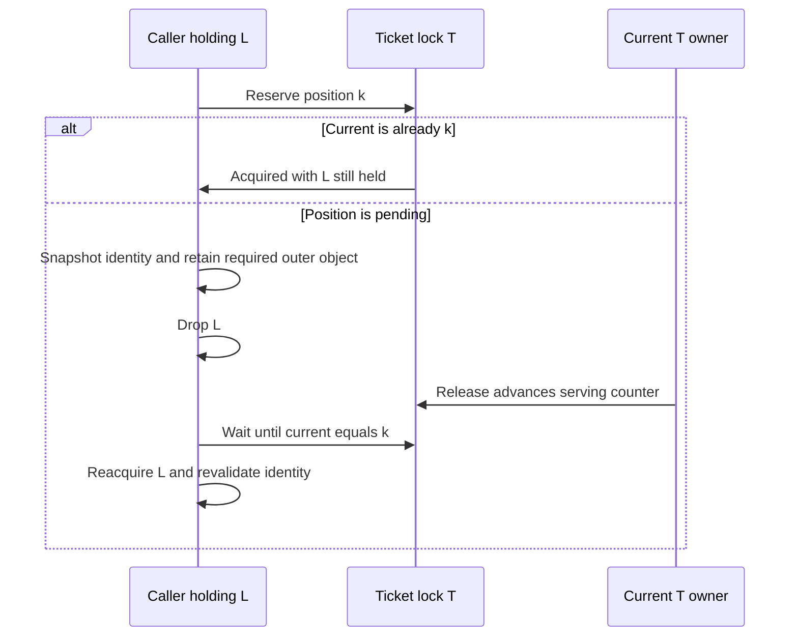
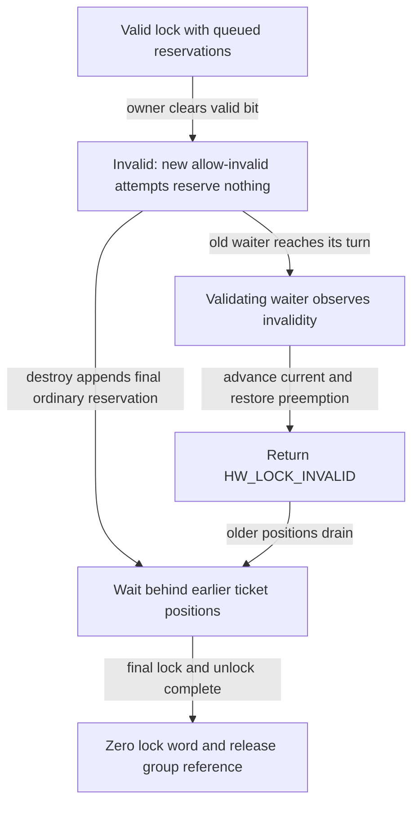
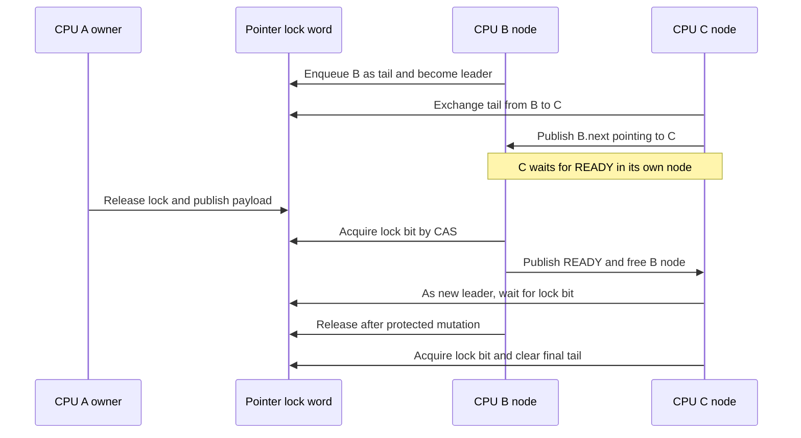
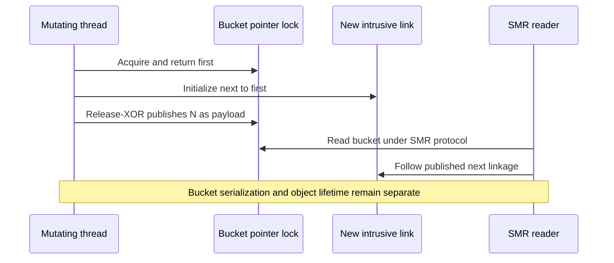

# Ticket and pointer locks: spinning, reservations and publication

[Runtime overview](README.md) · [Reader-writer locks](reader-writer-locks.md) · [Wait and turnstile protocols](wait-and-turnstile-protocols.md) · [SMR hash tables](../../cross-cutting/smr-hash-tables.md)

Ticket locks serialize callers by allocating a position in a counter sequence. Pointer locks serialize mutations while retaining a pointer payload in the same word, and use a per-CPU MCS queue to organize contending CPUs. Both normally keep preemption disabled while owned, but their waiting, lifetime and publication rules differ. This chapter traces the ARM64/common implementation, including wait-queue ticket reservations and the pointer locks used by scalable SMR hash buckets. [Ticket implementation](../../../platydoc-data/xnu/osfmk/kern/lock_ticket.c#L39-L55), [pointer-lock representation](../../../platydoc-data/xnu/osfmk/kern/lock_ptr.h#L44-L89), [real waitq wrappers](../../../platydoc-data/xnu/osfmk/kern/waitq.c#L733-L795), [SMR mutation](../../../platydoc-data/xnu/osfmk/kern/smr.c#L2764-L2819).

## 1. Distinguish the primitive from the spin-lock wrapper

| Primitive | State and intended role |
|---|---|
| `hw_lck_ticket_t` | Four-byte ticket state: type/validity plus current and next ticket bytes. Small enough to embed as a wait-queue interlock; no exclusive thread-owner field. |
| `lck_ticket_t` | Sixteen-byte wrapper with type, padding, embedded hardware ticket and compact thread-owner ID. Adds ownership diagnostics and checked operations. |
| `hw_lck_ptr_t` | One pointer-sized word containing signed pointer bits, optional memory tag, lock/statistics flags and a 16-bit MCS tail. A lock operation returns the pointer; unlock can replace it. |
| ARM `lck_spin_t` | A configurable wrapper. With `LCK_SPIN_IS_TICKET_LOCK`, it aliases `lck_ticket_t`; the supplied header defaults the macro to **0**, selecting the `hslock` wrapper and `hw_lock_*()` path instead. |

[Ticket types](../../../platydoc-data/xnu/osfmk/kern/ticket_lock.h#L116-L146), [size assertions](../../../platydoc-data/xnu/osfmk/kern/lock_ticket.c#L89-L99), [pointer type](../../../platydoc-data/xnu/osfmk/kern/lock_ptr.h#L44-L89), [ARM default/type selection](../../../platydoc-data/xnu/osfmk/arm/locks.h#L31-L62), [ticket-backed wrappers](../../../platydoc-data/xnu/osfmk/arm/locks_arm.c#L226-L326), [default hardware-lock wrappers](../../../platydoc-data/xnu/osfmk/arm/locks_arm.c#L421-L493).

Thus “spin lock” does not identify one storage algorithm throughout XNU. The ticket behavior below applies to explicit ticket users and the selected ticket-wrapper branch, not automatically every `lck_spin_lock()` call. Preemption disabling also does not itself disable interrupts; an interrupt handler's use of the same primitive requires its own context and lock-order discipline. [ARM preemption helpers](../../../platydoc-data/xnu/osfmk/arm/locks.h#L115-L146), [ordinary ticket acquisition](../../../platydoc-data/xnu/osfmk/kern/lock_ticket.c#L638-L649).

## 2. Ticket allocation and the serving counter

The complete low-level ticket object is small enough for reservation to atomically inspect its validity/type and increment the next-ticket field:

[osfmk/kern/ticket_lock.h, lines 116–131](../../../platydoc-data/xnu/osfmk/kern/ticket_lock.h#L116-L131).

<!-- source-excerpt: ../../../platydoc-data/xnu/osfmk/kern/ticket_lock.h#L116-L131 -->
```c
typedef union hw_lck_ticket_s {
	struct {
		uint8_t         lck_type;
		uint8_t         lck_valid  : 1;
		uint8_t         lck_is_pv  : 1;
		uint8_t         lck_unused : 6;
		union {
			struct {
				uint8_t cticket;
				uint8_t nticket;
			};
			uint16_t tcurnext;
		};
	};
	uint32_t lck_value;
} hw_lck_ticket_t;
```

`cticket` is the position now being served, and `nticket` is the next unallocated position. In the ordinary non-PV configuration, tickets increment by one modulo 256. When `CONFIG_PV_TICKET` is compiled, counters advance by two and the low bit of `cticket` is a hypervisor-wait flag. `equal_tickets()` masks that flag; some fast checks use raw equality and simply take the slower path when the flag is present. The compile-time `MAX_CPUS` bound uses the configured increment to prevent the number of contending CPUs exhausting the ticket space. [Increments/PV bit](../../../platydoc-data/xnu/osfmk/kern/ticket_lock.h#L365-L402), [comparison helpers](../../../platydoc-data/xnu/osfmk/kern/lock_ticket.c#L121-L131), [capacity assertion](../../../platydoc-data/xnu/osfmk/kern/lock_ticket.c#L89-L99), [raw fast comparison](../../../platydoc-data/xnu/osfmk/kern/lock_ticket.c#L692-L706).

Reservation is an acquire atomic add to the complete word. Its return value is the **old** word, so the caller's position is old `nticket`, not the incremented value now in storage:

[osfmk/kern/lock_ticket.c, lines 606–615](../../../platydoc-data/xnu/osfmk/kern/lock_ticket.c#L606-L615).

<!-- source-excerpt: ../../../platydoc-data/xnu/osfmk/kern/lock_ticket.c#L606-L615 -->
```c
static inline uint32_t
hw_lck_ticket_reserve_orig(hw_lck_ticket_t *lck)
{
	/*
	 * Atomically load both the entier lock state, and increment the
	 * "nticket". Wrap of the ticket field is OK as long as the total
	 * number of contending CPUs is < maximum ticket
	 */
	return os_atomic_add_orig(&lck->lck_value,
	           HW_LCK_TICKET_LOCK_INC_WORD, acquire);
```

If old current equals old next, acquisition succeeds immediately. Otherwise the caller waits until current equals its reserved position. Normal `hw_lck_ticket_lock()` disables preemption before taking a reservation; `_nopreempt` leaves that responsibility with the caller. The higher-level wrapper installs `current_thread()->ctid` only after acquiring its turn and detects recursive ownership in its contended path. [Hardware acquire](../../../platydoc-data/xnu/osfmk/kern/lock_ticket.c#L618-L649), [owner publication](../../../platydoc-data/xnu/osfmk/kern/lock_ticket.c#L330-L345), [owned contention](../../../platydoc-data/xnu/osfmk/kern/lock_ticket.c#L590-L603), [wrapper acquisition](../../../platydoc-data/xnu/osfmk/kern/lock_ticket.c#L690-L723).

A worked non-PV sequence makes the arithmetic concrete:

| Operation | Shared `(cticket, nticket)` afterward | Meaning |
|---|---|---|
| Initial state | `(0, 0)` | Nobody owns or has reserved the lock. |
| A reserves | `(0, 1)` | A's old next was 0, so A owns immediately. |
| B reserves | `(0, 2)` | B must wait for current 1. |
| C reserves | `(0, 3)` | C must wait for current 2. |
| A unlocks | `(1, 3)` | B's turn; C remains waiting. |
| B unlocks | `(2, 3)` | C's turn. |
| C unlocks | `(3, 3)` | Empty queue again; counters need not reset to zero. |

Ticket wrap does not create a new generation identifier. FIFO ownership is meaningful because reservation count is bounded and reservations cannot simply be abandoned. Equal counters indicate no outstanding ticket; they do not identify the last owner or validate the lifetime of the containing allocation. [Reservation and wrap rationale](../../../platydoc-data/xnu/osfmk/kern/lock_ticket.c#L606-L615), [held test](../../../platydoc-data/xnu/osfmk/kern/lock_ticket.c#L313-L319).

## 3. Waiting, ARM64 atomics and timeout policy

Contended acquisition repeatedly loads the ticket word and compares current against the reserved position. On ARM, `__hw_spin_wait_load()` performs a relaxed exclusive load, evaluates the condition, and either clears the exclusive monitor or executes `WFE`. After a bounded set of snoops, the loop evaluates its timeout policy and, in the selected PV case, may ask the hypervisor to wait. A successful contended acquire finishes with an acquire fence. It does not register a kernel `waitq` or switch out through `thread_block()` as a sleepable mutex would. [Spin macro](../../../platydoc-data/xnu/osfmk/kern/locks_internal.h#L56-L93), [ARM load/WFE](../../../platydoc-data/xnu/osfmk/arm/locks.h#L148-L156), [ticket loop](../../../platydoc-data/xnu/osfmk/kern/lock_ticket.c#L487-L586).

Ordinary unlock updates only `cticket`, using a release store to advance by the configured increment. Because the holder alone advances current, it does not need a CAS against concurrent next-ticket reservations. The regular unlock then enables preemption; `_nopreempt` leaves the nesting count alone. The high-level wrapper clears its owner field before the serving-counter release. [Unlock implementation](../../../platydoc-data/xnu/osfmk/kern/lock_ticket.c#L441-L474), [high-level unlock](../../../platydoc-data/xnu/osfmk/kern/lock_ticket.c#L966-L982).

`hw_spin_compute_timeout()` selects the configured hardware timebase duration and may constrain it under scheduler-hygiene rules. `hw_spin_should_keep_spinning()` initializes the deadline on its first policy evaluation, checks elapsed time and invokes the policy callback on expiry. `HW_LOCK_TIMEOUT_CONTINUE` extends the deadline; another return ends the contended wait. The ordinary ticket policies panic and include ticket/owner diagnostics rather than return a recoverable application timeout. [Timeout computation](../../../platydoc-data/xnu/osfmk/kern/locks.c#L173-L211), [policy progression](../../../platydoc-data/xnu/osfmk/kern/locks.c#L214-L276), [ticket panic policies](../../../platydoc-data/xnu/osfmk/kern/lock_ticket.c#L348-L413).

There is a critical distinction between a failed try and a timeout policy that elects to return:

| Result/path | Reservation and preemption state |
|---|---|
| `lock_try()` sees unequal tickets | No ticket is added. A normal try undoes its own preemption disable and returns false. |
| `reserve()` returns false | A ticket **has been reserved**. Preemption remains disabled; the caller must complete that position through `wait()`. |
| Custom `_to()` or `wait()` policy returns `HW_LOCK_CONTENDED` | The contended body returns without advancing/canceling the reservation or enabling preemption. This is not a general timed-mutex API with automatic rollback. |
| Allow-invalid returns `HW_LOCK_INVALID` | Either no ticket was reserved, or the validating acquisition reached its turn, released that turn and restored preemption. |

The source has no general “remove my middle ticket” operation. A caller cannot treat `HW_LOCK_CONTENDED` as permission to forget an allocated position; later ticket holders would eventually wait for that missing position. This is a consequence of the code's state changes, not a recommendation for a new cancellation scheme. [Try body](../../../platydoc-data/xnu/osfmk/kern/lock_ticket.c#L726-L752), [reserve contract](../../../platydoc-data/xnu/osfmk/kern/ticket_lock.h#L69-L104), [policy return](../../../platydoc-data/xnu/osfmk/kern/lock_ticket.c#L517-L531), [timeout entry](../../../platydoc-data/xnu/osfmk/kern/lock_ticket.c#L652-L688), [invalid cleanup](../../../platydoc-data/xnu/osfmk/kern/lock_ticket.c#L570-L586).

The specialized `unlock_after_lookup()` injects a dependency from the lookup result into the lock address and uses a relaxed serving-counter update. Its name matters: it supplies a dependency-ordered read-only lookup release, not the generic release for arbitrary protected writes. This chapter records the implementation boundary without claiming every caller's dependency proof was audited. [Specialized release](../../../platydoc-data/xnu/osfmk/kern/lock_ticket.c#L952-L963), [dependency type contract](../../../platydoc-data/xnu/osfmk/kern/lock_types.h#L82-L96).

## 4. Reserve, drop an outer lock, wait, then revalidate

Ticket reservation allows a caller to avoid blocking while holding locks in the wrong order. Suppose a thread already holds L but must take ticket lock T, while the proper order is T then L. `reserve(T)` can acquire immediately. If it cannot, the caller has secured a future turn, drops L, waits for T, reacquires L and verifies the facts previously protected by L. Dropping L creates an observation gap, so successful ticket acquisition does not validate the old lookup or object generation. [API contract and example](../../../platydoc-data/xnu/osfmk/kern/ticket_lock.h#L69-L109), [reserve/wait bodies](../../../platydoc-data/xnu/osfmk/kern/lock_ticket.c#L840-L907).



The turnstile priority-chain walker is a concrete client. It starts with a thread locked, finds the turnstile on which that thread waits and reserves that turnstile's waitq lock. If reservation is pending, it snapshots the turnstile generation, takes a thread reference, drops the thread lock, waits for the ticket, then relocks the thread. It rejects the operation if the generation changed or the thread no longer waits on that turnstile. The temporary thread reference is released after this check; the walker intentionally avoids taking a turnstile reference at that point. [Walker and revalidation](../../../platydoc-data/xnu/osfmk/kern/turnstile.c#L3100-L3175), [waitq wrappers](../../../platydoc-data/xnu/osfmk/kern/waitq.c#L757-L770), [complete chain context](wait-and-turnstile-protocols.md#7-walking-a-chain-while-its-members-can-wake).

A ticket can contribute to lifetime safety only as part of this surrounding protocol. The header requires that destruction itself take both locks in the proper order; generic pointer dereference is not made safe merely by finding a word that looks like a ticket lock. [Lifetime precondition](../../../platydoc-data/xnu/osfmk/kern/ticket_lock.h#L96-L109).

## 5. Invalidation and the ARM64 recoverable reservation

An allow-invalid ticket lock supports selected reclamation schemes. `hw_lck_ticket_invalidate()` atomically clears `lck_valid`. Future `reserve_allow_invalid()` attempts inspect that bit and return invalid without incrementing next; callers already queued still need to reach and release their turns. `lock_allow_invalid()` carries a `validate=true` flag into contention so a thread whose reservation predates invalidation will acquire its turn, see invalidity, unlock it and return `HW_LOCK_INVALID`. Plain `hw_lck_ticket_wait()` uses `validate=false`; it does not automatically repeat the allow-invalid check just because an earlier operation reserved a ticket. [Invalidate](../../../platydoc-data/xnu/osfmk/kern/lock_ticket.c#L932-L938), [reserve status](../../../platydoc-data/xnu/osfmk/kern/lock_ticket.c#L864-L891), [wait versus validating acquire](../../../platydoc-data/xnu/osfmk/kern/lock_ticket.c#L893-L930), [post-wait validation](../../../platydoc-data/xnu/osfmk/kern/lock_ticket.c#L570-L586).

The reservation helper is assembly because the address can fault while being inspected under the scheme's lifetime rules. On ARM64 it keeps the original address in `x8` and the next-ticket increment in `w9`. With the selected ARMv8.2 path and no software KASAN tagging, it loads the word, rejects a clear valid bit and uses acquire `CASA` to increment it; a compare failure retries using the returned current word. Other paths use acquire `LDAXR` plus `STXR`. The result in `w0` is the previous state or zero for an invalid/faulted attempt. [Whole helper](../../../platydoc-data/xnu/osfmk/arm64/machine_routines_asm.s#L1440-L1510).

The selected valid-bit/CAS branch is short enough to read directly:

[osfmk/arm64/machine_routines_asm.s, lines 1462–1480](../../../platydoc-data/xnu/osfmk/arm64/machine_routines_asm.s#L1462-L1480).

<!-- source-excerpt: ../../../platydoc-data/xnu/osfmk/arm64/machine_routines_asm.s#L1462-L1480 -->
```asm
	mov		w9, #HW_LCK_TICKET_LOCK_INC_WORD
1:
#if defined(__ARM_ARCH_8_2__) && !KASAN_TBI
	ldr 		w0, [x8]
#else
	ldaxr		w0, [x8]
#endif
2:
	tbz		w0, #HW_LCK_TICKET_LOCK_VALID_BIT, 9f /* lock valid ? */

	add		w11, w0, w9
#if defined(__ARM_ARCH_8_2__) && !KASAN_TBI
	mov		w12, w0
	casa		w0, w11, [x8]
	cmp		w12, w0
	b.ne		2b
#else /* __ARM_ARCH_8_2__ && !KASAN_TBI */
#if KASAN_TBI
	/*
```

The helper establishes a `COPYIO_RECOVER_RANGE`; on `HAS_MTE` it also permits recovery from a kernel read tag-check fault for this operation. The software `KASAN_TBI` branch explicitly compares the shadow tag byte against the pointer tag inside the exclusive-load/store interval. Those branches implement a constrained invalid-acquire path; they do not make arbitrary freed pointers safe. Allocator sequestering, reference/lock order and tag reuse still define which stale accesses the caller is allowed to attempt. [Recovery setup](../../../platydoc-data/xnu/osfmk/arm64/machine_routines_asm.s#L1452-L1460), [tag check and failure return](../../../platydoc-data/xnu/osfmk/arm64/machine_routines_asm.s#L1480-L1510), [C wrapper/tag address](../../../platydoc-data/xnu/osfmk/kern/lock_ticket.c#L864-L891), [ticket lifetime contract](../../../platydoc-data/xnu/osfmk/kern/ticket_lock.h#L49-L67).

Destruction has a synchronization branch: if a low-level lock has been invalidated and its tickets are still unequal, `hw_lck_ticket_destroy()` reserves and completes one final ordinary lock/unlock cycle. FIFO order places that cycle behind preexisting reservations. Since future allow-invalid calls no longer reserve, the cycle drains the outstanding set before the object word is zeroed. A valid lock or the higher-level destroy path does not automatically perform this same invalid-reservation drain. [Destruction implementation](../../../platydoc-data/xnu/osfmk/kern/lock_ticket.c#L261-L311).



Waitq destruction makes this ordering visible: it first checks queue-specific emptiness, invalidates the relevant queue types, asserts invalidity and calls `hw_lck_ticket_destroy()`. The source explicitly warns that omitting invalidation would prevent the reservation drain. This drains **interlock reservations**, not sleeping threads still linked to the wait queue; those must already have been removed. [Waitq teardown](../../../platydoc-data/xnu/osfmk/kern/waitq.c#L1770-L1811).

## 6. PV ticket waiting is a different execution boundary

With compiled `CONFIG_PV_TICKET` and runtime `lck_is_pv`, a contended ticket lock sets the current-ticket wait flag and invokes the ARM64 PV helper. That helper disables interrupts, publishes the per-CPU lock address and desired ticket, adds the CPU to `ticket_waitmask_pv`, and rereads current. If the turn is still unavailable, it calls `hvg_hc_wait_for_kick()`; otherwise it skips the hypercall. Cleanup removes the mask bit, clears the per-CPU lock pointer and restores the prior interrupt state, while preemption stays disabled. [Common selection](../../../platydoc-data/xnu/osfmk/kern/lock_ticket.c#L534-L539), [ARM64 wait helper](../../../platydoc-data/xnu/osfmk/arm64/lock_ticket_pv.c#L91-L147).

PV unlock increments current with acquire/release ordering and, when the wait flag is present, scans eligible CPUs for matching lock and desired ticket before `hvg_hc_kick_cpu()`. A kick causes a vCPU to resume its acquisition checks; it is not transfer of the XNU lock to a kernel thread via a scheduler waitq. The checkout exposes this guest-side handshake; host scheduling and hypervisor implementation are outside it. [PV unlock](../../../platydoc-data/xnu/osfmk/kern/lock_ticket.c#L427-L438), [matching/kick](../../../platydoc-data/xnu/osfmk/arm64/lock_ticket_pv.c#L42-L80).

## 7. Pointer packing and what the payload owns

A pointer lock stores an ordinary kernel pointer together with lock metadata. `lck_ptr_bits` is a **signed** bitfield, so decoding sign-extends it back into the kernel address form. Without kernel tagging it has 46 bits; with `CONFIG_KERNEL_TAGGING` it has 42 bits plus a separate four-bit memory tag. The remaining bits are `lck_ptr_locked`, `lck_ptr_stats` and the 16-bit MCS tail. A compile-time check requires the significant kernel-pointer bits to fit. [Definition](../../../platydoc-data/xnu/osfmk/kern/lock_ptr.h#L44-L89), [encoding and fit assertion](../../../platydoc-data/xnu/osfmk/kern/lock_ptr.c#L42-L54), [decoding](../../../platydoc-data/xnu/osfmk/kern/lock_ptr.h#L237-L247).

The header permits arbitrary low pointer bits for client state and rejects PAC-signed payload pointers; it preserves the memory tag when configured. This makes an SMR bucket stop marker or migration marker a valid **value**, even though it is not an object to dereference. The type itself provides no retain/release operation for the pointed-to allocation. A client still needs a separate object-reference or SMR lifetime rule. [Pointer contract](../../../platydoc-data/xnu/osfmk/kern/lock_ptr.h#L49-L77), [bucket initialization](../../../platydoc-data/xnu/osfmk/kern/smr.c#L2641-L2651), [SMR client rules](../../cross-cutting/smr-hash-tables.md#1-keys-intrusive-links-and-client-defined-lifetime).

`hw_lck_ptr_value()` is a relaxed snapshot of the decoded payload. It neither acquires the lock nor independently establishes an acquire publication barrier. `hw_lck_ptr_lock()` returns the payload from the successful acquire state; `hw_lck_ptr_unlock(lock, new_value)` publishes a replacement payload while releasing ownership. Initialization encodes a payload and references the optional lock group. [Value accessor](../../../platydoc-data/xnu/osfmk/kern/lock_ptr.h#L250-L267), [initialization](../../../platydoc-data/xnu/osfmk/kern/lock_ptr.c#L88-L106), [lock entry](../../../platydoc-data/xnu/osfmk/kern/lock_ptr.c#L240-L272), [unlock entry](../../../platydoc-data/xnu/osfmk/kern/lock_ptr.c#L294-L343).

## 8. Pointer contention and the per-CPU MCS queue

The pointer fast path first checks that both the lock bit and MCS tail are zero, then atomically ORs the lock bit with acquire ordering. If the old lock bit was clear, it returns the decoded payload. This pretest helps respect an existing queue, but it is not part of one CAS covering the tail: a racing enqueue can occur between pretest and OR. The header's “fair spinlock” description should therefore not be read as a strict proof of global FIFO order across every fast-path race. [Fast path](../../../platydoc-data/xnu/osfmk/kern/lock_ptr.c#L240-L259), [header characterization](../../../platydoc-data/xnu/osfmk/kern/lock_ptr.h#L54-L61).

On contention the CPU obtains an MCS spinning node and atomically exchanges its ID into `lck_ptr_mcs_tail`. If a predecessor existed, it publishes itself as the predecessor's `lmn_next` and waits for its own status to become READY. Only the queue head competes for the actual pointer lock bit. The full packed word remains the ownership state; the MCS node is waiting-order state. [Pointer contention](../../../platydoc-data/xnu/osfmk/kern/lock_ptr.c#L161-L223), [MCS enqueue](../../../platydoc-data/xnu/osfmk/kern/locks.c#L551-L584).

Each CPU has a 64-byte MCS head plus one sleepable and two spinning nodes. The compact ID indexes the statically allocated MCS array. `lmn_link` names the lock's tail field, `lmn_next` links the successor, `lmn_status` is WAITING/READY/ABORTED, and mode/abort fields select queue behavior. Spinning allocation takes the next per-CPU free slot; cleanup restores it in nested order. This requires the caller's preemption discipline to keep per-CPU storage stable. [Slots and head](../../../platydoc-data/xnu/osfmk/kern/locks_internal.h#L190-L257), [node definition](../../../platydoc-data/xnu/osfmk/kern/locks_internal.h#L278-L347), [ID mapping](../../../platydoc-data/xnu/osfmk/kern/locks_internal.h#L380-L418), [allocation/free](../../../platydoc-data/xnu/osfmk/kern/locks.c#L383-L398), [enqueue selection](../../../platydoc-data/xnu/osfmk/kern/locks.c#L559-L571).



After the leader observes a clear lock bit, it CASes the whole pointer word to set the bit. If its own node is still the tail, the same CAS clears the tail. Otherwise a successor exists or is joining. `lck_mcs_cleanup()` then wakes the successor if needed and frees the current node **while the pointer lock remains owned**. The successor can now poll the lock word, but cannot enter the protected mutation until the owner releases it. If successor linkage has not yet been published, `lck_mcs_wakeup_next()` waits for `lmn_next` before releasing READY. [Pointer claim/cleanup](../../../platydoc-data/xnu/osfmk/kern/lock_ptr.c#L187-L216), [successor publication wait](../../../platydoc-data/xnu/osfmk/kern/locks.c#L365-L378), [cleanup](../../../platydoc-data/xnu/osfmk/kern/locks.c#L600-L610).

Pointer-lock MCS mode is `LCK_MCS_SPINNING`, with no abort flag and no scheduler wait. New RW writer spinning uses the same infrastructure but chooses a sleepable, abortable node. Those flags are properties of a particular queue; mixing abortable and non-abortable participants on the same queue violates the implementation contract. [Pointer mode](../../../platydoc-data/xnu/osfmk/kern/lock_ptr.c#L165-L171), [RW mode](../../../platydoc-data/xnu/osfmk/kern/lock_rw.c#L1829-L1835), [MCS mode contract](../../../platydoc-data/xnu/osfmk/kern/locks_internal.h#L280-L300), [abortable waiting](../../../platydoc-data/xnu/osfmk/kern/locks.c#L491-L549).

## 9. Release-XOR preserves a concurrently changing queue tail

A plain store of `new_pointer | unlocked` would overwrite a successor's concurrent MCS-tail update. A CAS loop would work but add another retry loop to every pointer unlock. The implementation instead loads the current word, removes statistics/tail bits from a local copy, encodes the desired payload in a second local word, and XORs those two values to construct a delta. The delta toggles only the pointer/tag bits that differ and the held lock bit; it contains zeros in the MCS/statistics fields. One release atomic XOR applies that delta to the latest shared word. [Unlock body](../../../platydoc-data/xnu/osfmk/kern/lock_ptr.c#L294-L331).

[osfmk/kern/lock_ptr.c, lines 310–320](../../../platydoc-data/xnu/osfmk/kern/lock_ptr.c#L310-L320).

<!-- source-excerpt: ../../../platydoc-data/xnu/osfmk/kern/lock_ptr.c#L310-L320 -->
```c
	curv = atomic_load_explicit((hw_lck_ptr_t _Atomic *)lck,
	    memory_order_relaxed);

	curv.lck_ptr_stats = false;
	curv.lck_ptr_mcs_tail = 0;

	__hw_lck_ptr_encode(&xorv, val);
	xorv.lck_ptr_value ^= curv.lck_ptr_value;

	curv.lck_ptr_value =
	    os_atomic_xor(&lck->lck_ptr_value, xorv.lck_ptr_value, release);
```

For an illustrative payload change P→Q, the delta is `P XOR Q` in payload bits and one in the lock bit, with zero in tail/stat bits. If another CPU changes the tail between the relaxed load and release XOR, its new tail survives. This works because the current holder alone changes the payload and lock bit while contenders may change the queue field. The code is not a general way to merge arbitrary concurrent payload writers. [Claim serialization](../../../platydoc-data/xnu/osfmk/kern/lock_ptr.c#L193-L209), [release delta](../../../platydoc-data/xnu/osfmk/kern/lock_ptr.c#L302-L320).

The normal unlock restores preemption after publication. The no-preemption unlock retains the caller's nesting state, allowing a client to move between related pointer locks without an intervening migration/preemption point. A new owner pairs acquire lock acquisition with the previous release; object initialization before publication is thereby visible through that synchronization. [Preemption finish](../../../platydoc-data/xnu/osfmk/kern/lock_ptr.c#L322-L343), [acquire operations](../../../platydoc-data/xnu/osfmk/kern/lock_ptr.c#L193-L209), [fast acquire](../../../platydoc-data/xnu/osfmk/kern/lock_ptr.c#L245-L255).

## 10. Waiting for a payload is not acquiring the pointer lock

`hw_lck_ptr_wait_for_value()` first performs an acquire load of the word. If its decoded payload equals the requested value, it returns even if the lock bit is set. Otherwise it spins using the hardware wait macro and pointer-lock timeout policy until the payload matches, then issues an acquire fence. It does not queue an MCS node, set the lock bit, change preemption state or make a `waitq` sleep. [Value wait](../../../platydoc-data/xnu/osfmk/kern/lock_ptr.c#L348-L395), [public barrier contract](../../../platydoc-data/xnu/osfmk/kern/lock_ptr.h#L270-L287).

The result is a publication observation: writes preceding the release that made the matching value visible can be consumed after the acquire. It is not a durable grant that prevents a later payload change, and equal values do not identify an allocation generation. An SMR reader must remain inside the appropriate read-side lifetime scope while interpreting the result. [Actual observation predicate](../../../platydoc-data/xnu/osfmk/kern/lock_ptr.c#L368-L380), [SMR lookup consumer](../../../platydoc-data/xnu/osfmk/kern/smr.c#L2653-L2682), [SMR lifetime guide](../../cross-cutting/smr-and-publication.md).

This distinction also answers “who wakes the pointer waiter?” No kernel-thread wakeup is performed by pointer unlock. Release changes the observed word; ARM's exclusive-load/WFE wait loop retests memory, and MCS queue handoff separately releases READY to a successor node. PV ticket kick is another, explicitly selected mechanism and is not used by this pointer-lock path. [ARM wait loop](../../../platydoc-data/xnu/osfmk/arm/locks.h#L148-L156), [MCS READY store](../../../platydoc-data/xnu/osfmk/kern/locks.c#L365-L378), [pointer release](../../../platydoc-data/xnu/osfmk/kern/lock_ptr.c#L311-L331).

## 11. Worked client: scalable SMR hash mutation and migration

A scalable SMR bucket head is a `hw_lck_ptr_t`. Get-or-insert computes the current bucket, takes its pointer lock and receives `first`, the current chain head. If it finds `SMRSH_MIGRATED`, it unlocks that old bucket with `_nopreempt`, reloads the table's new selection and locks the new bucket with `_nopreempt`. One eventual normal unlock balances the original preemption disable. [Mutation setup and redirection](../../../platydoc-data/xnu/osfmk/kern/smr.c#L2764-L2790).

While holding the bucket, it walks the chain and tries the client's `obj_try_get()` on an equal object. A successful try-reference returns that existing object after unlocking with the unchanged head. Otherwise the new candidate is prepended: the code writes `link->next = first`, increments the table count and calls `hw_lck_ptr_unlock(head, link, ...)`. The pointer-lock release publishes the newly initialized link as the new bucket value. It does not itself acquire a client-object reference or schedule retirement. [Lookup/try-get and prepend](../../../platydoc-data/xnu/osfmk/kern/smr.c#L2792-L2819), [client lifetime and duplicate races](../../cross-cutting/smr-hash-tables.md#3-insertion-duplicate-races-and-removal).



During rehash, a reader can encounter a stop marker belonging to a different bucket and enter `__smr_shash_entered_find_slow()`. It waits for its original head's value to become `SMRSH_MIGRATED`, then reloads table state and searches the target bucket with the new seed. This is why the pointer value can carry protocol state and why `wait_for_value()` needs acquire semantics but not exclusive ownership. The existing [SMR hash chapter](../../cross-cutting/smr-hash-tables.md#9-scalable-rehash-moves-nodes-before-retiring-the-array) follows array migration and grace periods; the mechanism here supplies its bucket mutation and completion observation. [Slow lookup](../../../platydoc-data/xnu/osfmk/kern/smr.c#L2653-L2682).

Pointer-lock destruction checks that neither the lock bit nor MCS tail is active, drops the optional group reference and poisons the word with `locked=true`, `stats=false`, `tail=0xffff`. It does not free the payload or wait for SMR readers. The SMR table's own teardown cancels/waits for rehash work and handles buckets/objects/array storage separately. [Pointer destroy](../../../platydoc-data/xnu/osfmk/kern/lock_ptr.c#L108-L126), [table teardown entry](../../../platydoc-data/xnu/osfmk/kern/smr.c#L3174-L3208).

## 12. Evidence and limits

The traced bodies cover ticket reservation, serving order, try failure, invalidation/recovery, selected PV boundaries, destruction drain, pointer encoding, MCS contention, release publication, payload observation and real waitq/turnstile/SMR consumers. They do not establish a complete formal fairness or memory-ordering proof, a guarantee for arbitrary stale-pointer use, or host-hypervisor scheduling behavior. Mutex turnstile donation and RW scheduling floors remain different mechanisms; these non-sleeping lock algorithms do not invent an owner-priority inheritance chain. [Mutex/turnstile mechanism](wait-and-turnstile-protocols.md), [RW scheduling mechanism](reader-writer-locks.md#10-rw-counts-scheduler-promotion-and-explicit-condition-sleeps).

The development/debug `hw_lck_ticket_allow_invalid` test allocates a zeroed lock, checks invalid/valid acquisitions and failed recursive try, coordinates a pending reservation with invalidation/destruction when `!KASAN`, and depopulates the backing page to test the recoverable unmapped address. It explicitly checks preemption state on selected returns. A Darwin test invokes it through `debug.test.hw_lck_ticket_allow_invalid`. These are precise tests present in the tree, not tests executed during this documentation work. [Kernel test](../../../platydoc-data/xnu/osfmk/kern/test_lock.c#L64-L164), [build guards](../../../platydoc-data/xnu/osfmk/conf/files#L197-L198), [user test](../../../platydoc-data/xnu/tests/locks.c#L29-L33).

The same test driver exposes scalable SMR hash tests, but their existence does not prove every pointer-lock MCS/interrupt/tagging interleaving. No kernel build, boot, benchmark or hardware fault injection was performed. The diagrams describe the source protocols and chosen examples; they are not measured traces. [SMR test entry](../../../platydoc-data/xnu/tests/locks.c#L35-L43), [pointer/MCS source](../../../platydoc-data/xnu/osfmk/kern/lock_ptr.c#L161-L223).

<!-- BEGIN PLATYDOC DOCUMENTATION LICENSE -->
Original Platydoc text and diagrams are licensed under [CC BY 4.0](https://creativecommons.org/licenses/by/4.0/). Quoted source code and third-party material retain their respective licenses.
<!-- END PLATYDOC DOCUMENTATION LICENSE -->
