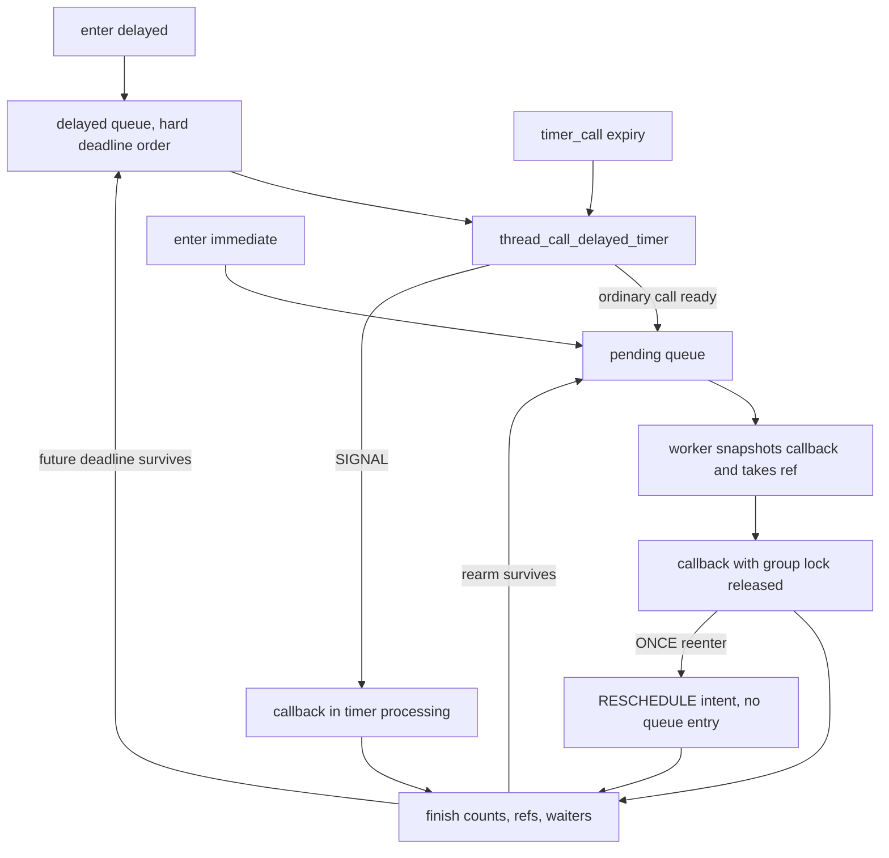

# Timers and thread calls: execution, cancellation, and lifetime

[Runtime](README.md) · [Time and accounting introduction](time-and-accounting.md) · [Wait protocols](wait-and-turnstile-protocols.md)

A `timer_call` arranges a function call from timer processing. A `thread_call` normally moves work to a kernel worker thread, using timer calls only to make delayed work eligible. Their cancellation APIs remove scheduled work; callback completion and object/context lifetime are additional questions. One configured thread-call mode, `THREAD_CALL_OPTIONS_SIGNAL`, deliberately executes from the timer interrupt instead of a worker. [`timer_call.c`, expiry](../../../xnu/osfmk/kern/timer_call.c#L913-L1047), [`thread_call.c`, delayed expiry](../../../xnu/osfmk/kern/thread_call.c#L1999-L2076), [`thread_call.h`, options](../../../xnu/osfmk/kern/thread_call.h#L76-L83).

The distinctions matter in shutdown code. An empty queue does not prove no callback is using its arguments. A worker-held reference protects an allocated thread-call object, but does not automatically retain the external object passed as `param0` or `param1`. The implementation snapshots those parameters and invokes the callback after releasing its group lock. [`thread_call.c`](../../../xnu/osfmk/kern/thread_call.c#L1759-L1808), [`thread_call_invoke()`](../../../xnu/osfmk/kern/thread_call.c#L1669-L1704).

## 1. Low-level timer state and deadline selection

`timer_call_data_t` contains a soft deadline, deadline-queue linkage, list linkage, queue pointer, function/parameters, time-to-deadline accounting, flags, and a per-call lock. The queue's lock additionally protects `tc_async_dequeue`, used to reconcile an expiry/cancel or expiry/rearm lock collision. This object has queue membership and callback parameters, but no general callback-completion counter comparable to a thread call's submit/finish counters. [`timer_call.h`](../../../xnu/osfmk/kern/timer_call.h#L72-L91).

`timer_call_enter_internal()` records the requested deadline as the soft deadline, obtains a coalescing allowance, and extends the scheduling deadline by the larger applicable allowance/leeway, saturating at `UINT64_MAX`. Past deadlines have an adjustment path. Rate-limited calls retain a flag that affects early expiry. The syscall/thread QoS influence depends on urgency: system urgency classes ignore the current thread's attributes for coalescing, while user classes can incorporate them. [`timer_call.c`](../../../xnu/osfmk/kern/timer_call.c#L657-L715), [`timer_call.h`](../../../xnu/osfmk/kern/timer_call.h#L94-L110).

The call is assigned to a suitable timer queue, or potentially the long-term queue, and its deadline/parameters are changed under synchronization. The return value means the timer was previously queued; it does not mean this function waited for a preceding callback. The long-term mechanism is configuration-sensitive: this source defaults to a one-second threshold on x86_64 and disables it by default elsewhere. Its migration/scanning policy is not deeply traced here. [`timer_call.c`](../../../xnu/osfmk/kern/timer_call.c#L716-L778), [`long-term defaults`](../../../xnu/osfmk/kern/timer_call.c#L79-L105).

Within an ordinary timer queue, the deadline priority queue selects the earliest hard deadline, while a parallel list supports rescans. The earliest-soft-deadline summary is derived from the head, using its hard deadline if rate-limited. This is not a second full ordering by soft deadline; expiry/rescan code explicitly handles the consequence of maintaining these different views. [`timer_call.c`](../../../xnu/osfmk/kern/timer_call.c#L366-L437), [`expiry traversal`](../../../xnu/osfmk/kern/timer_call.c#L921-L980).

## 2. Opposite lock order without blocking the expiry scanner

Enqueue and cancel start with the per-call lock and then acquire the old/new queue lock. Expiry starts from the queue lock, so waiting for a call lock held by a concurrent enqueue/cancel would invert that order. Instead the expiry scanner tries the call lock. If unavailable, it removes the entry from queue structures asynchronously, leaves the queue pointer for the competing operation to reconcile, marks `tc_async_dequeue`, and skips invocation. [`timer_call.c`](../../../xnu/osfmk/kern/timer_call.c#L467-L598), [`expiry try-lock`](../../../xnu/osfmk/kern/timer_call.c#L989-L1011).

[`osfmk/kern/timer_call.c:996–1011`](../../../xnu/osfmk/kern/timer_call.c#L996-L1011)

<!-- source-excerpt: ../../../xnu/osfmk/kern/timer_call.c#L996-L1011 -->
```c
			if (!simple_lock_try(&call->tc_lock, LCK_GRP_NULL)) {
				/* case (2b) lock inversion, dequeue and skip */
				timer_queue_expire_lock_skips++;
				timer_call_entry_dequeue_async(call);
				call = NULL;
				continue;
			}

			timer_call_entry_dequeue(call);

			func = call->tc_func;
			param0 = call->tc_param0;
			param1 = call->tc_param1;

			simple_unlock(&call->tc_lock);
			timer_queue_unlock(queue);
```

The operation holding the call lock later takes the old queue lock, sees `tc_async_dequeue`, clears the flag and stale queue pointer, then completes cancel or rearm. This lets the operation that already owns the call determine its final disposition without the timer interrupt waiting in a lock-order cycle. The async path is a synchronization mechanism, not evidence that a callback has been queued onto a worker. [`timer_call.c`](../../../xnu/osfmk/kern/timer_call.c#L493-L598).

On ordinary successful expiry, the scanner removes the entry, snapshots `func`, `param0`, and `param1`, releases both locks, and calls the function. Timer processing remains bounded by a scan-time limit, but callbacks themselves run as part of that processing; dropping the queue lock does not transform their context into a sleepable worker context. Rate-limited entries can wait until their hard deadline, and rescans can revisit/sort entries under separate rules. [`timer_call.c`](../../../xnu/osfmk/kern/timer_call.c#L934-L1047), [`rescan and next deadline`](../../../xnu/osfmk/kern/timer_call.c#L1048-L1111), [`thread-call signal contract`](../../../xnu/osfmk/kern/thread_call.h#L78-L83).

`timer_call_cancel()` dequeues and adjusts the queue's next deadline. It has no loop waiting for a callback already detached for execution. A false result can mean the callback has already passed the dequeue point, not that it never ran. Even a cancellation that removes a pending rearm is not a generic barrier against another invocation already executing. Callers need their own callback-state/lifetime protocol where that distinction matters. [`timer_call.c`](../../../xnu/osfmk/kern/timer_call.c#L780-L819), [`callback after dequeue`](../../../xnu/osfmk/kern/timer_call.c#L1004-L1032).

## 3. The thread wait timer is a concrete teardown protocol

A thread's wait timer uses `wait_timer_armed` to decide whether an expiry should affect the logical wait and `wait_timer_active` to account for expirations that still require completion. Registration increments active state only when it newly activates the timer. The expiry callback locks the thread, clears armed state before requesting `THREAD_TIMED_OUT`, and decrements active state before unlocking. `clear_wait_internal()` may temporarily drop the thread lock while removing queue membership. [`waitq.c`](../../../xnu/osfmk/kern/waitq.c#L1390-L1406), [`sched_prim.c`](../../../xnu/osfmk/kern/sched_prim.c#L823-L842), [`clear_wait_internal()`](../../../xnu/osfmk/kern/sched_prim.c#L1702-L1734).

A normal wake clears armed state and, if cancellation actually removed the timer, decrements active state itself. Otherwise the concurrent expiry is responsible for its decrement. During final thread termination, the runtime cancels the armed timer and waits until `wait_timer_active` reaches zero, dropping the thread lock and restoring interrupt state between checks so a concurrent callback can finish. The object cannot simply disappear because its wait event was cleared. [`sched_prim.c`](../../../xnu/osfmk/kern/sched_prim.c#L856-L885), [`thread.c`](../../../xnu/osfmk/kern/thread.c#L639-L670).

[`osfmk/kern/thread.c:640–668`](../../../xnu/osfmk/kern/thread.c#L640-L668)

<!-- source-excerpt: ../../../xnu/osfmk/kern/thread.c#L640-L668 -->
```c
	 *	Cancel wait timer, and wait for
	 *	concurrent expirations.
	 */
	if (thread->wait_timer_armed) {
		thread->wait_timer_armed = false;

		if (timer_call_cancel(thread->wait_timer)) {
			thread->wait_timer_active--;
		}
	}

	delay_us = 1;

	while (thread->wait_timer_active > 0) {
		thread_unlock(thread);
		splx(s);

		delay(delay_us++);

		if (delay_us > USEC_PER_SEC) {
			panic("wait timer failed to inactivate!"
			    "thread: %p, wait_timer_active: %d, "
			    "wait_timer_armed: %d",
			    thread, thread->wait_timer_active,
			    thread->wait_timer_armed);
		}

		s = splsched();
		thread_lock(thread);
```

This is a specific thread-owned protocol, not a hidden service provided by `timer_call_cancel()`. Other timer clients must be read for their own equivalent ownership and completion rules. The [scheduler chapter](scheduler-execution.md) follows the later `TH_TERMINATE` block and off-CPU reaping boundary.

## 4. Thread-call groups and object state

A thread-call group holds a lock, pending FIFO/count, delayed lists and deadline queues for absolute and continuous time, timer calls servicing those delayed queues, idle-worker and completion-wait queues, and worker counts. Priority/group selection determines which workers execute callbacks. Some groups have `TCG_PARALLEL`; other groups only initiate worker wake/creation when no worker is active. These group policies are distinct from the per-call `ONCE` option. [`thread_call.c`](../../../xnu/osfmk/kern/thread_call.c#L71-L148), [`worker capacity decision`](../../../xnu/osfmk/kern/thread_call.c#L413-L463), [`wake`](../../../xnu/osfmk/kern/thread_call.c#L1481-L1514).

| Thread-call field/flag | Role |
|---|---|
| `tc_queue`, `tc_qlink`, `tc_pqlink` | Pending or delayed membership and the delayed hard deadline. [`thread_call.h`](../../../xnu/osfmk/kern/thread_call.h#L374-L385). |
| `tc_soft_deadline`, `tc_pending_timestamp`, `tc_ttd` | Requested expiry, pending-queue enqueue time, and timing attribution. [`thread_call.h`](../../../xnu/osfmk/kern/thread_call.h#L374-L394). |
| `tc_submit_count`, `tc_finish_count` | Count admitted invocations versus completion/cancellation; used for ordinary allocated-call waits and activity checks. [`thread_call.c`](../../../xnu/osfmk/kern/thread_call.c#L710-L812), [`wait/activity`](../../../xnu/osfmk/kern/thread_call.c#L2298-L2344). |
| `tc_refs`, `THREAD_CALL_ALLOC` | Client and worker ownership of storage allocated by this subsystem. [`thread_call.c`](../../../xnu/osfmk/kern/thread_call.c#L1013-L1027), [`worker reference`](../../../xnu/osfmk/kern/thread_call.c#L1773-L1793). |
| `ONCE`, `RUNNING`, `RESCHEDULE` | Suppress concurrent execution of this call by deferring reenqueue until its running invocation finishes. [`thread_call.c`](../../../xnu/osfmk/kern/thread_call.c#L710-L781). |
| `WAIT`, `SIGNAL`, `DELAYED`, `RATELIMITED` | Completion waiters; interrupt-context mode; deadline-based rearm; enforcement of leeway's end. [`thread_call.h`](../../../xnu/osfmk/kern/thread_call.h#L360-L372). |

`thread_call_allocate_with_options()` allocates initialized storage, sets one client reference, and marks `THREAD_CALL_ALLOC`. Setup alone does not establish that allocation ownership. The function-only convenience pool is different again: its internal slot can be returned to the pool before callback execution, because function and parameters have been copied out. An arbitrary embedded call does not acquire allocated-object completion/free guarantees merely by having the same C structure layout. [`thread_call.c`](../../../xnu/osfmk/kern/thread_call.c#L554-L600), [`allocation`](../../../xnu/osfmk/kern/thread_call.c#L1013-L1027), [`internal pool`](../../../xnu/osfmk/kern/thread_call.c#L637-L697), [`worker dequeue`](../../../xnu/osfmk/kern/thread_call.c#L1759-L1771).

## 5. Enter, delayed expiry, and the meaning of ONCE

Immediate enter takes the group lock with interrupts disabled. If already on the pending queue, it does not add another pending invocation, though it updates `param1`. Otherwise `_pending_call_enqueue()` moves/enqueues the work, increments submit count only when it was not already queued, updates pending count, and wakes service capacity. A delayed enter records the selected clock flavor and soft deadline, computes leeway/rate limiting, and inserts/repositions the call on its delayed queue. Replacing queued work is different from adding a request behind an invocation already running. [`thread_call.c`](../../../xnu/osfmk/kern/thread_call.c#L710-L781), [`immediate enter`](../../../xnu/osfmk/kern/thread_call.c#L1170-L1197), [`delayed enter`](../../../xnu/osfmk/kern/thread_call.c#L1261-L1336).

For an ordinary call, reentering while its callback runs can queue another invocation that another worker executes concurrently. `ONCE` changes that branch: when the call is running, enter stores immediate/deadline intent and sets `THREAD_CALL_RESCHEDULE` without adding queue membership. Multiple such reentries collapse into the stored pending rearm state; `ONCE` means at most one invocation at a time, not “this callback can run only once in its lifetime.” [`thread_call.h`](../../../xnu/osfmk/kern/thread_call.h#L76-L98), [`pending/delayed ONCE branches`](../../../xnu/osfmk/kern/thread_call.c#L710-L771).

[`osfmk/kern/thread_call.c:715–725`](../../../xnu/osfmk/kern/thread_call.c#L715-L725)

<!-- source-excerpt: ../../../xnu/osfmk/kern/thread_call.c#L715-L725 -->
```c
	    == (call->tc_flags & (THREAD_CALL_ONCE | THREAD_CALL_RUNNING))) {
		call->tc_pqlink.deadline = 0;

		thread_call_flags_t flags = call->tc_flags;
		call->tc_flags |= THREAD_CALL_RESCHEDULE;

		assert(call->tc_queue == NULL);

		return flags & THREAD_CALL_RESCHEDULE;
	}

```

When the group's delayed timer runs, it takes the group lock and examines the earliest hard-deadline entry. A not-yet-reached soft deadline ends the scan; rate-limited calls can also wait until the hard deadline unless forced evaluation applies. Ordinary ready work moves onto the pending queue, where worker scheduling determines when it actually executes. The source explicitly notes that a later queue entry can have a larger leeway and an already eligible soft deadline despite this head-based scan. A requested delayed deadline is therefore not a promise of callback start at that exact timestamp. [`thread_call.c`](../../../xnu/osfmk/kern/thread_call.c#L1999-L2076).



## 6. Worker execution and blocked-worker compensation

A worker dequeues under the group lock, snapshots the callback and parameters, clears queue membership, and takes an invocation reference for allocated storage. Allocated or ONCE calls require a finish operation; unowned non-ONCE storage may already be gone after invocation, so the worker cannot unconditionally dereference it afterward. The group lock and interrupt disable are released before calling an ordinary callback. Returning with nonzero preemption level is diagnosed as an error. [`thread_call.c`](../../../xnu/osfmk/kern/thread_call.c#L1711-L1830).

The worker registers `sched_call_thread()` while servicing the group. When its callback blocks, the scheduler reports `SCHED_CALL_BLOCK`, which moves one worker from active to blocked count and can wake/create replacement capacity if pending work exists. Unblock reverses the counts. This is how a nominally nonparallel group can still make progress while its active worker waits; it does not mean every queued callback receives a dedicated thread. Parallel groups additionally use target count, pending-to-active ratio, and machine-load checks to decide whether to add workers. [`thread_call.c`](../../../xnu/osfmk/kern/thread_call.c#L421-L460), [`scheduler callback`](../../../xnu/osfmk/kern/thread_call.c#L1517-L1553), [`worker registration`](../../../xnu/osfmk/kern/thread_call.c#L1731-L1739).

On finish, the call's finish count increments and the worker reference is released. The routine clears running/reschedule/wait flags, then reenqueues surviving ONCE rearm intent if ownership still permits it. A delayed rearm whose soft deadline has already elapsed becomes immediate pending work. If the last allocated-call reference was released, finish can free the object after validating count and waiter invariants. This last-reference path protects call storage while callbacks run; it does not release arbitrary client resources automatically. [`thread_call.c`](../../../xnu/osfmk/kern/thread_call.c#L1564-L1645).

Completion wakes use a separate `waiters_waitq`, not the worker idle queue. The finish path drops the group lock before waking completion waiters because a woken thread's scheduler callback may itself need that lock. This is a concrete lock-order reason for both the separate queue and the unlock/wake/relock sequence. [`thread_call.c`](../../../xnu/osfmk/kern/thread_call.c#L1647-L1666).

## 7. Cancellation API behavior is branch-dependent

`thread_call_cancel_locked()` cancels deferred ONCE rearm by clearing `RESCHEDULE`, or removes a queued call and increments its finish count. If the head delayed call was removed, it rearms/cancels the group's timer accordingly. Plain `thread_call_cancel()` does not wait for an invocation already running. Its result is whether pending work was canceled, not a callback-completion certificate. [`thread_call.c`](../../../xnu/osfmk/kern/thread_call.c#L1343-L1402).

`thread_call_cancel_wait()` requires allocated storage and interrupts enabled, and rejects a worker waiting on its own current callback. Its actual body has two materially different branches:

| Call kind | Behavior after cancel attempt |
|---|---|
| `ONCE` | Cancel pending/rearm intent, then wait for the current invocation if it is running. [`thread_call.c`](../../../xnu/osfmk/kern/thread_call.c#L1439-L1446). |
| Ordinary, nothing canceled | Snapshot submit count and wait until finish count reaches that snapshot. Later submissions need not be drained. [`thread_call.c`](../../../xnu/osfmk/kern/thread_call.c#L1455-L1457), [`count wait`](../../../xnu/osfmk/kern/thread_call.c#L2298-L2327). |
| Ordinary, pending work canceled | Unlock and return without waiting for an earlier concurrent invocation. The source itself calls out this limitation. [`thread_call.c`](../../../xnu/osfmk/kern/thread_call.c#L1448-L1460). |

[`osfmk/kern/thread_call.c:1447–1461`](../../../xnu/osfmk/kern/thread_call.c#L1447-L1461)

<!-- source-excerpt: ../../../xnu/osfmk/kern/thread_call.c#L1447-L1461 -->
```c
	} else {
		/*
		 * A cancel-wait on a normal call will only wait for the in-flight calls
		 * if it did not cancel the pending call.
		 *
		 * TODO: This seems less than useful - shouldn't it do the wait as well?
		 */

		if (canceled == FALSE) {
			thread_call_wait_locked(call, s);
			/* thread call lock unlocked */
		} else {
			enable_ints_and_unlock(group, s);
		}
	}
```

The broad comment above `thread_call_cancel_wait()` should therefore be read together with this branch, not used to conclude that every prior invocation has finished in every case. For a conceptual race: an ordinary call is running; another submission is pending; cancel-wait removes that pending submission successfully and returns through the no-wait branch while the first invocation continues. This follows from the explicitly supported overlapping ordinary invocations and the body above, not from a measured failure. [`thread_call.h`](../../../xnu/osfmk/kern/thread_call.h#L88-L98), [`thread_call.c`](../../../xnu/osfmk/kern/thread_call.c#L1404-L1464).

The ordinary wait helper snapshots a count and repeatedly registers an uninterruptible wait until completion catches up. It is not a “never permit future submission” operation:

[`osfmk/kern/thread_call.c:2302–2314`](../../../xnu/osfmk/kern/thread_call.c#L2302-L2314)

<!-- source-excerpt: ../../../xnu/osfmk/kern/thread_call.c#L2302-L2314 -->
```c
	assert(call->tc_flags & THREAD_CALL_ALLOC);

	uint64_t submit_count = call->tc_submit_count;

	while (call->tc_finish_count < submit_count) {
		call->tc_flags |= THREAD_CALL_WAIT;

		wait_result_t res = waitq_assert_wait64(&group->waiters_waitq,
		    CAST_EVENT64_T(call), THREAD_UNINT, 0);

		if (res != THREAD_WAITING) {
			panic("Unable to assert wait: %d", res);
		}
```

`thread_call_wait_once()` waits without first canceling and only supports allocated ONCE calls. Its locked helper checks `RUNNING`, registers one completion wait, unlocks, and blocks. A later invocation can start before the waiter resumes; the comment explicitly permits that. The helper also contains a TODO for priority inheritance to the executing thread, so this completion wait should not be described as an implemented turnstile donation to the callback worker. [`thread_call.c`](../../../xnu/osfmk/kern/thread_call.c#L2192-L2286).

## 8. Freeing storage and shutting down the callback's owner

`thread_call_free()` refuses while the object is queued or has `RESCHEDULE` intent. Otherwise it drops the client reference. An ordinary allocated callback already executing retains an invocation reference, so freeing can return true before callback completion and the eventual finish path performs the actual storage free. The zero-reference path checks initialization, absence of waiters/running ONCE state, and submit/finish balance before releasing the zone element. [`thread_call.c`](../../../xnu/osfmk/kern/thread_call.c#L1084-L1153), [`worker ref`](../../../xnu/osfmk/kern/thread_call.c#L1777-L1793), [`finish free`](../../../xnu/osfmk/kern/thread_call.c#L1620-L1645).

A robust owner teardown therefore has to establish its own no-new-submission condition, choose a completion protocol appropriate to its call kind, and keep callback arguments alive through that completion. In an allocated ONCE design with external submissions prevented, cancel-wait provides the pending-plus-current-invocation operation before freeing. In an ordinary overlapping design, the successful-cancel branch above means cancel-wait by itself is not that barrier; client synchronization or additional documented sequencing must cover the outstanding executions. This is a derived usage constraint from the inspected branches, not a claim that a generic callback-owner reference is maintained by the subsystem. [`thread_call.c`](../../../xnu/osfmk/kern/thread_call.c#L1413-L1464), [`free contract`](../../../xnu/osfmk/kern/thread_call.c#L1084-L1153).

Avoid inferring support for waiting on embedded/unowned ONCE objects from the worker's historical comment: the current public cancel-wait and wait-once bodies explicitly reject calls lacking `THREAD_CALL_ALLOC`. A client using setup-only storage must be checked against its actual synchronization and destruction contract. The mismatch is visible within this checkout and is a reason to favor executable preconditions over a nearby explanatory comment. [`thread_call.c`](../../../xnu/osfmk/kern/thread_call.c#L1781-L1789), [`cancel-wait validation`](../../../xnu/osfmk/kern/thread_call.c#L1417-L1425), [`wait-once validation`](../../../xnu/osfmk/kern/thread_call.c#L2253-L2271).

## 9. SIGNAL and continuous-time boundaries

`THREAD_CALL_OPTIONS_SIGNAL` also sets `ONCE`. Immediate enter asserts it is not a signal call; delayed expiry directly invokes it while the group lock is dropped, then performs finish under that lock. If finish detects an immediate repend, the timer handler can invoke again in its loop. Signal callbacks consequently inherit timer-context restrictions, not ordinary worker blocking behavior. Freeing a running signal call has an explicit wait-once branch because there is no ordinary worker invocation reference to defer its free. [`thread_call.c`](../../../xnu/osfmk/kern/thread_call.c#L591-L599), [`immediate restriction`](../../../xnu/osfmk/kern/thread_call.c#L1170-L1181), [`signal expiry`](../../../xnu/osfmk/kern/thread_call.c#L2050-L2073), [`signal free`](../../../xnu/osfmk/kern/thread_call.c#L1118-L1125).

Absolute and continuous delayed calls use separate group queues/timers. Delayed entry chooses the time domain; finish converts current absolute time when evaluating continuous rearm; wake handling has `adjust_cont_time_thread_calls()` to reenqueue continuous-time delayed timers. These mechanisms connect runtime work to platform sleep/wake, but they do not make a delayed callback's execution independent of scheduler availability after expiry. Detailed clock conversion and hardware sleep/resume are covered at the [platform boundary](../platform/README.md). [`thread_call.c`](../../../xnu/osfmk/kern/thread_call.c#L1269-L1293), [`finish time conversion`](../../../xnu/osfmk/kern/thread_call.c#L1595-L1604), [`wake adjustment`](../../../xnu/osfmk/kern/thread_call.c#L2347-L2361).

## Sources inspected and limits

Deep review covered low-level enqueue/dequeue/async-dequeue, ordinary expiry and cancellation, thread wait-timer drain, allocated thread-call setup, immediate/delayed submission, ONCE rearm, worker invocation/finish, scheduler block accounting, cancel/wait/free, and signal expiry. Group construction, QoS allocation, and continuous wake adjustment were inspected as connecting interfaces. Long-term timer migration, every coalescing policy input, daemon capacity tuning, worker-retirement races, and each hardware clock backend remain outside the deep path review.

The examples describe source-derived interleavings; no timer workload, cancellation stress test, or clock-accuracy experiment was run. A productive follow-up is to choose one real caller and trace both its final submission prohibition and the lifetime of its callback parameter object. Those client-side conditions are deliberately not supplied by the raw queue API.

<!-- BEGIN PLATYDOC DOCUMENTATION LICENSE -->
Original Platydoc text and diagrams are licensed under [CC BY 4.0](https://creativecommons.org/licenses/by/4.0/). Quoted source code and third-party material retain their respective licenses.
<!-- END PLATYDOC DOCUMENTATION LICENSE -->
