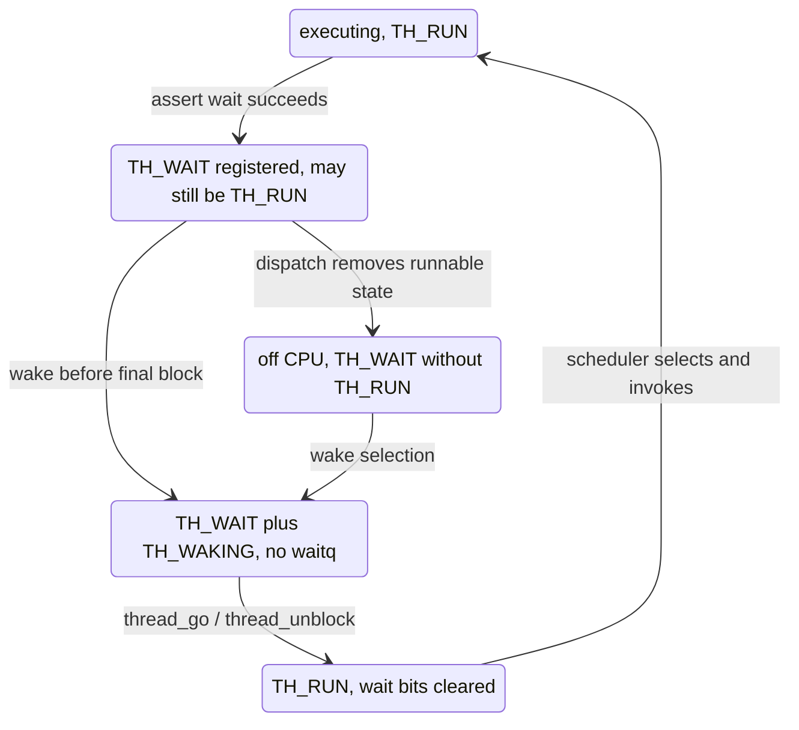
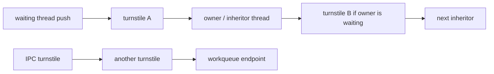

# Wait registration, mutex contention, and priority propagation

[Runtime](README.md) · [Waits and locks introduction](waits-and-locks.md) · [Scheduler execution](scheduler-execution.md)

For how inherited priorities combine with QoS, usage decay, and depression before queue movement, see [priority, QoS and quanta](priority-qos-and-quanta.md).

A blocking primitive needs two protocols. The first makes a waiter visible before a waker can conclude there is nobody to wake. The second raises the priority of work required to release the resource. XNU's wait queues implement the first protocol; turnstiles add an inheritor graph and priority queues for the second. A contended mutex uses both, plus its own interlock and owner state. The functions are coupled, but none replaces the others. [`lock_mtx.c`](../../../xnu/osfmk/kern/lock_mtx.c#L428-L483), [`waitq.c`](../../../xnu/osfmk/kern/waitq.c#L1319-L1432), [`turnstile.h`](../../../xnu/osfmk/kern/turnstile.h#L335-L375).

This chapter follows an ordinary kernel mutex and then the general turnstile chain. IPC turnstiles can target other turnstiles or workqueues, so the mutex example is not the whole topology. The [Mach IPC guides](../ipc/README.md) explain those clients; the rules here describe the runtime mechanism they share. [`turnstile.h`, type and lock-order contracts](../../../xnu/osfmk/kern/turnstile.h#L65-L153).

## 1. Registering a wait does not immediately leave the CPU

`waitq_assert_wait64_locked()` first checks queue/event conventions and preposted state. It then obtains an interrupt-safe queue, possibly a shared safe queue behind the logical wait queue, and locks the thread. `thread_mark_wait_locked()` decides whether the requested interruptibility permits waiting in the presence of abort state. Only a `THREAD_WAITING` result inserts the thread. `thread_block()` is a subsequent scheduler operation; a wait can be satisfied in between registration and that block. [`waitq.c`](../../../xnu/osfmk/kern/waitq.c#L1319-L1432), [`thread_mark_wait_locked()`](../../../xnu/osfmk/kern/sched_prim.c#L1101-L1166), [`thread_block_reason()`](../../../xnu/osfmk/kern/sched_prim.c#L3874-L3944).

The logical wait queue and physical safe queue are worth separating. `thread->waitq` and `wait_event` record the actual wait target even when membership is stored on a global safe queue. Turnstile queues use a priority queue; other safe queues use circular lists with their configured insertion rules. A global queue's event mask is an optimization for searching, not a replacement for the recorded logical event. [`waitq.c`](../../../xnu/osfmk/kern/waitq.c#L536-L575), [`registration`](../../../xnu/osfmk/kern/waitq.c#L1370-L1413).

If a deadline is supplied, registration arms the embedded thread wait timer while the thread is locked. `wait_timer_active` increments when entering a newly active timer, and `wait_timer_armed` records whether this wait still expects its expiry. These two fields deliberately represent different things: an expiry can already be in flight after the logical wait has been canceled. The [timer lifetime chapter](timer-and-thread-call-lifetime.md) follows their teardown use. [`waitq.c`](../../../xnu/osfmk/kern/waitq.c#L1390-L1406), [`thread timer expiry`](../../../xnu/osfmk/kern/sched_prim.c#L823-L842).

[`osfmk/kern/waitq.c:1390–1406`](../../../xnu/osfmk/kern/waitq.c#L1390-L1406)

<!-- source-excerpt: ../../../xnu/osfmk/kern/waitq.c#L1390-L1406 -->
```c
	wait_result = thread_mark_wait_locked(thread, interruptible);
	/* thread->wait_result has been set */
	if (wait_result == THREAD_WAITING) {
		waitq_thread_insert(safeq, thread, waitq, wait_event);

		if (deadline != 0) {
			bool was_active;

			was_active = timer_call_enter_with_leeway(thread->wait_timer,
			    NULL,
			    deadline, leeway,
			    urgency, FALSE);
			if (!was_active) {
				thread->wait_timer_active++;
			}
			thread->wait_timer_armed = true;
		}
```

For a turnstile queue, registration finishes by recomputing the turnstile's effective priority and applying the staged inheritor update while the relevant queue lock remains held. Thus the mutex can prepare an owner reference before enqueue, then have the wait registration establish the actual highest waiter priority. [`waitq.c`](../../../xnu/osfmk/kern/waitq.c#L1415-L1427), [`mutex staging`](../../../xnu/osfmk/kern/lock_mtx.c#L466-L474).

## 2. Detach first, make runnable second

A wakeup selects and removes waiters under queue/thread synchronization. Detachment clears the logical wait queue and event, clears the safe-point/block-hint state, and adds `TH_WAKING` while retaining `TH_WAIT`. This intermediate state says a wakeup owns completion: the thread is no longer discoverable as a waiter, but has not yet passed through the scheduler's runnable transition. [`waitq.c`](../../../xnu/osfmk/kern/waitq.c#L577-L619).

[`osfmk/kern/waitq.c:588–598`](../../../xnu/osfmk/kern/waitq.c#L588-L598)

<!-- source-excerpt: ../../../xnu/osfmk/kern/waitq.c#L588-L598 -->
```c
static inline void
thread_clear_waitq_state(thread_t thread)
{
	assert(thread->state & TH_WAIT);

	thread->waitq.wq_q = NULL;
	thread->wait_event = NO_EVENT64;
	thread->at_safe_point = FALSE;
	thread->block_hint = kThreadWaitNone;
	thread->state |= TH_WAKING;
}
```

The selected list is then flushed: for each thread, raise scheduler interrupt level, lock the thread, perform any wake-priority adjustment, and call `thread_go()`. `thread_go()` asserts that wait membership has already disappeared and delegates to `thread_unblock()`. That function sets the wait result, handles timer cancellation, clears wait-related state, and increments runnable accounting only if the thread was not already `TH_RUN`. A wake-before-block therefore does not create a duplicate queued thread. [`waitq.c`](../../../xnu/osfmk/kern/waitq.c#L904-L933), [`sched_prim.c`](../../../xnu/osfmk/kern/sched_prim.c#L1043-L1091), [`thread_unblock()`](../../../xnu/osfmk/kern/sched_prim.c#L856-L923).



This is a conceptual state diagram of the ordinary path; interruptibility, termination, idle execution, and explicit handoff add conditions. The key invariant is the detachment/runnable split, supported by `thread_clear_waitq_state()` and `thread_go()`'s assertions. [`waitq.c`](../../../xnu/osfmk/kern/waitq.c#L577-L619), [`sched_prim.c`](../../../xnu/osfmk/kern/sched_prim.c#L1043-L1068).

Timeout or abort uses a related but opposite lock-order entry. `clear_wait_internal()` starts with the thread locked and rejects an interrupt wake of an uninterruptible waiter. It proceeds only for a waiter that is neither terminating nor already waking. `waitq_pull_thread_locked()` reserves a ticket on the safe queue; if it must wait, it drops the thread lock, obtains the queue lock, reacquires the thread lock, and rechecks whether this is still the same wait. Losing the race returns false rather than removing a new wait accidentally. [`sched_prim.c`](../../../xnu/osfmk/kern/sched_prim.c#L1702-L1734), [`waitq.c`](../../../xnu/osfmk/kern/waitq.c#L1434-L1484).

## 3. The mutex slow path is a retry loop

The sleepable mutex implementation initially tries spinning when that can be useful. Its adaptive path uses an MCS-style queue so contenders do not all hammer the owner field; the queue head evaluates whether the owner is on-core, whether spinning is still worthwhile, and whether scheduler pressure/time limits require stopping. This spin-queue ordering is not a promise that sleeping mutex waiters acquire the lock in FIFO order. [`lock_mtx.c`](../../../xnu/osfmk/kern/lock_mtx.c#L570-L660).

The contended loop disables preemption while inspecting/updating primitive state and acquiring its interlock. Under that interlock it either finds no owner and claims the mutex, or sets `LCK_MTX_NEEDS_WAKEUP` and prepares to sleep on the current owner. Recursive/type/destroyed-state checks and spin-only modes introduce explicit errors rather than silently taking the ordinary blocking path. [`lock_mtx.c`](../../../xnu/osfmk/kern/lock_mtx.c#L670-L792).

The wait helper gives a compact view of the handoff between mechanisms:

[`osfmk/kern/lock_mtx.c:466–476`](../../../xnu/osfmk/kern/lock_mtx.c#L466-L476)

<!-- source-excerpt: ../../../xnu/osfmk/kern/lock_mtx.c#L466-L476 -->
```c
	thread_set_pending_block_hint(self, kThreadWaitKernelMutex);
	turnstile_update_inheritor(ts, holder, (TURNSTILE_DELAYED_UPDATE | TURNSTILE_INHERITOR_THREAD));

	waitq_assert_wait64(&ts->ts_waitq, LCK_MTX_EVENT(lck),
	    THREAD_UNINT | THREAD_WAIT_NOREPORT_USER, TIMEOUT_WAIT_FOREVER);

	lck_mtx_ilk_unlock(lck);

	turnstile_update_inheritor_complete(ts, TURNSTILE_INTERLOCK_NOT_HELD);

	thread_block(THREAD_CONTINUE_NULL);
```

The primitive interlock protects the association between the mutex's owner and its turnstile while the wait is registered. After dropping that interlock, the helper completes the pending propagation work and blocks. On wake it returns to the acquisition loop; it does not return a guarantee that the mutex owner field already names the woken thread. The retry may sleep again. [`lock_mtx.c`](../../../xnu/osfmk/kern/lock_mtx.c#L445-L483), [`acquisition loop and claim`](../../../xnu/osfmk/kern/lock_mtx.c#L784-L825).

On actual acquisition, the thread recovers a donated turnstile with `turnstile_complete_compact_id()`, clears the mutex's compact turnstile ID if it was the last donation, sets its owner word with release ordering, restores preemption for sleepable mode, and performs remaining turnstile cleanup. During unlock, the primitive interlock stabilizes the turnstile while `waitq_wakeup64_one(..., WAITQ_UPDATE_INHERITOR)` chooses a waiter and updates inheritance. The later cleanup must respect that interlock protocol. [`lock_mtx.c`](../../../xnu/osfmk/kern/lock_mtx.c#L485-L546), [`claim/cleanup`](../../../xnu/osfmk/kern/lock_mtx.c#L797-L825).

## 4. Turnstile storage is donated, then recovered

A turnstile is more than a waiter queue. It has an embedded wait queue, `ts_inheritor`, an incoming-turnstile priority queue, `ts_priority`, reference count, proprietor identity, and a type/generation field. The type determines the promotion policy and allowed inheritance topology. A thread also has a turnstile available for donation, plus temporary `inheritor` and `inheritor_flags` fields used while an update is being completed. [`turnstile.h`](../../../xnu/osfmk/kern/turnstile.h#L335-L375), [`thread.h`](../../../xnu/osfmk/kern/thread.h#L443-L460).

`turnstile_prepare_common()` consumes the caller's spare turnstile when no explicit object was supplied, assigns the proprietor/type, resets inheritor/priority state, and changes generation. The first waiter installs that object as the primitive's active turnstile. Later waiters donate their objects to its free list rather than replacing the active queue. Direct-pointer, compact-ID, and hash-backed variants support different primitive storage layouts; a mutex uses the compact-ID form. [`turnstile.c`](../../../xnu/osfmk/kern/turnstile.c#L946-L1089), [`mutex prepare`](../../../xnu/osfmk/kern/lock_mtx.c#L457-L464).

Completion retrieves one spare from that free list, or removes the active object itself when the last donation is recovered. The compact-ID variant moves the recovered ID back to the current thread and clears the compact-ID table entry in the last-donation case. `turnstile_complete_common()` either disconnects the last primitive inheritor or stages priority adjustment for a remaining active primitive, then returns the recovered object to thread ownership with type `TURNSTILE_NONE`. A caller should not assume it receives the same physical turnstile object it originally donated; the free-list protocol preserves availability, not per-waiter object identity. [`turnstile.c`](../../../xnu/osfmk/kern/turnstile.c#L1090-L1235).

This protocol lets heavily used primitives obtain a priority queue only while needed without allocating one permanently for every mutex. It still requires lifetime work: inherited targets are referenced, returned turnstiles are reset, and any displaced inheritor's priority must be recomputed before its reference is released. The primitive's interlock, turnstile queue lock, and object references serve different purposes. [`turnstile.c`](../../../xnu/osfmk/kern/turnstile.c#L946-L1235), [`stashing references`](../../../xnu/osfmk/kern/turnstile.c#L1420-L1505), [`cleanup`](../../../xnu/osfmk/kern/turnstile.c#L2846-L2877).

## 5. What priority propagates

The donation input depends on the turnstile's promotion policy. User and user-IPC promotion uses the waiter's base priority. Kernel promotion starts from scheduling priority, raises it to at least base priority and `BASEPRI_DEFAULT`, and caps it at `MAXPRI_PROMOTE`. These distinctions prevent the statement “a turnstile copies the highest waiting thread's priority” from being precise enough. [`turnstile.c`](../../../xnu/osfmk/kern/turnstile.c#L2351-L2379).

[`osfmk/kern/turnstile.c:2356–2373`](../../../xnu/osfmk/kern/turnstile.c#L2356-L2373)

<!-- source-excerpt: ../../../xnu/osfmk/kern/turnstile.c#L2356-L2373 -->
```c
	switch (turnstile_promote_policy[turnstile_get_type(turnstile)]) {
	case TURNSTILE_USER_PROMOTE:
	case TURNSTILE_USER_IPC_PROMOTE:
		priority = thread->base_pri;
		break;
	case TURNSTILE_KERNEL_PROMOTE:
		/*
		 * Ideally this should be policy based
		 * according to the turnstile type.
		 *
		 * The priority with which each thread pushes on
		 * a primitive should be primitive dependent.
		 */
		priority = thread->sched_pri;
		priority = MAX(priority, thread->base_pri);
		priority = MAX(priority, BASEPRI_DEFAULT);
		priority = MIN(priority, MAXPRI_PROMOTE);
		break;
```

The embedded waiter queue is ordered by that computed push. Unlike Clutch's stable run queue, it is not a stable equal-priority FIFO queue. When a blocked thread's relevant priority changes, the runtime must update its queue key. The effective turnstile priority is the maximum of its highest waiting-thread push and its highest incoming-turnstile donation; the latter is disallowed for kernel-promotion turnstiles by an assertion. [`turnstile.c`](../../../xnu/osfmk/kern/turnstile.c#L2391-L2428), [`priority recomputation`](../../../xnu/osfmk/kern/turnstile.c#L2437-L2488).

For a thread inheritor, user promotions are represented in `base_inheritor_queue`, while kernel promotions use `sched_inheritor_queue`. Recomputing kernel promotion updates `kern_promotion_schedpri` and the thread's scheduling priority. Recomputing user promotion derives a bounded base-priority promotion, maps it into QoS policy, and may need to propagate again if a waiting thread's base priority changed. The user-policy helper can drop and reacquire the thread lock, which matters to callers attempting to treat it as a trivial field assignment. [`turnstile.c`](../../../xnu/osfmk/kern/turnstile.c#L1837-L1906), [`thread_policy.c`](../../../xnu/osfmk/kern/thread_policy.c#L3000-L3092).

## 6. Changing the inheritor transfers references and queued updates

`turnstile_update_inheritor()` first stashes the proposed inheritor and takes the appropriate thread, turnstile, or workqueue reference. With `TURNSTILE_DELAYED_UPDATE`, it stops there. Otherwise it locks the turnstile and updates the inheritance relationship. The locked update removes the old priority-queue relationship and adds/updates the new one, then leaves displaced inheritor state on the current thread for completion. This staging makes the lifetime of both the old and new target explicit across lock transitions. [`turnstile.c`](../../../xnu/osfmk/kern/turnstile.c#L1284-L1505), [`immediate/delayed entry`](../../../xnu/osfmk/kern/turnstile.c#L1506-L1539).

There is a source detail worth checking instead of inferring behavior from a parameter name. In this checkout, `turnstile_update_inheritor_complete()` declares its held/not-held flags argument `__unused`. Its body always captures pending flags, calls `turnstile_cleanup()`, and starts a new-inheritor priority-chain update when required:

[`osfmk/kern/turnstile.c:2818–2833`](../../../xnu/osfmk/kern/turnstile.c#L2818-L2833)

<!-- source-excerpt: ../../../xnu/osfmk/kern/turnstile.c#L2818-L2833 -->
```c
turnstile_update_inheritor_complete(
	struct turnstile *turnstile,
	turnstile_update_complete_flags_t flags __unused)
{
	thread_t thread = current_thread();

	turnstile_update_flags_t inheritor_flags = thread->inheritor_flags;

	turnstile_cleanup();

	/* Perform priority update for new inheritor */
	if (inheritor_flags & TURNSTILE_NEEDS_PRI_UPDATE) {
		turnstile_update_inheritor_priority_chain(turnstile,
		    TURNSTILE_INHERITOR_TURNSTILE | TURNSTILE_UPDATE_BOOST);
	}
}
```

Thus the flag itself is not a runtime switch that automatically postpones all recursion until the primitive interlock is dropped. Correct usage still depends on each primitive's lock-order contract and staged operations; mutex wait and unlock invoke completion at different points. `turnstile_cleanup()` clears the current thread's temporary fields before potentially propagating demotion, then drops the displaced target's reference with the appropriate safe-deallocation helper. [`lock_mtx.c`](../../../xnu/osfmk/kern/lock_mtx.c#L466-L476), [`unlock integration`](../../../xnu/osfmk/kern/lock_mtx.c#L510-L543), [`turnstile.c`](../../../xnu/osfmk/kern/turnstile.c#L2846-L2877).

## 7. Walking a chain while its members can wake

A representative inheritance chain is: high-priority waiter → mutex turnstile → owner thread → another turnstile on which that owner waits → next owner. IPC can add turnstile-to-turnstile edges and a workqueue endpoint. The priority walker dispatches among thread, turnstile, and workqueue cases, keeping only the locks appropriate to the next step and stopping when no further update is needed. This is a changing dependency graph, not a snapshot copied once at lock acquisition. [`turnstile.c`](../../../xnu/osfmk/kern/turnstile.c#L2731-L2817), [`handover helpers`](../../../xnu/osfmk/kern/turnstile.c#L2953-L3208).



The difficult handover is from a locked thread to the turnstile on which it waits. The helper reserves a ticket on the turnstile wait-queue lock. If it cannot obtain the lock immediately, it snapshots the turnstile generation, references the thread, drops the thread lock, waits for the ticket, and relocks the thread. It then verifies both the generation and the thread's continued membership in that same turnstile. A wakeup or reuse during the gap causes the walker to stop and release the temporary reference instead of updating a stale relationship. [`turnstile.c`](../../../xnu/osfmk/kern/turnstile.c#L3100-L3171).

[`osfmk/kern/turnstile.c:3140–3164`](../../../xnu/osfmk/kern/turnstile.c#L3140-L3164)

<!-- source-excerpt: ../../../xnu/osfmk/kern/turnstile.c#L3140-L3164 -->
```c
	 * 3. Performance optimization
	 */
	if (!waitq_lock_reserve(&waiting_turnstile->ts_waitq, &ticket)) {
		/* take a reference on thread and snapshot of gencount */
		turnstile_gencount = turnstile_get_gencount(waiting_turnstile);
		thread_reference(thread);

		/* drop the thread lock and wait for turnstile ticket */
		thread_unlock(thread);
		waitq_lock_wait(&waiting_turnstile->ts_waitq, ticket);
		thread_lock(thread);

		/* Check if the gencount matches and thread is still waiting on same turnstile */
		if (turnstile_gencount != turnstile_get_gencount(waiting_turnstile) ||
		    waiting_turnstile != thread_get_waiting_turnstile(thread)) {
			turnstile_stats_update(total_hop + 1, TSU_NO_PRI_CHANGE_NEEDED |
			    TSU_THREAD_ARG | tsu_flags, thread);
			/* No updates required, bail out */
			thread_unlock(thread);
			waitq_unlock(&waiting_turnstile->ts_waitq);
			thread_deallocate_safe(thread);
			return;
		}

		/*
```

The ticket reservation protects the turnstile's lifetime for this lock acquisition; the helper deliberately avoids taking an additional turnstile reference while holding the surrounding locks. Once the thread is confirmed still waiting under its lock, wait membership makes the temporary thread reference unnecessary. The helper updates the waiter's priority-queue position and then passes the locked turnstile to the next step. [`turnstile.c`](../../../xnu/osfmk/kern/turnstile.c#L3136-L3200).

Propagation stops at a missing dependency, an unchanged effective priority after the initial hop, or the configured thread-hop limit. That bound is not a deadlock-resolution algorithm. Primitive-specific lock-order and acyclicity requirements still apply; the header spells out different permitted orders for mutex, user lock, IPC, and workloop turnstiles. A workqueue endpoint can request creator redrive, with its own lock/reference/preemption treatment, instead of continuing as a thread owner. [`turnstile.c`](../../../xnu/osfmk/kern/turnstile.c#L3107-L3135), [`workqueue endpoint`](../../../xnu/osfmk/kern/turnstile.c#L2909-L2942), [`turnstile.h`](../../../xnu/osfmk/kern/turnstile.h#L65-L153).

## Review scope and reading exercises

The reviewed path covers generic wait registration/detachment, abort/timeout pulling, sleepable mutex contention and recovery, compact-ID turnstile donation/completion, priority calculation, inheritor-reference staging, cleanup, and the generation-checked thread-to-turnstile handover. Direct/hash storage variants and IPC/workqueue endpoints were read for their interfaces; every client and every chain interleaving was not audited.

A useful source exercise is to follow a wake that occurs after `waitq_assert_wait64()` but before `thread_block()`, then a priority change that occurs while the chain walker has dropped the owner thread's lock. Both are ordinary cases the protocol explicitly supports. The [timer chapter](timer-and-thread-call-lifetime.md) adds the callback-lifetime race that a timeout introduces. These are explanations of code and invariants, not executed stress tests or a formal proof of deadlock freedom.

<!-- BEGIN PLATYDOC DOCUMENTATION LICENSE -->
Original Platydoc text and diagrams are licensed under [CC BY 4.0](https://creativecommons.org/licenses/by/4.0/). Quoted source code and third-party material retain their respective licenses.
<!-- END PLATYDOC DOCUMENTATION LICENSE -->
