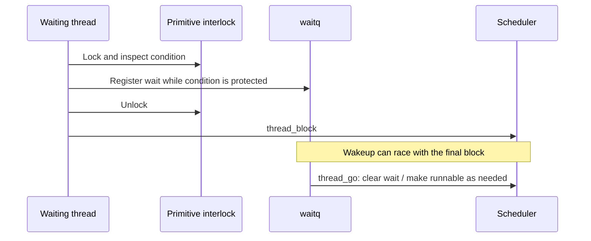

# Waiting, locking, and priority inheritance

[Runtime overview](README.md) · [Scheduling](scheduling.md)

For lock-by-lock traces and race handling, continue with [wait registration, mutex retries, and turnstile propagation](wait-and-turnstile-protocols.md).

## A wait is registration followed by scheduling

`assert_wait(event, interruptibility)` hashes an event to a global wait queue and registers the current thread. It does not itself perform the context switch. `thread_block()` subsequently enters the scheduler. This split allows a caller to record the wait while its condition lock is held, release that lock, and then block without leaving a lost-wakeup gap. Concrete lock implementations follow this pattern; the condition still needs rechecking according to the primitive's protocol. [`assert_wait()`](../../../platydoc-data/xnu/osfmk/kern/sched_prim.c#L1201), [`_global_eventq()`](../../../platydoc-data/xnu/osfmk/kern/waitq.c#L383), [`lck_mtx_lock_wait()`](../../../platydoc-data/xnu/osfmk/kern/lock_mtx.c#L446).

`waitq_assert_wait64_locked()` first handles preposted wait sets, then finds an IRQ-safe queue when the original queue is not IRQ-safe. With that queue and the thread locked, `thread_mark_wait_locked()` checks abort/interruptibility state; on `THREAD_WAITING` it inserts the thread and optionally arms its wait timer. Turnstile waits also recompute inherited priority. Queue hashing groups storage; the event identity still distinguishes which waiters should wake. [`waitq.c`](../../../platydoc-data/xnu/osfmk/kern/waitq.c#L1319).

Thread states are bits. `TH_WAIT` marks waiting state, including the detached interval before wake completion; `TH_RUN` means running or runnable; they can overlap during the handover from execution into blocking. `TH_WAKING` covers the interval between removal from a wait queue and `thread_go()`. Do not read these as exclusive enum values. `thread_go()` requires detached wait linkage and calls `thread_unblock()` before deciding whether new enqueueing is necessary. [`thread.h`](../../../platydoc-data/xnu/osfmk/kern/thread.h#L530), [`sched_prim.c`](../../../platydoc-data/xnu/osfmk/kern/sched_prim.c#L1043).

Wakeup selection and resumption are separable too. `waitq_wakeup64_nthreads_locked()` collects matching threads, optionally unlocks/enables interrupts according to flags, and flushes the selected queue through `thread_go()`. Flags can request handoff, inheritor updates, or IPC priority floors. This organization limits how much scheduler work must occur while holding the original queue lock. [`waitq.c`](../../../platydoc-data/xnu/osfmk/kern/waitq.c#L1523), [`waitq_select_queue_flush()`](../../../platydoc-data/xnu/osfmk/kern/waitq.c#L904), [`waitq.h`, flags](../../../platydoc-data/xnu/osfmk/kern/waitq.h#L60).

Wait queues also underlie Mach ports/port sets and BSD select sets. `waitq_type_t` distinguishes generic, turnstile, port, select, and set variants. Preposting lets a set retain knowledge of readiness, so its next wait can return awakened immediately. Full set linking is a separate reading path through `waitq_link_locked()` and `waitq_link_prepost_locked()`. [`waitq.h`](../../../platydoc-data/xnu/osfmk/kern/waitq.h#L193), [`waitq.c`](../../../platydoc-data/xnu/osfmk/kern/waitq.c#L1925).

## Mutex: fast acquisition, then adaptive wait

`lck_mtx_lock()` enters `lck_mtx_lock_fastpath()`, which uses an acquire CAS on the complete state to install the current thread's compact ID. The slow path handles contention, adaptive spinning, the internal interlock, and sleeping. It checks recursive acquisition and destroyed/corrupt state. `lck_mtx_unlock()` uses a release CAS for the common uncontended case and enters wakeup handling when required. [`lock_mtx.c`, fast path](../../../platydoc-data/xnu/osfmk/kern/lock_mtx.c#L875), [`lock_mtx.c`, contention](../../../platydoc-data/xnu/osfmk/kern/lock_mtx.c#L668), [`lock_mtx.c`, unlock](../../../platydoc-data/xnu/osfmk/kern/lock_mtx.c#L1151).

The sleeping path makes the dependency explicit:

1. `lck_mtx_lock_wait()` obtains the mutex's turnstile through `turnstile_prepare_compact_id()`.
2. It sets the current holder as inheritor and registers an uninterruptible wait on the turnstile's queue.
3. It drops the mutex interlock, completes priority propagation, then calls `thread_block()`.
4. Unlock wakes one waiter with `WAITQ_UPDATE_INHERITOR`; completion/cleanup return donated storage and remove obsolete priority inheritance.

These are distinct operations because the primitive interlock stabilizes owner/waiter state while propagation may need locks farther along a dependency chain. [`lock_mtx.c`](../../../platydoc-data/xnu/osfmk/kern/lock_mtx.c#L446).

## Turnstiles represent who must run to unblock someone

A turnstile embeds a priority-ordered `waitq`, an inheritor, a queue of incoming inheritors, a proprietor identity, reference count, and type/generation state. An inheritor can be a thread, another turnstile, or a workqueue. The header lists client-specific interlocks and lock order for mutexes, ulocks, pthread mutexes, synchronous IPC, workloops, and other clients. [`turnstile.h`](../../../platydoc-data/xnu/osfmk/kern/turnstile.h#L65), [`struct turnstile`](../../../platydoc-data/xnu/osfmk/kern/turnstile.h#L336).

Each thread receives reusable turnstile storage at creation. `turnstile_prepare_common()` transfers this storage to the primitive or its spare list while the primitive's interlock is held. `turnstile_complete_common()` returns a turnstile to the thread and arranges any remaining priority updates. Thus a heavily used primitive does not require allocating a permanently private turnstile for every uncontended instance. [`thread.c`](../../../platydoc-data/xnu/osfmk/kern/thread.c#L1527), [`turnstile.c`, prepare](../../../platydoc-data/xnu/osfmk/kern/turnstile.c#L938), [`turnstile.c`, complete](../../../platydoc-data/xnu/osfmk/kern/turnstile.c#L1091).

`turnstile_update_inheritor_priority_chain()` alternates between turnstiles and threads: update the owner, then, if it is waiting on another turnstile, continue along that dependency. Workqueues terminate this chain through their specialized update path. `turnstile_cleanup()` removes pending old-inheritor state from the current thread, propagates demotion if needed, and releases the saved reference. Priority inheritance helps the actual blocker run; it does not replace lock ordering or resolve cycles in an arbitrary client protocol. [`turnstile.c`](../../../platydoc-data/xnu/osfmk/kern/turnstile.c#L2731), [`turnstile.c`](../../../platydoc-data/xnu/osfmk/kern/turnstile.c#L2846).

## Reader/writer and spinning locks: inspect the actual variant

The [reader/writer lock companion](reader-writer-locks.md) traces both implementations through admission, waiting, upgrade/downgrade and release. [Ticket and pointer locks](ticket-and-pointer-locks.md) follows reservation, preemption, invalidation and pointer/waiter publication, with concrete callers.

This checkout sets `XNU_LCK_RW_DEFAULT_TO_NEW` to **0**. Ordinary internal `lck_rw_t` therefore selects `lck_rw_old_t`; explicit `lck_rw_new_t` and `LCK_RW_NEW_DEFINE` select the newer implementation. Reading only `lock_rw.c` would describe the wrong default. [`lock_rw.h`](../../../platydoc-data/xnu/osfmk/kern/lock_rw.h#L40), [`lock_rw.h`, typedef selection](../../../platydoc-data/xnu/osfmk/kern/lock_rw.h#L206).

The default implementation uses shared count, exclusive/upgrade intent, waiter flags, and an embedded interlock. Its contended paths spin and, when permitted, register reader/writer waits under that interlock before blocking. The newer implementation documents atomic-add reader fast paths and separate typed reader/writer/upgrader events; it uses the corresponding global wait-queue lock as the interlock for waiter registration. Its comments also analyze lifetime hazards when an unlock permits concurrent lock destruction. [`lock_rw_old.c`](../../../platydoc-data/xnu/osfmk/kern/lock_rw_old.c#L70), [`lock_rw_old.c`, writer wait](../../../platydoc-data/xnu/osfmk/kern/lock_rw_old.c#L589), [`lock_rw.c`, algorithm](../../../platydoc-data/xnu/osfmk/kern/lock_rw.c#L69), [`lck_rw_assert_wait()`](../../../platydoc-data/xnu/osfmk/kern/lock_rw.c#L1314).

Spin/hardware locks protect contexts where sleeping is unsuitable. Ordinary hardware-lock acquisition returns with preemption disabled; `_nopreempt` entry points require the caller to have disabled it already. Interrupt masking is a separate concern, visible in `splsched()`/restore pairs. `thread_invoke()` explicitly panics if a context switch is attempted with nonzero preemption level. Ticket locks implement FIFO admission through current/next tickets; architecture wrappers determine which implementation backs a particular spin-lock API. [`locks.c`](../../../platydoc-data/xnu/osfmk/kern/locks.c#L1037), [`lock_ticket.c`](../../../platydoc-data/xnu/osfmk/kern/lock_ticket.c#L40), [`sched_prim.c`](../../../platydoc-data/xnu/osfmk/kern/sched_prim.c#L2999).

For practical reading, annotate each blocking call with its condition, interlock, wait event, inheritor if any, and wakeup source. That small record exposes the cross-subsystem protocol much more clearly than following lock function names in isolation.

<!-- BEGIN PLATYDOC DOCUMENTATION LICENSE -->
Original Platydoc text and diagrams are licensed under [CC BY 4.0](https://creativecommons.org/licenses/by/4.0/). Quoted source code and third-party material retain their respective licenses.
<!-- END PLATYDOC DOCUMENTATION LICENSE -->
