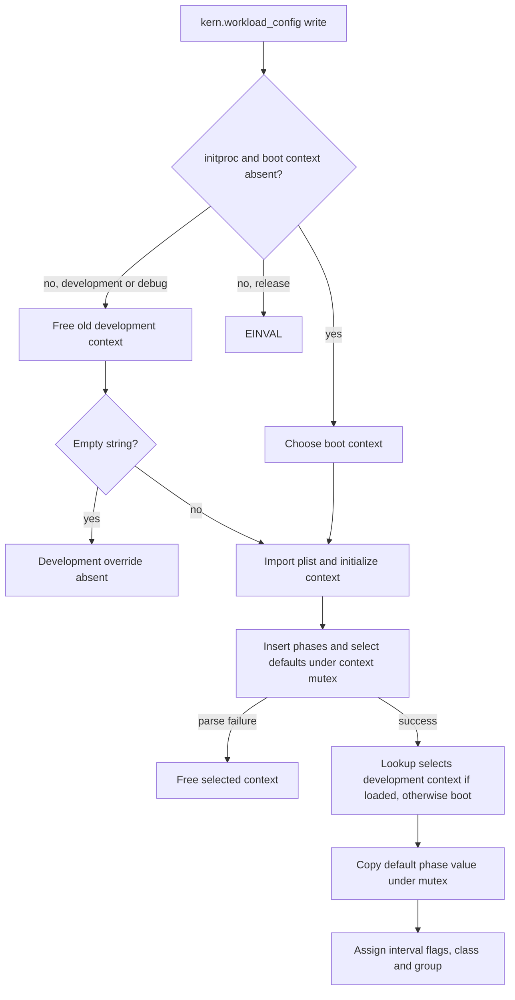
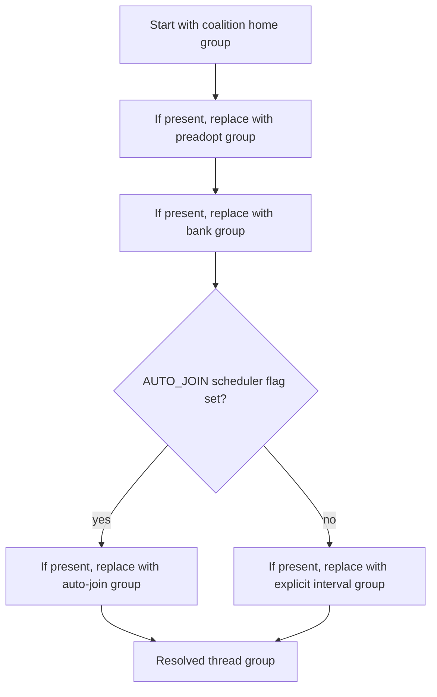
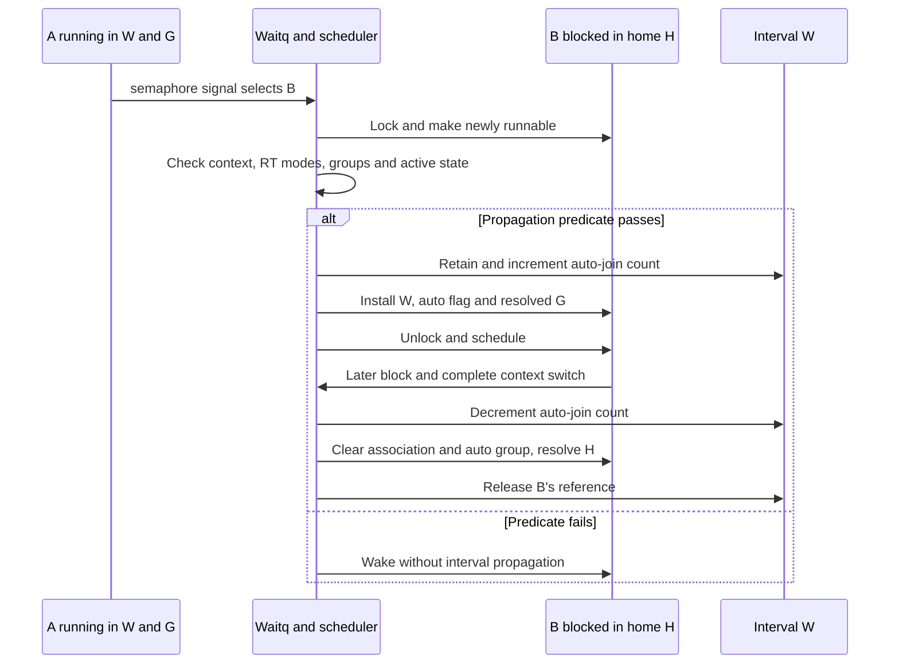

# Work-interval policy and thread-group selection

A work interval can give a thread an attribution group, workload-derived scheduling policy, and permission to participate in real-time work. These are separate decisions. A wakeup can propagate an interval to another thread without repeating the explicit-join policy operation. This chapter follows those decisions in `xnu-12377.121.6`, including the point at which a blocked worker gives the interval back.

Start with the [runtime guide](README.md), [work-interval accounting](recount-and-resource-attribution.md#6-work-interval-ownership-and-telemetry), and [real-time scheduling](realtime-deadlines-and-runqueues.md). The [priority and QoS guide](priority-qos-and-quanta.md) explains requested versus effective policy; [bank attribution](../ipc/bank-accounts-and-charging.md) explains the voucher-carried group considered below.

After group selection, [Thread-group accounting and cluster migration](thread-group-accounting-and-cluster-migration.md) follows Clutch runnable counts and CPU charging, then the separate Edge preference update and migration requests.

## One interval, several kinds of identity

The BSD entry is [`work_interval_ctl()`](../../../platydoc-data/xnu/bsd/kern/sys_work_interval.c#L42-L108). `CREATE2` imports the creation structure, checks `PRIV_WORK_INTERVAL`, then calls the kernel implementation. This is a privilege-framework decision: [`priv_check_cred()`](../../../platydoc-data/xnu/bsd/kern/kern_priv.c#L78-L123) includes MAC checks and a superuser path, so the local dispatcher alone does not establish an entitlement-only rule. The old `CREATE` operation returns `ENOTSUP`.

| Representation | What it identifies or controls |
| --- | --- |
| `wi_id` | Kernel-generated numeric interval identity, checked by operations such as notify and destroy |
| Task-local Mach port name | A send right to an `IKOT_WORK_INTERVAL` port; join and workload-ID assignment translate this capability into a retained interval |
| Workload-ID string | Lookup key in a configuration context, selecting its default phase; it is not the Mach name or numeric interval ID |
| `wi_class`, `wi_class_offset`, `wi_wlid_flags` | Per-interval copied classification and admission flags |
| `wi_group` | A thread-group pointer; a new group, the creator's home group, or temporarily `NULL` while workload-dependent creation is deferred |
| `thread->th_work_interval` | The thread's retained interval association |
| `thread->thread_group` | The group resolved from several possible attribution sources |
| Requested/effective `wi_driven` policy | Whether workload scheduling policy is requested and survives the effective-policy calculation |

These fields live in [`struct work_interval`](../../../platydoc-data/xnu/osfmk/kern/work_interval.c#L152-L204), [`workload_config_t`](../../../platydoc-data/xnu/osfmk/kern/workload_config.h#L51-L62), and the [thread-group resolver](../../../platydoc-data/xnu/osfmk/kern/thread_group.c#L660-L688). [`port_name_to_work_interval()`](../../../platydoc-data/xnu/osfmk/kern/work_interval.c#L574-L608) checks the typed port under the IPC port lock and retains the interval before unlocking. A successful join transfers that reference to the thread; a rejected join releases it. A null port requests leave. See [`kern_work_interval_join()`](../../../platydoc-data/xnu/osfmk/kern/work_interval.c#L1515-L1540).

`JOINABLE` creation initially transfers the reference to the port and does not join the creator. Nonjoinable creation combines allocation and explicit join, and rejects a creator already holding an interval. `GROUP | HAS_WORKLOAD_ID` defers group construction; `GROUP` alone constructs a default-flags group; without `GROUP`, creation retains the home group. These are [separate branches](../../../platydoc-data/xnu/osfmk/kern/work_interval.c#L1095-L1250), not three names for the same group allocation.

## Loading configuration and copying a selected phase

[`kern.workload_config`](../../../platydoc-data/xnu/bsd/kern/kern_sysctl.c#L466-L578) accepts a property-list representation through the sysctl control plane. The first eligible write from `initproc` targets the boot context. Other writes target a development context only in `DEVELOPMENT || DEBUG`; otherwise they fail. A one-byte empty string clears that development context. The handler frees an existing development configuration before importing its replacement, so a later allocation, copy, or parse failure does not restore the previous configuration.

The local parser [`IOParseWorkloadConfig()`](../../../platydoc-data/xnu/iokit/Kernel/IOWorkloadConfig.cpp#L596-L645) initializes the context, uses `OSUnserializeXML`, validates a dictionary containing the workload-ID table, parses each ID's phases, selects the named default phase, and applies global configuration flags. Error cleanup frees the context. The table contains ID entries, phase lists, and a default-phase pointer; a phase contains a copied `workload_config_t`. See the [representations](../../../platydoc-data/xnu/osfmk/kern/workload_config.c#L50-L82), [phase parser](../../../platydoc-data/xnu/iokit/Kernel/IOWorkloadConfig.cpp#L377-L445), and [default selection](../../../platydoc-data/xnu/iokit/Kernel/IOWorkloadConfig.cpp#L450-L525).



The diagram shows control flow, not a single atomic table swap. [`workload_config_init()`](../../../platydoc-data/xnu/osfmk/kern/workload_config.c#L105-L132) installs an empty hash table before parsing completes. [Insertion](../../../platydoc-data/xnu/osfmk/kern/workload_config.c#L293-L321), [default assignment](../../../platydoc-data/xnu/osfmk/kern/workload_config.c#L423-L453), and lookup each take the context mutex. Thus individual table operations are serialized, while loading is a sequence of operations.

A loaded development context replaces the boot context for lookup as a whole. Missing IDs in that context do not trigger per-ID fallback into the boot table. The selection is explicit in [`get_ctx_locked()`](../../../platydoc-data/xnu/osfmk/kern/workload_config.c#L331-L347):

<!-- source-excerpt: ../../../platydoc-data/xnu/osfmk/kern/workload_config.c#L333-L347 -->
```c
#if DEVELOPMENT || DEBUG
	/*
	 * If a devel context has been setup, use that.
	 */
	lck_mtx_lock(&workload_config_devel.wlcc_mtx);
	if (workload_config_devel.wlcc_hashtbl != NULL) {
		return &workload_config_devel;
	}

	lck_mtx_unlock(&workload_config_devel.wlcc_mtx);

#endif /* DEVELOPMENT || DEBUG */

	lck_mtx_lock(&workload_config_boot.wlcc_mtx);
	return &workload_config_boot;
```

[`workload_config_lookup_default()`](../../../platydoc-data/xnu/osfmk/kern/workload_config.c#L391-L418) copies the selected phase value while holding the selected context's mutex, then releases it. The interval keeps values, not a pointer into a phase that configuration removal could free. This path selects the default phase; the presence of the separate named-phase lookup API does not imply that joined intervals automatically switch phases when configuration changes.

## Assigning an interval's workload ID

`SET_WORKLOAD_ID` imports both the argument structure and its separate user string before invoking [`kern_work_interval_set_workload_id()`](../../../platydoc-data/xnu/bsd/kern/sys_work_interval.c#L151-L198). The kernel requires a nonempty name, a valid typed port, `JOINABLE`, and `HAS_WORKLOAD_ID` in the original creation flags. Its [configuration decision](../../../platydoc-data/xnu/osfmk/kern/work_interval.c#L1344-L1433) has three useful cases:

| Lookup outcome | Interval flags and group policy |
| --- | --- |
| Default phase found | Use configured flags, class and offset. Configured interval type must match, with a specific `CA_RENDER_SERVER` configuration → `FRAME_COMPOSITOR` interval exception. Configured group flags other than `ABSENT` require `GROUP`. |
| Lookup fails and no configuration is available | Check the supplied interval type, allow `RT_ALLOWED`, and use default group flags. The caller's complexity-allowed flag can also be carried. |
| Lookup fails but a configuration is available | Check the supplied type; no automatic `RT_ALLOWED`; copy the current thread's home-group flags when there is a home group. Complexity-allowed is still handled separately. |

The availability query is a second locked operation after the failed lookup, not part of a single snapshot across configuration replacement. Outside `XNU_TARGET_OS_XR`, assignment clears the `RT_CRITICAL` workload flag. This is not a rewrite of the copied class. The parser separately gates XR-only managed/strict-timer group flags. See [the assignment guard](../../../platydoc-data/xnu/osfmk/kern/work_interval.c#L1382-L1395) and [flag parsing](../../../platydoc-data/xnu/iokit/Kernel/IOWorkloadConfig.cpp#L327-L375).

The one-time claim on `wi_wlid_flags` precedes the class writes and deferred group construction. It should not be described as atomic publication of the whole interval policy bundle. The exact claim and initial writes are in [`work_interval.c`](../../../platydoc-data/xnu/osfmk/kern/work_interval.c#L1435-L1445):

<!-- source-excerpt: ../../../platydoc-data/xnu/osfmk/kern/work_interval.c#L1435-L1445 -->
```c
	workload_id_args->wlida_wicreate_flags = work_interval->wi_create_flags;

	/* cmpxchg a non-zero workload ID flags value (indicating that workload ID
	 * has been set). */
	wlida_flags |= WORK_INTERVAL_WORKLOAD_ID_HAS_ID;
	if (os_atomic_cmpxchgv(&work_interval->wi_wlid_flags, 0, wlida_flags,
	    &wlid_flags, relaxed)) {
		if (from_workload_config) {
			work_interval->wi_class = wl_config.wc_class;
			work_interval->wi_class_offset = wl_config.wc_class_offset;
		}
```

The winner creates the group with the selected flags, names it from the interval ID and workload string, then stores `wi_group`. A losing request fails if `ALREADY_JOINED` was installed; otherwise it treats the operation as a query and returns existing workload flags. It does not reclassify the interval from the newly supplied string. See [the rest of assignment](../../../platydoc-data/xnu/osfmk/kern/work_interval.c#L1446-L1473).

Explicit join rejects a still-null deferred group before claiming `ALREADY_JOINED`. Otherwise it attempts to set that marker when workload flags are still zero. A CoreAudio interval normally requires actual or saved real-time mode; an already-assigned `RT_ALLOWED` flag bypasses that type-specific admission check. The marker is attempted before this CoreAudio check, so a rejected join can still prevent later assignment. See [join validation and ordering](../../../platydoc-data/xnu/osfmk/kern/work_interval.c#L858-L884).

The [first successful association](../../../platydoc-data/xnu/osfmk/kern/work_interval.c#L980-L995) also marks the group as joined, preventing later naming through [`kern_work_interval_set_name()`](../../../platydoc-data/xnu/osfmk/kern/work_interval.c#L1290-L1326). BSD output copyout is later than workload assignment and has no rollback of that assignment. Similarly, creation's output-copyout error calls `kern_work_interval_destroy()`, whose body only leaves a matching currently joined interval; that call alone is not proof that a separately installed joinable port is undone. See [create output handling](../../../platydoc-data/xnu/bsd/kern/sys_work_interval.c#L98-L107) and [destroy's exact scope](../../../platydoc-data/xnu/osfmk/kern/work_interval.c#L1500-L1512).

## Class, scheduling mode, and priority remain distinct

The parser maps workload classes to workload/group flags independently of the sparse scheduling table. For example, `APPLICATION` selects the application group flag but has no entry in the policy table; `REALTIME` permits real-time work without supplying the `REALTIME_CRITICAL` priority entry. See [the parser's class map](../../../platydoc-data/xnu/iokit/Kernel/IOWorkloadConfig.cpp#L92-L153) and [the scheduler table](../../../platydoc-data/xnu/osfmk/kern/work_interval.c#L666-L699).

| Class with a scheduling-table entry | Base priority | Requested mode when applicable |
| --- | ---: | --- |
| `BEST_EFFORT` | 31 | Timeshare |
| `APP_SUPPORT` | 37 | Timeshare |
| `SYSTEM` | 48 | Fixed |
| `SYSTEM_CRITICAL` | 64 | Fixed |
| `REALTIME_CRITICAL` | 98 | Adjust real-time priority offset; do not enter real-time mode |

A configured criticality offset is accepted only for these five classes and must be below 16; absent or nonnumeric values become zero. Other classes get zero offset. Thus a configured `SYSTEM` interval with offset 2 supplies priority 50, subject to the thread's effective-policy calculation. See [`parseCriticalityOffset()`](../../../platydoc-data/xnu/iokit/Kernel/IOWorkloadConfig.cpp#L297-L324), [the bound](../../../platydoc-data/xnu/iokit/Kernel/IOWorkloadConfig.cpp#L57-L57), and [`work_interval_get_priority()`](../../../platydoc-data/xnu/osfmk/kern/work_interval.c#L705-L719).

On explicit join, [`work_interval_set_policy()`](../../../platydoc-data/xnu/osfmk/kern/work_interval.c#L765-L797) first requires a currently available configuration with `WLC_F_THREAD_POLICY`. A class whose table mode is `TH_MODE_NONE` makes no policy request. Otherwise `TASK_POLICY_WI_DRIVEN` sets the requested policy. The configuration flag is queried at join time, separately from the earlier class copy; replacing configuration does not retroactively rewrite the interval's saved class.

The real-time branch is deliberately different from fixed/timeshare mode selection. See [`thread_policy.c`](../../../platydoc-data/xnu/osfmk/kern/thread_policy.c#L2151-L2165):

<!-- source-excerpt: ../../../platydoc-data/xnu/osfmk/kern/thread_policy.c#L2151-L2165 -->
```c
		/*
		 * No sched mode change for REALTIME (threads must explicitly
		 * opt-in), however the priority_offset needs to be updated.
		 */
		if (mode == TH_MODE_REALTIME) {
			const int pri = work_interval_get_priority(thread);
			assert3u(pri, >=, BASEPRI_RTQUEUES);
			thread->realtime.priority_offset = set_policy ?
			    (uint8_t)(pri - BASEPRI_RTQUEUES) : 0;
		} else {
			sched_set_thread_mode_user(thread, mode);
			if (set_policy) {
				thread->static_param = true;
			}
		}
```

The [effective-policy calculation](../../../platydoc-data/xnu/osfmk/kern/thread_policy.c#L1665-L1680) can suppress `wi_driven` under a task QoS clamp. [Priority recomputation](../../../platydoc-data/xnu/osfmk/kern/thread_policy.c#L1054-L1128) then distinguishes an actual real-time thread's offset, effective interval-derived priority, and the ordinary QoS/legacy paths. Workload admission flags, a requested real-time policy, actual `sched_mode`, and an effective interval priority are consequently not interchangeable tests.

Explicit leave clears interval-driven policy before clearing the association. [`work_interval_clear_policy()`](../../../platydoc-data/xnu/osfmk/kern/work_interval.c#L805-L820) preserves a user real-time mode when clearing its offset; otherwise it requests timeshare. Explicit association also updates the thread's workload-ID/RT-allowed flags and calls `thread_rt_evaluate()`. Auto-join does not run those explicit-policy/flag-update blocks. See [the mode-specific operations](../../../platydoc-data/xnu/osfmk/kern/work_interval.c#L887-L1025) and the [real-time admission guide](realtime-deadlines-and-runqueues.md).

## Resolving the group seen by the scheduler

The home group comes from the task's coalition. The ordinary resolver starts there, optionally replaces it with a preadopted group, then with a bank-voucher group. Its final branch chooses either the auto-join source or the explicit work-interval source based on `TH_SFLAG_THREAD_GROUP_AUTO_JOIN`. It does not independently compare both sources. See [home lookup](../../../platydoc-data/xnu/osfmk/kern/thread_group.c#L637-L641) and [`thread_compute_resolved_thread_group()`](../../../platydoc-data/xnu/osfmk/kern/thread_group.c#L660-L688).



The final selection is [`thread_group.c:677–685`](../../../platydoc-data/xnu/osfmk/kern/thread_group.c#L677-L685):

<!-- source-excerpt: ../../../platydoc-data/xnu/osfmk/kern/thread_group.c#L677-L685 -->
```c
	if (t->sched_flags & TH_SFLAG_THREAD_GROUP_AUTO_JOIN) {
		if (t->auto_join_thread_group) {
			tg = t->auto_join_thread_group;
		}
	} else {
		if (t->work_interval_thread_group) {
			tg = t->work_interval_thread_group;
		}
	}
```

This resolver requires the thread lock with interrupts disabled. The [explicit setter](../../../platydoc-data/xnu/osfmk/kern/thread_group.c#L1147-L1168) runs on the current thread, takes that lock, and resolves the hierarchy. Joining a nonnull interval clears preadoption, so leaving does not revive the old preadopted group. Bank assignment is also current-thread work and carries a reference owned through the current voucher; see [bank-group assignment](../../../platydoc-data/xnu/osfmk/kern/thread_group.c#L1074-L1093) and [preadoption clearing/release](../../../platydoc-data/xnu/osfmk/kern/thread_group.c#L816-L845).

The [auto-join setter](../../../platydoc-data/xnu/osfmk/kern/thread_group.c#L1100-L1143) instead requires the caller's thread lock and a target outside a run queue. It changes the auto pointer and resolves the group without acquiring that lock again. For a current-thread change it makes machine/performance-controller callouts with `PERFCONTROL_CALLOUT_WAKE_UNSAFE`. These are distinct entry conditions from explicit joining. Special internal [`thread_set_thread_group()`](../../../platydoc-data/xnu/osfmk/kern/thread_group.c#L1046-L1070) assignments bypass this ordinary hierarchy, so the diagram is not a claim about every kernel thread's group transition.

## A two-thread wakeup and propagation schedule

Select `CONFIG_THREAD_GROUPS` and `CONFIG_SCHED_AUTO_JOIN`. Let A and B be active threads with the same home group H. Both are actually in `TH_MODE_REALTIME`. A has explicitly joined an interval W created with `GROUP | ENABLE_AUTO_JOIN` and CoreAudio type; W has group G. B holds no interval, resolves to H, and has completed blocking on a semaphore. This is an illustrative schedule through implemented operations, not a report of an executed test. The creation combination is checked in [`kern_work_interval_create()`](../../../platydoc-data/xnu/osfmk/kern/work_interval.c#L1148-L1163).

A concrete entry is A's [`semaphore_signal_trap()`](../../../platydoc-data/xnu/osfmk/kern/sync_sema.c#L524-L541), through [`semaphore_signal_internal()`](../../../platydoc-data/xnu/osfmk/kern/sync_sema.c#L339-L403), [`waitq_wakeup64_one_locked()`](../../../platydoc-data/xnu/osfmk/kern/waitq.c#L1576-L1587), and [waitq selection/flush](../../../platydoc-data/xnu/osfmk/kern/waitq.c#L841-L928). The selected B is locked when [`thread_go()`](../../../platydoc-data/xnu/osfmk/kern/sched_prim.c#L1043-L1077) calls `thread_unblock()`. No semaphore-specific propagation rule exists; it is the scheduler's newly-runnable transition that matters.

| Step | Participant and protected state | Result |
| --- | --- | --- |
| 1 | A signals; the semaphore/waitq path selects B. The flush path takes B's thread lock at scheduler interrupt level. | B's wait result can be delivered through `thread_go()`. |
| 2 | `thread_unblock()` changes B from waiting to runnable. Its old state has no `TH_RUN`, and this wake is not interrupt context. | The propagation predicate is evaluated before placing B on a run queue. |
| 3 | While B remains locked, the predicate reads A's current interval and both threads' modes, groups and active state. | The selected initial conditions pass. A remains associated with W. |
| 4 | Propagation retains W, increments W's auto-join count, then transfers the new reference into B's `th_work_interval`. | B gets the auto-join scheduler flag and auto group G. No explicit interval-policy adoption is performed. |
| 5 | B runs and later completes a blocking context switch. `thread_dispatch()` clears `TH_RUN` and invokes auto-join unwind with B locked. | The count is decremented while B still has G, the auto flag and association are cleared, group resolution returns to H in this example, and B's reference to W is released. |

The wakeup context and newly-runnable restriction are in [`thread_unblock()`](../../../platydoc-data/xnu/osfmk/kern/sched_prim.c#L880-L912). The reference/count ordering is short enough to inspect directly in [`work_interval_auto_join_propagate()`](../../../platydoc-data/xnu/osfmk/kern/work_interval.c#L460-L467):

<!-- source-excerpt: ../../../platydoc-data/xnu/osfmk/kern/work_interval.c#L460-L467 -->
```c
work_interval_auto_join_propagate(thread_t from, thread_t to)
{
	assert(from == current_thread());
	work_interval_retain(from->th_work_interval);
	work_interval_auto_join_increment(from->th_work_interval);
	__assert_only kern_return_t kr = thread_set_work_interval(to, from->th_work_interval,
	    THREAD_WI_AUTO_JOIN_POLICY | THREAD_WI_THREAD_LOCK_HELD | THREAD_WI_THREAD_CTX_SWITCH);
	assert(kr == KERN_SUCCESS);
```



The predicate is stricter than “an interval member woke a worker.” Each failed condition means ordinary wakeup continues without this propagation:

| Alternate condition | Why propagation is skipped |
| --- | --- |
| B was still `TH_RUN` when its wait was cleared | `thread_unblock()` does not enter the newly-runnable branch |
| Wakeup occurs in interrupt context | The scheduler checks `aticontext == FALSE` |
| A has no interval, or B already has one | The first interval-association check fails |
| W lacks `ENABLE_AUTO_JOIN` | The interval is not eligible |
| Either thread has a saved RT mode but is currently demoted | Propagation checks actual `sched_mode` for both threads |
| Home groups differ | Equality is checked on the home-group pointers |
| B currently resolves to another group, including an adopted voucher group | B's resolved group must equal its home group |
| Either thread is inactive | Termination-state admission fails |

These are the actual branches in [`work_interval_should_propagate()`](../../../platydoc-data/xnu/osfmk/kern/work_interval.c#L413-L447). Sharing a task is a sufficient way for this example to share a home group, but the source predicate is group equality rather than task equality. Likewise, an existing voucher does not categorically forbid propagation if the resulting group still equals home.

## Unwind, remote demotion, and final release

Ordinary blocking unwind occurs after [the scheduler clears the outgoing thread's runnable state](../../../platydoc-data/xnu/osfmk/kern/sched_prim.c#L3690-L3725). [`thread_set_work_interval()`](../../../platydoc-data/xnu/osfmk/kern/work_interval.c#L927-L1029) decrements the old auto-join count before changing the group, clears the auto flag, publishes the new interval pointer, resolves the corresponding group source, and releases the old interval. The two-thread example assumes no intervening bank/preadopt changes; in general the return group is whatever the resolver selects, not necessarily home.

A transition away from real-time mode also calls [`work_interval_auto_join_demote()`](../../../platydoc-data/xnu/osfmk/kern/work_interval.c#L485-L500) from [`sched_set_thread_mode()`](../../../platydoc-data/xnu/osfmk/kern/priority.c#L944-L968). Unlike blocking unwind, it does not pass the context-switch option. If the target is another thread, has `TH_RUN`, and has no run queue, the setter treats it as potentially executing on a remote core. It cannot perform the local machine-group update there, so it sets `TH_WORK_INTERVAL_FLAGS_AUTO_JOIN_LEAK` and returns success while retaining the association. This is the source's name for deferred unjoin, not an assertion that the interval was detached. See [the remote predicate and early return](../../../platydoc-data/xnu/osfmk/kern/work_interval.c#L905-L925).

When that thread later reaches a permitted unwind, the setter accepts its non-RT state only with that flag set, clears the flag, decrements the count, and detaches. Explicit replacement of an auto-joined interval also executes the old-auto cleanup before adopting the explicit source. During termination, the current thread calls [`work_interval_thread_terminate()`](../../../platydoc-data/xnu/osfmk/kern/work_interval.c#L1042-L1049) before [`thread_policy_reset()`](../../../platydoc-data/xnu/osfmk/kern/thread.c#L500-L514), which uses the explicit leave path if an interval remains.

The auto-join counter is not the reference count. Each propagated association holds a reference as well as contributing one to the counter. Explicit members and the port can hold references without contributing to the auto-join count. No-senders [deallocates the typed port and releases its interval reference](../../../platydoc-data/xnu/osfmk/kern/work_interval.c#L620-L632); it need not free an interval still held by a thread.

At reference count zero, the release context selects immediate versus deferred storage reclamation. In `CONFIG_SCHED_AUTO_JOIN`, `THREAD_WI_THREAD_LOCK_HELD` selects the MPSC deferred-release queue; it is not a test of the interval's creation flag. See [`work_interval_release()`](../../../platydoc-data/xnu/osfmk/kern/work_interval.c#L368-L380):

<!-- source-excerpt: ../../../platydoc-data/xnu/osfmk/kern/work_interval.c#L370-L379 -->
```c
	if (os_ref_release(&work_interval->wi_ref_count) == 0) {
#if CONFIG_SCHED_AUTO_JOIN
		if (options & THREAD_WI_THREAD_LOCK_HELD) {
			work_interval_deferred_release(work_interval);
		} else {
			work_interval_deallocate(work_interval);
		}
#else /* CONFIG_SCHED_AUTO_JOIN */
		work_interval_deallocate(work_interval);
#endif /* CONFIG_SCHED_AUTO_JOIN */
```

The [queue callback and startup](../../../platydoc-data/xnu/osfmk/kern/work_interval.c#L503-L533) use a thread-call-backed queue and verify the reference count is zero. The [local deallocator](../../../platydoc-data/xnu/osfmk/kern/work_interval.c#L345-L353) tears down enabled recount storage and frees the interval. Although `wi_group` is documented as an owned group reference, this deallocator contains no `thread_group_release()` call. The generic [thread-group destructor](../../../platydoc-data/xnu/osfmk/kern/thread_group.c#L562-L620) therefore must not be drawn as a demonstrated final edge from this interval cleanup body.

### The deferred-finish code is a narrower local boundary

The auto-join status reserves its high bit for deferred finish and the remaining bits for the auto-join count. [`work_interval_auto_join_decrement()`](../../../platydoc-data/xnu/osfmk/kern/work_interval.c#L270-L305) uses an acquire atomic update loop: decrement the count, and if only the deferred bit remains, clear the status and copy the saved finish state inside the loop. Only after the successful update does it call the finish helper, while the thread still resolves to the interval group.

That consumption mechanism is present, but this file supplies no producer that sets the deferred bit and saved finish state for a start/finish cycle. Moreover, the comment at the call site says the helper calls the machine layer, while the actual helper only traces. Its entire body is [`work_interval.c:239–246`](../../../platydoc-data/xnu/osfmk/kern/work_interval.c#L239-L246):

<!-- source-excerpt: ../../../platydoc-data/xnu/osfmk/kern/work_interval.c#L239-L246 -->
```c
static inline void
work_interval_perform_deferred_finish(__unused struct work_interval_deferred_finish_state *deferred_finish_state,
    __unused struct work_interval *work_interval, __unused thread_t thread)
{

	KDBG(MACHDBG_CODE(DBG_MACH_SCHED, MACH_SCHED_WI_DEFERRED_FINISH),
	    thread_tid(thread), thread_group_get_id(work_interval->wi_group));
}
```

Consequently the schedule above establishes count maintenance and unjoin, not an end-to-end deferred performance-controller finish. The ordinary notify path is separate: [`kern_work_interval_notify()`](../../../platydoc-data/xnu/osfmk/kern/work_interval.c#L1053-L1088) validates the current interval ID and creator unique ID/PID version, captures urgency, then calls the machine notifier. The [ARM machine adapter](../../../platydoc-data/xnu/osfmk/arm/machine_routines_common.c#L766-L793) packages that notification for a registered performance-controller callback; its downstream policy is outside this checkout's implementation path.

## Configuration and evidence limits

| Boundary | Scope of this chapter |
| --- | --- |
| ARM64 groups | [`arm64/proc_reg.h`](../../../platydoc-data/xnu/osfmk/arm64/proc_reg.h#L105-L105) enables `CONFIG_THREAD_GROUPS`; the group and propagation examples assume their feature guards are selected |
| Auto join and preadoption | [`config/MASTER`](../../../platydoc-data/xnu/config/MASTER#L679-L687) declares `CONFIG_SCHED_AUTO_JOIN`, `CONFIG_SCHED_RT_ALLOW`, and `CONFIG_PREADOPT_TG`; declarations alone do not establish every product's selection |
| Development configuration | Override loading and readback are conditional on `DEVELOPMENT || DEBUG`; boot configuration loading has its own init-process condition |
| Mobile versus macOS client intervals | A `CA_CLIENT` interval cannot request a new group. A non-app receives an ignored interval on macOS, versus `KERN_NOT_SUPPORTED` in the non-macOS branch; [the creator also records a per-task client interval restriction](../../../platydoc-data/xnu/osfmk/kern/work_interval.c#L1117-L1145) |
| External providers | Distribution of real workload configuration, user-space library behavior, MAC privilege grants, and downstream performance-controller policy are not reconstructed here |

The checked-in tests provide useful assertions without establishing that they were executed for this documentation:

- [`work_interval_test.c`](../../../platydoc-data/xnu/tests/work_interval_test.c#L23-L120) checks explicit join, notification while joined, port-reference independence, repeated join, leave, and a worker exiting while joined. Its [CoreAudio case](../../../platydoc-data/xnu/tests/work_interval_test.c#L166-L198) expects a non-RT join to fail, then succeeds after real-time setup; it does not cover the workload-ID `RT_ALLOWED` exception.
- [`thread_group_flags.c`](../../../platydoc-data/xnu/tests/sched/thread_group_flags.c#L278-L310) requires a development kernel and root to load test workload configuration. Its [trace checks](../../../platydoc-data/xnu/tests/sched/thread_group_flags.c#L214-L269) compare group creation/flags/join events against the selected groups, verify expected counts, and check the flag trace was not dropped. The [expected flags](../../../platydoc-data/xnu/tests/sched/thread_group_flags.c#L188-L198) differ for XR-only flags.
- These selected tests do not assert the full two-thread auto-join schedule, concurrent configuration replacement, or a deferred-finish producer. The schedule is derived from the cited scheduler and interval bodies; no kernel build or runtime test was performed.

<!-- BEGIN PLATYDOC DOCUMENTATION LICENSE -->
Original Platydoc text and diagrams are licensed under [CC BY 4.0](https://creativecommons.org/licenses/by/4.0/). Quoted source code and third-party material retain their respective licenses.
<!-- END PLATYDOC DOCUMENTATION LICENSE -->
