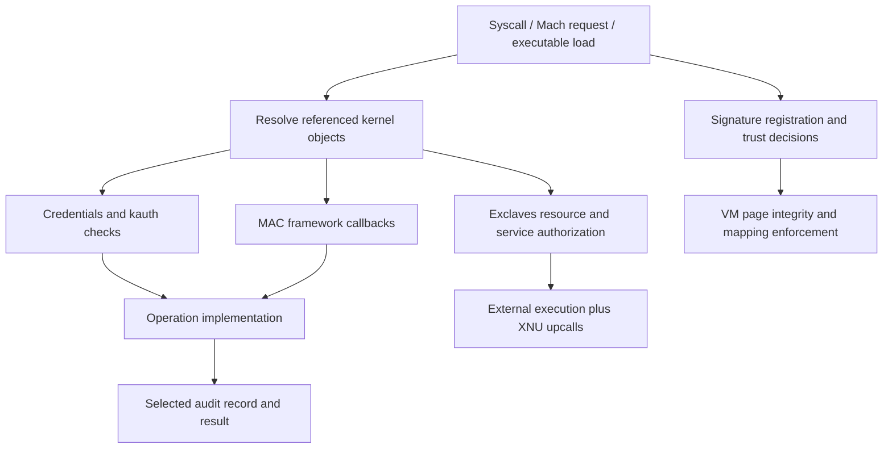

# Security mechanisms and policy boundaries

[Guide index](../../README.md) · [Architecture](../../architecture.md)

XNU security is distributed across object ownership, authorization checks, executable validation, and protected execution interfaces. There is no single function that decides whether an operation is allowed. A syscall may first validate its arguments and descriptor, evaluate Unix credentials, invoke MAC policy callbacks, and finally enter a VM or IPC operation with additional checks. Which checks run depends on that operation and the build configuration.

This chapter describes the `xnu-12377.121.6` source in this folder. It distinguishes mechanisms implemented here from policy modules, libraries, firmware, and services reached through interfaces. The presence of a callout does not reveal the complete policy implemented by its provider.

The diagram identifies relationships, not a mandatory ordering of checks for every API.

For the storage behind signed-file policy, read [code-signature blob storage](../../structures/code-signature-blob-storage.md): RO wrapper allocation, serialized byte ownership, pointer reconstruction, PAC preparation, borrowed/retained access, permitted field writes and cleanup. The [UBC/pager companion](../../structures/ubc-and-vnode-pagers.md) supplies its enclosing vnode/VM lifetime.

## Reading routes

The structure companions follow [credential values and writable lifetime state](../../structures/credentials-and-credential-storage.md), [MAC label slots and ownership](../../structures/mac-label-storage.md), and [thread identity in `thread_ro`](../../structures/thread-and-thread-ro.md). Read them beside the operation chapters below to connect authorization inputs to allocation, protected updates, references, publication and cleanup. [Ports and kobject associations](../../structures/ipc-ports-and-kobjects.md) supplies the corresponding storage and conversion model for Mach capabilities.

[Executable-memory policy](../vm/executable-memory-policy.md) connects MAP_JIT admission and protection changes to monitor association, ARM64 faults and SPTM frame types. It distinguishes current permissions, maximum permissions, entry classification and the physical mapping that a later access obtains.

Two operation companions connect identity and execution state: [exec identity and inherited state](../processes/exec-identity-and-inherited-state.md) follows credentials, IPC reset and token publication, while [ARM64 thread-state conversion](arm64-thread-state-conversion.md) follows kernel-selected import policy, pointer authentication, exception/signal replies and final saved-state writes. [Message integrity](../ipc/message-integrity-and-descriptor-authentication.md) explains the separate kmsg signature and descriptor-pointer mechanisms.

| Page | Questions answered |
| --- | --- |
| [Credentials, authorization, and task rights](credentials-and-policy.md) | Where does caller identity live? How are immutable credentials replaced? How do kauth and MAC combine results? Why does a PID not itself grant task access? |
| [Credential publication and policy lifetimes](credential-and-policy-lifetimes.md) | How do temporary references, long-term holdings, SMR, retrying publication, kauth listeners, and dynamic MAC policies interact? |
| [Personas and membership resolution](personas-and-membership-resolution.md) | How do persona IDs, credentials and membership-query identity differ, how are adoption/drop and caches managed, and where does the external resolver enter? |
| [Task and thread capabilities](task-and-thread-capabilities.md) | How are control/read/inspect/name rights acquired and converted? Which policy and flavor checks apply? How do lazy ports, no-senders cleanup, reset and identity tokens retain or invalidate access? |
| [Code signing and platform policy](code-signing.md) | How does a signature become a vnode's `cs_blob`? What does a VM validation bit mean? Where are AMFI, CoreTrust, trust-cache, and monitor boundaries? |
| [Signature format and structural validation](signature-format-and-blob-validation.md) | How do SuperBlob/CodeDirectory layouts, code and special hash slots, scatter ranges, algorithms and CDHash fit together? What does the local parser actually check? |
| [Vnode signature attachment and lifetime](vnode-signature-lifecycle.md) | How do loader and file-control inputs become protected `cs_blob` state? How do publication, duplicates, generation revalidation, supplemental signatures and teardown work? |
| [Executable signature policy](executable-signature-policy.md) | How do exec permissions, initial command-buffer hashes, process flags, launch constraints, detached signatures, library validation and monitor-region association connect? |
| [File-page validation and cached integrity](page-signature-validation.md) | How are file offsets hashed? When are cached masks reused or reset? How do COW, writes, UPLs, optional bitmaps and VM/monitor checks affect executable mappings? |
| [Trust-cache control](trust-cache-control.md) | How do cache type, entitlement and Image4 inputs select a backend? Who retains payloads, how are query results represented, and what changes after loading or unloading? |
| [Code-signing process controls and CSR](code-signing-process-controls.md) | How do `csops` commands resolve process identity, query metadata or mutate policy? Which errors follow partial output/state changes, and how does ARM64 boot policy become a CSR check? |
| [Audit records and sessions](audit.md) | How are records selected, accumulated, committed, serialized, and delivered? Which thread owns a record at each stage? |
| [Audit pipeline](audit-pipeline.md) | How do selection, commit backpressure, worker batches, rotation, pipe drops, and output errors change record ownership? |
| [Audit-session capabilities](audit-session-capabilities.md) | How do session IDs, credential/process references, exported ports and send epochs interact across self, join, spawn and teardown? |
| [SPTM, TXM, and Exclaves entry/exit map](protected-execution.md) | Which security boundary does each mechanism implement? How do ordinary calls, upcalls, interrupts and protected-domain resumes differ? |
| [SPTM](sptm.md) | How do bootstrap, frame/table typing, mapping operations, result buffers, epochs and protected entry/exit hooks fit together? |
| [TXM](txm.md) | How do the call ABI, protected stacks, signature/trust lifecycle and address-space policy connect to executable mappings? |
| [Exclaves overview](exclaves.md) and [execution](exclaves-execution.md) | How do the trap, per-thread RPC context, hosted scheduler, secure entry, upcalls and interrupt resumption work? |
| [Exclaves resources and memory](exclaves-resources-and-memory.md) | How do task lifecycle, resource ports, service permissions and physical-page ownership interact? |
| [Exclaves service integration](exclaves-services.md) | What can storage, sensor, driver, notification, always-on and diagnostic requests ask XNU to do? |
| [Allocator type isolation](../vm/typed-allocation.md) | How do compiler layouts, fixed zone budgets and variable heaps constrain allocation placement? What does free validation actually check? |
| [Read-only zones](../vm/read-only-and-special-zones.md) and [restricted mapping categories](../vm/allocator-interfaces.md#mapping-restrictions-are-a-separate-layer-of-isolation) | How are controlled mutation and kernel-private mapping policy connected to allocator classification? Which enforcement is external? |

For an initial source walk, follow `setuid()` through `kauth_cred_proc_update()`, then read `MAC_CHECK`, `ubc_cs_blob_add()`, `cs_validate_hash()`, and `audit_syscall_enter()`/`audit_commit()`. These paths demonstrate identity replacement, policy composition, integrity metadata, and asynchronous accounting without requiring every security hook to be read first.

## Main structures and boundaries

| Object/interface | Responsibility |
| --- | --- |
| [`ucred`](../../../xnu/bsd/sys/ucred.h#L146), [`proc_ro`](../../../xnu/bsd/sys/proc_ro.h#L69), [`thread_ro`](../../../xnu/osfmk/kern/thread.h#L187) | Immutable identity value, process publication point, and current-thread credential cache |
| [`mac_policy_conf`](../../../xnu/security/mac_policy.h#L6432), [`mac_policy_ops`](../../../xnu/security/mac_policy.h#L6013), [`label`](../../../xnu/security/_label.h#L86) | Registered policy operations and policy-specific label slots |
| [`cs_blob` and `ubc_info`](../../../xnu/bsd/sys/ubc_internal.h#L106) | Signature coverage, hashes, signer/entitlement information, and attachment to file-backed VM |
| [`kaudit_record`](../../../xnu/bsd/security/audit/audit_private.h#L334) | In-progress audit record, selected destinations, optional user data, and queue linkage |
| [`exclaves_resource`](../../../xnu/osfmk/kern/exclaves_resource.h#L188) | Named, typed external resource with XNU lifetime and type-specific state |
| SPTM bootstrap/per-CPU state and frame types | Inputs and completion state for protected mapping/retyping operations; [detailed structure map](sptm.md) |
| TXM call/stack/shared data | Selector arguments, protected call lifetime, typed results and policy state; [TXM](txm.md) |
| Exclaves thread context, SCID and per-core scheduler buffers | Separate RPC and scheduling protocols with interrupt-safe execution state; [execution](exclaves-execution.md) |

`CONFIG_MACF`, `CONFIG_AUDIT`, `CONFIG_CSR`, `CONFIG_CSR_FROM_DT`, and `CONFIG_EXCLAVES` materially change these paths; declarations are in [`config/MASTER`](../../../xnu/config/MASTER). Code-signing monitor and architecture options introduce additional branches. This chapter is not a statement that every mechanism is active on every product built from XNU.

## Sources inspected and limits

| Area | Depth of this reading | Limits |
| --- | --- | --- |
| Credentials, personas and kauth | Allocation/uniquing and insertion-race cleanup, temporary/long-term references, SMR acquisition/retirement, retrying process publication, thread-cache refresh, `setuid`, kauth registration/dispatch/removal; persona registry/adoption/drop and process accounting; membership/identity caches and resolver work/result/timeout ownership | External directory-service databases and persona policy, every identity-changing syscall and all resolver/invalidation races remain outside the selected traces; ACL algorithms have a separate VFS companion |
| MAC | Deep registry registration/unload and static/dynamic busy protocol, check/grant/perform macros, label ownership/access and build-dependent seal assertion; representative vnode/process/socket/IOKit wrappers | Individual platform policy implementations and every hook not available or not audited |
| Task/thread capabilities | PID lookup and acquisition gates, flavor conversion and MIG ownership, task/map reference handoff, lazy read/inspect ports, generation-checked no-senders, IPC disable/reset and identity-token resolution | External task-access policy and generated stubs, every entitlement/product variant and concurrent teardown interleaving remain outside the selected traces |
| Code signing | Deep selected SuperBlob/CodeDirectory parsing, hash/coverage selection, loader/fcntl input and blob construction, MAC/monitor ordering, protected publication, duplicate/generation/revalidation/free and supplemental attachment; exec flags/constraints/detached acceptance, mmap/LV and monitor association; per-page hashing/masks/bitmap, write/COW/UPL invalidation and invalid-page outcomes | Complete CMS/certificate/provisioning and AMFI policy, protected monitor internals, external daemon/dyld behavior, every format/configuration and race are unavailable or outside the selected trace |
| Trust and signing controls | Typed trust-cache frontend, ordinary/PPL/TXM backend ownership and queries, unload boundaries; `csops` process identity, command authority, output/mutation and VM effects; ARM64 CSR boot state, checks and consumers | Imported TrustCache formats/type-policy tables, AMFI/Image4/monitor verification and boot-policy generation remain external; no runtime or complete configuration/concurrency proof |
| Audit | Syscall entry/exit, record construction/commit/free, worker batching/backpressure, trail write/rotation/failure, pipe selection/drop/read, user-record attachment; session registry and masks, lazy port export/send epochs, join/spawn, process/reference counts, no-senders and END/CLOSE/SMR removal | Every BSM token case, all control/session-device commands, external policy decisions and userspace audit daemon behavior are not traced |
| SPTM | Deep bootstrap, entry/exit/resume, physical/table typing, representative mapping/retyping, epoch/result storage, lockdown and external-interface review | Monitor implementation and external transition ABI bodies unavailable; full hardware state cannot be inferred |
| TXM | Deep stack/call/error/retry paths, shared data, region ownership, signature/profile/trust operations, address-space/executable policy integration | External policy/cryptography and some public-header structure omissions remain boundaries |
| Exclaves | Deep trap/proxy/hosted scheduler and interrupt paths; resource/port/task lifetimes; page donation/shared mapping; representative service and diagnostic handoffs | Secure scheduler/services, FrameMint implementation, generated transport and all provider/race combinations unavailable or not exhaustively audited |

Follow [process lifecycle](../processes/lifecycle.md) for exec and credentials, [executable loading](../../cross-cutting/executable-loading.md) for Mach-O parsing, [VFS authorization](../vfs/pathname-and-authorization.md) for pathname permissions, [VM](../vm/README.md) for page faults, [IPC](../ipc/README.md) for ports and rights, [networking](../networking/policy-extensions.md) for socket policy, [drivers](../drivers/README.md) for user clients, and [platform](../platform/README.md) for protected memory and boot mechanisms.

<!-- BEGIN PLATYDOC DOCUMENTATION LICENSE -->
Original Platydoc text and diagrams are licensed under [CC BY 4.0](https://creativecommons.org/licenses/by/4.0/). Quoted source code and third-party material retain their respective licenses.
<!-- END PLATYDOC DOCUMENTATION LICENSE -->
