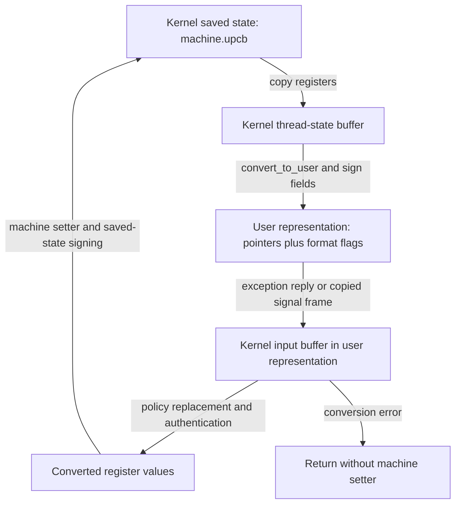
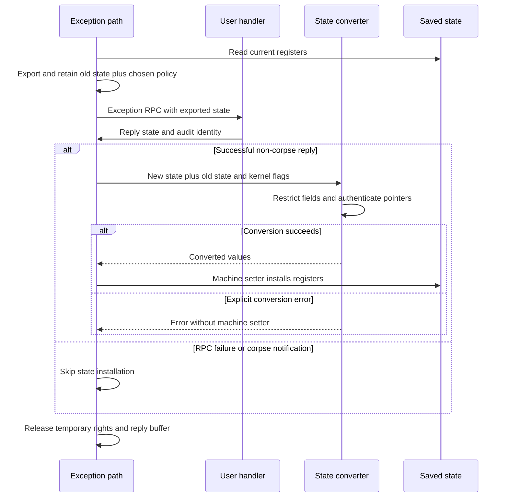
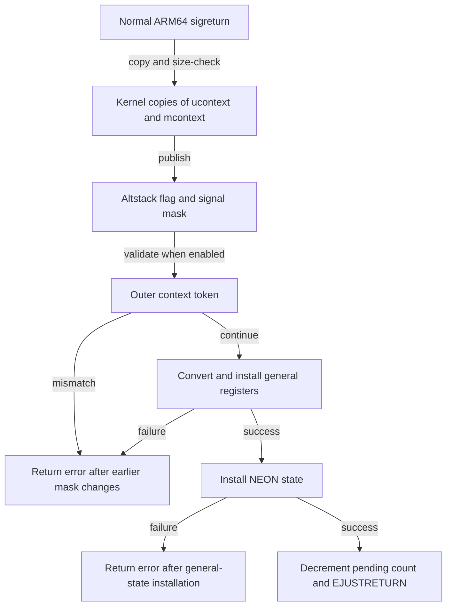

# ARM64 thread-state conversion and restoration

[Security guide](README.md) · [Task and thread capabilities](task-and-thread-capabilities.md) · [Exception delivery](../ipc/exception-delivery.md) · [Signal delivery and return](../processes/signal-delivery-and-return.md) · [ARM64 exception return](../platform/arm64-exception-return.md)

Setting thread state crosses several distinct boundaries: authority to affect a thread, interpretation of a userspace register structure, policy on which changes to accept, and installation into the kernel's saved execution state. This chapter follows those boundaries in `xnu-12377.121.6`, concentrating on 64-bit ARM state with pointer authentication enabled. The exception and signal guides explain delivery; this companion explains what happens to the returned register values.

## Three representations and two kinds of flags

The kernel's [`arm_thread_state64_t` representation](../../../platydoc-data/xnu/osfmk/mach/arm/_structs.h#L129-L145) has `x[29]`, `fp`, `lr`, `sp`, `pc`, `cpsr`, and `flags`. Userspace may see [opaque pointer fields and accessor macros](../../../platydoc-data/xnu/osfmk/mach/arm/_structs.h#L149-L186). This transport structure is distinct from the thread's `machine.upcb` saved state. [`saved_state_to_thread_state64()`](../../../platydoc-data/xnu/osfmk/arm64/status.c#L98-L113) copies register values out; export conversion subsequently signs selected fields for userspace.



The diagram shows representation changes, not a guarantee that a returned pointer will be usable. Some authentication failures become poisoned values in the converted buffer.

Two flag namespaces must remain separate:

| Flags | Source and meaning |
| --- | --- |
| `arm_thread_state64_t.flags` | Transport metadata: `NO_PTRAUTH`, `IB_SIGNED_LR`, `KERNEL_SIGNED_PC`, `KERNEL_SIGNED_LR`, an 8-bit user diversifier, and small embedded sigreturn token fields; [layout and masks](../../../platydoc-data/xnu/osfmk/mach/arm/_structs.h#L112-L127) |
| `thread_set_status_flags_t` / `TSSF_*` | Kernel caller policy: translate, check metadata, replace kernel-signed pointers, select a diversifier, require a token match, or accept only a new PC; [definitions](../../../platydoc-data/xnu/osfmk/kern/thread.h#L217-L253) |

A reply's format flags do not enable `TSSF_ONLY_PC` or choose `TSSF_TASK_USER_DIV`. Those decisions come from kernel call sites. Conversely, format flags affect which authentication scheme the converter applies, so they are more than descriptive annotations.

## Admission and stopping the target

The [MIG declaration](../../../platydoc-data/xnu/osfmk/mach/thread_act.defs#L156-L173) selects `thread_set_state_from_user()` for the kernel server. Its [wrapper](../../../platydoc-data/xnu/osfmk/kern/thread_act.c#L1008-L1018) supplies `TSSF_TRANSLATE_TO_USER | TSSF_CHECK_ENTITLEMENT`. Despite its name, `TSSF_TRANSLATE_TO_USER` also tells the common setter that input needs conversion *from* userspace. Internal [`thread_set_state()`](../../../platydoc-data/xnu/osfmk/kern/thread_act.c#L998-L1005) uses no conversion flags. Capability conversion is covered by [task and thread capabilities](task-and-thread-capabilities.md); possession of a usable thread object is followed by further state-setting policy.

[`thread_set_state_allowed()`](../../../platydoc-data/xnu/osfmk/kern/thread_act.c#L111-L209) is conditional policy, not an unconditional entitlement requirement:

- Without `TSSF_CHECK_ENTITLEMENT` and without `TH_IN_MACH_EXCEPTION`, it returns early. It also bypasses these restrictions when the task's IPC policy does not apply the default hardening policy.
- A cross-task direct setter targeting a thread in a Mach exception can be denied when the selected enhanced-policy level applies, the target is not debugged, and the caller lacks the thread-set-state entitlement. The threshold is enhanced V1 outside OSX/BRIDGE and V2 on those targets.
- For ordinary core-register changes, enhanced V1 can require that entitlement. On `__has_feature(ptrauth_calls)` builds, debug-state changes for a fatal-PAC-exception task have another entitlement check.
- The enhanced V3 exception-reply audit-token mismatch branch calls `ipc_triage_policy_violation()`. It has no local `return false`; it must not be described as the same rejection branch as the explicit guard-and-false cases.

The common setter returns `KERN_NO_ACCESS` when admission returns false. It takes the thread mutex, checks `active`, and converts the input buffer before stopping a remote thread. A conversion error exits through the mutex-unlock path without calling the machine setter. An inactive thread yields `KERN_TERMINATED`. [Common entry and conversion](../../../platydoc-data/xnu/osfmk/kern/thread_act.c#L930-L954), [exit and accounting](../../../platydoc-data/xnu/osfmk/kern/thread_act.c#L975-L986).

For a remote target, the hold spans dropping the mutex and trying to stop the thread. A failed stop returns `KERN_ABORTED`; both remote branches release the hold. This is a scheduler hold/release protocol, not a user-visible suspend/resume operation. Exact source: [`thread_act.c:955-970`](../../../platydoc-data/xnu/osfmk/kern/thread_act.c#L955-L970).

<!-- source-excerpt: ../../../platydoc-data/xnu/osfmk/kern/thread_act.c#L955-L970 -->
```c
		if (thread != current_thread()) {
			thread_hold(thread);

			thread_mtx_unlock(thread);

			if (thread_stop(thread, TRUE)) {
				thread_mtx_lock(thread);
				result = machine_thread_set_state(
					thread, flavor, state, state_count);
				thread_unstop(thread);
			} else {
				thread_mtx_lock(thread);
				result = KERN_ABORTED;
			}

			thread_release(thread);
```

The current-thread branch calls `machine_thread_set_state()` directly while retaining the mutex. The conversion has changed only the input buffer at this point; installation is a later operation. Count/flavor validation is also layered: `machine_thread_state_convert_from_user()` returns success without converting unsupported or unsuitable layouts, but [`handle_set_arm64_thread_state()`](../../../platydoc-data/xnu/osfmk/arm64/status.c#L259-L268) still requires the exact count, and the [machine setter](../../../platydoc-data/xnu/osfmk/arm64/status.c#L1658-L1669) rejects `ARM_THREAD_STATE64` for a non-64-bit-data thread. A converter's no-op success does not establish API acceptance.

## Exported pointers and the selected diversifier

Under `__has_feature(ptrauth_calls)`, export first resolves an ARM64 transport layout. If either caller or target has `ARM_MACHINE_THREAD_DISABLE_USER_JOP`, or lacks a 64-bit address space, it sets `NO_PTRAUTH` and returns. Otherwise it clears/rebuilds flags, detects an already return-address-signed LR, and checks the separate global `arm_user_jop_disabled()` predicate. [Export setup and early exits](../../../platydoc-data/xnu/osfmk/arm64/status.c#L659-L719).

On the ordinary signing path, PC and LR are initially marked kernel-signed. Nonzero PC uses the process-independent code key with discriminator `"pc"`; LR uses `"lr"` unless it is being carried as an IB-signed return address. Nonzero SP and FP use the process-independent data key with fixed `"sp"` and `"fp"` discriminators. Each call supplies the target thread's `machine.jop_pid`. [Field signing](../../../platydoc-data/xnu/osfmk/arm64/status.c#L750-L795).

Here, “kernel-signed PC” means the kernel exported a pointer using this transport scheme. It does not mean an address in kernel virtual memory. A newly user-signed PC can use a field discriminator blended with a user diversifier; the public [PC setter macro](../../../platydoc-data/xnu/osfmk/mach/arm/_structs.h#L273-L289) performs the appropriate resigning and clears `KERNEL_SIGNED_PC`.

| Selected kernel policy | Exported metadata | Import source for the user diversifier |
| --- | --- | --- |
| Ordinary conversion without a diversifier option | No newly selected user diversifier | No user diversifier |
| `TSSF_RANDOM_USER_DIV` | Nonzero random value under `0xff000000` | The retained **old state**, when present with matching count; not the reply's high flag byte |
| `TSSF_THREAD_USER_DIV` | Thread's masked sigreturn diversifier | `thread_get_sigreturn_diversifier(thread)` |
| `TSSF_TASK_USER_DIV` | Still a random visible value | Target task's `hardened_exception_action.signed_pc_key`, masked to the same byte |
| `TSSF_PRESERVE_FLAGS` on export | Retains the existing user diversifier and whether PC/LR are user-signed | Used by the separate representation-conversion API, not a new import policy |

The export branches are in [`status.c:721-748`](../../../platydoc-data/xnu/osfmk/arm64/status.c#L721-L748). The task policy deliberately does not expose its actual authentication diversifier in the exported state. The field named `signed_pc_key` is supplied to [`task_register_hardened_exception_handler()`](../../../platydoc-data/xnu/osfmk/kern/ipc_tt.c#L4842-L4894) and stored in the task; it is not a kernel-generated PAC hardware key. Its role here is discriminator input, separate from `jop_pid` and the selected architectural key.

The import branch makes that distinction explicit. Exact source: [`status.c:1051-1063`](../../../platydoc-data/xnu/osfmk/arm64/status.c#L1051-L1063).

<!-- source-excerpt: ../../../platydoc-data/xnu/osfmk/arm64/status.c#L1051-L1063 -->
```c
	/* Get the userland diversifier */
	if (random_div && old_ts64 && old_count == count) {
		/* Get the random diversifier from the old thread state */
		userland_diversifier = (void *)(long)(old_ts64->flags &
		    __DARWIN_ARM_THREAD_STATE64_USER_DIVERSIFIER_MASK);
	} else if (thread_div) {
		userland_diversifier = (void *)(long)(thread_get_sigreturn_diversifier(thread) &
		    __DARWIN_ARM_THREAD_STATE64_USER_DIVERSIFIER_MASK);
	} else if (task_div) {
		userland_diversifier =
		    (void *)(long)((get_threadtask(thread)->hardened_exception_action.signed_pc_key) &
		    __DARWIN_ARM_THREAD_STATE64_USER_DIVERSIFIER_MASK);
	}
```

[`thread_convert_thread_state()`](../../../platydoc-data/xnu/osfmk/kern/thread_act.c#L1021-L1079) is useful for understanding the representation boundary. Depending on `FROM_SELF` or `TO_SELF`, it authenticates against one thread's context, exports against the other's with `TSSF_PRESERVE_FLAGS`, and copies the result to an output buffer. It checks direction and capacity; it does not install execution state or resume either thread.

## Import: replacement, authentication, and pointer poisoning

The converter first selects a valid ARM64 layout. Before the PAC-specific block, `TSSF_ONLY_PC` saves the new PC and format flags, replaces the rest of the transport structure with the old state, then restores those two new fields. Its callers must supply the old state. The retained format flags still participate in subsequent interpretation; this is not an unvalidated raw PC write. Exact source: [`status.c:951-958`](../../../platydoc-data/xnu/osfmk/arm64/status.c#L951-L958).

<!-- source-excerpt: ../../../platydoc-data/xnu/osfmk/arm64/status.c#L951-L958 -->
```c
	if (only_set_pc) {
		uint64_t new_pc = ts64->pc;
		uint64_t new_flags = ts64->flags;
		/* Only allow pc to be modified in new_state */
		memcpy(ts64, old_ts64, sizeof(arm_thread_state64_t));
		ts64->pc = new_pc;
		ts64->flags = new_flags;
	}
```

The PAC path then handles caller/target compatibility. If the caller has JOP disabled or lacks a 64-bit address space, an equally disabled/non-64-bit target is accepted with `NO_PTRAUTH`; an enabled target yields `KERN_PROTECTION_FAILURE`. If an enabled caller supplies `NO_PTRAUTH` for an enabled target, the converter clears that flag and treats the pointers as signed. It does not grant an unsigned-pointer bypass. [Compatibility branches](../../../platydoc-data/xnu/osfmk/arm64/status.c#L969-L991).

For `IB_SIGNED_LR`, stripping with the return-address key is a format check. If stripping changes nothing, the flag is cleared and ordinary code-pointer authentication follows. Otherwise the LR is carried through this converter without IA authentication. The converter does not authenticate that IB-signed LR against its eventual stack return context. The subsequent global-JOP-disabled early return is distinct from both per-thread compatibility checks. [LR handling and global predicate](../../../platydoc-data/xnu/osfmk/arm64/status.c#L993-L1009).

| Field or metadata | Import decision before the machine setter |
| --- | --- |
| Kernel-signed PC under `CHECK_USER_FLAGS` and `ALLOW_ONLY_USER_PTRS` | With matching old state/count, replace with old PC; changed-state checking also emits telemetry |
| Kernel-signed LR under the same policy | Replace with old LR unless incoming LR has the IB-signed flag; replacement restores the old IB flag |
| PC / non-IB LR | Authenticate nonzero values with code key, field discriminator, and target `jop_pid`; blend the selected user diversifier only when the corresponding kernel-signed flag is clear |
| SP / FP | Authenticate nonzero values with data key and fixed field discriminator; no user-diversifier blend |
| Embedded sigreturn tokens | Check only fields marked kernel-signed; mismatch becomes a protection error only when `ALLOW_ONLY_MATCHING_TOKEN` is also set |
| Other registers / CPSR | No pointer authentication in this converter; later machine setters select accepted register/status bits |

These decisions are implemented in [replacement and token checking](../../../platydoc-data/xnu/osfmk/arm64/status.c#L1011-L1049), [field authentication](../../../platydoc-data/xnu/osfmk/arm64/status.c#L1065-L1102), and [token comparison](../../../platydoc-data/xnu/osfmk/arm64/status.c#L858-L897). Zero pointers skip the per-field signing/authentication calls; that is not a guarantee that execution with a zero PC or SP will succeed.

The return channel matters. `pmap_auth_user_ptr()` returns a pointer, and the converter stores it before eventually returning `KERN_SUCCESS`. The legacy/PPL implementation uses [`ml_auth_ptr_unchecked()`](../../../platydoc-data/xnu/osfmk/arm/pmap/pmap.c#L9622-L9651). The SPTM implementation translates the monitor's explicit failure sentinel into a poisoned pointer. Exact source: [`sptm/pmap/pmap.c:9754-9756`](../../../platydoc-data/xnu/osfmk/arm64/sptm/pmap/pmap.c#L9754-L9756).

<!-- source-excerpt: ../../../platydoc-data/xnu/osfmk/arm64/sptm/pmap/pmap.c#L9754-L9756 -->
```c
	if (res == SPTM_AUTH_FAILURE) {
		res = ml_poison_ptr(value, key);
	}
```

Therefore distinguish an explicit `KERN_PROTECTION_FAILURE` from an import that completes with an unusable pointer value. Saved-state installation and later execution are additional stages. The SPTM signing/authentication implementation itself is external; the local [wrapper](../../../platydoc-data/xnu/osfmk/arm64/sptm/pmap/pmap.c#L9743-L9761) establishes the call, key-state restoration, and poison substitution.

## Exception replies retain an old state and caller-selected policy

[`exception_deliver()`](../../../platydoc-data/xnu/osfmk/kern/exception.c#L213-L214) initializes export flags to translate and import flags to check user metadata. It snapshots the selected action under its mutex, copies the exception-port send right, and adds `TSSF_ONLY_PC` when that action is hardened. The mutex is released before the exception RPC. [Action snapshot](../../../platydoc-data/xnu/osfmk/kern/exception.c#L246-L268).

For `EXCEPTION_STATE`, `pac_replace_ptrs_user || task_needs_user_signed_thread_state(task)` selects random diversification and `ALLOW_ONLY_USER_PTRS`. The task predicate reads [`TFRO_PAC_ENFORCE_USER_STATE`](../../../platydoc-data/xnu/osfmk/kern/task.c#L10192-L10197). The kernel retains the exported old state, allocates a separate reply buffer, makes the RPC, and passes both states plus the reply audit token to `thread_setstatus_from_user()` on a successful non-corpse reply. [Complete state-reply branch](../../../platydoc-data/xnu/osfmk/kern/exception.c#L299-L354).



This diagram describes the `EXCEPTION_STATE` branch; it does not erase behavior-specific gates. `EXCEPTION_STATE_IDENTITY_PROTECTED` chooses the task diversifier for a hardened action under the same strict-pointer predicate, otherwise the random one. It conveys a task identity token and still retains the old state for import. The ordinary `EXCEPTION_STATE_IDENTITY` branch applies returned state only for a non-corpse notification **and** an `IKOT_THREAD_CONTROL` thread port. [Protected branch](../../../platydoc-data/xnu/osfmk/kern/exception.c#L427-L498), [ordinary identity installation gate](../../../platydoc-data/xnu/osfmk/kern/exception.c#L567-L579).

Cleanup clears `TH_IN_MACH_EXCEPTION`, releases any task/thread/exception/token send rights held by the delivery path, and frees the allocated reply state. A successful RPC is thus distinct from successful register installation, and both paths converge on resource cleanup. [Cleanup](../../../platydoc-data/xnu/osfmk/kern/exception.c#L587-L611).

### Worked PC change

Take an illustrative old PC of `0x100004000` and a handler that wants to resume at `0x100004004`. Assume the random-diversifier exception policy is active and the reply has the same valid flavor/count.

1. The old exported PC is kernel-signed, with a nonzero visible diversifier in the old state's flags. The handler obtains the PC through an accessor and uses `arm_thread_state64_set_pc_fptr()` to construct a new user-signed field; that macro clears `KERNEL_SIGNED_PC`.
2. If the handler reasserts `KERNEL_SIGNED_PC`, `ALLOW_ONLY_USER_PTRS` replaces the proposed PC with the retained old PC. This is replacement, not necessarily a failing reply.
3. With the kernel-signed bit clear, authentication blends the **retained old state's** diversifier. Altering the reply's diversifier byte does not select a new kernel authentication context.

This is the mechanism exercised by the [PC-plus-four callback](../../../platydoc-data/xnu/tests/ipc/kernel_signed_pac_thread_state.c#L240-L290). Its first normal callback deliberately reasserts the kernel-signed bit; the test expects a second exception. The setter macro clears that bit on each call, so the later log string saying “Not clearing” must not override the actual macro and branch behavior.

For hardened protected exceptions, the analogous PC change is signed using the task-registered diversifier, not the random byte exposed in the exported state. The [hardened test handler](../../../platydoc-data/xnu/tests/ipc/hardened_exceptions.c#L61-L104) uses `0xa8000000`, registers it through the API, and attempts additional LR/SP/FP changes that the `ONLY_PC` copy step replaces before authentication.

## Sigreturn: three checks with distinct inputs

Signal delivery captures register state, copies it into `mcontext`, and exports with `TSSF_STASH_SIGRETURN_TOKEN`; the `pac_sigreturn_token` or task policy additionally selects the thread diversifier. When no sigreturn is pending, `sendsig()` generates a new random token and nonzero masked diversifier; nested deliveries increment `uu_pending_sigreturn` while retaining that epoch's values. [Export flags](../../../platydoc-data/xnu/bsd/dev/arm/unix_signal.c#L117-L140), [epoch setup](../../../platydoc-data/xnu/bsd/dev/arm/unix_signal.c#L331-L341).

Normal ARM64 `sigreturn()` copies the outer ucontext, checks its machine-context size, and copies the pointed-to mcontext. Its validation has three distinct inputs:

| Check | Compared or authenticated input |
| --- | --- |
| Outer context token | The `uctx` pointer converted with the `"uctx"` data-pointer scheme, XORed with `uu_sigreturn_token`, compared with the syscall token argument |
| Embedded PC/LR tokens | Small flag fields derived from each exported signed pointer XORed with the thread token, signed with `"nonce"`, then shifted/masked; checked only for pointers still marked kernel-signed |
| Pointer authentication | PC/LR/SP/FP values passed through the normal state converter; user-signed PC/LR use the thread diversifier when selected |

See [context copyin](../../../platydoc-data/xnu/bsd/dev/arm/unix_signal.c#L747-L773), [outer-pointer conversion](../../../platydoc-data/xnu/osfmk/arm64/status.c#L1123-L1149), [embedded-token derivation](../../../platydoc-data/xnu/osfmk/arm64/status.c#L633-L644), [token stashing](../../../platydoc-data/xnu/osfmk/arm64/status.c#L797-L810), and [outer-token comparison](../../../platydoc-data/xnu/bsd/dev/arm/unix_signal.c#L878-L898). These are related checks, not interchangeable proofs about the entire signal frame.

`PS_SIGRETURN_VALIDATION_DISABLED` suppresses the outer-token rejection and selection of the embedded-token checks. With validation enabled, the stronger PAC/task predicate adds both required-token matching and the thread diversifier. Exact source: [`unix_signal.c:900-907`](../../../platydoc-data/xnu/bsd/dev/arm/unix_signal.c#L900-L907).

<!-- source-excerpt: ../../../platydoc-data/xnu/bsd/dev/arm/unix_signal.c#L900-L907 -->
```c
		if (sigreturn_validation != PS_SIGRETURN_VALIDATION_DISABLED) {
			tssf_flags |= TSSF_CHECK_SIGRETURN_TOKEN;

			if (pac_sigreturn_token || task_needs_user_signed_thread_state(current_task())) {
				tssf_flags |= TSSF_ALLOW_ONLY_MATCHING_TOKEN | TSSF_THREAD_USER_DIV;
			}
		}
		error = sigreturn_set_state64(th_act, &mctx.mc64, tssf_flags);
```



The diagram omits the special `UC_SET_ALT_STACK` / `UC_RESET_ALT_STACK` operations, which return without using `uctx`. In the normal path, altstack state and the signal mask are already changed before outer-token or register conversion failure. The general-register setter runs before the NEON setter; either failure maps to `EINVAL`, and the earlier general-state update is not rolled back by this helper. Only the successful path decrements the pending count and returns `EJUSTRETURN`. [Shortcuts](../../../platydoc-data/xnu/bsd/dev/arm/unix_signal.c#L830-L843), [mask publication](../../../platydoc-data/xnu/bsd/dev/arm/unix_signal.c#L867-L876), [sequential setters](../../../platydoc-data/xnu/bsd/dev/arm/unix_signal.c#L776-L795), [completion](../../../platydoc-data/xnu/bsd/dev/arm/unix_signal.c#L940-L945).

Unlike exception replies, this path supplies no retained old thread-state buffer. It uses its thread token/diversifier and the copied frame. The wrappers add translation before calling the common setter; `sigreturn_set_state64()` also clears/replaces mode bits before that call. [Wrapper](../../../platydoc-data/xnu/osfmk/kern/thread_act.c#L1223-L1234), [signal setter](../../../platydoc-data/xnu/bsd/dev/arm/unix_signal.c#L782-L790).

## Installing and signing the kernel saved state

After import, `thread_state64_to_saved_state()` accepts only `PSR64_USER_MASK` from supplied CPSR, clears mode bits, and preserves the other existing bits. Here [`PSR64_USER_MASK` is the NZCV mask](../../../platydoc-data/xnu/osfmk/arm64/proc_reg.h#L527). The PAC build mutates the signed CPSR under PAC-safe interrupt exclusion, then orders that write before the remaining register updates. [CPSR installation](../../../platydoc-data/xnu/osfmk/arm64/status.c#L125-L161).

The next writes show where converted transport values become execution state. Exact source: [`status.c:162-168`](../../../platydoc-data/xnu/osfmk/arm64/status.c#L162-L168).

<!-- source-excerpt: ../../../platydoc-data/xnu/osfmk/arm64/status.c#L162-L168 -->
```c
	set_saved_state_fp(saved_state, ts64->fp);
	set_user_saved_state_lr(saved_state, ts64->lr);
	set_saved_state_sp(saved_state, ts64->sp);
	set_user_saved_state_pc(saved_state, ts64->pc);
	for (i = 0; i < 29; i++) {
		set_user_saved_state_reg(saved_state, i, ts64->x[i]);
	}
```

On `HAS_APPLE_PAC` paths, the [PC](../../../platydoc-data/xnu/osfmk/mach/arm/thread_status.h#L684-L700), [LR](../../../platydoc-data/xnu/osfmk/mach/arm/thread_status.h#L744-L759), and [x16/x17 setters](../../../platydoc-data/xnu/osfmk/mach/arm/thread_status.h#L829-L859) use `MANIPULATE_SIGNED_USER_THREAD_STATE`. That helper authenticates the existing saved-state signature, verifies the old state is EL0, performs the mutation, and signs the resulting protected fields. [Mutation and signing helper](../../../platydoc-data/xnu/osfmk/mach/arm/thread_status.h#L519-L568).

This saved-state signature protects PC, CPSR, LR, x16, and x17, with the EL0 carry-bit treatment described in [ARM64 exception return](../platform/arm64-exception-return.md). It is a separate integrity mechanism from userspace pointer authentication and does not cover all registers: [SP](../../../platydoc-data/xnu/osfmk/mach/arm/thread_status.h#L708-L715) and [FP](../../../platydoc-data/xnu/osfmk/mach/arm/thread_status.h#L768-L775) use ordinary saved-state writes here. Signing the resulting kernel record preserves the accepted values' integrity; it does not retroactively prove that a poisoned PC denotes executable user memory.

## Source tests and boundaries

These are source-to-test mappings, not results from executing a kernel or Darwin test suite:

| Source test | Mechanism represented and limitation |
| --- | --- |
| [`kernel_signed_pac_thread_state`](../../../platydoc-data/xnu/tests/ipc/kernel_signed_pac_thread_state.c#L377-L395) | ARM64E-enabled test expects two exceptions as its callback first reasserts the kernel-signed PC flag, then leaves the accessor-created user-signed PC |
| [`user_signed_pac_thread_state`](../../../platydoc-data/xnu/tests/ipc/kernel_signed_pac_thread_state.c#L397-L426) | Callback changes the reply diversifier and resigns; test expects termination, but its metadata explicitly disables it with `false && TARGET_CPU_ARM64E` in this snapshot |
| [`hardened_exceptions` new-flow case](../../../platydoc-data/xnu/tests/ipc/hardened_exceptions.c#L164-L181) | Registers/adopts a protected handler, uses the registered PC diversifier, and exercises restoration after attempted non-PC changes; file metadata selects [ARM64](../../../platydoc-data/xnu/tests/ipc/hardened_exceptions.c#L35-L41) |

The trace covers ARM64 general-register import/export, selected exception behaviors, normal 64-bit sigreturn, and the final saved-state mutation helpers. It does not establish every debug/NEON flavor, all combinations of entitlement and IPC policy, generated MIG wire handling, or all process JOP-key lifecycle rules. Non-PAC builds skip the PAC conversion block, while `ONLY_PC` precedes that guard. The `__has_feature(ptrauth_calls)`, `HAS_APPLE_PAC`, target-OS, runtime JOP, and caller-policy predicates must remain explicit when comparing products.

No target runtime or hardware behavior was measured. Monitor internals and external exception/signal consumers remain outside the local source boundary. The useful invariants are narrower: kernel callers select import policy; retained old state or thread/task state supplies the chosen authentication context; conversion and installation have separate failure channels; and saved-state signing protects the installed record rather than replacing admission or pointer validation.

<!-- BEGIN PLATYDOC DOCUMENTATION LICENSE -->
Original Platydoc text and diagrams are licensed under [CC BY 4.0](https://creativecommons.org/licenses/by/4.0/). Quoted source code and third-party material retain their respective licenses.
<!-- END PLATYDOC DOCUMENTATION LICENSE -->
