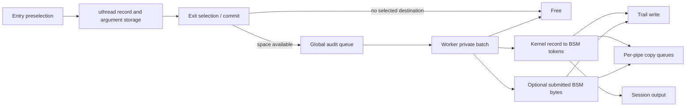

# Audit selection, queue ownership, and output

[Security](README.md) · [Audit overview and sessions](audit.md) · [Credential lifetimes](credential-and-policy-lifetimes.md)

The audit pipeline has three decisions: whether to allocate a record before an operation, whether its actual result selects an output destination, and whether that destination successfully accepts the serialized record. These decisions occur in different execution contexts. An audited syscall completing does not prove its record was durably written to a trail.

All paths here are under `CONFIG_AUDIT`. When auditing is compiled out, the user interfaces have `ENOSYS` stubs. The audit daemon, its trail-management policy, and external consumers are outside this source tree.

## 1. A record first belongs to a uthread

`audit_syscall_enter()` maps a valid syscall number through `sys_au_event[]` and skips `AUE_NULL`. It references the process credential and chooses the subject mask or `audit_nae_mask` for a nonattributable audit user. Entry preselection uses both success and failure classes because the syscall result is not known yet. MAC preselection or an interested audit pipe can also cause allocation. [Entry](../../../xnu/bsd/security/audit/audit.c#L608).

This selection uses the process credential; it is not automatically the current thread's independently assumed credential. `audit_record_ctor()` obtains its own credential reference and copies real/effective identity, PID, audit user/session, mask, and terminal address into the record. The code obtains executable identity before running the syscall, which is necessary for an exec that changes image identity. The record contains values, not a promise to reread the process's current identity later. [Subject snapshot](../../../xnu/bsd/security/audit/audit.c#L228).

`audit_new()` checks enabled/suspended state under `audit_mtx`, with explicit overrides for session start/update/end/close events. It allocates and initializes `kaudit_record`, performs MAC record initialization, and increments `audit_pre_q_len`. That counter tracks records created but not yet committed; it is different from `audit_q_len`. [Allocation](../../../xnu/bsd/security/audit/audit.c#L382).

The uthread owns the active pointer through `uu_ar`. Argument macros used by syscall implementations populate `audit_record` fields and set `ar_valid_arg` bits. A zero field in zeroed storage does not mean that argument was captured. Variable-size path, text, opaque, argv/env, identity, MAC, and submitted-user-record storage is released by the record destructor. [Record layouts](../../../xnu/bsd/security/audit/audit_private.h#L215), [destructor](../../../xnu/bsd/security/audit/audit.c#L261).

## 2. Exit commits an outcome, not necessarily a record

`audit_syscall_exit()` selects `-1` as the user-visible result on error, otherwise reads `uu_rval[0]`, applies MAC postselection, and passes the record into `audit_commit()`. The thread clears `uu_ar` afterward. Ownership has moved to the audit subsystem; the caller cannot free or continue filling the record. Mach trap and spawn subcall hooks use related machinery. [Exit ownership](../../../xnu/bsd/security/audit/audit.c#L714).

`audit_commit()` first refines event identity where necessary. An open recorded under a generic open event becomes the appropriate event using captured flags and the error; fcntl, sysctl, auditon, and open variants also have refinement branches. It selects success or failure against the captured subject mask, except the nonattributable case uses the global mask. Trail and pipe destinations are evaluated separately. [Commit](../../../xnu/bsd/security/audit/audit.c#L450).

The commit flags distinguish a kernel record, submitted user bytes, trail selection, pipe selection, and filter/session output. If no destination wants either part, commit decrements the prequeue count and frees the record. Otherwise it records errno/result/end time and rechecks enabled/suspended state; disabling auditing during an operation can discard its record, apart from the specified overrides.

The committed queue is bounded by a high-water test:

[Backpressure and queue publication](../../../xnu/bsd/security/audit/audit.c#L586):
<!-- source-excerpt: ../../../xnu/bsd/security/audit/audit.c#L586-L597 -->
```c
	/*
	 * Constrain the number of committed audit records based on the
	 * configurable parameter.
	 */
	while (audit_q_len >= audit_qctrl.aq_hiwater) {
		cv_wait(&audit_watermark_cv, &audit_mtx);
	}

	TAILQ_INSERT_TAIL(&audit_q, ar, k_q);
	audit_q_len++;
	audit_pre_q_len--;
	cv_signal(&audit_worker_cv);
```

This wait is in the committing thread. “Asynchronous audit” means serialization and output use a worker; it does not mean audit imposes no syscall latency. The record changes from prequeue accounting to committed-queue accounting only when insertion succeeds.



## 3. The worker drains batches outside the queue mutex

`audit_worker()` waits on `audit_worker_cv` using a continuation. Under `audit_mtx` it moves the global queue into a private worklist and decrements `audit_q_len`. Crossing the low-water threshold broadcasts to blocked committers. It then releases the mutex and processes each record. [Worker](../../../xnu/bsd/security/audit/audit_worker.c#L431).

The batch remains allocated even though it is no longer counted in the global queue. The source notes that this makes the effective pending committed-record bound approximately twice the global limit; prequeue records and per-pipe copies are additional categories. Looking only at `audit_q_len` understates total owned audit memory.

A special static drain marker is handled without normal serialization/freeing. It clears `audit_q_draining` and wakes drain waiters after preceding queued work has passed through the worker. Ordinary records are processed and then freed, including all attached argument storage. The worker owns the record until that final release.

`audit_worker_process_record()` can emit two BSM records: caller-supplied user bytes and a kernel-generated record. It holds the trail/worker lock across both trail writes so a concurrent rotation cannot split the pair between files. User data can be sent before kernel conversion; a later `BSM_NOAUDIT` or `BSM_FAILURE` therefore does not roll back the already handled user part. [Paired output](../../../xnu/bsd/security/audit/audit_worker.c#L322).

`kaudit_to_bsm()` returns an owned serialized buffer on success. The worker writes selected trail output, submits selected pipe output, emits session/filter output where requested, and releases the BSM buffer. The conversion's event switch decides which valid arguments become tokens. This chapter does not claim that every event's token sequence was reconstructed. [Serialization entry](../../../xnu/bsd/security/audit/audit_bsm.c#L610).

## 4. Trail writes can trigger rotation, suspend, or fail-stop

`audit_record_write()` receives the currently selected trail vnode and retained VFS credential under the worker/trail lock. It returns immediately when no vnode exists and obtains a vnode iocount before filesystem access. It refreshes filesystem statistics and file size before appending data using `vn_rdwr()` with `IO_APPEND | IO_UNIT`. The routine returns no errno to the original syscall, whose execution is already over. [Write path](../../../xnu/bsd/security/audit/audit_worker.c#L130).

There are different space conditions:

| Condition | Visible source behavior |
| --- | --- |
| Soft minimum-free threshold | Rate-limited low-space trigger to the daemon; continue processing |
| Configured trail-size limit | Set rotation-wait state and send a rotation trigger |
| Hard minimum-free blocks or write `ENOSPC` | Fail-stop panic if configured; otherwise trigger no-space and suspend auditing |
| Other filesystem/write failure | Current record is lost; optional panic-on-write-fail, otherwise rate-limited report |
| Fail-stop estimate says queued data can exhaust disk | Set failure state, prevent selected unprivileged activity from advancing, drain existing work toward the configured failure outcome |

[Space and failure policy](../../../xnu/bsd/security/audit/audit_worker.c#L169). The fail-stop estimate uses global queue/prequeue counters and maximum record size; it is not an exact count of bytes held in every private batch or pipe. The source's recovery branch explicitly does not resume normal operation automatically.

On an `ENOSPC` failure without fail-stop, suspension is a state change affecting later record allocation/commit. It does not mean the failed record has been retried or persisted. Likewise, normal append does not perform a per-record filesystem synchronization; explicit fsync calls occur in the fatal paths shown. No durable-record acknowledgment is returned to the subject syscall.

## 5. Rotation transfers vnode and credential ownership

`auditctl()` requires privilege, applies reserved-mode entitlement rules, resolves/opens a supplied path, invokes MAC control checks, and requires a regular vnode. A null path returns `EINVAL` in this interface; it is not the direct disabling operation despite older API expectations. On success it clears suspension, retains the caller credential, and transfers the open vnode/credential to `audit_rotate_vnode()` before releasing the temporary iocount. Failure after open closes and drops the vnode. [Control path](../../../xnu/bsd/security/audit/audit_syscalls.c#L1170).

`audit_rotate_vnode()` accepts a referenced credential and opened/referenced vnode, or both null for its internal disable case. Disabling first turns off new audit generation under `audit_mtx`, enqueues the drain marker, and waits for the worker to pass it. The trail lock then protects replacement of `audit_vp` and `audit_ctx.vc_ucred` and resets rotation-trigger state. The old vnode is closed and its credential reference released after the swap. [Rotation/drain](../../../xnu/bsd/security/audit/audit_worker.c#L503).

A non-null replacement does not attach a permanent destination pointer to every queued record: the worker uses the trail current when it processes the record. The trail lock ensures the paired user/kernel writes stay together, while the drain protocol provides the stronger ordering needed before disable closes the trail.

## 6. Audit pipes copy records and can lose them independently

Each audit pipe has its own selection mode, queue limit, byte/record counts, partial-read offset, and drop statistics. Trail mode follows the trail-selection result; local mode selects with the pipe's attributable/nonattributable masks or per-audit-user override. Preselection asks whether any pipe is interested, and worker submission rechecks selection against the pipes that exist at delivery time. [Pipe selection](../../../xnu/bsd/security/audit/audit_pipe.c#L388).

`audit_pipe_append()` copies serialized bytes into a per-pipe allocation. It uses nonblocking allocations and drops the newest record when the queue is full or allocation fails. A slow reader therefore does not indefinitely block the global audit worker. Drop counters report this independent loss; successful trail writing does not imply every pipe accepted a copy.

[Pipe queue-full behavior](../../../xnu/bsd/security/audit/audit_pipe.c#L464):
<!-- source-excerpt: ../../../xnu/bsd/security/audit/audit_pipe.c#L464-L468 -->
```c
	if (ap->ap_qlen >= ap->ap_qlimit) {
		ap->ap_drops++;
		audit_pipe_drops++;
		return;
	}
```

After insertion, the pipe wakes readiness observers, optional asynchronous notification, and sleeping readers. These copies no longer depend on the worker's BSM buffer or `kaudit_record` lifetime. [Append and submit](../../../xnu/bsd/security/audit/audit_pipe.c#L458).

`audit_pipe_read()` holds a sleep lock across read/flush serialization so a record remains stable while its queue mutex is dropped for `uiomove()`. It can return partial records, retaining `ap_qoffset` until the final bytes are consumed. Empty nonblocking reads return `EAGAIN`; interruptible waits can return an error. The offset/bookkeeping updates occur after a successful copy, and only then can the fully consumed entry be freed. [Read](../../../xnu/bsd/security/audit/audit_pipe.c#L975).

## 7. User-supplied BSM follows a separate selection contract

`audit()` checks privilege or the user-audit entitlement, bounds the submitted length, copies bytes, applies the MAC audit hook, and verifies record structure/event eligibility. Non-root entitled callers may submit only the permitted non-kernel event categories. Unless the caller has the reserved identity entitlement, the kernel constructs and inserts an identity token, adjusting header/trailer lengths. [Submission validation](../../../xnu/bsd/security/audit/audit_syscalls.c#L147).

The result buffer is attached to the current kernel record; if none exists, the syscall attempts to create an `AUE_NULL` carrier. After attachment, record teardown owns the buffer, while error paths free unattached allocations. The syscall sets both user-trail and user-pipe selection flags, relying on userspace preselection for this path. [Ownership transfer](../../../xnu/bsd/security/audit/audit_syscalls.c#L312).

Correspondingly, `audit_pipe_submit_user()` delivers to pipes without the ordinary per-event selection metadata; the source explicitly calls out this limitation. It should not be documented as if submitted BSM automatically goes through the same local pipe-mask filtering as kernel-generated records. [User pipe delivery](../../../xnu/bsd/security/audit/audit_pipe.c#L537).

## Inspection scope

Read bodies cover constructor/destructor, entry/postselection/commit, batching and backpressure, paired user/kernel output, trail write/space/error decisions, rotation/drain ownership, auditctl, user BSM validation/attachment, and pipe selection/append/read. [The overview](audit.md) retains session and control-interface navigation. Every BSM token case, auditon command, MAC audit-provider decision, session-port policy, and daemon persistence/rotation behavior remains outside this trace.

